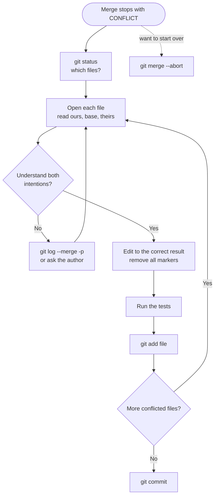

# Resolving Merge Conflicts: The Complete Guide

> 📚 **Before you start**
>
> - [Fast-Forward and Three-Way Merges](fast-forward-and-three-way-merges.md), for the merge base and "ours" and "theirs"
> - [The Three Areas: Working Tree, Staging and Repository](../02-version-control-from-scratch/the-three-areas-working-tree-staging-and-repository.md), for the index

## Introduction

Two people edit the same line of a shared menu board at the same time. Ravi writes "Masala chai: 22" because milk prices went up. Asha, standing at the other end, writes "Masala chai (large): 30" because the stall now sells a bigger cup. Neither is wrong, but the board can only say one thing. Somebody has to look at both and decide.

That's a **merge conflict**. Git combines changes automatically whenever they touch different parts of the project, and that covers the vast majority of merges. But when two branches change **the same lines** differently, or one deletes a file the other edited, Git can't know the right answer, so it stops and asks you.

Conflicts scare beginners because the files suddenly fill with `<<<<<<<` and `>>>>>>>` markers. By the end of this article you'll know exactly what those markers mean, how to read the three versions Git stores during a conflict, how to resolve conflicts by hand or by picking a side, how to back out safely, how to handle tricky cases like modify/delete, how `rerere` remembers resolutions, and how to make conflicts rarer in the first place.

> 💡 **Key Insight**
>
> A conflict isn't an error. It's Git saying **"both sides changed this, you decide"**. Until you resolve it, nothing is committed and nothing is lost: you can always run `git merge --abort` to go back to exactly where you were. To resolve: **edit the file into its correct final form, remove the markers, `git add` it, then `git commit`**.

---

## Core Explanation

### 1. Creating a Conflict

Start with a menu committed on `main`:

```
# Chai menu
Masala chai: 20
Ginger chai: 25
Elaichi chai: 25
```

On a branch `price-rise`, line 2 becomes `Masala chai: 22`. On `main`, the same line becomes `Masala chai (large): 30`. Both are committed:

```bash
git log --oneline --graph --all
```

Example output:

```
* d4ad8e9 Sell masala chai in a large cup for 30
| * 628e96f Raise masala chai to 22
|/  
* 6ff0609 Add the menu
```

Now merge:

```bash
git merge price-rise
```

Example output:

```
Auto-merging menu.txt
CONFLICT (content): Merge conflict in menu.txt
Automatic merge failed; fix conflicts and then commit the result.
```

The merge has **stopped in the middle**. `git status` shows where you are and what to do:

```bash
git status
```

Example output:

```
On branch main
You have unmerged paths.
  (fix conflicts and run "git commit")
  (use "git merge --abort" to abort the merge)

Unmerged paths:
  (use "git add <file>..." to mark resolution)
	both modified:   menu.txt

no changes added to commit (use "git add" and/or "git commit -a")
```

In short form, conflicted files show as `UU` ("unmerged, both modified"). `git diff --name-only --diff-filter=U` lists just the conflicted paths, handy when there are many.

### 2. Reading Conflict Markers

```bash
cat menu.txt
```

Example output:

```
# Chai menu
<<<<<<< HEAD
Masala chai (large): 30
=======
Masala chai: 22
>>>>>>> price-rise
Ginger chai: 25
Elaichi chai: 25
```

| Marker | Meaning |
|---|---|
| `<<<<<<< HEAD` | Start of **our** version: the branch you're on (`main`) |
| `=======` | Divider |
| `>>>>>>> price-rise` | End of **their** version: the branch being merged in |

Everything outside the markers (the heading, ginger and elaichi lines) merged cleanly. Only the clashing region is marked.

**Turn on a better marker style.** The default shows ours and theirs but not what the line was **before** either change, which is often the key to understanding the conflict. The `zdiff3` style adds the base:

```bash
git merge --abort
git config --global merge.conflictStyle zdiff3
git merge price-rise
cat menu.txt
```

Example output:

```
Auto-merging menu.txt
CONFLICT (content): Merge conflict in menu.txt
Automatic merge failed; fix conflicts and then commit the result.
# Chai menu
<<<<<<< HEAD
Masala chai (large): 30
||||||| 6ff0609
Masala chai: 20
=======
Masala chai: 22
>>>>>>> price-rise
Ginger chai: 25
Elaichi chai: 25
```

Now the middle section (after `|||||||`) shows the **base**: originally the line said `Masala chai: 20`. So `main` turned it into a large-cup item, and `price-rise` raised the regular price. Both intentions are valid, and the right answer is probably **both lines**. Without the base, you might have guessed one replaced the other. (`diff3` is the older style that also shows the base; `zdiff3`, available since Git 2.35, trims lines common to both sides out of the conflict region.)

### 3. Resolving by Hand

Edit the file into its correct final content and delete all marker lines:

```
# Chai menu
Masala chai: 22
Masala chai (large): 30
Ginger chai: 25
Elaichi chai: 25
```

Check your resolution against both sides. During a conflict, `git diff` shows a **combined diff** with two columns of `+`/`-`, one per parent:

```bash
git diff
```

Example output:

```
diff --cc menu.txt
index f695441,b95c46e..0000000
--- a/menu.txt
+++ b/menu.txt
@@@ -1,4 -1,4 +1,5 @@@
  # Chai menu
+ Masala chai: 22
 +Masala chai (large): 30
  Ginger chai: 25
  Elaichi chai: 25
```

The first column compares with ours, the second with theirs: `Masala chai: 22` is new relative to ours (`+` in column 1), and the large-cup line is new relative to theirs (`+` in column 2). Then mark the file resolved by staging it, and finish the merge:

```bash
git add menu.txt
git status
```

Example output:

```
On branch main
All conflicts fixed but you are still merging.
  (use "git commit" to conclude merge)

Changes to be committed:
	modified:   menu.txt

```

```bash
git commit --no-edit
git log --oneline --graph
```

Example output:

```
[main b96df32] Merge branch 'price-rise'
*   b96df32 Merge branch 'price-rise'
|\  
| * 628e96f Raise masala chai to 22
* | d4ad8e9 Sell masala chai in a large cup for 30
|/  
* 6ff0609 Add the menu
```

Plain `git commit` opens your editor with the default message `Merge branch 'price-rise'`, plus a commented list of the files that conflicted; it's good practice to add a line explaining how you resolved anything non-obvious. `--no-edit` accepts the default message as it is.

**Before you commit, search for leftover markers.** A stray `=======` in code is a common, embarrassing bug. `git diff --check` warns about leftover conflict markers (and whitespace problems), and most editors highlight them.

### 4. The Three Versions in the Index

During a conflict, the index stores **all three versions** of the file, in numbered **stages**:

```bash
git ls-files --stage
```

Example output:

```
100644 6f8e2496b7fb5d8b4f0cacedcbfdef0cb0368e3c 1	menu.txt
100644 f69544135b00f6f703452e4259ded9e955e42d07 2	menu.txt
100644 b95c46e3e69583528926a8a187ddb28f5b1adcac 3	menu.txt
```

| Stage | Version | View it with |
|---|---|---|
| 1 | Base (common ancestor) | `git show :1:menu.txt` |
| 2 | Ours (`HEAD`) | `git show :2:menu.txt` |
| 3 | Theirs (incoming) | `git show :3:menu.txt` |

```bash
git show :1:menu.txt
```

Example output:

```
# Chai menu
Masala chai: 20
Ginger chai: 25
Elaichi chai: 25
```

`git add` replaces the three stages with a single stage-0 entry: that's what "marking as resolved" means.

### 5. Taking One Side Completely

When you know one side is simply right for a file, you don't need to edit markers. Take the whole file from one side:

```bash
git checkout --theirs menu.txt   # use the incoming branch's version
git checkout --ours menu.txt     # use the current branch's version
git add menu.txt
```

Example output (with `grep` after each, in a conflict over the ginger price):

```
Updated 1 path from the index
Ginger chai: 26
Updated 1 path from the index
Ginger chai: 27
```

(`git restore --ours <file>` / `--theirs` do the same.) To resolve **every** conflicting region in favour of one side while still merging the non-conflicting changes, use a strategy option at merge time: `git merge -X ours price-rise` or `-X theirs`. Don't confuse that with `-s ours`, a different and rarely wanted strategy that ignores the other branch's changes **entirely**.

### 6. Backing Out

At any point before committing, you can abandon the merge:

```bash
git merge --abort
git status -s
```

That restores the branch, index and working tree to their state before `git merge`. (It's another reason to start merges with a clean working tree: abort can't distinguish your pre-existing uncommitted edits from merge results.) If you've already committed the merge and haven't pushed, `git reset --hard ORIG_HEAD` undoes it.

### 7. Other Kinds of Conflict

Not every conflict is two edits to the same lines:

| Conflict | Example | Short status | How to resolve |
|---|---|---|---|
| **Content** | Both changed the same lines | `UU` | Edit, `git add` |
| **Modify/delete** | One side edited a file, the other deleted it | `UD` or `DU` | Keep it: `git add <file>`. Delete it: `git rm <file>` |
| **Add/add** | Both sides created a file with the same name and different content | `AA` | Edit into one version, `git add` |
| **Rename/rename** | Both renamed the same file differently | varies | Choose a name; `git rm` the other |
| **Binary** | Both changed an image or spreadsheet | `UU` | No markers possible: `git checkout --ours/--theirs`, then `git add` |

A modify/delete conflict in action:

```bash
git merge remove-elaichi
git status -s
```

Example output:

```
CONFLICT (modify/delete): menu.txt deleted in remove-elaichi and modified in HEAD.  Version HEAD of menu.txt left in tree.
Automatic merge failed; fix conflicts and then commit the result.
UD menu.txt
```

Decide whether the file should exist after the merge, then `git add menu.txt` (keep) or `git rm menu.txt` (delete), and commit.

### 8. Merge Tools

For large conflicts, a visual three-pane tool helps. `git mergetool` opens each conflicted file in a configured tool:

```bash
git config --global merge.tool vscode
git config --global mergetool.vscode.cmd 'code --wait --merge $REMOTE $LOCAL $BASE $MERGED'
git mergetool
```

VS Code, JetBrains IDEs and GitHub Desktop also detect conflicts on their own and offer "Accept Current", "Accept Incoming", "Accept Both" buttons and a three-way merge editor. They're doing exactly what you did by hand above. GitHub can resolve simple text conflicts in the browser on a pull request ([module 6](../course.md#m6)).

### 9. rerere: Reuse Recorded Resolution

If you resolve the same conflict repeatedly (for example, while rebasing a long-lived branch again and again), turn on **rerere**:

```bash
git config --global rerere.enabled true
git merge cup-size
```

Example output:

```
Auto-merging menu.txt
CONFLICT (content): Merge conflict in menu.txt
Recorded preimage for 'menu.txt'
Automatic merge failed; fix conflicts and then commit the result.
```

Resolve and commit as usual; Git records the resolution (`Recorded resolution for 'menu.txt'.`). The next time the **identical** conflict appears:

```
Auto-merging menu.txt
CONFLICT (content): Merge conflict in menu.txt
Resolved 'menu.txt' using previous resolution.
Automatic merge failed; fix conflicts and then commit the result.
```

The file is already fixed. Git still makes you review and `git add` it, so a recorded resolution is never applied silently.

### 10. A Calm Conflict Routine



`git log --merge -p` shows only the commits on both sides that touched the conflicted files, which is the fastest way to understand *why* each side changed.

### 11. Making Conflicts Rarer

- **Merge or rebase often.** Small, frequent integrations produce small conflicts. A branch that lives for a month produces a month of conflicts at once.
- **Keep branches and pull requests small and focused.**
- **Don't mix reformatting with real changes.** Reformatting a whole file conflicts with everyone. Do it in a separate, announced commit.
- **Agree on formatting tools** (like an autoformatter in a pre-commit hook) so whitespace and style never conflict.
- **Talk to each other.** If two people need to change the same module this week, coordinate.

---

## Try It Yourself

1. **Make and fix a conflict.** In a practice repo, change the same line differently on two branches, merge, and resolve by keeping both changes. Verify with `git log --oneline --graph`.
2. **See the base.** Repeat with `merge.conflictStyle` set to `zdiff3`. What new section appears, and what does it show?
3. **Pick a side.** Create a conflict in a file and resolve it with `git checkout --theirs`. Which branch's version did you get?
4. **Abort.** Start a conflicting merge, edit the file halfway, then run `git merge --abort`. What does `git status` show?

<details>
<summary>Show answers</summary>

1. After editing the file, removing the markers, `git add` and `git commit`, the graph shows a merge commit with two parents.
2. A section starting with `|||||||` followed by the base commit's hash, showing the lines as they were in the merge base.
3. The incoming branch's version (the one you named in `git merge`).
4. A clean working tree on your original branch, exactly as before the merge; the half-done edit is discarded.

</details>

---

## Real-World Examples

### Example 1: Lock Files

Two developers each add a different dependency, and both branches change `package-lock.json` or `uv.lock`. Hand-merging these generated files is error-prone. The usual fix is to take either version (`git checkout --theirs package-lock.json`), then rerun the package manager to regenerate the lock file from the merged dependency list, and commit the result.

### Example 2: The Long-Lived Branch

A team leaves a big refactoring branch open for six weeks. Merging it back produces conflicts in forty files and takes two days. The lesson they adopt: merge `main` into long branches (or rebase them) every day or two, and split big work into smaller pull requests.

### Example 3: Conflicts in Pull Requests

On GitHub, a pull request shows "This branch has conflicts that must be resolved". The author merges or rebases the latest `main` into their branch locally, resolves exactly as in this lesson, pushes, and the pull request updates ([module 6](../course.md#m6)).

---

## Common Misconceptions

### Misconception 1: "A conflict means someone did something wrong"

It means two people changed the same thing. That's normal in active projects. The fix is a decision, not blame.

### Misconception 2: "Ours is always my change and theirs is always the other person's"

"Ours" is the branch you're **on**; "theirs" is the one coming **in**. During a rebase this flips: you're replaying your commits onto the other branch, so "ours" is the other branch and "theirs" is your commit (next lesson).

### Misconception 3: "If Git merged without conflicts, the result is correct"

Git merges text, not meaning. One branch can rename a function while another adds a new call to the old name: no textual conflict, but broken code. Always run the tests after a merge.

### Misconception 4: "I have to finish a conflicted merge once I start it"

`git merge --abort` always takes you back to before the merge.

---

## Interview Relevance

"How do you resolve a merge conflict?" appears in almost every Git interview and practical exercise. A strong answer covers:

- **Why conflicts happen**: both sides changed the same region relative to the merge base, or modify/delete and similar cases.
- **The routine**: `git status`, read the markers (preferably with `zdiff3`), edit, remove markers, test, `git add`, `git commit`; or `git merge --abort`.
- **Index stages** 1, 2, 3, and `--ours` / `--theirs`.
- **Prevention**: small, frequent merges, separate formatting changes, communication.
- **Advanced**: `rerere`, `-X ours/theirs` vs `-s ours`, and that a clean merge still needs tests.

---

## Key Takeaways

- A conflict happens when **both sides changed the same region** (or one deleted what the other changed).
- Markers show **ours** (`HEAD`), optionally the **base** (`zdiff3`), and **theirs**.
- Resolve by **editing to the correct final content**, removing markers, **`git add`**, then **`git commit`**.
- **`git merge --abort`** always gets you back to safety.
- Take a whole side with **`git checkout --ours/--theirs`**; reuse resolutions with **`rerere`**.
- **Merge small and often**, and **run the tests** after every merge.

---

**Up next:** [Rebase and Interactive Rebase](rebase-and-interactive-rebase.md)
