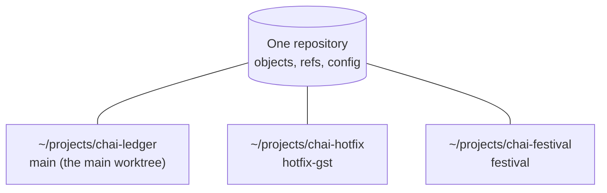
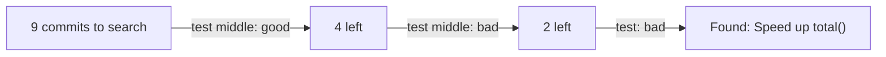

# Stash, Worktrees and bisect: The Complete Guide

> 📚 **Before you start**
>
> - [Branches Are Just Pointers](branches-are-just-pointers.md), for switching with uncommitted changes
> - [Refs, HEAD and Detached HEAD](../03-how-git-works-inside/refs-head-and-detached-head.md), since bisect works in detached HEAD
> - [Undoing Things: restore, reset, revert and cherry-pick](undoing-things-restore-reset-revert-and-cherry-pick.md)

## Introduction

Three everyday interruptions:

1. You're halfway through a change when your lead asks you to look at something on another branch, *right now*. Your work isn't ready to commit.
2. You need to fix a production bug while a long build or test run is going on in your current branch, and switching would disturb it.
3. Something that worked last month is broken now, and there are 300 commits in between. Which one broke it?

Git has a dedicated tool for each: **stash** puts unfinished work on a shelf and gives you a clean working tree; **worktrees** let you have several branches checked out at once in separate folders; **bisect** binary-searches history to find the commit that introduced a bug in a handful of steps.

By the end of this article you'll be able to stash and restore work (including untracked files and partial changes), manage several worktrees, and find the commit that broke something, by hand and fully automatically.

> 💡 **Key Insight**
>
> **Stash** = "save my uncommitted changes as hidden commits and clean up". **Worktree** = "a second working folder attached to the same repository". **Bisect** = "binary search through history: mark one good commit and one bad commit, test the middle, repeat". With bisect, 1,000 commits take only about **10 tests**.

---

## Core Explanation

### Part A: git stash

### 1. Stashing and Restoring

You've edited `menu.txt` and started a `notes.md`:

```bash
git status -s
```

Example output:

```
 M menu.txt
?? notes.md
```

`git stash` (short for `git stash push`) saves your changes to **tracked** files and resets them to `HEAD`:

```bash
git stash
git status -s
git stash list
```

Example output:

```
Saved working directory and index state WIP on main: 44ec5ff Add menu and prices
?? notes.md
stash@{0}: WIP on main: 44ec5ff Add menu and prices
```

Notice `notes.md` is still there: **untracked files are not stashed by default**. The menu change is on the shelf, and your working tree is clean apart from that new file. Now you can switch branches, pull, or do anything else.

Bring the work back with `pop` (apply it, then delete it from the stash list):

```bash
git stash pop
```

Example output:

```
On branch main
Changes not staged for commit:
  (use "git add <file>..." to update what will be committed)
  (use "git restore <file>..." to discard changes in working directory)
	modified:   menu.txt

Untracked files:
  (use "git add <file>..." to include in what will be committed)
	notes.md

no changes added to commit (use "git add" and/or "git commit -a")
Dropped refs/stash@{0} (d0bbed26fb3b5cf8ecbcda4e82f1d58416194127)
```

### 2. Stash Everything, with a Message

Include untracked files with `-u` (`--include-untracked`) and always give a message with `-m`, so `git stash list` is readable next week:

```bash
git stash push -u -m "elaichi menu + notes draft"
git status -s
git stash list
```

Example output:

```
Saved working directory and index state On main: elaichi menu + notes draft
stash@{0}: On main: elaichi menu + notes draft
```

The working tree is now completely clean (`git status -s` printed nothing).

### 3. Looking Inside a Stash

```bash
git stash show
git stash show -p
git stash show --include-untracked
```

Example output:

```
 menu.txt | 1 +
 1 file changed, 1 insertion(+)
diff --git a/menu.txt b/menu.txt
index f3998fe..59b5ea5 100644
--- a/menu.txt
+++ b/menu.txt
@@ -1,2 +1,3 @@
 Masala chai: 20
 Ginger chai: 25
+Elaichi chai: 25
 menu.txt | 1 +
 notes.md | 1 +
 2 files changed, 2 insertions(+)
```

Name a specific stash with `stash@{n}`: `git stash show -p stash@{2}`. Stashes are numbered newest first.

### 4. apply vs pop, drop and clear

| Command | Effect |
|---|---|
| `git stash apply [stash@{n}]` | Re-apply the changes; **keep** the stash in the list |
| `git stash pop [stash@{n}]` | Re-apply, then **drop** it (unless there was a conflict) |
| `git stash drop [stash@{n}]` | Delete one stash |
| `git stash clear` | Delete **all** stashes |
| `git stash apply --index` | Also restore which changes were staged |

`apply` is the safer habit: apply, check that everything looks right, then `git stash drop`. If applying conflicts with your current files, resolve like a merge conflict; `pop` keeps the stash in that case so nothing is lost.

### 5. Partial Stashes and Other Options

| Option | What gets stashed |
|---|---|
| `git stash push <path>...` | Only changes in those files |
| `git stash push -p` | Hunks you choose interactively |
| `git stash push --staged` | Only what's staged (Git 2.35+) |
| `git stash push -k` / `--keep-index` | Everything, but staged changes also stay in place |
| `git stash push -a` / `--all` | Everything, including **ignored** files |

```bash
git stash push -m "only the menu" menu.txt
git status -s
```

Example output:

```
Saved working directory and index state On main: only the menu
?? notes.md
```

### 6. Turning a Stash into a Branch

If a stash no longer applies cleanly because the code moved on, or the "quick experiment" turned into real work, create a branch from the commit where you made the stash and apply it there:

```bash
git stash branch try-elaichi
```

Example output:

```
Switched to a new branch 'try-elaichi'
On branch try-elaichi
Changes not staged for commit:
  (use "git add <file>..." to update what will be committed)
  (use "git restore <file>..." to discard changes in working directory)
	modified:   menu.txt

Untracked files:
  (use "git add <file>..." to include in what will be committed)
	notes.md

no changes added to commit (use "git add" and/or "git commit -a")
Dropped refs/stash@{0} (be2e17ec23e462b1e9f7f7fe1f3d58fef726bbc8)
```

### 7. How Stash Works, and Its Limits

A stash is stored as special commits (one for the working tree, one for the index, and one for untracked files with `-u`), and `refs/stash` points at the newest. The list is that ref's **reflog**, which is why entries look like `stash@{0}`. Consequences:

- Stashes are **local**. They're never pushed.
- A dropped stash can usually be found with `git fsck --unreachable | grep commit` ([module 3](../03-how-git-works-inside/the-reflog-and-garbage-collection.md)).
- Stashes are easy to forget. For anything you'll come back to later than "in a few minutes", a **WIP commit on a branch** is clearer and safer: `git commit -am "WIP: half-done receipt layout"`, then amend or squash it later.

### Part B: git worktree

### 8. Several Branches Checked Out at Once

A **worktree** is an extra working folder linked to the same repository. Each has its own checked-out branch, index and files, but they share one `.git` object database, so there's no second clone to download or keep in sync.



Create a worktree with a new branch for an urgent fix, without touching your current folder:

```bash
git worktree add ../chai-hotfix -b hotfix-gst
git worktree list
```

Example output:

```
Preparing worktree (new branch 'hotfix-gst')
HEAD is now at 44ec5ff Add menu and prices
/home/asha/projects/chai-ledger  44ec5ff [main]
/home/asha/projects/chai-hotfix  44ec5ff [hotfix-gst]
```

`cd ../chai-hotfix` and work normally: edit, commit, push. Commits made there are immediately visible from the main folder, because it's the same repository. Check out an existing branch the same way:

```bash
git worktree add ../chai-festival festival
```

Example output:

```
Preparing worktree (checking out 'festival')
HEAD is now at 9d9f270 Start festival offers
```

One rule: **a branch can be checked out in only one worktree at a time**, so two folders can't fight over it:

```bash
git switch festival
```

Example output:

```
fatal: 'festival' is already used by worktree at '/home/asha/projects/chai-festival'
```

### 9. Managing Worktrees

| Command | Does |
|---|---|
| `git worktree add <path> <branch>` | New folder with an existing branch |
| `git worktree add <path> -b <new-branch> [<start>]` | New folder with a new branch |
| `git worktree add --detach <path> <commit>` | New folder at a commit, detached (great for reviewing or building an old version) |
| `git worktree list` | Show all worktrees |
| `git worktree remove <path>` | Delete a worktree folder (refuses if it has uncommitted changes; `--force` overrides) |
| `git worktree prune` | Clean up records of worktree folders you deleted by hand |
| `git worktree lock` / `unlock` | Stop a worktree on removable media from being pruned |
| `git worktree move <path> <new-path>` | Move a worktree |

If you delete a worktree folder with `rm -rf` instead of `git worktree remove`, Git marks it `prunable` until you run `git worktree prune`:

```bash
rm -rf ../chai-hotfix
git worktree list
git worktree prune
```

Example output:

```
/home/asha/projects/chai-ledger  44ec5ff [main]
/home/asha/projects/chai-hotfix  44ec5ff [hotfix-gst] prunable
```

The `hotfix-gst` **branch** survives either way; only the folder goes.

Worktrees are especially handy for: urgent fixes during long-running work, reviewing a teammate's pull request without disturbing your branch, running a slow test suite on one branch while coding on another, and running several AI coding agents in parallel, each in its own worktree and branch ([the Coding Agents and Harness Engineering course](../../coding-agents-and-harness-engineering/course.md#m3)).

### Part C: git bisect

### 10. Binary Search for the Bad Commit

`total(["masala", "ginger"])` should be 45, but now returns 25. It worked at the first commit. There are nine commits in between:

```bash
git log --oneline
python3 test_prices.py
```

Example output:

```
30ac98a Update notes (7)
fdaef43 Update notes (6)
39f713d Update notes (5)
17d8620 Speed up total()
07eff6a Update notes (4)
8905a3b Update notes (3)
f1af8f9 Update notes (2)
fe301d8 Update notes (1)
4b166b9 Add total() and a test
Traceback (most recent call last):
  File "/home/asha/projects/bisect-demo/test_prices.py", line 2, in <module>
    assert total(["masala", "ginger"]) == 45, total(["masala", "ginger"])
           ^^^^^^^^^^^^^^^^^^^^^^^^^^^^^^^^^
AssertionError: 25
```

Bisect needs one **bad** commit (has the bug) and one **good** commit (doesn't). It then checks out the commit halfway between, you test and report, and it halves the range again:



```bash
git bisect start
git bisect bad
git bisect good HEAD~8
```

Example output:

```
status: waiting for both good and bad commits
status: waiting for good commit(s), bad commit known
Bisecting: 3 revisions left to test after this (roughly 2 steps)
[07eff6a9a9845a3fb6f78b9f2c2d2b96968a7a5e] Update notes (4)
```

(`git bisect bad` with no argument means the current commit; you can also write `git bisect start <bad> <good>` in one go.) Git checked out `07eff6a` in detached HEAD. Test it and report:

```bash
python3 test_prices.py
git bisect good
```

Example output:

```
ok
Bisecting: 1 revision left to test after this (roughly 1 step)
[39f713db0b6280bb57d8f85a54a77633cb4ae97e] Update notes (5)
```

Two more rounds (both fail the test, so both `git bisect bad`), and:

```
17d86206ac1e67f9d5fefa26d53acbf1e92af029 is the first bad commit
commit 17d86206ac1e67f9d5fefa26d53acbf1e92af029
Author: Asha Rao <asha@example.com>
Date:   Mon Oct 5 11:56:00 2026 +0530

    Speed up total()

 prices.py | 2 +-
 1 file changed, 1 insertion(+), 1 deletion(-)
```

"Speed up total()" changed `order` to `order[1:]`, skipping the first item. Always finish with:

```bash
git bisect reset
```

Example output:

```
Previous HEAD position was 17d8620 Speed up total()
Switched to branch 'main'
```

That returns you to the branch you started on. `git bisect log` shows the decisions you made (and `git bisect replay <file>` can repeat them), handy if you mark something wrongly.

### 11. Fully Automatic: git bisect run

If a command can tell good from bad by its **exit code**, Git can do the whole search alone:

```bash
git bisect start HEAD HEAD~8
git bisect run python3 test_prices.py
```

Example output:

```
Bisecting: 3 revisions left to test after this (roughly 2 steps)
[07eff6a9a9845a3fb6f78b9f2c2d2b96968a7a5e] Update notes (4)
running 'python3' 'test_prices.py'
ok
Bisecting: 1 revision left to test after this (roughly 1 step)
[39f713db0b6280bb57d8f85a54a77633cb4ae97e] Update notes (5)
running 'python3' 'test_prices.py'
Traceback (most recent call last):
  File "/home/asha/projects/bisect-demo/test_prices.py", line 2, in <module>
    assert total(["masala", "ginger"]) == 45, total(["masala", "ginger"])
           ^^^^^^^^^^^^^^^^^^^^^^^^^^^^^^^^^
AssertionError: 25
Bisecting: 0 revisions left to test after this (roughly 0 steps)
[17d86206ac1e67f9d5fefa26d53acbf1e92af029] Speed up total()
running 'python3' 'test_prices.py'
Traceback (most recent call last):
  File "/home/asha/projects/bisect-demo/test_prices.py", line 2, in <module>
    assert total(["masala", "ginger"]) == 45, total(["masala", "ginger"])
           ^^^^^^^^^^^^^^^^^^^^^^^^^^^^^^^^^
AssertionError: 25
17d86206ac1e67f9d5fefa26d53acbf1e92af029 is the first bad commit
commit 17d86206ac1e67f9d5fefa26d53acbf1e92af029
Author: Asha Rao <asha@example.com>
Date:   Mon Oct 5 11:56:00 2026 +0530

    Speed up total()

 prices.py | 2 +-
 1 file changed, 1 insertion(+), 1 deletion(-)
bisect found first bad commit
```

The exit code rules for the script:

| Exit code | Meaning |
|---|---|
| 0 | Good |
| 1 to 127, except 125 | Bad |
| 125 | Can't test this commit: skip it (for example, it doesn't build) |
| 128 or more | Abort the bisect |

A good bisect script is usually a small, focused test that reproduces the bug, often written in a temporary file outside the repository so it exists at every commit you test.

### 12. More bisect Tools

| Command | Use |
|---|---|
| `git bisect skip` | The current commit can't be tested (broken build); try a neighbour |
| `git bisect start --term-old=fast --term-new=slow` | Use your own words when you're searching for a change that isn't a "bug", like a performance regression |
| `git bisect start --first-parent` | Only test commits on the main line (skip inside merged branches) |
| `git bisect visualize` / `view` | Show remaining suspects |
| `git bisect log` / `replay` | Save and repeat a session |

Bisect works best with **small, buildable commits** (another reason for atomic commits and clean, rebased history): when it lands on a 2-line change, you've found the bug; when it lands on a 2,000-line "misc changes" commit, you've only narrowed it down.

---

## Try It Yourself

1. **Stash round trip.** Edit a tracked file and create a new file. Stash so that **both** disappear, list the stash, then restore it with `apply` and remove it with `drop`.
2. **Parallel worktree.** Add a worktree for a new branch `hotfix`, commit a change there, and show the commit from your main folder with `git log --oneline hotfix -1`. Remove the worktree afterwards.
3. **Manual bisect.** Build a history of 10 commits where one in the middle introduces a bug that a one-line test can detect. Find it with manual `good`/`bad` steps, counting how many tests it takes.
4. **Automatic bisect.** Repeat exercise 3 with `git bisect run`.

<details>
<summary>Show answers</summary>

1. `git stash push -u -m "both"` (without `-u` the new file stays). `git stash list` shows `stash@{0}: On main: both`; `git stash apply` restores both; `git stash drop` deletes the entry.
2. `git worktree add ../hotfix-dir -b hotfix`, then `cd ../hotfix-dir`, edit and commit; back in the main folder, `git log --oneline hotfix -1` shows that commit. `git worktree remove ../hotfix-dir`.
3. About 3 or 4 tests for 10 commits (log2 of 10 is about 3.3).
4. `git bisect start HEAD <good>` then `git bisect run <test command>`; it prints `<hash> is the first bad commit`. Finish with `git bisect reset`.

</details>

---

## Real-World Examples

### Example 1: The Interrupted Afternoon

A developer is mid-refactor when a teammate asks for help reproducing a bug on `main`. `git stash push -u -m "refactor: half-moved helpers"`, `git switch main`, investigate, `git switch -`, `git stash pop`. Five minutes, no WIP commit needed.

### Example 2: Reviewing Without Disturbing

A reviewer keeps a permanent worktree at `~/review` for checking out pull requests (`git worktree add ~/review --detach`, then `gh pr checkout 123` inside it). Their own feature branch, its running dev server and its editor state are never touched.

### Example 3: Finding a Performance Regression

A data pipeline went from 4 minutes to 40 between two releases with 600 commits. An engineer writes a script that runs a small benchmark and exits 1 if it takes more than 10 seconds, then `git bisect run`s it. Ten iterations later it names a commit that accidentally disabled a cache.

---

## Common Misconceptions

### Misconception 1: "git stash saves everything"

By default it saves tracked files only. Use `-u` for untracked files and `-a` for ignored ones too.

### Misconception 2: "Stashes are backed up on GitHub"

They're local, like the reflog they live in. Push a WIP branch if you need a backup.

### Misconception 3: "A worktree is just another clone"

All worktrees share one object database and one set of refs. Commits and branches created in one are instantly visible in the others, and there's nothing extra to fetch.

### Misconception 4: "bisect needs me to test every commit"

It halves the range each time: about log₂(N) tests. 1,000 commits take around 10.

---

## Interview Relevance

These come up as practical scenario questions: "You have uncommitted work and need to switch branches", "How would you find which commit introduced a bug?" A strong answer covers:

- **Stash**: `push -u -m`, `list`, `show -p`, `apply` vs `pop`, `branch`; stashes are local reflog entries; WIP commits as an alternative.
- **Worktrees**: multiple checkouts sharing one repository; a branch can be in only one worktree; good for hotfixes, reviews and parallel agents.
- **Bisect**: binary search with `good`/`bad`, `run` with exit codes (125 = skip), `reset` at the end; needs small, testable commits.

---

## Key Takeaways

- **`git stash push -u -m "msg"`** shelves all uncommitted work; restore with **`apply`** (then `drop`) or **`pop`**.
- Stashes are **local commits in a reflog**; prefer a WIP commit for anything longer-lived.
- **`git worktree add`** gives you another folder with another branch from the **same repository**; one branch per worktree.
- **`git bisect`** binary-searches history: mark **good** and **bad**, test, repeat; **`git bisect run`** automates it with exit codes.
- Always finish a bisect with **`git bisect reset`**.

---

**Up next:** [Lab: Branching kata with conflicts](lab-branching-kata-with-conflicts.md)
