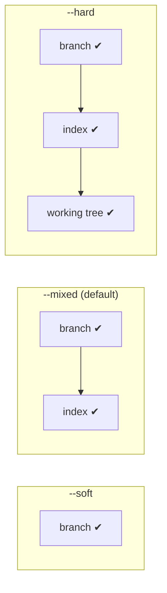
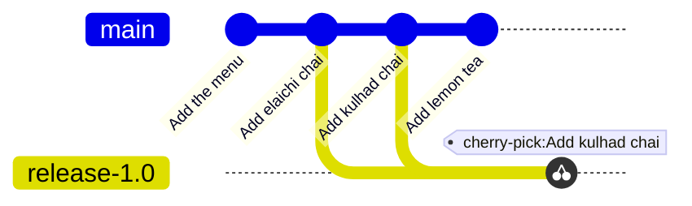
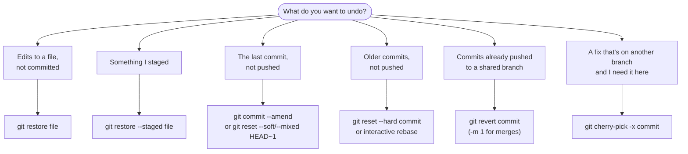

# Undoing Things: restore, reset, revert and cherry-pick: The Complete Guide

> 📚 **Before you start**
>
> - [The Three Areas: Working Tree, Staging and Repository](../02-version-control-from-scratch/the-three-areas-working-tree-staging-and-repository.md)
> - [The Reflog and Garbage Collection](../03-how-git-works-inside/the-reflog-and-garbage-collection.md)
> - [Fast-Forward and Three-Way Merges](fast-forward-and-three-way-merges.md), for merge commits and parents

## Introduction

Every app you love has an undo button. Git has several, and that's exactly what confuses people. "How do I undo in Git?" has a different answer depending on **what** you want to undo (a file edit, a staged change, a commit, a merge) and **whether you've shared it yet**. Pick the wrong one and you can throw away work, or rewrite history your team depends on.

This lesson sorts it out. You'll learn the four tools that cover nearly every situation:

- **`git restore`**: undo changes to **files** (working tree and staging area).
- **`git reset`**: move a **branch** back to an earlier commit, optionally changing the index and files too.
- **`git revert`**: undo a **commit** safely by adding a new commit that does the opposite.
- **`git cherry-pick`**: **copy** a commit from one branch onto another.

By the end you'll know exactly what each does to the three areas and to history, which is safe after pushing, how to revert a merge, and how to pick the right tool in seconds.

> 💡 **Key Insight**
>
> Ask two questions. **What do I want to undo?** Files → `restore`. Commits → `reset` or `revert`. **Have the commits been shared?** Not shared → `reset` (rewrites history, fine locally). Shared → `revert` (adds a new commit, history stays intact). `cherry-pick` is the reverse direction: it *brings in* a commit rather than removing one.

---

## Core Explanation

Our practice history:

```bash
git log --oneline
```

Example output:

```
b2c3b4f Add lemon tea
fbd8c97 Add kulhad chai
a11baeb Add elaichi chai
6f10576 Add the menu
```

### 1. git restore: Undo File Changes

You met `restore` in module 2. A quick recap, plus one more power:

| Command | Effect |
|---|---|
| `git restore <file>` | Discard unstaged edits (working tree ← index) |
| `git restore --staged <file>` | Unstage (index ← `HEAD`), keep your edits |
| `git restore --staged --worktree <file>` | Both: back to `HEAD` completely |
| `git restore --source=<commit> <file>` | Bring back the file **as it was in any commit** |
| `git restore -p <file>` | Choose hunks interactively |

`--source` is how you recover an old version of one file without touching history:

```bash
git restore --source=HEAD~2 menu.txt
cat menu.txt
git status -s
```

Example output:

```
Masala chai: 20
Ginger chai: 25
Elaichi chai: 25
 M menu.txt
```

The file now matches its state two commits ago, as an ordinary uncommitted change. Commit it if you want to keep it, or `git restore --source=HEAD menu.txt` to put it back. Nothing about history changed.

### 2. git reset: Move the Branch

`git reset <commit>` moves the **current branch label** to `<commit>`. Commits after that point are no longer on the branch. The mode decides what happens to the index and working tree:

| Mode | Branch moves to target | Index (staging) | Working tree (files) | Typical use |
|---|---|---|---|---|
| `--soft` | ✔ | Unchanged: the undone commits' changes stay **staged** | Unchanged | Redo the last commit(s), for example to combine them |
| `--mixed` (default) | ✔ | Reset to target: changes become **unstaged** | Unchanged | Un-commit and re-stage differently |
| `--hard` | ✔ | Reset to target | **Reset to target: changes discarded** | Throw away commits and edits completely |



**`--soft`**: undo the last commit but keep everything staged:

```bash
git reset --soft HEAD~1
git status -s
git log --oneline -2
```

Example output:

```
A  teas.txt
fbd8c97 Add kulhad chai
a11baeb Add elaichi chai
```

The lemon tea commit is gone from the branch, but `teas.txt` is still staged, ready to recommit (perhaps with a better message, or together with more changes).

**`--mixed`** (the default when you give no mode): undo the commit and unstage its changes:

```bash
git reset HEAD~1
git status -s
```

Example output:

```
?? teas.txt
```

The file is untracked again (it was new in that commit), but its content is intact on disk. Commit it once more (we used the message "Add lemon tea (again)") so there's something to throw away in the next step.

**`--hard`**: undo the commit and discard the changes:

```bash
git reset --hard HEAD~1
git status -s
ls
```

Example output:

```
HEAD is now at fbd8c97 Add kulhad chai
menu.txt
```

`teas.txt` is gone from the disk too. The commit is still recoverable through the reflog (or `ORIG_HEAD`, which `reset` sets to the previous position):

```bash
git reset --hard ORIG_HEAD
git log --oneline -1
```

Example output:

```
HEAD is now at 16edce7 Add lemon tea (again)
16edce7 Add lemon tea (again)
```

> ⚠️ `--hard` also wipes **uncommitted** changes in tracked files, and those are **not** recoverable. Run `git status` and `git stash` (or commit) first if you have any.

**Reset with a file path** doesn't move the branch at all. `git reset <file>` copies the file from `HEAD` into the index, which means "unstage", the same as `git restore --staged <file>`:

```bash
git reset menu.txt
```

Example output:

```
Unstaged changes after reset:
M	menu.txt
```

**Never `reset` commits that are already pushed to a shared branch.** You'd have to force-push, and everyone else's history would no longer match. Use `revert` instead.

### 3. git revert: Undo by Adding a Commit

`git revert <commit>` creates a **new commit** that applies the **opposite** of `<commit>`'s changes. History isn't rewritten: the original commit stays, and the revert sits on top. That makes it the safe way to undo something already pushed.

```bash
git revert --no-edit HEAD~1
git log --oneline
```

Example output:

```
[main 5af85e4] Revert "Add kulhad chai"
 Date: Mon Oct 5 10:32:00 2026 +0530
 1 file changed, 1 deletion(-)
5af85e4 Revert "Add kulhad chai"
16edce7 Add lemon tea (again)
fbd8c97 Add kulhad chai
a11baeb Add elaichi chai
6f10576 Add the menu
```

```bash
git show --stat HEAD
```

Example output:

```
commit 5af85e4ecbc1819b10ed439c8978c11ffd9b79a4
Author: Asha Rao <asha@example.com>
Date:   Mon Oct 5 10:32:00 2026 +0530

    Revert "Add kulhad chai"
    
    This reverts commit fbd8c97c35c55030c74ebe84a51b90e41f02dff0.

 menu.txt | 1 -
 1 file changed, 1 deletion(-)
```

Notice it reverted an **older** commit (`HEAD~1`) while keeping the newer lemon tea commit. Without `--no-edit`, Git opens your editor so you can explain *why* you're reverting, which you should usually do. Changed your mind? Revert the revert:

```bash
git revert --no-edit HEAD
```

Example output:

```
[main a45261a] Reapply "Add kulhad chai"
 Date: Mon Oct 5 10:48:00 2026 +0530
 1 file changed, 1 insertion(+)
```

Useful options: `git revert A B C` reverts several commits (each gets its own revert commit); `-n` / `--no-commit` applies the reverse changes without committing, so you can combine several reverts into one commit; a revert can conflict like any merge, with `--continue`, `--skip` and `--abort` to handle it.

### 4. Reverting a Merge Commit

A merge commit has two parents, so "the opposite of this commit" is ambiguous: opposite relative to which parent? Git refuses to guess:

```bash
git revert --no-edit HEAD
```

Example output:

```
error: commit f506924b213e3c89607a58318581f5a5ec0d95c3 is a merge but no -m option was given.
fatal: revert failed
```

`-m 1` says "parent 1 (the branch I merged *into*) is the mainline; undo everything the merge brought in from the other side":

```bash
git revert --no-edit -m 1 HEAD
git log --oneline -3
```

Example output:

```
[main 58a9337] Revert "Merge branch 'festival'"
 Date: Mon Oct 5 11:20:00 2026 +0530
 1 file changed, 2 deletions(-)
58a9337 Revert "Merge branch 'festival'"
f506924 Merge branch 'festival'
cf0d676 Add cutting chai
```

Both Diwali lines are gone from the menu, while `main`'s own `cutting chai` commit stays.

> ⚠️ **The re-merge trap.** After reverting a merge, the feature branch's commits are still **in history**, so Git considers them already merged. If you fix the feature and run `git merge festival` again, only the *new* fix commits come in; the original changes stay reverted. To bring the whole feature back, first **revert the revert** (`git revert <revert-commit>`), then merge the fixes.

### 5. git cherry-pick: Copy a Commit

`git cherry-pick <commit>` applies the changes from one commit onto your current branch as a **new commit**. The classic use is copying a bug fix from `main` to a release branch without bringing everything else along.



Create a `release-1.0` branch at "Add elaichi chai" (`a11baeb`), while `main` has moved on, and copy just the kulhad chai commit to it:

```bash
git switch -c release-1.0 a11baeb
git cherry-pick -x fbd8c97
git log -1 --format=%B
```

Example output:

```
Switched to a new branch 'release-1.0'
[release-1.0 476862e] Add kulhad chai
 Date: Mon Oct 5 09:16:00 2026 +0530
 1 file changed, 1 insertion(+)
Add kulhad chai

(cherry picked from commit fbd8c97c35c55030c74ebe84a51b90e41f02dff0)
```

`-x` appends that "cherry picked from" line, which is good practice for public branches: anyone can trace the copy back to the original. The copy has a new hash (`476862e`) because its parent differs.

**When a pick conflicts**, resolve it like any conflict. Suppose the release branch has since changed the kulhad price to 32. Picking the Diwali special commit, which was written right next to the old kulhad line, conflicts:

```bash
git cherry-pick 4bc50df
```

Example output:

```
Auto-merging menu.txt
CONFLICT (content): Merge conflict in menu.txt
error: could not apply 4bc50df... Add Diwali special
hint: After resolving the conflicts, mark them with
hint: "git add/rm <pathspec>", then run
hint: "git cherry-pick --continue".
hint: You can instead skip this commit with "git cherry-pick --skip".
hint: To abort and get back to the state before "git cherry-pick",
hint: run "git cherry-pick --abort".
```

Edit the file, `git add` it, and `git cherry-pick --continue`.

| Option | Use |
|---|---|
| `-x` | Record the original commit's hash in the message |
| `A..B` | Pick a range: every commit after A up to and including B (oldest first) |
| `-n` / `--no-commit` | Apply the changes to the index and files without committing |
| `-e` | Edit the message |
| `-m 1` | Cherry-pick a merge commit relative to its first parent |
| `--continue` / `--skip` / `--abort` | Handle conflicts |

Cherry-pick creates duplicate changes with different hashes. If both branches are later merged, Git usually handles the duplicates fine, but heavy cherry-picking between long-lived branches gets confusing. Prefer merging when you can; cherry-pick for targeted fixes.

### 6. Which Undo Do I Need?



| I want to... | Command | Rewrites history? |
|---|---|---|
| Discard edits to a file | `git restore <file>` | No (edits are lost) |
| Unstage a file | `git restore --staged <file>` | No |
| Get an old version of one file | `git restore --source=<commit> <file>` | No |
| Fix the last commit's message or contents | `git commit --amend` | Yes (last commit) |
| Un-commit, keep changes staged | `git reset --soft HEAD~1` | Yes |
| Un-commit, keep changes unstaged | `git reset HEAD~1` | Yes |
| Throw away commits and changes | `git reset --hard <commit>` | Yes |
| Undo a pushed commit | `git revert <commit>` | No (adds a commit) |
| Undo a pushed merge | `git revert -m 1 <merge>` | No |
| Copy a commit to this branch | `git cherry-pick -x <commit>` | No (adds a commit) |
| Undo any of the above "Yes" rows | `git reflog`, then `git reset --hard <entry>` | Yes |

---

## Try It Yourself

1. **Three resets.** Make three commits. Use `reset --soft HEAD~1`, `reset HEAD~1` and `reset --hard HEAD~1` in turn (recommitting between), checking `git status -s` each time. Then recover the hard reset with `ORIG_HEAD`.
2. **Revert in the middle.** Revert the second of three commits. What do the file and `git log` look like?
3. **Revert a merge.** Create a merge commit and revert it. What error do you get without `-m`, and what does `-m 1` mean?
4. **Backport a fix.** Make a release branch from an old commit, then cherry-pick one later fix to it with `-x`. Show the message.

<details>
<summary>Show answers</summary>

1. `--soft`: changes staged (`M ` or `A `). Mixed: changes unstaged (` M` or `??`). `--hard`: clean working tree, changes gone. `git reset --hard ORIG_HEAD` brings the commit back.
2. The file loses only the second commit's change; the log shows all three originals plus `Revert "<second commit>"` on top.
3. `error: commit <hash> is a merge but no -m option was given.` `-m 1` treats the first parent (the branch merged into) as the mainline, undoing what the merged branch brought in.
4. The message ends with `(cherry picked from commit <full hash>)`.

</details>

---

## Real-World Examples

### Example 1: Friday Night Rollback

A release breaks payments. The fix will take hours, so the on-call engineer runs `git revert -m 1 <merge-of-the-bad-PR>`, pushes, and the pipeline redeploys the previous behaviour in minutes. On Monday, the team reverts the revert on a new branch, fixes the bug and merges again.

### Example 2: Backporting Security Fixes

A project maintains `release/3.x` and `release/4.x` branches. A security fix lands on `main`, and maintainers `git cherry-pick -x` it to both release branches, then tag patch releases. The `-x` trailer lets anyone verify which commit each backport came from.

### Example 3: Cleaning Up Before a Pull Request

A developer realises their last three local commits were a wrong approach. `git reset --hard HEAD~3` (after a quick `git log` to be sure) puts the branch back, and they start again. Since nothing was pushed, no one else is affected, and the reflog keeps the old attempt for 30 days just in case.

---

## Common Misconceptions

### Misconception 1: "git revert goes back to an old version"

It undoes **one commit's changes** by adding a new commit. Later commits remain. To return a file to an older state, use `git restore --source`; to move a branch back, `git reset`.

### Misconception 2: "git reset deletes commits"

It moves the branch pointer. The commits stay recoverable through the reflog. What `--hard` really destroys is uncommitted changes.

### Misconception 3: "I can reset a pushed branch and nobody will notice"

You'll need to force-push, and everyone who pulled the old commits will have diverging history. Use `revert` on shared branches.

### Misconception 4: "Cherry-pick moves a commit"

It copies the changes as a new commit with a new hash. The original stays where it was.

---

## Interview Relevance

"What's the difference between `reset`, `revert` and `restore`?" and "How do you undo a pushed commit?" are among the most common Git interview questions. A strong answer covers:

- **restore** for files; **reset** to move a branch (with **soft/mixed/hard** affecting index and working tree); **revert** to add an inverse commit.
- **Shared vs unshared**: revert for pushed work, reset for local work.
- **Reverting merges** with `-m 1`, and the re-merge trap (revert the revert).
- **Cherry-pick** for backports, with `-x` for traceability.
- **Recovery** via `ORIG_HEAD` and the reflog.

---

## Key Takeaways

- **`git restore`** undoes **file** changes; `--source` brings back any old version of a file.
- **`git reset`** moves the **branch**: `--soft` keeps changes staged, `--mixed` unstaged, `--hard` discards them.
- **`git revert`** undoes a commit by **adding** its inverse: the safe choice for **pushed** history; use **`-m 1`** for merges.
- **`git cherry-pick -x`** copies a commit onto the current branch, ideal for backporting fixes.
- **Not pushed → reset is fine. Pushed → revert.** The **reflog** can undo almost any reset.

---

**Up next:** [Stash, Worktrees and bisect](stash-worktrees-and-bisect.md)
