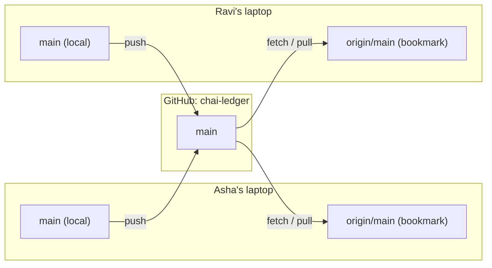
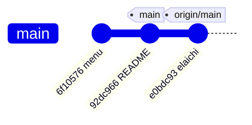
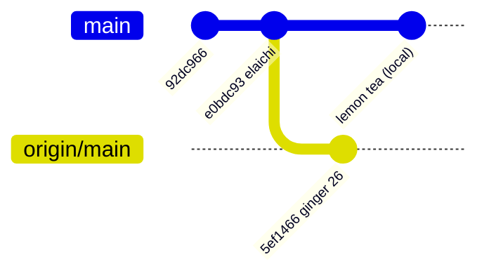

# clone, fetch, pull and push: The Complete Guide

> 📚 **Before you start**
>
> - [Refs, HEAD and Detached HEAD](../03-how-git-works-inside/refs-head-and-detached-head.md), for what a ref is and where branches live
> - [Fast-Forward and Three-Way Merges](../04-branching-and-merging/fast-forward-and-three-way-merges.md)
> - [Merge vs Rebase](../04-branching-and-merging/merge-vs-rebase.md), for what `pull --rebase` does

## Introduction

Everything so far has happened on one laptop. Real projects live in many places at once: your laptop, your teammate's laptop, a build server, and a copy on GitHub that everyone treats as the meeting point. Git was designed for exactly this. Every clone is a **full repository** with the complete history, and four commands move commits between them: `clone`, `fetch`, `pull` and `push`.

Most Git confusion in teams comes from not knowing what these commands actually change. "I pulled but I don't see Ravi's work." "Push was rejected, so I used `--force` and now Ravi's work is gone." "Why does it say I'm ahead by 2?" Every one of these has a simple explanation once you can see the extra set of refs Git keeps for each remote.

By the end of this article you'll be able to clone a repository and explain everything the clone created, read remote-tracking branches and "ahead/behind" counts, fetch safely and inspect before integrating, choose how `pull` integrates (merge, rebase or fast-forward only), push new branches with an upstream, recover from rejected pushes, force-push safely with `--force-with-lease`, share tags, delete remote branches and prune stale ones, and make smaller clones with `--depth`, `--filter` and `--single-branch`.

> 💡 **Key Insight**
>
> A remote is just a **name for another repository's URL**. Git never talks to it unless you run `clone`, `fetch`, `pull` or `push`. Between those moments, your knowledge of the remote is a set of local, read-only bookmarks called **remote-tracking branches** (`origin/main`). **Fetch** updates the bookmarks and changes nothing else. **Pull** is fetch plus integrate. **Push** asks the remote to move *its* branch to your commit, and it refuses unless that's a fast-forward.

---

## Core Explanation

All outputs in this article were captured by running Git 2.43 against a practice server holding Asha's `chai-ledger` repository. Only the URL has been changed to the GitHub-style `https://github.com/asha-rao/chai-ledger.git`; GitHub's own `remote:` progress lines can differ slightly in wording and numbers.

### 1. The Picture: Three Copies, Two Kinds of Branch

Asha and Ravi each have a clone. GitHub holds a third copy. Inside Asha's clone there are two kinds of branch:

- **Local branches** such as `main`: yours. They move when *you* commit, merge or reset.
- **Remote-tracking branches** such as `origin/main`: Git's memory of where `main` was on `origin` the last time you talked to it. They live under `refs/remotes/origin/` and only move when you fetch or push.



Nothing syncs automatically. If Ravi pushes, Asha's `origin/main` doesn't move until Asha fetches. That single fact explains most "I can't see the change" moments.

### 2. git clone: What It Actually Creates

```bash
git clone https://github.com/asha-rao/chai-ledger.git
```

Example output:

```
Cloning into 'chai-ledger'...
remote: Enumerating objects: 10, done.
remote: Counting objects: 100% (10/10), done.
remote: Compressing objects: 100% (6/6), done.
remote: Total 10 (delta 1), reused 0 (delta 0), pack-reused 0
Receiving objects: 100% (10/10), done.
Resolving deltas: 100% (1/1), done.
```

The server packed every object (10 of them: blobs, trees, commits and a tag) into a single **packfile** and sent it; your Git indexed the pack and resolved the one delta (a file stored as a difference from a similar one). Then `clone`:

1. Created the folder `chai-ledger` and ran the equivalent of `git init` inside it.
2. Added a remote named **`origin`** pointing at the URL.
3. Fetched every branch and tag into **remote-tracking branches** (`origin/main`, `origin/festival`) and tags.
4. Created **one local branch**, matching the remote's default branch (`main`), and set it to **track** `origin/main`.
5. Checked that branch out into the working tree.

You can confirm each step:

```bash
git remote -v
git branch
git branch -a
```

Example output:

```
origin	https://github.com/asha-rao/chai-ledger.git (fetch)
origin	https://github.com/asha-rao/chai-ledger.git (push)

* main

* main
  remotes/origin/HEAD -> origin/main
  remotes/origin/festival
  remotes/origin/main
```

`git branch` shows only local branches. `git branch -a` (all) adds remote-tracking ones. `origin/HEAD` records the remote's default branch, which is why `origin` on its own means `origin/main` in commands like `git log origin`.

Notice there's no local `festival` branch, yet you can still use it. `git switch festival` sees that exactly one remote has a `festival` branch and creates a local one tracking `origin/festival`. Git calls this its "guess" mode, and you can turn it off with `--no-guess`.

The clone writes this into `.git/config`:

```bash
cat .git/config
```

Example output:

```
[core]
	repositoryformatversion = 0
	filemode = true
	bare = false
	logallrefupdates = true
[remote "origin"]
	url = https://github.com/asha-rao/chai-ledger.git
	fetch = +refs/heads/*:refs/remotes/origin/*
[branch "main"]
	remote = origin
	merge = refs/heads/main
```

Two settings matter:

- **`fetch = +refs/heads/*:refs/remotes/origin/*`** is a **refspec**: "copy every branch under the remote's `refs/heads/` into my `refs/remotes/origin/`". The `+` allows those bookmarks to move even when the move isn't a fast-forward (for example after someone force-pushes), which is fine because you never commit to them.
- **`[branch "main"]`** is the **upstream** (tracking) setting. It tells `git pull`, `git push` and `git status` that `main` pairs with `main` on `origin`.

Useful clone options:

| Command | Effect |
|---------|--------|
| `git clone <url> my-folder` | Clone into a folder with a different name |
| `git clone -o upstream <url>` | Name the remote `upstream` instead of `origin` |
| `git clone --branch festival <url>` | Check out `festival` instead of the default branch (also accepts a tag) |
| `git clone --depth 1 <url>` | Shallow clone: only the latest commit (section 12) |
| `git clone --filter=blob:none <url>` | Partial clone: all commits and trees, file contents downloaded on demand (section 12) |
| `git clone --recurse-submodules <url>` | Also clone submodules |

### 3. Inspecting a Remote Without Changing Anything

```bash
git branch -vv
```

Example output:

```
* main 92dc966 [origin/main] Add README
```

The square brackets show the upstream. If you were ahead or behind, the counts would appear inside them.

`git remote show origin` contacts the remote and summarises the relationships:

```bash
git remote show origin
```

Example output:

```
* remote origin
  Fetch URL: https://github.com/asha-rao/chai-ledger.git
  Push  URL: https://github.com/asha-rao/chai-ledger.git
  HEAD branch: main
  Remote branches:
    festival tracked
    main     tracked
  Local branch configured for 'git pull':
    main merges with remote main
  Local ref configured for 'git push':
    main pushes to main (up to date)
```

`git ls-remote` asks the remote for its current refs and prints them raw, without downloading any objects. It's the quickest way to answer "what's on the server right now?":

```bash
git ls-remote origin
```

Example output:

```
92dc9667c1b68ff3554917b387ce8aa07249dd6d	HEAD
b0106ff27f8cf50fff18f7b3acf6ad902180510a	refs/heads/festival
92dc9667c1b68ff3554917b387ce8aa07249dd6d	refs/heads/main
8ccabfd943c82978302ce2acfaee8590e1959227	refs/tags/v0.1
92dc9667c1b68ff3554917b387ce8aa07249dd6d	refs/tags/v0.1^{}
```

`v0.1` is an annotated tag, so it has its own object (`8ccabfd`); the `^{}` line shows the commit it points at, which here is the same as `main`.

### 4. git fetch: Download, Then Decide

Ravi adds elaichi chai to the menu and pushes. On Asha's laptop nothing changes, and `git status` happily says she's up to date, because it only compares `main` with her **last-known** `origin/main`:

```bash
git status -sb
```

Example output:

```
## main...origin/main
```

Now she fetches:

```bash
git fetch
```

Example output:

```
From https://github.com/asha-rao/chai-ledger
   92dc966..e0bdc93  main       -> origin/main
```

Read the line as "the remote's `main` moved from `92dc966` to `e0bdc93`, and I updated my bookmark `origin/main` to match". Fetch downloaded Ravi's commit and moved `origin/main`. It did **not** touch her `main`, her staging area or her files. That makes fetch **always safe**, even with uncommitted work.

```bash
git status
```

Example output:

```
On branch main
Your branch is behind 'origin/main' by 1 commit, and can be fast-forwarded.
  (use "git pull" to update your local branch)

nothing to commit, working tree clean
```

The fetched state as a graph:



Before integrating, look at what arrived. The `A..B` range means "commits reachable from B but not from A":

```bash
git log --oneline main..origin/main
git diff main origin/main
```

Example output:

```
e0bdc93 Add elaichi chai

diff --git a/menu.txt b/menu.txt
index f3998fe..59b5ea5 100644
--- a/menu.txt
+++ b/menu.txt
@@ -1,2 +1,3 @@
 Masala chai: 20
 Ginger chai: 25
+Elaichi chai: 25
```

Happy with it, she integrates. With no arguments, `git merge` merges the current branch's upstream:

```bash
git merge
```

Example output:

```
Updating 92dc966..e0bdc93
Fast-forward
 menu.txt | 1 +
 1 file changed, 1 insertion(+)
```

Useful fetch options:

| Command | Effect |
|---------|--------|
| `git fetch` | Fetch from the current branch's remote (usually `origin`) |
| `git fetch upstream` | Fetch from a named remote |
| `git fetch --all` | Fetch from every remote |
| `git fetch --prune` (`-p`) | Also delete bookmarks for branches deleted on the remote (section 11) |
| `git fetch --tags` | Fetch all tags, even ones not on fetched branches |
| `git fetch origin main` | Fetch just one branch |

### 5. Ahead, Behind and Diverged

Comparing a local branch with its upstream gives four possible states:

| `git status -sb` shows | Meaning | What to do |
|------------------------|---------|------------|
| `## main...origin/main` | Same commit (as of your last fetch) | Nothing |
| `[ahead 1]` | You have commits the remote doesn't | Push |
| `[behind 1]` | The remote has commits you don't | Pull (a fast-forward) |
| `[ahead 1, behind 1]` | Both: you've **diverged** | Pull with rebase or merge, then push |

The counts are computed from your local refs only. Run `git fetch` first if you want them to reflect the server right now.

### 6. git pull: Fetch Plus Integrate

`git pull` is two commands in one: `git fetch`, then integrate the upstream into the current branch. When you're only behind, the integration is a fast-forward and nothing can go wrong. When you've **diverged**, Git has to choose between a merge and a rebase.

Asha commits "Add lemon tea" locally while Ravi pushes "Ginger chai to 26":

```bash
git status -sb
git pull
```

Example output:

```
## main...origin/main [ahead 1]

From https://github.com/asha-rao/chai-ledger
   e0bdc93..5ef1466  main       -> origin/main
hint: You have divergent branches and need to specify how to reconcile them.
hint: You can do so by running one of the following commands sometime before
hint: your next pull:
hint: 
hint:   git config pull.rebase false  # merge
hint:   git config pull.rebase true   # rebase
hint:   git config pull.ff only       # fast-forward only
hint: 
hint: You can replace "git config" with "git config --global" to set a default
hint: preference for all repositories. You can also pass --rebase, --no-rebase,
hint: or --ff-only on the command line to override the configured default per
hint: invocation.
fatal: Need to specify how to reconcile divergent branches.
```

Two things happened. The **fetch part succeeded** (`origin/main` moved), and then, because no preference was configured, Git refused to guess. Older Git versions silently created a merge commit here; current versions make you choose. Now she's officially diverged:

```bash
git status -sb
```

Example output:

```
## main...origin/main [ahead 1, behind 1]
```



Her lemon tea commit has never left her laptop, so replaying it on top of Ravi's work is safe. That's a rebase:

```bash
git pull --rebase
git log --oneline --graph -4
```

Example output:

```
Successfully rebased and updated refs/heads/main.

* 10d8921 Add lemon tea
* 5ef1466 Ginger chai to 26
* e0bdc93 Add elaichi chai
* 92dc966 Add README
```

A straight line, and no "Merge branch 'main' of github.com..." commit cluttering history. The three choices, side by side:

| Command / setting | When diverged | Result |
|-------------------|---------------|--------|
| `git pull --rebase` / `pull.rebase true` | Replays your local commits on top of the remote's | Linear history; your commits get new hashes (they were never shared, so that's fine) |
| `git pull --no-rebase` / `pull.rebase false` | Creates a merge commit | Accurate but noisy history |
| `git pull --ff-only` / `pull.ff only` | Refuses | You decide manually each time |

Pick one globally, for example `git config --global pull.rebase true`. Many teams also set `rebase.autoStash true` so a pull with uncommitted changes stashes and restores them automatically. If a pull's rebase hits a conflict, you resolve it exactly as in [Resolving Merge Conflicts](../04-branching-and-merging/resolving-merge-conflicts.md), then `git rebase --continue` (or `git rebase --abort` to get back to where you started).

### 7. git push: Asking the Remote to Move Its Branch

```bash
git push
git status -sb
```

Example output:

```
To https://github.com/asha-rao/chai-ledger.git
   5ef1466..10d8921  main -> main

## main...origin/main
```

`main -> main` means "my `main` updated the remote's `main`". Push also moved her `origin/main` bookmark, so status shows she's level.

Push sends the commits the remote is missing, then asks it to update a ref. The remote accepts only if the update is a **fast-forward**: its current commit must be an ancestor of the one you're sending. This one rule protects everyone's work.

`git push` with no arguments pushes the current branch to its upstream. That relies on the `push.default` setting, which defaults to `simple`: push the current branch to the branch of the same name, and only if an upstream is configured.

### 8. Pushing a New Branch: -u and Upstreams

A new local branch has no upstream yet:

```bash
git switch -c weekly-report
git push
```

Example output:

```
Switched to a new branch 'weekly-report'

fatal: The current branch weekly-report has no upstream branch.
To push the current branch and set the remote as upstream, use

    git push --set-upstream origin weekly-report

To have this happen automatically for branches without a tracking
upstream, see 'push.autoSetupRemote' in 'git help config'.
```

`-u` is short for `--set-upstream`:

```bash
git push -u origin weekly-report
git branch -vv
```

Example output:

```
To https://github.com/asha-rao/chai-ledger.git
 * [new branch]      weekly-report -> weekly-report
branch 'weekly-report' set up to track 'origin/weekly-report'.

  main          10d8921 [origin/main] Add lemon tea
* weekly-report 13ee7e9 [origin/weekly-report] Add weekly report stub
```

From now on, plain `git push` and `git pull` work on this branch. To skip the `-u` step forever, set:

```bash
git config --global push.autoSetupRemote true
```

With that, the first plain `git push` of a new branch creates it on the remote and sets the upstream. Other ways to manage upstreams:

| Command | Effect |
|---------|--------|
| `git branch -u origin/main` | Set the current branch's upstream (long form `--set-upstream-to`) |
| `git branch --unset-upstream` | Remove it |
| `git push origin HEAD` | Push the current branch to a same-named branch, whatever it's called |
| `git push origin local-name:remote-name` | Push to a branch with a different name |

### 9. Rejected Pushes and How to Fix Them

Ravi pushes "Masala chai to 22" to `main`. Asha, who hasn't fetched, commits a README change and pushes:

```bash
git push
```

Example output:

```
To https://github.com/asha-rao/chai-ledger.git
 ! [rejected]        main -> main (fetch first)
error: failed to push some refs to 'https://github.com/asha-rao/chai-ledger.git'
hint: Updates were rejected because the remote contains work that you do not
hint: have locally. This is usually caused by another repository pushing to
hint: the same ref. If you want to integrate the remote changes, use
hint: 'git pull' before pushing again.
hint: See the 'Note about fast-forwards' in 'git push --help' for details.
```

The remote's `main` has a commit Asha's `main` doesn't contain, so moving it to her commit would throw Ravi's away. Git refuses. The fix is always **integrate, then push**:

```bash
git pull --rebase
git push
```

Example output:

```
From https://github.com/asha-rao/chai-ledger
   10d8921..4a335fb  main       -> origin/main
Successfully rebased and updated refs/heads/main.

To https://github.com/asha-rao/chai-ledger.git
   4a335fb..b0a722b  main -> main
```

There are two flavours of rejection message:

- **`(fetch first)`**: the remote has commits you've never fetched.
- **`(non-fast-forward)`**: you *have* fetched them (or you rewrote your own commits), and your branch doesn't contain the remote's tip.

The wrong fix for either is `git push --force`.

### 10. Force-Pushing Safely: --force-with-lease

Sometimes you *mean* to replace the remote branch: you amended or rebased your own pull request branch. A normal push is rejected because the old commit isn't an ancestor of the new one:

```bash
git commit --amend -m "Add a weekly report stub"
git push
```

Example output:

```
To https://github.com/asha-rao/chai-ledger.git
 ! [rejected]        weekly-report -> weekly-report (non-fast-forward)
error: failed to push some refs to 'https://github.com/asha-rao/chai-ledger.git'
hint: Updates were rejected because the tip of your current branch is behind
hint: its remote counterpart. If you want to integrate the remote changes,
hint: use 'git pull' before pushing again.
hint: See the 'Note about fast-forwards' in 'git push --help' for details.
```

Don't follow the hint here: pulling would merge your old version back in. Instead:

```bash
git push --force-with-lease
```

Example output:

```
To https://github.com/asha-rao/chai-ledger.git
 + 13ee7e9...b0fe9f1 weekly-report -> weekly-report (forced update)
```

The `+` and three dots mark a forced, non-fast-forward update. `--force-with-lease` adds a safety check that `--force` lacks: it overwrites the remote branch **only if it still points where your `origin/weekly-report` bookmark says it does**. If someone pushed in the meantime, you'd be destroying work you've never seen, so it refuses.

Watch it save Ravi. He pushes a commit to `weekly-report`. Asha, unaware, amends again and force-pushes:

```bash
git push --force-with-lease
```

Example output:

```
To https://github.com/asha-rao/chai-ledger.git
 ! [rejected]        weekly-report -> weekly-report (stale info)
error: failed to push some refs to 'https://github.com/asha-rao/chai-ledger.git'
```

"Stale info" means "your bookmark is out of date". Plain `--force` would have deleted Ravi's commit silently. Asha fetches, sees Ravi's commit, and incorporates it (for example `git rebase origin/weekly-report`) before force-pushing again.

Know one trap: `git fetch` updates the bookmark, so if you fetch and then force-push **without looking**, the lease passes and Ravi's work is overwritten anyway. A lease protects you only if you integrate what you fetched. Since Git 2.30, adding `--force-if-includes` closes that gap by also checking that the remote tip is in your branch's reflog, meaning you actually had it locally:

```bash
git push --force-with-lease --force-if-includes
```

Rules for force-pushing:

- Only force-push **your own** branches, typically a pull request branch nobody else commits to.
- Never force-push `main` or any shared branch. GitHub's branch protection can forbid it ([Branch Protection, Rulesets and CODEOWNERS](../06-collaborating-on-github/branch-protection-rulesets-and-codeowners.md)).
- Always `--force-with-lease`, never bare `--force` or `-f`.

### 11. Tags, Deleting Remote Branches and Pruning

Tags are **not pushed** by a plain `git push`. Push them explicitly:

```bash
git tag -a v0.2 -m "Elaichi and lemon tea"
git push origin v0.2
```

Example output:

```
To https://github.com/asha-rao/chai-ledger.git
 * [new tag]         v0.2 -> v0.2
```

`git push origin --tags` pushes every tag (including stray lightweight experiments, so be careful). `git push --follow-tags` pushes annotated tags that point at commits you're pushing; `git config --global push.followTags true` makes that the default.

Delete a branch on the remote after its pull request merges:

```bash
git push origin --delete weekly-report
```

Example output:

```
To https://github.com/asha-rao/chai-ledger.git
 - [deleted]         weekly-report
```

The older spelling `git push origin :weekly-report` (push "nothing" to it) does the same. Ravi's clone still has a bookmark for the deleted branch, because fetch doesn't remove bookmarks by default:

```bash
git branch -r
git fetch --prune
git branch -r
```

Example output:

```
  origin/HEAD -> origin/main
  origin/festival
  origin/main
  origin/weekly-report

From https://github.com/asha-rao/chai-ledger
 - [deleted]         (none)     -> origin/weekly-report

  origin/HEAD -> origin/main
  origin/festival
  origin/main
```

Set `git config --global fetch.prune true` so every fetch prunes. Pruning removes **bookmarks** only. Ravi's *local* branch `weekly-report` still exists; delete it with `git branch -d weekly-report` when he's done.

### 12. Smaller Clones for Big Repositories

A large repository with years of history can take minutes to clone. Three options trade completeness for speed:

```bash
git clone --depth 1 https://github.com/asha-rao/chai-ledger.git shallow-ledger
git -C shallow-ledger log --oneline
```

Example output:

```
Cloning into 'shallow-ledger'...

b0a722b Name the stall in the README
```

| Option | What you get | Good for | Catch |
|--------|--------------|----------|-------|
| `--depth 1` (shallow) | Only the newest commit(s) | CI builds, quick looks | No history: `log`, `blame` and `bisect` are limited; `git fetch --unshallow` converts it into a full clone |
| `--filter=blob:none` (partial, "blobless") | All commits and trees; file contents downloaded when checked out | Developers on huge repos | Commands that read old file versions (`blame`, old diffs) fetch blobs on demand, needing network |
| `--branch festival --single-branch` | One branch's history | Working on one branch only | `git branch -a` shows only that branch; other branches need extra fetch config |

`--filter` requires server support, which GitHub provides. CI systems like GitHub Actions' checkout step use a shallow clone by default ([module 7](../course.md#m7)).

---

## Try It Yourself

You don't need GitHub to practise. A **bare repository** (one with no working tree, exactly what a server stores) works as a remote:

```bash
git init --bare ~/practice/server.git
git clone ~/practice/server.git asha
git clone ~/practice/server.git ravi
```

1. **Push and fetch.** In `asha`, commit a file and `git push -u origin main`. In `ravi`, run `git status -sb`, then `git fetch`, then `git status -sb` again. Why did the second status differ?
2. **Diverge.** Commit different files in both clones. Push from `ravi`, then try to push from `asha`. Read the rejection, fix it with `git pull --rebase`, and push.
3. **Lease.** In `asha`, create `notes`, push it with `-u`, then amend the commit. In `ravi`, `git switch notes`, commit and push. Back in `asha`, try `git push --force-with-lease`. What happens and why?
4. **Prune.** Delete `notes` on the remote from `ravi`. In `asha`, compare `git branch -r` before and after `git fetch --prune`.
5. **Read config.** Open `asha/.git/config` and explain each line under `[remote "origin"]` and `[branch "main"]`.

<details>
<summary>Show answers</summary>

1. The first status compares `main` with a bookmark that hasn't moved, so it says "up to date". `git fetch` updates `origin/main`, and the second status reports `behind 1`.
2. `! [rejected] main -> main (fetch first)`. `git pull --rebase` fetches Ravi's commit and replays Asha's on top; the push is then a fast-forward and succeeds.
3. It's rejected with `(stale info)`: Asha's `origin/notes` still points at the old commit, but the server's `notes` moved when Ravi pushed. Fetch, integrate Ravi's commit, then force-push.
4. Before pruning, `origin/notes` still appears; afterwards it's gone. Asha's local `notes` branch remains until she deletes it.
5. `url` is where the remote lives; `fetch = +refs/heads/*:refs/remotes/origin/*` maps every remote branch to a local bookmark; `remote = origin` and `merge = refs/heads/main` make `origin`'s `main` the upstream for `pull`, `push` and `status`.

</details>

---

## Real-World Examples

### Example 1: Morning Routine on a Team

A developer at a payments startup starts each day with `git switch main && git pull` (with `pull.rebase true` set globally), then `git switch -c` for the day's ticket. Because `fetch.prune` is on, branches merged yesterday vanish from `git branch -r` automatically.

### Example 2: Fixing Review Comments

A reviewer asks for changes on a pull request. The author makes the edits, folds them into the original commits with an interactive rebase, and runs `git push --force-with-lease`. The pull request updates in place, and if a teammate had pushed a fix to the same branch, the lease would refuse rather than wipe it.

### Example 3: CI Clones Quickly

A build pipeline for a large monorepo clones with `--depth 1` because it only needs the latest commit to build and test. A release job that generates a changelog from tags clones with full history (`fetch-depth: 0` in GitHub Actions).

---

## Common Misconceptions

### Misconception 1: "git fetch updates my files"

Fetch only downloads objects and moves remote-tracking branches. Your local branches, staging area and working tree are untouched until you merge, rebase or pull.

### Misconception 2: "origin/main is the branch on GitHub"

It's your **local bookmark** of that branch, accurate only as of your last fetch or push. `git ls-remote origin` shows what's on the server right now.

### Misconception 3: "git status tells me if I'm up to date with GitHub"

It compares with your bookmark, so "up to date" can be wrong if you haven't fetched. Fetch first.

### Misconception 4: "A rejected push means I should use --force"

A rejection means the remote has work you don't. Integrate it with `pull --rebase` or `pull`, then push. Force only when you deliberately rewrote your own branch, and then with `--force-with-lease`.

### Misconception 5: "git push sends my tags too"

Plain push sends branch commits only. Push tags by name, with `--follow-tags`, or with `--tags`.

---

## Interview Relevance

Questions about remotes come up in almost every developer interview because they reveal whether a candidate has worked on a team. Be ready for:

- **"What's the difference between fetch and pull?"** Fetch downloads and moves remote-tracking branches; pull is fetch plus a merge or rebase into the current branch.
- **"What is `origin/main`?"** A remote-tracking branch: a local, read-only record of the remote's `main` at your last contact.
- **"Your push was rejected. What do you do?"** Fetch or `pull --rebase`, resolve any conflicts, push again. Explain the fast-forward rule.
- **"`--force` vs `--force-with-lease`?"** The lease refuses if the remote moved since your last fetch, protecting others' commits; mention `--force-if-includes`.
- **"How would you speed up cloning a huge repository?"** Shallow (`--depth`), partial (`--filter=blob:none`) and single-branch clones, with their trade-offs.

---

## Key Takeaways

- A **remote** is a named URL; **remote-tracking branches** like `origin/main` are local bookmarks that move only on fetch or push.
- **Fetch is always safe**: inspect with `git log main..origin/main` and `git diff` before integrating.
- **Pull = fetch + integrate.** Choose rebase, merge or fast-forward-only once with `pull.rebase` or `pull.ff`; `pull --rebase` keeps history linear.
- **Push only fast-forwards** the remote; rejections mean "integrate first". Set upstreams with `-u` or `push.autoSetupRemote`.
- Rewrote your own branch? **`--force-with-lease`**, never `--force`, and never on shared branches.
- Tags need an explicit push; delete remote branches with `push --delete` and clean bookmarks with **`fetch --prune`**.

---

**Up next:** [SSH Keys, Tokens and the GitHub CLI](ssh-keys-tokens-and-the-github-cli.md)
