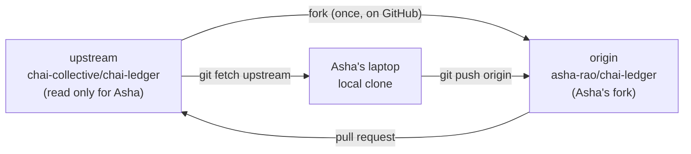
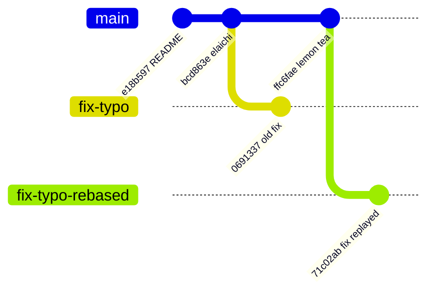

# Forks, Upstreams and Remotes: The Complete Guide

> 📚 **Before you start**
>
> - [clone, fetch, pull and push](clone-fetch-pull-and-push.md), for remote-tracking branches and upstreams
> - [SSH Keys, Tokens and the GitHub CLI](ssh-keys-tokens-and-the-github-cli.md), so you can push to GitHub
> - [Rebase and Interactive Rebase](../04-branching-and-merging/rebase-and-interactive-rebase.md)

## Introduction

So far every clone had one remote, `origin`, and you were allowed to push to it. Most of the world's code doesn't work that way. You can read every public repository on GitHub, but you can push to almost none of them. So how does a stranger fix a typo in a popular library?

The answer is the **fork**: your own copy of someone else's repository on GitHub, which you *can* push to. You push your fix there and open a pull request asking the original project to pull it in. To make this work, your local clone talks to **two remotes**: your fork and the original. Managing several remotes, and keeping your fork in step with the original, is the core skill of open source contribution, and it's also how many companies handle contributions from outside a core team.

By the end of this article you'll be able to explain what a fork is (and how it differs from a clone and a branch), create one on the web or with `gh`, add, inspect, rename and remove remotes, set up the standard `origin`/`upstream` arrangement, keep your fork's `main` in sync three different ways, update a contribution branch when the original moves, and avoid the classic mistakes that make fork-based pull requests messy.

> 💡 **Key Insight**
>
> A fork is a **server-side clone** that GitHub remembers is related to the original. Your laptop clone then has two remotes: **`origin`** (your fork, which you push to) and **`upstream`** (the original, which you only fetch from). Code flows in a triangle: **fetch from upstream → work locally → push to origin → pull request into upstream**. Keep your fork's `main` as a clean mirror of upstream's and do all your work on branches.

---

## Core Explanation

The outputs in this article come from running Git 2.43 against two practice servers standing in for GitHub repositories; only the URLs were changed to the GitHub-style ones shown. The original project is `chai-collective/chai-ledger`, and Asha's fork is `asha-rao/chai-ledger`.

### 1. Clone, Branch and Fork: Three Different Copies

| | Where it lives | Who creates it | What it's for |
|---|---------------|----------------|---------------|
| **Branch** | Inside one repository | Anyone with write access | A line of work within a project |
| **Clone** | On your computer | Anyone who can read the repository | Working locally; it's a full repository with all history |
| **Fork** | On GitHub, under your account or organisation | Anyone who can read the repository | A copy you can push to when you can't push to the original |

Forks are a **GitHub** feature, not a Git one. Git only knows about remotes and URLs. What GitHub adds is the relationship: the fork shows "forked from chai-collective/chai-ledger", GitHub can compare the two, and pull requests can go **from a branch in the fork to a branch in the original**.

When do you need a fork?

- **You don't have write access**: open source contributions, or a repository owned by another team. Fork.
- **You do have write access**: just push a branch to the shared repository and open a pull request from it. No fork needed.
- **You want to start a new project based on someone else's**, permanently going your own way: fork, or use a **template repository** if the owner offers one (a template gives you a fresh history with no link back).

### 2. The Triangle: origin and upstream



The names `origin` and `upstream` are only conventions, but nearly every guide and tool uses them, so stick with them: `origin` is yours, `upstream` is theirs.

### 3. Creating a Fork

**On the web:** open the repository, click **Fork**, choose the owner (your account or an organisation), keep the name, and leave **Copy the `main` branch only** ticked unless you need other branches. GitHub creates `asha-rao/chai-ledger` in seconds.

**With the GitHub CLI**, one command forks and clones, and sets up both remotes:

```bash
gh repo fork chai-collective/chai-ledger --clone
```

By default the fork becomes your `origin` remote and the original becomes `upstream`. Flags worth knowing, from `gh repo fork --help`: `--clone` clones the fork; `--remote` adds a remote for the fork when you run it inside an existing clone of the original (renaming the existing `origin` to `upstream`); `--remote-name` changes the fork remote's name; `--org` forks into an organisation, `--fork-name` renames the fork, and `--default-branch-only` copies only the default branch. When you later clone an existing fork with `gh repo clone asha-rao/chai-ledger`, `gh` notices it's a fork and adds the `upstream` remote automatically (`--no-upstream` turns that off).

### 4. Setting Up Remotes by Hand

Doing it with plain Git shows what `gh` does for you. Clone **your fork**, not the original:

```bash
git clone https://github.com/asha-rao/chai-ledger.git
cd chai-ledger
git remote -v
```

Example output:

```
origin	https://github.com/asha-rao/chai-ledger.git (fetch)
origin	https://github.com/asha-rao/chai-ledger.git (push)
```

Add the original as `upstream`:

```bash
git remote add upstream https://github.com/chai-collective/chai-ledger.git
git remote -v
git fetch upstream
```

Example output:

```
origin	https://github.com/asha-rao/chai-ledger.git (fetch)
origin	https://github.com/asha-rao/chai-ledger.git (push)
upstream	https://github.com/chai-collective/chai-ledger.git (fetch)
upstream	https://github.com/chai-collective/chai-ledger.git (push)

From https://github.com/chai-collective/chai-ledger
 * [new branch]      main       -> upstream/main
```

`git remote add` only writes a `[remote "upstream"]` section into `.git/config`, with a URL and a fetch refspec mapping the remote's branches to `refs/remotes/upstream/*`. It doesn't contact the server; `git fetch upstream` does, creating the `upstream/main` bookmark.

The full set of `git remote` subcommands:

| Command | Effect |
|---------|--------|
| `git remote` / `git remote -v` | List remote names / with URLs |
| `git remote add <name> <url>` | Add a remote (`-f` also fetches it right away) |
| `git remote get-url <name>` | Print a remote's URL |
| `git remote set-url <name> <url>` | Change a remote's URL (for example HTTPS to SSH) |
| `git remote set-url --push <name> <url>` | Use a different URL just for pushing |
| `git remote rename <old> <new>` | Rename a remote, its bookmarks and every upstream setting that used it |
| `git remote remove <name>` (or `rm`) | Delete a remote and its bookmarks |
| `git remote show <name>` | Contact the remote and summarise branches and tracking |
| `git remote prune <name>` | Delete stale bookmarks (like `fetch --prune`, without fetching) |

Renaming is thorough: it renames the bookmarks and rewrites every branch's upstream setting. Here it is from later in Asha's session, when she also had a `fix-typo` branch (section 7):

```bash
git branch -vv
git remote rename origin fork
git branch -vv
```

Example output:

```
* fix-typo 0691337 [origin/fix-typo] Describe the project in the README
  main     bcd863e [origin/main] Add elaichi chai

* fix-typo 0691337 [fork/fix-typo] Describe the project in the README
  main     bcd863e [fork/main] Add elaichi chai
```

Removing a remote you added by mistake:

```bash
git remote add typo-remote https://github.com/someone/elsewhere.git
git remote remove typo-remote
git remote
```

Example output:

```
origin
upstream
```

### 5. Keeping Your Fork's main in Sync

Your fork doesn't update itself. The day after Asha forked, the maintainers added elaichi chai. Fetching shows it:

```bash
git fetch upstream
git status -sb
```

Example output:

```
From https://github.com/chai-collective/chai-ledger
   e18b597..bcd863e  main       -> upstream/main

## main...origin/main
```

Notice that `status` says nothing is wrong. Asha's `main` tracks **`origin/main`** (her fork), and her fork is just as out of date as she is. Status compares with the upstream *branch*, which is a different idea from the upstream *remote*. Keep that in mind; section 6 fixes it.

**Way 1: on the command line.** Fast-forward `main` to `upstream/main`, then push it to the fork:

```bash
git switch main
git merge --ff-only upstream/main
git push origin main
```

Example output:

```
Already on 'main'
Your branch is up to date with 'origin/main'.

Updating e18b597..bcd863e
Fast-forward
 menu.txt | 1 +
 1 file changed, 1 insertion(+)

To https://github.com/asha-rao/chai-ledger.git
   e18b597..bcd863e  main -> main
```

`--ff-only` is the safety catch. If it ever fails, it means you committed directly on your fork's `main`, which you shouldn't do (Common Misconceptions explains the fix).

**Way 2: on GitHub.** The fork's page shows "This branch is N commits behind chai-collective/chai-ledger:main" and a **Sync fork** button that updates the fork's branch on the server. Then `git pull` locally.

**Way 3: with `gh`.** `gh repo sync asha-rao/chai-ledger` updates the fork's default branch on GitHub from its parent, using a fast-forward. Run inside a clone with no argument, `gh repo sync` updates your *local* branch from the parent repository instead. `--branch` picks another branch. Its `--force` flag hard-resets the destination branch to match the source, discarding commits that exist only in the fork, so use it only when you mean that.

### 6. Make main Track upstream/main

Since your fork's `main` should always mirror upstream, it's convenient to make local `main` **track `upstream/main`** directly, while still pushing to your fork:

```bash
git branch --set-upstream-to=upstream/main main
git config remote.pushDefault origin
git branch -vv
```

Example output:

```
branch 'main' set up to track 'upstream/main'.

* fix-typo 0691337 [origin/fix-typo] Describe the project in the README
  main     bcd863e [upstream/main] Add elaichi chai
```

Now:

- `git pull` on `main` fetches from **upstream** and fast-forwards.
- `git status` on `main` reports how far behind **upstream** you are, which is what you actually care about.
- `remote.pushDefault origin` makes plain `git push` send to your **fork**, never to upstream. (With the default `push.default=simple`, pushing to a different remote than the one you pull from pushes the current branch to a same-named branch.)

Later, once the maintainers have added lemon tea (that commit arrives in section 8), the next sync is three short commands:

```bash
git switch main
git pull
git push
```

Example output:

```
Switched to branch 'main'
Your branch is behind 'upstream/main' by 1 commit, and can be fast-forwarded.
  (use "git pull" to update your local branch)

Updating bcd863e..ffc6fae
Fast-forward
 menu.txt | 1 +
 1 file changed, 1 insertion(+)

To https://github.com/asha-rao/chai-ledger.git
   bcd863e..ffc6fae  main -> main
```

This "pull from one remote, push to another" arrangement is called a **triangular workflow**.

### 7. Contributing: A Branch in the Fork

Work happens on a branch, created from an up-to-date `main`, and pushed to your fork:

```bash
git switch -c fix-typo
# edit README.md, then commit
git push -u origin fix-typo
```

Example output:

```
Switched to a new branch 'fix-typo'

To https://github.com/asha-rao/chai-ledger.git
 * [new branch]      fix-typo -> fix-typo
branch 'fix-typo' set up to track 'origin/fix-typo'.
```

GitHub then offers **Compare & pull request** on either repository's page. The pull request's **base** is `chai-collective/chai-ledger:main`, and its **head** is `asha-rao:fix-typo`. The details of writing and updating pull requests are in [Pull Requests End to End](../06-collaborating-on-github/pull-requests-end-to-end.md).

By default, cross-fork pull requests have **Allow edits by maintainers** ticked. Maintainers of the original can then push small fixes directly to your `fix-typo` branch. That's helpful, and it's another reason to fetch before force-pushing.

### 8. When upstream Moves While Your Branch Is Open

While Asha's pull request waits for review, the maintainers add lemon tea to `main`. If they ask her to update her branch, she rebases it onto the new `upstream/main` (it's her own branch, so rewriting it is fine):

```bash
git fetch upstream
git rebase upstream/main
git push --force-with-lease origin fix-typo
git log --oneline --graph --all
```

Example output:

```
From https://github.com/chai-collective/chai-ledger
   bcd863e..ffc6fae  main       -> upstream/main

Successfully rebased and updated refs/heads/fix-typo.

To https://github.com/asha-rao/chai-ledger.git
 + 0691337...71c02ab fix-typo -> fix-typo (forced update)

* 71c02ab Describe the project in the README
* ffc6fae Add lemon tea
* bcd863e Add elaichi chai
* e18b597 Add README
* d23607d Add the menu
```



The pull request updates itself, now based on the latest `main`. Rebase onto **`upstream/main`**, not `origin/main`: your fork's `main` may be stale. Some projects prefer that you merge `upstream/main` into your branch instead of rebasing; follow the project's contributing guide (and never rebase if other people have pushed to your branch).

### 9. Remotes Beyond Forks

Multiple remotes are useful outside open source too:

- **Reviewing a colleague's fork:** `git remote add ravi https://github.com/ravi-kumar/chai-ledger.git`, `git fetch ravi`, then `git switch -c try-ravi ravi/new-feature`. (`gh pr checkout 42` does this in one step for a pull request.)
- **Migrating hosts:** add the new host as a second remote, `git push new-host --all` and `git push new-host --tags`, then swap names.
- **Mirroring:** `git clone --mirror` copies every ref, and `git push --mirror` makes the destination identical, deleting refs that don't exist locally. Powerful and destructive, so use it only for true mirrors.
- **Listing what's out there:** `git ls-remote upstream` shows a remote's refs without fetching.

```bash
git ls-remote upstream
```

Example output:

```
ffc6faef9962dea0d0447846fbbe0ee4a322954c	HEAD
ffc6faef9962dea0d0447846fbbe0ee4a322954c	refs/heads/main
```

### 10. Fork Facts Worth Knowing

- **Visibility:** a fork of a public repository is public. A fork of a private repository stays private, and access follows the original repository's permissions; if your access to the original is removed, your fork of it is removed too.
- **Public forks are permanent-ish:** commits pushed to a public fork become part of the parent's fork network on GitHub. Treat anything you push to a public fork as published, and never push secrets there, even briefly.
- **Organisations can disable forking** of their private repositories.
- **Deleting a fork** (Settings → Danger Zone) doesn't affect the original or any pull requests already merged.
- **Many small contributions?** Keep one long-lived fork, sync `main` before each new branch, and delete branches after they merge.

---

## Try It Yourself

Simulate GitHub with bare repositories:

```bash
git init --bare ~/practice/original.git
git clone --bare ~/practice/original.git ~/practice/my-fork.git
```

(Seed `original.git` with a commit first by cloning it, committing and pushing, then create the "fork" with the second command.)

1. **Two remotes.** Clone `my-fork.git` as `contrib`, add `original.git` as `upstream`, fetch, and run `git remote -v` and `git branch -a`.
2. **Sync.** Push a new commit to `original.git` from another clone. In `contrib`, fetch upstream and fast-forward `main`, then push it to `origin`. Confirm with `git ls-remote origin` that the fork moved.
3. **Track upstream.** Make `main` track `upstream/main` and set `remote.pushDefault`. What do `git status` and `git push` now do on `main`?
4. **Rebase a contribution.** Create a branch, commit, push it to `origin`. Add another commit to `original.git`, then update your branch so it sits on top. Which push command do you need?
5. **Rename.** Rename `origin` to `fork`. Run `git branch -vv` and `git config --get branch.main.remote`. Then rename it back.

<details>
<summary>Show answers</summary>

1. `git remote -v` lists `origin` (the fork) and `upstream` (the original); `git branch -a` shows `remotes/origin/main` and `remotes/upstream/main`.
2. `git fetch upstream`, `git switch main`, `git merge --ff-only upstream/main`, `git push origin main`. `git ls-remote origin` shows the new hash on `refs/heads/main`.
3. `git branch --set-upstream-to=upstream/main main` and `git config remote.pushDefault origin`. Status now compares with `upstream/main`; `git push` sends `main` to the fork (`origin`).
4. `git fetch upstream`, `git rebase upstream/main`, then `git push --force-with-lease origin <branch>`, because the rebased commits have new hashes.
5. After renaming, bookmarks become `fork/...` and `branch.main.remote` changes accordingly (to `fork` if `main` tracked `origin/main`; it stays `upstream` if you set that in step 3). `git remote rename fork origin` reverses it.

</details>

---

## Real-World Examples

### Example 1: A First Open Source Fix

A student finds a wrong example in a Python library's documentation. She forks the project with `gh repo fork --clone`, creates `docs-fix-example`, commits, pushes to her fork and opens a pull request. A maintainer asks her to rebase after a release; she fetches upstream, rebases and force-pushes with a lease. The fix ships in the next version.

### Example 2: Inner Source at a Company

A platform team owns a shared configuration repository and gives other teams read access only. Product teams fork it inside the organisation, make changes on branches and open pull requests, so the platform team reviews every change without granting write access to everyone.

### Example 3: Reviewing a Contributor's Branch Locally

A maintainer wants to run a contributor's change before approving. Instead of adding the contributor's fork as a remote by hand, she runs `gh pr checkout 128`, which fetches the pull request's branch from the fork into a local branch, runs the tests, and comments on the pull request.

---

## Common Misconceptions

### Misconception 1: "My fork stays up to date automatically"

It doesn't. It's a snapshot at fork time. Sync it with `git fetch upstream` and a fast-forward, the **Sync fork** button, or `gh repo sync`.

### Misconception 2: "I should commit on my fork's main"

Committing on `main` makes it diverge from upstream, so syncing stops being a fast-forward and every pull request includes unrelated commits. Always branch. If you already did it: create a branch at your commit (`git branch my-work`), reset `main` with `git reset --hard upstream/main`, and force-push `main` to your fork with `--force-with-lease`.

### Misconception 3: "git status says up to date, so I'm current with the project"

Status compares with your branch's upstream, which after a fork clone is your **fork**. Fetch `upstream` and compare with `upstream/main`, or make `main` track it.

### Misconception 4: "upstream is a special Git keyword"

It's just a conventional remote name. Git also uses "upstream" to mean a branch's tracking branch (`@{upstream}`, `--set-upstream`). Same word, two ideas.

### Misconception 5: "I need a fork to contribute to my team's repository"

If you have write access, push a branch directly and open a pull request from it. Forks are for when you can't push.

---

## Interview Relevance

Fork workflows come up for roles involving open source or cross-team collaboration:

- **"What's the difference between a fork and a clone?"** A fork is a GitHub-side copy you own, linked to the original for pull requests; a clone is a local repository.
- **"How do you keep a fork up to date?"** Add `upstream`, fetch, fast-forward `main`, push to `origin`, or use Sync fork or `gh repo sync`.
- **"What are origin and upstream?"** Conventional names for your fork and the original repository.
- **"The project's main moved while your PR was open. What do you do?"** Fetch upstream, rebase (or merge per project rules) onto `upstream/main`, force-push with lease to your fork.
- **"How would you test someone's pull request locally?"** Add their fork as a remote and check out the branch, or `gh pr checkout <number>`.

---

## Key Takeaways

- A **fork** is your GitHub-side copy of a repository you can't push to; pull requests carry changes from fork to original.
- Use two remotes: **`origin`** (your fork, push here) and **`upstream`** (the original, fetch from here).
- Manage remotes with **`git remote add`, `-v`, `set-url`, `rename`, `remove`, `show`**; a remote is just a named URL plus a fetch refspec.
- Keep your fork's **`main` a clean mirror**: fetch upstream, `merge --ff-only`, push. Do all work on branches.
- Make `main` **track `upstream/main`** and set **`remote.pushDefault origin`** for a smooth triangular workflow.
- Update an open contribution by **rebasing onto `upstream/main`** and pushing with **`--force-with-lease`**.

---

**Up next:** [A Great README, LICENSE and Profile](a-great-readme-license-and-profile.md)
