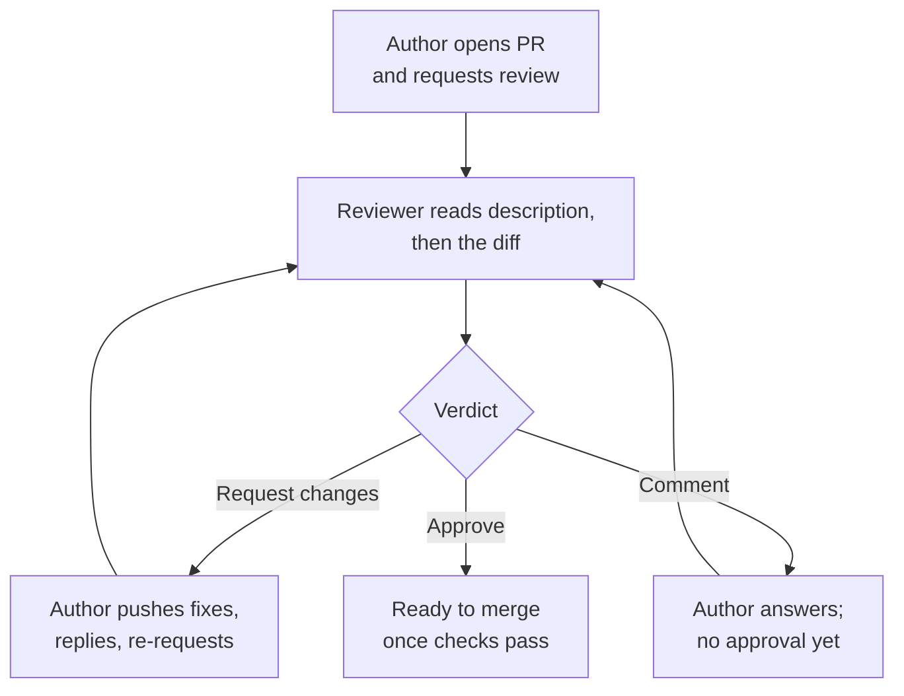

# Code Review that Helps: The Complete Guide

> 📚 **Before you start**
>
> - [Pull Requests End to End](pull-requests-end-to-end.md)
> - [Reading History with log, show and diff](../02-version-control-from-scratch/reading-history-with-log-show-and-diff.md)

## Introduction

Code review is the habit of having at least one other person read a change before it's merged. Done well, it catches bugs while they're cheap, spreads knowledge so no one is the only person who understands a module, and keeps a codebase consistent. Done badly, it's a bottleneck where PRs wait for days, or a ritual where reviewers click **Approve** without reading, or a source of friction where comments feel like personal attacks.

The difference is mostly skill, and it can be learned: what to look for and in what order, how to phrase comments so they're clear and kind, how to use GitHub's review tools (pending reviews, suggestions, the "Viewed" checkbox), and a few Git commands that let you see exactly what a PR changes, even after a force-push. It works both ways too: authors can make their PRs much easier to review.

By the end of this article you'll be able to review a pull request systematically, write comments that are specific, actionable and labelled by severity, use GitHub's review states and suggested changes, compare branches correctly with three-dot diffs, see what changed between two versions of a rewritten PR with `git range-diff`, and set up your own PRs so reviews go fast.

> 💡 **Key Insight**
>
> The goal of review is **a healthier codebase and a better-informed team**, not a perfect PR or a display of cleverness. Review **in order of importance** (does it solve the right problem, is it correct and safe, is it tested, is it readable), make every comment **specific and labelled** (blocking, suggestion, question, nit), and **approve when the change makes the code better**, even if it isn't how you'd have written it.

---

## Core Explanation

### 1. What Review Is For (and What It Isn't)

| Review is good at | Review is bad at |
|-------------------|------------------|
| Catching logic errors, missed edge cases, security holes | Catching formatting and style issues (let linters and formatters do that automatically) |
| Questioning the design before it's set in concrete | Finding every bug (tests do that better) |
| Sharing knowledge of how the system works | Replacing conversation about large designs (do that before the code, in an issue or design doc) |
| Keeping consistency with the rest of the codebase | Enforcing personal taste |

If you find yourself writing the same style comment repeatedly, that's a sign to add a linter rule or a formatter to CI ([module 7](../course.md#m7)), so humans can focus on what machines can't check.

### 2. The Review Loop on GitHub



A **review** on GitHub is a batch: you write line comments as you go (**Start a review**, then **Add review comment**), and they stay **pending**, visible only to you, until you **Submit review** with one of three verdicts:

| Verdict | Means | Effect |
|---------|-------|--------|
| **Comment** | General feedback, no verdict | Doesn't count as approval |
| **Approve** | Fine to merge as far as you're concerned | Counts towards required approvals |
| **Request changes** | Must be addressed before merging | Blocks merging (when reviews are required) until you approve or the review is dismissed |

Batching matters: submitting ten single comments sends ten notifications; one review sends one. From the terminal, `gh pr review 7 --approve`, `gh pr review 7 --request-changes -b "See the comment on upi_link()"` and `gh pr review 7 --comment -b "..."` submit a review-level verdict.

### 3. A Reviewing Order That Works

Spend your attention where it matters most. Work top-down:

1. **Context.** Read the description and linked issue. What problem is this solving? If you can't tell, that's your first comment.
2. **Design.** Is this the right approach, in the right place? Big concerns go first, before you spend time on details that might change.
3. **Correctness.** Edge cases (empty lists, zero, `None`, very large values), error handling, concurrency, off-by-one errors.
4. **Security and data.** User input validated? Secrets kept out? Permissions checked? Database migrations safe for existing data?
5. **Tests.** Do tests cover the new behaviour and the edge cases? Would they fail if the code were wrong?
6. **Readability.** Names, function size, comments explaining *why*. Will someone understand this in a year?
7. **Consistency and small stuff.** Patterns used elsewhere in the codebase; minor naming; typos.

For a big PR, read the files in a sensible order (tests first can be a great way to learn what the code is meant to do) and tick **Viewed** on each file in the Files changed tab. GitHub collapses viewed files and un-ticks them if they change later, so you can see what's new.

### 4. Seeing Exactly What a PR Changes: Two Dots vs Three Dots

Locally, the right comparison matters. Here `main` has moved on since the branch was created:

```bash
git log --oneline --graph --all
```

Example output:

```
* dfe5d06 Describe the project
| * 384688b Add apply_discount()
|/  
* 7b56ddf Add billing
```

Compare the two kinds of diff:

```bash
git diff --stat main..add-discount
git diff --stat main...add-discount
```

Example output:

```
 README.md  | 2 --
 billing.py | 4 ++++
 2 files changed, 4 insertions(+), 2 deletions(-)

 billing.py | 4 ++++
 1 file changed, 4 insertions(+)
```

- **Two dots** (`main..add-discount`) compares the two **tips** directly. It shows the branch "removing" the README lines, which it never touched; they're just changes on `main` the branch doesn't have yet. Misleading for review.
- **Three dots** (`main...add-discount`) compares the branch with the **merge base**, the commit where it split from `main`. It shows only what the branch introduced. This is what GitHub's Files changed tab shows.

```bash
git diff main...add-discount
```

Example output:

```
diff --git a/billing.py b/billing.py
index 635da4e..35b3496 100644
--- a/billing.py
+++ b/billing.py
@@ -3,3 +3,7 @@ PRICES = {"masala": 20, "ginger": 25}
 
 def bill(items):
     return sum(PRICES[name] * qty for name, qty in items)
+
+
+def apply_discount(total, percent):
+    return total - total * percent / 100
```

(For `git log`, the meaning is different: `main..add-discount` lists commits on the branch not on `main`, which is what you want there. Three dots in `git log` means commits on *either* side but not both.)

To review commit by commit, which helps when an author has structured the PR as a sequence of logical steps:

```bash
git log --oneline --stat main..add-discount
```

Example output:

```
384688b Add apply_discount()
 billing.py | 4 ++++
 1 file changed, 4 insertions(+)
```

Add `-p` to see each commit's full patch. `gh pr diff 7` prints the PR's diff without fetching anything, and `gh pr diff 7 --name-only` lists just the files.

### 5. Writing Comments People Can Act On

A useful comment says **what**, **why**, and **how serious**. Compare:

| Unhelpful | Helpful |
|-----------|---------|
| "This is wrong." | "**blocking:** `apply_discount(100, 150)` returns -50. Should we reject percentages over 100, or clamp?" |
| "Rename this." | "**nit:** `d` → `discount_percent` would make the call sites clearer." |
| "Why did you do it this way??" | "**question:** Is there a reason not to reuse `bill()` here? I may be missing context." |
| "Use a dict." | "**suggestion (non-blocking):** A dict lookup would avoid the if/elif chain, but this is fine as is." |

Habits that keep reviews kind and fast:

- **Label severity.** Prefixes like `blocking:`, `suggestion:`, `question:`, `nit:` (a convention sometimes called "conventional comments") tell the author what must change and what's optional.
- **Comment on the code, not the person.** "This function does three things" rather than "you made this too complicated".
- **Ask, don't assume.** The author may know something you don't.
- **Explain the why**, or link to a doc or past incident.
- **Praise specifically** when something is good ("nice test for the empty basket case"). It tells the author what to keep doing.
- **Don't block on taste.** If it's correct, readable and consistent, approve, maybe with optional suggestions.
- **Big disagreement? Talk.** After two rounds of back-and-forth in comments, a short call is faster; write the outcome back on the PR.

### 6. Suggested Changes and Reviewing Force-Pushes

For small fixes, write a **suggestion** instead of describing the change. In a line comment, click the suggestion button (or type the block yourself):

````markdown
```suggestion
    if not 0 <= percent <= 100:
        raise ValueError("percent must be between 0 and 100")
    return total - total * percent / 100
```
````

The author sees a diff and a **Commit suggestion** button that applies it as a commit on the PR branch. On the Files changed tab, several suggestions can be added to a batch and committed together. Select multiple lines before commenting to suggest a multi-line replacement.

When an author **force-pushes** a rewritten branch, the commit hashes all change, so "what's new since my last review?" becomes hard to see. GitHub's timeline shows "force-pushed the branch from b99a803 to 35cd1ef" with a **Compare** link. Locally, `git range-diff` answers the question precisely by matching up the old and new versions of each commit. Here Asha rebased her UPI branch onto the latest `main` and reworded an error message; before force-pushing she checks what changed relative to her pushed version (`@{u}`):

```bash
git range-diff origin/main @{u} HEAD
```

Example output:

```
1:  a74f7f6 = 1:  a36b90d Add upi_link() for UPI payments
2:  02987c2 = 2:  f5c7fe5 Show the UPI link on receipts
3:  b99a803 ! 3:  35cd1ef Reject zero or negative UPI amounts
    @@ billing.py: def bill(items):
      
      def upi_link(amount, payee="chai-ledger@upi"):
     +    if amount <= 0:
    -+        raise ValueError("amount must be positive")
    ++        raise ValueError("UPI amount must be more than zero")
          return f"upi://pay?pa={payee}&am={amount}"
      
      
```

Read it as: commits 1 and 2 are unchanged (`=`) apart from their new base; commit 3 changed (`!`), and the nested diff shows the change to the change, one line reworded. A reviewer can do the same after fetching, using the old and new hashes from the force-push: `git range-diff origin/main b99a803 35cd1ef`.

### 7. Making Your Own PRs Easy to Review

Authors control most of review speed:

- **Small and focused.** Under a few hundred lines; one purpose.
- **A description with context**: what, why, how to test, what to look at hardest.
- **Self-review first** on GitHub's Files changed tab; leave comments on your own PR pointing out tricky bits.
- **Logical commits** if the team reviews commit by commit; otherwise one tidy story in the description.
- **Green checks** before requesting review. Don't make humans find what CI would have.
- **Separate moves from changes.** If you renamed a file *and* edited it, reviewers see a giant diff; rename in one commit, edit in another (or in separate PRs).
- **Answer every comment**, with a fix ("Done in a1b2c3d") or a reason. Resolve threads you've addressed; let the reviewer resolve ones still under discussion if your team prefers.

### 8. Team Norms and GitHub Settings

Healthy review cultures write down a few rules:

- **Response time**: for example, a first review within one working day. Unreviewed PRs rot as `main` moves on.
- **How many approvals**: one is common; two for sensitive code. Enforce with branch protection or rulesets, and route areas to experts with **CODEOWNERS** ([Branch Protection, Rulesets and CODEOWNERS](branch-protection-rulesets-and-codeowners.md)).
- **Who merges**: often the author, after approval, so they can watch the deploy.
- **Stale approvals**: a ruleset can dismiss approvals when new commits are pushed, so reviewers see the final version.

GitHub also offers **automatic review requests** for teams (round-robin or load-balanced assignment), and AI-assisted reviews: you can request a review from Copilot on a PR, which leaves comments like a human reviewer would ([the Coding Agents and Harness Engineering course](../../coding-agents-and-harness-engineering/course.md#m3)). Treat AI review as an extra pair of eyes, not a replacement for a teammate who knows the system.

---

## Try It Yourself

1. **Two dots vs three.** In any repository, create a branch with one commit, then add a commit to `main` touching a different file. Compare `git diff --stat main..branch` and `git diff --stat main...branch`. Which matches what a PR would show?
2. **Rewrite a comment.** Improve these review comments: (a) "bad name", (b) "this won't scale", (c) "why not use the library?".
3. **Suggestion block.** On a practice PR, leave a suggested change on a line and apply it with **Commit suggestion**. Pull the branch locally and look at `git log -1`.
4. **range-diff.** On a branch with three commits, run `git branch old-version` to bookmark it, then rebase onto an updated `main` and amend one commit. Run `git range-diff main old-version HEAD`. Identify the `=` and `!` lines.
5. **Review checklist.** Write a seven-line checklist for your team based on section 3, and add it to a PR template.

<details>
<summary>Show answers</summary>

1. Two dots shows the branch "undoing" `main`'s new commit; three dots shows only the branch's own change, which matches GitHub's Files changed tab.
2. For example: (a) "**nit:** `x` could be `order_total`, it would make `apply_discount(x, ...)` self-explanatory." (b) "**question:** This loads every order into memory. Roughly how many orders do we expect per day? If it's thousands, should we paginate?" (c) "**suggestion:** `decimal.Decimal` handles currency rounding for us; would it simplify this? Fine to leave if there's a reason."
3. The commit appears on the PR branch, authored by the PR author with the reviewer credited as co-author in a `Co-authored-by:` trailer.
4. Unchanged commits show `=`; the amended one shows `!` with a nested diff of the difference. `main` works as the base because both versions' own commits are the ones not reachable from it.
5. Context, design, correctness, security, tests, readability, consistency, as checkboxes in `.github/pull_request_template.md`.

</details>

---

## Real-World Examples

### Example 1: Google's Review Guidance

Google's public engineering practices say a reviewer should approve a change once it definitely improves the overall code health, even if it isn't perfect, and that reviews should be fast: speed of review is treated as a team-wide productivity issue.

### Example 2: A Fintech's Two-Key Rule

A payments company requires two approvals, one from a code owner, for anything under `payments/`. Formatting is enforced by CI, so reviewers spend their time on money handling, idempotency and audit logging.

### Example 3: Open Source Maintainers

Maintainers of busy projects often reply to first-time contributors with friendly, specific requests plus suggestion blocks they can apply with one click. Projects that review this way tend to keep their contributors.

---

## Common Misconceptions

### Misconception 1: "Approving means I vouch that it's bug-free"

Approving means you reviewed it carefully and saw no blocking issues. Quality is shared by the author, tests, and reviewers.

### Misconception 2: "More comments means a better review"

Ten nits can bury one serious bug. Lead with what matters; label the rest optional.

### Misconception 3: "Seniors review juniors, not the other way round"

Juniors reviewing seniors' code learn fast and often catch unclear code precisely because they lack context. Everyone should review.

### Misconception 4: "The diff on GitHub compares my branch with main as it is now"

It compares with the merge base (three-dot), so changes on `main` don't appear as reversals. Conflicts are flagged separately.

---

## Interview Relevance

Behavioural and technical interviews both probe review skills:

- **"How do you approach reviewing a pull request?"** Context first, then design, correctness, security, tests, readability; label severity; approve when it improves code health.
- **"Tell me about a time you disagreed in a code review."** Show you asked questions, explained reasoning, moved to a conversation when needed, and recorded the outcome.
- **"What makes a PR easy to review?"** Small, focused, described, self-reviewed, green checks.
- **"What's the difference between `git diff a..b` and `a...b`?"** Tip-to-tip versus from the merge base.
- **"How do you review a force-pushed PR?"** GitHub's Compare link or `git range-diff`.

---

## Key Takeaways

- Review for **code health and shared understanding**; let **linters and CI** handle style.
- Work **top-down**: context, design, correctness, security, tests, readability, small stuff.
- Make comments **specific, kind and labelled** (blocking, suggestion, question, nit), and use **suggested changes** for small fixes.
- Submit comments as **one review** with a verdict: Comment, Approve or Request changes.
- Compare with **three dots** (`main...branch`) and inspect rewritten PRs with **`git range-diff`**.
- Authors speed reviews with **small PRs, clear descriptions, self-review and green checks**.

---

**Up next:** [Issues, Labels, Milestones and Projects](issues-labels-milestones-and-projects.md)
