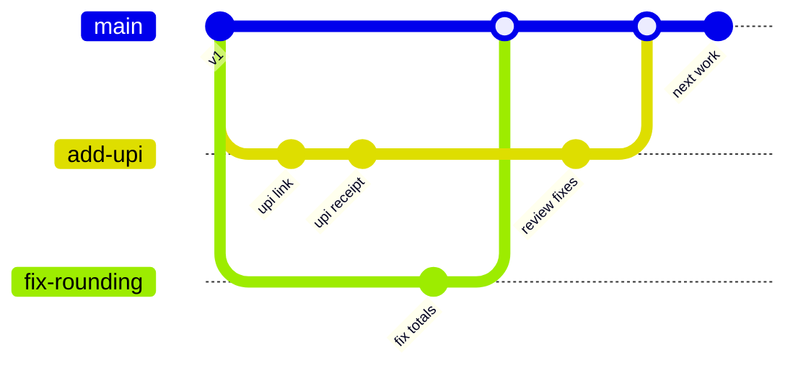
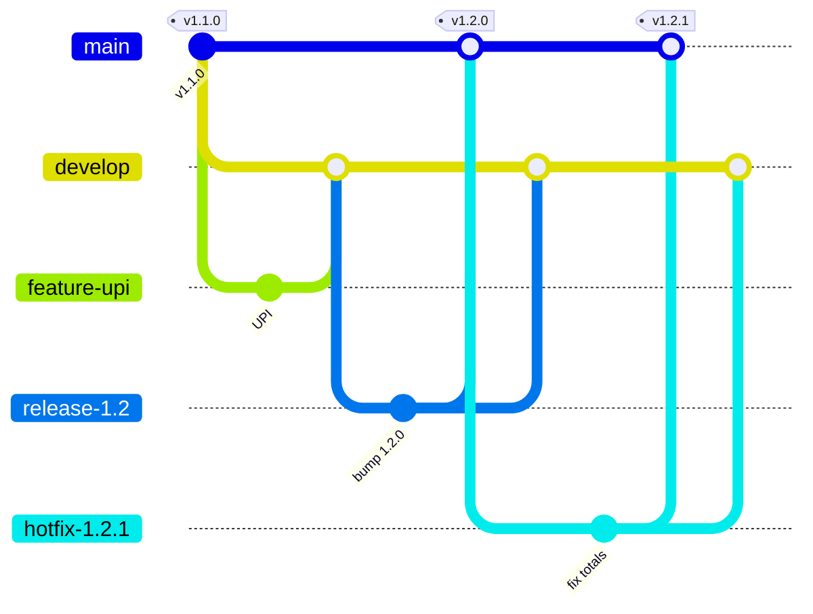
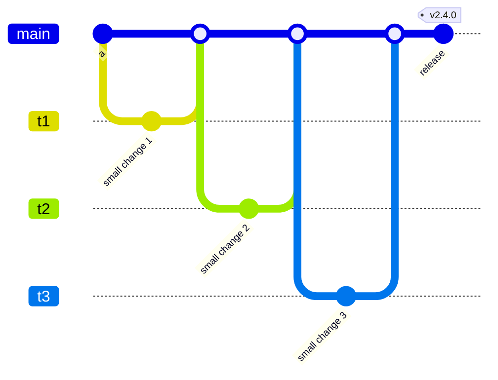

# GitHub Flow, Git Flow and Trunk-Based Development: The Complete Guide

> 📚 **Before you start**
>
> - [Pull Requests End to End](pull-requests-end-to-end.md)
> - [Merge vs Rebase](../04-branching-and-merging/merge-vs-rebase.md)
> - [Blobs, Trees, Commits and Tags](../03-how-git-works-inside/blobs-trees-commits-and-tags.md), for annotated tags

## Introduction

Git lets you create as many branches as you like and merge them in any direction. That freedom is great for one person and chaos for twenty. A team needs shared answers to a few questions: Which branch is the truth? Where do new features start? How long can a branch live? How does code get to production, and how do we fix production in a hurry?

A **branching strategy** (or workflow) is a team's agreed set of answers. Three are worth knowing well. **GitHub Flow** is the simple, PR-centred workflow most teams on GitHub use. **Git Flow** is an older, more structured model with long-lived `develop` and release branches, still found in teams shipping versioned software. **Trunk-based development** pushes integration to its limit, with everyone merging small changes into `main` at least daily and using feature flags to hide unfinished work; it's what high-performing teams practising continuous delivery tend to converge on.

By the end of this article you'll be able to describe each workflow's branches and rules, draw its history, explain how releases and hotfixes work in it, compare their trade-offs, choose one for a given team, and recognise the supporting practices (feature flags, release branches, tags, CI) that make them work.

> 💡 **Key Insight**
>
> All three workflows trade **isolation** against **integration**. Long-lived branches feel safe but defer merging, and the pain of merging grows with time apart. Most modern teams pick **GitHub Flow** (short branches, PRs, `main` always deployable) and move towards **trunk-based development** (even shorter branches, feature flags) as their testing and deployment automation matures. **Git Flow** fits when you must maintain multiple released versions in parallel.

---

## Core Explanation

### 1. The Questions Every Workflow Answers

| Question | GitHub Flow | Git Flow | Trunk-based |
|----------|-------------|----------|-------------|
| Source of truth | `main` | `main` = released; `develop` = next release | `main` (the "trunk") |
| Where work starts | Short branch from `main` | `feature/*` from `develop` | Very short branch from `main` (or commit to `main`) |
| Branch lifetime | Days | Days to weeks | Hours, at most a day or two |
| How unfinished work is hidden | Not merged until done | Stays on feature branches | **Feature flags** in merged code |
| Releases | Deploy `main`, often continuously | `release/*` branch, then merge to `main` and tag | Deploy `main` continuously, or cut a release branch |
| Hotfixes | Normal PR to `main` | `hotfix/*` from `main`, merged to `main` and `develop` | Fix on `main`, cherry-pick to a release branch if needed |

### 2. GitHub Flow

GitHub Flow has one rule at its core: **anything in `main` is deployable**. The loop:

1. Create a descriptively named branch from `main`.
2. Commit and push early.
3. Open a pull request (draft if early).
4. Discuss, review, let CI run, push fixes.
5. Merge into `main` once approved and green.
6. Deploy (often automatically on merge), then delete the branch.



Everything you learned in [Pull Requests End to End](pull-requests-end-to-end.md) is GitHub Flow. Its strengths are simplicity (one long-lived branch) and fast feedback. It assumes good automated tests and the ability to deploy `main` frequently, and it handles maintaining several released versions awkwardly, which is where Git Flow comes in.

Variations you'll meet: some teams deploy a PR branch to a staging or production environment *before* merging; others merge, then deploy with an approval gate in CI ([module 7](../course.md#m7)).

### 3. Git Flow

Git Flow (described by Vincent Driessen in 2010) uses two permanent branches and three kinds of temporary ones:

| Branch | Lives | Created from | Merged into |
|--------|-------|--------------|-------------|
| `main` | Forever | (initial) | Only receives releases and hotfixes; every commit is a tagged release |
| `develop` | Forever | `main` | Integration branch for the next release |
| `feature/*` | Until the feature is done | `develop` | `develop` |
| `release/*` | Until the release ships | `develop` | `main` (tagged) **and** `develop` |
| `hotfix/*` | Until the fix ships | `main` | `main` (tagged) **and** `develop` |

Here's a full cycle (one feature, one release, one hotfix) using plain Git. Merges use `--no-ff` so each branch's work stays grouped under a merge commit:

```bash
git switch -c develop
git switch -c feature/upi develop
# commit "Add UPI payments"
git switch develop
git merge --no-ff feature/upi -m "Merge branch feature/upi into develop"
git branch -d feature/upi
```

Example output:

```
Switched to a new branch 'develop'

Switched to a new branch 'feature/upi'

Switched to branch 'develop'

Merge made by the 'ort' strategy.
 upi.py | 1 +
 1 file changed, 1 insertion(+)
 create mode 100644 upi.py

Deleted branch feature/upi (was e02b67e).
```

When `develop` has enough for a release, cut a release branch. Only stabilisation happens there: version bumps, last fixes, release notes. Then it merges to `main`, gets a tag, and merges back to `develop`:

```bash
git switch -c release/1.2 develop
# commit "Bump version to 1.2.0"
git switch main
git merge --no-ff release/1.2 -m "Merge branch release/1.2"
git tag -a v1.2.0 -m "Version 1.2.0"
git switch develop
git merge --no-ff release/1.2 -m "Merge branch release/1.2 into develop"
git branch -d release/1.2
```

Example output:

```
Switched to a new branch 'release/1.2'

Switched to branch 'main'

Merge made by the 'ort' strategy.
 VERSION | 2 +-
 upi.py  | 1 +
 2 files changed, 2 insertions(+), 1 deletion(-)
 create mode 100644 upi.py

Switched to branch 'develop'

Merge made by the 'ort' strategy.
 VERSION | 2 +-
 1 file changed, 1 insertion(+), 1 deletion(-)

Deleted branch release/1.2 (was 62527c2).
```

A bug in production gets a hotfix branch from `main`, merged to both `main` (tagged `v1.2.1`) and `develop` so the fix isn't lost in the next release. After that, the full history looks like this:

```bash
git log --oneline --graph --all --decorate
```

Example output:

```
*   db7c216 (HEAD -> develop) Merge branch hotfix/1.2.1 into develop
|\  
* \   85c0414 Merge branch release/1.2 into develop
|\ \  
| | | *   6ab0b95 (tag: v1.2.1, main) Merge branch hotfix/1.2.1
| | | |\  
| | | |/  
| | |/|   
| | * | ec7a5c9 Fix rounding in totals
| | |/  
| | *   b0630df (tag: v1.2.0) Merge branch release/1.2
| | |\  
| | |/  
| |/|   
| * | 62527c2 Bump version to 1.2.0
|/ /  
* |   0798c75 Merge branch feature/upi into develop
|\ \  
| |/  
|/|   
| * e02b67e Add UPI payments
|/  
* 484bc93 (tag: v1.1.0) Release 1.1 code
```

Three branches of work produced five merge commits and a graph that's hard to read. That's Git Flow's main cost: ceremony and many merges, with `develop` drifting away from what's actually in production. Its benefit: `main` contains exactly the released versions, each tagged, and a release can be stabilised while new features continue on `develop`.



When is Git Flow still a good fit? When you ship **versioned releases** (mobile apps going through store review, installed desktop software, embedded firmware, libraries) and must support more than one version at a time. Even its author has written that teams doing continuous delivery of web apps should prefer something simpler like GitHub Flow.

### 4. Trunk-Based Development

In trunk-based development (TBD), everyone integrates into `main` (the trunk) **at least once a day**. Branches, if used, live for hours and are merged through a quick PR. There's no `develop`, no long-running feature branches.



How can you merge unfinished features into `main` every day? With supporting practices:

- **Feature flags** (toggles): new code ships switched off and is turned on by configuration, for internal users first, then a percentage of customers, then everyone. Merging and releasing become separate decisions.
- **Branch by abstraction**: put an interface in front of the old implementation, build the new one behind it in small steps, then switch over.
- **Strong CI**: every merge runs the full test suite; a broken `main` is fixed (or the change reverted) immediately.
- **Small changes**: a day's work at most per PR, which also makes review fast.

A feature flag can be as simple as a configuration check:

```python
FLAGS = {"upi_payments": False}


def payment_options(flags):
    options = ["cash"]
    if flags.get("upi_payments"):
        options.append("upi")
    return options


print(payment_options(FLAGS))
FLAGS["upi_payments"] = True
print(payment_options(FLAGS))
```

Output:

```
['cash']
['cash', 'upi']
```

Real systems read flags from a service or configuration file so they can change without a deploy, and target them by user or percentage. Remove a flag once the feature is fully on; old flags become confusing dead code.

Releases in TBD are usually continuous deployment from `main`. Teams that need versioned releases cut a short-lived **release branch** from `main` when it's time (`release/2.4`), only ever cherry-pick fixes into it from `main`, and tag from it. Fixes always land on the trunk first, so nothing is forgotten.

Research summarised in the DORA reports and the book *Accelerate* links trunk-based development (few active branches, short-lived, frequent merges) with higher software delivery performance.

### 5. Choosing a Workflow

| Situation | Good fit |
|-----------|----------|
| Web app or service, deployed frequently, decent tests | **GitHub Flow** |
| Mature CI/CD, many developers in one codebase, want fastest integration | **Trunk-based** (with feature flags) |
| Versioned product, several versions supported at once, release QA cycles | **Git Flow**, or trunk-based with release branches |
| Open source library | GitHub Flow, plus tags and maintenance branches for old major versions (`v1.x`) |
| Solo project | GitHub Flow (or commit to `main` with tags) |

Whatever you choose, write it down in `CONTRIBUTING.md` and **enforce it with tools**: branch protection or rulesets on `main` (and `develop`), required checks, and a merge method that matches ([Branch Protection, Rulesets and CODEOWNERS](branch-protection-rulesets-and-codeowners.md), [Merge Strategies and Merge Queues](merge-strategies-and-merge-queues.md)).

### 6. Naming, Tags and Release Conventions

- **Branch names**: lowercase, hyphens, optionally a type prefix or issue number: `feature/upi-payments`, `fix/12-rounding`, `docs/readme-setup`. Slashes are fine in branch names and group nicely in tools.
- **Tags**: annotated tags named with **semantic versioning**, `vMAJOR.MINOR.PATCH` (`v1.2.1`): bump MAJOR for breaking changes, MINOR for new features, PATCH for fixes ([module 10](../course.md#m10)).
- **Releases**: GitHub Releases attach notes and files to a tag and can generate notes from merged PRs ([module 8](../course.md#m8)).
- **Environment branches** (`staging`, `production` that code is merged into to deploy) are an older pattern; most teams now deploy a commit or tag to an environment instead of keeping a branch per environment.

---

## Try It Yourself

1. **GitHub Flow by hand.** In a practice repository, run two features through branches and PRs into `main`, one with a review change. Draw the resulting graph with `git log --oneline --graph`.
2. **Git Flow cycle.** Recreate section 3 in a scratch repository: a `develop` branch, one `feature/*`, a `release/*` merged to `main` and tagged, and a `hotfix/*` merged to both. How many merge commits did you create?
3. **Forgotten merge.** In your Git Flow repository, make another hotfix but merge it only into `main`. What happens to the fix in the next release from `develop`? How would you detect it?
4. **Feature flag.** Extend the Python example with a second flag, `"discounts"`, that adds a `"10% off"` line. Show both flags off, one on, both on.
5. **Choose.** Pick a workflow for: (a) a three-person startup deploying a web app ten times a day; (b) a banking app released to app stores monthly, supporting the last two versions; (c) a 400-engineer monorepo.

<details>
<summary>Show answers</summary>

1. A mostly straight `main` with short side branches joining it, or a straight line if you squash merge.
2. Five with `--no-ff`: feature into `develop`, release into `main` and into `develop`, hotfix into `main` and into `develop`. Tags add none.
3. The fix is missing from `develop`, so the next release regresses. `git log --oneline develop..main` lists commits on `main` not in `develop`; it should be empty except for merge commits.
4. Add `FLAGS["discounts"] = False` and in the function `if flags.get("discounts"): options.append("10% off")`, then print with the four combinations.
5. (a) GitHub Flow, moving to trunk-based. (b) Git Flow, or trunk-based with release branches per version. (c) Trunk-based with feature flags, required checks and a merge queue.

</details>

---

## Real-World Examples

### Example 1: GitHub Itself

GitHub has described deploying `github.com` from pull request branches and `main` many times a day, with the PR-centred flow that gave GitHub Flow its name, supported by extensive automation and chat-driven deploys.

### Example 2: Large Monorepos

Very large monorepos at big technology companies are developed trunk-based: thousands of engineers commit to one trunk, protected by pre-merge testing and feature flags, with release branches cut from the trunk when needed.

### Example 3: A Mobile Banking App

A bank's mobile team uses a Git Flow variant: features merge to `develop`, a `release/*` branch goes through two weeks of QA and store review, and hotfixes go from `main` to both branches. They maintain two app versions because not every customer updates immediately.

---

## Common Misconceptions

### Misconception 1: "Git Flow is the official Git workflow"

It's one published convention among many. Git itself prescribes no workflow; Git's own project uses its own set of integration branches.

### Misconception 2: "Trunk-based means no code review"

Most trunk-based teams use short-lived branches with quick PR reviews. The defining trait is merging small changes at least daily, not skipping review.

### Misconception 3: "Feature flags are only for big companies"

A flag can be one `if` around a configuration value. The discipline is removing it once the feature is fully launched.

### Misconception 4: "Long-lived branches are safer"

They delay integration, so conflicts and surprises grow. Safety comes from small changes, tests and the ability to turn features off.

---

## Interview Relevance

Workflow questions test whether you understand team trade-offs:

- **"What branching strategy have you used, and why?"** Describe it precisely, including releases and hotfixes, and why it suited the product.
- **"Compare Git Flow and trunk-based development."** Isolation versus integration, release cadence, merge pain, feature flags, multiple supported versions.
- **"How do you ship a half-finished feature safely?"** Feature flags, branch by abstraction, dark launches.
- **"How do you hotfix production?"** In your workflow: branch from what's deployed, fix, test, merge, tag, deploy, and make sure the fix reaches the main development line.

---

## Key Takeaways

- A **branching strategy** answers: source of truth, where work starts, branch lifetime, releases and hotfixes.
- **GitHub Flow**: short branches from `main`, PRs, `main` always deployable. The default for most teams.
- **Git Flow**: `main` plus `develop`, with feature, release and hotfix branches. Fits versioned products supporting several releases, at the cost of ceremony.
- **Trunk-based development**: merge small changes to `main` at least daily, hide unfinished work with **feature flags**, rely on strong CI.
- Choose for your product and release cadence, document it, and **enforce it** with protection rules and merge settings.

---

**Up next:** [Branch Protection, Rulesets and CODEOWNERS](branch-protection-rulesets-and-codeowners.md)
