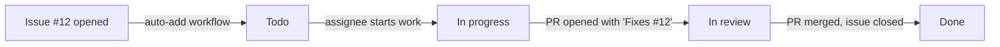

# Issues, Labels, Milestones and Projects: The Complete Guide

> 📚 **Before you start**
>
> - [Pull Requests End to End](pull-requests-end-to-end.md), for linking PRs to issues
> - [SSH Keys, Tokens and the GitHub CLI](../05-remotes-and-github-basics/ssh-keys-tokens-and-the-github-cli.md), for `gh`

## Introduction

Code is only half of a project. The other half is the list of things to do: bugs people have hit, features users asked for, chores someone promised to get to. On a team without a shared list, work lives in chat threads and people's heads, and the same bug gets reported three times while nobody fixes it.

GitHub's answer is a set of planning tools built right next to the code. **Issues** record a single piece of work or a problem. **Labels** categorise them. **Milestones** group them towards a release or deadline. **Projects** turn them into boards, tables and roadmaps with custom fields. Because they live in the same place as pull requests, a PR can close an issue automatically when it merges, and you can always trace a line of code back to the conversation that motivated it.

By the end of this article you'll be able to write a clear issue, use labels and issue templates, break work into sub-issues, plan a release with a milestone, track work on a project board with custom fields and automations, search issues efficiently, and drive it all from the command line with `gh issue` and `gh project`.

> 💡 **Key Insight**
>
> An **issue** is the unit of work and conversation; a **PR** is the unit of change. Link them (`Fixes #12`) so merged code closes its issue automatically. Then layer organisation on top: **labels** say *what kind* of work it is, **milestones** say *when* it's due, and **Projects** show *where it stands* across many repositories.

---

## Core Explanation

### 1. Anatomy of an Issue

| Field | Purpose |
|-------|---------|
| **Title** | A specific summary: "Total shows 46 for a 45.75 bill", not "Bug in billing" |
| **Body** | Markdown description: context, steps, expected vs actual, screenshots |
| **Number** | `#12`, shared with PRs in the same repository; use it to link from anywhere |
| **Assignees** | Who's working on it |
| **Labels** | Categories such as `bug` or `good first issue` |
| **Milestone** | The release or deadline it belongs to |
| **Projects** | Project boards it appears on |
| **Type** | Organisations can define issue types (for example Bug, Feature, Task) |
| **Relationships** | Parent issue, sub-issues, and "blocked by" / "blocking" dependencies |
| **Development** | Linked branches and PRs |

Any GitHub user can open an issue on a public repository with issues enabled; people with **triage** access or higher can label, assign and close them.

### 2. Writing an Issue People Can Act On

A good bug report lets someone else reproduce the problem without asking you anything:

```markdown
**What happened**
The bill total shows ₹46 when the items add up to ₹45.75.

**Steps to reproduce**
1. Add masala chai at 20.50
2. Add ginger chai at 25.25
3. Print the bill

**Expected**
Total: 45.75

**Actual**
Total: 46

**Environment**
chai-ledger 0.3.1, Python 3.12, Windows 11
```

A feature request explains the **problem** before the solution: "Staff can't tell which orders were paid by UPI" is more useful than "Add a column", because maintainers may know a better solution.

Before opening an issue, **search** for an existing one. If you find it, add a 👍 reaction rather than a "+1" comment (reactions don't notify everyone), and add a comment only if you have new information.

### 3. Issue Templates and Forms

Templates make reports consistent. Put them in `.github/ISSUE_TEMPLATE/`:

- **Markdown templates** (`bug_report.md`) pre-fill the body with headings.
- **Issue forms** (`bug_report.yml`) render as a real form with required fields, dropdowns and checkboxes, so nobody can skip "steps to reproduce".

A minimal issue form:

```yaml
name: Bug report
description: Something isn't working
labels: ["bug", "triage"]
body:
  - type: textarea
    id: what-happened
    attributes:
      label: What happened?
      description: Include the steps to reproduce.
    validations:
      required: true
  - type: dropdown
    id: version
    attributes:
      label: Version
      options:
        - "0.3.x"
        - "0.2.x"
    validations:
      required: true
```

A `config.yml` in the same folder can turn off blank issues (`blank_issues_enabled: false`) and add `contact_links`, for example pointing security reports to a private channel and questions to Discussions.

### 4. Labels

Labels are coloured tags. New repositories start with a default set: `bug`, `documentation`, `duplicate`, `enhancement`, `good first issue`, `help wanted`, `invalid`, `question` and `wontfix`. Two are special: GitHub surfaces issues labelled **`good first issue`** to newcomers looking for ways to contribute, and **`help wanted`** signals maintainers would welcome outside help.

Teams typically add labels along a few dimensions, using a prefix so they group nicely:

| Dimension | Examples |
|-----------|----------|
| Type | `bug`, `enhancement`, `chore` |
| Area | `area: billing`, `area: reports` |
| Priority | `priority: high`, `priority: low` |
| Status | `needs-triage`, `blocked`, `needs-info` |

Keep the set small enough that people actually use it. Create and apply labels from the terminal:

```bash
gh label create "area: billing" --color FBCA04 --description "Bill totals, discounts, UPI"
gh issue edit 12 --add-label "bug,area: billing"
```

(If your organisation uses **issue types**, prefer the type field over `bug`/`feature` labels.)

### 5. Linking Issues, Commits and PRs

Mention `#12` in any issue, PR or comment and GitHub cross-links them; both sides show the reference. To **close** an issue automatically, use a closing keyword (`close`, `closes`, `closed`, `fix`, `fixes`, `fixed`, `resolve`, `resolves`, `resolved`) followed by the number, either in the PR description or in a commit message. The issue closes when the PR (or commit) lands on the **default branch**.

`gh issue develop 12 --checkout` creates a branch linked to issue #12 (it appears under the issue's **Development** section) and switches to it. Or name the branch yourself and put the keyword in the commit:

```bash
git switch -c 12-fix-rounding
git commit -am "Keep paise when totalling bills" -m "Totals were rounded to whole rupees, so a bill of 20.50 + 25.25 showed 46." -m "Fixes #12"
git log -1
```

Example output:

```
Switched to a new branch '12-fix-rounding'

[12-fix-rounding acf8c04] Keep paise when totalling bills
 1 file changed, 1 insertion(+), 1 deletion(-)

commit acf8c04ae4e193b550f8cf86ea528a998315f853
Author: Asha Rao <asha@example.com>
Date:   Mon Oct 5 09:36:00 2026 +0530

    Keep paise when totalling bills
    
    Totals were rounded to whole rupees, so a bill of 20.50 + 25.25 showed 46.
    
    Fixes #12
```

Each `-m` becomes a separate paragraph: subject, body, then the closing keyword on its own line. Years later, `git log --grep` finds every commit tied to an issue:

```bash
git log --oneline --grep="#12"
```

Example output:

```
acf8c04 Keep paise when totalling bills
```

To reference an issue in a **different** repository, write `owner/repo#12`.

### 6. Closing, Triage and Housekeeping

Close an issue with a **reason**: **completed**, **not planned** (won't fix, out of scope, stale), or **duplicate** of another issue. The reasons show in search and help later readers.

```bash
gh issue close 15 --reason "not planned" --comment "Out of scope for the stall app; see the README."
gh issue close 16 --duplicate-of 12
```

**Triage** is the regular routine of reading new issues and deciding what happens next: label, ask for missing information (`needs-info`), close duplicates, and assign or prioritise. A weekly half-hour keeps the list trustworthy. Other tools:

- **Pin** up to three important issues to the top of the Issues tab.
- **Lock** a conversation that has turned heated, so only collaborators can comment.
- **Transfer** an issue to another repository in the same owner when it was filed in the wrong place.
- **Convert to a discussion** when it's a question or idea rather than actionable work (if Discussions is enabled).

### 7. Sub-issues and Dependencies

Large pieces of work split naturally into smaller ones. Open the parent issue ("UPI payments") and use **Create sub-issue** or **Add existing issue** to attach children ("Generate UPI link", "Show QR on receipt", "Record payment method"). The parent shows a progress bar as sub-issues close, and sub-issues can have their own sub-issues.

Mark ordering with **relationships**: "Show QR on receipt" is **blocked by** "Generate UPI link". Blocked issues are flagged on the issue and on project boards, so nobody picks up work that can't start yet. Before sub-issues existed, people used **task lists** in the body (`- [ ] #21`), which still render as checkboxes and are fine for lightweight checklists.

### 8. Milestones

A **milestone** groups issues and PRs towards a goal, usually a release or a date: "v0.4: UPI payments, due 31 October". Create one under **Issues → Milestones → New milestone** with a title, optional due date and description. Its page shows a progress bar (closed items / total) and lets you drag items into priority order.

```bash
gh issue create --title "Show QR code on receipts" --label enhancement --milestone "v0.4" --assignee @me
gh issue list --milestone "v0.4" --state open
```

Milestones are per repository. For planning that spans repositories or needs richer fields, use Projects.

### 9. Projects: Boards, Tables and Roadmaps

**GitHub Projects** are flexible planning spreadsheets owned by a user or organisation. Items can be issues and PRs from **any** repositories the owner can access, or plain **draft items** for ideas. Each project has views:

| Layout | Good for |
|--------|----------|
| **Table** | Spreadsheet view; sort, filter, group by any field, bulk edit |
| **Board** | Kanban columns (for example Todo, In progress, In review, Done), usually grouped by a Status field |
| **Roadmap** | Timeline bars using date or iteration fields |

Projects add **custom fields** on top of issue data: single select (Status, Priority), number (Estimate), date (Target date), text, and **iteration** (sprints of a fixed length). Filters use the same style as search, for example `assignee:@me status:"In progress"`.

**Built-in workflows** keep the board current without manual dragging: add new items automatically from a repository (with a filter), set Status to Done when an issue closes or a PR merges, and auto-archive items that have been done for a while. **Insights** charts show progress, such as items completed per iteration.



From the terminal (the token needs the `project` scope: `gh auth refresh -s project`):

```bash
gh project create --owner @me --title "Chai Ledger roadmap"
gh project item-add 1 --owner @me --url https://github.com/asha-rao/chai-ledger/issues/12
```

### 10. Finding Things: Search Qualifiers

The issue search box and `gh issue list --search` accept qualifiers. Combine them freely:

| Query | Finds |
|-------|-------|
| `is:issue is:open label:bug` | Open bugs |
| `is:open assignee:@me` | Everything assigned to you |
| `is:open no:assignee label:"good first issue"` | Unclaimed starter issues |
| `milestone:"v0.4" is:closed` | Done for the release |
| `is:pr is:open review-requested:@me` | PRs waiting for your review |
| `is:issue is:open sort:updated-asc` | Stale issues, oldest activity first |
| `involves:ravi-kumar` | Anything Ravi authored, was assigned, mentioned in, or commented on |

```bash
gh issue list --label bug --state open
gh issue list --search "no:assignee label:\"good first issue\""
```

Save frequent searches as bookmarks, or as saved views in a project.

---

## Try It Yourself

1. **Write a bug report.** In a practice repository, open an issue for a real or made-up bug using the structure from section 2. Ask a friend to reproduce it from the issue alone.
2. **Issue form.** Add `.github/ISSUE_TEMPLATE/bug_report.yml` with a required textarea and a dropdown. Open **New issue** and try submitting without filling it in.
3. **Close via commit.** Create issue #N, then on a branch commit with `Fixes #N` in the message, open a PR, and merge it. What happened to the issue?
4. **Milestone and labels.** Create a milestone "v0.1" and two labels. Use `gh issue create` to file two issues into the milestone with labels. View the milestone's progress after closing one.
5. **Project board.** Create a project, add both issues, switch to a Board layout grouped by Status, and enable the "Item closed → Done" workflow. Close an issue and watch the card move.

<details>
<summary>Show answers</summary>

1. If your friend had to ask a question, add the answer to the template you use next time.
2. GitHub refuses to submit until required fields are filled, and the dropdown limits answers to your options.
3. The issue closed when the PR merged into the default branch, and its timeline shows "closed this as completed in #<PR>".
4. `gh issue create --title "..." --label "bug" --milestone "v0.1"`. The milestone page shows 50% complete after one of two is closed.
5. The card moves to Done automatically; the workflow sets the Status field when the issue closes.

</details>

---

## Real-World Examples

### Example 1: An Open Source Library

A popular Python library uses issue forms that require a minimal reproducible example and version numbers, a `needs-triage` label applied automatically, and a weekly triage rota among maintainers. Questions go to Discussions via `contact_links`, keeping the issue list focused on actionable work.

### Example 2: A Startup Sprint Board

An eight-person team runs two-week sprints in one organisation-level project spanning their web, API and mobile repositories. An **Iteration** field holds the sprint, a **Priority** field drives sorting, and a roadmap view shows the quarter's milestones to the founders.

### Example 3: A Release Milestone

Before each release, a team creates a milestone, triages issues into it, and doesn't ship until it's at 100% or the remaining items are explicitly moved to the next milestone. The release notes are drafted from the milestone's closed items.

---

## Common Misconceptions

### Misconception 1: "Issues are only for bugs"

Issues track any unit of work: features, chores, investigations, documentation. Types or labels distinguish them.

### Misconception 2: "Writing 'Fixes #12' anywhere closes the issue"

The keyword must be in a PR description or a commit message, and the issue closes when that PR or commit reaches the **default branch**. A plain comment only links.

### Misconception 3: "Projects belong to a repository"

Projects belong to a user or organisation and can hold items from many repositories. You can link a project to a repository so it shows on the repository's Projects tab.

### Misconception 4: "More labels means better organisation"

Too many labels go unused or applied inconsistently. A small, documented set works better.

---

## Interview Relevance

Planning tools come up in questions about teamwork and process:

- **"How does your team track work?"** Issues with templates, labels for type and area, milestones for releases, a project board with automation, PRs linked with closing keywords.
- **"What makes a good bug report?"** Steps to reproduce, expected versus actual, environment, evidence.
- **"How do you link code changes to tickets?"** Branch names and commit messages with issue numbers; `Fixes #n` in the PR.
- **"How would you onboard open source contributors?"** `good first issue` and `help wanted` labels, clear templates, `CONTRIBUTING.md`.

---

## Key Takeaways

- An **issue** is one unit of work with its conversation; write titles and bodies others can act on.
- **Templates and issue forms** make reports consistent; **labels** classify; keep the set small.
- **`Fixes #n`** in a PR or commit closes the issue when it reaches the default branch; `#n` alone just links.
- Break big work into **sub-issues** and mark **blocked-by** dependencies.
- **Milestones** group work towards a release; **Projects** give boards, tables and roadmaps with custom fields and automations across repositories.
- Use **search qualifiers** and `gh issue` / `gh project` to find and manage work quickly.

---

**Up next:** [GitHub Flow, Git Flow and Trunk-Based Development](github-flow-git-flow-and-trunk-based-development.md)
