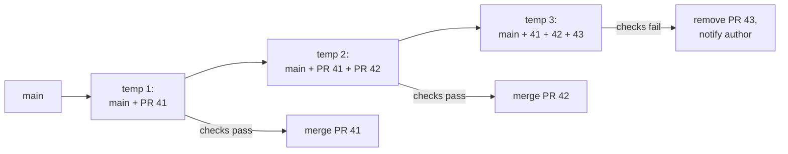

# Merge Strategies and Merge Queues: The Complete Guide

> 📚 **Before you start**
>
> - [Merge vs Rebase](../04-branching-and-merging/merge-vs-rebase.md)
> - [Pull Requests End to End](pull-requests-end-to-end.md)
> - [Branch Protection, Rulesets and CODEOWNERS](branch-protection-rulesets-and-codeowners.md), for required checks

## Introduction

When a pull request is approved, one click lands it on `main`. But *how* it lands (as a merge commit, as one squashed commit, or as a series of rebased commits) shapes your project's history for years. It decides what `git log` tells a new teammate, how easy it is to revert a feature, how well `git bisect` finds a bug, and even whether `git branch -d` works afterwards. Teams choose deliberately and configure GitHub to allow only their choice.

Then there's a subtler problem. Two PRs each pass all their tests. Both get merged. `main` is broken. Neither PR was wrong on its own; they're wrong *together*. On a quiet repository this is rare. On a busy one, with dozens of merges a day, it happens constantly, and "require branches to be up to date" turns into a frustrating race of rebasing and re-running CI. A **merge queue** solves this by testing each PR combined with everything ahead of it before it lands.

By the end of this article you'll be able to describe exactly what each of GitHub's three merge buttons does to history, choose and configure a merge policy, explain semantic conflicts and why up-to-date checks don't scale, and set up and use a merge queue, including the CI changes it needs.

> 💡 **Key Insight**
>
> **Merge commit** keeps every commit plus a merge commit (complete history, easy to revert a whole PR). **Squash** turns each PR into one commit (clean, one-commit-per-change `main`). **Rebase** replays each commit with new hashes (linear history, keeps individual commits). Pick one policy and enforce it. And when merges are frequent, use a **merge queue**: it tests "`main` + the PRs ahead + this PR" before merging, so `main` stays green without everyone rebasing all day.

---

## Core Explanation

The histories below were produced with Git 2.43 by performing locally what each GitHub button does. The starting point: `add-receipts` (PR #12) has three commits, including a typo fix, and `main` has moved on by one commit.

```bash
git log --oneline --graph --all
```

Example output:

```
* 9892a9d Add README
| * 3d1f275 Fix typo in footer name
| * 84f8d3a Add receipt footer
| * 50ebd6f Add receipt()
|/  
* 6c281cb Add billing
```

### 1. Create a Merge Commit

The button **Create a merge commit** is equivalent to `git merge --no-ff`: it always creates a merge commit, even if a fast-forward were possible.

```bash
git merge --no-ff add-receipts -m "Merge pull request #12 from asha-rao/add-receipts"
git log --oneline --graph
```

Example output:

```
Merge made by the 'ort' strategy.
 billing.py | 8 ++++++++
 1 file changed, 8 insertions(+)

*   5a4f8ef Merge pull request #12 from asha-rao/add-receipts
|\  
| * 3d1f275 Fix typo in footer name
| * 84f8d3a Add receipt footer
| * 50ebd6f Add receipt()
* | 9892a9d Add README
|/  
* 6c281cb Add billing
```

- **History:** every original commit, unchanged (same hashes), plus a merge commit recording when the PR landed.
- **Reading at PR level:** `git log --first-parent` follows only `main`'s own line, one entry per merged PR:

```bash
git log --oneline --first-parent
```

Example output:

```
5a4f8ef Merge pull request #12 from asha-rao/add-receipts
9892a9d Add README
6c281cb Add billing
```

- **Reverting the whole PR:** one command, `git revert -m 1 5a4f8ef` ([Undoing Things](../04-branching-and-merging/undoing-things-restore-reset-revert-and-cherry-pick.md)).
- **Downside:** the "Fix typo" commit and any "WIP" commits land on `main` too, and the graph gets busy.

### 2. Squash and Merge

**Squash and merge** takes the PR's total change and commits it as **one new commit** on `main`. Locally, that's `git merge --squash` followed by a commit:

```bash
git merge --squash add-receipts
git commit -m "Add receipts (#12)"
git log --oneline --graph
```

Example output:

```
Automatic merge went well; stopped before committing as requested
Squash commit -- not updating HEAD

[main fb55fe0] Add receipts (#12)
 1 file changed, 8 insertions(+)

* fb55fe0 Add receipts (#12)
* 9892a9d Add README
* 6c281cb Add billing
```

- **History:** perfectly linear, one commit per PR, and the typo fix disappears into it. GitHub fills the message from the PR title (with its number) and, depending on settings, the description or the list of commit messages. If several people committed on the PR, GitHub adds `Co-authored-by:` trailers so everyone is credited.
- **Reverting:** a single ordinary `git revert fb55fe0`.
- **Bisect:** finds the PR that caused a bug, but not which commit inside it.
- **Downside:** individual commits are lost from `main` (they remain visible on the PR page), and the branch's commits are not ancestors of `main`:

```bash
git branch -d add-receipts
```

Example output:

```
error: the branch 'add-receipts' is not fully merged.
If you are sure you want to delete it, run 'git branch -D add-receipts'
```

That's expected after a squash; use `-D` once you've confirmed the PR merged. Also, don't keep working on a branch after it's been squash-merged: its old commits will conflict with their own squashed copy. Start a fresh branch from the updated `main`.

### 3. Rebase and Merge

**Rebase and merge** replays each PR commit on top of `main`, then moves `main` forward. Locally:

```bash
git switch add-receipts
git rebase main
git switch main
git merge --ff-only add-receipts
git log --oneline --graph
```

Example output:

```
Switched to branch 'add-receipts'

Successfully rebased and updated refs/heads/add-receipts.

Switched to branch 'main'

Updating 9892a9d..0c03cb3
Fast-forward
 billing.py | 8 ++++++++
 1 file changed, 8 insertions(+)

* 0c03cb3 Fix typo in footer name
* 327b395 Add receipt footer
* f30a365 Add receipt()
* 9892a9d Add README
* 6c281cb Add billing
```

- **History:** linear, with every commit kept, but with **new hashes** (`50ebd6f` became `f30a365`). On GitHub, rebase and merge always rewrites the commits and updates the committer, even when a fast-forward would have been possible, so the PR's original hashes never appear on `main`.
- **No PR boundary:** nothing on `main` marks where PR #12 starts and ends; reverting it means reverting three commits.
- **Best when** authors curate clean, meaningful commits (with interactive rebase) and each commit builds and passes tests on its own, so bisect stays precise.
- **Downside:** WIP and typo commits land on `main` unless authors clean up first.

### 4. Comparing and Choosing

| | Merge commit | Squash and merge | Rebase and merge |
|---|---|---|---|
| Commits on `main` per PR | All + 1 merge | 1 | All (rewritten) |
| History shape | Graph with merge bubbles | Linear | Linear |
| Original hashes kept | Yes | No | No |
| Revert a whole PR | `revert -m 1 <merge>` | `revert <commit>` | Revert each commit |
| `git bisect` precision | Commit (or PR with `--first-parent`) | PR | Commit |
| Needs clean commits from authors | No | No | **Yes** |
| `git branch -d` afterwards | Works | Needs `-D` | Needs `-D` |
| Compatible with "Require linear history" | No | Yes | Yes |

A popular default for product teams is **squash and merge only**: authors commit freely while working, the PR title becomes a well-written commit, and `main` reads as a changelog. Projects whose contributors craft careful commit series (many open source projects) prefer **merge commits** or **rebase**.

Configure it in **Settings → General → Pull Requests**: untick the methods you don't allow, choose the **default commit message** for squash merges (for example "Pull request title and description") and for merge commits, and consider **Always suggest updating pull request branches**, **Allow auto-merge** and **Automatically delete head branches**. A ruleset's "Require a pull request" rule can also restrict allowed merge methods per branch ([Branch Protection, Rulesets and CODEOWNERS](branch-protection-rulesets-and-codeowners.md)).

### 5. Semantic Conflicts: Green PRs, Red main

Git detects **textual** conflicts: two changes to the same lines. It can't detect **semantic** conflicts: changes to different lines that break each other. Two PRs start from the same `main`. One renames `bill()` to `total_bill()` (updating every caller that exists). The other adds `receipt()`, which calls `bill()`. Each branch's tests pass:

```bash
git switch rename-bill
python3 test_billing.py
git switch add-receipt
python3 test_billing.py
```

Example output:

```
Switched to branch 'rename-bill'

bill ok

Switched to branch 'add-receipt'

bill ok
receipt ok
```

Merge both. Git reports no conflict, because the edits don't overlap. Then run the tests on the result:

```bash
git switch main
git merge -q rename-bill
git merge add-receipt -m "Merge add-receipt"
python3 test_billing.py
```

Example output:

```
Switched to branch 'main'

Auto-merging billing.py
Auto-merging test_billing.py
Merge made by the 'ort' strategy.
 billing.py      | 4 ++++
 test_billing.py | 2 ++
 2 files changed, 6 insertions(+)

bill ok
Traceback (most recent call last):
  File "/home/asha/projects/chai-ledger/test_billing.py", line 5, in <module>
    assert billing.receipt([("ginger", 1)]) == "Total: Rs 25"
           ~~~~~~~~~~~~~~~^^^^^^^^^^^^^^^^^
  File "/home/asha/projects/chai-ledger/billing.py", line 9, in receipt
    return f"Total: Rs {bill(items)}"
                        ^^^^
NameError: name 'bill' is not defined
```

`main` is broken, although every PR was green. CI on a PR tests **the PR branch** (on GitHub, actually a test merge of the PR with `main` *as it was when CI ran*), not the future `main` after other PRs land.

The classic fix is the rule **Require branches to be up to date before merging**: GitHub refuses to merge until the PR contains the latest `main`, so the second PR would have to update, rerun CI, and fail. It works, but it serialises everything: each merge invalidates every other open PR, authors click "Update branch" and wait for CI again, and on a busy repository PRs can wait for hours in an endless race.

### 6. Merge Queues

A **merge queue** automates that safely and in parallel. Instead of merging, a ready PR is **added to the queue**. For each queued PR, GitHub builds a temporary branch containing the latest `main`, plus every PR ahead of it in the queue, plus this PR, and runs the required checks on it. When those pass, the PR merges.



Key behaviours:

- Groups are tested **in parallel**: PR 42's checks run on top of PR 41's changes without waiting for 41 to finish. If 41 fails, it's removed and the groups behind it are rebuilt and retested without it.
- The temporary branches live under `gh-readonly-queue/<base-branch>/...`. Don't push to them.
- Authors don't need to keep their branches up to date; the queue tests the real combination. "Require branches to be up to date" becomes unnecessary.
- In the semantic conflict above, the queue would have tested `main + rename-bill + add-receipt`, caught the `NameError`, removed `add-receipt` from the queue, and kept `main` green.

**Enabling it:** in a branch ruleset (or classic branch protection) for `main`, turn on **Require merge queue** and configure:

| Setting | Meaning |
|---------|---------|
| Merge method | How queued PRs land (merge, squash or rebase) |
| Build concurrency | How many queue entries can run checks at once |
| Minimum / maximum group size, wait time | Optionally batch several PRs into one merge to save CI time |
| Only merge non-failing pull requests | Whether every entry must pass on its own, or only the group as a whole |
| Status check timeout | How long to wait for checks before giving up |

**CI must run on queue branches.** GitHub Actions workflows need the `merge_group` event in addition to `pull_request`, or required checks never report for the queue and nothing merges:

```yaml
on:
  pull_request:
  merge_group:
```

Triggers are covered in [module 7](../course.md#m7). External CI systems need to build `gh-readonly-queue/*` branches.

**Using it:** once a PR meets its requirements, the merge button becomes **Merge when ready** (adds it to the queue); `gh pr merge` or enabling auto-merge also queues it. The PR shows its position, and you can remove it from the queue. Merge queues are available for public repositories owned by organisations and for private organisation repositories on GitHub Enterprise Cloud.

### 7. Picking Settings for Your Team

| Team | Suggested setup |
|------|-----------------|
| Solo or small team, few merges a day | Squash and merge only; required checks; no queue needed |
| Team that crafts commit series | Merge commits or rebase; reviewers review commits; `--first-parent` for PR-level history |
| Busy repository, many merges per hour | Squash (or merge) **plus a merge queue**; required checks run on `merge_group` |
| Regulated environment | Merge commits (clear audit trail of what landed when, who merged), signed commits, linear history off |

Whatever you pick, write it in `CONTRIBUTING.md` so contributors know whether to polish commits or just the PR title.

---

## Try It Yourself

1. **Three ways.** Create a repository with a three-commit branch and a diverged `main`. Copy the folder three times and land the branch with `merge --no-ff`, `merge --squash` + commit, and rebase + `merge --ff-only`. Compare `git log --oneline --graph` in each.
2. **Revert each.** In each copy, undo the feature. Which needed the most commands?
3. **Branch deletion.** In each copy, try `git branch -d` on the feature branch. Explain the results.
4. **Semantic conflict.** Recreate section 5 (or invent your own: one branch changes a function's return type, another adds a caller). Confirm both branches pass on their own and the merge fails.
5. **Workflow trigger.** Write the `on:` block for a workflow that must run on pushes to `main`, on pull requests, and in a merge queue.

<details>
<summary>Show answers</summary>

1. Merge commit: a bubble with the original hashes. Squash: one new commit. Rebase: three new commits in a line.
2. Merge commit: one `git revert -m 1 <merge>`. Squash: one `git revert <commit>`. Rebase: three commits to revert (or `git revert --no-commit <oldest>^..<newest>` then commit).
3. Works after the merge commit and after rebase + fast-forward locally (the rebased branch tip is on `main`); fails with "not fully merged" after the squash. On GitHub, rebase-and-merge also rewrites commits, so `-d` fails there too.
4. Each branch passes; the merged result fails, with no textual conflict reported.
5. `on:` with `push:` and `branches: [main]` under it, plus `pull_request:` and `merge_group:`.

</details>

---

## Real-World Examples

### Example 1: Squash-Only Product Teams

Many product companies allow only squash merges. PR titles follow a convention like "Add UPI payments (#7)", so `git log --oneline main` reads like release notes, and reverting a bad change is one command.

### Example 2: The Linux Kernel and Git Itself

These projects use merge commits deliberately: contributors send carefully crafted commit series, and maintainers merge topic branches so history records who integrated what. `--first-parent` gives the high-level view.

### Example 3: A Monorepo With a Merge Queue

A company with hundreds of engineers in one repository saw `main` break several times a week from semantic conflicts. After enabling a merge queue with batching, `main` stayed green, and engineers stopped spending time rebasing PRs just to satisfy "up to date" checks.

---

## Common Misconceptions

### Misconception 1: "Rebase and merge on GitHub keeps my commit hashes"

GitHub always rewrites the commits, updating committer details, so the hashes on `main` differ from the PR branch.

### Misconception 2: "Squash merging loses the history"

The individual commits remain on the PR page (and in the branch until deleted). `main` simply records one commit per change.

### Misconception 3: "If every PR passes CI, main is green"

Each PR is tested against an older `main`. Semantic conflicts between PRs only show up when combined, which is what merge queues test.

### Misconception 4: "A merge queue makes merging slower"

For one PR, slightly. For a busy repository, it's faster overall: no manual updating, parallel testing, and far fewer broken-`main` incidents.

---

## Interview Relevance

Senior and platform roles in particular get these:

- **"Squash, merge or rebase: which does your team use and why?"** Discuss history shape, revertability, bisect, authors' commit hygiene, and audit needs.
- **"Why might two passing PRs break main?"** Semantic conflicts; CI tested each against a stale `main`.
- **"What's a merge queue and how does it work?"** Speculative temporary branches of `main` + queued PRs, parallel checks, removal on failure, `merge_group` trigger.
- **"How do you revert a feature that was rebase-merged?"** Revert each of its commits (or a range) in one PR.

---

## Key Takeaways

- **Merge commit** keeps all commits and records the PR boundary; **squash** makes one commit per PR; **rebase** keeps commits but rewrites them in a line.
- Each choice changes **revert, bisect, branch deletion and readability**; choose one policy and restrict the others in settings.
- **Semantic conflicts** break `main` even when every PR is green and Git sees no conflict.
- "Require branches to be up to date" catches them but **doesn't scale**; a **merge queue** tests `main` + PRs ahead + this PR, in parallel.
- Merge queues need CI on the **`merge_group`** event, enabled via a ruleset's **Require merge queue** rule.

---

**Up next:** [Lab: Team workflow with PRs and reviews](lab-team-workflow-with-prs-and-reviews.md)
