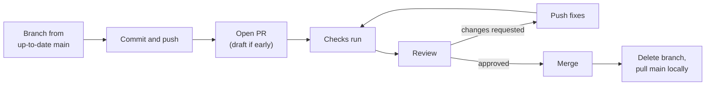

# Pull Requests End to End: The Complete Guide

> 📚 **Before you start**
>
> - [Branches Are Just Pointers](../04-branching-and-merging/branches-are-just-pointers.md)
> - [clone, fetch, pull and push](../05-remotes-and-github-basics/clone-fetch-pull-and-push.md), for pushing branches and `--force-with-lease`
> - [SSH Keys, Tokens and the GitHub CLI](../05-remotes-and-github-basics/ssh-keys-tokens-and-the-github-cli.md), for `gh`

## Introduction

On almost every software team, code doesn't reach `main` because someone typed `git merge main` on their laptop. It gets there through a **pull request** (PR): a page on GitHub that says "please merge my branch into `main`", shows exactly what would change, runs automated checks, and gives teammates a place to review and discuss before anything lands.

Pull requests are where most of the day-to-day collaboration of software development happens. They're also where many beginners feel nervous: what makes a good description, what happens when a reviewer asks for changes, how to update the branch without making a mess, and what to do locally once it merges. This article walks one pull request through its entire life, with the Git commands at every step and the GitHub actions around them.

By the end you'll be able to prepare a branch for review, open a pull request on the web or with `gh pr create`, write a description that gets fast reviews, use drafts, reviewers, labels and linked issues, check out someone else's pull request, respond to feedback by adding commits or rewriting with `--force-with-lease`, keep the branch up to date, merge (or auto-merge) it, and clean up afterwards, including the classic "branch is not fully merged" surprise after a squash merge.

> 💡 **Key Insight**
>
> A pull request is a **proposal to merge a head branch into a base branch**, plus a conversation. It's live: every push to the head branch updates it, checks rerun, and reviewers see the new commits. Nothing touches `main` until someone clicks **Merge**. That makes PRs safe to open early (as **drafts**) and lets you keep improving them until they're right.

---

## Core Explanation

The Git outputs below come from running Git 2.43 against a practice server that stands in for GitHub; URLs were changed to `https://github.com/asha-rao/chai-ledger.git`. Steps that only happen on GitHub's website are described rather than shown as terminal output.

### 1. Anatomy of a Pull Request

| Part | What it is |
|------|------------|
| **Base** | The branch you want to merge *into*, usually `main` |
| **Head** (compare) | Your branch with the changes, in the same repository or a fork |
| **Title and description** | What and why, written for reviewers |
| **Conversation** tab | Description, comments, review summaries, and a timeline of events |
| **Commits** tab | The head branch's commits not in the base |
| **Checks** tab | Results of CI runs (tests, linting) triggered by the PR |
| **Files changed** tab | The diff, where reviewers leave line comments |
| **Number** | Shared with issues: if issue #6 exists, the next PR is #7 |

Behind the scenes, GitHub stores each pull request's head commit as a ref in the base repository, `refs/pull/<number>/head`, which is how reviewers can fetch any PR, including one from a fork (section 6).



### 2. Prepare the Branch

Start from an up-to-date `main` (`git switch main`, then `git pull`) and keep the branch focused on **one change**. Small pull requests get reviewed faster and more carefully. A common guideline is a few hundred changed lines at most; split bigger work into a sequence of PRs.

```bash
git switch -c add-upi-payments
# edit billing.py, test, commit; then again for receipts
git log --oneline main..HEAD
```

Example output:

```
Switched to a new branch 'add-upi-payments'

02987c2 Show the UPI link on receipts
a74f7f6 Add upi_link() for UPI payments
```

Read `main..HEAD` as "commits on my branch that aren't on `main`": exactly what the pull request will contain. Before pushing, review your own diff (`git diff main...HEAD`), run the tests, and make sure commit messages make sense on their own ([Writing Good Commit Messages](../02-version-control-from-scratch/writing-good-commit-messages.md)).

Push the branch and set its upstream:

```bash
git push -u origin add-upi-payments
```

Example output:

```
To https://github.com/asha-rao/chai-ledger.git
 * [new branch]      add-upi-payments -> add-upi-payments
branch 'add-upi-payments' set up to track 'origin/add-upi-payments'.
```

When you push a new branch to GitHub, the server also prints a `remote:` line with a link for creating a pull request from it, and the repository page shows a yellow **Compare & pull request** banner.

### 3. Open the Pull Request

**On the web:** click **Compare & pull request** (or **Pull requests → New pull request**, then choose base and compare branches). Check the base is right, write a title and description, and either **Create pull request** or, from the button's dropdown, **Create draft pull request**.

**With `gh`:**

```bash
gh pr create --base main --title "Add UPI payments" --body-file pr.md --reviewer ravi-kumar --label payments
```

Flags you'll use, all from `gh pr create --help`:

| Flag | Effect |
|------|--------|
| `-B`, `--base` | Base branch (defaults to the repository's default branch) |
| `-H`, `--head` | Head branch, if not the current one |
| `-t`, `--title` / `-b`, `--body` / `-F`, `--body-file` | Title and description |
| `-f`, `--fill` | Use commit messages for title and body |
| `-d`, `--draft` | Open as a draft |
| `-r`, `--reviewer` | Request reviewers (users or `org/team`) |
| `-a`, `--assignee` | Assign people (`@me` for yourself) |
| `-l`, `--label`, `-m`, `--milestone`, `-p`, `--project` | Organise it ([Issues, Labels, Milestones and Projects](issues-labels-milestones-and-projects.md)) |
| `-T`, `--template` | Start from a PR template file |
| `-w`, `--web` | Finish in the browser |
| `--dry-run` | Print what would be created without creating it |

**Drafts** signal "work in progress, don't merge yet". They can't be merged, and code owners aren't automatically asked to review until the PR is marked ready. Use drafts to get early feedback or to let CI run on unfinished work. Mark it ready with the **Ready for review** button or `gh pr ready` (`gh pr ready --undo` converts it back).

### 4. Write a Description Reviewers Love

The description is the reviewer's map. A reliable structure:

```markdown
## What
Adds UPI payment links to receipts so customers can scan and pay.

## Why
Closes #5. About 60% of payments at the stall are UPI; staff currently type amounts by hand.

## How
- `upi_link()` builds a `upi://pay` URL from the amount and payee
- `receipt()` prints the link under the total

## How to test
python -c "import billing; print(billing.receipt([('masala', 2)]))"
Expect: a link ending in `am=40`.

## Notes for reviewers
The payee ID is hard-coded for now; making it configurable is #9.
```

Some things to get right:

- **Linking issues:** a closing keyword followed by an issue number, such as `Closes #5`, `Fixes #5` or `Resolves #5` (also `close`, `closed`, `fix`, `fixed`, `resolve`, `resolved`), links the PR to the issue and **closes the issue automatically when the PR merges into the default branch**. "Related to #9" links without closing.
- **Screenshots** for anything visual; before and after if it's a change.
- **Risks and rollout:** migrations, feature flags, anything a reviewer should look at hardest.
- **Templates:** a file at `.github/pull_request_template.md` pre-fills every new PR's description in that repository.

### 5. Checks Run Automatically

If the repository has CI ([module 7](../course.md#m7)), opening the PR and every later push trigger workflow runs. Their results appear as **status checks** at the bottom of the Conversation tab: yellow while running, green tick when passing, red cross on failure, with **Details** links to the logs. From the terminal:

```bash
gh pr checks --watch
```

`--watch` refreshes until the checks finish, and `--fail-fast` stops at the first failure. Branch protection can make specific checks **required**, so the Merge button stays disabled until they pass ([Branch Protection, Rulesets and CODEOWNERS](branch-protection-rulesets-and-codeowners.md)). Fix failures by pushing new commits to the same branch; the PR updates and checks rerun.

### 6. Reviewing: Getting Someone Else's PR Locally

Reading the diff on GitHub is often enough, but sometimes a reviewer wants to run the code. The easy way is `gh pr checkout 7`, which fetches the PR's branch (even from a fork) and switches to it. Underneath, it uses the `refs/pull/7/head` ref GitHub keeps, which you can fetch with plain Git:

```bash
git fetch origin pull/7/head:pr-7
git log --oneline main..pr-7
git diff --stat main...pr-7
```

Example output:

```
From https://github.com/asha-rao/chai-ledger
 * [new ref]         refs/pull/7/head -> pr-7

02987c2 Show the UPI link on receipts
a74f7f6 Add upi_link() for UPI payments

 billing.py | 9 +++++++++
 1 file changed, 9 insertions(+)
```

The refspec `pull/7/head:pr-7` means "fetch the remote's `refs/pull/7/head` into a local branch called `pr-7`". Ravi switches to it and tries it:

```bash
git switch pr-7
python3 -c "import billing; print(billing.receipt([(\"masala\", 2)]))"
```

Example output:

```
Switched to branch 'pr-7'

Total: Rs 40
Pay: upi://pay?pa=chai-ledger@upi&am=40
```

On GitHub he then submits a **review**: line comments on the Files changed tab, plus an overall verdict of **Comment**, **Approve** or **Request changes** (`gh pr review 7 --approve`, `--request-changes -b "..."` or `--comment -b "..."`). How to write useful reviews is the subject of [Code Review that Helps](code-review-that-helps.md).

### 7. Responding to Feedback

Ravi asks Asha to reject zero or negative amounts. There are two ways to update a PR, and both are just pushes to the head branch.

**Option A: add a commit.** Simple, and reviewers can see exactly what changed since their review:

```bash
# edit billing.py, then:
git commit -am "Reject zero or negative UPI amounts"
git push
```

Example output:

```
[add-upi-payments b99a803] Reject zero or negative UPI amounts
 1 file changed, 2 insertions(+)

To https://github.com/asha-rao/chai-ledger.git
   02987c2..b99a803  add-upi-payments -> add-upi-payments
```

**Option B: rewrite and force-push.** If the team cares about clean individual commits (because it uses rebase merging, for example), fold fixes into the right commits with an interactive rebase or `--amend`, then `git push --force-with-lease`. It's your own branch, so rewriting is fine; the lease protects any commits a co-author pushed.

Then reply to each comment ("Done in b99a803"), click **Resolve conversation** on the ones you've addressed, and **re-request review** with the circular arrows icon next to the reviewer's name (or `gh pr edit 7 --add-reviewer ravi-kumar`). Don't resolve threads where you disagree; reply with your reasoning instead.

### 8. Keeping the Branch Up to Date

While a PR is open, `main` keeps moving. You only *need* to update your branch when there are **conflicts** (GitHub shows "This branch has conflicts that must be resolved") or when branch protection requires branches to be up to date. Two ways:

- **On GitHub:** the **Update branch** button merges `main` into your branch (its dropdown can rebase instead). From the terminal: `gh pr update-branch`, or `gh pr update-branch --rebase`.
- **Locally:** rebase onto the latest `main` and force-push with a lease:

```bash
git fetch
git rebase origin/main
git push --force-with-lease
```

Example output:

```
From https://github.com/asha-rao/chai-ledger
   545fbe0..e8dacc8  main       -> origin/main

Successfully rebased and updated refs/heads/add-upi-payments.

To https://github.com/asha-rao/chai-ledger.git
 + b99a803...35cd1ef add-upi-payments -> add-upi-payments (forced update)
```

(Between the rebase and the push, Asha also amended the last commit to reword an error message. Section 6 of [Code Review that Helps](code-review-that-helps.md) shows how a reviewer can see exactly what changed across a force-push with `git range-diff`.)

If a pull request touches files that conflict, resolve them during the rebase exactly as in [Resolving Merge Conflicts](../04-branching-and-merging/resolving-merge-conflicts.md). GitHub's web editor can resolve simple conflicts too, by committing a merge of `main` into your branch.

### 9. Merging

When required reviews and checks are satisfied, the **Merge** button turns green. Its dropdown offers up to three methods, depending on repository settings:

| Button | What lands on `main` |
|--------|----------------------|
| **Create a merge commit** | All the branch's commits plus a merge commit "Merge pull request #7 from asha-rao/add-upi-payments" |
| **Squash and merge** | One new commit containing all the changes, titled from the PR by default ("Add UPI payments (#7)") |
| **Rebase and merge** | The branch's commits replayed on top of `main`, no merge commit |

The trade-offs are in [Merge Strategies and Merge Queues](merge-strategies-and-merge-queues.md). From the terminal: `gh pr merge 7 --squash --delete-branch` (or `--merge`, `--rebase`).

**Auto-merge** lets you say "merge this as soon as it's approved and checks pass" and walk away: click **Enable auto-merge** or run `gh pr merge 7 --auto --squash`. It must be allowed in the repository settings. If someone pushes new commits, the requirements are checked again before it merges.

After merging, GitHub offers **Delete branch**. Take it: merged branches only clutter the list, and the PR keeps a record of the commits. Repositories can enable **Automatically delete head branches** in settings so it happens every time. If a merged PR causes trouble, its page has a **Revert** button that opens a new PR reverting it.

### 10. Cleaning Up Locally After a Merge

The PR was squash-merged and its remote branch deleted. Asha updates `main`:

```bash
git switch main
git pull
git log --oneline -4
```

Example output:

```
Switched to branch 'main'
Your branch is behind 'origin/main' by 1 commit, and can be fast-forwarded.
  (use "git pull" to update your local branch)

From https://github.com/asha-rao/chai-ledger
   e8dacc8..8fc9518  main       -> origin/main
Updating 545fbe0..8fc9518
Fast-forward
 README.md  |  2 ++
 billing.py | 11 +++++++++++
 2 files changed, 13 insertions(+)

8fc9518 Add UPI payments (#7)
e8dacc8 Describe the project
545fbe0 Add README
71d650d Add billing
```

Now prune the bookmark for the deleted remote branch and look at the local one:

```bash
git fetch --prune
git branch -vv
git branch -d add-upi-payments
```

Example output:

```
From https://github.com/asha-rao/chai-ledger
 - [deleted]         (none)     -> origin/add-upi-payments

  add-upi-payments 35cd1ef [origin/add-upi-payments: gone] Reject zero or negative UPI amounts
* main             8fc9518 [origin/main] Add UPI payments (#7)

error: the branch 'add-upi-payments' is not fully merged.
If you are sure you want to delete it, run 'git branch -D add-upi-payments'
```

`[...: gone]` means the upstream branch was deleted on the server, a good sign the PR merged. But why "not fully merged"? A **squash merge creates a brand-new commit** (`8fc9518`). The branch's own commits (`35cd1ef` and its parents) were never added to `main`, so Git, which checks ancestry, can't tell the work landed. Once you've confirmed the PR merged on GitHub, force-delete:

```bash
git branch -D add-upi-payments
```

Example output:

```
Deleted branch add-upi-payments (was 35cd1ef).
```

With a **merge commit**, the branch's commits *are* ancestors of `main`, so the safe delete works. Asha's next PR, #8, was merged that way:

```bash
git branch --merged
git branch -d fix-ginger-price
git log --oneline --graph -5
```

Example output:

```
  fix-ginger-price
* main

Deleted branch fix-ginger-price (was f008537).

*   f6d002d Merge pull request #8 from asha-rao/fix-ginger-price
|\  
| * f008537 Raise ginger chai to Rs 26
|/  
* 8fc9518 Add UPI payments (#7)
* e8dacc8 Describe the project
* 545fbe0 Add README
```

`git branch --merged` lists branches whose tips are reachable from the current branch, safe to delete. Because PR numbers end up in commit titles, `git log --oneline --grep="#7"` finds the commit for a PR later.

### 11. Closing, Reopening and Etiquette

- **Close without merging** when an approach is abandoned (`gh pr close 7 --comment "Superseded by #11"`). Closed PRs can be reopened while the branch exists.
- **One PR, one purpose.** Don't sneak unrelated refactors in; open a separate PR.
- **Review your own PR first.** Read the Files changed tab before requesting review; you'll catch debug prints and stray files.
- **Respond promptly** and keep discussion on the PR, not in private chat, so the reasoning is recorded.
- **Don't force-push during an active review** without saying so; reviewers lose their place. Adding commits during review and cleaning up at the end (or squash merging) avoids this.

---

## Try It Yourself

Use a practice repository on GitHub (create one with `gh repo create pr-practice --private --add-readme --clone`).

1. **First PR.** Create a branch, make two small commits, push with `-u`, and open a PR with `gh pr create --fill`. What did `--fill` use for the title and body?
2. **Draft to ready.** Open a second PR as a draft. Try to merge it. Then mark it ready with `gh pr ready`.
3. **Link an issue.** Create an issue, then edit your PR description to include `Closes #<n>`. Merge the PR and check the issue's state.
4. **Fetch a PR by ref.** In a separate clone, run `git fetch origin pull/<n>/head:pr-<n>` for one of your PRs and compare `git log main..pr-<n>` with the PR's Commits tab.
5. **Squash cleanup.** Squash-merge a PR on GitHub, then locally run `git switch main`, `git pull`, `git fetch --prune`, and `git branch -d <branch>`. Explain the result and fix it.

<details>
<summary>Show answers</summary>

1. With several commits, `--fill` uses the branch name as the title and lists the commit messages in the body; with a single commit, it uses that commit's subject and body.
2. Drafts can't be merged; the Merge button is replaced by **Ready for review**. `gh pr ready <n>` marks it ready.
3. The issue closes automatically when the PR merges into the default branch, and its timeline links to the PR.
4. They list the same commits; `refs/pull/<n>/head` points at the PR's head commit.
5. `git branch -d` refuses with "not fully merged" because the squash commit is new and the branch's commits aren't ancestors of `main`. After confirming the merge, `git branch -D <branch>`.

</details>

---

## Real-World Examples

### Example 1: A Product Team's Daily Flow

Each ticket becomes a branch named after it, a draft PR opened on the first push so CI runs early, and a ready PR once tests pass. Two approvals are required, checks must be green, and auto-merge squashes it in. The PR title, including the ticket number, becomes the commit on `main`.

### Example 2: Open Source Contributions

A contributor opens a PR from a fork. Maintainers can't push to the contributor's repository directly, but "Allow edits by maintainers" lets them push small fixes to the PR branch, and `gh pr checkout` lets them run it locally before merging.

### Example 3: Stacked Pull Requests

A developer splits a large feature into three PRs: the database change, the API, then the UI, each based on the previous branch. Reviewers read each piece in isolation. When the first merges, GitHub retargets the next PR's base to `main` automatically if its old base branch is deleted.

---

## Common Misconceptions

### Misconception 1: "I have to open a new PR after every change"

A PR tracks a branch. Push to the branch and the PR updates.

### Misconception 2: "The PR is a copy of my code"

It's a live view of the branch compared with the base. Rewriting the branch rewrites the PR's commits.

### Misconception 3: "Only finished work should become a PR"

Drafts exist for early feedback and early CI. Opening early often saves rework.

### Misconception 4: "`git branch -d` failing after merge means the PR didn't merge"

After a squash or rebase merge, the branch's original commits aren't on `main`, so Git can't prove they merged. Check the PR, then use `-D`.

### Misconception 5: "Approval means the code is correct"

Approval means a reviewer saw no blocking problems. Tests, checks and the author's own diligence still matter.

---

## Interview Relevance

Pull request workflow questions are near-universal in developer interviews:

- **"Walk me through how you get a change into production."** Branch, commits, push, PR with description and linked issue, checks, review, address feedback, merge per team policy, deploy.
- **"What makes a good pull request?"** Small and focused, a clear description (what, why, how to test), green checks, self-reviewed.
- **"How do you update a PR after review comments?"** New commits, or a rewrite with `--force-with-lease`; reply to comments and re-request review.
- **"Your branch has conflicts with main. What do you do?"** Fetch, rebase onto (or merge) `origin/main`, resolve, test, push.
- **"Why might `git branch -d` refuse to delete a merged branch?"** Squash or rebase merges create new commits.

---

## Key Takeaways

- A PR proposes merging a **head** branch into a **base** branch; it updates on every push and stays unmerged until someone merges it.
- Keep PRs **small and focused**, describe **what, why and how to test**, and link issues with **`Closes #n`**.
- Use **drafts** for early feedback; checks and reviews gate the merge.
- Respond to feedback by **pushing to the same branch** (new commits, or a rewrite with `--force-with-lease`), then re-request review.
- Review others' PRs locally with **`gh pr checkout`** or `git fetch origin pull/<n>/head:<branch>`.
- After merging: **delete the branch**, `git pull` on `main`, `git fetch --prune`, and expect to need **`git branch -D`** after squash merges.

---

**Up next:** [Code Review that Helps](code-review-that-helps.md)
