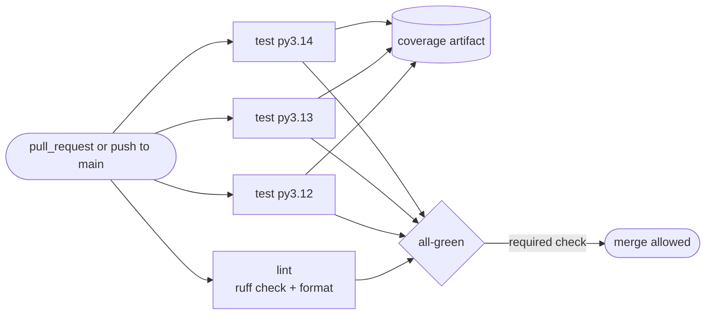

# Lab: CI that Tests and Lints a Python Project

> 📚 **Before you start**
>
> - [Workflows, Jobs, Steps and Runners](workflows-jobs-steps-and-runners.md)
> - [Triggers and Events](triggers-and-events.md)
> - [Matrix Builds and Caching](matrix-builds-and-caching.md)
> - [Branch Protection, Rulesets and CODEOWNERS](../course.md#m6) (Collaborating on GitHub), for Step 8
> - [Package Managers and Virtual Environments](../../the-command-line-and-linux-basics/course.md#m3) (The Command Line and Linux Basics)

## What You'll Build

A small Python package, `chai-bill`, that adds GST to a chai stall bill and splits it fairly between friends, with a production-quality CI pipeline around it:

1. A **lint** job that runs Ruff's linter and formatter check and puts problems as annotations on the pull request.
2. A **test** job that runs pytest with coverage on three Python versions in parallel, with pip caching.
3. A **coverage report** uploaded as an artifact and summarised on the run page.
4. A single **all-green** job you can mark as the one required check, so branch protection stays simple even as the matrix changes.



> 💡 **Key Insight**
>
> CI should run **exactly the commands you run locally**, configured in **one place** (`pyproject.toml`). If the workflow has its own special flags, local and CI results drift apart and people stop trusting the red X.

You'll need Git, Python 3.12 or newer, and a GitHub repository you can push to.

---

## Step 1: Create the Project Layout

```bash
mkdir chai-bill && cd chai-bill
git init -b main
mkdir -p src/chai_bill tests .github/workflows
touch src/chai_bill/__init__.py
```

The finished layout:

```
chai-bill/
├── .github/
│   └── workflows/
│       └── ci.yml
├── pyproject.toml
├── src/
│   └── chai_bill/
│       ├── __init__.py
│       └── billing.py
└── tests/
    └── test_billing.py
```

The **src layout** (code under `src/`) means tests run against the *installed* package, not whatever happens to be in the current folder. It catches packaging mistakes that a flat layout hides.

---

## Step 2: Write the Code

`src/chai_bill/billing.py`:

```python
"""Billing helpers for a chai stall: GST and fair bill splitting."""

from decimal import ROUND_HALF_UP, Decimal

GST_RATE = Decimal("0.05")


class BillError(ValueError):
    """Raised when a bill can't be calculated."""


def to_rupees(amount) -> Decimal:
    """Round any number to rupees and paise."""
    return Decimal(str(amount)).quantize(Decimal("0.01"), rounding=ROUND_HALF_UP)


def add_gst(amount, rate=GST_RATE) -> Decimal:
    """Return the amount with GST added, rounded to the paisa."""
    value = Decimal(str(amount))
    if value < 0:
        raise BillError("amount can't be negative")
    return to_rupees(value * (1 + rate))


def split_bill(total, people: int) -> list[Decimal]:
    """Split a bill so shares differ by at most one paisa and add up exactly."""
    if people < 1:
        raise BillError("need at least one person")
    paise = int(to_rupees(total) * 100)
    base, extra = divmod(paise, people)
    return [Decimal(base + (1 if i < extra else 0)) / 100 for i in range(people)]
```

Money uses `Decimal`, never `float`: `0.1 + 0.2` isn't exactly `0.3` in floating point, and a bill that's off by a paisa is a bug. Try it before writing any tests:

```python
print(add_gst(20))
print(add_gst(99.99))
print(split_bill(100, 3))
try:
    split_bill(100, 0)
except BillError as err:
    print("BillError:", err)
```

Output:

```
21.00
104.99
[Decimal('33.34'), Decimal('33.33'), Decimal('33.33')]
BillError: need at least one person
```

₹100 among three friends becomes 33.34 + 33.33 + 33.33, which adds up to exactly ₹100.

---

## Step 3: Write the Tests

`tests/test_billing.py`:

```python
# not-run: this file is collected by pytest, which imports the installed chai_bill package
from decimal import Decimal

import pytest

from chai_bill.billing import BillError, add_gst, split_bill


def test_gst_on_a_cup_of_chai():
    assert add_gst(20) == Decimal("21.00")


@pytest.mark.parametrize(
    ("amount", "expected"),
    [(0, "0.00"), (99.99, "104.99"), (1000, "1050.00")],
)
def test_gst_table(amount, expected):
    assert add_gst(amount) == Decimal(expected)


def test_negative_amount_is_rejected():
    with pytest.raises(BillError):
        add_gst(-1)


def test_split_adds_up_exactly():
    shares = split_bill(100, 3)
    assert shares == [Decimal("33.34"), Decimal("33.33"), Decimal("33.33")]
    assert sum(shares) == Decimal("100.00")


def test_split_needs_at_least_one_person():
    with pytest.raises(BillError):
        split_bill(100, 0)
```

(The first comment line is only for this website's code checker; leave it out of your file.) `parametrize` turns one test function into three test cases, so pytest will collect seven tests.

---

## Step 4: Put All Configuration in `pyproject.toml`

```toml
[build-system]
requires = ["setuptools>=69"]
build-backend = "setuptools.build_meta"

[project]
name = "chai-bill"
version = "0.1.0"
description = "Billing helpers for a chai stall"
requires-python = ">=3.12"

[project.optional-dependencies]
test = ["pytest>=8", "pytest-cov>=5"]

[tool.setuptools.packages.find]
where = ["src"]

[tool.pytest.ini_options]
addopts = "-ra --strict-markers"
testpaths = ["tests"]

[tool.coverage.run]
source = ["chai_bill"]
branch = true

[tool.coverage.report]
show_missing = true
fail_under = 90

[tool.ruff]
line-length = 100
target-version = "py312"

[tool.ruff.lint]
select = ["E", "F", "W", "I", "B", "UP"]
```

What each tool section does:

- **pytest**: `-ra` prints a summary of skipped and failed tests; `--strict-markers` turns a typo in a marker name into an error.
- **coverage**: measure the `chai_bill` package including branches, show missing lines, and **fail below 90%**. The threshold lives here, so local runs and CI enforce the same rule.
- **Ruff**: one fast tool for linting and formatting. The selected rule groups are pycodestyle errors and warnings (`E`, `W`), Pyflakes (`F`, such as unused imports), import sorting (`I`), bugbear (`B`, likely bugs) and pyupgrade (`UP`, modern syntax).

---

## Step 5: Run Everything Locally First

```bash
python -m venv .venv && source .venv/bin/activate
python -m pip install -e ".[test]" ruff
ruff check .
ruff format --check .
python -m pytest --cov --cov-report=term-missing
```

Example output:

```
All checks passed!
3 files already formatted
============================= test session starts ==============================
collected 7 items

tests/test_billing.py .......                                            [100%]

================================ tests coverage ================================
Name                        Stmts   Miss Branch BrPart  Cover   Missing
-----------------------------------------------------------------------
src/chai_bill/__init__.py       0      0      0      0   100%
src/chai_bill/billing.py       16      0      4      0   100%
-----------------------------------------------------------------------
TOTAL                          16      0      4      0   100%
Required test coverage of 90.0% reached. Total coverage: 100.00%
============================== 7 passed in 0.06s ===============================
```

Add a `.gitignore` with `.venv/`, `__pycache__/`, `.coverage`, `coverage.xml` and `*.egg-info/`, then commit:

```bash
git add .
git commit -m "Add chai-bill package with tests"
```

---

## Step 6: Write the Workflow

`.github/workflows/ci.yml`:

```yaml
name: CI

on:
  pull_request:
  push:
    branches: [main]
  merge_group:            # harmless now, needed if you ever turn on a merge queue
  workflow_dispatch:

permissions:
  contents: read

concurrency:
  group: ci-${{ github.workflow }}-${{ github.ref }}
  cancel-in-progress: true

env:
  RUFF_VERSION: "0.16.8"
  PIP_DISABLE_PIP_VERSION_CHECK: "1"

jobs:
  lint:
    runs-on: ubuntu-latest
    timeout-minutes: 5
    steps:
      - uses: actions/checkout@v7
      - uses: actions/setup-python@v7
        with:
          python-version: "3.13"
      - run: python -m pip install "ruff==${RUFF_VERSION}"
      - name: Lint
        run: ruff check --output-format=github .
      - name: Check formatting
        run: ruff format --check --diff .

  test:
    name: test (py${{ matrix.python }})
    runs-on: ubuntu-latest
    timeout-minutes: 15
    strategy:
      fail-fast: false
      matrix:
        python: ["3.12", "3.13", "3.14"]
    steps:
      - uses: actions/checkout@v7
      - uses: actions/setup-python@v7
        with:
          python-version: ${{ matrix.python }}
          cache: pip
          cache-dependency-path: pyproject.toml
      - run: python -m pip install -e ".[test]"
      - name: Run tests
        run: python -m pytest --cov --cov-report=term-missing --cov-report=xml --junitxml=junit.xml
      - name: Coverage summary
        if: always()
        run: |
          {
            echo "### Coverage on Python ${{ matrix.python }}"
            python -m coverage report --format=markdown || echo "No coverage data."
          } >> "$GITHUB_STEP_SUMMARY"
      - uses: actions/upload-artifact@v7
        if: always()
        with:
          name: coverage-py${{ matrix.python }}
          path: |
            coverage.xml
            junit.xml
          retention-days: 14

  all-green:
    # One stable check name to require in branch protection.
    if: always()
    needs: [lint, test]
    runs-on: ubuntu-latest
    steps:
      - name: Fail if any needed job failed or was cancelled
        run: |
          echo "lint=${{ needs.lint.result }} test=${{ needs.test.result }}"
          if [ "${{ contains(needs.*.result, 'failure') || contains(needs.*.result, 'cancelled') }}" = "true" ]; then
            exit 1
          fi
```

Design choices to notice:

- **`--output-format=github`** makes Ruff print workflow commands, so each problem appears as an annotation on the exact line in the pull request's "Files changed" tab.
- **Pinned Ruff version** in one `env` value, so a new Ruff release can't suddenly fail every pull request. Bump it on purpose.
- **`fail-fast: false`** shows every failing Python version, not just the first.
- **`if: always()` on the summary and upload** means you get the report even when tests fail, which is exactly when you need it.
- **`all-green`** runs even if others fail (`if: always()`) and turns any failure or cancellation into its own failure. Without the explicit check, a job with `if: always()` would pass even when its dependencies failed.
- **`permissions: contents: read`**: this workflow never needs to write anything.

Commit and push:

```bash
git add .github/workflows/ci.yml
git commit -m "Add CI workflow: lint, test matrix, coverage"
git remote add origin git@github.com:YOUR-USER/chai-bill.git
git push -u origin main
```

---

## Step 7: Watch It Run, Then Break It on Purpose

Open the **Actions** tab, or watch from the terminal:

```bash
gh run watch
```

Example output:

```
✓ main CI · 11849213370
Triggered via push less than a minute ago

JOBS
✓ lint in 14s
✓ test (py3.12) in 22s
✓ test (py3.13) in 19s
✓ test (py3.14) in 21s
✓ all-green in 3s
```

Now open a pull request that breaks things in two ways. Create a branch, add an unused `import os` at the top of `billing.py`, and "simplify" `split_bill`'s last line to `return [Decimal(base) / 100 for i in range(people)]`:

```bash
git switch -c break-ci
# edit src/chai_bill/billing.py as described
git commit -am "Simplify bill splitting"
git push -u origin break-ci
gh pr create --fill
```

The **lint** job fails. Locally, the same problem looks like this:

Example output:

```
F401 [*] `os` imported but unused
 --> src/chai_bill/billing.py:3:8
  |
1 | """Billing helpers for a chai stall: GST and fair bill splitting."""
2 |
3 | import os
  |        ^^
4 | from decimal import ROUND_HALF_UP, Decimal
  |
help: Remove unused import: `os`

Found 1 error.
[*] 1 fixable with the `--fix` option.
```

In CI, with `--output-format=github`, it appears as a red annotation on line 3 of the diff. Each **test** job fails too:

Example output:

```
.....F.                                                                  [100%]
=================================== FAILURES ===================================
__________________________ test_split_adds_up_exactly __________________________

    def test_split_adds_up_exactly():
        shares = split_bill(100, 3)
>       assert shares == [Decimal("33.34"), Decimal("33.33"), Decimal("33.33")]
E       AssertionError: assert [Decimal('33....imal('33.33')] == [Decimal('33....imal('33.33')]
E
E         At index 0 diff: Decimal('33.33') != Decimal('33.34')

tests/test_billing.py:27: AssertionError
=========================== short test summary info ============================
FAILED tests/test_billing.py::test_split_adds_up_exactly - AssertionError: as...
1 failed, 6 passed in 0.02s
```

The "simplification" lost a paisa: three shares of 33.33 add up to ₹99.99. This is exactly the kind of bug CI exists to catch. Finally, **all-green** fails because its dependencies did. Revert the change (`git revert HEAD` or fix the code) and push again to see everything go green.

---

## Step 8: Make the Check Required

A check that can be ignored will be ignored on a busy day. Protect `main`:

1. **Settings → Rules → Rulesets → New branch ruleset** (or **Branches → Add branch protection rule**).
2. Target the default branch.
3. Enable **Require a pull request before merging**.
4. Enable **Require status checks to pass**, and add **`all-green`**. Because it summarises lint and every matrix job, you can add Python 3.15 later without touching the ruleset.
5. Optionally enable **Require branches to be up to date before merging**.

Now the merge button stays disabled until `all-green` passes. The [Branch Protection, Rulesets and CODEOWNERS](../course.md#m6) lesson explains every option on that page.

---

## Step 9: Add a Badge

Add the workflow's status badge to your README:

```markdown
# chai-bill


Billing helpers for a chai stall: GST and fair bill splitting.
```

The `?branch=main` part shows the status of `main` only, not whatever pull request ran last.

---

## Try It Yourself

1. **Auto-fix locally.** Run `ruff check --fix .` on the broken branch. Which problem does it fix, and which does it leave for you?
2. **Raise the bar.** Delete the `test_split_needs_at_least_one_person` test and run pytest with coverage. Does the 90% threshold still pass? What does the `Missing` column show?
3. **Add a version.** Add a Windows job for Python 3.13 only, without adding Windows for every version. Write the matrix change.
4. **Draft PRs.** Stop the expensive test matrix from running on draft pull requests, while still running lint.

<details>
<summary>Show answers</summary>

**1.** It removes the unused `import os` (rule F401 is auto-fixable, marked `[*]`). It can't fix the logic bug in `split_bill`; only the failing test reveals that.

**2.** The `raise BillError("need at least one person")` line (line 28) is never run, and one branch is only partly covered:

```
Name                        Stmts   Miss Branch BrPart  Cover   Missing
-----------------------------------------------------------------------
src/chai_bill/__init__.py       0      0      0      0   100%
src/chai_bill/billing.py       16      1      4      1    90%   28
-----------------------------------------------------------------------
TOTAL                          16      1      4      1    90%
Required test coverage of 90.0% reached. Total coverage: 90.00%
```

It passes, just barely. That's a good reminder that a coverage threshold is a floor, not proof that the important cases are tested.

**3.**

```yaml
strategy:
  fail-fast: false
  matrix:
    os: [ubuntu-latest]
    python: ["3.12", "3.13", "3.14"]
    include:
      - os: windows-latest
        python: "3.13"
```

and change `runs-on: ${{ matrix.os }}`. The include entry clashes with the original `os` value, so it becomes one extra job.

**4.** Add a job-level condition to `test` only:

```yaml
test:
  if: github.event_name != 'pull_request' || github.event.pull_request.draft == false
```

Also add `ready_for_review` to the `pull_request` types so the tests start when the draft is marked ready: `pull_request: types: [opened, synchronize, reopened, ready_for_review]`. Note that `all-green` will then see `test` as `skipped`, which it treats as success.

</details>

---

## What You've Learned

- **One source of truth**: pytest, coverage and Ruff settings live in `pyproject.toml`, and CI runs the same commands you run locally.
- **Parallel jobs** for lint and a **matrix** of test versions, with **pip caching** keyed on `pyproject.toml`.
- **Readable feedback**: Ruff annotations on the diff, a coverage table in the job summary, JUnit and coverage XML as artifacts.
- **Robust required checks**: one `all-green` job that turns any failure or cancellation into a failure, required by a ruleset.
- **Good habits**: explicit `permissions`, `concurrency` to cancel stale runs, timeouts and pinned tool versions.

---

**Up next:** [Publishing a Site with GitHub Pages](../08-github-pages-codespaces-and-packages/publishing-a-site-with-github-pages.md)
