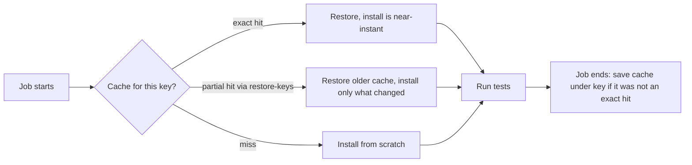

# Matrix Builds and Caching: The Complete Guide

> 📚 **Before you start**
>
> - [Workflows, Jobs, Steps and Runners](workflows-jobs-steps-and-runners.md)
> - [Triggers and Events](triggers-and-events.md)
> - [Package Managers and Virtual Environments](../../the-command-line-and-linux-basics/course.md#m3) (The Command Line and Linux Basics), for what `pip install` and lockfiles do

## Introduction

A chai stall owner wants to know whether a new recipe works. One cup on one stove proves very little. So she brews it on the gas stove and the induction plate, with full-cream milk and toned milk: four cups at once, side by side. And she keeps a tin of ready-ground masala, so she doesn't grind spices from scratch for every cup.

That is this lesson in one picture. A **matrix** runs the same job across many combinations (Python versions, operating systems, database versions) in parallel. A **cache** keeps expensive-to-rebuild things, like downloaded packages, between runs so each run starts warm.

By the end you will be able to write matrices with include, exclude, fail-fast and dynamic values, predict exactly which jobs a matrix creates, cache dependencies with both the setup actions and `actions/cache`, design good cache keys, and know when to use a cache versus an artifact.

> 💡 **Key Insight**
>
> A matrix multiplies **coverage** without multiplying YAML. A cache divides **time** without changing results. A cache must only ever be a speed-up: if the cache vanished, the build must still produce the same answer, just slower.

---

## Core Explanation

### 1. Your First Matrix

```yaml
name: CI
on: [push, pull_request]

jobs:
  test:
    runs-on: ${{ matrix.os }}
    strategy:
      matrix:
        os: [ubuntu-latest, windows-latest]
        python: ["3.12", "3.13", "3.14"]
    steps:
      - uses: actions/checkout@v7
      - uses: actions/setup-python@v7
        with:
          python-version: ${{ matrix.python }}
      - run: python -m pip install -r requirements.txt pytest
      - run: python -m pytest -q
```

GitHub takes every combination of the lists, the **Cartesian product**, and creates one job for each: 2 operating systems × 3 Python versions = 6 jobs, all running at once. Each job reads its own values through the `matrix` context, and the Actions tab names them like `test (ubuntu-latest, 3.13)`.

Always quote version numbers. In YAML, `3.10` without quotes is the number 3.1, and you'd get a puzzling "Python 3.1 not found" error.

### 2. Seeing the Expansion in Python

The rules for how a matrix expands are easy to misremember, so let's write them as code. This function follows the rules in GitHub's documentation, which we'll use for `include` and `exclude` in the next section.

```python
from itertools import product

def expand_matrix(matrix):
    """Expand a GitHub Actions matrix the way the docs describe it."""
    dims = {k: v for k, v in matrix.items() if k not in ("include", "exclude")}
    keys = list(dims)
    combos = [dict(zip(keys, values)) for values in product(*dims.values())]

    # exclude: drop every combination that matches all keys of an exclude entry
    for rule in matrix.get("exclude", []):
        combos = [c for c in combos if not all(c.get(k) == v for k, v in rule.items())]

    # include: extend matching combinations, or add a new one
    originals = [dict(c) for c in combos]
    for extra in matrix.get("include", []):
        added = False
        for combo, original in zip(combos, originals):
            clashes = any(k in original and original[k] != v for k, v in extra.items())
            if not clashes:
                combo.update(extra)
                added = True
        if not added:
            combos.append(dict(extra))
            originals.append(dict(extra))
    return combos

matrix = {
    "os": ["ubuntu-latest", "windows-latest"],
    "python": ["3.12", "3.13", "3.14"],
}
for job in expand_matrix(matrix):
    print(job)
print(len(expand_matrix(matrix)), "jobs")
```

Output:

```
{'os': 'ubuntu-latest', 'python': '3.12'}
{'os': 'ubuntu-latest', 'python': '3.13'}
{'os': 'ubuntu-latest', 'python': '3.14'}
{'os': 'windows-latest', 'python': '3.12'}
{'os': 'windows-latest', 'python': '3.13'}
{'os': 'windows-latest', 'python': '3.14'}
6 jobs
```

### 3. `exclude` and `include`

Real matrices are rarely a perfect grid. Maybe Windows doesn't need the oldest Python, coverage should only run once, and you want one extra macOS job.

```yaml
strategy:
  matrix:
    os: [ubuntu-latest, windows-latest]
    python: ["3.12", "3.13", "3.14"]
    exclude:
      - os: windows-latest
        python: "3.12"
    include:
      - python: "3.14"
        coverage: true
      - os: macos-latest
        python: "3.13"
```

The rules:

- **`exclude`** removes every combination that matches **all** the keys in an exclude entry. It is applied first.
- **`include`** entries are processed one by one. An entry's values are **added** to every existing combination it doesn't conflict with (it may not change an original matrix value). If it fits **no** combination, it becomes a **new** job of its own.

```python
matrix = {
    "os": ["ubuntu-latest", "windows-latest"],
    "python": ["3.12", "3.13", "3.14"],
    "exclude": [{"os": "windows-latest", "python": "3.12"}],
    "include": [
        {"python": "3.14", "coverage": True},
        {"os": "macos-latest", "python": "3.13"},
    ],
}
for job in expand_matrix(matrix):
    print(job)
```

Output:

```
{'os': 'ubuntu-latest', 'python': '3.12'}
{'os': 'ubuntu-latest', 'python': '3.13'}
{'os': 'ubuntu-latest', 'python': '3.14', 'coverage': True}
{'os': 'windows-latest', 'python': '3.13'}
{'os': 'windows-latest', 'python': '3.14', 'coverage': True}
{'os': 'macos-latest', 'python': '3.13'}
```

The `coverage` entry attached itself to both 3.14 jobs, because it doesn't clash with them. The macOS entry clashes with every combination's `os`, so it became a sixth job. In the workflow, a step reads the extra key:

```yaml
- if: matrix.coverage
  run: python -m pytest --cov=src --cov-report=xml
```

Keys that don't exist in a combination are simply empty, so `if: matrix.coverage` is false on the other jobs.

### 4. Controlling How the Matrix Runs

```yaml
strategy:
  fail-fast: false        # default true: one failure cancels the rest
  max-parallel: 3         # at most 3 matrix jobs at a time
  matrix:
    python: ["3.12", "3.13", "3.14"]
```

- **`fail-fast`** (default `true`) cancels the remaining in-progress and queued jobs when one fails. Set it to `false` when you want the full picture: "it fails only on Windows" is much more useful than "it failed".
- **`max-parallel`** limits concurrency, for example when tests hit a shared staging database or a rate-limited API.
- **`continue-on-error`** at job level, often driven by the matrix, lets an experimental combination fail without failing the workflow:

```yaml
jobs:
  test:
    runs-on: ubuntu-latest
    continue-on-error: ${{ matrix.experimental }}
    strategy:
      matrix:
        python: ["3.13", "3.14"]
        experimental: [false]
        include:
          - python: "3.15-dev"
            experimental: true
```

A matrix can produce at most **256 jobs** per workflow run.

### 5. Dynamic Matrices

Sometimes the list isn't known until the workflow runs, for example "test only the packages that changed in this monorepo". One job computes a JSON list and a later job uses `fromJSON` to turn it into a matrix:

```yaml
jobs:
  plan:
    runs-on: ubuntu-latest
    outputs:
      packages: ${{ steps.list.outputs.packages }}
    steps:
      - uses: actions/checkout@v7
      - id: list
        run: |
          # every folder under packages/ that has a pyproject.toml, as a JSON array
          pkgs=$(find packages -maxdepth 2 -name pyproject.toml -printf '%h\n' | xargs -n1 basename | jq -R . | jq -cs .)
          echo "packages=$pkgs" >> "$GITHUB_OUTPUT"

  test:
    needs: plan
    runs-on: ubuntu-latest
    strategy:
      matrix:
        package: ${{ fromJSON(needs.plan.outputs.packages) }}
    steps:
      - uses: actions/checkout@v7
      - run: echo "Testing packages/${{ matrix.package }}"
```

Example output (plan job):

```
packages=["billing","orders","payments"]
```

If the list could be empty, guard the `test` job with `if: needs.plan.outputs.packages != '[]'`, because a matrix with no values is an error.

### 6. Why Cache?

Every GitHub-hosted job starts on a fresh machine. Without a cache, every run downloads every package again: hundreds of megabytes and a minute or more per job, multiplied by your matrix. A **cache** stores a folder (like pip's or npm's download cache) at the end of one run and restores it at the start of the next.



### 7. The Easy Way: Caching Built into Setup Actions

Most language setup actions can cache for you with one line:

```yaml
- uses: actions/setup-python@v7
  with:
    python-version: "3.13"
    cache: pip                                  # also: pipenv, poetry
    cache-dependency-path: requirements*.txt    # files whose hash forms the key

- uses: actions/setup-node@v7
  with:
    node-version: 22
    cache: npm                                  # also: yarn, pnpm
    cache-dependency-path: site/package-lock.json
```

The action builds the cache key from the OS, the tool version and a hash of the dependency files, so the cache changes exactly when your dependencies change. `setup-go`, `setup-java`, `setup-ruby` and `setup-dotnet` have similar options. For `uv`, the `astral-sh/setup-uv` action has its own `enable-cache` input.

This site's own deploy workflow uses exactly this: `cache: npm` with `cache-dependency-path: site/package-lock.json`.

### 8. The Flexible Way: `actions/cache`

For anything else (a model download, a pre-commit environment, a compiled build folder), use `actions/cache` directly:

```yaml
- uses: actions/cache@v6
  id: cache-models
  with:
    path: ~/.cache/huggingface
    key: hf-${{ runner.os }}-${{ hashFiles('models.txt') }}
    restore-keys: |
      hf-${{ runner.os }}-

- if: steps.cache-models.outputs.cache-hit != 'true'
  run: python scripts/download_models.py
```

| Input / output | Meaning |
|---|---|
| `path` | Files or folders to cache (one per line, globs allowed) |
| `key` | Exact name of the cache entry to look for, and to save under |
| `restore-keys` | Ordered list of key **prefixes** to fall back on if there is no exact hit |
| `fail-on-cache-miss` | Fail the job instead of continuing when nothing matches |
| `lookup-only` | Check whether a cache exists without downloading it |
| `cache-hit` (output) | `'true'` only for an **exact** key match |

The action restores at the start and saves automatically in a post-step at the end of a successful job, under `key`, **only if** there was no exact hit. Caches are immutable: you can't update an entry, you save a new one under a new key. When you need separate control, `actions/cache/restore` and `actions/cache/save` split the two halves.

### 9. Designing Cache Keys

The lookup logic, in Python, looks like this:

```python
def find_cache(saved_keys, key, restore_keys):
    """Return (hit_type, key) the way actions/cache looks up a cache."""
    if key in saved_keys:
        return "exact hit", key
    for prefix in restore_keys:
        matches = [k for k in saved_keys if k.startswith(prefix)]
        if matches:
            return "partial hit", matches[-1]   # the newest matching entry wins
    return "miss", None

saved = ["pip-Linux-3f9a", "pip-Linux-77c1", "npm-Linux-aa01"]   # oldest first
print(find_cache(saved, "pip-Linux-77c1", ["pip-Linux-"]))
print(find_cache(saved, "pip-Linux-b2e4", ["pip-Linux-", "pip-"]))
print(find_cache(saved, "pip-Windows-b2e4", ["pip-Windows-"]))
```

Output:

```
('exact hit', 'pip-Linux-77c1')
('partial hit', 'pip-Linux-77c1')
('miss', None)
```

A good key has three parts, from general to specific:

1. **What** is cached: `pip`, `npm`, `hf-models`.
2. **Where it is valid**: `${{ runner.os }}`, plus the tool version if the cache depends on it.
3. **A fingerprint of the inputs**: `${{ hashFiles('**/requirements*.txt') }}` or a lockfile hash.

Restore keys drop the fingerprint, so a changed lockfile still restores the most recent cache for that OS and only downloads what's new. Never put something that changes every run (like `github.sha` or a timestamp) in the key without a restore-key fallback, or you'll save a fresh multi-hundred-megabyte cache on every run and never hit it.

### 10. Cache Rules and Limits

- **Scope:** a run can restore caches created on its **own branch** or the **default branch**. Pull request runs can also restore caches from the **base** branch. A cache saved by a pull request run belongs to its merge ref and is only reused by re-runs of that pull request. Feature branches can't see each other's caches, which also stops one branch poisoning another's.
- **Size:** by default each repository has 10 GB of cache storage. Administrators can raise it, and storage above 10 GB is billed. When the limit is reached, the oldest entries are evicted.
- **Expiry:** entries not accessed for 7 days are removed.
- **Management:** see and delete caches under **Actions → Caches**, or from the terminal with `gh cache list` and `gh cache delete <key>`.

### 11. Cache or Artifact?

| | Cache | Artifact |
|---|---|---|
| Purpose | Speed up future runs | Keep results of this run |
| Typical content | Downloaded dependencies, build caches | Test reports, wheels, built sites, logs |
| Shared between | Runs (across time) | Jobs in one run, and humans |
| If missing | Build is slower, same result | Later job fails |
| Lifetime | Evicted after 7 days unused | Retention period (default 90 days, configurable) |

Rule of thumb: if losing it would change the outcome, it's an artifact, not a cache.

### 12. A Complete Matrix-plus-Cache Workflow

```yaml
name: CI
on:
  pull_request:
  push:
    branches: [main]

concurrency:
  group: ci-${{ github.ref }}
  cancel-in-progress: true

permissions:
  contents: read

jobs:
  test:
    name: test (${{ matrix.os }}, py${{ matrix.python }})
    runs-on: ${{ matrix.os }}
    timeout-minutes: 20
    strategy:
      fail-fast: false
      matrix:
        os: [ubuntu-latest, windows-latest, macos-latest]
        python: ["3.12", "3.13", "3.14"]
        exclude:
          - os: macos-latest
            python: "3.12"
    steps:
      - uses: actions/checkout@v7
      - uses: actions/setup-python@v7
        with:
          python-version: ${{ matrix.python }}
          cache: pip
          cache-dependency-path: requirements*.txt
      - run: python -m pip install -r requirements.txt -r requirements-dev.txt
      - run: python -m pytest -q --junitxml=report-${{ matrix.os }}-${{ matrix.python }}.xml
      - if: always()
        uses: actions/upload-artifact@v7
        with:
          name: report-${{ matrix.os }}-${{ matrix.python }}
          path: report-*.xml
```

Eight jobs, each named clearly, each restoring a warm pip cache, each uploading its own test report even when tests fail (artifact names must be unique within a run, so the name includes the matrix values).

---

## Try It Yourself

1. **Count the jobs.** A matrix has `os: [ubuntu-latest, windows-latest]`, `node: [20, 22, 24]`, excludes `{os: windows-latest, node: 20}`, and includes `{os: ubuntu-latest, node: 24, lint: true}`. How many jobs, and which has `lint`? Check with `expand_matrix`.
2. **Fix the version.** A matrix has `python: [3.10, 3.11]`. The 3.10 job fails with "Version 3.1 was not found". Why, and what's the fix?
3. **Write a key.** Write an `actions/cache` step for the pre-commit environments folder `~/.cache/pre-commit`, keyed on the OS and the hash of `.pre-commit-config.yaml`, with a sensible restore key.
4. **Cache or artifact?** For each, decide: (a) the HTML coverage report, (b) `~/.cache/pip`, (c) the built `dist/` folder that a deploy job needs, (d) a 2 GB dataset downloaded from a public URL in every test run.

<details>
<summary>Show answers</summary>

**1.** Five jobs. The `lint` entry matches the existing Ubuntu/24 job without clashing, so it is added to that job only.

```python
answer = expand_matrix({
    "os": ["ubuntu-latest", "windows-latest"],
    "node": [20, 22, 24],
    "exclude": [{"os": "windows-latest", "node": 20}],
    "include": [{"os": "ubuntu-latest", "node": 24, "lint": True}],
})
for job in answer:
    print(job)
```

Output:

```
{'os': 'ubuntu-latest', 'node': 20}
{'os': 'ubuntu-latest', 'node': 22}
{'os': 'ubuntu-latest', 'node': 24, 'lint': True}
{'os': 'windows-latest', 'node': 22}
{'os': 'windows-latest', 'node': 24}
```

**2.** Unquoted `3.10` is the YAML number 3.1. Quote every version: `python: ["3.10", "3.11"]`.

**3.**

```yaml
- uses: actions/cache@v6
  with:
    path: ~/.cache/pre-commit
    key: pre-commit-${{ runner.os }}-${{ hashFiles('.pre-commit-config.yaml') }}
    restore-keys: |
      pre-commit-${{ runner.os }}-
```

**4.** (a) artifact, a result for humans; (b) cache; (c) artifact, the deploy job can't work without it; (d) cache, keyed on the dataset's version or URL, since re-downloading gives the same file.

</details>

---

## Real-World Examples

### Example 1: An Open Source Library's Support Promise

A popular Python library promises to support every Python version that hasn't reached end of life. Its matrix lists those versions on Linux, plus the newest on Windows and macOS, with `fail-fast: false`. When a contributor's change breaks only Python 3.12 on Windows, the matrix shows that precisely, instead of a single red X.

### Example 2: Cutting a 9-Minute Pipeline to 3

A fintech team's CI downloaded about 600 MB of packages per job across a 6-job matrix. Adding `cache: pip` keyed on their lockfile cut install time from about 4 minutes to 20 seconds per job, and saved thousands of runner minutes a month.

### Example 3: Database Compatibility

A backend team's matrix runs integration tests against PostgreSQL 16 and 17 using `services:` containers whose `image:` comes from `matrix.postgres`. Upgrading production's database became a non-event because CI had tested both for months.

---

## Common Misconceptions

### Misconception 1: "A cache is a reliable way to pass files between jobs"

Caches can be evicted at any time and are not guaranteed to exist. Use artifacts for files a later job depends on.

### Misconception 2: "`cache-hit` is true whenever something was restored"

It is `'true'` only for an **exact** key match. A restore-key match restores files but reports `cache-hit` as `'false'`.

### Misconception 3: "More matrix entries are always better"

Each entry costs runner minutes and queue time. Test the combinations your users actually run, plus edges like the oldest and newest supported versions.

### Misconception 4: "`include` always adds new jobs"

`include` first tries to extend existing combinations. It only adds a new job when the entry fits none of them.

---

## Interview Relevance

Expect "how would you speed up a slow CI pipeline?" or "how do you test across versions?":

- **Matrix strategy:** Cartesian product, `include`/`exclude`, `fail-fast: false` for full diagnostics, `max-parallel` for shared resources, dynamic matrices with `fromJSON`.
- **Caching:** setup-action caching first; `actions/cache` with keys built from OS, tool version and lockfile hash; restore keys for partial hits.
- **Correctness:** caches are optional speed-ups, never required inputs; artifacts carry results.
- **Cost control:** concurrency cancellation, path filters, trimming the matrix.

Common follow-ups:

- *"Your cache never hits. Why?"* The key includes something that changes each run, the path is wrong, the job fails before the save step, or the cache was saved on a branch this run can't read.
- *"How do you avoid cache poisoning?"* Caches are scoped by branch; never restore caches into privileged release jobs from untrusted runs, and prefer clean builds for releases.

---

## Key Takeaways

- **A matrix** runs one job definition across every combination of values, up to 256 jobs.
- **`exclude` runs first; `include` extends matching combinations or adds new ones.** Quote version numbers.
- **`fail-fast: false`** shows every failing combination; **`fromJSON`** builds matrices at run time.
- **Use setup-action caching first**, `actions/cache` for everything else, with keys of the form `what-os-hash` plus prefix restore keys.
- **Caches speed things up; artifacts carry results.** A build must succeed without its cache.

---

**Up next:** [Secrets, Variables and Environments](secrets-variables-and-environments.md)
