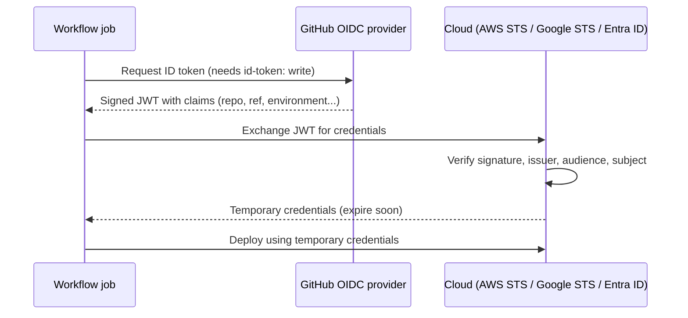

# OIDC: Deploying to the Cloud without Stored Keys: The Complete Guide

> 📚 **Before you start**
>
> - [Secrets, Variables and Environments](secrets-variables-and-environments.md), especially `permissions:` and environments
> - [Triggers and Events](triggers-and-events.md)
> - Basic idea of a cloud account (AWS, Google Cloud or Azure). The [Cloud Data Platforms](../../cloud-data-platforms/course.md) course covers them in depth, but you don't need it here.

## Introduction

When you check in at an airport, you don't hand the airline a permanent master key to your house. You show a boarding pass: it says who you are, which flight, which seat, and it's useless after today. If you drop it in the lounge, the damage is small.

For years, CI pipelines did the opposite. Teams created a cloud access key that never expired, pasted it into a repository secret, and hoped it never leaked. Those keys turned up in logs, forks, laptops and old backups, and attackers love them because they keep working for months.

**OpenID Connect (OIDC)** lets a workflow use boarding passes instead. Each job asks GitHub for a signed, short-lived token that says exactly which repository, branch, environment and workflow it is. Your cloud account checks the signature and the claims, and hands back temporary credentials that expire within the hour. Nothing long-lived is stored anywhere.

By the end of this article you will understand the OIDC flow, read the claims inside a GitHub token, write trust policies that only accept the right workflows, and set up keyless deploys to AWS, Google Cloud and Azure, plus keyless publishing to PyPI.

> 💡 **Key Insight**
>
> With OIDC, the security question changes from "who has the key?" to "**which workflows does the cloud trust?**" The trust policy, especially its condition on the token's `sub` claim, is now your real secret. A loose condition like "any repo in my org" quietly hands production to every repository in the org.

---

## Core Explanation

### 1. The Problem with Stored Keys

| Stored access key | OIDC |
|---|---|
| Lives for months or years | Credentials live minutes to an hour |
| Works from anywhere for anyone who has it | Only issued to a specific repo/branch/environment |
| Must be rotated by hand | Nothing to rotate |
| Leaks via logs, forks, laptops | Nothing to leak; a captured token expires quickly |
| Same key for every branch | Different permissions per branch or environment |

### 2. The Flow, Step by Step



1. The job asks GitHub's OIDC provider for an **ID token**. This only works if the job has `permissions: id-token: write`.
2. GitHub returns a **JWT** (JSON Web Token): a signed piece of JSON with **claims** describing the job.
3. The job sends the JWT to the cloud's security token service.
4. The cloud checks that the token was signed by GitHub (issuer `https://token.actions.githubusercontent.com`), that the **audience** is what it expects, and that the **subject** and other claims match its **trust policy**.
5. If everything matches, the cloud returns temporary credentials for a specific role.

The cloud actions (`aws-actions/configure-aws-credentials`, `google-github-actions/auth`, `azure/login`) do steps 1, 3 and 5 for you.

### 3. What's Inside the Token

A JWT is three base64url-encoded parts joined by dots: header, payload (the claims) and signature. Let's build a pretend one and read it back, to see the claims a cloud provider checks.

```python
import base64, json

def b64url(data: dict) -> str:
    raw = json.dumps(data, separators=(",", ":")).encode()
    return base64.urlsafe_b64encode(raw).decode().rstrip("=")

# A pretend GitHub OIDC token: header.payload.signature
claims = {
    "iss": "https://token.actions.githubusercontent.com",
    "aud": "sts.amazonaws.com",
    "sub": "repo:chai-co/orders-api:environment:production",
    "repository": "chai-co/orders-api",
    "repository_owner": "chai-co",
    "ref": "refs/heads/main",
    "environment": "production",
    "event_name": "push",
    "workflow_ref": "chai-co/orders-api/.github/workflows/deploy.yml@refs/heads/main",
    "exp": 1791712800,
}
token = ".".join([b64url({"alg": "RS256", "typ": "JWT"}), b64url(claims), "signature-goes-here"])
print(token[:60] + "...")

def read_claims(jwt: str) -> dict:
    payload = jwt.split(".")[1]
    payload += "=" * (-len(payload) % 4)          # put back the stripped padding
    return json.loads(base64.urlsafe_b64decode(payload))

decoded = read_claims(token)
for key in ["iss", "aud", "sub", "ref", "environment"]:
    print(f"{key:<12} {decoded[key]}")
```

Output:

```
eyJhbGciOiJSUzI1NiIsInR5cCI6IkpXVCJ9.eyJpc3MiOiJodHRwczovL3R...
iss          https://token.actions.githubusercontent.com
aud          sts.amazonaws.com
sub          repo:chai-co/orders-api:environment:production
ref          refs/heads/main
environment  production
```

Anyone can **read** a JWT; the payload isn't encrypted. What nobody can do is **forge** one, because the signature is made with GitHub's private key and checked against GitHub's published public keys. Never put a real token in logs anyway: until it expires, it's a valid boarding pass.

The claims that matter most:

| Claim | Example | Use in trust policies |
|---|---|---|
| `iss` | `https://token.actions.githubusercontent.com` | Always checked |
| `aud` | `sts.amazonaws.com` | Must equal what the cloud expects |
| `sub` | `repo:chai-co/orders-api:environment:production` | **The main condition** |
| `repository`, `repository_owner` | `chai-co/orders-api`, `chai-co` | Narrow to a repo or org |
| `ref` | `refs/heads/main` | Narrow to a branch or tag |
| `environment` | `production` | Narrow to an environment |
| `job_workflow_ref` | `chai-co/ci/.github/workflows/deploy.yml@refs/heads/main` | Require a specific (reusable) workflow |

### 4. The Shape of `sub`

GitHub builds the default `sub` claim from the job's context:

| Job context | `sub` |
|---|---|
| Job with `environment: production` | `repo:ORG/REPO:environment:production` |
| Push to a branch (no environment) | `repo:ORG/REPO:ref:refs/heads/main` |
| Tag push (no environment) | `repo:ORG/REPO:ref:refs/tags/v1.2.0` |
| Pull request (no environment) | `repo:ORG/REPO:pull_request` |

Notice that when a job uses an environment, `sub` names the **environment**, not the branch. That's convenient: put production behind an environment with required reviewers and a branch rule, and trust exactly `repo:ORG/REPO:environment:production`. Organization admins can also customise which claims make up `sub` through the API, for example to include `job_workflow_ref`.

### 5. Trust Policies: Where Security Actually Lives

The cloud side holds a policy that says which tokens to accept. Here's that check in miniature:

```python
from fnmatch import fnmatchcase

def trust_policy_allows(claims, audience, subject_patterns):
    """Mimic a cloud trust policy: exact audience, subject matching any pattern."""
    if claims["iss"] != "https://token.actions.githubusercontent.com":
        return False
    if claims["aud"] != audience:
        return False
    return any(fnmatchcase(claims["sub"], p) for p in subject_patterns)

policy = ["repo:chai-co/orders-api:environment:production"]
print(trust_policy_allows(decoded, "sts.amazonaws.com", policy))

feature_branch = dict(decoded, sub="repo:chai-co/orders-api:ref:refs/heads/experiment")
print(trust_policy_allows(feature_branch, "sts.amazonaws.com", policy))

too_loose = ["repo:chai-co/*"]
other_repo = dict(decoded, sub="repo:chai-co/intern-sandbox:ref:refs/heads/main")
print(trust_policy_allows(other_repo, "sts.amazonaws.com", too_loose))
```

Output:

```
True
False
True
```

The last line is the classic mistake. `repo:chai-co/*` trusts **every** repository in the organization, including a sandbox where anyone can push. Write the narrowest pattern that works, and never trust a subject with no condition at all.

### 6. AWS: IAM Role with Web Identity

**One-time setup in AWS:**

1. In IAM, add an **identity provider** of type OpenID Connect with provider URL `https://token.actions.githubusercontent.com` and audience `sts.amazonaws.com`.
2. Create an IAM **role** with only the permissions the deploy needs (say, upload to one S3 bucket), and this trust policy:

```json
{
  "Version": "2012-10-17",
  "Statement": [
    {
      "Effect": "Allow",
      "Principal": {
        "Federated": "arn:aws:iam::123456789012:oidc-provider/token.actions.githubusercontent.com"
      },
      "Action": "sts:AssumeRoleWithWebIdentity",
      "Condition": {
        "StringEquals": {
          "token.actions.githubusercontent.com:aud": "sts.amazonaws.com",
          "token.actions.githubusercontent.com:sub": "repo:chai-co/orders-api:environment:production"
        }
      }
    }
  ]
}
```

Use `StringEquals` when you can; switch to `StringLike` only when you genuinely need a wildcard, such as `repo:chai-co/orders-api:ref:refs/tags/v*`.

**The workflow:**

```yaml
name: Deploy to AWS
on:
  push:
    branches: [main]

permissions:
  id-token: write     # allow requesting the OIDC token
  contents: read

jobs:
  deploy:
    runs-on: ubuntu-latest
    environment: production
    steps:
      - uses: actions/checkout@v7
      - uses: aws-actions/configure-aws-credentials@v6
        with:
          role-to-assume: arn:aws:iam::123456789012:role/orders-api-deploy
          aws-region: ap-south-1
      - run: aws sts get-caller-identity
      - run: aws s3 sync ./site s3://orders-api-static --delete
```

Example output:

```
{
    "UserId": "AROAXXXXXXXXXXXXXXXX:GitHubActions",
    "Account": "123456789012",
    "Arn": "arn:aws:sts::123456789012:assumed-role/orders-api-deploy/GitHubActions"
}
```

No `AWS_ACCESS_KEY_ID` secret anywhere. The role ARN isn't secret either; it's useless without a token that satisfies the trust policy.

### 7. Google Cloud: Workload Identity Federation

**One-time setup:** create a workload identity **pool** and an OIDC **provider** that trusts GitHub, with an attribute mapping and a condition:

```bash
gcloud iam workload-identity-pools create github \
  --location=global --display-name="GitHub Actions"

gcloud iam workload-identity-pools providers create-oidc orders-api \
  --location=global --workload-identity-pool=github \
  --issuer-uri="https://token.actions.githubusercontent.com" \
  --attribute-mapping="google.subject=assertion.sub,attribute.repository=assertion.repository,attribute.repository_owner=assertion.repository_owner" \
  --attribute-condition="assertion.repository_owner == 'chai-co'"
```

Then grant the repository access, either directly to resources or by letting it impersonate a service account:

```bash
gcloud iam service-accounts add-iam-policy-binding deployer@my-project.iam.gserviceaccount.com \
  --role="roles/iam.workloadIdentityUser" \
  --member="principalSet://iam.googleapis.com/projects/123456789/locations/global/workloadIdentityPools/github/attribute.repository/chai-co/orders-api"
```

**The workflow:**

```yaml
permissions:
  id-token: write
  contents: read

jobs:
  deploy:
    runs-on: ubuntu-latest
    steps:
      - uses: actions/checkout@v7
      - uses: google-github-actions/auth@v3
        with:
          workload_identity_provider: projects/123456789/locations/global/workloadIdentityPools/github/providers/orders-api
          service_account: deployer@my-project.iam.gserviceaccount.com
      - run: gcloud run deploy orders-api --source . --region asia-south1
```

The attribute condition on the provider is required for GitHub, and is your first line of defence: without it, any GitHub repository in the world could present a token to your pool.

### 8. Azure: Federated Credentials

**One-time setup:** on an Entra ID app registration (or a user-assigned managed identity), add a **federated credential** that trusts one subject:

```bash
az ad app federated-credential create --id <APP_CLIENT_ID> --parameters '{
  "name": "orders-api-production",
  "issuer": "https://token.actions.githubusercontent.com",
  "subject": "repo:chai-co/orders-api:environment:production",
  "audiences": ["api://AzureADTokenExchange"]
}'
```

Give the app a role assignment on just the resource group it deploys to.

**The workflow:**

```yaml
permissions:
  id-token: write
  contents: read

jobs:
  deploy:
    runs-on: ubuntu-latest
    environment: production
    steps:
      - uses: actions/checkout@v7
      - uses: azure/login@v3
        with:
          client-id: ${{ vars.AZURE_CLIENT_ID }}
          tenant-id: ${{ vars.AZURE_TENANT_ID }}
          subscription-id: ${{ vars.AZURE_SUBSCRIPTION_ID }}
      - run: az webapp deploy --resource-group orders --name orders-api --src-path app.zip
```

The three IDs are identifiers, not secrets, so variables are fine.

### 9. Beyond Clouds: Trusted Publishing and Other Services

OIDC isn't only for cloud consoles. Any service that trusts GitHub's tokens can drop long-lived secrets:

- **PyPI trusted publishing.** On pypi.org, add a "trusted publisher" naming your GitHub owner, repository, workflow file and (optionally) environment. Then publish with no API token:

```yaml
jobs:
  publish:
    runs-on: ubuntu-latest
    environment: pypi
    permissions:
      id-token: write
    steps:
      - uses: actions/download-artifact@v8
        with: { name: dist, path: dist/ }
      - uses: pypa/gh-action-pypi-publish@release/v1
```

- **npm** and other registries offer trusted publishing from GitHub Actions in a similar way.
- **HashiCorp Vault**, **Kubernetes** clusters and some AI providers can also accept GitHub OIDC tokens. For example, Anthropic's `claude-code-action` accepts workload identity federation settings instead of a stored API key, as you'll see in [Running Coding Agents in GitHub Actions](../../coding-agents-and-harness-engineering/03-coding-agents-on-github/running-coding-agents-in-github-actions.md).

### 10. Hardening Checklist

- **Grant `id-token: write` only to the job that deploys**, not the whole workflow.
- **Pin the subject** to an environment (`...:environment:production`) or a protected branch, never a whole org.
- **Combine with environment protection**: required reviewers and a `main`-only branch rule mean the OIDC subject can only be produced by approved, reviewed runs.
- **Least privilege on the cloud role**: one bucket, one service, one resource group.
- **Separate roles per environment**: staging's role can't touch production.
- **Watch the audit logs**: cloud logs show each `AssumeRoleWithWebIdentity` with the claims, so you can see exactly which workflow did what.

---

## Try It Yourself

1. **Read the claims.** Use `read_claims` on a token whose `sub` is `repo:chai-co/orders-api:ref:refs/tags/v2.1.0`. Write a subject pattern that accepts any `v*` tag on that repo, and test it with `trust_policy_allows`.
2. **Find the hole.** A trust policy uses `StringLike` with `repo:chai-co/orders-api:*`. Name two kinds of jobs that would now get production credentials.
3. **Missing permission.** A job using `aws-actions/configure-aws-credentials` fails with an error about not being able to fetch an OIDC token. What did they forget?
4. **Design.** Staging should deploy from any branch of `orders-api`, production only from `main` after approval. Sketch the two subjects you would trust and how.

<details>
<summary>Show answers</summary>

**1.**

```python
tag_claims = dict(decoded, sub="repo:chai-co/orders-api:ref:refs/tags/v2.1.0")
tag_token = ".".join([b64url({"alg": "RS256"}), b64url(tag_claims), "sig"])
print(read_claims(tag_token)["sub"])
print(trust_policy_allows(read_claims(tag_token), "sts.amazonaws.com",
                          ["repo:chai-co/orders-api:ref:refs/tags/v*"]))
```

Output:

```
repo:chai-co/orders-api:ref:refs/tags/v2.1.0
True
```

**2.** Any pull request run (`repo:chai-co/orders-api:pull_request`), any push to any branch (`...:ref:refs/heads/anything`), and any job in any environment. A contributor's pull request could deploy to production.

**3.** `permissions: id-token: write` on the job (or workflow). Without it, the runner can't request a token.

**4.** Create two environments. `staging` has no branch rule; `production` allows only `main` and requires a reviewer. Make two cloud roles: the staging role trusts `repo:chai-co/orders-api:environment:staging`, the production role trusts `repo:chai-co/orders-api:environment:production`. Each deploy job sets its `environment:`, so it can only ever get its own role.

</details>

---

## Real-World Examples

### Example 1: Removing Fifty Access Keys

A mid-size e-commerce company found 52 long-lived AWS keys spread across repository secrets, many belonging to former employees. They created one IAM role per service per environment, trusted only the `environment:production` subject of each repository, and deleted every key. Their next security audit had nothing to rotate.

### Example 2: Data Pipelines on Google Cloud

A data team deploys BigQuery transformations and Cloud Run jobs from GitHub Actions. Workload identity federation with `assertion.repository_owner == 'their-org'` on the provider, and per-repository bindings on service accounts, means a new pipeline repository gets cloud access only after a platform engineer adds a binding.

### Example 3: Keyless Package Releases

An open source maintainer switched their Python package to PyPI trusted publishing. There is no PyPI token in the repository, so a compromised maintainer laptop or a leaked secret can't publish a malicious version: only the `release.yml` workflow in the `pypi` environment can.

---

## Common Misconceptions

### Misconception 1: "OIDC tokens are secret because they're encrypted"

They're signed, not encrypted. Anyone can read the claims. The security comes from the signature, the short lifetime and your trust policy.

### Misconception 2: "Setting up the identity provider is enough"

The provider only says "I trust tokens from GitHub". Without a tight subject condition, every GitHub workflow that can reach your account is trusted.

### Misconception 3: "OIDC replaces environments and reviews"

They work together. OIDC removes stored keys; environments decide which runs are allowed to produce a production token in the first place.

### Misconception 4: "`id-token: write` lets the workflow write to my cloud"

It only allows the job to **request** an identity token from GitHub. What that token can do is decided entirely by the cloud's trust policy and role permissions.

---

## Interview Relevance

OIDC is now a standard question for DevOps, platform and cloud security roles:

- **The why:** eliminate long-lived credentials; short-lived, scoped, auditable access.
- **The flow:** job requests a JWT (`id-token: write`), cloud verifies issuer/audience/subject, returns temporary credentials.
- **The claims:** `sub` formats for branch, tag, pull request and environment; `job_workflow_ref` for reusable workflows.
- **Pitfalls:** wildcard subjects, missing attribute conditions on GCP, giving every job `id-token: write`.

Common follow-ups:

- *"How do you stop pull requests from getting deploy credentials?"* Trust only the environment or `main` subject; the pull request subject is `repo:ORG/REPO:pull_request`, which doesn't match.
- *"What's trusted publishing?"* OIDC applied to package registries like PyPI and npm.

---

## Key Takeaways

- **OIDC swaps stored cloud keys for per-job, short-lived credentials** issued against a signed GitHub token.
- **The job needs `permissions: id-token: write`**; the cloud verifies issuer, audience and subject.
- **The `sub` claim is the key condition**: pin it to an environment or protected branch, never to a whole org.
- **AWS uses an IAM role trust policy, Google uses workload identity federation, Azure uses federated credentials**, and registries like PyPI use trusted publishing.
- **Combine OIDC with environment protection rules** so only reviewed runs can ever produce a production token.

---

**Up next:** [Reusable Workflows and Composite Actions](reusable-workflows-and-composite-actions.md)
