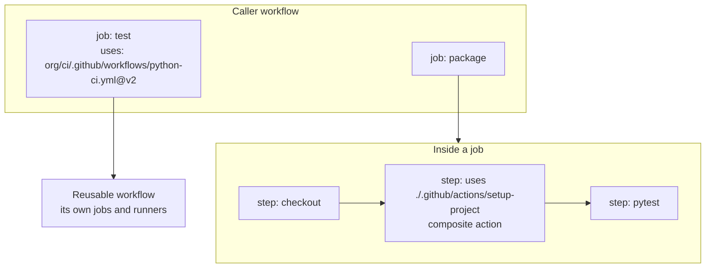

# Reusable Workflows and Composite Actions: The Complete Guide

> 📚 **Before you start**
>
> - [Workflows, Jobs, Steps and Runners](workflows-jobs-steps-and-runners.md)
> - [Matrix Builds and Caching](matrix-builds-and-caching.md)
> - [Secrets, Variables and Environments](secrets-variables-and-environments.md)
> - [Functions and Iterators](../../python-programming/course.md#m6) (Python Programming), because the idea is exactly "write a function once, call it everywhere"

## Introduction

A restaurant chain with forty outlets doesn't let every kitchen invent its own masala chai. Head office writes one recipe card, and every outlet follows it. When head office improves the recipe, every outlet gets the better chai the next morning.

Most companies with more than a handful of repositories hit the opposite problem with CI. Forty repositories each have their own copy-pasted `ci.yml`, slightly different, slowly drifting. A security fix has to be made forty times, and someone always misses one.

GitHub Actions gives you two kinds of recipe card. A **reusable workflow** is a whole workflow (jobs, runners, environments) that other workflows call like a function. A **composite action** bundles several **steps** into one step you can drop into any job. By the end of this article you'll know how to write and call both, how inputs, outputs, secrets and permissions flow through them, their limits, and how to choose between them.

> 💡 **Key Insight**
>
> Reuse **jobs** with a reusable workflow; reuse **steps** with a composite action. If the shared thing needs its own runner, environment or approvals, it's a workflow. If it's "the five setup steps every job starts with", it's an action.

---

## Core Explanation

### 1. Two Levels of Reuse



| | Reusable workflow | Composite action |
|---|---|---|
| Replaces | One or more **jobs** | One or more **steps** |
| Called with | `jobs.<id>.uses:` | `steps[*].uses:` |
| File | `.github/workflows/<name>.yml` with `on: workflow_call` | `action.yml` in its own folder or repository |
| Chooses its own runner | Yes | No, runs on the caller's runner |
| Can use environments, `needs`, matrices inside | Yes | No |
| Sees secrets | Only those passed in (or `secrets: inherit`) | Only what the caller passes as inputs or env |
| Shows in logs as | Separate jobs | One step, expandable into its sub-steps |

### 2. Writing a Reusable Workflow

A workflow becomes reusable when it listens to `workflow_call`. Here is a shared Python CI pipeline kept in a central `my-company/ci-templates` repository:

```yaml
# my-company/ci-templates/.github/workflows/python-ci.yml
name: Python CI (reusable)

on:
  workflow_call:
    inputs:
      python-versions:
        description: "JSON list of Python versions"
        type: string
        default: '["3.12", "3.13"]'
      working-directory:
        type: string
        default: "."
      run-integration:
        type: boolean
        default: false
    secrets:
      CODECOV_TOKEN:
        required: false
    outputs:
      coverage:
        description: "Line coverage percentage"
        value: ${{ jobs.test.outputs.coverage }}

permissions:
  contents: read

jobs:
  lint:
    runs-on: ubuntu-latest
    defaults:
      run:
        working-directory: ${{ inputs.working-directory }}
    steps:
      - uses: actions/checkout@v7
      - run: pipx run ruff check .
      - run: pipx run ruff format --check .

  test:
    runs-on: ubuntu-latest
    outputs:
      coverage: ${{ steps.cov.outputs.percent }}
    strategy:
      fail-fast: false
      matrix:
        python: ${{ fromJSON(inputs.python-versions) }}
    defaults:
      run:
        working-directory: ${{ inputs.working-directory }}
    steps:
      - uses: actions/checkout@v7
      - uses: actions/setup-python@v7
        with:
          python-version: ${{ matrix.python }}
          cache: pip
      - run: python -m pip install -e ".[test]"
      - run: python -m pytest --cov --cov-report=term | tee pytest.log
      - id: cov
        run: echo "percent=$(grep '^TOTAL' pytest.log | awk '{print $NF}' | tr -d '%')" >> "$GITHUB_OUTPUT"
      - if: inputs.run-integration
        run: python -m pytest tests/integration
```

What's new compared with a normal workflow:

- **`inputs`** have a `type`: `string`, `number` or `boolean`. Lists must travel as JSON strings and be decoded with `fromJSON`.
- **`secrets`** are declared by name; the caller must pass them.
- **`outputs`** at the top map to job outputs inside, which map to step outputs. Three hops: step → job → workflow.
- Inside, you read `${{ inputs.python-versions }}` and `${{ secrets.CODECOV_TOKEN }}` as usual.

### 3. Calling a Reusable Workflow

In each service repository, the whole CI file shrinks to this:

```yaml
# orders-api/.github/workflows/ci.yml
name: CI
on:
  pull_request:
  push:
    branches: [main]

jobs:
  python:
    uses: my-company/ci-templates/.github/workflows/python-ci.yml@v2
    with:
      python-versions: '["3.13", "3.14"]'
      run-integration: true
    secrets:
      CODECOV_TOKEN: ${{ secrets.CODECOV_TOKEN }}

  report:
    needs: python
    runs-on: ubuntu-latest
    steps:
      - run: echo "Coverage was ${{ needs.python.outputs.coverage }}%"
```

Rules for the calling job:

- `uses:` goes on the **job**, not a step, in the form `OWNER/REPO/.github/workflows/FILE.yml@REF`, or `./.github/workflows/FILE.yml` for a workflow in the same repository (which then uses the same commit as the caller).
- A calling job can't have `steps:` or `runs-on:`. It can have `with`, `secrets`, `needs`, `if`, `permissions`, `strategy` (to call the workflow once per matrix value) and `concurrency`.
- `secrets: inherit` passes **all** of the caller's secrets. Convenient inside one organization, but it gives the called workflow more than it may need. Prefer passing named secrets when the callee is maintained by a different team.
- In the Actions log, the called workflow's jobs appear as `python / lint` and `python / test (3.13)`.

### 4. Access, Permissions and Limits

**Who can call it?** A reusable workflow in a public repository can be called by anyone. One in a private or internal repository can be called by other repositories only if its **Settings → Actions → General → Access** allows it (for example, "Accessible from repositories in the organization").

**Permissions only go down.** The called workflow starts with the `GITHUB_TOKEN` permissions the caller gives it, and can reduce them but never raise them. If the shared deploy workflow needs `id-token: write`, the caller's job must grant it:

```yaml
jobs:
  deploy:
    uses: my-company/ci-templates/.github/workflows/deploy.yml@v2
    permissions:
      contents: read
      id-token: write
```

**Environment variables don't cross over.** `env:` set at the caller's workflow level isn't visible inside the called workflow, and vice versa. Pass values as inputs.

**Limits:** up to ten levels of nesting (a reusable workflow can call another), and at most 50 unique reusable workflows from one workflow file, counting nested ones.

**OIDC note:** in a called workflow, the OIDC token's `job_workflow_ref` claim names the **reusable** workflow. Cloud trust policies can require it, so that only your central, reviewed deploy workflow can ever assume the production role.

### 5. Writing a Composite Action

Many jobs start with the same five steps: check out, set up Python, restore cache, install dependencies, print versions. Bundle them:

```yaml
# .github/actions/setup-project/action.yml
name: Set up project
description: Install Python, restore the pip cache and install dependencies

inputs:
  python-version:
    description: Python version to install
    required: false
    default: "3.13"
  extras:
    description: Optional dependency group, for example "test" or "docs"
    required: false
    default: "test"

outputs:
  python-path:
    description: Path to the installed Python interpreter
    value: ${{ steps.py.outputs.python-path }}

runs:
  using: composite
  steps:
    - id: py
      uses: actions/setup-python@v7
      with:
        python-version: ${{ inputs.python-version }}
        cache: pip

    - name: Install dependencies
      shell: bash
      run: python -m pip install -e ".[${EXTRAS}]"
      env:
        EXTRAS: ${{ inputs.extras }}

    - name: Show versions
      shell: bash
      run: |
        python --version
        pip --version
```

Things that differ from workflow steps:

- `runs: using: composite` marks it as a composite action.
- **Every `run:` step must declare `shell:`.** There is no default inside a composite action.
- Inputs are read with `${{ inputs.NAME }}`; passing them through `env:` (as above) avoids injection problems if a value ever contains quotes.
- `outputs` map to a step's outputs with `value:`.
- A composite action can use other actions, including other composite actions.

Using it from a workflow in the same repository (after checkout, since the action file comes from your code):

```yaml
jobs:
  test:
    runs-on: ubuntu-latest
    steps:
      - uses: actions/checkout@v7
      - id: setup
        uses: ./.github/actions/setup-project
        with:
          python-version: "3.14"
      - run: echo "Using ${{ steps.setup.outputs.python-path }}"
      - run: python -m pytest -q
```

To share it across repositories, put `action.yml` at the root (or in a subfolder) of its own repository, tag releases, and call it as `my-company/setup-project@v1` or `my-company/actions/setup-project@v1` for a subfolder.

### 6. Choosing Between Them

| You want to share... | Use |
|---|---|
| A full CI pipeline (lint + test matrix + build) | Reusable workflow |
| A deploy process with environments and approvals | Reusable workflow |
| A set of setup steps used inside many different jobs | Composite action |
| Logic that needs real code, API calls or complex parsing | A JavaScript or Docker action (next lesson) |
| A starting point teams copy and customise | A workflow template (below) |

A common, healthy combination: a central reusable workflow defines the pipeline, and its jobs use a few composite actions for shared setup.

### 7. Workflow Templates

Sometimes you don't want enforcement, just a good starting point. An organization can publish **workflow templates** in its `.github` repository under `workflow-templates/`: a `.yml` file plus a `.properties.json` with a name, description and icon. They appear when anyone in the organization clicks **Actions → New workflow**, ready to commit. Unlike a reusable workflow, a template is **copied**, so later improvements don't reach repositories that already used it.

### 8. Versioning Shared Workflows and Actions

Callers pin a ref, so you can improve things without breaking everyone:

- **Tag releases** with semantic versions (`v2.3.0`) and move a major tag (`v2`) to the latest compatible release. Callers on `@v2` get fixes automatically; breaking changes go to `v3`.
- **Keep a changelog** so teams know what changed.
- **Security-sensitive callers pin to a full commit SHA** and let Dependabot propose updates. The trade-off between convenience and safety is covered in [Hardening Actions](../09-security-and-supply-chain/hardening-actions-pinning-and-least-privilege.md).
- Calling `@main` means every change to the shared repository instantly runs in every caller. Only do this for your own repositories in active development.

---

## Try It Yourself

1. **Spot the errors.** What's wrong with this calling job?

    ```yaml
    jobs:
      ci:
        runs-on: ubuntu-latest
        steps:
          - uses: my-company/ci-templates/.github/workflows/python-ci.yml@v2
    ```

2. **Pass a list.** You want the reusable `python-ci.yml` above to test only Python 3.14. What do you write under `with:`?
3. **Composite gotcha.** A teammate's composite action fails to load with an error about a missing `shell`. What's the fix?
4. **Choose.** For each, reusable workflow or composite action? (a) "Install our internal CLI and log in to the package registry", (b) "Build, sign and deploy to production with approval", (c) "Run lint, unit tests and type-check on three Python versions".

<details>
<summary>Show answers</summary>

**1.** A reusable workflow is called at **job** level, not as a step, and the calling job can't have `runs-on` or `steps`:

```yaml
jobs:
  ci:
    uses: my-company/ci-templates/.github/workflows/python-ci.yml@v2
```

**2.**

```yaml
with:
  python-versions: '["3.14"]'
```

The input is a JSON string, decoded inside with `fromJSON`.

**3.** Every `run:` step in a composite action needs an explicit `shell:`, for example `shell: bash`.

**4.** (a) composite action, it's a handful of steps used inside many jobs; (b) reusable workflow, it needs its own jobs and an environment with approval; (c) reusable workflow, it's several jobs including a matrix.

</details>

---

## Real-World Examples

### Example 1: A Platform Team's Golden Pipeline

A bank's platform team maintains `ci-templates` with reusable workflows for Python, Java and Node services. Each includes dependency review, code scanning and SBOM generation. When a new security check is added to `v3`, every service on `@v3` gets it on its next run, with no pull requests to forty repositories.

### Example 2: Keyless Deploys Locked to One Workflow

The same bank's cloud roles trust only tokens whose `job_workflow_ref` is the central `deploy.yml` at a release tag. A team can't write its own deploy job that skips the checks: the cloud would reject its token.

### Example 3: A Composite Setup Action

A data team's jobs all need Python, the internal `datakit` CLI, and credentials for the internal package index. A twelve-line composite action replaced the same block copied into 23 workflows, and a change to the package index URL became one commit.

---

## Common Misconceptions

### Misconception 1: "A reusable workflow is just a composite action with a different file name"

A reusable workflow brings its own jobs, runners, matrices and environments. A composite action is a bundle of steps running on the caller's runner.

### Misconception 2: "Secrets flow into called workflows automatically"

Only `GITHUB_TOKEN` does. Other secrets must be passed by name or with `secrets: inherit`.

### Misconception 3: "The called workflow can grant itself more permissions"

Permissions can only be reduced inside the called workflow. The caller decides the ceiling.

### Misconception 4: "Workflow templates keep repositories in sync"

Templates are copied once. Use reusable workflows when you need central updates.

---

## Interview Relevance

"How would you standardise CI across 50 repositories?" is a common platform engineering question. A strong answer covers:

- **Reusable workflows** in a central repo, versioned with tags, called with `uses:` at job level, inputs typed and secrets passed explicitly.
- **Composite actions** for shared setup steps.
- **Permissions and OIDC**: callers set the ceiling; `job_workflow_ref` lets the cloud trust only the central deploy workflow.
- **Rollout and safety**: semantic versioning, major tags, changelogs, SHA pinning for sensitive callers.

Common follow-ups:

- *"How do outputs get from a step in a reusable workflow to the caller?"* Step output → job `outputs` → `on.workflow_call.outputs` → `needs.<job>.outputs` in the caller.
- *"Why might `env` values be missing in the called workflow?"* Workflow-level `env` doesn't propagate; use inputs.

---

## Key Takeaways

- **Reusable workflows share jobs**; they use `on: workflow_call` and are called with `jobs.<id>.uses`.
- **Composite actions share steps**; they use `runs: using: composite`, and every `run` needs a `shell`.
- **Inputs are typed, secrets are explicit, outputs travel step → job → workflow.**
- **Permissions only go down** in a called workflow; nesting goes up to ten levels and 50 unique workflows per file.
- **Version shared automation like a library**: tags, major-version refs, changelogs, and SHA pins where safety matters.

---

**Up next:** [Writing Your Own Action](writing-your-own-action.md)
