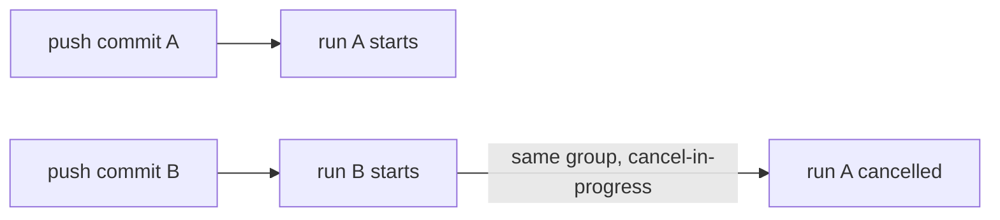

# Triggers and Events: The Complete Guide

> 📚 **Before you start**
>
> - [Workflows, Jobs, Steps and Runners](workflows-jobs-steps-and-runners.md)
> - [Pull Requests End to End](../course.md#m6) and [Merge Strategies and Merge Queues](../course.md#m6) (Collaborating on GitHub)
> - [Shell Scripts and cron](../../the-command-line-and-linux-basics/course.md#m3) (The Command Line and Linux Basics), for cron syntax

## Introduction

A doorbell, a wall clock and a phone call can all make you get up from your chai. Each is a different kind of signal, and you respond differently to each: you open the door, you leave for work, you pick up the phone.

Workflows work the same way. The `on:` key of a workflow lists the **events** that wake it up. Choosing them well is the difference between a CI setup that gives fast, cheap, relevant feedback and one that runs the full test suite because someone fixed a typo in the README, or worse, one that hands your secrets to a stranger's pull request.

By the end of this article you will know every trigger you are likely to need, how to filter them by branch, tag, path and activity type, how manual and scheduled runs work, how workflows chain into each other, how concurrency stops duplicate runs, and which triggers are dangerous with untrusted code.

> 💡 **Key Insight**
>
> A trigger answers two questions: **when** should this run, and **with whose code and whose permissions**? Most trigger mistakes are not about timing. They are about running untrusted code with trusted permissions.

---

## Core Explanation

### 1. Three Ways to Write `on:`

```yaml
# a single event
on: push

# a list of events, no filters
on: [push, pull_request]

# a map, when you need filters or settings
on:
  push:
    branches: [main]
  pull_request:
    branches: [main]
  workflow_dispatch:
```

The map form is what you will write most of the time.

### 2. `push`: Branches, Tags and Paths

```yaml
on:
  push:
    branches:
      - main
      - "release/**"        # release/1.0, release/2026/oct ...
    tags:
      - "v*"                # v1.0.0, v2.3.1-rc1 ...
    paths:
      - "src/**"
      - "pyproject.toml"
```

Filter rules worth memorising:

- **Glob patterns**: `*` matches anything except `/`; `**` matches anything including `/`; `?` matches one character.
- **Branches and tags together**: the workflow runs if the push matches **either** filter. If you give only `tags`, pushes to branches don't trigger it at all, and vice versa.
- **Ignore forms**: `branches-ignore`, `tags-ignore` and `paths-ignore`. You can't use `branches` and `branches-ignore` for the same event. To include and exclude in one list, use `!`:

```yaml
on:
  push:
    branches:
      - "release/**"
      - "!release/**-alpha"    # later patterns override earlier ones
```

- **Paths filters** compare against the files changed in the push. Use them so that a docs-only change doesn't run the full test suite.

### 3. `pull_request`: Activity Types and the Merge Ref

```yaml
on:
  pull_request:
    types: [opened, synchronize, reopened, ready_for_review]
    branches: [main]           # filters the BASE branch, the one you merge into
    paths-ignore:
      - "docs/**"
      - "**.md"
```

Key facts:

- With no `types:`, the defaults are `opened`, `synchronize` (new commits pushed) and `reopened`. Other useful types: `ready_for_review`, `labeled`, `closed`, `edited`.
- `branches:` here filters the **base** branch, not the pull request's own branch.
- The code checked out by default is a **merge commit**: what `main` would look like if the pull request merged now. Its ref is `refs/pull/<number>/merge`. This catches problems that only appear after merging.
- To skip draft pull requests, add `if: github.event.pull_request.draft == false` to the job.

**Forks get reduced trust.** When a pull request comes from a fork, the workflow runs with a read-only `GITHUB_TOKEN` and **no access to secrets** (except the token itself). Depending on repository settings, first-time contributors' runs wait for a maintainer to click "Approve and run". This is deliberate: the fork's code is untrusted.

### 4. `pull_request_target`: Powerful and Dangerous

`pull_request_target` fires for the same pull request activity, but runs the workflow **from the base branch** with a **read/write token and secrets**, even for forks. It exists for jobs like labelling or commenting on fork pull requests, which need write access but don't need to run the contributor's code.

```yaml
on:
  pull_request_target:
    types: [opened]

permissions:
  pull-requests: write

jobs:
  label:
    runs-on: ubuntu-latest
    steps:
      # Safe: no checkout of the pull request's code, only an API call.
      - run: gh pr edit "$PR" --add-label needs-review
        env:
          GH_TOKEN: ${{ secrets.GITHUB_TOKEN }}
          PR: ${{ github.event.pull_request.html_url }}
```

> ⚠️ Never check out and run the pull request's head code (`ref: ${{ github.event.pull_request.head.sha }}`) in a `pull_request_target` workflow. That runs a stranger's code with your secrets. This "pwn request" pattern has been behind several real supply-chain compromises.

### 5. Manual Runs with `workflow_dispatch`

`workflow_dispatch` adds a **Run workflow** button to the Actions tab, with a form built from your inputs:

```yaml
on:
  workflow_dispatch:
    inputs:
      environment:
        description: "Where to deploy"
        type: choice
        options: [staging, production]
        default: staging
      dry_run:
        description: "Only print what would happen"
        type: boolean
        default: true
      batch_size:
        description: "Rows per batch"
        type: number
        default: 500

jobs:
  deploy:
    runs-on: ubuntu-latest
    steps:
      - run: echo "Deploying to ${{ inputs.environment }}, dry run = ${{ inputs.dry_run }}, batch = ${{ inputs.batch_size }}"
```

Input types are `string`, `boolean`, `choice`, `number` and `environment`. The workflow file must exist on the default branch for the button to appear. You can also start it from the terminal with the GitHub CLI:

```bash
gh workflow run deploy.yml -f environment=production -f dry_run=false
gh run watch
```

### 6. Schedules with `schedule`

```yaml
on:
  schedule:
    - cron: "30 20 * * *"     # 20:30 UTC = 02:00 IST, every day
    - cron: "0 3 * * 1"       # 03:00 UTC every Monday
```

The five fields are minute, hour, day of month, month and day of week. Things that surprise people:

- Cron times are in **UTC** by default. India is UTC+5:30, so 02:00 IST is 20:30 UTC on the previous day. If you'd rather think in local time, add an optional `timezone:` with an IANA time zone name next to the `cron:` line:

```yaml
on:
  schedule:
    - cron: "0 2 * * *"
      timezone: "Asia/Kolkata"    # 02:00 IST every day
```

- The shortest interval is every 5 minutes.
- Scheduled runs can start late, or be dropped, when GitHub is busy. Avoid the top of the hour (`0 * * * *`); pick an odd minute.
- Schedules run on the **default branch** only.
- In a public repository, scheduled workflows are automatically disabled after 60 days without repository activity. Re-enable them from the Actions tab.

### 7. Issue, Comment and Release Events

Actions reacts to almost anything that happens on GitHub:

```yaml
on:
  issues:
    types: [opened, labeled]
  issue_comment:
    types: [created]          # fires for comments on issues AND pull requests
  release:
    types: [published]
  discussion:
    types: [created]
```

Inside the job, `github.event` holds the full payload, for example `github.event.issue.number`, `github.event.comment.body` or `github.event.release.tag_name`. Comment-triggered "chat ops" (such as `/deploy` or `@claude review this`) is built on `issue_comment`. To tell whether a comment is on a pull request, check `github.event.issue.pull_request`.

### 8. `merge_group`: Required for Merge Queues

If your repository uses a merge queue, the queue creates temporary branches and waits for your required checks to pass on them. Those checks only run if the workflow listens to `merge_group`:

```yaml
on:
  pull_request:
  merge_group:
```

Forget this and every pull request sits in the queue forever, waiting for a check that never starts.

### 9. Chaining Workflows

There are three ways for one workflow to start another:

| Trigger | Use it when |
|---|---|
| `workflow_call` | You want a **reusable workflow**, called like a function. Covered in [Reusable Workflows and Composite Actions](reusable-workflows-and-composite-actions.md) |
| `workflow_run` | Workflow B should run **after** workflow A completes |
| `repository_dispatch` | Something **outside** GitHub (a script, another service) should start a workflow through the API |

```yaml
# runs after the "CI" workflow finishes on main
on:
  workflow_run:
    workflows: ["CI"]
    types: [completed]
    branches: [main]

jobs:
  report:
    if: github.event.workflow_run.conclusion == 'success'
    runs-on: ubuntu-latest
    steps:
      - run: echo "CI passed for ${{ github.event.workflow_run.head_sha }}"
```

```yaml
# started from outside with an API call
on:
  repository_dispatch:
    types: [refresh-data]
```

```bash
gh api repos/OWNER/REPO/dispatches -f event_type=refresh-data -F 'client_payload[source]=nightly'
```

Like `pull_request_target`, a `workflow_run` workflow runs with full permissions from the default branch. Treat any artifact it downloads from a fork's run as untrusted data.

**The recursion guard.** Events caused by the built-in `GITHUB_TOKEN` (for example, a workflow pushing a commit or opening a pull request) do **not** start new workflow runs, except `workflow_dispatch` and `repository_dispatch`. This stops infinite loops. If you genuinely need a bot push to trigger CI, authenticate as a GitHub App or with a dedicated token instead.

### 10. Concurrency: One Run at a Time

Push three commits in a minute and you get three runs, two of them testing code that is already outdated. `concurrency` groups runs and cancels or queues the extras:

```yaml
concurrency:
  group: ci-${{ github.workflow }}-${{ github.ref }}
  cancel-in-progress: true
```

- Runs with the same `group` value never run at the same time.
- `cancel-in-progress: true` cancels the older run. Great for pull request CI.
- Without it, the newer run waits and only the latest pending run is kept. Use that for deployments, where you don't want to kill a deploy halfway.



### 11. Skipping Runs

- Put `[skip ci]`, `[ci skip]`, `[no ci]`, `[skip actions]` or `[actions skip]` in the commit message to skip `push` and `pull_request` workflows for that commit.
- Use `paths-ignore` for changes that never need CI.
- **Watch out with required checks:** if a workflow is skipped by a path filter, its check never reports, and a branch protection rule that requires it will block the merge. A common fix is to keep the workflow triggered and skip the expensive **job** with an `if:` based on changed files, so the check still reports success.

### 12. A Trigger Cheat Sheet

| Goal | Trigger |
|---|---|
| Test every pull request | `pull_request` (+ `merge_group` if you use a merge queue) |
| Deploy on merge to main | `push` with `branches: [main]` |
| Release on a version tag | `push` with `tags: ["v*"]`, or `release: types: [published]` |
| Run a job by hand with options | `workflow_dispatch` with `inputs` |
| Nightly or weekly job | `schedule` |
| Label or comment on fork pull requests | `pull_request_target`, **without** checking out the fork's code |
| Post-process another workflow | `workflow_run` |
| Start from an external system | `repository_dispatch` |
| Share a pipeline across repos | `workflow_call` |

---

## Try It Yourself

1. **Docs don't need tests.** Write the `on:` block for a CI workflow that runs on pushes to `main` and on pull requests into `main`, but not when only Markdown files or the `docs/` folder change.
2. **Cricket score alert.** Write a schedule that runs at 19:00 IST on Saturdays and Sundays. What's the UTC cron?
3. **Manual backfill.** Write a `workflow_dispatch` trigger with a required `start_date` string input and a `dry_run` boolean defaulting to `true`, and a step that prints both.
4. **Spot the bug.** A team's merge queue never merges anything. Their CI workflow has `on: [push, pull_request]`. What's wrong?

<details>
<summary>Show answers</summary>

**1.**

```yaml
on:
  push:
    branches: [main]
    paths-ignore: ["**.md", "docs/**"]
  pull_request:
    branches: [main]
    paths-ignore: ["**.md", "docs/**"]
```

If the CI check is required by branch protection, remember a docs-only pull request will then be blocked; use a job-level `if:` instead in that case.

**2.** 19:00 IST is 13:30 UTC. Saturday is 6 and Sunday is 0:

```yaml
on:
  schedule:
    - cron: "30 13 * * 0,6"
```

**3.**

```yaml
on:
  workflow_dispatch:
    inputs:
      start_date:
        description: "First day to backfill (YYYY-MM-DD)"
        type: string
        required: true
      dry_run:
        type: boolean
        default: true
jobs:
  backfill:
    runs-on: ubuntu-latest
    steps:
      - run: echo "Backfill from $START, dry run = $DRY"
        env:
          START: ${{ inputs.start_date }}
          DRY: ${{ inputs.dry_run }}
```

**4.** The merge queue waits for required checks on its temporary branches, which only run if the workflow listens to `merge_group`. Add `merge_group:` to `on:`.

</details>

---

## Real-World Examples

### Example 1: A Monorepo with Path Filters

A company keeps its web app, mobile API and data pipelines in one repository. Each area has its own workflow with `paths:` filters, so a change to `pipelines/` runs only the pipeline tests. CI time per pull request drops from 25 minutes to about 6.

### Example 2: Release on Tag

A Python package's `release.yml` triggers on `push: tags: ["v*"]`. Pushing `v2.4.0` builds the wheel, publishes it to PyPI and creates a GitHub Release. Nobody runs release commands by hand, so releases are repeatable.

### Example 3: A Comment-Triggered Agent

A team's `issue_comment` workflow checks whether a comment starts with `@claude` and whether the commenter has write access, then runs a coding agent on the pull request. You'll build this in [Running Coding Agents in GitHub Actions](../../coding-agents-and-harness-engineering/03-coding-agents-on-github/running-coding-agents-in-github-actions.md).

---

## Common Misconceptions

### Misconception 1: "`branches:` on `pull_request` filters the feature branch"

It filters the **base** branch the pull request targets.

### Misconception 2: "Cron runs at exactly the time I wrote, in my time zone"

Cron is UTC by default, and scheduled runs can be delayed under load.

### Misconception 3: "`pull_request_target` is just `pull_request` with more permissions, so it's an upgrade"

It's a different trust model. Used with a checkout of fork code, it's one of the most dangerous patterns in Actions.

### Misconception 4: "My bot's push will trigger CI"

Pushes made with `GITHUB_TOKEN` deliberately do not start new workflows.

---

## Interview Relevance

Questions on triggers come up in DevOps and platform interviews, often as "design a CI/CD pipeline for this repo":

- **Choosing events:** `pull_request` for checks, `push` to main for deploys, tags or releases for publishing, `schedule` for batch jobs, `workflow_dispatch` for manual operations.
- **Cost and speed:** path filters, concurrency with cancel-in-progress, skipping drafts.
- **Security:** fork pull requests get no secrets; `pull_request_target` and `workflow_run` run with full permissions, so never execute untrusted code in them.
- **Merge queues:** need `merge_group`.

Common follow-ups:

- *"Why didn't my workflow run after the bot committed?"* `GITHUB_TOKEN` events don't trigger workflows.
- *"How do you prevent two deploys at once?"* A `concurrency` group without cancel-in-progress.

---

## Key Takeaways

- **`on:` decides when and with what trust** a workflow runs.
- **Filters** (`branches`, `tags`, `paths`, `types`) keep CI fast and relevant; `pull_request` branch filters apply to the base branch.
- **`workflow_dispatch`** gives manual runs with typed inputs; **`schedule`** uses UTC cron on the default branch.
- **`pull_request_target` and `workflow_run`** run with secrets: never run fork code in them.
- **`concurrency`** cancels outdated runs or serialises deploys; **`merge_group`** is required for merge queues.

---

**Up next:** [Matrix Builds and Caching](matrix-builds-and-caching.md)
