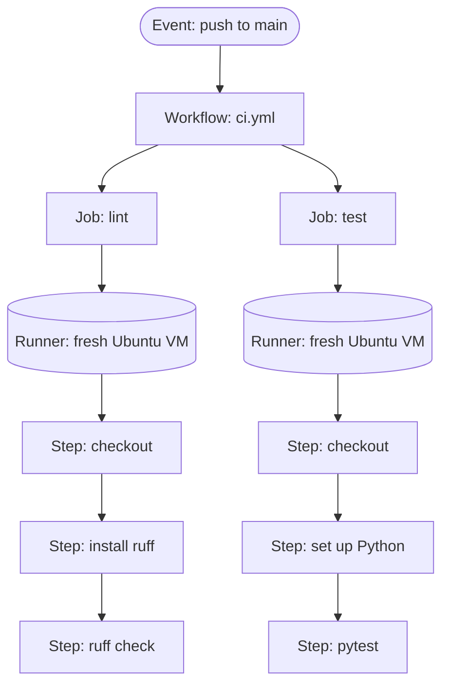
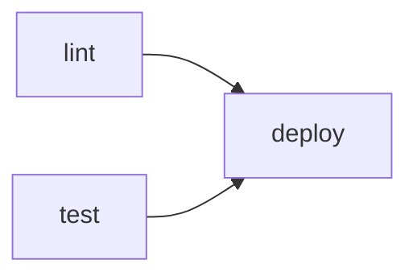

# Workflows, Jobs, Steps and Runners: The Complete Guide

> 📚 **Before you start**
>
> You should be able to push a branch and open a pull request. If not, read these first:
> - [clone, fetch, pull and push](../course.md#m5) (Remotes and GitHub Basics)
> - [Pull Requests End to End](../course.md#m6) (Collaborating on GitHub)
> - [Shell Scripts and cron](../../the-command-line-and-linux-basics/course.md#m3) (The Command Line and Linux Basics), because every step in a workflow is a shell command

## Introduction

Picture a busy railway reservation counter before computers. Every ticket was checked by hand: is the train right, is the date right, is the fare right? When the clerk was tired, mistakes slipped through. Now picture the same counter with a machine that checks every ticket the moment it is printed, the same way every time, and refuses to issue a bad one.

Software teams have the same problem. Every push could break the tests, the formatting, or the build. Someone has to check. **GitHub Actions** is the machine at the counter: a service built into GitHub that runs your commands on fresh computers whenever something happens in your repository, such as a push, a pull request or a schedule.

By the end of this article you will be able to read and write a workflow file from scratch, explain what a workflow, job, step, action and runner are, choose the right runner, pass data between steps and jobs, use contexts and expressions, and debug a failing run from its logs. You will also read the real workflow that deploys this site.

> 💡 **Key Insight**
>
> A workflow is just a YAML file in `.github/workflows/`. An **event** starts it, it runs one or more **jobs**, each job gets its own fresh **runner** (a throwaway virtual machine), and each job runs its **steps** top to bottom. Everything else in Actions is a detail on top of that four-level picture.

---

## Core Explanation

### 1. What CI/CD Means and Where Actions Fits

**Continuous integration (CI)** means every change is automatically built and tested as soon as it is pushed, so problems surface within minutes instead of at release time. **Continuous delivery or deployment (CD)** means a change that passes CI is automatically packaged and shipped, either to a staging area for a human to release (delivery) or straight to production (deployment).

GitHub Actions does both, and more. It can also label issues, publish packages, run a nightly data job, or ask a coding agent to review a pull request. Anything you can script, you can trigger from a repository event.

| Term | Meaning |
|---|---|
| **Workflow** | A YAML file in `.github/workflows/` that describes automation |
| **Event** | Something that happens in or to the repository (push, pull request, schedule, manual click) |
| **Job** | A group of steps that run on one runner. Jobs run in parallel unless you chain them |
| **Step** | One shell command (`run`) or one reusable action (`uses`) inside a job |
| **Action** | A packaged, reusable step, such as `actions/checkout` |
| **Runner** | The machine that executes a job. GitHub-hosted runners are fresh VMs |
| **Workflow run** | One execution of a workflow, with its logs, status and artifacts |
| **Artifact** | A file saved from a run so later jobs or humans can download it |

### 2. The Four-Level Picture



*One event starts one workflow run. Each job gets its own runner; the two jobs run at the same time.*

Two consequences follow from this picture, and they explain most beginner surprises:

- **Jobs do not share a disk.** A file created in the `lint` job does not exist in the `test` job. Each job starts on a clean machine. To pass files between jobs you upload and download artifacts.
- **Steps in a job do share a disk.** A step can create a file and the next step can read it, because they run on the same runner one after another.

### 3. Your First Workflow

Create `.github/workflows/hello.yml` in any repository, commit it and push:

```yaml
name: Hello

on:
  push:
    branches: [main]
  workflow_dispatch:        # adds a "Run workflow" button on the Actions tab

jobs:
  greet:
    runs-on: ubuntu-latest
    steps:
      - name: Say hello
        run: echo "Namaste from a runner running ${{ runner.os }}"

      - name: Show where we are
        run: |
          echo "Commit: $GITHUB_SHA"
          echo "Branch: $GITHUB_REF_NAME"
          pwd
          ls -la
```

Line by line:

- `name:` is what the Actions tab shows. Optional, but always set it.
- `on:` lists the events that start the workflow. Here: a push to `main`, or a manual click.
- `jobs:` is a map. The key `greet` is the **job id**; you use it to refer to the job elsewhere.
- `runs-on:` picks the runner. `ubuntu-latest` is the most common choice.
- `steps:` is a list. `run:` executes a shell command. A `|` starts a multi-line script.
- `${{ runner.os }}` is an **expression**, filled in by GitHub before the step runs. `$GITHUB_SHA` is a normal environment variable read by the shell at run time.

Open the **Actions** tab, click the run, then the `greet` job.

Example output:

```
Run echo "Namaste from a runner running Linux"
Namaste from a runner running Linux
Run echo "Commit: $GITHUB_SHA"
Commit: 4c1d2e9a0b7f3c5e8d6a1b2c3d4e5f6a7b8c9d0e
Branch: main
/home/runner/work/my-repo/my-repo
total 8
drwxr-xr-x 2 runner docker 4096 Oct 11 06:30 .
drwxr-xr-x 3 runner docker 4096 Oct 11 06:30 ..
```

Notice the folder is **empty**. The runner does not have your code until a step fetches it. That is what `actions/checkout` is for, and it is the first step of almost every workflow.

### 4. Steps: `run` and `uses`

A step does exactly one of two things:

```yaml
steps:
  # uses: run a published action, pinned to a version
  - uses: actions/checkout@v7

  # uses + with: pass inputs to the action
  - uses: actions/setup-python@v7
    with:
      python-version: "3.13"

  # run: a shell command, with optional settings
  - name: Install dependencies
    run: python -m pip install -r requirements.txt
    working-directory: backend
    env:
      PIP_DISABLE_PIP_VERSION_CHECK: "1"
    timeout-minutes: 10
```

The settings you will use most on a step:

| Key | What it does |
|---|---|
| `name` | Label shown in the log |
| `id` | A handle so later steps can read this step's outputs |
| `uses` | The action to run, as `owner/repo@ref` (or `./path` for a local action) |
| `with` | Inputs for the action |
| `run` | Shell commands to execute |
| `shell` | `bash` (default on Linux and macOS), `pwsh` (default on Windows), `python`, `sh` and others |
| `env` | Environment variables for this step only |
| `working-directory` | Folder to run the command in |
| `if` | Run the step only when a condition is true |
| `continue-on-error` | Don't fail the job if this step fails |
| `timeout-minutes` | Kill the step if it runs too long |

On Linux and macOS, `run` steps use `bash -e {0}` by default, so the script stops at the first failing command. A non-zero exit code fails the step, and a failed step fails the job.

The `@v7` part is a **ref**: a tag, branch or full commit SHA of the action's repository. Major-version tags are convenient; full SHAs are safest. The [Hardening Actions](../10-security-and-supply-chain/hardening-actions-pinning-and-least-privilege.md) lesson explains why.

### 5. Jobs: Parallel by Default, Chained with `needs`

```yaml
jobs:
  lint:
    runs-on: ubuntu-latest
    steps:
      - uses: actions/checkout@v7
      - run: pipx run ruff check .

  test:
    runs-on: ubuntu-latest
    steps:
      - uses: actions/checkout@v7
      - run: python -m pip install pytest && python -m pytest

  deploy:
    needs: [lint, test]           # waits for both, and only runs if both succeeded
    if: github.ref == 'refs/heads/main'
    runs-on: ubuntu-latest
    steps:
      - run: echo "Deploying ${{ github.sha }}"
```



`lint` and `test` start together. `deploy` waits for both. If either fails, `deploy` is **skipped**. The `if:` on a job is checked before a runner is even assigned, so a skipped job costs nothing.

Useful job-level keys: `runs-on`, `needs`, `if`, `steps`, `env`, `defaults` (for example a default `working-directory`), `timeout-minutes` (the default is 360 minutes on GitHub-hosted runners, so set something smaller), `strategy` (matrix builds, covered in [Matrix Builds and Caching](matrix-builds-and-caching.md)), `services` (sidecar containers like Postgres), `container` (run the steps inside a Docker image), `environment`, `permissions`, `concurrency` and `outputs`.

### 6. Runners: Where Your Job Actually Runs

A **runner** is a machine running GitHub's runner agent, which picks up a job, executes the steps and streams logs back.

**GitHub-hosted runners** are virtual machines GitHub creates for each job and destroys afterwards. Every job gets a clean machine with a large set of tools preinstalled (Git, Python, Node, Docker on Linux, compilers and more). Common labels:

| Label | Machine |
|---|---|
| `ubuntu-latest`, `ubuntu-24.04` | Linux x64, the usual choice |
| `ubuntu-24.04-arm` | Linux on Arm64 |
| `windows-latest` | Windows Server |
| `macos-latest` | macOS on Apple silicon |

The `-latest` labels move to a newer OS image over time, which can break a build that relied on an old tool. Pin a specific version (`ubuntu-24.04`) when you need stability, and plan upgrades on your own schedule.

**Larger runners** are GitHub-hosted machines with more cores, more memory or GPUs, configured by an organization and referenced by their label.

**Self-hosted runners** are machines you own (an office server, a cloud VM, a Kubernetes pod) that you register with a repository or organization. You choose them with labels:

```yaml
runs-on: [self-hosted, linux, x64, gpu]
```

Use self-hosted runners when you need special hardware, access to a private network, or lower cost at very high volume. The catch: you maintain them, and a non-ephemeral self-hosted runner keeps state between jobs. Never attach self-hosted runners to a **public** repository, because anyone who opens a pull request could run code on your machine.

**Cost.** Standard GitHub-hosted runners are free for public repositories. Private repositories get a monthly allowance of free minutes that depends on the account's plan, and Windows and macOS minutes count at a higher rate than Linux. Check the billing page of your account for the current numbers.

### 7. Contexts and Expressions

Anything inside `${{ ... }}` is an **expression**, evaluated by GitHub before the step is handed to the runner. Expressions read **contexts**, which are objects full of information about the run.

| Context | Examples |
|---|---|
| `github` | `github.event_name`, `github.ref`, `github.ref_name`, `github.sha`, `github.actor`, `github.repository`, `github.event` (the full event payload) |
| `env` | Variables set with `env:` at workflow, job or step level |
| `vars` | Configuration variables from repository or organization settings |
| `secrets` | Encrypted secrets, such as `secrets.GITHUB_TOKEN` |
| `runner` | `runner.os`, `runner.arch`, `runner.temp` |
| `job`, `steps` | Status of the current job; outputs of earlier steps (`steps.<id>.outputs.<name>`) |
| `needs` | Results and outputs of jobs this job depends on |
| `matrix`, `strategy` | Values for the current matrix combination |
| `inputs` | Inputs to a manually triggered or reusable workflow |

Expressions also have operators (`==`, `!=`, `&&`, `||`, `!`) and functions:

```yaml
- if: github.event_name == 'push' && startsWith(github.ref, 'refs/tags/v')
  run: echo "This is a release tag"

- if: contains(github.event.pull_request.labels.*.name, 'skip-tests')
  run: echo "Tests skipped by label"

- if: failure()          # run only when an earlier step failed
  run: echo "Something broke, collecting logs"

- if: always()           # run whether earlier steps passed, failed or were cancelled
  run: echo "Cleanup"

- run: echo "Lockfile hash is ${{ hashFiles('**/requirements*.txt') }}"
```

The status functions are `success()` (the default for every step), `failure()`, `always()` and `cancelled()`. Other common functions: `contains`, `startsWith`, `endsWith`, `format`, `join`, `toJSON`, `fromJSON` and `hashFiles`.

In an `if:` you may leave out the `${{ }}`; GitHub adds it for you. Everywhere else it is required.

**Expressions versus environment variables.** `${{ github.sha }}` is pasted into the script text before it runs. `$GITHUB_SHA` is read by the shell while it runs. They hold the same value here, but the difference matters for security: pasting untrusted text (such as an issue title) into a script with `${{ }}` lets an attacker inject commands. Pass such values through `env:` instead. The hardening lesson covers this in depth.

### 8. Default Environment Variables and Special Files

Every step sees variables such as `GITHUB_SHA`, `GITHUB_REF`, `GITHUB_REF_NAME`, `GITHUB_REPOSITORY`, `GITHUB_RUN_ID`, `GITHUB_WORKSPACE` (where checkout puts your code), `RUNNER_OS` and `RUNNER_TEMP`.

A few of them point to **files** the runner reads after each step. Writing to them is how a step talks to the rest of the job:

| File variable | Write this | Effect |
|---|---|---|
| `GITHUB_OUTPUT` | `name=value` | Sets an output of this step |
| `GITHUB_ENV` | `NAME=value` | Sets an environment variable for all **later** steps |
| `GITHUB_PATH` | a folder path | Adds the folder to `PATH` for later steps |
| `GITHUB_STEP_SUMMARY` | Markdown | Shows on the run's summary page |

```yaml
steps:
  - id: version
    run: echo "tag=v$(date +%Y.%m.%d)" >> "$GITHUB_OUTPUT"

  - run: echo "BUILD_MODE=release" >> "$GITHUB_ENV"

  - run: |
      echo "Version is ${{ steps.version.outputs.tag }}"
      echo "Mode is $BUILD_MODE"
      echo "### Built ${{ steps.version.outputs.tag }} :rocket:" >> "$GITHUB_STEP_SUMMARY"
```

Example output:

```
Version is v2026.10.11
Mode is release
```

### 9. Passing Data Between Jobs

Small values travel as **job outputs**; files travel as **artifacts**.

```yaml
jobs:
  build:
    runs-on: ubuntu-latest
    outputs:
      version: ${{ steps.v.outputs.version }}
    steps:
      - uses: actions/checkout@v7
      - id: v
        run: echo "version=$(cat VERSION)" >> "$GITHUB_OUTPUT"
      - run: mkdir -p dist && echo "app ${{ steps.v.outputs.version }}" > dist/app.txt
      - uses: actions/upload-artifact@v7
        with:
          name: app
          path: dist/
          retention-days: 7

  publish:
    needs: build
    runs-on: ubuntu-latest
    steps:
      - uses: actions/download-artifact@v8
        with:
          name: app
          path: dist/
      - run: |
          echo "Publishing version ${{ needs.build.outputs.version }}"
          cat dist/app.txt
```

Artifacts also appear on the run page so a human can download them, which is handy for test reports and build outputs.

### 10. Reading a Real Workflow: How This Site Deploys

This site is built and published by `.github/workflows/deploy.yml` in its own repository. Here is its shape, trimmed:

```yaml
name: Deploy site
on:
  push:
    branches: [main]
  pull_request:
  workflow_dispatch:
permissions:
  contents: read
  pages: write
  id-token: write
concurrency:
  group: pages
  cancel-in-progress: true
jobs:
  build:
    runs-on: ubuntu-latest
    steps:
      - uses: actions/checkout@v4
      - uses: actions/setup-python@v5
        with: { python-version: "3.13" }
      - name: Rebuild catalog
        run: python3 build_catalog.py .
      - name: Run every code example in the lessons
        run: python3 tools/check_code.py
      - uses: actions/setup-node@v4
        with: { node-version: 22, cache: npm, cache-dependency-path: site/package-lock.json }
      - name: Build site
        working-directory: site
        run: npm ci && npm run build
      - uses: actions/upload-pages-artifact@v3
        with: { path: site/dist }
  deploy:
    if: github.event_name != 'pull_request'
    needs: build
    runs-on: ubuntu-latest
    environment:
      name: github-pages
      url: ${{ steps.deployment.outputs.page_url }}
    steps:
      - id: deployment
        uses: actions/deploy-pages@v4
```

You can now read every line: three triggers, a `permissions` block that gives the token only what it needs, a `concurrency` group so two deploys never overlap, a `build` job whose steps share one disk, and a `deploy` job that waits for `build`, is skipped on pull requests, and reads an output from its own step for the environment URL. (The action versions here are older majors that still work; newer workflows in this course use the current ones.) You will build a workflow like this yourself in [Lab: Deploy a static site with Actions](../08-github-pages-codespaces-and-packages/lab-deploy-a-static-site-with-actions.md).

### 11. Debugging a Failing Run

When a run goes red:

1. **Open the failed step** in the log. The last lines before `Error: Process completed with exit code 1.` usually say what went wrong.
2. **Re-run** only the failed jobs from the run page, in case it was a flaky network call.
3. **Turn on debug logging** by re-running with "Enable debug logging" ticked, or by setting a repository variable `ACTIONS_STEP_DEBUG` to `true`.
4. **Print context** you are unsure about: `run: echo '${{ toJSON(github.event) }}'` for trusted events.
5. **Use workflow commands** to make logs readable:

```yaml
- run: |
    echo "::group::Installed packages"
    pip list
    echo "::endgroup::"
    echo "::notice title=Heads up::Using Python $(python --version)"
    echo "::warning file=app.py,line=10::Deprecated call"
    echo "::error file=app.py,line=42::Tests failed here"
```

`::error` and `::warning` with `file` and `line` show up as annotations right on the pull request diff.

Finally, show the status on your README with a badge:

```markdown

```

---

## Try It Yourself

1. **Two jobs, one dependency.** Write a workflow with jobs `a` and `b`, where `b` needs `a`. In `a`, write a file `note.txt`. In `b`, try to `cat note.txt`. What happens, and how do you fix it?
2. **Step output.** Write a job whose first step sets an output `day` to the current weekday (`date +%A`) and whose second step prints "Chai break on <day>".
3. **Conditional cleanup.** Add a step that only runs if an earlier step failed, and another that runs no matter what. Make the second-to-last step fail with `exit 1` to test.
4. **Read and explain.** In the deploy workflow above, why does `deploy` have `if: github.event_name != 'pull_request'`, and what would happen without it?

<details>
<summary>Show answers</summary>

**1.** `b` fails with `No such file or directory` because each job runs on a fresh runner. Upload the file in `a` and download it in `b`:

```yaml
jobs:
  a:
    runs-on: ubuntu-latest
    steps:
      - run: echo "hello" > note.txt
      - uses: actions/upload-artifact@v7
        with: { name: note, path: note.txt }
  b:
    needs: a
    runs-on: ubuntu-latest
    steps:
      - uses: actions/download-artifact@v8
        with: { name: note }
      - run: cat note.txt
```

**2.**

```yaml
steps:
  - id: today
    run: echo "day=$(date +%A)" >> "$GITHUB_OUTPUT"
  - run: echo "Chai break on ${{ steps.today.outputs.day }}"
```

**3.**

```yaml
steps:
  - run: exit 1
  - if: failure()
    run: echo "An earlier step failed"
  - if: always()
    run: echo "Cleaning up"
```

The `failure()` step runs, the `always()` step runs, and the job is still marked failed.

**4.** Pull requests should build and test but never publish. Without the condition, every pull request (including one from a fork) would try to deploy unreviewed code to the live site. The `environment` protection would also be bypassed in spirit, since review would happen after publishing.

</details>

---

## Real-World Examples

### Example 1: A Python Library's Pull Request Checks

An open source library runs three jobs on every pull request: `lint` (ruff), `type-check` (mypy) and `test` (pytest across several Python versions). They run in parallel, so feedback arrives in a few minutes. Branch protection requires all three to pass before merging.

### Example 2: A Data Team's Nightly Job

A data team schedules a workflow at 02:00 IST every night that pulls the previous day's UPI transaction summary from an API, validates it, and commits a CSV to a reporting repository. No server to maintain: the runner exists only for the five minutes the job needs.

### Example 3: Issue Housekeeping

A maintainer adds a workflow that runs when an issue is opened and applies a `needs-triage` label using the GitHub CLI preinstalled on the runner. It is three lines of YAML, and it saves a few minutes every day.

---

## Common Misconceptions

### Misconception 1: "Jobs in a workflow run one after another"

They run in **parallel** by default. Only `needs:` creates an order.

### Misconception 2: "The runner already has my code"

A runner starts empty. Without `actions/checkout`, your repository's files aren't there.

### Misconception 3: "Steps in different jobs can share files"

Only steps in the **same** job share a disk. Across jobs, use artifacts, caches or outputs.

### Misconception 4: "`${{ }}` and `$VAR` are the same thing"

`${{ }}` is replaced by GitHub before the script runs; `$VAR` is read by the shell at run time. Mixing untrusted input into `${{ }}` inside `run:` is a classic security hole.

### Misconception 5: "Actions is only for CI"

Actions reacts to dozens of events, including issues, comments, releases and schedules. Teams use it for triage, releases, reports and AI agents as much as for tests.

---

## Interview Relevance

Interviewers for developer, DevOps and data engineering roles often ask you to explain a CI pipeline you have built. A strong answer covers:

- **The hierarchy:** event → workflow → jobs (parallel, on separate runners) → steps (sequential, shared disk).
- **How data moves:** step outputs via `GITHUB_OUTPUT`, job outputs via `needs`, files via artifacts.
- **Runner choice:** GitHub-hosted for clean, maintenance-free builds; self-hosted for special hardware or private networks, never on public repos.
- **Failure handling:** `if: failure()`/`always()`, timeouts, re-runs, debug logging.

Common follow-ups:

- *"How would you make deploy wait for tests?"* `needs:` plus an `if:` on the branch or event.
- *"Why might a build pass yesterday and fail today with no code change?"* A `-latest` runner image changed, an unpinned dependency released a new version, or an action's moving tag changed.
- *"Where would you store an API key the workflow needs?"* In an encrypted secret, never in the YAML. See [Secrets, Variables and Environments](secrets-variables-and-environments.md).

---

## Key Takeaways

- **A workflow is a YAML file** in `.github/workflows/`, started by events.
- **Jobs run in parallel on separate fresh runners**; `needs:` chains them, and each job starts with an empty disk.
- **Steps run in order on one runner** and either `run` a command or `uses` an action.
- **Contexts and expressions** (`${{ github.sha }}`, `if: failure()`) make workflows dynamic; `GITHUB_OUTPUT`, `GITHUB_ENV` and artifacts move data.
- **Debug from the logs**, use workflow commands for annotations, and pin runner images when stability matters.

---

**Up next:** [Triggers and Events](triggers-and-events.md)
