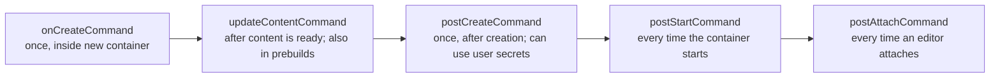

# Codespaces and Dev Containers: The Complete Guide

> 📚 **Before you start**
>
> - [clone, fetch, pull and push](../course.md#m5) (Remotes and GitHub Basics)
> - [Package Managers and Virtual Environments](../../the-command-line-and-linux-basics/course.md#m3) (The Command Line and Linux Basics)
> - [Processes, Ports and Environment Variables](../../the-command-line-and-linux-basics/course.md#m3), for port forwarding
> - Knowing roughly what a Docker container is helps, but section 1 explains enough

## Introduction

A new developer joins a team in Hyderabad on Monday. By Wednesday they still can't run the project: wrong Python version, a missing system library, a database that won't start, a README that was last accurate two years ago. Every team has lived this, and the phrase "but it works on my machine" was born here.

A **dev container** fixes it by writing the whole development environment down as code: the operating system, language versions, tools, editor extensions, ports and setup commands, all in one `devcontainer.json` file committed to the repository. **GitHub Codespaces** then runs that environment on a cloud machine and connects your editor to it, so a new developer clicks one button and is coding in a few minutes, from any laptop, even a borrowed one.

By the end of this article you'll be able to write a `devcontainer.json` for a Python project (with features, extensions, ports and lifecycle commands), use Docker Compose for a project with a database, run it locally or in Codespaces, manage codespaces from the CLI, and control cost with machine types, timeouts and prebuilds.

> 💡 **Key Insight**
>
> The **dev container** is the recipe; **Codespaces** is one kitchen that can cook it. The same `devcontainer.json` works in Codespaces, in VS Code on your laptop, and in other tools that support the open Dev Container specification. Write the recipe once and everyone, including CI and new hires, gets the same environment.

---

## Core Explanation

### 1. Containers in One Paragraph

A **container** is an isolated process with its own filesystem, built from an **image**: a snapshot of an operating system plus installed software. Images are built from a **Dockerfile** and shared through registries like Docker Hub or GitHub Container Registry. A container starts in seconds and behaves the same on any machine that runs it. A **dev container** is simply a container set up for development: your code is mounted inside it, your editor connects to it, and your tools run in it.

### 2. Your First `devcontainer.json`

Create `.devcontainer/devcontainer.json` in the repository:

```json
{
  "name": "chai-bill (Python 3.13)",
  "image": "mcr.microsoft.com/devcontainers/python:3.13",

  "features": {
    "ghcr.io/devcontainers/features/github-cli:1": {},
    "ghcr.io/devcontainers/features/node:1": { "version": "22" }
  },

  "customizations": {
    "vscode": {
      "extensions": ["ms-python.python", "charliermarsh.ruff"],
      "settings": {
        "python.testing.pytestEnabled": true,
        "editor.formatOnSave": true
      }
    }
  },

  "forwardPorts": [8000],
  "portsAttributes": {
    "8000": { "label": "API", "onAutoForward": "notify" }
  },

  "postCreateCommand": "pip install -e '.[test]' ruff",
  "remoteUser": "vscode"
}
```

| Key | What it does |
|---|---|
| `name` | Display name |
| `image` | The base image. Microsoft publishes ready-made dev container images for Python, Node, Java, Go and more |
| `features` | Add-on tools installed on top of the image, each from a registry with its own options |
| `customizations.vscode` | Extensions to install and editor settings inside the container |
| `forwardPorts` | Ports to forward from the container to your browser or laptop |
| `portsAttributes` | Labels and behaviour for forwarded ports |
| `postCreateCommand` | Runs once after the container is created, ideal for installing dependencies |
| `remoteUser` | The user your terminal runs as (avoid working as root) |

`devcontainer.json` allows comments (`//`) and trailing commas, so you can document why each piece is there.

### 3. Features: Tools as Building Blocks

A **feature** is a reusable, self-contained install script with options, published to a container registry. Instead of writing apt and curl commands, you declare what you need:

```json
"features": {
  "ghcr.io/devcontainers/features/github-cli:1": {},
  "ghcr.io/devcontainers/features/docker-in-docker:2": {},
  "ghcr.io/devcontainers/features/aws-cli:1": {},
  "ghcr.io/devcontainers/features/node:1": { "version": "lts" }
}
```

The number after the colon is the feature's major version. The official collection lives in the `devcontainers/features` repository, and the community publishes many more, indexed on containers.dev.

### 4. Lifecycle Commands

Several hooks run at different moments. Choosing the right one keeps startup fast:



| Hook | Runs | Good for |
|---|---|---|
| `onCreateCommand` | Once, when the container is first created | Heavy, rarely changing setup |
| `updateContentCommand` | When content changes; also during prebuilds | Installing dependencies so prebuilds include them |
| `postCreateCommand` | Once, after creation | Final setup that may need your personal secrets |
| `postStartCommand` | On every start | Starting a background service, `git fetch` |
| `postAttachCommand` | On every attach | Printing a welcome message, opening a file |

Each accepts a string (run in a shell), an array (run directly) or an object of named commands that run in parallel:

```json
"postCreateCommand": {
  "python": "pip install -e '.[test]'",
  "node": "cd site && npm ci"
}
```

### 5. A Custom Dockerfile

When an image plus features isn't enough (say you need a system library like `libpq-dev` or a specific CLI), build your own:

```dockerfile
# .devcontainer/Dockerfile
FROM mcr.microsoft.com/devcontainers/python:3.13
RUN apt-get update \
 && apt-get install -y --no-install-recommends libpq-dev postgresql-client \
 && rm -rf /var/lib/apt/lists/*
```

```json
{
  "name": "orders-api",
  "build": {
    "dockerfile": "Dockerfile",
    "context": ".."
  },
  "postCreateCommand": "pip install -r requirements-dev.txt"
}
```

`context: ".."` makes the repository root the build context, so the Dockerfile can `COPY` files from anywhere in the repo.

### 6. Multiple Services with Docker Compose

Real projects need a database, a cache or a queue. Point the dev container at a Compose file and pick which service your editor attaches to:

```yaml
# .devcontainer/docker-compose.yml
services:
  app:
    build:
      context: ..
      dockerfile: .devcontainer/Dockerfile
    volumes:
      - ..:/workspaces/orders-api:cached
    command: sleep infinity
    environment:
      DATABASE_URL: postgresql://chai:chai@db:5432/orders
    depends_on: [db]

  db:
    image: postgres:17
    environment:
      POSTGRES_USER: chai
      POSTGRES_PASSWORD: chai
      POSTGRES_DB: orders
    volumes:
      - pgdata:/var/lib/postgresql/data

volumes:
  pgdata:
```

```json
{
  "name": "orders-api + Postgres",
  "dockerComposeFile": "docker-compose.yml",
  "service": "app",
  "workspaceFolder": "/workspaces/orders-api",
  "forwardPorts": [8000, "db:5432"],
  "postCreateCommand": "pip install -r requirements-dev.txt && alembic upgrade head"
}
```

`command: sleep infinity` keeps the app container running so the editor can attach. The app reaches the database at the hostname `db`, the Compose service name. The local development password here is fine; real credentials never go in these files.

### 7. Running It: Codespaces or Your Laptop

**In GitHub Codespaces:** on the repository page, **Code → Codespaces → Create codespace on main**. GitHub starts a cloud VM, builds the dev container, clones your repository into `/workspaces/<repo>`, and opens VS Code in the browser. You can also open the codespace in desktop VS Code or JetBrains IDEs.

**From the terminal** with the GitHub CLI:

```bash
gh codespace create --repo chai-co/orders-api --branch main --machine basicLinux32gb
gh codespace list
gh codespace ssh            # terminal inside the codespace
gh codespace code           # open it in desktop VS Code
gh codespace ports          # list forwarded ports
gh codespace stop
gh codespace delete
```

Example output (`gh codespace list`):

```
NAME                         DISPLAY NAME     REPOSITORY          BRANCH  STATE      CREATED AT
chai-co-orders-api-x7q4r9    fluffy-garbanzo  chai-co/orders-api  main    Available  about 3 minutes ago
```

**Locally**, with Docker installed: open the folder in VS Code with the **Dev Containers** extension and choose **Reopen in Container**. Or use the reference command-line tool:

```bash
npm install -g @devcontainers/cli
devcontainer up --workspace-folder .
devcontainer exec --workspace-folder . pytest -q
```

The last command is also a neat way to run CI **inside the same environment** developers use.

### 8. Ports, Secrets and Personalisation

**Port forwarding.** When your app listens on a port (say a FastAPI server on 8000), Codespaces forwards it to a URL like `https://<codespace-name>-8000.app.github.dev`. Ports are **private** by default (only you, signed in), and you can change one to **organization** or **public** visibility from the Ports panel, for example to show a client a demo. Remember to switch it back.

**Secrets.** Add personal secrets in **Settings → Codespaces → Secrets** on your account, and choose which repositories can use them. They appear as environment variables inside the codespace. Repository and organization admins can add Codespaces secrets too. A repository can **recommend** the secrets it needs:

```json
"secrets": {
  "OPENAI_API_KEY": { "description": "Needed for the summarisation demo" },
  "MAPS_API_KEY": { "description": "Google Maps key for the delivery map" }
}
```

Codespaces then prompts users for those values when they create a codespace.

**Dotfiles.** If you have a public repository named `dotfiles` (shell aliases, Git config, prompt), enable it under **Settings → Codespaces** and it's applied to every codespace you create.

**Hardware.** Ask for a minimum machine size when your project needs it:

```json
"hostRequirements": { "cpus": 4, "memory": "8gb", "storage": "32gb" }
```

### 9. Cost and Lifecycle

Codespaces is billed by **compute** (how long the machine runs, multiplied by its cores) and **storage** (the size of your codespaces and prebuilds per month). Personal accounts get a free monthly allowance: 120 core-hours and 15 GB-month of storage on GitHub Free, 180 core-hours and 20 GB-month on Pro. A 2-core machine uses 2 core-hours per hour of running, so the allowance goes further on smaller machines:

```python
INCLUDED_CORE_HOURS = {"Free": 120, "Pro": 180}

def hours_available(plan, cores):
    """Wall-clock hours per month you can run a codespace before paying."""
    return INCLUDED_CORE_HOURS[plan] / cores

for cores in [2, 4, 8]:
    print(f"{cores}-core: Free {hours_available('Free', cores):.0f} h, Pro {hours_available('Pro', cores):.0f} h")

def month_usage(hours_per_day, days, cores):
    return hours_per_day * days * cores

used = month_usage(hours_per_day=2, days=22, cores=2)
print("Student, 2 h/day on 22 days, 2 cores:", used, "core-hours of", INCLUDED_CORE_HOURS["Free"])
used = month_usage(hours_per_day=3, days=22, cores=4)
print("Same student on 4 cores, 3 h/day:", used, "core-hours, over by", used - INCLUDED_CORE_HOURS["Free"])
```

Output:

```
2-core: Free 60 h, Pro 90 h
4-core: Free 30 h, Pro 45 h
8-core: Free 15 h, Pro 22 h
Student, 2 h/day on 22 days, 2 cores: 88 core-hours of 120
Same student on 4 cores, 3 h/day: 264 core-hours, over by 144
```

Keep costs under control:

- **Pick the smallest machine** that's comfortable.
- **Idle timeout:** a codespace stops itself after a period of inactivity (30 minutes by default, adjustable in your settings). A stopped codespace costs only storage.
- **Retention:** stopped codespaces are deleted automatically after a retention period (30 days by default), so don't treat a codespace as your only copy of unpushed work. **Commit and push.**
- **Spending limit:** with no payment method or a spending limit of zero, Codespaces simply stops being available when the allowance runs out, instead of charging you.
- **Organizations** can set policies on machine types, idle timeouts and who pays.

### 10. Prebuilds: Instant Start for Big Projects

For a large project, building the container and installing dependencies can take ten minutes. A **prebuild** does that work ahead of time, whenever the configuration or code changes on a chosen branch, and stores a ready snapshot. New codespaces start from the snapshot in seconds. Configure prebuilds under **Settings → Codespaces** in the repository; they run as GitHub Actions workflows and consume Actions minutes and storage, so enable them only for branches people start codespaces from. This is where `updateContentCommand` shines: anything it installs is baked into the prebuild.

### 11. Dev Containers Beyond Codespaces

- **Other editors and tools** that implement the open specification can use the same file.
- **CI** can run tests in the dev container (for example with the dev container CLI) so the environment is identical.
- **Coding agents:** Copilot cloud agent sets up its own environment from a `copilot-setup-steps.yml` workflow rather than from `devcontainer.json`, but the same discipline applies: an environment written as code is one an agent can reproduce. See [Coding Agents that Open Pull Requests](../09-ai-on-github/coding-agents-that-open-pull-requests.md).

---

## Try It Yourself

1. **Write one.** Write a `devcontainer.json` for a FastAPI project on Python 3.13 that installs the GitHub CLI feature, the Python and Ruff extensions, forwards port 8000 labelled "API", and runs `pip install -r requirements.txt` once after creation.
2. **Pick the hook.** Where would you put: (a) `pip install -r requirements.txt` so prebuilds include it, (b) starting a local Redis server every time the codespace starts, (c) printing "Run make dev to start" whenever you connect?
3. **Do the maths.** With the Free allowance, how many full 8-hour days can you work on a 4-core machine? Use `hours_available`.
4. **Spot the risk.** A teammate made port 8000 public to show a demo and forgot. What's the risk, and what's the fix?

<details>
<summary>Show answers</summary>

**1.**

```json
{
  "name": "chai-api",
  "image": "mcr.microsoft.com/devcontainers/python:3.13",
  "features": { "ghcr.io/devcontainers/features/github-cli:1": {} },
  "customizations": {
    "vscode": { "extensions": ["ms-python.python", "charliermarsh.ruff"] }
  },
  "forwardPorts": [8000],
  "portsAttributes": { "8000": { "label": "API" } },
  "postCreateCommand": "pip install -r requirements.txt"
}
```

**2.** (a) `updateContentCommand`; (b) `postStartCommand`; (c) `postAttachCommand`.

**3.**

```python
days = hours_available("Free", 4) // 8
print(days, "full days")
```

Output:

```
3.0 full days
```

30 hours on 4 cores is three full days plus six hours, which is why a 2-core machine is the sensible default for learning.

**4.** Anyone with the URL can reach the app while the codespace runs, including any unprotected admin pages or debug endpoints. Set the port back to private in the Ports panel (or `gh codespace ports visibility 8000:private`), and stop the codespace when not in use.

</details>

---

## Real-World Examples

### Example 1: Onboarding in Minutes

A fintech team in Bengaluru added a dev container with Python, Postgres via Compose, and prebuilds on `main`. New engineers now open a codespace on day one and run the test suite before lunch, instead of spending two days on setup.

### Example 2: Workshops and Classrooms

A college coding club runs Python workshops where every student opens the same codespace from a template repository. Nobody's laptop setup matters, and the instructor never hears "pip isn't working on my Windows machine".

### Example 3: Open Source First Contributions

Many open source projects add a dev container so first-time contributors can fix a typo or a small bug from the browser without installing anything. The friction of "set up the project locally" disappears.

---

## Common Misconceptions

### Misconception 1: "Dev containers only work in Codespaces"

The specification is open. The same file works locally in VS Code with Docker, with the dev container CLI, and in other supporting tools.

### Misconception 2: "A codespace is permanent storage"

Stopped codespaces are deleted after the retention period. Push your work.

### Misconception 3: "Bigger machines are always better"

They burn the allowance proportionally faster. Most web and data projects are fine on 2 or 4 cores.

### Misconception 4: "Put the install in `postStartCommand` to be safe"

That reinstalls on every start and slows everyone down. Install once in `postCreateCommand` or `updateContentCommand`.

---

## Interview Relevance

Developer-experience and platform interviews ask how you'd make onboarding and environments reproducible:

- **Environment as code:** `devcontainer.json`, images, features, Dockerfile or Compose, editor customisations.
- **Lifecycle hooks:** what runs once versus every start, and how prebuilds use `updateContentCommand`.
- **Codespaces operations:** machine types, idle timeout, retention, secrets, port visibility, prebuilds.
- **Cost awareness:** core-hours, storage, spending limits.

Common follow-ups:

- *"How would you give developers a database locally and in Codespaces?"* Docker Compose with the app and database services, `service` and `workspaceFolder` in `devcontainer.json`.
- *"How do you keep secrets out of the dev container config?"* Codespaces secrets (recommended via the `secrets` key), never values in the file.

---

## Key Takeaways

- **A dev container is your development environment as code**, in `.devcontainer/devcontainer.json`: image or Dockerfile, features, extensions, ports and lifecycle commands.
- **Codespaces runs that environment on a cloud VM**; the same file works locally with VS Code or the dev container CLI.
- **Lifecycle hooks differ**: install in `postCreateCommand`/`updateContentCommand`, start services in `postStartCommand`.
- **Compose** brings databases and other services; **Codespaces secrets** bring credentials without committing them.
- **Control cost** with small machines, idle timeouts, retention, spending limits and targeted prebuilds; personal accounts get 120 (Free) or 180 (Pro) core-hours a month.

---

**Up next:** [Releases, Tags and GitHub Packages](releases-tags-and-github-packages.md)
