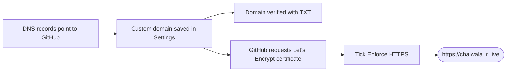

# Custom Domains and HTTPS: The Complete Guide

> 📚 **Before you start**
>
> - [Publishing a Site with GitHub Pages](publishing-a-site-with-github-pages.md)
> - [SSH and Remote Servers](../../the-command-line-and-linux-basics/course.md#m3) (The Command Line and Linux Basics), for being comfortable with hostnames and the terminal

## Introduction

`meera-codes.github.io/chai-recipes` works, but it's hard to say over the phone and harder to print on a visiting card. `chaiwala.in` is easy to remember and looks like a real business. Pointing your own domain at a GitHub Pages site takes about fifteen minutes of setup and a little waiting, and HTTPS comes free.

The fifteen minutes involve **DNS**, the internet's phone book, which trips up even experienced developers: records that look right but point to the wrong place, a missing verification step that lets someone else hijack your domain, or an HTTPS checkbox that stays grey for hours.

By the end of this article you will understand the DNS records you need, set up an apex domain and a `www` subdomain, verify your domain to prevent takeovers, turn on and enforce HTTPS, and troubleshoot the usual problems with `dig`.

> 💡 **Key Insight**
>
> A custom domain needs **two sides to agree**: your DNS must point to GitHub, and GitHub must be told which repository owns the domain. Verification adds a third lock: proof that **you** own the domain, so nobody else's repository can claim it if your site is ever removed.

---

## Core Explanation

### 1. DNS in Five Minutes

When someone types `chaiwala.in`, their computer asks DNS servers "what's the address for this name?" The answer comes from **records** you create at your **DNS provider** (often the company you bought the domain from, the **registrar**, or a service like Cloudflare).

| Record | Maps a name to... | Example |
|---|---|---|
| **A** | An IPv4 address | `chaiwala.in → 185.199.108.153` |
| **AAAA** | An IPv6 address | `chaiwala.in → 2606:50c0:8000::153` |
| **CNAME** | Another **name** (an alias) | `www.chaiwala.in → meera-codes.github.io` |
| **ALIAS / ANAME** | Another name, but allowed at the apex (provider-specific) | `chaiwala.in → meera-codes.github.io` |
| **TXT** | Text, used for verification | `_github-pages-challenge-meera-codes.chaiwala.in → "a1b2c3..."` |
| **CAA** | Which certificate authorities may issue certificates | `chaiwala.in → 0 issue "letsencrypt.org"` |

Two more terms:

- **Apex domain** (also "root" or "naked" domain): `chaiwala.in` itself. DNS rules don't allow a CNAME at the apex, which is why apex domains use A/AAAA records (or a provider's ALIAS/ANAME).
- **Subdomain**: anything in front, like `www.chaiwala.in` or `docs.chaiwala.in`. Subdomains use a CNAME.

Changes take time to spread because resolvers cache answers for the record's **TTL** (time to live). Usually minutes, occasionally up to a day or two.

### 2. The Records GitHub Pages Needs

**For the apex domain**, create **A** records pointing to all four GitHub Pages IPv4 addresses:

```
185.199.108.153
185.199.109.153
185.199.110.153
185.199.111.153
```

Optionally add **AAAA** records for IPv6 (keep the A records too, since not every visitor has IPv6):

```
2606:50c0:8000::153
2606:50c0:8001::153
2606:50c0:8002::153
2606:50c0:8003::153
```

If your provider supports **ALIAS** or **ANAME**, you can instead point the apex at `<username>.github.io`.

**For a subdomain** like `www` or `docs`, create a **CNAME** pointing to `<username>.github.io` (or `<org>.github.io`). Never include the repository name in a DNS record: DNS knows nothing about paths. GitHub works out which repository to serve from the custom domain you configure in the next step.

A plan for `chaiwala.in` plus `www.chaiwala.in` is easy to get wrong, so here's a small checker that encodes the rules:

```python
PAGES_A = {"185.199.108.153", "185.199.109.153", "185.199.110.153", "185.199.111.153"}
PAGES_AAAA = {"2606:50c0:8000::153", "2606:50c0:8001::153", "2606:50c0:8002::153", "2606:50c0:8003::153"}

def check_zone(zone, apex, username):
    """Check a DNS plan for a Pages site on apex + www. Returns a list of problems."""
    problems = []
    a = {r["value"] for r in zone if r["name"] == apex and r["type"] == "A"}
    aaaa = {r["value"] for r in zone if r["name"] == apex and r["type"] == "AAAA"}
    www = [r for r in zone if r["name"] == f"www.{apex}"]
    if a != PAGES_A:
        problems.append(f"apex A records should be all four Pages IPs, found {sorted(a)}")
    if aaaa and aaaa != PAGES_AAAA:
        problems.append("apex AAAA records are present but not the four Pages IPv6 addresses")
    if not (len(www) == 1 and www[0]["type"] == "CNAME" and www[0]["value"] == f"{username}.github.io"):
        problems.append(f"www should be a single CNAME to {username}.github.io")
    if any(r["name"].startswith("*.") for r in zone):
        problems.append("wildcard record found: risk of subdomain takeover")
    return problems or ["looks good"]

good = [{"name": "chaiwala.in", "type": "A", "value": ip} for ip in sorted(PAGES_A)]
good.append({"name": "www.chaiwala.in", "type": "CNAME", "value": "meera-codes.github.io"})
print(check_zone(good, "chaiwala.in", "meera-codes"))

bad = [
    {"name": "chaiwala.in", "type": "A", "value": "185.199.108.153"},
    {"name": "www.chaiwala.in", "type": "CNAME", "value": "meera-codes.github.io/chai-site"},
    {"name": "*.chaiwala.in", "type": "CNAME", "value": "meera-codes.github.io"},
]
for problem in check_zone(bad, "chaiwala.in", "meera-codes"):
    print("-", problem)
```

Output:

```
['looks good']
- apex A records should be all four Pages IPs, found ['185.199.108.153']
- www should be a single CNAME to meera-codes.github.io
- wildcard record found: risk of subdomain takeover
```

### 3. Tell GitHub About the Domain

In the repository: **Settings → Pages → Custom domain**, type `chaiwala.in` (or `www.chaiwala.in`) and save. GitHub runs a DNS check and shows the result.

- **Publishing from a branch:** saving the setting commits a file named `CNAME` (containing just the domain) to the root of your publishing source. If you build the site yourself and deploy from a branch, make sure your build keeps that file in the output.
- **Publishing with GitHub Actions:** no `CNAME` file is created, and any existing one is ignored. The setting alone is enough.

**Apex plus www.** If you configure `chaiwala.in` and your DNS also has the `www` CNAME (or the other way round), GitHub automatically redirects between them, so both addresses reach the site. Pick the one you want people to see as the setting; the other redirects to it.

Example output after a few minutes (Settings → Pages):

```
✓ DNS check successful
Your site is live at https://chaiwala.in/
```

### 4. Verify the Domain: Stop Takeovers

Picture this: you point `docs.chaiwala.in` at GitHub Pages, and a year later you delete the docs repository but forget the DNS record. The CNAME still points at GitHub, but no repository claims the domain. Anyone could create a repository, set its custom domain to `docs.chaiwala.in`, and serve whatever they like on **your** domain: phishing pages, malware, embarrassing content. This is a **domain takeover**.

**Verification** prevents it. Verified domains can only be used by repositories owned by your account (or organization):

1. Open your **profile** (or organization) **Settings → Pages → Add a domain**. This is account-level, not repository-level.
2. Enter `chaiwala.in`. GitHub shows a TXT record to create, at the host `_github-pages-challenge-<username>.chaiwala.in`, with a random value.
3. Create that TXT record at your DNS provider, wait for it to propagate, and click **Verify**.

```bash
dig _github-pages-challenge-meera-codes.chaiwala.in +nostats +nocomments +nocmd TXT
```

Example output:

```
;_github-pages-challenge-meera-codes.chaiwala.in. IN TXT
_github-pages-challenge-meera-codes.chaiwala.in. 300 IN TXT "4f9c2a7e1b"
```

Keep the TXT record forever; removing it un-verifies the domain. Verification also protects **immediate** subdomains (`docs.chaiwala.in`). It can't protect deeper names covered by a **wildcard** record (`*.chaiwala.in`), so don't point wildcards at GitHub Pages. And when you stop using a domain for Pages, delete its DNS records too.

### 5. HTTPS

**HTTPS** encrypts traffic between visitors and your site and proves the site is really yours. Without it, browsers show "Not secure", and anyone on the same café Wi-Fi can read or alter pages.

- Sites on `*.github.io` always have HTTPS.
- For custom domains, GitHub automatically requests a free certificate from **Let's Encrypt** once your DNS is correct, and renews it for you.
- Tick **Enforce HTTPS** in **Settings → Pages** to redirect every `http://` request to `https://`. It can take up to 24 hours after setting the domain before this option becomes available.



Common HTTPS blockers:

- **DNS still wrong or still propagating.** The certificate can't be issued until the domain resolves to GitHub.
- **A CAA record** that doesn't allow `letsencrypt.org`. Either remove CAA records or add one allowing Let's Encrypt.
- **A subdomain pointed at your apex** instead of at `<username>.github.io`. Point subdomains straight at `github.io`.
- **Mixed content:** your HTTPS page loads an image or script over `http://`. Browsers block or warn. Use `https://` or relative URLs for every asset.

To kick a stuck certificate request, remove the custom domain, save, add it back and save again.

### 6. Checking DNS from the Terminal

```bash
dig chaiwala.in +noall +answer -t A
dig chaiwala.in +noall +answer -t AAAA
dig www.chaiwala.in +nostats +nocomments +nocmd
```

Example output:

```
chaiwala.in.		300	IN	A	185.199.108.153
chaiwala.in.		300	IN	A	185.199.109.153
chaiwala.in.		300	IN	A	185.199.110.153
chaiwala.in.		300	IN	A	185.199.111.153
...
www.chaiwala.in.	300	IN	CNAME	meera-codes.github.io.
meera-codes.github.io.	3600	IN	A	185.199.108.153
```

On Windows, `Resolve-DnsName chaiwala.in -Type A` in PowerShell does the same job. If `dig` shows old values, your resolver is caching: wait for the TTL, or ask a public resolver directly with `dig @1.1.1.1 chaiwala.in`.

### 7. Troubleshooting Table

| Symptom | Likely cause | Fix |
|---|---|---|
| "Domain's DNS record could not be retrieved" | Records missing or not propagated | Check with `dig`, wait for TTL |
| 404 "There isn't a GitHub Pages site here" | DNS points to GitHub, but no repository has this custom domain | Set the custom domain in the repository's Pages settings |
| Custom domain keeps disappearing after a deploy (branch publishing) | Your build overwrites the `CNAME` file | Keep `CNAME` in the build output, or switch to Actions publishing |
| Enforce HTTPS is greyed out | Certificate not issued yet | Fix DNS/CAA, wait, or remove and re-add the domain |
| Styles load on `github.io` but not on the custom domain | Base path was `/<repo>/`, but the custom domain serves at `/` | Use `configure-pages`' `base_path`, which is `/` under a custom domain |
| Someone else's site on your old subdomain | Dangling DNS record, unverified domain | Verify the domain; delete DNS records you no longer use |

---

## Try It Yourself

1. **Write the records.** You own `masala-maps.in` and want the site at `www.masala-maps.in`, with the apex redirecting to it. Your GitHub username is `ravi-k`. List every DNS record and the custom domain setting.
2. **Fix the plan.** Use `check_zone` to test a plan with all four A records but a `www` record of type A pointing to `185.199.108.153`. What does it report, and why does GitHub prefer a CNAME here?
3. **Takeover thinking.** Your company deletes the `status-page` repository that served `status.company.in`. List the two things that should have happened to prevent a takeover.
4. **Base path.** A project site moves from `ravi-k.github.io/masala-maps/` to `www.masala-maps.in`. What happens to absolute links that were hard-coded as `/masala-maps/...`?

<details>
<summary>Show answers</summary>

**1.** Four apex A records to `185.199.108.153` to `185.199.111.153` (optionally the four AAAA records), one CNAME `www.masala-maps.in → ravi-k.github.io`, a TXT record `_github-pages-challenge-ravi-k.masala-maps.in` with GitHub's value for verification. In the repository's Pages settings, set the custom domain to `www.masala-maps.in`; GitHub redirects the apex to it.

**2.**

```python
plan = [{"name": "masala-maps.in", "type": "A", "value": ip} for ip in sorted(PAGES_A)]
plan.append({"name": "www.masala-maps.in", "type": "A", "value": "185.199.108.153"})
print(check_zone(plan, "masala-maps.in", "ravi-k"))
```

Output:

```
['www should be a single CNAME to ravi-k.github.io']
```

A CNAME follows GitHub automatically if the Pages IP addresses ever change, and it's what GitHub's checks expect for subdomains.

**3.** The domain `company.in` should have been verified for the organization's Pages (so no other account can claim its subdomains), and the `status` DNS record should have been deleted when the repository was deleted.

**4.** They break: the site is now served at `/`, so `/masala-maps/style.css` doesn't exist. Use relative links or the base path from `configure-pages`, which becomes `/` under the custom domain.

</details>

---

## Real-World Examples

### Example 1: A Café's Website

A café in Bengaluru moved its menu site from a paid shared host to GitHub Pages with its existing `.in` domain: four A records, a `www` CNAME, a verification TXT record, Enforce HTTPS. Hosting cost went to zero and page loads got faster.

### Example 2: Documentation on a Subdomain

A startup serves product docs at `docs.<company>.com` from a Pages site built by MkDocs in Actions. The domain is verified at organization level, so an employee's personal repository can't accidentally (or maliciously) claim `docs.<company>.com`.

### Example 3: A Real Takeover

Security researchers regularly find well-known companies with forgotten DNS records pointing at hosting services where the original site was deleted. Claiming them lets attackers serve content on a trusted domain. GitHub's domain verification exists precisely to close this gap for Pages.

---

## Common Misconceptions

### Misconception 1: "The CNAME record should include my repository name"

DNS maps names to names or IP addresses. It never contains paths like `/chai-site`. Point to `<username>.github.io`; the custom domain setting picks the repository.

### Misconception 2: "I need to buy an SSL certificate"

GitHub provisions and renews a Let's Encrypt certificate for you at no cost.

### Misconception 3: "Verification is optional polish"

It's the control that stops domain takeovers. Do it before or right after setting up the domain.

### Misconception 4: "With Actions publishing I still need a CNAME file"

With a custom Actions workflow, the `CNAME` file is ignored; the repository setting is what counts.

---

## Interview Relevance

DNS questions come up in web, DevOps and security interviews. For Pages specifically:

- **Records:** A/AAAA at the apex, CNAME for subdomains, ALIAS/ANAME as a provider-specific apex alternative, TXT for verification, CAA for certificate authorities.
- **The two-sided setup:** DNS points to GitHub; the repository claims the domain.
- **Security:** domain takeover via dangling records, prevented by verification and DNS hygiene; avoid wildcards.
- **HTTPS:** automatic Let's Encrypt certificates, Enforce HTTPS, mixed content.

Common follow-ups:

- *"Why can't you use a CNAME at the apex?"* The apex must hold other records (like SOA and NS), and a CNAME can't coexist with other records at the same name.
- *"What's a subdomain takeover?"* A DNS record pointing to a service where the resource no longer exists, which an attacker can then claim.

---

## Key Takeaways

- **Apex domains use the four A records** (and optionally AAAA, or ALIAS/ANAME); **subdomains use a CNAME** to `<username>.github.io`, never with a path.
- **Set the custom domain in repository Settings → Pages**; branch publishing writes a `CNAME` file, Actions publishing doesn't need one.
- **Verify the domain at account or organization level** with a TXT record to block takeovers; avoid wildcard records and delete unused ones.
- **HTTPS is automatic** via Let's Encrypt; tick **Enforce HTTPS** once available and fix mixed content.
- **Debug with `dig`**: most problems are DNS that's wrong, still propagating, or blocked by CAA.

---

**Up next:** [Codespaces and Dev Containers](codespaces-and-dev-containers.md)
