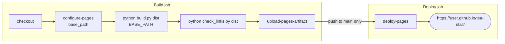

# Lab: Deploy a Static Site with Actions

> 📚 **Before you start**
>
> - [Publishing a Site with GitHub Pages](publishing-a-site-with-github-pages.md)
> - [Custom Domains and HTTPS](custom-domains-and-https.md) (only for the optional last step)
> - [Lab: CI that tests and lints a Python project](../07-github-actions/lab-ci-that-tests-and-lints-a-python-project.md)
> - [Secrets, Variables and Environments](../07-github-actions/secrets-variables-and-environments.md), for environment protection

## What You'll Build

A menu website for a tea stall, generated by a small Python script from a JSON file, checked for broken links, and published to GitHub Pages by a workflow that:

1. **Builds and checks** the site on every pull request, without publishing.
2. **Publishes** it on every push to `main`, using the correct base path whether it's a project site, a user site or a custom domain.
3. **Protects** the `github-pages` environment so only `main` can deploy.

It's the same shape as the workflow that publishes this course site, at a size you can build in one sitting.



> 💡 **Key Insight**
>
> Make the **base path an input** to your build, not a constant in your code. Then the same commit builds correctly for `localhost`, for `/<repo>/` and for a custom domain, and your checks can test the exact output that goes live.

You'll need Python 3.12+, Git, and a GitHub account.

---

## Step 1: Create the Repository

```bash
mkdir tea-stall && cd tea-stall
git init -b main
mkdir -p data .github/workflows
```

Final layout:

```
tea-stall/
├── .github/workflows/pages.yml
├── data/menu.json
├── build.py
└── check_links.py
```

---

## Step 2: The Data

`data/menu.json`. The shop owner can edit this file in the browser on GitHub, and the site rebuilds itself.

```json
{
  "stall": "Sharma Tea Stall",
  "city": "Pune",
  "sections": [
    {"slug": "chai", "title": "Chai", "items": [["Masala chai", 20], ["Ginger chai", 25], ["Kulhad chai", 30]]},
    {"slug": "snacks", "title": "Snacks", "items": [["Bun maska", 30], ["Vada pav", 25], ["Poha", 35]]}
  ]
}
```

---

## Step 3: The Builder

`build.py` turns the data into HTML pages. Every internal link starts with `base`, the path the site will be served from.

```python
import html
import json
from pathlib import Path

MENU_JSON = """
{
  "stall": "Sharma Tea Stall",
  "city": "Pune",
  "sections": [
    {"slug": "chai", "title": "Chai", "items": [["Masala chai", 20], ["Ginger chai", 25], ["Kulhad chai", 30]]},
    {"slug": "snacks", "title": "Snacks", "items": [["Bun maska", 30], ["Vada pav", 25], ["Poha", 35]]}
  ]
}
"""

STYLE = "body { font-family: system-ui, sans-serif; max-width: 40rem; margin: 2rem auto; padding: 0 1rem; }\n"

def layout(title, body, base):
    return (
        "<!doctype html>\n<html lang=\"en\">\n<head>\n"
        "<meta charset=\"utf-8\">\n<meta name=\"viewport\" content=\"width=device-width, initial-scale=1\">\n"
        f"<title>{html.escape(title)}</title>\n"
        f"<link rel=\"stylesheet\" href=\"{base}style.css\">\n</head>\n"
        f"<body>\n<nav><a href=\"{base}\">Home</a></nav>\n{body}\n</body>\n</html>\n"
    )

def build(menu, out, base="/"):
    """Write the whole site into `out`. `base` is the path the site is served from."""
    if not base.endswith("/"):
        base += "/"
    out.mkdir(parents=True, exist_ok=True)
    links = "".join(
        f'<li><a href="{base}{s["slug"]}/">{html.escape(s["title"])}</a></li>' for s in menu["sections"]
    )
    home = f"<h1>{html.escape(menu['stall'])}</h1><p>{html.escape(menu['city'])}</p><ul>{links}</ul>"
    (out / "index.html").write_text(layout(menu["stall"], home, base))
    for section in menu["sections"]:
        rows = "".join(f"<li>{html.escape(name)}: ₹{price}</li>" for name, price in section["items"])
        page = f"<h1>{html.escape(section['title'])}</h1><ul>{rows}</ul>"
        (out / section["slug"]).mkdir(exist_ok=True)
        (out / section["slug"] / "index.html").write_text(layout(section["title"], page, base))
    missing = f'<h1>Page not found</h1><p><a href="{base}">Back to the menu</a></p>'
    (out / "404.html").write_text(layout("Not found", missing, base))
    (out / "style.css").write_text(STYLE)
    return sorted(str(p.relative_to(out)) for p in out.rglob("*") if p.is_file())
```

(`MENU_JSON` is here so you can run the lesson's code in one file; the real script reads `data/menu.json`.) Each section gets a folder with an `index.html`, so URLs look like `/tea-stall/chai/` rather than `/tea-stall/chai.html`. `html.escape` stops a menu item like `Chai & "Bun"` from breaking the HTML.

Try it as a project site served at `/tea-stall/`:

```python
import tempfile
menu = json.loads(MENU_JSON)
dist = Path(tempfile.mkdtemp()) / "dist"
for f in build(menu, dist, base="/tea-stall/"):
    print(f)
```

Output:

```
404.html
chai/index.html
index.html
snacks/index.html
style.css
```

```python
print((dist / "chai" / "index.html").read_text())
```

Output:

```
<!doctype html>
<html lang="en">
<head>
<meta charset="utf-8">
<meta name="viewport" content="width=device-width, initial-scale=1">
<title>Chai</title>
<link rel="stylesheet" href="/tea-stall/style.css">
</head>
<body>
<nav><a href="/tea-stall/">Home</a></nav>
<h1>Chai</h1><ul><li>Masala chai: ₹20</li><li>Ginger chai: ₹25</li><li>Kulhad chai: ₹30</li></ul>
</body>
</html>
```

Finally, give `build.py` a command-line entry point that reads the data file and the `BASE_PATH` environment variable:

```python
# not-run: command-line entry point at the bottom of build.py
import os
import sys

def cli(argv):
    out = Path(argv[1]) if len(argv) > 1 else Path("dist")
    base = os.environ.get("BASE_PATH", "/") or "/"
    menu = json.loads(Path("data/menu.json").read_text())
    files = build(menu, out, base)
    print(f"Built {len(files)} files into {out} for base path {base!r}")
    return 0

if __name__ == "__main__":
    sys.exit(cli(sys.argv))
```

---

## Step 4: The Link Checker

Broken links are the classic static-site bug, especially wrong base paths. `check_links.py` reads every page, collects `href` and `src` values, and checks that each internal one points at a real file:

```python
from html.parser import HTMLParser

class LinkCollector(HTMLParser):
    def __init__(self):
        super().__init__()
        self.links = []

    def handle_starttag(self, tag, attrs):
        for name, value in attrs:
            if name in ("href", "src") and value:
                self.links.append(value)

def check_links(out, base="/"):
    """Return internal links that don't resolve to a file in `out`."""
    if not base.endswith("/"):
        base += "/"
    broken = []
    for page in sorted(out.rglob("*.html")):
        collector = LinkCollector()
        collector.feed(page.read_text())
        for link in collector.links:
            if link.startswith(("http://", "https://", "mailto:", "#")):
                continue
            if not link.startswith(base):
                broken.append((str(page.relative_to(out)), link, "outside base path"))
                continue
            target = out / link[len(base):]
            if target.is_dir() or link.endswith("/"):
                target = target / "index.html"
            if not target.exists():
                broken.append((str(page.relative_to(out)), link, "missing"))
    return broken

print(check_links(dist, base="/tea-stall/"))
root_dist = Path(tempfile.mkdtemp()) / "dist"
build(menu, root_dist, base="/")          # built for "/", but served from /tea-stall/
problems = check_links(root_dist, base="/tea-stall/")
print(len(problems), "problems, first one:", problems[0])
```

Output:

```
[]
11 problems, first one: ('404.html', '/style.css', 'outside base path')
```

The second check is the bug this lab exists to prevent: a site built for `/` but served from `/tea-stall/` has every single link broken. The script's command-line entry point exits non-zero when anything is broken, which fails the CI step:

```python
# not-run: command-line entry point at the bottom of check_links.py
import os
import sys
from pathlib import Path

if __name__ == "__main__":
    out = Path(sys.argv[1] if len(sys.argv) > 1 else "dist")
    problems = check_links(out, os.environ.get("BASE_PATH", "/") or "/")
    for page, link, reason in problems:
        print(f"::error file={page}::broken link {link} ({reason})")
    print(f"{len(problems)} broken link(s)")
    sys.exit(1 if problems else 0)
```

The `::error` lines become annotations on the run page.

---

## Step 5: Preview Locally

Build for the root and serve it with Python's built-in web server:

```bash
python build.py dist
python check_links.py dist
python -m http.server --directory dist 8000
```

Example output:

```
Built 5 files into dist for base path '/'
0 broken link(s)
Serving HTTP on 0.0.0.0 port 8000 (http://0.0.0.0:8000/) ...
```

Open `http://localhost:8000`, click around, then stop the server with Ctrl+C. Add `dist/` to `.gitignore`, since the build output is never committed:

```bash
echo "dist/" > .gitignore
git add .
git commit -m "Tea stall menu site with builder and link checker"
```

---

## Step 6: Turn On Pages with GitHub Actions

```bash
gh repo create tea-stall --public --source=. --push
```

Then on GitHub: **Settings → Pages → Build and deployment → Source: GitHub Actions**. That's the only setting needed; the workflow does the rest.

---

## Step 7: Write the Workflow

`.github/workflows/pages.yml`:

```yaml
name: Pages

on:
  push:
    branches: [main]
  pull_request:
  workflow_dispatch:

permissions:
  contents: read

concurrency:
  group: pages-${{ github.ref }}
  cancel-in-progress: ${{ github.event_name == 'pull_request' }}

jobs:
  build:
    runs-on: ubuntu-latest
    timeout-minutes: 10
    steps:
      - uses: actions/checkout@v7

      - uses: actions/setup-python@v7
        with:
          python-version: "3.13"

      - id: pages
        uses: actions/configure-pages@v6

      - name: Build
        env:
          BASE_PATH: ${{ steps.pages.outputs.base_path }}
        run: python build.py dist

      - name: Check links
        env:
          BASE_PATH: ${{ steps.pages.outputs.base_path }}
        run: python check_links.py dist

      - uses: actions/upload-pages-artifact@v5
        with:
          path: dist

  deploy:
    if: github.event_name != 'pull_request'
    needs: build
    runs-on: ubuntu-latest
    permissions:
      pages: write
      id-token: write
    environment:
      name: github-pages
      url: ${{ steps.deployment.outputs.page_url }}
    steps:
      - id: deployment
        uses: actions/deploy-pages@v5
```

Compared with the generic workflow in [Publishing a Site with GitHub Pages](publishing-a-site-with-github-pages.md):

- **Least privilege per job.** The build job only reads code. Only the deploy job gets `pages: write` and `id-token: write`, so a compromised build step can't deploy on its own.
- **Pull requests build and check but never deploy.** The `if:` on `deploy` skips it, so reviewers know the site builds before merging.
- **Concurrency** cancels outdated pull request builds, but never cancels a deploy on `main` halfway (the expression is `false` for pushes).
- **The base path comes from `configure-pages`**: `/tea-stall` for this project site, empty for a user site or a custom domain (the builder turns empty into `/`).

Commit and push:

```bash
git add .github/workflows/pages.yml
git commit -m "Build, check and deploy with GitHub Pages"
git push
gh run watch
```

Example output:

```
✓ main Pages · 11850020417
Triggered via push less than a minute ago

JOBS
✓ build in 18s
✓ deploy in 12s
```

The run summary shows the `deploy` job's environment URL, `https://<username>.github.io/tea-stall/`. Open it and check that the styles load and every link works.

---

## Step 8: Protect the Deploy

Right now any branch that someone pushes and runs with `workflow_dispatch` could deploy. Lock it down: **Settings → Environments → github-pages → Deployment branches and tags → Selected branches and tags → add `main`**.

Now a manual run from any other branch fails at the deploy job:

Example output:

```
Branch "experiment" is not allowed to deploy to github-pages due to environment protection rules.
```

You can also add a required reviewer to `github-pages` if publishing should need a human's approval.

---

## Step 9: Test the Pull Request Path

Make a change on a branch that breaks a link on purpose. In `build.py`, change the home link in `layout` from `href="{base}"` to `href="{base}home/"`:

```bash
git switch -c rename-home
# edit build.py
git commit -am "Rename home link"
git push -u origin rename-home
gh pr create --fill
```

The pull request's **build** job fails at "Check links", with annotations like:

Example output:

```
Error: broken link /tea-stall/home/ (missing)
4 broken link(s)
Error: Process completed with exit code 1.
```

and the **deploy** job shows as skipped. The live site is untouched. Revert the change, push, and watch the check go green.

---

## Step 10 (Optional): Custom Domain

Follow [Custom Domains and HTTPS](custom-domains-and-https.md) to point a domain at the site. Notice you don't need to change any code: once the domain is set, `configure-pages` returns an empty base path, the builder writes links from `/`, and the link checker tests exactly that.

---

## Try It Yourself

1. **Add a page.** Add a "Specials" section with `Cutting chai ₹15` to the JSON. Build for `/tea-stall/` and run the link checker. How many files are built now?
2. **External links.** Add `<a href="https://maps.google.com/?q=Pune">Find us</a>` to the home page. Why doesn't the checker flag it, and what would it take to check external links too?
3. **User site.** If this repository were renamed `<username>.github.io`, what would `configure-pages` return as the base path, and what would the builder use?
4. **Deploy from a tag.** Change the workflow so pushing a tag like `v2026.10` also deploys. What else must change in the environment's protection rules?

<details>
<summary>Show answers</summary>

**1.** Six files: the new `specials/index.html` plus the previous five, and no broken links.

```python
menu["sections"].append({"slug": "specials", "title": "Specials", "items": [["Cutting chai", 15]]})
dist2 = Path(tempfile.mkdtemp()) / "dist"
print(len(build(menu, dist2, base="/tea-stall/")), "files")
print(check_links(dist2, base="/tea-stall/"))
```

Output:

```
6 files
[]
```

**2.** The checker skips anything starting with `http://` or `https://`. Checking external links needs network requests (with timeouts and retries), which makes CI slow and flaky, so teams usually run external link checks on a weekly schedule instead of on every pull request.

**3.** An empty base path; the builder turns it into `/`, so links become `/style.css`, `/chai/` and so on.

**4.** Add `tags: ["v*"]` under `push:`, and add a `v*` tag rule to the `github-pages` environment's allowed deployment branches and tags; otherwise the tag run is rejected at the deploy job.

</details>

---

## What You've Learned

- **A static site is just files**: a small Python builder plus data is a complete site generator.
- **Base paths are inputs**, taken from `actions/configure-pages`, so the same code works as a project site, user site or custom domain.
- **Checks belong in the build job**: a link checker that fails CI and annotates the run catches the most common static-site bug before it ships.
- **The Pages deploy pattern**: build job with read-only permissions → `upload-pages-artifact` → deploy job with `pages: write` and `id-token: write` → `deploy-pages`.
- **Safe publishing**: pull requests build but never deploy, concurrency never cancels a live deploy, and the `github-pages` environment only accepts `main`.

---

**Up next:** [Copilot in the Editor and on GitHub](../09-ai-on-github/copilot-in-the-editor-and-on-github.md)
