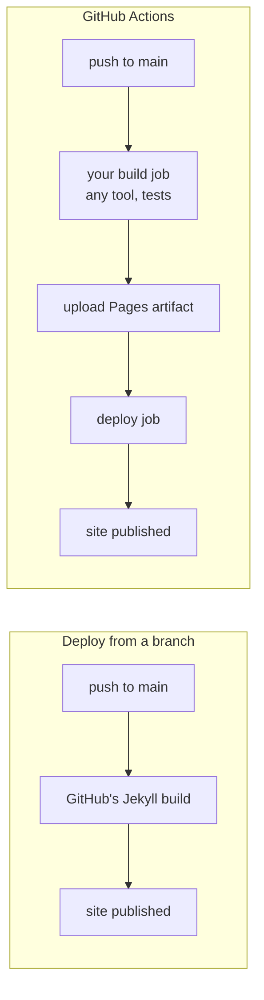

# Publishing a Site with GitHub Pages: The Complete Guide

> 📚 **Before you start**
>
> - [Workflows, Jobs, Steps and Runners](../07-github-actions/workflows-jobs-steps-and-runners.md)
> - [Secrets, Variables and Environments](../07-github-actions/secrets-variables-and-environments.md), for `permissions` and environments
> - [A Great README, LICENSE and Profile](../course.md#m5) (Remotes and GitHub Basics)

## Introduction

When a small bakery in Pune wants a website, the owner usually hears: buy hosting, set up a server, install an SSL certificate, pay every month. For a menu, an address and a few photos, that's like hiring a truck to deliver one cake.

**GitHub Pages** is free static hosting built into GitHub. You give it HTML, CSS, JavaScript and images, and it serves them on a fast global network with HTTPS, at `username.github.io` or your own domain. Portfolios, documentation, project homepages, course sites (including the one you're reading) and blogs all run on it.

By the end of this article you will know the two kinds of Pages site and their URLs, the two ways to publish (from a branch, or with a GitHub Actions workflow), how Jekyll fits in and how to switch it off, how to deploy any static site generator with a workflow, how to handle base paths and 404 pages, and what Pages can't do.

> 💡 **Key Insight**
>
> GitHub Pages serves **files**, not programs. Whatever builds your site (Jekyll, Astro, Hugo, MkDocs, a Python script) runs **before** Pages, usually in a GitHub Actions job. Pages only ever sees the finished folder of static files.

---

## Core Explanation

### 1. What "Static" Means

A **static site** is a folder of files served exactly as they are. When someone visits `/menu.html`, the server sends the file `menu.html`. Nothing runs on the server per request: no Python, no database, no login sessions.

| Pages can host | Pages can't host |
|---|---|
| HTML, CSS, JavaScript, images, fonts, PDFs | A Flask, Django or FastAPI backend |
| Sites from generators: Jekyll, Hugo, Astro, MkDocs, Docusaurus | Server-side databases |
| Single-page apps (React, Vue) that call external APIs | Secrets (everything served is public) |
| Documentation, portfolios, blogs, course sites | Server-side form handling (use a third-party form service) |

Your JavaScript can still call APIs in the browser, so a Pages site can feel dynamic. Just remember that any key in client-side JavaScript is visible to every visitor.

### 2. Two Kinds of Site

| | User or organization site | Project site |
|---|---|---|
| Repository name | Exactly `<username>.github.io` | Any name, e.g. `tea-stall` |
| URL | `https://<username>.github.io/` | `https://<username>.github.io/tea-stall/` |
| How many | One per account | One per repository |

This course site lives in the repository `sourabh1996/sourabh1996.github.io`, so it's a user site served at the root. If the same code lived in a repository named `learning`, it would be served under `/learning/`, and every link would need that prefix. That difference is the source of the most common Pages bug, covered in section 7.

On GitHub Free, Pages works for **public** repositories. Publishing from **private** repositories needs GitHub Pro, Team or Enterprise. Even then, the published site is public on the internet, unless you're on Enterprise Cloud and choose private site visibility.

### 3. Two Ways to Publish

Open **Settings → Pages** in a repository. Under **Build and deployment → Source** you choose:

**Deploy from a branch.** Pick a branch and a folder (`/` or `/docs`). Whenever that branch changes, GitHub builds and publishes it. If the folder contains Jekyll files, Jekyll builds them; otherwise the files are served as they are.

**GitHub Actions.** Your own workflow builds the site and hands GitHub a packaged artifact to deploy. You control the build tool, versions, tests and timing.



For anything beyond a plain HTML or simple Jekyll site, use **GitHub Actions**. It's what this site uses, and it lets you run tests (this site checks every code example) before anything goes live.

### 4. The Quickest Possible Site

To see Pages work in two minutes:

```bash
mkdir tea-stall && cd tea-stall
git init -b main
cat > index.html <<'EOF'
<!doctype html>
<html lang="en">
  <head><meta charset="utf-8"><title>Sharma Tea Stall</title></head>
  <body>
    <h1>Sharma Tea Stall</h1>
    <p>Masala chai ₹20 · Bun maska ₹30 · Open 6 a.m. to 10 p.m.</p>
  </body>
</html>
EOF
git add index.html
git commit -m "First page"
gh repo create tea-stall --public --source=. --push
```

Then **Settings → Pages → Source: Deploy from a branch → main → / (root) → Save**. A minute later, the page is live at `https://<username>.github.io/tea-stall/`. The Pages settings page shows the URL, and the repository's **Deployments** section lists each publish.

### 5. Jekyll and `.nojekyll`

When you deploy from a branch, GitHub runs **Jekyll**, a Ruby static site generator, on your files. Jekyll turns Markdown into HTML, applies layouts and themes, and **ignores files and folders whose names start with `_` or `.`**. That last rule breaks some tools whose output has folders like `_next` or `_astro`.

Two fixes:

- Add an empty file named **`.nojekyll`** at the root of the published branch folder to switch Jekyll off and serve files untouched.
- Better: publish with **GitHub Actions**. Jekyll doesn't run at all unless your workflow runs it.

### 6. Publishing with a GitHub Actions Workflow

Set **Settings → Pages → Source** to **GitHub Actions**. Then add a workflow with two jobs: build and deploy. Here is a complete one for a site whose build writes to `dist/`:

```yaml
name: Deploy to Pages

on:
  push:
    branches: [main]
  workflow_dispatch:

permissions:
  contents: read
  pages: write       # deploy to Pages
  id-token: write    # prove the deployment came from this workflow

concurrency:
  group: pages
  cancel-in-progress: false   # never stop a deploy halfway

jobs:
  build:
    runs-on: ubuntu-latest
    steps:
      - uses: actions/checkout@v7
      - id: pages
        uses: actions/configure-pages@v6
      - uses: actions/setup-node@v7
        with:
          node-version: 22
          cache: npm
      - run: npm ci
      - run: npm run build
        env:
          BASE_PATH: ${{ steps.pages.outputs.base_path }}
      - uses: actions/upload-pages-artifact@v5
        with:
          path: dist

  deploy:
    needs: build
    runs-on: ubuntu-latest
    environment:
      name: github-pages
      url: ${{ steps.deployment.outputs.page_url }}
    steps:
      - id: deployment
        uses: actions/deploy-pages@v5
```

The three Pages actions:

| Action | Job | What it does |
|---|---|---|
| `actions/configure-pages` | build | Reads the Pages settings and outputs values like `base_url`, `base_path` and `origin` for your build |
| `actions/upload-pages-artifact` | build | Packs the folder into a special artifact named `github-pages` |
| `actions/deploy-pages` | deploy | Publishes that artifact and outputs `page_url` |

Why the permissions: `pages: write` allows deploying, and `id-token: write` lets `deploy-pages` prove to Pages, with an OIDC token, that the request comes from this repository's workflow. The `github-pages` **environment** is created automatically; you can add protection rules to it, such as allowing deploys only from `main`.

Two details about `upload-pages-artifact`: the folder must contain only files the site needs (it is limited to 1 GB), and since version 4 it **skips hidden files** (names starting with `.`) by default; version 5 adds an `include-hidden-files` input if you really need them.

### 7. The Base Path Problem

A project site lives under `/tea-stall/`. If your HTML says `<link href="/style.css">`, the browser asks for `https://<username>.github.io/style.css`, which belongs to the user site, not your project. Result: an unstyled page and broken links, while everything works fine on your laptop.

Fixes, from simplest to most robust:

- Use **relative links** (`href="style.css"`, `href="../about/"`).
- Tell your generator the base path. Most have a setting: Astro `base`, Vite `base`, Next.js `basePath`, Hugo `baseURL`, MkDocs `site_url`, Docusaurus `baseUrl`.
- Get it from `actions/configure-pages`, as the workflow above does with `steps.pages.outputs.base_path`, so the same code works in a user site, a project site or under a custom domain.

This site's own `deploy.yml` computes the base path from the repository name instead: if the name ends in `.github.io` it uses `/`, otherwise `/<repo-name>`. Both approaches solve the same problem.

### 8. Generator Cheat Sheet

| Generator | Build command | Output folder |
|---|---|---|
| Plain HTML | none | the folder itself |
| Jekyll | `bundle exec jekyll build` | `_site` |
| Hugo | `hugo --minify` | `public` |
| MkDocs | `mkdocs build` | `site` |
| Astro | `npm run build` | `dist` |
| Vite (React/Vue) | `npm run build` | `dist` |
| Next.js (static export) | `next build` with `output: 'export'` | `out` |
| Docusaurus | `npm run build` | `build` |

**Actions → New workflow → Pages** offers ready-made workflows for many of these. They follow the same build-upload-deploy pattern; only the build steps change.

### 9. Custom 404 Pages and Single-Page Apps

Add a `404.html` at the root of your published folder and Pages serves it for any missing path, with a 404 status.

Single-page apps with client-side routing (React Router, Vue Router) have a wrinkle: a visitor who opens `/tea-stall/orders/42` directly gets a 404 because no such file exists. Options:

- Use **hash routing** (`/#/orders/42`), which always loads `index.html`.
- Pre-render each route to its own HTML file (most modern frameworks can).
- As a workaround, copy `index.html` to `404.html` so the app loads and reads the URL itself. It works, but the response status is still 404, which search engines and monitoring tools see.

### 10. Limits and Good Habits

- **Size:** a published site can be at most 1 GB; the source repository should stay under 1 GB.
- **Bandwidth:** a soft limit of 100 GB per month. For heavy downloads, use Releases or a CDN.
- **Builds:** branch-based publishing has a soft limit of 10 builds per hour (it doesn't apply to custom Actions workflows), and a deployment times out after 10 minutes.
- **Not for business backends:** Pages isn't meant to run online shops or SaaS products, or anything that handles sensitive transactions such as passwords or card numbers.
- **Everything is public:** never put secrets in the built site.
- **Check before you publish:** link checkers, HTML validation and, for this course site, running every code example, all fit in the build job before `upload-pages-artifact`.

---

## Try It Yourself

1. **Name the URL.** User `meera-codes` publishes from repositories `meera-codes.github.io` and `chai-recipes`. What are the two URLs?
2. **Broken styles.** A project site at `/chai-recipes/` loads without CSS. The HTML has `<link rel="stylesheet" href="/assets/site.css">`. Give two fixes.
3. **Missing folder.** A Next.js site published from a branch is missing everything under `_next/`. Why, and what are two fixes?
4. **Permissions.** Which two permissions does a Pages deploy job need, and what is each for?

<details>
<summary>Show answers</summary>

**1.** `https://meera-codes.github.io/` and `https://meera-codes.github.io/chai-recipes/`.

**2.** Change the link to the relative `assets/site.css` (or `./assets/site.css` from the root page), or configure the generator's base path to `/chai-recipes/` (for example from `actions/configure-pages`' `base_path` output) so it writes `/chai-recipes/assets/site.css`.

**3.** Branch publishing runs Jekyll, which ignores folders starting with `_`. Add an empty `.nojekyll` file to the published folder, or switch the source to GitHub Actions and deploy the build output with `upload-pages-artifact` and `deploy-pages`.

**4.** `pages: write` to create the deployment, and `id-token: write` so `deploy-pages` can request an OIDC token proving the deployment comes from this workflow.

</details>

---

## Real-World Examples

### Example 1: This Course Site

This site is an Astro project in the `site/` folder of a user-site repository. On every pull request, its workflow rebuilds the catalog, runs every Python example in every lesson, and builds the site, without deploying. On every push to `main`, the same build runs and a second job deploys it with `deploy-pages`. A broken code example can never reach readers.

### Example 2: Project Documentation

Many open source Python libraries publish MkDocs documentation to `<org>.github.io/<project>/`. Their docs workflow triggers on pushes to `main` that change `docs/**`, so docs are always in step with the code.

### Example 3: A Developer Portfolio

A final-year student keeps their portfolio in `<username>.github.io` with a custom domain. Recruiters see a fast HTTPS site; the student pays only for the domain name.

---

## Common Misconceptions

### Misconception 1: "A private repository makes my Pages site private"

The repository is private, but the published site is public to everyone, unless you use private site visibility on Enterprise Cloud.

### Misconception 2: "Pages can run my Flask app"

Pages only serves static files. Build to static HTML, or host the backend elsewhere and call it from the browser.

### Misconception 3: "I need `.nojekyll` when deploying with Actions"

Jekyll only runs for branch-based publishing (or if your workflow runs it). With an Actions deploy, `.nojekyll` does nothing, and newer versions of `upload-pages-artifact` skip hidden files anyway.

### Misconception 4: "It works locally, so the links are fine"

Locally your site is served from `/`. A project site is served from `/<repo>/`. Test with the real base path.

---

## Interview Relevance

Pages comes up for frontend, docs and DevOps roles, often as "how would you host documentation?":

- **Static versus dynamic:** what Pages can and can't serve.
- **Site types and URLs:** user/org site at the root, project site under `/<repo>/`.
- **Publishing:** branch-based with Jekyll versus a custom Actions workflow with `configure-pages`, `upload-pages-artifact` and `deploy-pages`; why the latter is preferred.
- **Pitfalls:** base paths, Jekyll ignoring `_` folders, SPA deep links, public by default.

Common follow-ups:

- *"Why does the deploy job need `id-token: write`?"* To get an OIDC token that proves the deployment's origin.
- *"How would you stop broken docs from going live?"* Build and test in a job that runs on pull requests too, and only deploy from `main`.

---

## Key Takeaways

- **Pages hosts static files** over HTTPS for free (public repos on Free; private repos need a paid plan), and the published site is public.
- **User/org sites** live at `<name>.github.io/`; **project sites** at `<name>.github.io/<repo>/`, so mind the **base path**.
- **Publish from a branch** (Jekyll, `.nojekyll` to opt out) or, better, **from a GitHub Actions workflow**.
- **The Actions pattern** is `configure-pages` → build → `upload-pages-artifact` → `deploy-pages`, with `pages: write` and `id-token: write`.
- **Limits:** 1 GB site, about 100 GB/month bandwidth, 10-minute deploys; no backends, no secrets.

---

**Up next:** [Custom Domains and HTTPS](custom-domains-and-https.md)
