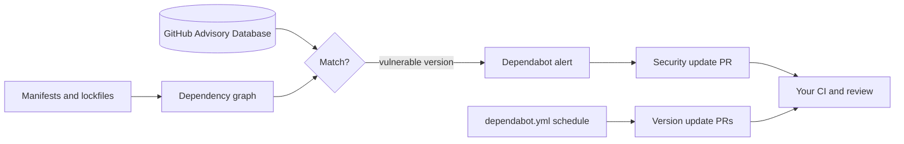

# Dependabot Alerts and Updates: The Complete Guide

> 📚 **Before you start**
>
> - [Pull Requests End to End](../course.md#m6) and [Branch Protection, Rulesets and CODEOWNERS](../course.md#m6) (Collaborating on GitHub)
> - [Workflows, Jobs, Steps and Runners](../07-github-actions/workflows-jobs-steps-and-runners.md)
> - [Package Managers and Virtual Environments](../../the-command-line-and-linux-basics/course.md#m3) (The Command Line and Linux Basics), for what dependencies and lockfiles are

## Introduction

A restaurant can have the cleanest kitchen in Mumbai and still make customers ill if the paneer supplier sends a bad batch. The kitchen didn't make the mistake, but it served it. Good restaurants track which supplier sent which batch, and when a recall notice comes, they know within minutes whether it affects them.

Software is the same. A typical Python or JavaScript project has a handful of dependencies you chose and hundreds you didn't (their dependencies, and theirs). When a vulnerability is found in one of them, you need to know whether you use it, which version, and how to fix it, fast. **Dependabot** is GitHub's recall-notice system: it knows your dependencies, watches GitHub's database of security advisories, alerts you when you're affected, and opens pull requests that fix the problem. It can also keep everything up to date routinely so security fixes are small and easy when they matter.

By the end of this article you'll understand the dependency graph and the Advisory Database, triage Dependabot alerts, enable security updates, write a complete `dependabot.yml` for version updates with grouping and cooldowns, block risky dependencies at pull request time with dependency review, and automate merging of safe updates.

> 💡 **Key Insight**
>
> Teams that update dependencies **a little, often** patch security problems in minutes. Teams that update **rarely** face a giant, scary upgrade exactly when an urgent vulnerability lands. Dependabot's real value is making small, routine updates cheap, so the urgent ones are small too.

---

## Core Explanation

### 1. Four Pieces That Work Together

| Piece | What it does |
|---|---|
| **Dependency graph** | Reads your manifests and lockfiles (`requirements.txt`, `pyproject.toml`, `uv.lock`, `package-lock.json`, `pom.xml`, Dockerfiles, workflow files...) and lists every dependency and version |
| **GitHub Advisory Database** | A curated database of known vulnerabilities (and malware) in open source packages, each with an ID like `GHSA-xxxx-xxxx-xxxx`, affected version ranges, patched versions and severity |
| **Dependabot alerts** | Match the graph against the database and tell you when you use a vulnerable version |
| **Dependabot updates** | Open pull requests: **security updates** fix alerts; **version updates** keep dependencies current on a schedule |



### 2. How an Alert Is Matched

An advisory says "package X, versions in this range, are vulnerable; fixed in version Y". Dependabot compares that range with the version in your lockfile. Here is the idea, with made-up advisory IDs:

```python
import re

def parse(version):
    return tuple(int(x) for x in version.split("."))

def in_range(version, spec):
    """spec like '>= 2.0.0, < 2.31.0' (all conditions must hold)."""
    ops = {"<": lambda a, b: a < b, "<=": lambda a, b: a <= b,
           ">": lambda a, b: a > b, ">=": lambda a, b: a >= b, "=": lambda a, b: a == b}
    for part in spec.split(","):
        op, bound = re.match(r"\s*(<=|>=|<|>|=)\s*([\d.]+)", part).groups()
        if not ops[op](parse(version), parse(bound)):
            return False
    return True

advisories = [
    {"id": "GHSA-demo-0001", "package": "requests", "vulnerable": ">= 2.0.0, < 2.32.4", "patched": "2.32.4", "severity": "medium"},
    {"id": "GHSA-demo-0002", "package": "jinja2", "vulnerable": "< 3.1.6", "patched": "3.1.6", "severity": "high"},
    {"id": "GHSA-demo-0003", "package": "urllib3", "vulnerable": ">= 2.0.0, < 2.5.0", "patched": "2.5.0", "severity": "low"},
]
lockfile = {"requests": "2.31.0", "jinja2": "3.1.6", "urllib3": "1.26.20", "pandas": "3.0.5"}

def alerts(lockfile, advisories):
    found = []
    for adv in advisories:
        installed = lockfile.get(adv["package"])
        if installed and in_range(installed, adv["vulnerable"]):
            found.append(f"{adv['severity'].upper():<6} {adv['package']} {installed} -> upgrade to {adv['patched']} ({adv['id']})")
    return found or ["no alerts"]

for line in alerts(lockfile, advisories):
    print(line)
```

Output:

```
MEDIUM requests 2.31.0 -> upgrade to 2.32.4 (GHSA-demo-0001)
```

`jinja2` is already at the patched version, and `urllib3` 1.26.20 is outside the vulnerable 2.x range, so only `requests` alerts. This is why **lockfiles** matter: without exact versions, Dependabot can only guess from ranges like `requests>=2.0`, and may miss or over-report.

### 3. Turning It On

In a repository, go to **Settings → Advanced Security** (the security settings page) and enable:

- **Dependency graph** (on by default for public repositories).
- **Dependabot alerts.**
- **Dependabot security updates** (automatic fix PRs).
- Optionally **grouped security updates**, so one PR fixes several alerts in the same ecosystem.

Organizations can enable these for all repositories at once with security configurations. All of these features are free for public and private repositories.

Alerts appear under **Security → Dependabot**. From the terminal:

```bash
gh api repos/chai-co/orders-api/dependabot/alerts --jq '.[] | select(.state=="open") | [.security_advisory.severity, .dependency.package.name, .security_vulnerability.first_patched_version.identifier] | @tsv'
```

Example output:

```
high	jinja2	3.1.6
medium	requests	2.32.4
```

### 4. Triage: Not Every Alert Is an Emergency

Each alert shows the advisory, severity (based on CVSS), the vulnerable function or condition, and the patched version. For each, decide:

1. **Is the vulnerable code reachable?** A flaw in a feature you never call is lower risk (but still worth patching).
2. **Is it a runtime or a development dependency?** A vulnerable test tool is less urgent than a web framework in production.
3. **Is there a patched version?** If yes, merge the security update. If not, mitigate (configuration, input validation, a different package) and watch the advisory.

You can **dismiss** an alert with a reason (fix started, no bandwidth, tolerable risk, inaccurate, not used). **Auto-triage rules** can dismiss or snooze alerts automatically; GitHub's built-in preset dismisses low-impact alerts in development-only dependencies, so the team sees what matters. The **EPSS** score shown on alerts, the estimated probability of exploitation in the next 30 days, helps you prioritise among many alerts.

### 5. Version Updates with `dependabot.yml`

Security updates fix known problems. **Version updates** keep you current so fixes are always small. Configure them in `.github/dependabot.yml`:

```yaml
version: 2

updates:
  # Python dependencies (pyproject.toml / requirements / uv.lock)
  - package-ecosystem: "pip"
    directory: "/"
    schedule:
      interval: "weekly"
      day: "monday"
      time: "09:00"
      timezone: "Asia/Kolkata"
    open-pull-requests-limit: 5
    labels: ["dependencies", "python"]
    commit-message:
      prefix: "deps"
      include: "scope"
    groups:
      dev-tools:
        dependency-type: "development"
        patterns: ["pytest*", "ruff", "mypy"]
      minor-and-patch:
        update-types: ["minor", "patch"]
    ignore:
      - dependency-name: "pandas"
        update-types: ["version-update:semver-major"]
    cooldown:
      default-days: 5
      semver-major-days: 30

  # GitHub Actions used in workflows
  - package-ecosystem: "github-actions"
    directory: "/"
    schedule:
      interval: "weekly"
    groups:
      actions:
        patterns: ["*"]

  # Base images in Dockerfiles
  - package-ecosystem: "docker"
    directories: ["/", "/services/*"]
    schedule:
      interval: "monthly"

  # The frontend
  - package-ecosystem: "npm"
    directory: "/site"
    schedule:
      interval: "weekly"
    versioning-strategy: increase
```

What each part does:

| Key | Meaning |
|---|---|
| `version: 2` | Always 2 |
| `package-ecosystem` | `pip`, `uv`, `npm`, `github-actions`, `docker`, `maven`, `gradle`, `gomod`, `cargo`, `nuget`, `bundler`, `composer`, `terraform`, `devcontainers`, `pre-commit` and more |
| `directory` / `directories` | Where the manifest lives (globs allowed in `directories`) |
| `schedule.interval` | `daily`, `weekly`, `monthly` and longer intervals, with optional `day`, `time` and `timezone` |
| `open-pull-requests-limit` | Maximum open version-update PRs for this entry (default 5) |
| `groups` | Combine updates into one PR, by `patterns`, `dependency-type` or `update-types` |
| `ignore` | Skip some dependencies or update types |
| `cooldown` | Wait N days after a release before proposing it (`default-days`, plus per-semver-level days) |
| `labels`, `commit-message`, `assignees`, `milestone`, `target-branch` | PR metadata |
| `versioning-strategy` | How to edit version constraints (e.g. `increase`, `lockfile-only`) |
| `registries` | Credentials for private package registries |

**Why cooldown matters.** Several 2025 supply-chain attacks published malicious versions of popular npm packages that were caught and removed within hours. A few days of cooldown means you only ever upgrade to versions the world has already used for a while, which avoids most of these. Security updates aren't delayed by cooldown.

**Why `github-actions` matters.** Your workflow files are dependencies too. Keeping action versions updated (and pinned by SHA, which Dependabot understands) is covered in [Hardening Actions](hardening-actions-pinning-and-least-privilege.md).

### 6. Working with Dependabot Pull Requests

Dependabot PRs include release notes, changelog excerpts, commits and a compatibility score. Your CI runs on them like any other PR. You can control Dependabot by commenting on its PR:

| Comment | Effect |
|---|---|
| `@dependabot rebase` | Rebase the PR on the latest base branch |
| `@dependabot recreate` | Recreate the PR from scratch, discarding edits |
| `@dependabot ignore this major version` | Stop proposing this major version |
| `@dependabot ignore this dependency` | Stop proposing updates for it |

Runs triggered by Dependabot get a read-only token and only **Dependabot secrets** (a separate secret store), so a malicious package version can't steal your Actions secrets during CI.

### 7. Dependency Review: Stop Bad Dependencies at the Door

Alerts tell you about problems already merged. **Dependency review** checks the dependency changes **in a pull request** and can fail the check before anything merges:

```yaml
name: Dependency review
on: [pull_request]

permissions:
  contents: read
  pull-requests: write     # only needed for comment-summary-in-pr

jobs:
  review:
    runs-on: ubuntu-latest
    steps:
      - uses: actions/checkout@v7
      - uses: actions/dependency-review-action@v5
        with:
          fail-on-severity: moderate
          allow-licenses: MIT, Apache-2.0, BSD-2-Clause, BSD-3-Clause, ISC, PSF-2.0
          comment-summary-in-pr: on-failure
```

Make it a required check, and a pull request that adds a dependency with a moderate-or-worse known vulnerability, or an unexpected licence, can't merge. On private repositories, dependency review needs GitHub Code Security.

### 8. Auto-Merging Safe Updates

Patch updates of well-tested dependencies rarely break anything. Automate them, keeping CI as the gate:

```yaml
name: Dependabot auto-merge
on: pull_request

permissions:
  contents: write
  pull-requests: write

jobs:
  automerge:
    if: github.event.pull_request.user.login == 'dependabot[bot]'
    runs-on: ubuntu-latest
    steps:
      - id: meta
        uses: dependabot/fetch-metadata@v3
      - if: steps.meta.outputs.update-type == 'version-update:semver-patch'
        run: gh pr merge --auto --squash "$PR_URL"
        env:
          PR_URL: ${{ github.event.pull_request.html_url }}
          GH_TOKEN: ${{ secrets.GITHUB_TOKEN }}
```

`gh pr merge --auto` doesn't merge immediately; it enables **auto-merge**, which waits for required checks and reviews to pass. Turn on **Allow auto-merge** in the repository settings, and make sure branch protection requires your CI checks, or this would merge untested code.

### 9. A Sustainable Routine

- **Weekly**: merge grouped version updates; skim the changelogs of anything major.
- **Daily or on alert**: review new high and critical alerts; merge security updates the same day when CI is green.
- **Monthly**: review dismissed alerts and `ignore` rules; remove ones that no longer apply.
- **Always**: keep lockfiles committed, CI meaningful, and the dependency list short. The cheapest dependency to secure is the one you don't add.

---

## Try It Yourself

1. **Match it.** Add `{"id": "GHSA-demo-0004", "package": "pandas", "vulnerable": ">= 3.0.0, < 3.0.6", "patched": "3.0.6", "severity": "critical"}` to `advisories` and rerun `alerts`. What's reported?
2. **Write the config.** Write a `dependabot.yml` that updates `uv` dependencies in `/` weekly with a 7-day cooldown, and GitHub Actions monthly, grouping all action updates into one PR.
3. **Decide.** A high-severity alert is in a package used only by your docs build, with no patched version yet. What do you do?
4. **Spot the risk.** A team auto-merges **all** Dependabot updates, including majors, and their branch protection doesn't require CI. What could go wrong?

<details>
<summary>Show answers</summary>

**1.**

```python
advisories.append({"id": "GHSA-demo-0004", "package": "pandas", "vulnerable": ">= 3.0.0, < 3.0.6",
                   "patched": "3.0.6", "severity": "critical"})
for line in alerts(lockfile, advisories):
    print(line)
```

Output:

```
MEDIUM requests 2.31.0 -> upgrade to 2.32.4 (GHSA-demo-0001)
CRITICAL pandas 3.0.5 -> upgrade to 3.0.6 (GHSA-demo-0004)
```

**2.**

```yaml
version: 2
updates:
  - package-ecosystem: "uv"
    directory: "/"
    schedule:
      interval: "weekly"
    cooldown:
      default-days: 7
  - package-ecosystem: "github-actions"
    directory: "/"
    schedule:
      interval: "monthly"
    groups:
      all-actions:
        patterns: ["*"]
```

**3.** It's real but lower urgency: a docs-only dependency usually isn't in production. Check whether the vulnerable path is reachable in your build, consider an alternative package or a mitigation, and dismiss with "tolerable risk" or leave it open with a note. Watch the advisory for a patched version.

**4.** Breaking major updates (or a malicious release) could merge with no tests run, breaking `main` or shipping compromised code. Require CI checks in branch protection, auto-merge only patch (maybe minor) updates, and use a cooldown.

</details>

---

## Real-World Examples

### Example 1: The Log4Shell Weekend

When a critical vulnerability hit a hugely popular Java logging library in December 2021, teams with Dependabot alerts and up-to-date dependencies merged a security update within hours. Teams on years-old versions spent weeks untangling upgrades. The difference wasn't tooling alone; it was the habit of small, regular updates.

### Example 2: Grouping Tames the Noise

A startup had 40 open Dependabot PRs and ignored them all. Grouping minor and patch updates per ecosystem cut that to three PRs a week, which the on-call engineer now merges every Monday morning.

### Example 3: Cooldown Avoids a Bad Release

A team using a 5-day cooldown never saw a PR for a compromised version of a popular npm package that was published and pulled within a day. Teams with immediate updates and auto-merge had to rotate credentials.

---

## Common Misconceptions

### Misconception 1: "No alerts means no vulnerabilities"

Alerts only cover known, published advisories for dependencies Dependabot can see. Unknown flaws, vendored code and unsupported ecosystems aren't covered.

### Misconception 2: "Security updates and version updates are the same feature"

Security updates fix alerts and need no config file. Version updates are routine bumps configured in `dependabot.yml`.

### Misconception 3: "Every alert must be fixed today"

Prioritise by severity, exploitability (EPSS), reachability and whether it's a runtime dependency. Dismiss with a documented reason when appropriate.

### Misconception 4: "Auto-merge is dangerous"

Auto-merge without CI is dangerous. Auto-merge that waits for required checks, limited to patch updates with a cooldown, is a sensible default.

---

## Interview Relevance

Supply-chain security is now a standard topic in backend, DevOps and security interviews:

- **The pieces:** dependency graph, Advisory Database (GHSA), alerts, security updates, version updates.
- **Configuration:** `dependabot.yml` with ecosystems, schedules, groups, ignore rules and cooldown.
- **Shift left:** dependency review as a required PR check for vulnerabilities and licences.
- **Automation with guard rails:** `fetch-metadata`, `gh pr merge --auto`, required checks.
- **Prioritisation:** severity, EPSS, reachability, runtime versus dev.

Common follow-ups:

- *"How do you handle a critical CVE in a transitive dependency?"* Find which direct dependency pulls it in, upgrade that (or add an override/constraint), verify with tests, and confirm the alert closes.
- *"Why a cooldown?"* To avoid adopting malicious or broken releases before the community notices them.

---

## Key Takeaways

- **The dependency graph plus the Advisory Database** produce Dependabot alerts; **lockfiles** make matching precise.
- **Security updates** open fix PRs for alerts; **version updates** in `dependabot.yml` keep everything current.
- **Group, limit and cool down** updates to keep the PR stream manageable and avoid fresh malicious releases.
- **Dependency review** blocks vulnerable or badly licensed dependencies before merge.
- **Auto-merge only what CI gates**, prioritise alerts by real risk, and update a little, often.

---

**Up next:** [Code Scanning and Secret Scanning](code-scanning-and-secret-scanning.md)
