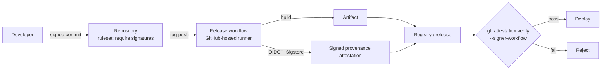

# Signed Commits and Artifact Attestations: The Complete Guide

> 📚 **Before you start**
>
> - [Installing and Configuring Git](../course.md#m2) (Version Control from Scratch)
> - [Hashes and Content Addressing](../course.md#m3) (How Git Works Inside)
> - [SSH Keys, Tokens and the GitHub CLI](../course.md#m5) (Remotes and GitHub Basics)
> - [OIDC: Deploying to the Cloud without Stored Keys](../07-github-actions/oidc-deploying-to-the-cloud-without-stored-keys.md) and [Releases, Tags and GitHub Packages](../08-github-pages-codespaces-and-packages/releases-tags-and-github-packages.md)

## Introduction

A letter signed "Prime Minister" isn't from the Prime Minister just because it says so. What makes it trustworthy is a seal that only that office can produce, and a way for anyone to check the seal.

Git has the same weakness. The author name and email on a commit are just text you set with `git config`. Anyone can make a commit that says it's from your team lead, or from you. And the software you download (a wheel, a binary, a container image) usually says nothing at all about where and how it was built.

This lesson covers both halves of proving origin. **Signed commits** prove who created a commit. **Artifact attestations** prove which repository, workflow and commit produced a build artifact. By the end you'll be able to sign commits and tags with SSH keys, get the Verified badge, enforce signing with rulesets, generate build provenance and SBOM attestations in GitHub Actions, and verify artifacts with `gh attestation verify`.

> 💡 **Key Insight**
>
> Signing answers "**who** made this?" and attestation answers "**how** was this made?". Neither proves the code is **good**; they prove it's **genuine**, so that your reviews, tests and policies actually apply to the thing you run.

---

## Core Explanation

### 1. Anyone Can Claim to Be Anyone

```bash
git -c user.name="Your Team Lead" -c user.email="lead@chai-co.example" \
    commit --allow-empty -m "Approve production config change"
git log -1 --format='%an <%ae>'
```

Example output:

```
Your Team Lead <lead@chai-co.example>
```

That's it. No password, no check. GitHub will even show the team lead's avatar if the email matches their account. In a busy repository, a commit like this could slip through review on reputation alone.

### 2. How Commit Signing Works

You sign a commit with a **private key** only you have. Git stores the signature inside the commit object. Anyone with your **public key** can check that the signature matches the commit's exact contents (tree, parents, author, message). Change one byte and verification fails, because the commit's hash changes (see [Hashes and Content Addressing](../course.md#m3)).

Git supports three signature formats:

| Format | Key you use | Notes |
|---|---|---|
| **SSH** | The SSH key you may already have | Simplest today; recommended for most people |
| **GPG** (OpenPGP) | A GPG key pair | The traditional choice; more setup, supports expiry and subkeys |
| **S/MIME** (X.509) | A certificate from your organization's CA | Common in enterprises with existing PKI |

### 3. Signing with SSH, Step by Step

```bash
# 1. A key (skip if you already have one; a separate signing key is also fine)
ssh-keygen -t ed25519 -C "meera@chai-co.example" -f ~/.ssh/id_ed25519_signing

# 2. Tell Git to sign with SSH, using that key
git config --global gpg.format ssh
git config --global user.signingkey ~/.ssh/id_ed25519_signing.pub

# 3. Sign every commit and tag by default
git config --global commit.gpgsign true
git config --global tag.gpgsign true
```

(The settings are called `gpg.*` for historical reasons; they apply to SSH signing too.)

4. Add the **public** key to GitHub: **Settings → SSH and GPG keys → New SSH key**, and set **Key type: Signing Key**. A key used for both pushing and signing must be added twice, once as each type. Or from the terminal:

```bash
gh ssh-key add ~/.ssh/id_ed25519_signing.pub --type signing --title "Laptop signing key"
```

5. Check your commit email matches a **verified email** on your GitHub account. The signature is only shown as Verified when the key belongs to the account that owns the commit's email.

Now commit and push as usual. On GitHub the commit shows a green **Verified** badge.

**Verifying locally** needs an "allowed signers" file that maps emails to public keys:

```bash
echo "meera@chai-co.example $(cat ~/.ssh/id_ed25519_signing.pub)" >> ~/.ssh/allowed_signers
git config --global gpg.ssh.allowedSignersFile ~/.ssh/allowed_signers
git log --show-signature -1
git verify-commit HEAD
```

Example output:

```
Good "git" signature for meera@chai-co.example with ED25519 key SHA256:3vXq...k8Rw
```

For tags, `git tag -s v1.4.0 -m "v1.4.0"` creates a signed tag (automatic with `tag.gpgsign`), and `git verify-tag v1.4.0` checks it.

### 4. What the Badges Mean

| Badge | Meaning |
|---|---|
| **Verified** | Signed with a key on the committer's GitHub account, email verified |
| **Partially verified** | Signed and verified, but the author isn't the committer (for example, a co-authored change) and vigilant mode is on |
| **Unverified** | A signature exists but couldn't be verified, or (with vigilant mode) the commit isn't signed at all |
| *(no badge)* | Unsigned, and vigilant mode is off |

**Vigilant mode** (**Settings → SSH and GPG keys → Flag unsigned commits as unverified**) marks every unsigned commit that claims to be from you as **Unverified**. Without it, a spoofed unsigned commit looks no different from your normal unsigned ones. Turn it on once you sign everything.

Commits you make **in the GitHub web UI**, and merges and squashes done by GitHub, are signed by GitHub's own key and show as Verified. GitHub also stores the verification result when a commit is pushed, so commits stay Verified even after you later rotate or delete the key.

### 5. Requiring Signatures

Add **Require signed commits** to a branch ruleset (or branch protection rule) for `main`. Pushes and merges that would add unsigned or unverifiable commits are rejected. Two practical notes:

- **Merge methods**: squash and rebase merges done by GitHub are signed by GitHub, so they work. Rebasing locally re-creates commits, so contributors need signing set up locally.
- **Bots**: commits made by GitHub Actions with `GITHUB_TOKEN` through the API are signed by GitHub; commits made with `git commit` on a runner are not, unless you set up a signing key on the runner. Many bots (and agent actions, such as `claude-code-action`'s `use_commit_signing`) commit through the API for this reason.

### 6. From Code to Artifacts: The Supply-Chain Gap

Signed commits protect the **source**. But users don't run your source; they run a wheel from PyPI, a binary from a release page, or an image from `ghcr.io`. Who's to say that artifact was built from that signed source, by your CI, and not on a compromised laptop? Several major supply-chain attacks did exactly this: tampered builds, correct-looking names.

**Build provenance** closes the gap: a signed statement, created by the build system itself, saying "this artifact, with this digest, was built by this workflow, in this repository, at this commit, on this runner". The **SLSA** framework (Supply-chain Levels for Software Artifacts) defines what good provenance contains, and **Sigstore** provides the signing infrastructure, with short-lived certificates tied to the workflow's OIDC identity, so no long-lived signing keys exist to steal.

### 7. Artifact Attestations in GitHub Actions

`actions/attest` creates a signed attestation for one or more artifacts and stores it with GitHub. (The older `actions/attest-build-provenance` still works and, from v4, is a thin wrapper around `actions/attest`; new workflows should use `actions/attest`.)

**For files** (wheels, binaries, tarballs):

```yaml
name: Release
on:
  push:
    tags: ["v*.*.*"]

jobs:
  build:
    runs-on: ubuntu-latest
    permissions:
      contents: write        # create the release
      id-token: write        # get an OIDC token for Sigstore signing
      attestations: write    # store the attestation
    steps:
      - uses: actions/checkout@v7
      - uses: actions/setup-python@v7
        with:
          python-version: "3.13"
      - run: python -m pip install build && python -m build
      - uses: actions/attest@v4
        with:
          subject-path: "dist/*"
      - run: gh release create "$GITHUB_REF_NAME" dist/* --generate-notes --verify-tag
        env:
          GH_TOKEN: ${{ github.token }}
```

**For container images**, attest the pushed image's digest and store the attestation in the registry too:

```yaml
      - id: push
        uses: docker/build-push-action@v7
        with:
          push: true
          tags: ghcr.io/chai-co/orders-api:${{ github.ref_name }}
      - uses: actions/attest@v4
        with:
          subject-name: ghcr.io/chai-co/orders-api
          subject-digest: ${{ steps.push.outputs.digest }}
          push-to-registry: true
```

That job needs `packages: write`, `id-token: write` and `attestations: write`, plus `artifact-metadata: write` for the storage record created with `push-to-registry`.

Useful inputs:

| Input | Purpose |
|---|---|
| `subject-path` | Files to attest (globs allowed) |
| `subject-name` + `subject-digest` | Attest something by name and `sha256:` digest, such as an image |
| `subject-checksums` | A checksums file listing many subjects |
| `sbom-path` | Attest an SPDX or CycloneDX SBOM (software bill of materials) for the subject |
| `predicate-type` + `predicate`/`predicate-path` | Custom attestations, such as test results |
| `push-to-registry` | Also store the attestation in the image's registry |

The run's summary page lists the attestations, and the repository has an **Attestations** page under **Actions**.

Visibility and plans: attestations for **public** repositories are signed with Sigstore's public-good instance and recorded in a public transparency log. For **private** and internal repositories they use GitHub's private Sigstore instance (no public log), which requires GitHub Enterprise Cloud. On their own, attestations meet **SLSA v1.0 Build Level 2**; building in a shared, locked-down reusable workflow can reach Build Level 3.

### 8. Verifying an Artifact

Consumers (you, your deploy pipeline, your users) verify with the GitHub CLI:

```bash
gh release download v1.4.0 --repo chai-co/chai-bill --pattern "*.whl"
gh attestation verify chai_bill-1.4.0-py3-none-any.whl --repo chai-co/chai-bill
```

Example output:

```
Loaded digest sha256:fa3c922bca406c89... for file://chai_bill-1.4.0-py3-none-any.whl
Loaded 1 attestation from GitHub API
✓ Verification succeeded!

The following policy criteria will be enforced:
- Predicate type must match:................ https://slsa.dev/provenance/v1
- Source Repository Owner URI must match:... https://github.com/chai-co
- Source Repository URI must match:......... https://github.com/chai-co/chai-bill
- Subject Alternative Name must match regex: (?i)^https://github.com/chai-co/chai-bill/
- OIDC Issuer must match:................... https://token.actions.githubusercontent.com
```

Tighten the policy for production use:

```bash
# only accept artifacts built by the release workflow, on GitHub-hosted runners
gh attestation verify chai_bill-1.4.0-py3-none-any.whl \
  --owner chai-co \
  --signer-workflow chai-co/chai-bill/.github/workflows/release.yml \
  --deny-self-hosted-runners

# container images (log in to the registry first)
gh attestation verify oci://ghcr.io/chai-co/orders-api:v1.4.0 --owner chai-co
```

Other useful flags: `--source-ref` (require a specific tag or branch), `--signer-repo` (for shared reusable build workflows), `--predicate-type` (for example, to verify an SBOM attestation instead of provenance), and `--bundle` for offline verification.

### 9. What Verification Actually Checks

After confirming the signature chains back to a trusted Sigstore root and GitHub's OIDC issuer, a verifier compares the attestation's claims with what you expect. Here are those last checks in Python, on a simplified SLSA provenance statement:

```python
import hashlib

wheel = b"chai_bill-1.4.0-py3-none-any.whl contents..."
digest = hashlib.sha256(wheel).hexdigest()
print(digest[:16], "...")

statement = {
    "_type": "https://in-toto.io/Statement/v1",
    "subject": [{"name": "chai_bill-1.4.0-py3-none-any.whl", "digest": {"sha256": digest}}],
    "predicateType": "https://slsa.dev/provenance/v1",
    "predicate": {
        "buildDefinition": {
            "externalParameters": {
                "workflow": {"repository": "https://github.com/chai-co/chai-bill",
                             "path": ".github/workflows/release.yml", "ref": "refs/tags/v1.4.0"}
            }
        },
        "runDetails": {"builder": {"id": "https://github.com/actions/runner/github-hosted"}},
    },
}

def verify(artifact_bytes, statement, expected_repo, expected_workflow):
    """The checks a verifier makes AFTER confirming the signature is genuine."""
    actual = hashlib.sha256(artifact_bytes).hexdigest()
    subjects = [s["digest"]["sha256"] for s in statement["subject"]]
    wf = statement["predicate"]["buildDefinition"]["externalParameters"]["workflow"]
    checks = {
        "digest matches": actual in subjects,
        "built from expected repo": wf["repository"] == f"https://github.com/{expected_repo}",
        "built by expected workflow": wf["path"] == expected_workflow,
        "github-hosted runner": statement["predicate"]["runDetails"]["builder"]["id"].endswith("github-hosted"),
    }
    return all(checks.values()), checks

print(verify(wheel, statement, "chai-co/chai-bill", ".github/workflows/release.yml")[0])

tampered = wheel + b" plus a backdoor"
ok, checks = verify(tampered, statement, "chai-co/chai-bill", ".github/workflows/release.yml")
print(ok, [name for name, passed in checks.items() if not passed])

ok, checks = verify(wheel, statement, "chai-co/chai-bill", ".github/workflows/nightly.yml")
print(ok, [name for name, passed in checks.items() if not passed])
```

Output:

```
fa3c922bca406c89 ...
True
False ['digest matches']
False ['built by expected workflow']
```

A tampered file fails because its digest no longer matches any subject. A genuine file built by a different workflow (say, an unreviewed nightly) fails the workflow policy. That's the power of `--signer-workflow`: only your reviewed release process can produce artifacts your deploy will accept.

### 10. Putting It Together



A chain where each link is checked: signed commits into a protected branch, a reviewed workflow that builds and attests, and a deploy step that refuses anything it can't verify. Kubernetes admission controllers and other policy engines can enforce the last step for every image automatically.

---

## Try It Yourself

1. **Configure signing.** Write the four `git config --global` commands to sign all commits and tags with the SSH key `~/.ssh/id_ed25519.pub`.
2. **Badge detective.** A commit shows **Unverified**. List three possible causes.
3. **Write the job.** Write the `permissions:` block and attest step for a job that builds `dist/app.tar.gz` and wants build provenance.
4. **Tamper test.** Use `verify` to check what happens if the attestation's repository is `https://github.com/chai-co-fork/chai-bill` but you expect `chai-co/chai-bill`.

<details>
<summary>Show answers</summary>

**1.**

```bash
git config --global gpg.format ssh
git config --global user.signingkey ~/.ssh/id_ed25519.pub
git config --global commit.gpgsign true
git config --global tag.gpgsign true
```

**2.** The signing key isn't added to GitHub as a **signing** key (only as an authentication key); the commit email isn't a verified email on the account that owns the key; vigilant mode is on and the commit wasn't signed at all; or the signature doesn't match because the commit was modified.

**3.**

```yaml
permissions:
  contents: read
  id-token: write
  attestations: write
steps:
  # ... build steps ...
  - uses: actions/attest@v4
    with:
      subject-path: dist/app.tar.gz
```

**4.**

```python
forked = dict(statement)
forked["predicate"] = {
    "buildDefinition": {"externalParameters": {"workflow": {
        "repository": "https://github.com/chai-co-fork/chai-bill",
        "path": ".github/workflows/release.yml", "ref": "refs/tags/v1.4.0"}}},
    "runDetails": statement["predicate"]["runDetails"],
}
ok, checks = verify(wheel, forked, "chai-co/chai-bill", ".github/workflows/release.yml")
print(ok, [name for name, passed in checks.items() if not passed])
```

Output:

```
False ['built from expected repo']
```

</details>

---

## Real-World Examples

### Example 1: Stopping Impersonated Commits

An engineering manager at a fintech enables "Require signed commits" on `main` and asks everyone to turn on vigilant mode. A month later, a commit pushed through a stolen (since revoked) token, made to look like it came from a senior engineer, is rejected by the ruleset because it isn't signed.

### Example 2: Verified Packages

Major package ecosystems now publish provenance for packages built in CI. A Python team's deploy pipeline runs `gh attestation verify` on its own wheels before promoting them, with `--signer-workflow` pinned to the release workflow. A wheel uploaded by hand would fail.

### Example 3: Image Policy in Kubernetes

A platform team attests every image pushed to `ghcr.io` with `push-to-registry: true`. Their cluster's admission policy refuses to run any image without a valid attestation from the organization's build workflows.

---

## Common Misconceptions

### Misconception 1: "A Verified badge means the code is safe"

It means the commit came from the account holding that key. A trusted developer can still commit a bug, or have their key stolen. Review still matters.

### Misconception 2: "Signing my commits needs a complicated GPG setup"

SSH signing uses a key you probably already have, and takes four config commands plus one upload.

### Misconception 3: "Attestations prove the artifact has no vulnerabilities"

They prove where and how it was built. Vulnerability scanning, dependency review and testing are separate jobs.

### Misconception 4: "If the release page says it's from the repo, it's from CI"

Anyone with write access could upload an asset by hand. Provenance attestations (and immutable releases) are what prove an asset came from the workflow.

---

## Interview Relevance

Software supply-chain security is now a mainstream interview topic for DevOps, security and senior engineering roles:

- **Commit signing:** why author fields are spoofable; SSH/GPG/S/MIME; Verified badges; vigilant mode; rulesets that require signatures.
- **Provenance:** SLSA levels, in-toto statements, Sigstore keyless signing with OIDC identities.
- **GitHub specifics:** `actions/attest` with `id-token: write` and `attestations: write`; `subject-path`, `subject-digest`, `sbom-path`, `push-to-registry`.
- **Verification policy:** `gh attestation verify` with `--repo`/`--owner`, `--signer-workflow`, `--deny-self-hosted-runners`, `--source-ref`.

Common follow-ups:

- *"How is keyless signing possible?"* The workflow's OIDC token proves its identity to Sigstore, which issues a certificate valid for minutes; the signature is logged (for public repos) in a transparency log.
- *"How would you stop deploying an image built outside CI?"* Attest in the release workflow and enforce verification with a signer-workflow policy at deploy or admission time.

---

## Key Takeaways

- **Commit author fields are just text**; signatures prove who made a commit.
- **SSH signing** is the easiest path: `gpg.format ssh`, `user.signingkey`, `commit.gpgsign`, and a **signing key** on GitHub; turn on **vigilant mode** and **require signed commits** on `main`.
- **Artifact attestations** are signed build provenance created by `actions/attest` using OIDC and Sigstore; they reach SLSA Build Level 2 (Level 3 with locked-down reusable workflows).
- **Verify with `gh attestation verify`**, ideally pinned to a signer workflow and GitHub-hosted runners.
- **Genuine isn't the same as safe**: signing and provenance make your reviews and scans count; they don't replace them.

---

**Up next:** [Hardening Actions: Pinning and Least Privilege](hardening-actions-pinning-and-least-privilege.md)
