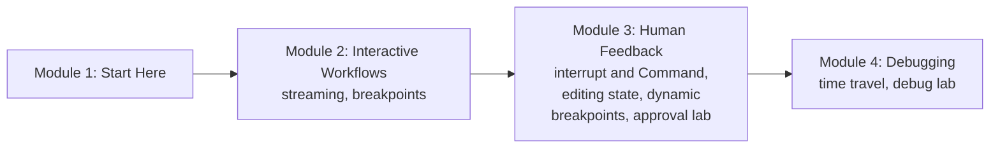

# How This Course Works

## Introduction

Would you let a new employee transfer ₹5 lakh from the company account on their first day without anyone checking? Probably not. You'd want to **see** what they're doing as they do it, have them **stop and ask** before anything risky, be able to **correct** their work before it goes out, and, when something goes wrong, **rewind** to see exactly where it went off track.

AI agents need the same four things. An agent that drafts emails, issues refunds, edits files or books tickets is useful precisely because it can act, and that's also what makes it risky. **Human-in-the-loop** (HITL) means designing the agent so people can watch, approve, edit and replay its work at the moments that matter.

LangGraph was built with this in mind. Because every step is saved as a checkpoint (you learned this in [LangGraph Fundamentals](../../langgraph-fundamentals/course.md)) and the state is fully under your control (the subject of [LangGraph State and Memory](../../langgraph-state-and-memory/course.md)), a graph can pause in the middle of a run, wait for minutes or days, and continue exactly where it stopped, with whatever a person decided in the meantime.

> 💡 **Key Insight**
>
> Every human-in-the-loop feature in LangGraph is the same trick seen from a different angle: **the run stops at a checkpoint, and something outside the graph decides how it continues**. Streaming lets people watch the checkpoints go by; breakpoints and `interrupt()` stop at one; `update_state` and `Command(resume=...)` change what happens next; time travel picks an *older* checkpoint to continue from.

---

## What You Will Learn

By the end of this course you will be able to:

- **Stream** a graph's progress in real time with every stream mode: `values`, `updates`, `messages`, `custom`, `checkpoints`, `tasks` and `debug`.
- **Stop at breakpoints** (`interrupt_before` / `interrupt_after`) to step through and debug a graph.
- **Pause for a human** with `interrupt()` and resume with `Command(resume=...)`, including several questions, parallel interrupts and validated answers.
- **Let people edit state**: change a tool call's arguments, correct a draft, or reject an action, using `update_state` and resume values.
- **Pause conditionally** (dynamic breakpoints) only when a rule says a human is needed.
- **Time travel**: list a thread's history, replay from a checkpoint, and fork a new branch with a change, to debug agents.

### The course at a glance



| Module | Lessons | You'll build |
|---|---|---|
| 2. Interactive Workflows | Streaming Real-Time Updates; Breakpoints | A progress-reporting workflow and a step-through debugger session |
| 3. Human Feedback | interrupt and Command; Editing State; Dynamic Breakpoints; Lab | A payout agent that must get approval before a risky tool runs |
| 4. Debugging | Time Travel; Lab | Finding and fixing an agent's wrong turn by rewinding and forking |

---

## What You Need Before Starting

- **LangGraph State and Memory**, especially [The LangGraph State System](../../langgraph-state-and-memory/02-state-fundamentals/the-langgraph-state-system.md) and [State Reducers](../../langgraph-state-and-memory/03-advanced-state/state-reducers.md), because editing state goes through the same reducers.
- **Checkpointers and threads** from [Persistence and Checkpointers](../../langgraph-fundamentals/05-chatbots-and-persistence/persistence-and-checkpointers.md). Every lesson here needs a checkpointer; pausing is impossible without one.
- **Tool-calling agents** from [Tools in LangGraph: ToolNode and tools_condition](../../langgraph-fundamentals/04-workflows-and-agents/tools-in-langgraph-toolnode-and-tools-condition.md).
- For module 3, a sense of **why** some actions need guardrails: [Guardrails and Security](../../enterprise-llm-systems/course.md#m6) in Enterprise LLM Systems.

### Installing

```bash
pip install langgraph langchain-core
```

The examples were tested with **LangGraph 1.2** and **langchain-core 1.6**. Human-in-the-loop APIs have changed more than most parts of LangGraph over the years (for example, the old `NodeInterrupt` exception is deprecated in favour of `interrupt()`); this course uses the current APIs and points out the old ones you'll still see in tutorials.

### Do I need an API key?

**No.** Every runnable example uses plain Python nodes or scripted fake chat models, so it runs offline with exactly the output shown. A few blocks show the real-model or real-server version for reference; they're marked as not run.

---

## How Every Lesson Is Built

The lessons follow the platform's usual template: **Before you start**, **Introduction**, **Key Insight**, **Core Explanation** with diagrams and runnable code, **Try It Yourself** with hidden answers, **Real-World Examples**, **Common Misconceptions**, **Interview Relevance** and **Key Takeaways**. **Labs** build something complete from an empty file.

A tip specific to this course: human-in-the-loop code is easiest to understand as a **conversation between two programs**. One is the graph, which runs until it pauses. The other is your application (a web server, a Slack bot, a CLI), which shows the pause to a person and later sends their answer back. In the examples, both halves live in one file, and the "human" is a line of code. When you build a real app, those two halves are separated by minutes or days and by a database-backed checkpointer, but the code is the same.

---

## Common Misconceptions

### "Human-in-the-loop means a human approves every step"

Good designs ask rarely: only for risky, irreversible or uncertain actions. Module 3's dynamic breakpoints are about exactly that.

### "Pausing a graph keeps a Python process waiting"

Nothing waits. The state is saved in a checkpoint and the run ends. Resuming is a new call, possibly on a different server, days later.

### "Time travel is only for demos"

It's one of the most practical debugging tools for agents: rerun the exact step that went wrong, with a fix, without repeating everything before it.

---

## Key Takeaways

- Human-in-the-loop lets people **watch, approve, edit and rewind** an agent's work.
- It's built on **checkpoints**: the run stops at one, and something outside decides how it continues.
- Module 2 covers **streaming and breakpoints**, module 3 **interrupts and editing state**, module 4 **time travel**.
- Every example runs **offline**; you need **LangGraph State and Memory** and a checkpointer for everything here.

---

**Up next:** [Streaming Real-Time Updates](../02-interactive-workflows/streaming-real-time-updates.md)
