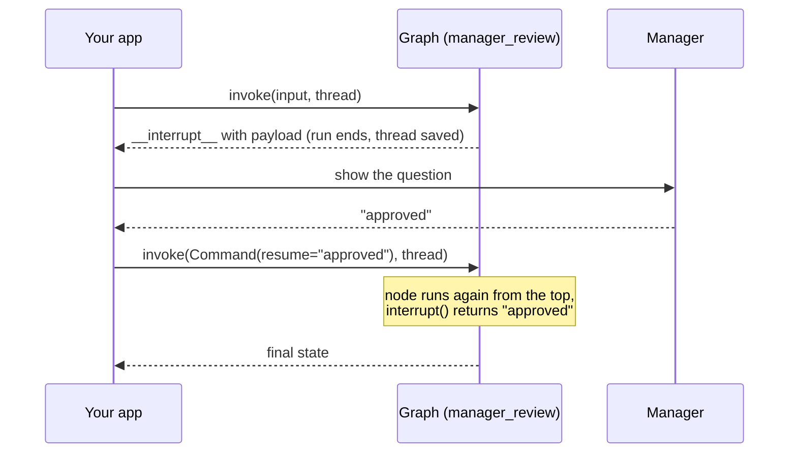

# Pausing with interrupt and Resuming with Command: The Complete Guide

> 📚 **Before you start**
>
> - [Breakpoints](../02-interactive-workflows/breakpoints.md), for pausing a run and resuming from a checkpoint.
> - [Streaming Real-Time Updates](../02-interactive-workflows/streaming-real-time-updates.md), where `__interrupt__` first appeared in the stream.
> - [Threads, Fault Tolerance and Resuming](../../langgraph-fundamentals/05-chatbots-and-persistence/threads-fault-tolerance-and-resuming.md), whose last section previewed `interrupt()`.
> - [Guardrails and Security](../../enterprise-llm-systems/course.md#m6) in Enterprise LLM Systems, for why risky actions need a human check.

## Introduction

At a bank branch, a customer asks to withdraw ₹3 lakh in cash. The teller has authority up to ₹2 lakh, so they don't refuse and they don't just hand it over: they fill in a slip, send it to the branch manager, and **wait**. The manager reads the slip ("₹3,00,000, account 4471, customer known to branch for 12 years"), writes "Approved, check ID", and sends it back. The teller picks up **exactly where they left off**, with the manager's answer in hand.

That is LangGraph's `interrupt()` function. A node calls `interrupt(payload)`: the run pauses, the thread is saved, and the payload (the slip) goes back to your application, which shows it to a person. Later, minutes or days later, your application sends the person's answer with `Command(resume=answer)`, and inside the node, `interrupt()` **returns that answer** as if it were an ordinary function call.

This lesson covers everything about that pair: the basic flow, routing on approve or reject, the most important rule (the node runs again from the start when resumed), several questions in one node, parallel interrupts, validated answers with `response_schema`, the traps of `try/except`, and how the newer `version="v2"` output presents interrupts.

> 💡 **Key Insight**
>
> `interrupt()` looks like a function that blocks until a human answers, but nothing blocks. The node raises a special signal, LangGraph saves the thread, and the run **ends**. When you resume, LangGraph **runs the node again from its first line**, and this time `interrupt()` returns your resume value instead of pausing. Every rule in this lesson follows from that one fact.

---

## Core Explanation

### 1. The basic flow

A refund workflow for an online electronics store. Refunds above ₹10,000 need a manager:

```python
import operator
from typing import Annotated, Literal, TypedDict
from langgraph.graph import StateGraph, START, END
from langgraph.checkpoint.memory import InMemorySaver
from langgraph.types import interrupt, Command

class Refund(TypedDict):
    order_id: str
    amount: float
    decision: str
    log: Annotated[list, operator.add]

def manager_review(state: Refund):
    answer = interrupt({
        "question": "Approve this refund?",
        "order_id": state["order_id"],
        "amount": state["amount"],
    })
    return {"decision": answer, "log": [f"manager said {answer!r}"]}

b = StateGraph(Refund)
b.add_node(manager_review)
b.add_edge(START, "manager_review")
b.add_edge("manager_review", END)
refunds = b.compile(checkpointer=InMemorySaver())

cfg = {"configurable": {"thread_id": "refund-ORD-5521"}}
result = refunds.invoke({"order_id": "ORD-5521", "amount": 18499.0, "log": []}, cfg)

print("keys:", list(result))
pending = result["__interrupt__"][0]
print("payload:", pending.value)
print("has id:", isinstance(pending.id, str))
```

Output:

```
keys: ['order_id', 'amount', 'log', '__interrupt__']
payload: {'question': 'Approve this refund?', 'order_id': 'ORD-5521', 'amount': 18499.0}
has id: True
```

The run paused inside `manager_review`. `invoke` returned the state so far plus a special `__interrupt__` key holding a list of `Interrupt` objects. Each has:

- **`value`**: whatever you passed to `interrupt()`, here a dictionary describing the decision. It must be JSON-serialisable, since it's saved in the checkpoint and usually sent to a UI.
- **`id`**: a unique id for this pause, used when several interrupts are pending at once (section 6).

The saved thread tells the same story:

```python
snap = refunds.get_state(cfg)
print("next:", snap.next)
print("interrupts on the thread:", [i.value["question"] for i in snap.interrupts])
```

Output:

```
next: ('manager_review',)
interrupts on the thread: ['Approve this refund?']
```

Now the manager answers. Resume with `Command(resume=...)` on the **same thread**:

```python
final = refunds.invoke(Command(resume="approved"), cfg)
print(final["decision"], "|", final["log"])
print("next:", refunds.get_state(cfg).next)
```

Output:

```
approved | ["manager said 'approved'"]
next: ()
```



### 2. Approve or reject: routing after the answer

Usually the answer decides where the graph goes next. The node that asks can return a `Command(goto=...)` (from [State Schemas and Data Flow](../../langgraph-state-and-memory/02-state-fundamentals/state-schemas-and-data-flow.md)) to route on the answer:

```python
issued = []

def review(state: Refund) -> Command[Literal["issue_refund", "notify_rejection"]]:
    if state["amount"] <= 10_000:
        return Command(update={"decision": "auto-approved"}, goto="issue_refund")
    answer = interrupt({"question": "Approve refund?", "amount": state["amount"]})
    if answer == "approve":
        return Command(update={"decision": "approved"}, goto="issue_refund")
    return Command(update={"decision": f"rejected: {answer}"}, goto="notify_rejection")

def issue_refund(state: Refund):
    issued.append(state["order_id"])
    return {"log": [f"refunded ₹{state['amount']:,.0f}"]}

def notify_rejection(state: Refund):
    return {"log": ["customer told: refund rejected"]}

b = StateGraph(Refund)
b.add_node(review)
b.add_node(issue_refund)
b.add_node(notify_rejection)
b.add_edge(START, "review")
approvals = b.compile(checkpointer=InMemorySaver())

def run(order_id, amount, answer=None):
    c = {"configurable": {"thread_id": order_id}}
    out = approvals.invoke({"order_id": order_id, "amount": amount, "log": []}, c)
    if "__interrupt__" in out:
        out = approvals.invoke(Command(resume=answer), c)
    return out["decision"], out["log"]

print(run("ORD-1", 2499.0))
print(run("ORD-2", 18499.0, "approve"))
print(run("ORD-3", 52000.0, "looks like fraud, refund to original card only"))
print("refunds issued:", issued)
```

Output:

```
('auto-approved', ['refunded ₹2,499'])
('approved', ['refunded ₹18,499'])
('rejected: looks like fraud, refund to original card only', ['customer told: refund rejected'])
refunds issued: ['ORD-1', 'ORD-2']
```

Two design points:

- The interrupt is **conditional**: small refunds never bother anyone. That's impossible with a static breakpoint.
- The resume value doesn't have to be a fixed word. Here a rejection carries the manager's reason, which flows into the state.

### 3. The big rule: the node runs again from the top

When you resume, LangGraph doesn't continue from the middle of the function (Python can't save a half-finished function call). It runs the node **again from its first line**. On that second run, `interrupt()` finds the resume value and returns it instead of pausing. So any code **before** `interrupt()` runs twice:

```python
calls = {"before": 0, "after": 0}

def careless_review(state: Refund):
    calls["before"] += 1                     # imagine: send an SMS, charge a fee, write to a DB
    answer = interrupt("Approve?")
    calls["after"] += 1
    return {"decision": answer}

b = StateGraph(Refund)
b.add_node(careless_review)
b.add_edge(START, "careless_review")
demo = b.compile(checkpointer=InMemorySaver())
c = {"configurable": {"thread_id": "rerun-demo"}}

demo.invoke({"order_id": "ORD-9", "amount": 12000.0, "log": []}, c)
print("after pausing:", calls)
demo.invoke(Command(resume="approve"), c)
print("after resuming:", calls)
```

Output:

```
after pausing: {'before': 1, 'after': 0}
after resuming: {'before': 2, 'after': 1}
```

The code before `interrupt()` ran twice; the code after ran once. If "before" had been "send the customer an SMS", they'd get two. Three ways to stay safe:

| Approach | Example |
|---|---|
| Put side effects **after** the interrupt | Ask first, then send the SMS |
| Put them in a **separate node** before the asking node | `notify` → `review`; `notify` has finished and is checkpointed, so it isn't re-run |
| Make them **idempotent** | Use an idempotency key so a repeat does nothing |

Reading state and computing the question before `interrupt()` is fine; it's cheap and gives the same result both times.

### 4. Several questions in one node

A node can call `interrupt()` more than once. Each call pauses the run once, and on each resume the node re-runs from the top; LangGraph matches resume values to `interrupt()` calls **by their order** within the node:

```python
class KYC(TypedDict):
    name: str
    pan: str
    log: Annotated[list, operator.add]

runs = []

def collect_details(state: KYC):
    runs.append("run")
    name = interrupt("What is the customer's full name?")
    pan = interrupt(f"PAN number for {name}?")
    return {"name": name, "pan": pan, "log": [f"collected {name}, {pan}"]}

b = StateGraph(KYC)
b.add_node(collect_details)
b.add_edge(START, "collect_details")
kyc = b.compile(checkpointer=InMemorySaver())
c = {"configurable": {"thread_id": "kyc-201"}}

out = kyc.invoke({"log": []}, c)
print("Q1:", out["__interrupt__"][0].value)
out = kyc.invoke(Command(resume="Asha Kulkarni"), c)
print("Q2:", out["__interrupt__"][0].value)
out = kyc.invoke(Command(resume="ABCPK1234F"), c)
print(out["log"], "| node ran", len(runs), "times")
```

Output:

```
Q1: What is the customer's full name?
Q2: PAN number for Asha Kulkarni?
['collected Asha Kulkarni, ABCPK1234F'] | node ran 3 times
```

The second question even used the first answer. Because matching is by position, the **sequence of `interrupt()` calls must be the same on every run** of the node. Don't skip one based on something that can change between runs (the time, a random number, a list from an API that might reorder), and don't build "keep asking until the answer is valid" with a `while True` loop around `interrupt()`; use a conditional edge that routes back to the node instead (see the [Dynamic Breakpoints](dynamic-breakpoints.md) lesson).

### 5. Never swallow the interrupt with `try/except`

`interrupt()` pauses by raising a special exception (`GraphInterrupt`) that LangGraph catches. A broad `except Exception:` around it catches that signal first, and the pause silently never happens:

```python
def fragile(state: Refund):
    try:
        answer = interrupt("Approve?")
    except Exception as e:                     # too broad!
        return {"decision": f"error path taken ({type(e).__name__})"}
    return {"decision": answer}

b = StateGraph(Refund)
b.add_node(fragile)
b.add_edge(START, "fragile")
oops = b.compile(checkpointer=InMemorySaver())
c = {"configurable": {"thread_id": "oops"}}
out = oops.invoke({"order_id": "ORD-10", "amount": 15000.0, "log": []}, c)
print(out["decision"], "| paused?", "__interrupt__" in out, "| next:", oops.get_state(c).next)
```

Output:

```
error path taken (GraphInterrupt) | paused? False | next: ()
```

The refund was never reviewed. Keep `interrupt()` outside `try` blocks, or catch only the specific exceptions you expect (`except ValueError:`), which won't match `GraphInterrupt`.

### 6. Parallel interrupts: resume by id

If two nodes in the same super-step both interrupt, the run pauses with **two** pending interrupts. A plain `Command(resume=value)` is now ambiguous, so LangGraph requires a dictionary mapping each interrupt's **id** to its answer:

```python
class Launch(TypedDict):
    approvals: Annotated[list, operator.add]

def legal_signoff(state: Launch):
    return {"approvals": [f"legal: {interrupt('Legal: approve the new loan ad?')}"]}

def compliance_signoff(state: Launch):
    return {"approvals": [f"compliance: {interrupt('Compliance: approve the new loan ad?')}"]}

b = StateGraph(Launch)
b.add_node(legal_signoff)
b.add_node(compliance_signoff)
b.add_edge(START, "legal_signoff")            # both run in the same super-step
b.add_edge(START, "compliance_signoff")
launch = b.compile(checkpointer=InMemorySaver())
c = {"configurable": {"thread_id": "ad-campaign-7"}}

out = launch.invoke({"approvals": []}, c)
pending = out["__interrupt__"]
print(sorted(i.value for i in pending))

try:
    launch.invoke(Command(resume="yes"), c)
except RuntimeError as e:
    print("RuntimeError:", str(e).split(".")[0])

answers = {i.id: ("yes" if i.value.startswith("Legal") else "yes, add the RBI disclaimer") for i in pending}
print(sorted(launch.invoke(Command(resume=answers), c)["approvals"]))
```

Output:

```
['Compliance: approve the new loan ad?', 'Legal: approve the new loan ad?']
RuntimeError: When there are multiple pending interrupts, you must specify the interrupt id when resuming
['compliance: yes, add the RBI disclaimer', 'legal: yes']
```

In a real app each `Interrupt` might go to a different person (the legal team, the compliance team). Store the ids with the requests, and resume with whichever answers have arrived; you can resume with a subset and the others stay pending.

### 7. Validated answers with `response_schema`

Humans type unexpected things. Since LangGraph 1.2.12, `interrupt()` accepts a **`response_schema`** (a Pydantic model, `TypedDict` or dataclass). The schema travels with the interrupt, so a UI can render a proper form (LangSmith Studio does), and the resume value is **validated** before your node sees it:

```python
from pydantic import BaseModel, Field

class RefundDecision(BaseModel):
    approve: bool
    reason: str = Field(default="", max_length=80)

def typed_review(state: Refund):
    d = interrupt({"question": "Approve refund?", "amount": state["amount"]},
                  response_schema=RefundDecision)
    return {"decision": "approved" if d.approve else f"rejected ({d.reason})"}

b = StateGraph(Refund)
b.add_node(typed_review)
b.add_edge(START, "typed_review")
typed = b.compile(checkpointer=InMemorySaver())
c = {"configurable": {"thread_id": "typed-1"}}

out = typed.invoke({"order_id": "ORD-11", "amount": 21000.0, "log": []}, c)
print("schema fields:", list(out["__interrupt__"][0].response_schema["properties"]))

try:
    typed.invoke(Command(resume={"approve": "maybe"}), c)
except Exception as e:
    print(type(e).__name__, "-> still paused at:", typed.get_state(c).next)

print(typed.invoke(Command(resume={"approve": False, "reason": "item was used"}), c)["decision"])
```

Output:

```
schema fields: ['approve', 'reason']
ValidationError -> still paused at: ('typed_review',)
rejected (item was used)
```

The invalid answer raised a `ValidationError` in the caller, and the thread **stayed paused**, so the app can ask again. With a Pydantic model, the node received a `RefundDecision` object; with a `TypedDict` schema it would receive the validated dictionary.

### 8. The `version="v2"` result

`invoke` with `version="v2"` returns a `GraphOutput` that keeps the state and the interrupts apart, instead of mixing `__interrupt__` into the state dictionary:

```python
c = {"configurable": {"thread_id": "v2-demo"}}
out = refunds.invoke({"order_id": "ORD-12", "amount": 15000.0, "log": []}, c, version="v2")
print(type(out).__name__, "| state keys:", list(out.value), "| interrupts:", len(out.interrupts))

out = refunds.invoke(Command(resume="approved"), c, version="v2")
print(out.value["decision"], "| interrupts:", out.interrupts)
```

Output:

```
GraphOutput | state keys: ['order_id', 'amount', 'log'] | interrupts: 1
approved | interrupts: ()
```

This is the format LangChain's newer agent helpers document, and it avoids accidentally treating `__interrupt__` as a state key. Both formats carry the same information.

### 9. Pausing for days

Nothing in this lesson depends on the same Python process staying alive. With a database checkpointer, the "resume" call can come from a different server, after a deploy, a week later:

```python
# not-run: needs `pip install langgraph-checkpoint-sqlite`; two separate processes
from langgraph.checkpoint.sqlite import SqliteSaver
import sqlite3

# `builder` is the refund StateGraph from section 1; save_to_inbox is your own app's code.

# Process 1: a web request starts the refund and stores the interrupt for the manager's inbox
saver = SqliteSaver(sqlite3.connect("refunds.db", check_same_thread=False))
app = builder.compile(checkpointer=saver)
out = app.invoke({"order_id": "ORD-5521", "amount": 18499.0, "log": []},
                 {"configurable": {"thread_id": "refund-ORD-5521"}})
save_to_inbox("refund-ORD-5521", out["__interrupt__"][0].value)

# Process 2, two days later: the manager clicks "Approve" in the inbox
app = builder.compile(checkpointer=SqliteSaver(sqlite3.connect("refunds.db", check_same_thread=False)))
app.invoke(Command(resume="approved"), {"configurable": {"thread_id": "refund-ORD-5521"}})
```

The `thread_id` is the only thing your app needs to remember (often it's derived from the business object, like the order id), and the `__interrupt__` payload is what you show the reviewer.

### 10. `Command` as input: only `resume`

`Command` has other fields (`update`, `goto`, `graph`) that you've used when **returning from nodes**. The docs are explicit that as **input** to `invoke`/`stream`, `Command` is meant only for `resume`. To change state while a run is paused, use `update_state`, the subject of the next lesson.

---

## Try It Yourself

1. **Clarifying question.** Write a node `book_table` for a restaurant bot: if `state["guests"]` is missing, `interrupt("How many guests?")` and store the answer as an int. Run it without `guests`, then resume with `"4"`.
2. **Fix the double SMS.** Rewrite `careless_review` as two nodes so the "SMS" counter increments once, even though the review node runs twice.
3. **Partial resume.** In the parallel example, resume only the legal interrupt on a new thread. What does `get_state(c).next` show, and how many interrupts are still pending?

<details>
<summary>Show answers</summary>

**1.**

```python
class Booking(TypedDict):
    guests: int
    status: str

def book_table(state: Booking):
    guests = state.get("guests")
    if guests is None:
        guests = int(interrupt("How many guests?"))
    return {"guests": guests, "status": f"table for {guests} booked"}

b = StateGraph(Booking)
b.add_node(book_table)
b.add_edge(START, "book_table")
bot = b.compile(checkpointer=InMemorySaver())
c = {"configurable": {"thread_id": "table-1"}}
print(bot.invoke({}, c)["__interrupt__"][0].value)
print(bot.invoke(Command(resume="4"), c))
```

Output:

```
How many guests?
{'guests': 4, 'status': 'table for 4 booked'}
```

The `if` is safe here: whether the interrupt happens depends only on the saved state, which is identical on both runs of the node.

**2.**

```python
sms_sent = []

def send_sms(state: Refund):
    sms_sent.append(state["order_id"])
    return {"log": ["sms: your refund is under review"]}

def review_only(state: Refund):
    return {"decision": interrupt("Approve?")}

b = StateGraph(Refund)
b.add_sequence([send_sms, review_only])
b.add_edge(START, "send_sms")
safe = b.compile(checkpointer=InMemorySaver())
c = {"configurable": {"thread_id": "safe-1"}}
safe.invoke({"order_id": "ORD-20", "amount": 15000.0, "log": []}, c)
print(safe.invoke(Command(resume="approved"), c)["decision"], "| SMS sent:", len(sms_sent))
```

Output:

```
approved | SMS sent: 1
```

**3.**

```python
c = {"configurable": {"thread_id": "ad-campaign-8"}}
pending = launch.invoke({"approvals": []}, c)["__interrupt__"]
legal = next(i for i in pending if i.value.startswith("Legal"))
out = launch.invoke(Command(resume={legal.id: "yes"}), c)
snap = launch.get_state(c)
print("next:", snap.next, "| still pending:", [i.value for i in snap.interrupts])
print("approvals so far:", out["approvals"])
```

Output:

```
next: ('compliance_signoff',) | still pending: ['Compliance: approve the new loan ad?']
approvals so far: ['legal: yes']
```

The legal node finished and its approval is in the state; compliance is still waiting.

</details>

---

## Real-World Examples

- **Refund and payout approvals** in fintech and e-commerce: small amounts auto-approve; large ones send an interrupt to a manager's inbox and resume when they click.
- **Clarifying questions** in booking and support agents ("Which of your two orders?"), where the interrupt payload becomes a quick-reply prompt in the chat UI.
- **Multi-team sign-off** for marketing content in regulated industries, using parallel interrupts resumed independently by id.
- **LangChain's `HumanInTheLoopMiddleware`** for `create_agent` is built on `interrupt()`: it pauses before chosen tools and resumes with approve, edit or reject decisions.

---

## Common Misconceptions

### "`interrupt()` blocks until the human answers"

The run ends and the thread is saved. Resuming is a new call, which re-runs the node from the top.

### "Code before `interrupt()` runs once"

It runs again on every resume. Keep side effects after the interrupt, in an earlier node, or idempotent.

### "I can resume with any input"

Resume with `Command(resume=...)` on the same `thread_id`. Passing a normal input starts a new run on the thread instead.

### "Multiple interrupts are matched by name"

They're matched by order inside a node, and by interrupt **id** across parallel nodes.

---

## Interview Relevance

*"How do you implement human approval in LangGraph?"* Call `interrupt(payload)` inside the node (conditionally, for risky cases), compile with a checkpointer, read `__interrupt__` (or `.interrupts` with `version="v2"`), show the payload to a person, and resume with `Command(resume=answer)` on the same thread. Route on the answer with `Command(goto=...)`. Mention re-execution of the node, idempotent side effects, order-based matching, id maps for parallel interrupts, `response_schema` validation, and durable checkpointers for long waits.

*"What's wrong with wrapping `interrupt()` in try/except?"* It pauses by raising `GraphInterrupt`; a broad `except` swallows it and the graph never pauses.

---

## Key Takeaways

- **`interrupt(payload)`** pauses a node and sends the payload out; **`Command(resume=value)`** makes `interrupt()` return `value`.
- On resume the node **re-runs from the top**: keep side effects after the interrupt or in another node.
- Several `interrupt()` calls in a node are matched **by order**; parallel interrupts are resumed with an **`{id: value}`** map.
- **`response_schema`** validates answers (LangGraph 1.2.12+); invalid answers leave the thread paused.
- Never wrap `interrupt()` in a **broad `try/except`**; use `Command(resume=...)` as the only `Command` input.

---

**Up next:** [Editing State with Human Input](editing-state-with-human-input.md)
