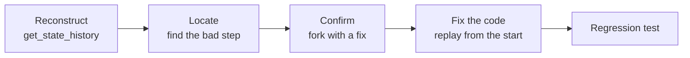

# Lab: Debug an Agent with Time Travel

> 📚 **Before you start**
>
> - [Time Travel: Rewind and Replay](time-travel-rewind-and-replay.md), for history, replay, forks and `as_node`.
> - [Streaming Real-Time Updates](../02-interactive-workflows/streaming-real-time-updates.md) and [Breakpoints](../02-interactive-workflows/breakpoints.md), the other two debugging tools you'll combine here.
> - [Tools in LangGraph: ToolNode and tools_condition](../../langgraph-fundamentals/04-workflows-and-agents/tools-in-langgraph-toolnode-and-tools-condition.md), for the agent's shape.

## What You'll Build

You're on call for a train-enquiry assistant. A customer complains: "I asked for trains from Mumbai to Delhi on 2/12 and your bot said there were **no trains**. There are always trains!" You have the thread id. Your job is a proper investigation, the way you'd debug any production agent:

1. **Reconstruct** what happened from the thread's checkpoints.
2. **Locate** the exact step where the agent went wrong.
3. **Confirm** the cause by forking from that step with a corrected value.
4. **Fix** the root cause in code, and **replay** the original conversation through the fixed graph.
5. **Lock it in** with a regression test.



> 💡 **Key Insight**
>
> A fork answers **"would the rest of the run have been right if this one value had been right?"** That separates the bad step from everything after it. A replay through **updated code** answers **"does my fix actually produce that value?"** You need both: the first proves where the bug is, the second proves you fixed it.

Run the blocks in order in one file or notebook (`pip install langgraph langchain-core`).

---

## Step 1: The Agent (with a Hidden Bug)

The tools read a small timetable. Note the maintenance block on 12 February:

```python
from datetime import date
from langchain_core.messages import AIMessage, SystemMessage, ToolMessage, HumanMessage
from langchain_core.tools import tool
from langgraph.graph import StateGraph, MessagesState, START
from langgraph.prebuilt import ToolNode, tools_condition
from langgraph.checkpoint.memory import InMemorySaver

TIMETABLE = {
    "2026-12-02": [{"no": "12951", "name": "Mumbai Rajdhani", "departs": "17:00"},
                   {"no": "12953", "name": "August Kranti Rajdhani", "departs": "17:10"}],
    "2026-02-12": [],                                     # maintenance block, no trains
}

@tool
def search_trains(origin: str, destination: str, travel_date: str) -> str:
    """Find trains between two cities on a date given as YYYY-MM-DD."""
    trains = TIMETABLE.get(travel_date, [])
    if not trains:
        return f"No trains from {origin} to {destination} on {travel_date}."
    return "; ".join(f"{t['no']} {t['name']} at {t['departs']}" for t in trains)

TOOLS = [search_trains]
```

Instead of a scripted list of replies, this lab uses a small **rule-based pretend model**, because we need its behaviour to depend on the **prompt** (so that fixing the prompt fixes the agent). It has a realistic flaw: it reads "2/12" the American way (month/day) unless the system prompt says dates are day/month:

```python
import re

class PretendTrainModel:
    """Behaves like a tool-calling chat model, deterministically."""
    def bind_tools(self, tools, **kwargs):
        return self

    def invoke(self, messages):
        system = messages[0].content if isinstance(messages[0], SystemMessage) else ""
        last = messages[-1]
        if isinstance(last, ToolMessage):
            if last.content.startswith("No trains"):
                return AIMessage("Sorry, there are no trains on that date.")
            return AIMessage(f"Here are your options: {last.content}.")
        a, b = map(int, re.search(r"(\d{1,2})/(\d{1,2})", last.content).groups())
        day, month = (a, b) if "DD/MM" in system else (b, a)          # the bug lives here
        when = date(2026, month, day).isoformat()
        return AIMessage("", tool_calls=[{"name": "search_trains", "id": f"call-{when}",
                                          "args": {"origin": "Mumbai", "destination": "Delhi",
                                                   "travel_date": when}}])

llm = PretendTrainModel().bind_tools(TOOLS)
SYSTEM_PROMPT = "You are an Indian Railways enquiry assistant."

def agent(state: MessagesState):
    return {"messages": [llm.invoke([SystemMessage(SYSTEM_PROMPT)] + state["messages"])]}

def build():
    b = StateGraph(MessagesState)
    b.add_node(agent)
    b.add_node("tools", ToolNode(TOOLS))
    b.add_edge(START, "agent")
    b.add_conditional_edges("agent", tools_condition)
    b.add_edge("tools", "agent")
    return b

checkpointer = InMemorySaver()                 # in production: Postgres or SQLite
enquiry_bot = build().compile(checkpointer=checkpointer)
```

Now the customer's conversation, as it happened in production:

```python
THREAD = {"configurable": {"thread_id": "cust-8812"}}
reply = enquiry_bot.invoke({"messages": [("user", "Trains from Mumbai to Delhi on 2/12?")]}, THREAD)
print(reply["messages"][-1].content)
```

Output:

```
Sorry, there are no trains on that date.
```

That's the complaint reproduced. In real life you wouldn't run it again yourself; you'd open the saved thread. That's what we do next.

---

## Step 2: Reconstruct the Run

Turn the thread's history into a readable timeline, oldest first. For each checkpoint, show the step, what will run next, and the newest message at that point:

```python
def describe(message):
    if isinstance(message, AIMessage) and message.tool_calls:
        c = message.tool_calls[0]
        return f"AI calls {c['name']}({c['args']})"
    return f"{type(message).__name__.replace('Message', '')}: {message.content}"

def timeline(app, config):
    for snap in reversed(list(app.get_state_history(config))):
        msgs = snap.values.get("messages", [])
        latest = describe(msgs[-1]) if msgs else "(no messages)"
        print(f"step {snap.metadata['step']:2} | next={str(snap.next):12} | {latest}")

timeline(enquiry_bot, THREAD)
```

Output:

```
step -1 | next=('__start__',) | (no messages)
step  0 | next=('agent',)   | Human: Trains from Mumbai to Delhi on 2/12?
step  1 | next=('tools',)   | AI calls search_trains({'origin': 'Mumbai', 'destination': 'Delhi', 'travel_date': '2026-02-12'})
step  2 | next=('agent',)   | Tool: No trains from Mumbai to Delhi on 2026-02-12.
step  3 | next=()           | AI: Sorry, there are no trains on that date.
```

Reading top to bottom: the question arrived, the agent decided on a tool call, the tool answered "No trains... on 2026-02-12", and the agent relayed that. The tool behaved correctly for the date it was given. The suspicious line is the **tool call**: the customer wrote "2/12" (2 December, in the Indian day/month format), and the agent searched **12 February**.

---

## Step 3: Locate the Bad Step

The checkpoint we want is the one where the tool call has been decided but **not yet executed**: its `next` is `("tools",)`. That's the last moment we can change the decision before it had any effect:

```python
def find_before(app, config, node):
    return next(s for s in app.get_state_history(config) if s.next == (node,))

bad_step = find_before(enquiry_bot, THREAD, "tools")
bad_call = bad_step.values["messages"][-1]
print("step:", bad_step.metadata["step"])
print("decision:", describe(bad_call))
print("message id kept for the fix:", bad_call.id is not None)
```

Output:

```
step: 1
decision: AI calls search_trains({'origin': 'Mumbai', 'destination': 'Delhi', 'travel_date': '2026-02-12'})
message id kept for the fix: True
```

---

## Step 4: Confirm the Cause with a Fork

Hypothesis: "if the agent had searched 2 December, everything after would have been right". Test it by replacing the AI message (same id, so it's replaced, not appended) with the corrected call, and running forward from there:

```python
corrected = AIMessage("", id=bad_call.id, tool_calls=[{
    **bad_call.tool_calls[0],
    "args": {**bad_call.tool_calls[0]["args"], "travel_date": "2026-12-02"}}])

fork_cfg = enquiry_bot.update_state(bad_step.config, {"messages": [corrected]})
forked = enquiry_bot.invoke(None, fork_cfg)
print(forked["messages"][-1].content)
```

Output:

```
Here are your options: 12951 Mumbai Rajdhani at 17:00; 12953 August Kranti Rajdhani at 17:10.
```

Confirmed: with the right date, the tool and the final answer are right. So the bug is **only** in how the agent turned "2/12" into a date. Everything after that step works.

Both versions are now in the thread. A quick comparison of the branch tips:

```python
tips = [s for s in enquiry_bot.get_state_history(THREAD) if not s.next]
for s in sorted(tips, key=lambda s: s.created_at):
    call = next(m for m in s.values["messages"] if isinstance(m, AIMessage) and m.tool_calls)
    print(f"{call.tool_calls[0]['args']['travel_date']} -> {s.values['messages'][-1].content[:60]}")
```

Output:

```
2026-02-12 -> Sorry, there are no trains on that date.
2026-12-02 -> Here are your options: 12951 Mumbai Rajdhani at 17:00; 12953
```

---

## Step 5: Fix the Root Cause and Replay

The fork patched one conversation. The real fix is in the code: tell the model that dates are written day/month. Then **replay the original conversation** from the checkpoint before the agent's first decision, through the **updated** graph. Replay always runs the current code; the checkpoint only provides the state:

```python
SYSTEM_PROMPT = ("You are an Indian Railways enquiry assistant. Users write dates as DD/MM "
                 "(Indian format); convert them to YYYY-MM-DD for tools.")

fixed_bot = build().compile(checkpointer=checkpointer)      # same checkpointer, same threads

before_agent = next(s for s in fixed_bot.get_state_history(THREAD)
                    if s.next == ("agent",) and len(s.values["messages"]) == 1)
replayed = fixed_bot.invoke(None, before_agent.config)
print(describe(replayed["messages"][-3]))
print(replayed["messages"][-1].content)
```

Output:

```
AI calls search_trains({'origin': 'Mumbai', 'destination': 'Delhi', 'travel_date': '2026-12-02'})
Here are your options: 12951 Mumbai Rajdhani at 17:00; 12953 August Kranti Rajdhani at 17:10.
```

The updated graph read the same question and, on its own, called the tool with 2 December. The fork proved **where** the bug was; this replay proves the **fix** works on the real input.

Here's the whole investigation as the thread's tree: the original branch, the confirming fork, and the replay through the fixed code:

```python
starts = [s for s in fixed_bot.get_state_history(THREAD) if s.metadata["source"] in ("update", "fork")]
print(sorted(s.metadata["source"] for s in starts))
print(len(list(fixed_bot.get_state_history(THREAD))), "checkpoints in the thread")
```

Output:

```
['fork', 'update']
12 checkpoints in the thread
```

One `update` (our manual fork in Step 4) and one `fork` (the replay in Step 5), on top of the original run. Nothing was overwritten; an auditor can see the original wrong answer and both corrections.

---

## Step 6: Watch the Fixed Agent Step by Step

Before shipping, step through a fresh conversation with a run-time breakpoint before the tools, so you can eyeball the decision exactly where the bug used to be:

```python
check = {"configurable": {"thread_id": "qa-check"}}
fixed_bot.invoke({"messages": [("user", "Mumbai to Delhi on 2/12 please")]}, check,
                 interrupt_before=["tools"])
pending = fixed_bot.get_state(check)
print("paused before:", pending.next, "|", describe(pending.values["messages"][-1]))
print(fixed_bot.invoke(None, check)["messages"][-1].content[:40], "...")
```

Output:

```
paused before: ('tools',) | AI calls search_trains({'origin': 'Mumbai', 'destination': 'Delhi', 'travel_date': '2026-12-02'})
Here are your options: 12951 Mumbai Rajd ...
```

---

## Step 7: Lock It In with a Regression Test

Every production bug you fix should become a test. This one replays a set of date formats through a fresh graph and checks the tool call:

```python
def tool_date_for(app, text):
    cfg = {"configurable": {"thread_id": f"test-{text}"}}
    app.invoke({"messages": [("user", text)]}, cfg, interrupt_before=["tools"])
    return app.get_state(cfg).values["messages"][-1].tool_calls[0]["args"]["travel_date"]

cases = {"Trains on 2/12?": "2026-12-02", "Any train 25/12": "2026-12-25", "On 1/11 please": "2026-11-01"}
test_bot = build().compile(checkpointer=InMemorySaver())
for text, expected in cases.items():
    got = tool_date_for(test_bot, text)
    assert got == expected, f"{text!r}: expected {expected}, got {got}"
print(f"{len(cases)} date-format tests passed")
```

Output:

```
3 date-format tests passed
```

The test stops at the breakpoint before `tools`, so it checks the agent's decision without calling any real service, which is how you'd test an agent whose tools book tickets or move money.

---

## Try It Yourself

1. **Prove the old prompt fails the test.** Temporarily set `SYSTEM_PROMPT` back to the original, rebuild, and run the three cases. Which ones fail? Restore the fixed prompt afterwards.
2. **Fork with `as_node`.** Instead of correcting the tool call, fork from `bad_step` by **supplying the tool result yourself** with `as_node="tools"` (a `ToolMessage` answering the bad call's id with the 2 December trains). What does the agent answer, and which nodes ran?
3. **Investigation report.** Write `report(app, config)` that prints, for each branch tip in the thread, the travel date searched and the final answer, labelled `original`, `fork` or `update` by the `source` of the first checkpoint after the branch point. (Hint: walk `parent_config` up from each tip until you hit a checkpoint whose source isn't `loop`.)

<details>
<summary>Show answers</summary>

**1.**

```python
GOOD_PROMPT = SYSTEM_PROMPT
SYSTEM_PROMPT = "You are an Indian Railways enquiry assistant."
old_bot = build().compile(checkpointer=InMemorySaver())
for text, expected in cases.items():
    try:
        got = tool_date_for(old_bot, text)
    except ValueError as e:
        got = f"crash ({e})"
    print(f"{text!r:20} expected {expected} got {got} {'OK' if got == expected else 'FAIL'}")
SYSTEM_PROMPT = GOOD_PROMPT
```

Output:

```
'Trains on 2/12?'    expected 2026-12-02 got 2026-02-12 FAIL
'Any train 25/12'    expected 2026-12-25 got crash (month must be in 1..12) FAIL
'On 1/11 please'     expected 2026-11-01 got 2026-01-11 FAIL
```

"2/12" and "1/11" are silently misread as other valid dates; "25/12" crashes outright because there's no 25th month. A bug that sometimes gives a wrong answer and sometimes errors is exactly the kind you want covered by tests.

**2.**

```python
rows = TIMETABLE["2026-12-02"]
result_text = "; ".join(f"{t['no']} {t['name']} at {t['departs']}" for t in rows)
tool_answer = ToolMessage(result_text, tool_call_id=bad_call.tool_calls[0]["id"], name="search_trains")
alt_cfg = fixed_bot.update_state(bad_step.config, {"messages": [tool_answer]}, as_node="tools")
print("next:", fixed_bot.get_state(alt_cfg).next)
print(fixed_bot.invoke(None, alt_cfg)["messages"][-1].content)
```

Output:

```
next: ('agent',)
Here are your options: 12951 Mumbai Rajdhani at 17:00; 12953 August Kranti Rajdhani at 17:10.
```

The real tool never ran; the update counted as its output, and the graph continued to `agent`. The history now contains a tool call for 12 February answered with December trains, so this kind of fork is useful for "what if the tool had returned X?" experiments, not for producing a clean record.

**3.**

```python
def branch_label(app, snap):
    s = snap
    while s.parent_config:
        if s.metadata["source"] in ("fork", "update"):
            return s.metadata["source"]
        s = app.get_state(s.parent_config)
    return "original"

def report(app, config):
    tips = [s for s in app.get_state_history(config) if not s.next]
    for s in sorted(tips, key=lambda s: s.created_at):
        calls = [m for m in s.values["messages"] if isinstance(m, AIMessage) and m.tool_calls]
        searched = calls[-1].tool_calls[0]["args"]["travel_date"]
        print(f"{branch_label(app, s):8} searched {searched}: {s.values['messages'][-1].content[:50]}")

report(fixed_bot, THREAD)
```

Output:

```
original searched 2026-02-12: Sorry, there are no trains on that date.
update   searched 2026-12-02: Here are your options: 12951 Mumbai Rajdhani at 17
fork     searched 2026-12-02: Here are your options: 12951 Mumbai Rajdhani at 17
update   searched 2026-02-12: Here are your options: 12951 Mumbai Rajdhani at 17
```

</details>

---

## What You've Learned

- **Reconstructed** a production run from its checkpoints as a readable timeline.
- **Located** the faulty decision as the checkpoint whose `next` is the tool node.
- **Confirmed** the cause by **forking** with a corrected AI message (same id), leaving the original intact.
- **Fixed** the code and **replayed** the original conversation through the updated graph, since replays run current code on saved state.
- Combined **breakpoints** and **time travel** into a **regression test** that checks decisions without calling real services.

---

**Up next:** You've finished Human-in-the-Loop with LangGraph. Put everything together in the [Multi-Agent Research System (Capstone)](../../multi-agent-research-system-capstone/course.md).
