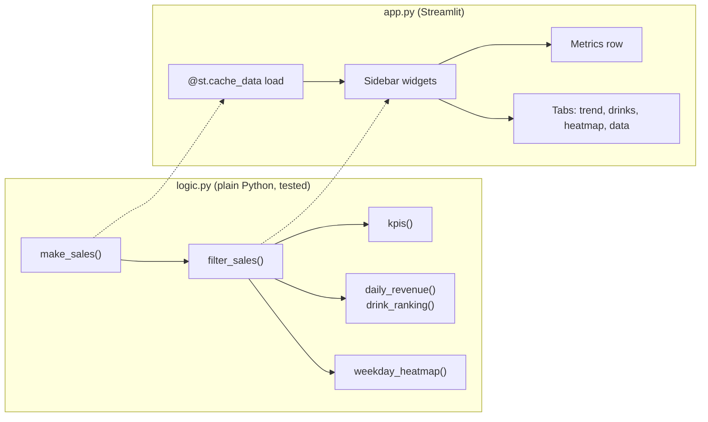

# Lab: Your First Dashboard

> 📚 **Before you start**
>
> - [What is Streamlit?](what-is-streamlit.md), for running apps and caching
> - [Widgets and Layout](widgets-and-layout.md), for the sidebar, columns, metrics and tabs
> - [pandas Core](../../numerical-computing-and-data-analysis/course.md#m3) and [Dates, Times and Timedeltas](../../numerical-computing-and-data-analysis/course.md#m4) (Numerical Computing and Data Analysis), for `groupby`, `pivot_table` and date filtering

## What You'll Build

A sales dashboard for **Chai Junction**, a made-up chain of chai outlets. The owner picks outlets, drinks and a date range in the sidebar and sees:

- four key numbers with the change versus the previous period of the same length,
- a daily revenue trend per outlet,
- a ranking of drinks,
- a weekday heatmap drawn with Seaborn,
- the filtered data, with a CSV download.



The final page looks roughly like this, shown here for Baner and Kothrud from 1 to 28 September (a sketch, since Streamlit draws the real thing in your browser):

```
┌──────────────┬───────────────────────────────────────────────────────┐
│ Filters      │  ☕ Chai Junction sales                                │
│ Outlets  [x] │  Revenue    Cups sold   Cups per day   Price per cup   │
│ Drinks   [x] │  ₹5.10 L    12,811      458            ₹39.8           │
│ Dates [....] │  ↑ +3.1%    ↑ +2.7%     ↑ +2.7%        ↑ +0.4%         │
│              │  [ Trend | Drinks | Weekdays | Data ]                 │
│              │  ~~~~~~~ line chart per outlet ~~~~~~~                 │
└──────────────┴───────────────────────────────────────────────────────┘
```

> 💡 **Key Insight**
>
> Build the dashboard **logic first, as plain functions you can run and check**, then write a thin Streamlit file that only reads widgets and draws results. When a number looks wrong on screen, you'll know whether the bug is in the logic (testable) or the layout (visible).

Steps 2 to 5 are plain Python: run them in one file or notebook and they print results. Then you'll save them as `logic.py` and write `app.py`.

---

## Step 1: Set Up the Project

```bash
mkdir chai-dashboard && cd chai-dashboard
python -m venv .venv && source .venv/bin/activate     # on Windows: .venv\Scripts\activate
python -m pip install streamlit pandas numpy matplotlib seaborn
```

You'll end with this structure:

```
chai-dashboard/
├── app.py
├── logic.py
└── requirements.txt
```

---

## Step 2: The Data

In a real project you'd read a CSV or query a database. Here a function generates 120 days of daily sales for three outlets and five drinks, with weekend peaks and a slow upward trend:

```python
import numpy as np
import pandas as pd

OUTLETS = ["Baner", "Kothrud", "Viman Nagar"]
DRINKS = {"Masala chai": 30, "Ginger chai": 35, "Elaichi chai": 35, "Filter coffee": 45, "Cold coffee": 90}

def make_sales(seed=7, days=120, start="2026-06-01"):
    """One row per outlet, drink and day: cups sold and revenue in rupees."""
    rng = np.random.default_rng(seed)
    dates = pd.date_range(start, periods=days, freq="D")
    rows = []
    for outlet_i, outlet in enumerate(OUTLETS):
        for drink_i, (drink, price) in enumerate(DRINKS.items()):
            base = [60, 30, 25, 20, 15][drink_i] * [1.0, 1.3, 0.8][outlet_i]
            trend = np.linspace(1.0, 1.25, days)
            weekend = np.where(dates.dayofweek >= 5, 1.35, 1.0)
            cups = rng.poisson(base * trend * weekend)
            rows.append(pd.DataFrame({"date": dates, "outlet": outlet, "drink": drink,
                                      "cups": cups, "revenue": cups * price}))
    return pd.concat(rows, ignore_index=True)

sales = make_sales()
print(sales.shape)
print(sales.head(3).to_string(index=False))
print(f"{sales['date'].min():%d %b} to {sales['date'].max():%d %b %Y}")
```

Output:

```
(1800, 5)
      date outlet       drink  cups  revenue
2026-06-01  Baner Masala chai    63     1890
2026-06-02  Baner Masala chai    67     2010
2026-06-03  Baner Masala chai    55     1650
01 Jun to 28 Sep 2026
```

---

## Step 3: Filtering and Key Numbers

The sidebar will produce three things: a list of outlets, a list of drinks and a date range. One function turns them into the filtered rows. Empty lists mean "everything", which is friendlier than showing nothing:

```python
import datetime as dt

def filter_sales(df, outlets, drinks, start, end):
    mask = df["date"].between(pd.Timestamp(start), pd.Timestamp(end))
    if outlets:
        mask &= df["outlet"].isin(outlets)
    if drinks:
        mask &= df["drink"].isin(drinks)
    return df[mask]

def previous_period(start, end):
    """The period of the same length just before [start, end]."""
    length = (end - start).days + 1
    return start - dt.timedelta(days=length), start - dt.timedelta(days=1)

start, end = dt.date(2026, 9, 1), dt.date(2026, 9, 28)
print(*previous_period(start, end))
current = filter_sales(sales, ["Baner", "Kothrud"], [], start, end)
print(len(current), current["outlet"].unique().tolist())
```

Output:

```
2026-08-04 2026-08-31
280 ['Baner', 'Kothrud']
```

Now the key numbers, each with its percentage change against the previous period. `st.metric` will show the change as a coloured arrow, so the function returns both:

```python
def kpis(current, previous):
    def summary(df):
        days = max(df["date"].nunique(), 1)
        cups = int(df["cups"].sum())
        revenue = int(df["revenue"].sum())
        return {"revenue": revenue, "cups": cups, "cups_per_day": cups / days,
                "price_per_cup": revenue / cups if cups else 0.0}

    now, before = summary(current), summary(previous)
    change = {k: (now[k] / before[k] - 1) * 100 if before[k] else None for k in now}
    return now, change

prev_start, prev_end = previous_period(start, end)
previous = filter_sales(sales, ["Baner", "Kothrud"], [], prev_start, prev_end)
now, change = kpis(current, previous)
for key in now:
    print(f"{key:<14} {now[key]:>10,.1f}   {change[key]:+.1f}%")
```

Output:

```
revenue         509,535.0   +3.1%
cups             12,811.0   +2.7%
cups_per_day        457.5   +2.7%
price_per_cup        39.8   +0.4%
```

Check the numbers make sense before you build anything on them: the data has an upward trend, so September should be up on August, and the average price per cup barely moves because the drink mix is stable.

---

## Step 4: Tables for the Charts

Streamlit's built-in charts want a DataFrame with the x values as the index and one column per line or bar. Write a function per chart:

```python
def daily_revenue(df):
    """Rows: dates. Columns: outlets. Values: revenue."""
    return df.pivot_table(index="date", columns="outlet", values="revenue", aggfunc="sum")

def drink_ranking(df):
    """Drinks sorted by revenue, with their share of the total."""
    ranked = df.groupby("drink")[["cups", "revenue"]].sum().sort_values("revenue", ascending=False)
    ranked["share"] = (ranked["revenue"] / ranked["revenue"].sum() * 100).round(1)
    return ranked

print(daily_revenue(current).head(3).to_string())
print(drink_ranking(current).to_string())
```

Output:

```
outlet      Baner  Kothrud
date                      
2026-09-01   6615    10300
2026-09-02   6985     9415
2026-09-03   7340     9540
               cups  revenue  share
drink                              
Masala chai    4972   149160   29.3
Cold coffee    1238   111420   21.9
Ginger chai    2599    90965   17.9
Filter coffee  1792    80640   15.8
Elaichi chai   2210    77350   15.2
```

---

## Step 5: A Seaborn Chart for `st.pyplot`

Built-in charts cover lines and bars. For anything else, build a Matplotlib figure in a function and return it. The app will hand it to `st.pyplot`. This one shows average cups by weekday and outlet as a heatmap:

```python
import os
import tempfile

import matplotlib.pyplot as plt
import seaborn as sns

WEEKDAYS = ["Mon", "Tue", "Wed", "Thu", "Fri", "Sat", "Sun"]

def weekday_table(df):
    daily = df.groupby(["date", "outlet"], as_index=False)["cups"].sum()
    daily["weekday"] = daily["date"].dt.day_name().str[:3]
    return daily.pivot_table(index="outlet", columns="weekday", values="cups",
                             aggfunc="mean").reindex(columns=WEEKDAYS).round()

def weekday_heatmap(df):
    table = weekday_table(df)
    fig, ax = plt.subplots(figsize=(8, 0.6 + 0.6 * len(table)), layout="constrained")
    sns.heatmap(table, annot=True, fmt=".0f", cmap="mako_r", cbar=False, ax=ax)
    ax.set(xlabel="", ylabel="", title="Average cups per day")
    return fig

print(weekday_table(current).to_string())
fig = weekday_heatmap(current)
fig.savefig(os.path.join(tempfile.mkdtemp(), "heatmap.png"))
plt.close(fig)
```

Output:

```
weekday    Mon    Tue    Wed    Thu    Fri    Sat    Sun
outlet                                                  
Baner    174.0  169.0  179.0  180.0  198.0  237.0  240.0
Kothrud  242.0  242.0  236.0  238.0  244.0  308.0  315.0
```

Now save Steps 2 to 5 (without the `print` lines and the test calls) as **`logic.py`**. It has no Streamlit import at all, which means you can test it in a notebook, in `pytest`, or anywhere else.

---

## Step 6: The Streamlit App

Create **`app.py`**:

```python
# not-run: Streamlit app, run with: streamlit run app.py
import datetime as dt

import matplotlib.pyplot as plt
import streamlit as st

from logic import (DRINKS, OUTLETS, daily_revenue, drink_ranking, filter_sales, kpis,
                   make_sales, previous_period, weekday_heatmap)

st.set_page_config(page_title="Chai Junction sales", page_icon="☕", layout="wide")


@st.cache_data(ttl="1h", show_spinner="Loading sales...")
def load_sales():
    return make_sales()            # swap for pd.read_csv(...) or a database query


sales = load_sales()
first_day, last_day = sales["date"].min().date(), sales["date"].max().date()

# ---- Sidebar: the only place the user makes choices ----
with st.sidebar:
    st.header("Filters")
    outlets = st.multiselect("Outlets", OUTLETS, placeholder="All outlets")
    drinks = st.multiselect("Drinks", list(DRINKS), placeholder="All drinks")
    dates = st.date_input("Dates", value=(last_day - dt.timedelta(days=27), last_day),
                          min_value=first_day, max_value=last_day)

if len(dates) != 2:
    st.info("Pick an end date in the sidebar.")
    st.stop()
start, end = dates

current = filter_sales(sales, outlets, drinks, start, end)
prev_start, prev_end = previous_period(start, end)
previous = filter_sales(sales, outlets, drinks, prev_start, prev_end)

if current.empty:
    st.warning("No sales match these filters.")
    st.stop()

# ---- Header and key numbers ----
st.title("☕ Chai Junction sales")
st.caption(f"{start:%d %b} to {end:%d %b %Y}, compared with {prev_start:%d %b} to {prev_end:%d %b}")

now, change = kpis(current, previous)

def delta(key):
    return None if change[key] is None else f"{change[key]:+.1f}%"

c1, c2, c3, c4 = st.columns(4)
c1.metric("Revenue", f"₹{now['revenue'] / 1e5:.2f} L", delta("revenue"), border=True)
c2.metric("Cups sold", f"{now['cups']:,}", delta("cups"), border=True)
c3.metric("Cups per day", f"{now['cups_per_day']:,.0f}", delta("cups_per_day"), border=True)
c4.metric("Price per cup", f"₹{now['price_per_cup']:.1f}", delta("price_per_cup"), border=True)

# ---- Details in tabs ----
tab_trend, tab_drinks, tab_week, tab_data = st.tabs(["Trend", "Drinks", "Weekdays", "Data"])

with tab_trend:
    st.subheader("Daily revenue by outlet")
    st.line_chart(daily_revenue(current), y_label="₹ per day")

with tab_drinks:
    ranking = drink_ranking(current)
    left, right = st.columns([2, 1])
    left.bar_chart(ranking["revenue"], horizontal=True, x_label="Revenue (₹)")
    right.dataframe(ranking, column_config={
        "revenue": st.column_config.NumberColumn("Revenue", format="₹%d"),
        "share": st.column_config.ProgressColumn("Share", format="%.1f%%", min_value=0, max_value=100),
    })

with tab_week:
    fig = weekday_heatmap(current)
    st.pyplot(fig)
    plt.close(fig)

with tab_data:
    st.dataframe(current, hide_index=True)
    st.download_button("Download CSV", current.to_csv(index=False).encode("utf-8"),
                       file_name=f"chai-sales-{start}-to-{end}.csv", mime="text/csv")
```

Run it:

```bash
streamlit run app.py
```

Walk through what happens on each interaction, because this is the rerun model in action:

1. **First load.** `load_sales()` runs once (spinner shows), the default date range is the last 28 days, and everything draws.
2. **Pick an outlet.** The whole script reruns. `load_sales()` returns instantly from the cache. Filtering and charts recompute in milliseconds.
3. **Change the start date only.** `st.date_input` returns a one-item tuple while you're mid-selection, so the app shows the hint and calls `st.stop()`.
4. **Choose filters that match nothing.** The warning shows and the run stops before any chart tries to draw empty data.

New pieces in this file:

- **`border=True` on `st.metric`** draws each key number as a card.
- **`st.line_chart(df)`** draws one line per column; the DataFrame's index is the x axis. `y_label` names the axis.
- **`st.bar_chart(..., horizontal=True)`** makes horizontal bars, easier to read with drink names.
- **`st.column_config`** formats `st.dataframe` columns: currency formatting and an in-cell progress bar for the share.
- **`st.download_button`** sends bytes to the user as a file. `to_csv(...).encode("utf-8")` turns the DataFrame into those bytes.

---

## Step 7: Test the App Without a Browser

Streamlit includes `AppTest`, which runs your script headlessly and lets you inspect and change widgets in a test:

```python
# not-run: needs streamlit installed; save as test_app.py and run with pytest
from streamlit.testing.v1 import AppTest

def test_dashboard_loads_and_filters():
    at = AppTest.from_file("app.py").run(timeout=30)
    assert not at.exception
    assert at.title[0].value == "☕ Chai Junction sales"
    assert len(at.metric) == 4

    at.multiselect[0].select("Baner").run()
    assert not at.exception
```

Together with plain tests of `logic.py`, this catches most breakages before your users do.

---

## Step 8: Share It

1. Create `requirements.txt` listing what the app imports:

   ```
   streamlit
   pandas
   numpy
   matplotlib
   seaborn
   ```

2. Push the folder to a GitHub repository.
3. On Streamlit Community Cloud, create an app from that repository with `app.py` as the entry point.
4. Every push to the repository redeploys the app.

If your real version reads from a database, put the connection details in the platform's secrets settings and read them with `st.secrets`, never in the code.

---

## Try It Yourself

1. **A fifth metric.** Add "Best outlet" showing the outlet with the highest revenue in the selection. Compute it in `logic.py` first and print it for the September filter.
2. **Weekends only.** Add an `st.toggle("Weekends only")` to the sidebar and a `weekends_only` parameter to `filter_sales`. How many rows does the September selection keep?
3. **Faster filters.** Wrap the sidebar widgets in `st.form` with an "Apply" button. What changes for the user, and when is that worth it?
4. **Cache a slow step.** Pretend `drink_ranking` takes 3 seconds. How would you cache it, given that its argument is a DataFrame?

<details>
<summary>Show answers</summary>

```python
best = current.groupby("outlet")["revenue"].sum().idxmax()
print("best outlet:", best)

def filter_sales(df, outlets, drinks, start, end, weekends_only=False):
    mask = df["date"].between(pd.Timestamp(start), pd.Timestamp(end))
    if outlets:
        mask &= df["outlet"].isin(outlets)
    if drinks:
        mask &= df["drink"].isin(drinks)
    if weekends_only:
        mask &= df["date"].dt.dayofweek >= 5
    return df[mask]

weekend_rows = filter_sales(sales, ["Baner", "Kothrud"], [], start, end, weekends_only=True)
print(len(weekend_rows), "rows on", weekend_rows["date"].nunique(), "weekend days")
```

Output:

```
best outlet: Kothrud
80 rows on 8 weekend days
```

1. Kothrud, because its base demand is 1.3 times Baner's in the generated data. In the app: `st.metric("Best outlet", best)`.
2. The rows for the eight weekend days in 1 to 28 September, for two outlets and five drinks.
3. The dashboard updates only when "Apply" is pressed, not on every click. Worth it when filtering or loading is slow (a big database query); for this small in-memory dataset instant updates are nicer.
4. Decorate it with `@st.cache_data`. Streamlit can hash DataFrames, so the filtered DataFrame works as a cache key: the same selection hits the cache, a new selection computes once.

</details>

---

## What You've Learned

- **Logic first**: data loading, filtering, KPIs and chart tables as plain, testable functions in `logic.py`.
- **A thin app file**: `st.cache_data` for loading, a sidebar for choices, `st.metric` cards with deltas, tabs for detail.
- **Built-in charts** take DataFrames shaped with the x values as the index; **`st.pyplot`** shows any Matplotlib or Seaborn figure.
- **`st.stop()`** handles incomplete or empty selections cleanly.
- **`st.column_config`** and **`st.download_button`** make tables useful.
- **`AppTest`** tests the app headlessly, and **Community Cloud** shares it from a GitHub repository.

---

**Up next:** [Session State](../03-state-and-responsiveness/session-state.md)
