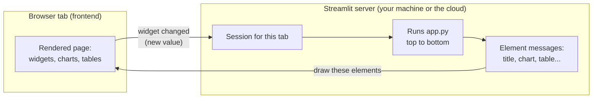
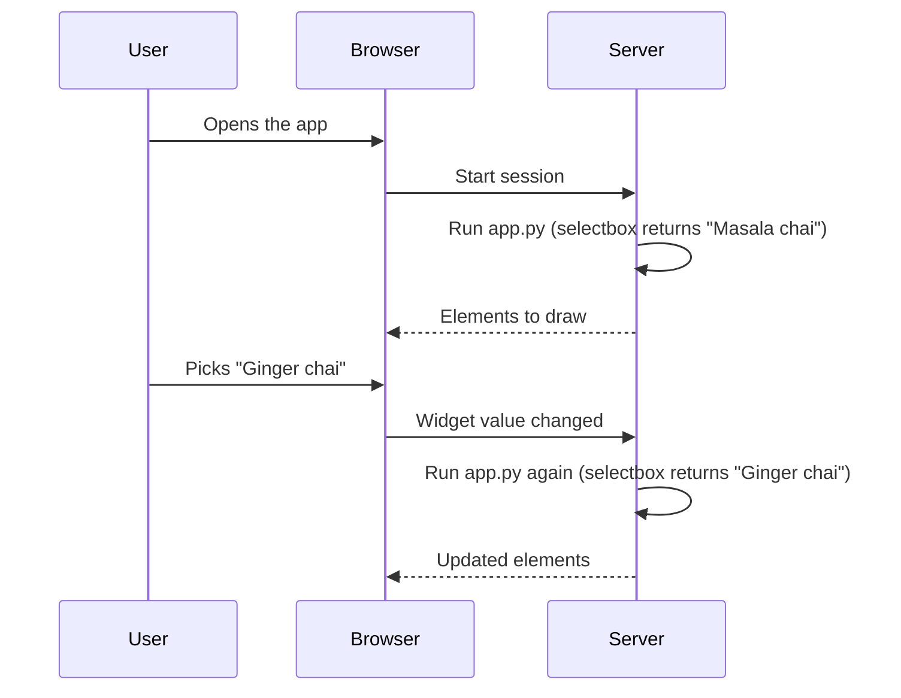

# What is Streamlit? The Complete Guide

> 📚 **Before you start**
>
> - [Functions and Iterators](../../python-fundamentals/course.md#m6) (Python Fundamentals), for functions and decorators-as-syntax
> - [pandas Core](../../numerical-computing-and-data-analysis/course.md#m3) (Numerical Computing and Data Analysis), for DataFrames

## Introduction

Think of a chai stall's handwritten price board. Each morning the owner rewrites it from top to bottom: the date, the menu, today's special, the prices. If a customer asks "what if I add ginger?", the owner doesn't patch one line; they recompute the bill from the start with the new choice. It's simple, it never gets out of sync, and nobody needs to remember what was written before.

Streamlit works the same way. Your app is a Python script. When a user opens it or changes anything (a dropdown, a slider, a button), Streamlit **runs the whole script again from the top**, with the widget returning its new value, and redraws the page from what the script produced. There are no callbacks to wire up, no HTML templates, no JavaScript. You write Python in the order you want things to appear on the page.

By the end of this article you will understand what Streamlit is and where it fits, write and run your first app, explain the client-server architecture and the rerun model, know the main display commands, use caching to stop expensive work repeating on every rerun, and know how an app is structured, configured and deployed.

> 💡 **Key Insight**
>
> In Streamlit, **the script is the page**. Every interaction reruns the script top to bottom, and whatever it draws this time *is* the new page. Variables don't survive between reruns unless you deliberately keep them (caching for data, session state for user state).

---

## Core Explanation

### 1. What Streamlit is, and where it fits

**Streamlit** is an open-source Python framework for building interactive web apps for data and AI. It was created in 2019 and later acquired by Snowflake; it remains open source under the Apache 2.0 licence.

You'd normally choose between these options to share a data tool:

| Option | You write | Good for | Cost |
|---|---|---|---|
| Notebook (Jupyter) | Python | Exploring, explaining to technical readers | Readers need Python; not an app |
| Web framework + frontend (FastAPI or Flask + React) | Python **and** JavaScript, HTML, CSS | Public products with custom design | Days to weeks of work |
| Dashboard tools (Power BI, Tableau) | Clicks, some formulas | Standard business dashboards | Limited custom logic, licences |
| **Streamlit** | Python | Data dashboards, internal tools, model and LLM demos | Less control over exact layout and page flow |
| Gradio | Python | Quick demos around one ML model function | Less suited to multi-part dashboards |
| Dash | Python with explicit callbacks | Complex dashboards with fine control | More code per feature |

Streamlit's bet is that for most data tools, **speed of building beats pixel-perfect control**.

### 2. Your first app

Install Streamlit in a virtual environment first. It needs Python 3.10 or newer:

```bash
python -m pip install streamlit pandas numpy
streamlit hello
streamlit version
```

Example output:

```
Streamlit, version 1.65.0
```

`streamlit hello` opens a demo app in your browser, which proves the install works. These lessons were written against **Streamlit 1.65** (October 2026). Streamlit releases every few weeks and rarely breaks older code, but if an argument isn't recognised, upgrade with `python -m pip install --upgrade streamlit`.

**How code is shown in these lessons.** Blocks that start with `# not-run: Streamlit app...` are app files: save them and launch them with `streamlit run`. Other Python blocks contain plain logic (loading, filtering, state updates) with no `st.` calls; they run as ordinary Python and show their real output. Good Streamlit apps are built the same way: testable functions underneath, a thin Streamlit layer on top.

Now create a file called `app.py`:

```python
# not-run: Streamlit app, run with: streamlit run app.py
import pandas as pd
import streamlit as st

st.title("Chai stall sales")
st.write("Cups sold per day last week. Pick a drink to see its numbers.")

sales = pd.DataFrame({
    "day": ["Mon", "Tue", "Wed", "Thu", "Fri", "Sat", "Sun"],
    "Masala chai": [120, 135, 128, 150, 190, 240, 210],
    "Ginger chai": [80, 76, 90, 95, 110, 150, 140],
})

drink = st.selectbox("Drink", ["Masala chai", "Ginger chai"])
st.metric("Total cups this week", int(sales[drink].sum()))
st.bar_chart(sales, x="day", y=drink)
st.dataframe(sales)
```

Run it from a terminal in the same folder:

```bash
streamlit run app.py
```

Example output:

```
  You can now view your Streamlit app in your browser.

  Local URL: http://localhost:8501
  Network URL: http://192.168.1.7:8501
```

Your browser opens at `http://localhost:8501` with a title, a dropdown, a big number, a bar chart and a table. Pick "Ginger chai" and the number and the chart change.

A few things to notice:

- **`st.selectbox` returns a value.** On the first run it returns the first option. When the user picks something else, the script reruns and `st.selectbox` returns the new choice. That's the whole interaction model.
- **Things appear in the order they're called.** The script's order is the page's order.
- **`python -m streamlit run app.py`** is equivalent to `streamlit run app.py`, and useful when your editor or IDE needs a Python module to launch.
- **Port 8501** is the default. Pass `--server.port 8600` to use another. The Network URL works for other devices on your Wi-Fi.
- **Stop the server** with Ctrl+C in the terminal.
- **Edit and save** `app.py` while it runs: the page offers "Rerun" or "Always rerun".

### 3. The architecture: a Python server and a browser page



*Each browser tab gets its own session on the server. Widget changes go up; the elements produced by the rerun come back down over a WebSocket connection.*

- **Your Python code runs on the server**, never in the user's browser. That's why it can read files, query databases and call APIs with secret keys the user never sees.
- **Each browser tab is a separate session.** Two colleagues using the app at once each get their own rerun of the script, with their own widget values.
- **The browser and server talk over a WebSocket**, a long-lived two-way connection, so updates arrive as soon as the script produces them, even in the middle of a run.
- Since version 1.57, the server runs on **Starlette and Uvicorn**, standard Python web components, which also makes it possible to embed a Streamlit app in other Python web servers through `st.App`. You don't need that for this course.

### 4. The rerun model, step by step

A Streamlit script runs:

1. **When a session starts** (someone opens the page).
2. **When a widget's value changes** (or a button is clicked).
3. **When you save the source file** (if you chose "Always rerun").
4. **When code asks for it**, with `st.rerun()`.

Each time, Python executes the file top to bottom in a fresh namespace. Widgets return their current values. Elements you draw replace the previous run's elements. Then the script finishes and waits.



You can simulate this in plain Python to see what it implies. Think of `run_script` as "the whole app file", and the loop as three user interactions:

```python
script_runs = 0
expensive_loads = 0

def load_sales_from_disk():
    global expensive_loads
    expensive_loads += 1                     # pretend this takes 5 seconds
    return {"Masala chai": 1173, "Ginger chai": 741}

def run_script(selected_drink):
    """Stands in for app.py: everything at the top level runs on every rerun."""
    global script_runs
    script_runs += 1
    clicks = 0                               # a normal variable: reset every run
    clicks += 1
    sales = load_sales_from_disk()
    return f"{selected_drink}: {sales[selected_drink]} cups (clicks={clicks})"

for choice in ["Masala chai", "Ginger chai", "Masala chai"]:
    print(run_script(choice))
print("script runs:", script_runs, "| expensive loads:", expensive_loads)
```

Output:

```
Masala chai: 1173 cups (clicks=1)
Ginger chai: 741 cups (clicks=1)
Masala chai: 1173 cups (clicks=1)
script runs: 3 | expensive loads: 3
```

Two consequences jump out, and they shape everything that follows:

- **Normal variables reset on every run.** `clicks` is always 1. To remember things between reruns (a counter, a chat history, a logged-in user), you need **session state**, covered in [Session State](../03-state-and-responsiveness/session-state.md).
- **Expensive work repeats on every run.** Loading the data three times for three clicks is wasteful. That's what **caching** fixes, in section 6.

### 5. Showing things: the display commands

#### `st.write` and "magic"

`st.write` is the Swiss Army knife: give it text (rendered as Markdown), numbers, DataFrames, dictionaries, charts or exceptions, and it picks a sensible display. Streamlit also has **magic**: a bare value or variable on its own line is written to the page as if you'd called `st.write`.

```python
# not-run: Streamlit app fragment
import pandas as pd
import streamlit as st

st.write("Hello, **Mumbai**! Today's special is *ginger chai*.")
st.write({"city": "Mumbai", "stalls": 4})
df = pd.DataFrame({"stall": ["Dadar", "Andheri"], "cups": [240, 310]})
df                        # magic: shown as a table
"Totals update hourly."   # magic: shown as text
```

Explicit commands give you more control. The ones you'll use most:

| Kind | Commands |
|---|---|
| Text | `st.title`, `st.header`, `st.subheader`, `st.markdown`, `st.caption`, `st.code`, `st.latex`, `st.divider` |
| Data | `st.dataframe` (interactive: sort, search, resize), `st.table` (static), `st.metric` (big number with change), `st.json` |
| Built-in charts | `st.line_chart`, `st.bar_chart`, `st.area_chart`, `st.scatter_chart`, `st.map` |
| Other charts | `st.pyplot(fig)` for Matplotlib or Seaborn, `st.altair_chart`, `st.plotly_chart`, `st.vega_lite_chart` |
| Media | `st.image`, `st.audio`, `st.video`, `st.pdf` |
| Messages | `st.success`, `st.info`, `st.warning`, `st.error`, `st.exception`, `st.toast` |

`st.markdown` supports normal Markdown plus extras such as coloured text (`:blue[text]`), emoji shortcodes and Material icons (`:material/check:`).

#### Matplotlib and Seaborn charts

Every Matplotlib or Seaborn chart, such as those in [Creating and Customising Plots](../../data-visualization-with-matplotlib-and-seaborn/02-matplotlib/creating-and-customising-plots.md), works in Streamlit. Build the figure as usual and pass it to `st.pyplot`:

```python
# not-run: Streamlit app fragment
import matplotlib.pyplot as plt
import seaborn as sns
import streamlit as st

fig, ax = plt.subplots(figsize=(7, 3.5))
sns.barplot(data=df, x="stall", y="cups", ax=ax)
ax.set_title("Cups per stall")
st.pyplot(fig)
plt.close(fig)
```

Always pass the figure explicitly; calling `st.pyplot()` with no figure is no longer supported. Close the figure afterwards, because a long-running server would otherwise accumulate figures from every rerun. The built-in charts (`st.bar_chart` and friends) are interactive (hover, zoom) and need no extra code, so prefer them for quick views.

### 6. Caching: stop repeating expensive work

Because the script reruns on every click, any slow step (reading a large CSV, querying a database, loading a machine learning model) would run on every click. **Caching** stores a function's result and returns it instantly the next time the function is called with the same arguments.

Streamlit has two decorators:

| | `@st.cache_data` | `@st.cache_resource` |
|---|---|---|
| For | **Data**: DataFrames, lists, dicts, API responses, computed results | **Resources**: database connections, ML models, LLM clients |
| Returns | A **fresh copy** each call (safe to modify) | The **same object** each call, shared by all users and sessions |
| Must be | Serialisable (picklable) | Thread-safe, because sessions share it |
| Typical example | `load_csv(path)` | `get_db_connection()`, `load_model()` |

```python
# not-run: Streamlit app, run with: streamlit run app.py
import pandas as pd
import streamlit as st

@st.cache_data(ttl="1h", show_spinner="Loading sales...")
def load_sales(path: str) -> pd.DataFrame:
    return pd.read_csv(path, parse_dates=["date"])

@st.cache_resource
def get_model():
    import joblib
    return joblib.load("demand_model.joblib")

sales = load_sales("sales.csv")          # slow the first time, instant after
model = get_model()                      # loaded once for the whole server
```

How the cache decides whether it has a stored answer:

- **The cache key is the function plus its argument values.** `load_sales("sales.csv")` and `load_sales("returns.csv")` are cached separately. Streamlit also notices when you edit the function's code and recomputes.
- **Arguments must be hashable by Streamlit.** If an argument can't be hashed (a database connection, say), prefix its name with an underscore, as in `def run_query(_conn, sql)`, and Streamlit leaves it out of the key.
- **`ttl`** (time to live) expires entries after a duration, such as `ttl=600` (seconds) or `ttl="1h"`, so data refreshes. **`max_entries`** caps the number of stored results.
- **`load_sales.clear()`** empties one function's cache; `st.cache_data.clear()` empties all data caches.
- **`st.cache_data` returns copies**, so one user sorting their DataFrame in place can't affect another user. **`st.cache_resource` returns the same object to everyone**, so never store per-user information in it.
- Both work with `async def` functions since version 1.64; you'll meet that in [async and await in Streamlit](../03-state-and-responsiveness/async-and-await-in-streamlit.md).

The rule of thumb: **if you'd be happy for every user to share it and it's slow to create, cache it.** Use `cache_data` unless the object is a connection, client or model.

The idea is the same as Python's own memoisation, which you can run without Streamlit. Here's the simulation from section 4 with a cache added:

```python
from functools import cache

expensive_loads = 0

@cache
def load_sales_cached(path):
    global expensive_loads
    expensive_loads += 1
    return {"Masala chai": 1173, "Ginger chai": 741}

for choice in ["Masala chai", "Ginger chai", "Masala chai"]:
    sales = load_sales_cached("sales.csv")
    print(choice, sales[choice])
print("expensive loads:", expensive_loads)
print(load_sales_cached.cache_info())
```

Output:

```
Masala chai 1173
Ginger chai 741
Masala chai 1173
expensive loads: 1
CacheInfo(hits=2, misses=1, maxsize=None, currsize=1)
```

One real load, two cache hits. Streamlit's decorators add what `functools.cache` lacks for web apps: expiry with `ttl`, copies for safety, sharing across sessions, spinners, and awareness of code changes.

### 7. Structure of a Streamlit project

```
chai-dashboard/
├── app.py                  # the Streamlit script (thin: layout and widgets)
├── logic.py                # plain functions: loading, filtering, calculations
├── requirements.txt        # streamlit, pandas, ... for deployment
├── data/sales.csv
└── .streamlit/
    ├── config.toml         # theme, server settings
    └── secrets.toml        # API keys and passwords (never commit this)
```

**Configuration** goes in `.streamlit/config.toml`. For example, to set a theme:

```toml
[theme]
base = "light"
primaryColor = "#1F4E8C"
```

**Secrets** go in `.streamlit/secrets.toml` and are read with `st.secrets`:

```toml
DB_PASSWORD = "change-me"

[openweather]
api_key = "..."
```

```python
# not-run: Streamlit app fragment
import streamlit as st

password = st.secrets["DB_PASSWORD"]
weather_key = st.secrets["openweather"]["api_key"]
```

Add `secrets.toml` to `.gitignore`. When you deploy, you paste the same values into the hosting platform's secrets settings.

**Page settings** such as the browser-tab title and a wide layout are set with `st.set_page_config(page_title="Chai dashboard", page_icon="☕", layout="wide")`, usually as the first Streamlit call.

**Multipage apps** list their pages with `st.navigation` and `st.Page`:

```python
# not-run: Streamlit app, run with: streamlit run app.py
import streamlit as st

pages = st.navigation([
    st.Page("overview.py", title="Overview", icon=":material/dashboard:"),
    st.Page("outlets.py", title="Outlets", icon=":material/store:"),
])
pages.run()
```

### 8. Sharing your app

- **Streamlit Community Cloud** (free for public apps): push your project to GitHub, sign in at share.streamlit.io, pick the repository and `app.py`, and paste your secrets into the app settings. Every push redeploys.
- **Snowflake**: Streamlit apps can run inside Snowflake next to the data.
- **Anywhere Python runs**: a virtual machine, a container (Docker) on a cloud service, or an internal server. Run `streamlit run app.py --server.port 80` (or behind a reverse proxy) and make sure the platform supports WebSockets.

Remember that every visitor runs your script on *your* server. Expensive calls (LLM APIs, big queries) cost you per visitor, which is another reason to cache.

### 9. When not to use Streamlit

- **Large public products** with many pages, complex navigation, accounts and custom design: a full web framework gives more control.
- **High-traffic sites**: each session runs Python on the server; it scales, but needs planning.
- **Pixel-exact layouts**: Streamlit's layout system is deliberately simple.
- **Offline mobile apps**: Streamlit apps are web pages served by a running Python server.

For dashboards, internal tools, prototypes and AI demos, it's usually the fastest good option.

---

## Try It Yourself

1. **Add a slider.** In the first app, add `min_cups = st.slider("Only days with at least", 0, 250, 100)` and show only the rows where the selected drink is at least `min_cups`. What happens to the page when you drag the slider?
2. **Find the rerun.** Add `st.write("Script ran at", pd.Timestamp.now())` at the bottom of the first app. When does the time change?
3. **Cache key.** Using the `functools.cache` simulation, call `load_sales_cached("returns.csv")` once. What is `expensive_loads` now, and why?
4. **Pick the decorator.** For each, `cache_data` or `cache_resource`: (a) a function returning a DataFrame from an API, (b) a function returning a SQLAlchemy engine, (c) a function returning a loaded scikit-learn model, (d) a function computing monthly totals from a DataFrame.

<details>
<summary>Show answers</summary>

```python
load_sales_cached("returns.csv")
print("expensive loads:", expensive_loads)
```

Output:

```
expensive loads: 2
```

1. The script reruns on every slider movement (when you release it), and the table and chart redraw with the filtered rows. Code: `filtered = sales[sales[drink] >= min_cups]`, then use `filtered` in the chart and table.
2. Every time you interact with any widget, and every time the file is saved with "Always rerun". The timestamp is a simple way to see reruns happen.
3. Two. A different argument is a different cache key, so the function runs again.
4. (a) `cache_data`. (b) `cache_resource` (a connection pool shared by everyone). (c) `cache_resource` (a big object that should be loaded once, and isn't modified). (d) `cache_data`.

</details>

---

## Real-World Examples

### Example 1: An analyst's weekly report becomes a tool

A sales analyst used to send the same pandas-generated report every Monday, then answer follow-up questions all week. They wrap the notebook logic in a Streamlit app with a region filter and a date range, and the questions stop because managers explore themselves.

### Example 2: Model demos

A data science team trains a model to predict delivery delays. Instead of a slide of accuracy numbers, they show a Streamlit app where operations staff enter an order's details and see the prediction and the factors behind it. Feedback on the model arrives in days instead of months.

### Example 3: LLM prototypes

A team testing a customer-support assistant builds a chat interface in Streamlit in an afternoon, with a sidebar to switch prompts and models. Support agents try it with real questions before any engineering work begins on the production version.

---

## Common Misconceptions

### Misconception 1: "Only the changed widget's code runs"

The **whole script** reruns. That's what keeps Streamlit simple, and it's why caching and session state exist. ([Fragments](../03-state-and-responsiveness/async-and-await-in-streamlit.md), let you rerun just part of a page when you need to.)

### Misconception 2: "Global variables keep their values between clicks"

Each rerun executes the script fresh. A counter at the top of the file starts from its initial value every time. Use `st.session_state` for values that must persist for a user.

### Misconception 3: "The code runs in the user's browser"

It runs on the server. The browser only shows the elements the server sends. That's why secrets stay safe and why your server pays for every user's computation.

### Misconception 4: "`st.cache_resource` is just a faster `st.cache_data`"

They do different jobs. `cache_resource` hands the *same* object to every user, which is right for connections and models but dangerous for data that someone might modify. `cache_data` returns a copy.

---

## Interview Relevance

Streamlit comes up in data science, ML engineering and AI engineering interviews, usually as "how would you demo this?" or in questions about an app on your CV:

- *"How does Streamlit work?"* A Python server runs your script per browser session and sends elements to the frontend over a WebSocket; every widget interaction reruns the script top to bottom.
- *"How do you make a Streamlit app fast?"* Cache slow, shareable work with `st.cache_data` (data) or `st.cache_resource` (connections, models); use fragments for parts that update often; avoid recomputing in loops.
- *"What's the difference between `cache_data` and `cache_resource`?"* Copies vs a shared singleton; serialisable data vs thread-safe resources.
- *"How do you keep secrets out of the code?"* `.streamlit/secrets.toml` locally (ignored by Git) and the hosting platform's secrets settings in production, read with `st.secrets`.
- *"When wouldn't you use Streamlit?"* Large public-facing products needing custom design and complex page flows.

---

## Key Takeaways

- **Streamlit turns a Python script into a web app**; run it with `streamlit run app.py`.
- **The script reruns top to bottom** on every interaction, in a session per browser tab, on the server.
- **Widgets are function calls that return the current value**, and the page is drawn in the order of your code.
- **`st.write` and magic** show almost anything; specific commands give control over text, data, charts and messages.
- **Cache slow, shareable work**: `st.cache_data` for data (copies), `st.cache_resource` for connections and models (shared).
- **Projects** have an `app.py`, logic modules, `requirements.txt`, and `.streamlit/` for config and secrets.

---

**Up next:** [Widgets and Layout](widgets-and-layout.md)
