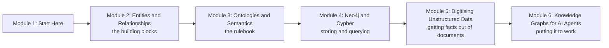

# How This Course Works

> 📚 **Before you start**
>
> - [Retrieval-Augmented Generation (RAG)](../../retrieval-augmented-generation-rag/course.md), because module 6 builds GraphRAG on top of ordinary RAG.
> - [LangGraph Fundamentals](../../langgraph-fundamentals/course.md), especially [Graphs, Nodes, Edges and State](../../langgraph-fundamentals/02-getting-started/graphs-nodes-edges-and-state.md), for building the agents in module 6.
> - Comfortable Python: dictionaries, sets, list comprehensions and classes. [Python Fundamentals](../../python-fundamentals/course.md) covers them.

## Introduction

Ask a normal RAG chatbot over your company's documents: *"Which of our suppliers in Gujarat also supply our biggest competitor's distributor?"* It will search for chunks of text that look similar to the question, find a few paragraphs about Gujarat and a few about suppliers, and then guess. The answer needs **connections**: supplier to state, supplier to distributor, distributor to competitor. Those connections are scattered across hundreds of invoices, emails and contracts, and no single chunk of text holds them.

A **knowledge graph** holds exactly those connections. It stores the world as **things** (a supplier, a city, an order) and **links between things** (*supplies*, *located in*, *placed by*). A question like the one above becomes a walk along the links. An **ontology** is the rulebook that says which kinds of things and links are allowed, so that everyone (people, databases and AI agents) means the same thing by "supplier" or "order".

The catch is that most business knowledge doesn't arrive as neat links. It arrives as **unstructured data**: scanned invoices, PDFs, emails and chat messages. So this course also teaches you how to turn that mess into clean, structured records first.

This page tells you what you'll learn, the examples we'll use throughout, and how the lessons are built.

> 💡 **Key Insight**
>
> Vector search finds text that **sounds like** your question. A knowledge graph finds facts that are **connected to** your question. Agents get much better at multi-step, factual questions when they have both, and when an ontology keeps the graph consistent.

---

## What You Will Learn


*The whole course on one page. Each module adds one layer.*

By the end of the course you will be able to:

- **Model any domain as entities, relationships and properties**, and explain when a graph beats a table or a vector store.
- **Read and write an ontology.** You will see real ones in Turtle syntax and as drawn pictures, not just definitions, and design one yourself for an online shop.
- **Use Neo4j and Cypher** to create, query and analyse a property graph, and know how SPARQL and RDF triple stores differ.
- **Digitise unstructured documents**: OCR, layout and table extraction, LLM-based entity extraction, schema-guided extraction with Pydantic, and entity resolution.
- **Build knowledge graphs for agents**: graph construction with an LLM, GraphRAG, hybrid graph plus vector retrieval, text-to-Cypher agents and ontology-grounded agents.

### The course at a glance



---

## The Three Running Examples

Instead of new toy data in every lesson, three examples grow with you through the course. You'll recognise them immediately when they come back.

| Example | What it is | Where it appears |
|---|---|---|
| **Chai Bazaar** | A small online shop in India selling tea, spices and kulhad cups. Customers in Pune and Bengaluru, orders, products, sellers and categories. | Modules 2 and 3: entities, the ontology worked example and the ontology lab |
| **Kiran Foods** | A mid-sized food company: employees, departments, projects, suppliers and cities. | Module 4: Neo4j, Cypher, graph algorithms and the company-graph lab |
| **The invoice pile** | Supplier invoices as messy text: different layouts, misspelt names, amounts written as "Rs. 1,180.00" or "₹1180". | Module 5: OCR, extraction, Pydantic and entity resolution, then module 6's GraphRAG agent |

Here is a peek at the kind of artefact you'll be reading by the end of module 3. It is a tiny piece of the Chai Bazaar ontology written in **Turtle**, a text format for knowledge graphs:

```turtle
@prefix shop: <https://chaibazaar.example/ontology#> .
@prefix rdfs: <http://www.w3.org/2000/01/rdf-schema#> .
@prefix owl:  <http://www.w3.org/2002/07/owl#> .

shop:Tea      a owl:Class ; rdfs:subClassOf shop:Product .
shop:placedBy a owl:ObjectProperty ;
              rdfs:domain shop:Order ;
              rdfs:range  shop:Customer .
```

In plain English: *"Tea is a kind of Product. `placedBy` is a relationship that goes from an Order to a Customer."* If that looks strange right now, good. Module 3 explains every symbol, line by line.

---

## How Every Lesson Is Built

| Section | What it gives you |
|---|---|
| **Before you start** | Links to the earlier lessons this one depends on. |
| **Introduction** | Why the topic matters, with an everyday example. |
| **Key Insight** | The one idea to remember. |
| **Core Explanation** | Step by step, with the real artefact first (a Turtle file, a Cypher query and its result table, a JSON record), then the general idea. Diagrams and runnable code throughout. |
| **Try It Yourself** | Exercises with answers hidden in a fold. |
| **Real-World Examples** | Where companies use the idea. |
| **Common Misconceptions** | The mistakes almost everyone makes. |
| **Interview Relevance** | What interviewers ask and what a strong answer covers. |
| **Key Takeaways** | A one-minute summary. |

**Labs** are guided builds: an ontology for the online shop, a company graph in Neo4j, an invoice digitiser and a GraphRAG agent.

---

## The Code in This Course

Every Python example on the site is run automatically, and the output you see printed under it is the real output. To make that possible without installing a database, the runnable code uses:

- **Plain Python sets and dictionaries** to hold triples and graphs, so you can see exactly what a graph store does inside.
- **`sqlite3`** (part of Python) when a comparison with a relational database helps.
- **Pydantic** for schemas and validation, and **NumPy/SciPy** for graph algorithms.
- A **pretend LLM** (LangChain's `FakeListChatModel`) wherever a real model would be called, so lessons run offline.

Neo4j, Cypher, SPARQL and real LLM calls are shown with the exact current syntax in blocks marked `# not-run` (or as Cypher/SPARQL code), followed by an **Example output** that shows what you'll see when you run them yourself.

### Do I need Neo4j installed?

Not to follow the lessons. To run the Cypher yourself, the easiest options are **Neo4j Desktop** on your laptop, the official **Docker image** (`docker run -p 7474:7474 -p 7687:7687 neo4j`), or a free **Neo4j AuraDB** cloud instance. The Neo4j lessons in module 4 show the setup.

---

## How to Get the Most Out of It

1. **Draw the graph.** Whenever a lesson shows triples or a Cypher pattern, sketch the circles and arrows on paper. Graph thinking is visual.
2. **Predict before you run.** Say what a query will return before you look at the output.
3. **Do the labs.** The ontology lab and the invoice lab are where the ideas join up.
4. **Keep your own domain in mind.** Every time you see the tea shop, ask: what would the entities and relationships be in my work?

---

## Common Misconceptions

### "Knowledge graphs are an old academic idea that LLMs replaced"

LLMs made knowledge graphs *more* useful, not less. LLMs can now build graphs from text cheaply, and graphs give LLMs facts they can trust and connections they can follow. GraphRAG, covered in module 6, is one of the most active areas in applied AI.

### "An ontology is just a fancy word for a database schema"

A schema describes how data is stored. An ontology describes what things **mean** and how they relate, in a way that both software and people can share and reason over. Module 3 shows the difference with side-by-side examples.

### "You need a graph database to work with graphs"

A graph is just nodes and edges. You can hold one in a Python dictionary, which is exactly what we do first. A graph database like Neo4j becomes worth it when the graph is large, shared or queried in complex ways.

---

## Key Takeaways

- **Knowledge graphs store connections**, which is what multi-step factual questions need.
- **Ontologies are the shared rulebook** that keeps a graph consistent and meaningful.
- **Most knowledge starts unstructured**, so digitising documents is half the job.
- **Three running examples** (Chai Bazaar, Kiran Foods, the invoice pile) carry through the course.
- **Runnable code uses plain Python**; Neo4j and LLM calls are shown with real syntax and example output.

---

**Up next:** [Entities, Relationships and Properties](../02-entities-and-relationships/entities-relationships-and-properties.md)
