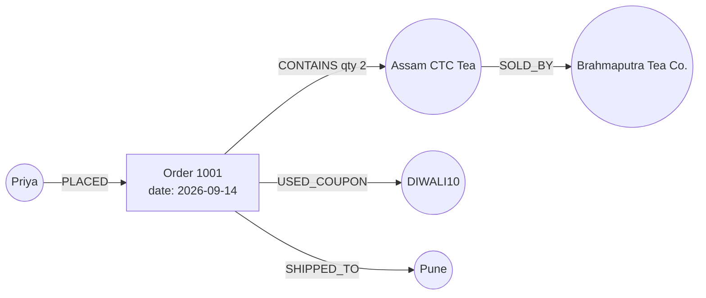
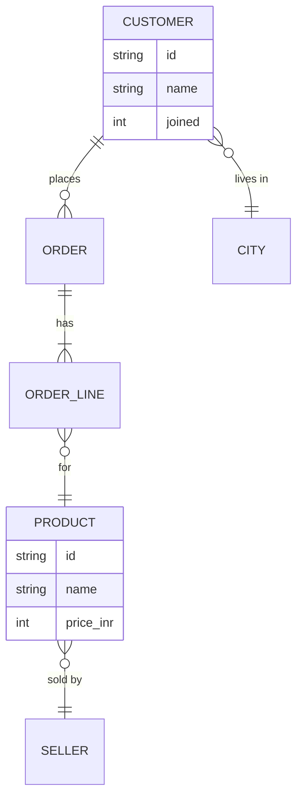

# Entities, Relationships and Properties: The Complete Guide

> 📚 **Before you start**
>
> - [How This Course Works](../01-start-here/how-this-course-works.md), for the running examples.
> - Python dictionaries, sets and tuples. [Python Programming › Strings and Data Structures](../../python-programming/course.md#m5) covers them.

## Introduction

Read this message from a small online tea shop's order log:

> *"Priya from Pune ordered 2 packs of Assam CTC Tea (₹240 each) on 14 September. The tea is sold by Brahmaputra Tea Co."*

You understood it instantly. A computer sees one string of 120 characters. To let software answer questions like *"Which sellers do customers in Pune buy from?"* we have to pull that sentence apart into pieces a machine can store and connect. Every knowledge graph, every ontology and every graph database in this course is built from just three kinds of piece:

- **Entities**: the *things* (Priya, Pune, the order, the tea, the seller).
- **Relationships**: how things are *connected* (Priya *placed* the order; the order *contains* the tea).
- **Properties**: *details* about a single thing or connection (the tea costs ₹240; the order contains *2* packs).

By the end of this lesson you'll be able to take any paragraph and break it into entities, relationships and properties, decide when a detail should be a property and when it deserves to be its own entity, handle "awkward" facts that involve more than two things, and hold the result in plain Python.

> 💡 **Key Insight**
>
> **Nouns become entities, verbs become relationships, and adjectives and numbers become properties.** Most modelling mistakes come from putting a fact in the wrong one of those three buckets.

---

## Core Explanation

### 1. The three building blocks in one picture


*The tea-shop sentence, taken apart. Every arrow reads as a short sentence.*

Here is the sentence from the introduction split into its pieces:

| Piece of the sentence | Bucket | Why |
|---|---|---|
| Priya | Entity | A thing you can point at and give an ID |
| Pune | Entity | A place other things connect to |
| the order | Entity | It has its own date and total, and other things point at it |
| Assam CTC Tea | Entity | A product many orders can contain |
| Brahmaputra Tea Co. | Entity | A seller many products connect to |
| ordered (Priya → order) | Relationship | Connects a customer to an order |
| contains (order → tea) | Relationship | Connects an order to a product |
| sold by (tea → seller) | Relationship | Connects a product to a seller |
| ₹240 | Property of the tea | A detail of one thing |
| 2 packs | Property of the *contains* relationship | It describes the connection, not the tea and not the order |
| 14 September | Property of the order | A detail of the order |

### 2. Entities: things with an identity

An **entity** is anything you want to say things about and can tell apart from everything else. People, companies, cities, products, orders, invoices, meetings, even abstract things like "the Diwali 2026 sale" are all entities.

Three ideas make an entity useful in software:

1. **Identity.** Every entity needs a stable ID. "Priya" is not enough: there may be three Priyas. A customer ID like `C-17` is. Names are properties; IDs are identity.
2. **Type (also called label or class).** Priya is a *Customer*; Pune is a *City*. The type tells you which properties and relationships to expect.
3. **Instance vs type.** "Customer" is the *type*; Priya is an *instance* of it. In graph databases the type is usually a **label** on the node. In ontologies (module 3) it's called a **class**.

### 3. Relationships: connections with a direction and a name

A **relationship** (also called an **edge**, **link** or, in RDF, a **predicate**) connects exactly two entities. It has:

- **A type name**, usually a verb: `PLACED`, `CONTAINS`, `LIVES_IN`, `SOLD_BY`. Graph databases conventionally write these in upper snake case.
- **A direction**, from a *source* to a *target*. `Priya -PLACED-> Order 1001` is not the same as `Order 1001 -PLACED-> Priya`. Pick the direction that reads naturally as a sentence.
- **Optional properties**, such as `qty: 2` on `CONTAINS` or `since: 2023` on `WORKS_AT`.

Relationships also have a **cardinality**: how many of one side can connect to the other.

| Cardinality | Tea-shop example | What it means |
|---|---|---|
| One-to-one | Customer → loyalty card | Each customer has at most one card, each card belongs to one customer |
| One-to-many | Customer → orders | One customer places many orders; each order has exactly one customer |
| Many-to-many | Orders ↔ products | An order contains many products; a product appears in many orders |

In a relational database, a many-to-many relationship needs an extra "join table". In a graph it's just more edges. That difference is a big reason graphs feel natural for connected data, and you'll measure it in [Knowledge Graphs vs Relational Databases vs Vector Stores](knowledge-graphs-vs-relational-databases-vs-vector-stores.md).

### 4. Properties: details as key and value

A **property** (or **attribute**) is a key and a value attached to an entity or a relationship: `price: 240`, `currency: "INR"`, `date: "2026-09-14"`. Values are simple data: text, numbers, dates, true/false, sometimes lists.

The test for "is this a property?" is: **does anything else ever need to connect to it, or does it have details of its own?** If not, it's a property.

### 5. Holding it all in plain Python

Before any database, let's store the tea-shop facts in ordinary Python structures. Nodes are a dictionary from ID to details; edges are a list of (source, type, target, properties).

```python
nodes = {
    "C-17":  {"label": "Customer", "name": "Priya Nair", "joined": 2023},
    "PUNE":  {"label": "City", "name": "Pune", "state": "Maharashtra"},
    "O-1001": {"label": "Order", "date": "2026-09-14", "total_inr": 480},
    "P-ASSAM": {"label": "Product", "name": "Assam CTC Tea", "price_inr": 240, "weight_g": 250},
    "S-BRAHM": {"label": "Seller", "name": "Brahmaputra Tea Co."},
}

edges = [
    ("C-17", "LIVES_IN", "PUNE", {}),
    ("C-17", "PLACED", "O-1001", {}),
    ("O-1001", "CONTAINS", "P-ASSAM", {"qty": 2}),
    ("P-ASSAM", "SOLD_BY", "S-BRAHM", {}),
]

def show(node_id):
    n = nodes[node_id]
    return n.get("name", node_id)

for src, rel, dst, props in edges:
    extra = f" {props}" if props else ""
    print(f"({show(src)}) -[{rel}{extra}]-> ({show(dst)})")
```

Output:

```
(Priya Nair) -[LIVES_IN]-> (Pune)
(Priya Nair) -[PLACED]-> (O-1001)
(O-1001) -[CONTAINS {'qty': 2}]-> (Assam CTC Tea)
(Assam CTC Tea) -[SOLD_BY]-> (Brahmaputra Tea Co.)
```

That printed form, `(node)-[RELATIONSHIP]->(node)`, is not an accident. It is very close to how you'll write patterns in Cypher, Neo4j's query language, in module 4.

Now a question that needs connections: *"Which sellers does Priya buy from?"* We walk from Priya along `PLACED`, then `CONTAINS`, then `SOLD_BY`.

```python
def neighbours(node_id, rel):
    return [dst for src, r, dst, _ in edges if src == node_id and r == rel]

sellers = set()
for order in neighbours("C-17", "PLACED"):
    for product in neighbours(order, "CONTAINS"):
        for seller in neighbours(product, "SOLD_BY"):
            sellers.add(show(seller))
print("Priya buys from:", sorted(sellers))
```

Output:

```
Priya buys from: ['Brahmaputra Tea Co.']
```

Each hop is one step along an edge. That's the core operation of every graph system: **traversal**.

### 6. Another way to write the same facts: triples

There is an even simpler shape: break *everything*, including properties, into three-part statements called **triples**: *(subject, predicate, object)*.

```python
triples = set()
for node_id, props in nodes.items():
    for key, value in props.items():
        triples.add((node_id, key, value))
for src, rel, dst, props in edges:
    triples.add((src, rel, dst))

print(len(triples), "triples, for example:")
for t in sorted(triples, key=str)[:6]:
    print("  ", t)
```

Output:

```
19 triples, for example:
   ('C-17', 'LIVES_IN', 'PUNE')
   ('C-17', 'PLACED', 'O-1001')
   ('C-17', 'joined', 2023)
   ('C-17', 'label', 'Customer')
   ('C-17', 'name', 'Priya Nair')
   ('O-1001', 'CONTAINS', 'P-ASSAM')
```

Notice what got lost: `qty: 2` lived on the `CONTAINS` edge, and a plain triple has nowhere to put it. That limitation is one of the main differences between **RDF triple stores** and **property graphs**, and you'll see both solutions in [What is a Knowledge Graph?](what-is-a-knowledge-graph.md) and [SPARQL and RDF Triple Stores](../course.md#m4).

### 7. The hardest decision: property or entity?

Should Priya's city be a property (`city: "Pune"`) or its own entity (`(Priya)-[:LIVES_IN]->(Pune)`)? Both are legal. The right answer depends on the questions you'll ask.

```python
# Model A: city as a property
customers_a = {"C-17": {"name": "Priya", "city": "Pune"},
               "C-21": {"name": "Arjun", "city": "Bengaluru"},
               "C-30": {"name": "Meera", "city": "pune"}}      # typed by hand, lowercase

# Model B: city as an entity that others link to
cities = {"PUNE": {"name": "Pune", "state": "Maharashtra", "warehouse": "Hadapsar"},
          "BLR": {"name": "Bengaluru", "state": "Karnataka", "warehouse": "Whitefield"}}
lives_in = {"C-17": "PUNE", "C-21": "BLR", "C-30": "PUNE"}

same_city_a = [c["name"] for c in customers_a.values() if c["city"] == "Pune"]
same_city_b = [customers_a[c]["name"] for c, city in lives_in.items() if city == "PUNE"]
print("Model A, customers in Pune:", same_city_a)
print("Model B, customers in Pune:", same_city_b)
print("Model B, Meera's warehouse:", cities[lives_in["C-30"]]["warehouse"])
```

Output:

```
Model A, customers in Pune: ['Priya']
Model B, customers in Pune: ['Priya', 'Meera']
Model B, Meera's warehouse: Hadapsar
```

Model A silently missed Meera because someone typed "pune". Model B can't make that mistake, because both customers point at the *same* entity, and the city can carry its own details (state, nearest warehouse) that every customer then shares. Use this checklist:

| Make it an **entity** when... | Keep it a **property** when... |
|---|---|
| Other things connect to it (many customers live in Pune) | Only this one thing uses it (a customer's phone number) |
| It has details of its own (the city's state, warehouse) | It's a plain value (a price, a date, a weight) |
| You'll ask questions *starting* from it ("everyone in Pune") | You only read it after finding the thing |
| It needs a consistent, shared spelling | Small spelling differences don't matter |

### 8. Facts about more than two things

Some facts involve three or more entities at once: *"Priya bought Assam tea from Brahmaputra Tea Co. using a Diwali coupon on 14 September."* A relationship only connects two things, so where does this go?

The answer is to **turn the event into an entity**. That's exactly why the *order* is an entity in our model. Modellers call this **reification**: making a node for something that is really a happening (an order, a payment, a meeting, a transfer).



Rule of thumb: **if you find yourself wanting a relationship that points at another relationship, make the middle thing an entity.**

### 9. The same model as an entity-relationship diagram

Database designers draw the *types* (not the individual records) as an entity-relationship (ER) diagram. It's a preview of the ontology you'll build in module 3:



The crow's-foot marks show cardinality: one customer places zero or more orders, and each order has one or more lines.

### 10. Naming conventions that save pain later

| Thing | Convention | Example |
|---|---|---|
| Entity type (label/class) | Singular, PascalCase | `Customer`, `OrderLine` |
| Relationship type | Verb phrase, UPPER_SNAKE (graphs) or camelCase (RDF) | `PLACED`, `SOLD_BY` / `placedBy` |
| Property key | camelCase or snake_case, with units | `price_inr`, `weight_g` |
| ID | Stable, never reused, never the display name | `C-17`, not `Priya` |

Putting the unit in the property name (`price_inr`, `weight_g`) prevents a whole class of bugs when data from different sources is mixed.

---

## Try It Yourself

1. **Decompose a sentence.** Break this into entities, relationships and properties: *"Arjun from Bengaluru gave the Darjeeling First Flush (₹650, 100 g) a 5-star review on 2 October."*
2. **Add it to the Python model** and print the edges again.
3. **Traverse.** Write a function `customers_of(seller_id)` that returns the names of customers who bought anything from a seller.

<details>
<summary>Show answers</summary>

**1.** Entities: Arjun (Customer), Bengaluru (City), Darjeeling First Flush (Product), and the review itself (Review, because it has its own rating and date and connects two things). Relationships: Arjun LIVES_IN Bengaluru, Arjun WROTE review, review ABOUT product. Properties: price ₹650 and weight 100 g on the product; rating 5 and date on the review.

**2.**

```python
nodes["C-21"] = {"label": "Customer", "name": "Arjun Rao", "joined": 2024}
nodes["BLR"] = {"label": "City", "name": "Bengaluru", "state": "Karnataka"}
nodes["P-DARJ"] = {"label": "Product", "name": "Darjeeling First Flush", "price_inr": 650, "weight_g": 100}
nodes["R-5"] = {"label": "Review", "rating": 5, "date": "2026-10-02"}
edges += [("C-21", "LIVES_IN", "BLR", {}), ("C-21", "WROTE", "R-5", {}),
          ("R-5", "ABOUT", "P-DARJ", {}), ("P-DARJ", "SOLD_BY", "S-BRAHM", {})]
for src, rel, dst, props in edges[-4:]:
    print(f"({show(src)}) -[{rel}]-> ({show(dst)})")
```

Output:

```
(Arjun Rao) -[LIVES_IN]-> (Bengaluru)
(Arjun Rao) -[WROTE]-> (R-5)
(R-5) -[ABOUT]-> (Darjeeling First Flush)
(Darjeeling First Flush) -[SOLD_BY]-> (Brahmaputra Tea Co.)
```

**3.** Walk the edges backwards: seller ← SOLD_BY ← product ← CONTAINS ← order ← PLACED ← customer.

```python
def incoming(node_id, rel):
    return [src for src, r, dst, _ in edges if dst == node_id and r == rel]

def customers_of(seller_id):
    names = set()
    for product in incoming(seller_id, "SOLD_BY"):
        for order in incoming(product, "CONTAINS"):
            for customer in incoming(order, "PLACED"):
                names.add(show(customer))
    return sorted(names)

print(customers_of("S-BRAHM"))
```

Output:

```
['Priya Nair']
```

Arjun reviewed a Brahmaputra tea but never ordered one, so he isn't a customer *of that seller*. The graph answers exactly the question asked, which is what you want.

</details>

---

## Real-World Examples

- **E-commerce catalogues** (Amazon, Flipkart) model products, brands, categories and sellers as entities so that "other products from this brand" or "sellers who ship to your pincode" are simple walks.
- **Banks** model accounts, people, devices and transactions as entities; a fraud ring shows up as many accounts connected to the same phone or device.
- **Wikidata**, the open knowledge base behind many Wikipedia infoboxes, stores over a hundred million items as entities with properties and relationships, each with a stable ID such as `Q1156` for Mumbai.

---

## Common Misconceptions

### "The name is the ID"

Names change, collide and get misspelt. Always give entities a stable ID and keep the name as a property. Module 5's entity resolution lesson is entirely about cleaning up after systems that forgot this.

### "Everything should be an entity"

Turning every price and date into a node makes the graph huge and slow, and adds nothing. Promote a value to an entity only when other things connect to it or it has details of its own.

### "Relationships can't have details"

In property graphs like Neo4j, relationships carry properties (`qty: 2`, `since: 2023`). In RDF you either reify the relationship into a node or use RDF-star style annotations. Either way, details about a *connection* belong on the connection.

### "Direction doesn't matter"

It matters for meaning (`PLACED` from customer to order) even though graph databases can traverse an edge in both directions. Pick the direction that reads as a natural sentence and stay consistent.

---

## Interview Relevance

*"How would you model X as a graph?"* is a common system-design and data-modelling question. A strong answer names the entities (with IDs and types), the relationships (with direction and cardinality), and the properties; explains why something is a node rather than a property (shared, has its own details, queried from); handles n-ary facts by turning events like orders or transactions into nodes; and puts properties on relationships when they describe the connection (quantity, start date, role).

---

## Key Takeaways

- **Entities are things with identity**: give them stable IDs and a type (label or class).
- **Relationships connect exactly two entities**, with a name, a direction and optional properties.
- **Properties are key-value details**; put units in the key.
- **Promote a value to an entity** when other things connect to it or it has details of its own.
- **Turn events into entities** (orders, payments, meetings) when a fact involves more than two things.

---

**Up next:** [What is a Knowledge Graph?](what-is-a-knowledge-graph.md)
