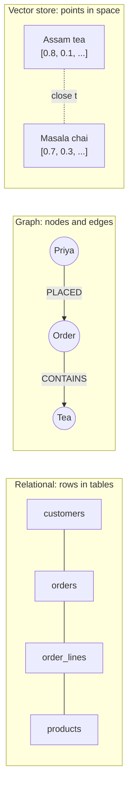
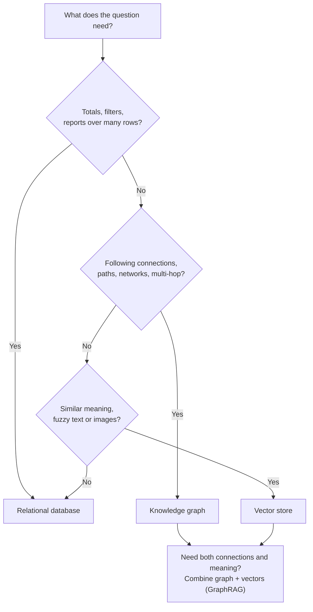

# Knowledge Graphs vs Relational Databases vs Vector Stores: The Complete Guide

> 📚 **Before you start**
>
> - [What is a Knowledge Graph?](what-is-a-knowledge-graph.md), for triples and pattern queries.
> - Basic SQL (SELECT, JOIN, GROUP BY). [Databases, SQL and NoSQL › Relational Databases and SQL](../../databases-sql-and-nosql/course.md#m2) covers it.
> - What an embedding is. [Vector Databases for AI › Introduction to Vector Databases](../../vector-databases-for-ai/course.md#m2) covers it.

## Introduction

Chai Bazaar's founder asks three questions on the same morning:

1. *"What was our total revenue from Pune last month?"*
2. *"Customers who bought Assam CTC Tea also bought what?"*
3. *"A customer typed 'something warming and spicy for the monsoon'. What should we show?"*

All three are about the same shop data. But each one is best answered by a different kind of database. The first is a **relational database** question (add up numbers across rows). The second is a **graph** question (follow connections: product → orders → customers → their other orders → products). The third is a **vector store** question (find products whose descriptions *mean* something similar, even with no shared words).

Teams building AI agents constantly ask "should we use a graph or a vector store?" The honest answer is that they solve different problems. By the end of this lesson you'll be able to run the same data through all three, see exactly where each one shines and struggles, and pick (or combine) them with confidence.

> 💡 **Key Insight**
>
> **Tables are best at counting, graphs are best at connecting, vectors are best at resembling.** Choose by the shape of your questions, not by fashion. Many real AI systems use two or all three.

---

## Core Explanation

### 1. One shop, three shapes of storage



| | Relational database | Knowledge graph / graph DB | Vector store |
|---|---|---|---|
| Stores | Rows with fixed columns in tables | Entities and typed relationships | Embedding vectors plus metadata |
| Connections | Foreign keys, resolved by JOIN at query time | Stored edges, followed directly | None (only "nearness") |
| Query language | SQL | Cypher, SPARQL, GQL | Nearest-neighbour search API |
| Answers best | Totals, filters, reports, transactions | Multi-hop paths, "how is X connected to Y", networks | "Find things similar to this text or image" |
| Exactness | Exact | Exact | Approximate, ranked by similarity |
| Schema | Strict, up front | Flexible, often guided by an ontology | Almost none |

Let's load the same small dataset into each and ask the founder's questions.

### 2. The relational version

```python
import sqlite3

db = sqlite3.connect(":memory:")
db.executescript("""
CREATE TABLE customers (id TEXT PRIMARY KEY, name TEXT, city TEXT);
CREATE TABLE products  (id TEXT PRIMARY KEY, name TEXT, price_inr INTEGER, description TEXT);
CREATE TABLE orders    (id TEXT PRIMARY KEY, customer_id TEXT REFERENCES customers(id), month TEXT);
CREATE TABLE order_lines (order_id TEXT REFERENCES orders(id), product_id TEXT REFERENCES products(id), qty INTEGER);
""")
db.executemany("INSERT INTO customers VALUES (?,?,?)", [
    ("C-17", "Priya", "Pune"), ("C-21", "Arjun", "Bengaluru"),
    ("C-30", "Meera", "Pune"), ("C-44", "Kabir", "Kolkata")])
db.executemany("INSERT INTO products VALUES (?,?,?,?)", [
    ("P-ASSAM", "Assam CTC Tea", 240, "strong malty black tea for a classic morning cup"),
    ("P-DARJ", "Darjeeling First Flush", 650, "light floral black tea from the hills"),
    ("P-MASALA", "Masala Chai Mix", 180, "warming spice blend of ginger cardamom and pepper"),
    ("P-KULHAD", "Kulhad Cups (set of 6)", 300, "clay cups that give chai an earthy aroma"),
    ("P-GINGER", "Dry Ginger Powder", 120, "spicy warming ginger for winter and rainy days")])
db.executemany("INSERT INTO orders VALUES (?,?,?)", [
    ("O-1", "C-17", "2026-09"), ("O-2", "C-21", "2026-09"),
    ("O-3", "C-30", "2026-09"), ("O-4", "C-44", "2026-08")])
db.executemany("INSERT INTO order_lines VALUES (?,?,?)", [
    ("O-1", "P-ASSAM", 2), ("O-1", "P-KULHAD", 1),
    ("O-2", "P-ASSAM", 1), ("O-2", "P-MASALA", 2),
    ("O-3", "P-DARJ", 1), ("O-4", "P-ASSAM", 1), ("O-4", "P-GINGER", 3)])

# Question 1: revenue by city in September. A natural fit for SQL.
for row in db.execute("""
    SELECT c.city, SUM(l.qty * p.price_inr) AS revenue_inr
    FROM orders o
    JOIN customers c   ON c.id = o.customer_id
    JOIN order_lines l ON l.order_id = o.id
    JOIN products p    ON p.id = l.product_id
    WHERE o.month = '2026-09'
    GROUP BY c.city ORDER BY revenue_inr DESC"""):
    print(row)
```

Output:

```
('Pune', 1430)
('Bengaluru', 600)
```

Clean and fast. Relational databases were built for exactly this: aggregate many rows with filters and grouping. Now question 2.

```python
# Question 2: "customers who bought Assam CTC Tea also bought..."
for row in db.execute("""
    SELECT p2.name, COUNT(DISTINCT o2.customer_id) AS customers
    FROM order_lines l1
    JOIN orders o1       ON o1.id = l1.order_id
    JOIN orders o2       ON o2.customer_id = o1.customer_id
    JOIN order_lines l2  ON l2.order_id = o2.id
    JOIN products p2     ON p2.id = l2.product_id
    WHERE l1.product_id = 'P-ASSAM' AND l2.product_id <> 'P-ASSAM'
    GROUP BY p2.name ORDER BY customers DESC, p2.name"""):
    print(row)
```

Output:

```
('Dry Ginger Powder', 1)
('Kulhad Cups (set of 6)', 1)
('Masala Chai Mix', 1)
```

It works, but look at the shape: **four joins** to walk product → line → order → customer → order → line → product. Every extra hop adds more joins, and the database has to match keys across whole tables at query time. For "friends of friends of friends" or "is this supplier connected to that sanctioned company within 5 hops?", SQL needs recursive queries that get slow and hard to read.

### 3. The graph version

In a graph, the connections are *stored*, so each hop is just following pointers from the node you're on.

```python
from collections import defaultdict

out_edges = defaultdict(list)   # node -> [(rel, node)]
in_edges = defaultdict(list)
def add(src, rel, dst):
    out_edges[src].append((rel, dst))
    in_edges[dst].append((rel, src))

for oid, cid, _ in db.execute("SELECT * FROM orders"):
    add(cid, "PLACED", oid)
for oid, pid, qty in db.execute("SELECT * FROM order_lines"):
    add(oid, "CONTAINS", pid)
names = dict(db.execute("SELECT id, name FROM products"))

def also_bought(product):
    counts = defaultdict(set)
    for _, order in in_edges[product]:                 # orders containing the product
        for _, customer in in_edges[order]:            # who placed them
            for _, other_order in out_edges[customer]:     # all their orders
                for _, other in out_edges[other_order]:    # products in those
                    if other != product:
                        counts[other].add(customer)
    return sorted(((names[p], len(c)) for p, c in counts.items()), key=lambda x: (-x[1], x[0]))

print(also_bought("P-ASSAM"))
```

Output:

```
[('Dry Ginger Powder', 1), ('Kulhad Cups (set of 6)', 1), ('Masala Chai Mix', 1)]
```

Same answer. The difference is in **how the work grows**. The graph only touches the orders, customers and products actually connected to Assam tea. The SQL join, without good indexes, scans and matches across whole tables. Graph databases call this **index-free adjacency**: each node knows its neighbours directly.

The gap becomes dramatic with *variable-length* questions. Here's "how is Kabir connected to Meera?" as a breadth-first search over the graph, treating edges as two-way:

```python
from collections import deque

def shortest_path(start, goal):
    neighbours = lambda n: [d for _, d in out_edges[n]] + [s for _, s in in_edges[n]]
    queue, seen = deque([[start]]), {start}
    while queue:
        path = queue.popleft()
        if path[-1] == goal:
            return path
        for nxt in neighbours(path[-1]):
            if nxt not in seen:
                seen.add(nxt)
                queue.append(path + [nxt])

print(" -> ".join(shortest_path("C-44", "C-17")))
print(shortest_path("C-44", "C-30"))
```

Output:

```
C-44 -> O-4 -> P-ASSAM -> O-1 -> C-17
None
```

Kabir and Priya are linked through a shared product (both bought Assam tea). Meera bought only Darjeeling, which nobody else bought, so there's no connection at all. In Cypher this whole function is one line, `MATCH p = SHORTEST 1 (a)-[*]-(b) ...`, which you'll write in module 4.

### 4. The vector version

Question 3 has no connections to follow and no number to add up. *"Something warming and spicy for the monsoon"* shares almost no words with "Dry Ginger Powder". We need **meaning**. A vector store holds an **embedding** (a list of numbers capturing meaning) for each item and returns the nearest ones.

Real embeddings come from a model and have hundreds of dimensions. To keep this runnable, we fake a tiny embedding with five hand-picked "meaning" dimensions, using a small synonym table to mimic what a model learns.

```python
import numpy as np

DIMENSIONS = ["strong", "floral", "spicy_warm", "cups", "weather"]
CUES = {"strong": "strong", "malty": "strong", "morning": "strong",
        "light": "floral", "floral": "floral", "hills": "floral",
        "spice": "spicy_warm", "spicy": "spicy_warm", "warming": "spicy_warm", "ginger": "spicy_warm", "pepper": "spicy_warm",
        "cups": "cups", "clay": "cups", "kulhad": "cups",
        "winter": "weather", "rainy": "weather", "monsoon": "weather"}

def embed(text):
    v = np.zeros(len(DIMENSIONS))
    for word in text.lower().split():
        if word in CUES:
            v[DIMENSIONS.index(CUES[word])] += 1
    return v / (np.linalg.norm(v) or 1)

products = list(db.execute("SELECT name, description FROM products"))
matrix = np.array([embed(desc) for _, desc in products])
query_vec = embed("something warming and spicy for the monsoon")
scores = matrix @ query_vec                      # cosine similarity (vectors are unit length)
for i in np.argsort(-scores)[:3]:
    print(f"{products[i][0]:<24} {scores[i]:.2f}")
```

Output:

```
Dry Ginger Powder        0.99
Masala Chai Mix          0.89
Darjeeling First Flush   0.00
```

The vector store finds ginger and masala chai even though the query never says "ginger". Neither SQL nor a graph pattern could do that. But notice what it *can't* do: ask it "which customers in Pune bought ginger?" and it has no idea. Vectors know resemblance, not facts or connections.

### 5. Where each one struggles

| Question | Relational | Graph | Vector |
|---|---|---|---|
| Revenue by city last month | ✅ Natural | ⚠️ Possible, less natural | ❌ Can't |
| Customers who bought X also bought | ⚠️ Many joins | ✅ Natural | ⚠️ Only "similar products", not co-purchases |
| Shortest connection between two entities, any length | ❌ Recursive SQL, slow | ✅ Built in | ❌ Can't |
| "Something warming for the monsoon" | ❌ Only exact words with LIKE | ❌ Only exact names | ✅ Natural |
| "List *all* suppliers of contract C-9" (complete answer) | ✅ Exact | ✅ Exact | ❌ Returns top-k, may miss some |
| Bank transfers with strict consistency | ✅ ACID transactions | ✅ Most graph DBs are transactional too | ❌ Not designed for it |

The fourth row is the reason plain RAG struggles with some questions: top-k similarity search returns "the 5 most similar chunks", which is the wrong tool when the question needs *every* matching fact or a *chain* of facts.

### 6. Choosing, as a flowchart



### 7. Using them together

Real systems mix them, each doing what it's good at:

- **Relational as the system of record**, with a graph built from it for connection questions (many companies sync Postgres into Neo4j).
- **Vectors stored on graph nodes.** Neo4j has native vector indexes, so you can find the most similar product *and then* walk its connections in one query. That's **hybrid retrieval**, covered in [Hybrid Retrieval: Graphs plus Vectors](../course.md#m6).
- **GraphRAG** uses vectors to find a starting point and the graph to gather connected facts for the LLM.

A practical rule: don't add a graph database because graphs are trendy. Add one when you have **many-to-many connections and multi-hop questions** that SQL makes painful.

---

## Try It Yourself

1. **SQL depth.** Write SQL for "products bought by customers who live in the same city as Priya (excluding Priya)".
2. **Graph depth.** Using `shortest_path`, connect Arjun (`C-21`) to Kabir (`C-44`).
3. **Vector limits.** Run the vector search for `"clay cups for chai"`. Then explain why vector search alone can't answer "how many kulhad sets did we sell?"

<details>
<summary>Show answers</summary>

**1.**

```python
rows = db.execute("""
    SELECT DISTINCT p.name
    FROM customers me
    JOIN customers c   ON c.city = me.city AND c.id <> me.id
    JOIN orders o      ON o.customer_id = c.id
    JOIN order_lines l ON l.order_id = o.id
    JOIN products p    ON p.id = l.product_id
    WHERE me.id = 'C-17'""").fetchall()
print(rows)
```

Output:

```
[('Darjeeling First Flush',)]
```

**2.**

```python
print(" -> ".join(shortest_path("C-21", "C-44")))
```

Output:

```
C-21 -> O-2 -> P-ASSAM -> O-4 -> C-44
```

**3.**

```python
q = embed("clay cups for chai")
best = int(np.argmax(matrix @ q))
print(products[best][0])
```

Output:

```
Kulhad Cups (set of 6)
```

The vector store finds the right *product*, but counting sales needs exact rows (order lines and quantities) added up. That's a SQL `SUM`, or a graph aggregation, not a similarity search.

</details>

---

## Real-World Examples

- **Online shops** keep orders in a relational database, compute "frequently bought together" on a graph, and power search with vector embeddings.
- **Fraud teams** move suspicious transactions into a graph to find rings of accounts sharing devices and phone numbers, something row-by-row rules miss.
- **Enterprise AI assistants** use vector search over documents for "find me the policy about travel" and a knowledge graph for "who approves travel for people in Rahul's team?"

---

## Common Misconceptions

### "Graphs replace relational databases"

Graph databases are excellent for connected queries but relational databases are still better for heavy aggregation, reporting and many transactional workloads. Most companies keep both.

### "A vector store is a kind of knowledge graph"

A vector store has no explicit relationships, only distances. "Close in embedding space" is not "connected by a fact". You can't ask a vector store for a path or a complete list.

### "SQL can't do graph queries"

It can, with joins and recursive common table expressions. It just becomes verbose and slow as the number of hops grows or is unknown.

### "Graph RAG is always better than vector RAG"

For questions answered by one passage of text, plain vector RAG is cheaper and works well. Graphs help when answers depend on connections across many documents.

---

## Interview Relevance

*"When would you use a graph database over Postgres?"* and *"Graph vs vector store for RAG?"* are common. A strong answer: match the store to the question shape. Relational for aggregation and transactions; graphs for many-to-many, variable-depth and path questions (index-free adjacency keeps traversals local); vectors for semantic similarity on unstructured content. Point out that vector search is approximate top-k and can't guarantee completeness or follow relationships, and that production systems often combine graph and vectors (vector index on graph nodes, then traverse).

---

## Key Takeaways

- **Relational databases count**: aggregation, filters, reports and strict transactions.
- **Graphs connect**: multi-hop, path and network questions stay simple and local.
- **Vector stores resemble**: semantic similarity over text and images, approximate and ranked.
- **Top-k similarity can't guarantee completeness**, which is why plain RAG misses connected facts.
- **Combine them**: system of record in SQL, connections in a graph, meaning in vectors.

---

**Up next:** [Where Knowledge Graphs Are Used](where-knowledge-graphs-are-used.md)
