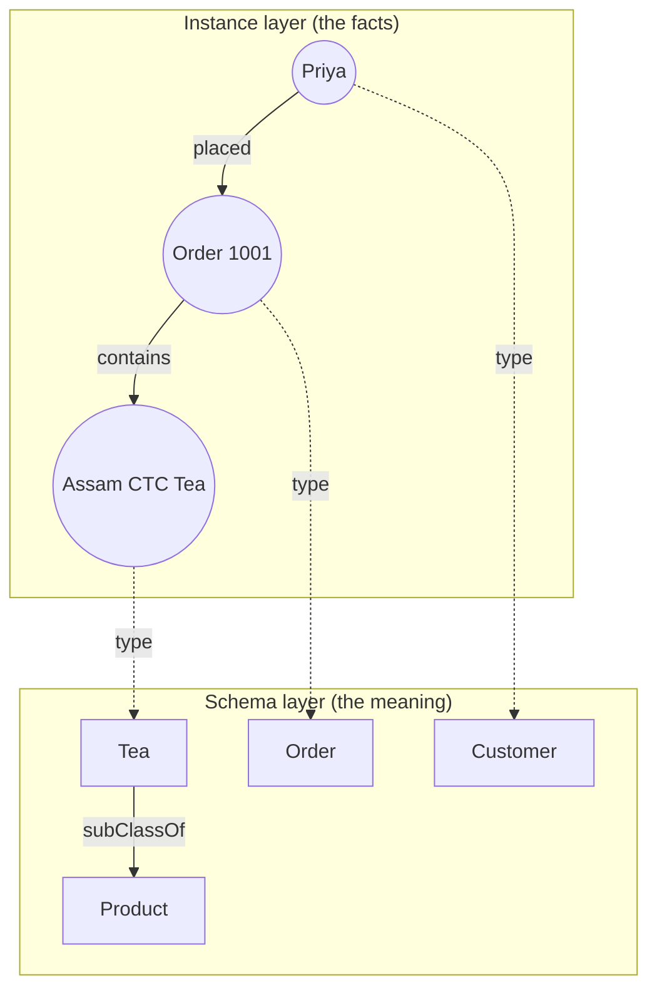
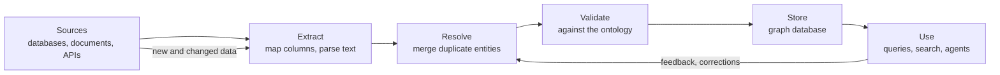

# What is a Knowledge Graph?: The Complete Guide

> 📚 **Before you start**
>
> - [Entities, Relationships and Properties](entities-relationships-and-properties.md), for the three building blocks and the idea of a triple.

## Introduction

Search Google for *"Sachin Tendulkar"* and, next to the usual list of web pages, a panel appears: his date of birth, his height, his spouse, the teams he played for, and links to related people. That panel isn't a web page someone wrote. It's assembled from a **knowledge graph**: a huge network of facts where Sachin is one node, connected to nodes for Mumbai, the Indian cricket team, Anjali Tendulkar and thousands of others. When Google introduced it in 2012, the slogan was *"things, not strings"*: search should understand that "Sachin" is a *person* with connections, not just a word.

Your company can have the same thing for its own world: customers, products, suppliers, contracts and employees, all linked. And AI agents can use it to answer questions that need several hops of reasoning, without guessing.

By the end of this lesson you'll be able to define a knowledge graph precisely, say what makes it more than "a graph", write the same facts in the two main formats (RDF triples and property graphs), run pattern queries and a simple inference over a small graph in Python, and explain how real knowledge graphs are built and kept fresh.

> 💡 **Key Insight**
>
> A knowledge graph is **facts as connections, plus agreed meaning**. The connections let you follow chains of facts. The agreed meaning (types, a schema or ontology) lets software know that "Assam CTC Tea is a Tea, and every Tea is a Product", and so derive facts nobody wrote down.

---

## Core Explanation

### 1. A definition you can use

A **knowledge graph (KG)** is a collection of facts about real-world things, stored as a graph where:

1. **Nodes are entities** with stable identifiers (a customer, a city, a product, a concept).
2. **Edges are typed relationships** between entities (`PLACED`, `locatedIn`, `subClassOf`).
3. **Entities and relationships have types drawn from a shared vocabulary**, usually defined by a **schema** or an **ontology**, so the meaning is explicit.
4. Often, **facts carry context**: where they came from (provenance), when they were true, and how confident we are.

A plain graph (like a road map or a social network) has the first two. The third point is what turns data into *knowledge*: a program can read the vocabulary and understand what the data means, combine it with other data that uses the same vocabulary, and draw conclusions.



*Two layers of one graph. The dotted `type` edges tie each fact to its meaning.*

### 2. The same facts in the two main formats

There are two families of knowledge graph technology. You'll meet both in depth later; here's what each looks like for the same three facts.

**RDF (Resource Description Framework)**, a W3C standard. Everything is a triple, and every entity and relationship is named by a web-style identifier (an IRI). Written in the **Turtle** format:

```turtle
@prefix shop: <https://chaibazaar.example/ontology#> .
@prefix ex:   <https://chaibazaar.example/data/> .

ex:C-17     a shop:Customer ;
            shop:name "Priya Nair" ;
            shop:placed ex:O-1001 .
ex:O-1001   a shop:Order ;
            shop:contains ex:P-ASSAM .
ex:P-ASSAM  a shop:Tea ;
            shop:name "Assam CTC Tea" ;
            shop:priceInr 240 .
```

Read `a` as "is a" (it's shorthand for `rdf:type`). A semicolon means "same subject, next statement".

**Labelled property graph (LPG)**, used by Neo4j and similar databases. Nodes have labels and properties; relationships have a type and can have properties too. Written in **Cypher**:

```cypher
CREATE (p:Customer {id: 'C-17', name: 'Priya Nair'})
CREATE (o:Order {id: 'O-1001', date: date('2026-09-14')})
CREATE (t:Product:Tea {id: 'P-ASSAM', name: 'Assam CTC Tea', priceInr: 240})
CREATE (p)-[:PLACED]->(o)
CREATE (o)-[:CONTAINS {qty: 2}]->(t)
```

| | RDF triple store | Labelled property graph |
|---|---|---|
| Basic unit | Triple (subject, predicate, object) | Node and relationship, each with properties |
| Identity | Global IRIs, mergeable across organisations | Internal IDs plus whatever ID property you add |
| Properties on relationships | Needs reification or RDF-star annotations | Built in (`{qty: 2}`) |
| Schema and meaning | RDFS and OWL ontologies, formal reasoning | Optional constraints; meaning lives in conventions |
| Query language | SPARQL | Cypher (and the ISO standard GQL) |
| Typical strength | Data integration, shared vocabularies, inference | Fast traversal, developer-friendly modelling, analytics |

Neither is "the" knowledge graph. Both store connected, typed facts. Choose by need: RDF when meaning must be shared and reasoned over across systems; property graphs when the main job is fast queries and analytics inside your application.

### 3. A tiny knowledge graph in Python

Let's build a small triple store and a query function that understands **variables**, written with a leading `?`. This is a miniature version of what SPARQL engines do.

```python
KG = {
    ("C-17", "type", "Customer"), ("C-17", "name", "Priya Nair"), ("C-17", "livesIn", "PUNE"),
    ("C-21", "type", "Customer"), ("C-21", "name", "Arjun Rao"), ("C-21", "livesIn", "BLR"),
    ("PUNE", "type", "City"), ("PUNE", "name", "Pune"),
    ("BLR", "type", "City"), ("BLR", "name", "Bengaluru"),
    ("O-1001", "type", "Order"), ("C-17", "placed", "O-1001"), ("O-1001", "contains", "P-ASSAM"),
    ("O-1002", "type", "Order"), ("C-21", "placed", "O-1002"), ("O-1002", "contains", "P-MASALA"),
    ("O-1002", "contains", "P-ASSAM"),
    ("P-ASSAM", "type", "Tea"), ("P-ASSAM", "name", "Assam CTC Tea"), ("P-ASSAM", "soldBy", "S-BRAHM"),
    ("P-MASALA", "type", "SpiceMix"), ("P-MASALA", "name", "Masala Chai Mix"), ("P-MASALA", "soldBy", "S-KERALA"),
    ("S-BRAHM", "type", "Seller"), ("S-BRAHM", "name", "Brahmaputra Tea Co."),
    ("S-KERALA", "type", "Seller"), ("S-KERALA", "name", "Malabar Spice House"),
    ("Tea", "subClassOf", "Product"), ("SpiceMix", "subClassOf", "Product"),
}

def is_var(x):
    return isinstance(x, str) and x.startswith("?")

def match(pattern, binding, kg):
    """Yield every extension of `binding` that makes the triple pattern true."""
    for triple in kg:
        new = dict(binding)
        for want, have in zip(pattern, triple):
            want = new.get(want, want) if is_var(want) else want
            if is_var(want):
                new[want] = have
            elif want != have:
                break
        else:
            yield new

def query(patterns, kg):
    results = [{}]
    for pattern in patterns:
        results = [b2 for b in results for b2 in match(pattern, b, kg)]
    return results

# Which customers bought Assam CTC Tea, and where do they live?
rows = query([("?order", "contains", "P-ASSAM"),
              ("?cust", "placed", "?order"),
              ("?cust", "name", "?name"),
              ("?cust", "livesIn", "?city"),
              ("?city", "name", "?cityName")], KG)
for r in sorted(rows, key=lambda r: r["?name"]):
    print(r["?name"], "from", r["?cityName"], "via", r["?order"])
```

Output:

```
Arjun Rao from Bengaluru via O-1002
Priya Nair from Pune via O-1001
```

Each pattern narrows the set of possible variable values, and patterns that share a variable (like `?cust`) join together. You just ran a **graph pattern query**, the idea behind both SPARQL and Cypher.

### 4. Knowledge you didn't write down: inference

Ask the graph *"Which things are Products?"* Nobody wrote `("P-ASSAM", "type", "Product")`. But the schema says `Tea subClassOf Product`, and Assam is a Tea. A knowledge graph with meaning can **infer** the missing fact. Here's a tiny reasoner that applies one rule until nothing new appears:

```python
def infer_types(kg):
    """Rule: if X type A and A subClassOf B, then X type B. Repeat until stable."""
    kg = set(kg)
    while True:
        new = {(x, "type", b)
               for (x, p, a) in kg if p == "type"
               for (a2, q, b) in kg if q == "subClassOf" and a2 == a}
        if new <= kg:
            return kg
        kg |= new

print("Before inference:", sorted(r["?x"] for r in query([("?x", "type", "Product")], KG)))
KG_INF = infer_types(KG)
print("After inference: ", sorted(r["?x"] for r in query([("?x", "type", "Product")], KG_INF)))
print("New facts added:", len(KG_INF) - len(KG))
```

Output:

```
Before inference: []
After inference:  ['P-ASSAM', 'P-MASALA']
New facts added: 2
```

Real reasoners apply dozens of such rules defined by the RDFS and OWL standards (module 3). The idea is the same: **the schema is data too, and rules turn it into new facts.**

### 5. Facts about facts: provenance, time and confidence

In a real company graph, "Priya lives in Pune" might come from her signup form in 2023 and "Priya lives in Mumbai" from a 2026 delivery address. Which is true? A useful KG keeps **context** for each fact:

```python
facts = [
    {"s": "C-17", "p": "livesIn", "o": "PUNE", "source": "signup_form", "as_of": "2023-04-02", "confidence": 1.0},
    {"s": "C-17", "p": "livesIn", "o": "MUMBAI", "source": "llm_extraction:email_8812", "as_of": "2026-09-30", "confidence": 0.7},
    {"s": "C-17", "p": "livesIn", "o": "MUMBAI", "source": "delivery_address:O-1077", "as_of": "2026-10-02", "confidence": 0.95},
]

def current_value(s, p, min_conf=0.8):
    trusted = [f for f in facts if f["s"] == s and f["p"] == p and f["confidence"] >= min_conf]
    latest = max(trusted, key=lambda f: f["as_of"])
    return latest["o"], latest["source"]

print(current_value("C-17", "livesIn"))
```

Output:

```
('MUMBAI', 'delivery_address:O-1077')
```

The low-confidence LLM extraction is ignored on its own, but agrees with a trusted delivery address, which wins because it's newer. Provenance is what lets an agent say *"according to order O-1077..."* instead of just asserting. In RDF this context is stored with **named graphs** or **RDF-star**; in property graphs, as properties on the relationship.

### 6. How a knowledge graph is built and kept alive



| Stage | What happens | Covered in |
|---|---|---|
| Extract | Structured sources are mapped table by table; unstructured text goes through OCR and LLM extraction | Module 5 |
| Resolve | "A. Sharma", "Anita Sharma" and "anita.sharma@kiranfoods.in" become one person | [Entity Resolution and Deduplication](../course.md#m5) |
| Validate | Reject facts that break the rules (an Order placed by a City) | Module 3 |
| Store and query | Neo4j with Cypher, or a triple store with SPARQL | Module 4 |
| Use | Search panels, recommendations, GraphRAG, agents | Module 6 |

A knowledge graph is never "finished". Keeping it fresh (new orders, changed addresses, retracted facts) is the biggest long-term cost, which is why provenance and timestamps matter from day one.

### 7. Open and enterprise knowledge graphs

| Graph | What it is | Good for |
|---|---|---|
| **Wikidata** | Open, community-edited KG behind Wikipedia infoboxes; items like `Q1156` (Mumbai) | Linking your entities to world knowledge, free SPARQL endpoint |
| **DBpedia** | Facts extracted from Wikipedia infoboxes, published as RDF | Research, linking |
| **Schema.org** | Not a graph of facts but a shared *vocabulary* (Product, Offer, Order, Person) used in web pages | Product and organisation markup that search engines read |
| **Enterprise KGs** | Private graphs of a company's customers, products, suppliers, assets | Search, compliance, fraud, recommendations, agents |

---

## Try It Yourself

1. **Query.** Using `query`, find the names of all sellers whose products Arjun bought.
2. **Infer.** Add `("Product", "subClassOf", "Thing")` and run `infer_types`. How many new facts appear, and why?
3. **Spot the problem.** Add the triple `("PUNE", "placed", "O-1001")`. Nothing stops you. What would an ontology add to prevent this?

<details>
<summary>Show answers</summary>

**1.**

```python
rows = query([("C-21", "placed", "?o"), ("?o", "contains", "?p"),
              ("?p", "soldBy", "?s"), ("?s", "name", "?seller")], KG)
print(sorted({r["?seller"] for r in rows}))
```

Output:

```
['Brahmaputra Tea Co.', 'Malabar Spice House']
```

**2.**

```python
KG2 = KG | {("Product", "subClassOf", "Thing")}
KG2_INF = infer_types(KG2)
print(len(KG2_INF) - len(KG2), sorted(t for t in KG2_INF - KG2))
```

Output:

```
4 [('P-ASSAM', 'type', 'Product'), ('P-ASSAM', 'type', 'Thing'), ('P-MASALA', 'type', 'Product'), ('P-MASALA', 'type', 'Thing')]
```

The rule runs again on its own output: Assam is a Tea, so a Product, so a Thing. That repeat-until-stable loop is called computing the **closure**.

**3.** An ontology would declare that `placed` has **domain** Customer and **range** Order, meaning only customers place, and only orders are placed. A validator could then reject `PUNE placed O-1001` because Pune is a City. You'll write exactly this rule in [What is an Ontology? A Worked Example](../course.md#m3).

</details>

---

## Real-World Examples

- **Search engines** use knowledge graphs for entity panels and to understand that a query names a person, place or product.
- **LinkedIn's Economic Graph** connects members, companies, skills and jobs to power recommendations and labour-market insights.
- **Pharmaceutical companies** link genes, proteins, diseases, drugs and trial results to find candidates for drug repurposing.
- **Banks and payment firms** link accounts, devices, merchants and transactions to spot fraud rings that look innocent one transaction at a time.

---

## Common Misconceptions

### "Any graph is a knowledge graph"

A graph of web page links or road junctions has no typed entities or shared meaning. A knowledge graph's nodes are things with types from a vocabulary, so software can interpret them.

### "Knowledge graphs require RDF"

RDF is one family. Many production knowledge graphs run on property-graph databases like Neo4j. What matters is typed, identified entities and relationships with explicit meaning.

### "A knowledge graph knows only what you put in"

With a schema and rules, it can derive new facts (Assam is a Product). With provenance, it can also tell you *why* it believes each fact.

### "LLMs make knowledge graphs unnecessary"

LLMs are great at language but can't guarantee facts or list *every* connected item. A knowledge graph is exact and auditable. The strongest systems combine them, as module 6 shows.

---

## Interview Relevance

*"What is a knowledge graph and how is it different from a graph database?"* A strong answer: a KG is a model of facts (typed entities and relationships with explicit meaning, often with provenance), while a graph database is one way to store it; KGs can live in RDF triple stores or property-graph databases. Mention the schema/ontology layer and inference (subclass reasoning), the RDF vs LPG trade-off (global identifiers and reasoning vs relationship properties and traversal speed), and the build pipeline (extract, resolve, validate, store) with freshness as the main operational cost.

---

## Key Takeaways

- **A knowledge graph = typed entities + typed relationships + shared meaning**, often with provenance.
- **Two families**: RDF triples (SPARQL, ontologies, global IDs) and labelled property graphs (Cypher, relationship properties).
- **Pattern queries** bind variables across triples; that's the core of SPARQL and Cypher.
- **Inference derives facts** from the schema, such as subclass membership.
- **Provenance, time and confidence** let you choose between conflicting facts and explain answers.

---

**Up next:** [Knowledge Graphs vs Relational Databases vs Vector Stores](knowledge-graphs-vs-relational-databases-vs-vector-stores.md)
