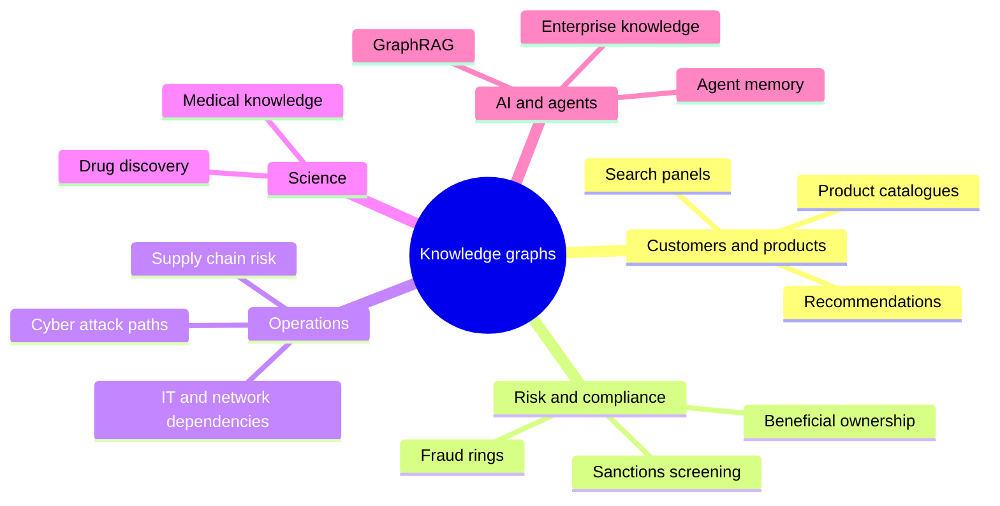

# Where Knowledge Graphs Are Used: The Complete Guide

> 📚 **Before you start**
>
> - [Knowledge Graphs vs Relational Databases vs Vector Stores](knowledge-graphs-vs-relational-databases-vs-vector-stores.md), for when a graph is the right tool.

## Introduction

In 2016 a leak of documents from a Panamanian law firm (the "Panama Papers") revealed hidden offshore companies owned by politicians and business people around the world. The investigative journalists who worked through millions of files didn't read them one by one. They loaded the people, companies, addresses and intermediaries into a **graph database** and followed the connections: this director shares an address with that shell company, which owns that one, which is owned by a minister's relative. The story was in the links.

That pattern, *"the answer is in how things connect"*, shows up across industries: a fraud ring of accounts sharing one phone, a supplier three tiers down sitting in a flooded district, a medicine that interacts with another medicine through a shared enzyme, an AI agent that must know who reports to whom.

This lesson tours the main uses of knowledge graphs. For each one you'll see the **entities and relationships involved**, the **question the graph answers**, and for three of them a small runnable example. By the end you'll be able to spot a graph-shaped problem in your own work, and just as importantly, spot when a graph would be overkill.

> 💡 **Key Insight**
>
> A problem is graph-shaped when **the important signal is in the relationships rather than in any single record**. One transaction looks fine; twenty accounts sharing three devices don't. If you keep writing "and then follow that to...", you're describing a graph.

---

## Core Explanation

### 1. The map of uses



### 2. Recommendations and product catalogues

**Entities:** customers, products, brands, categories, sessions. **Relationships:** `BOUGHT`, `VIEWED`, `IN_CATEGORY`, `MADE_BY`, `SIMILAR_TO`.

**Question answered:** *"People who bought this also bought..."*, *"more from this brand"*, *"complete the set"* (bought chai mix, so suggest kulhad cups). You built the "also bought" traversal in the previous lesson. Catalogue graphs also fix messy product data: a `Category` tree (Beverages → Tea → Black Tea) lets a search for "tea" include every subcategory.

### 3. Fraud detection: rings hiding in plain sight

**Entities:** accounts, people, phone numbers, devices, addresses, merchants. **Relationships:** `USES_DEVICE`, `HAS_PHONE`, `LIVES_AT`, `PAID`.

**Question answered:** *"Which accounts are secretly connected?"* Fraudsters open many accounts with different names, but they reuse a few phones, devices and addresses. Each account alone looks normal. Connected, they form a ring.

Here's a runnable version. We put accounts and their identifiers in a graph and find **connected components** (groups of nodes reachable from each other) using SciPy:

```python
import numpy as np
from scipy.sparse import coo_matrix
from scipy.sparse.csgraph import connected_components

links = [  # (account, identifier it uses)
    ("ACC-1", "phone:98200-11111"), ("ACC-2", "phone:98200-11111"),
    ("ACC-2", "device:android-7f3"), ("ACC-3", "device:android-7f3"),
    ("ACC-3", "addr:Flat 4B, Andheri"), ("ACC-4", "addr:Flat 4B, Andheri"),
    ("ACC-5", "phone:99300-22222"),                       # a normal customer
    ("ACC-6", "phone:97000-33333"), ("ACC-6", "device:iphone-a21"),  # another normal customer
]
nodes = sorted({n for pair in links for n in pair})
index = {n: i for i, n in enumerate(nodes)}
rows = [index[a] for a, _ in links]
cols = [index[b] for _, b in links]
adjacency = coo_matrix((np.ones(len(links)), (rows, cols)), shape=(len(nodes), len(nodes)))

n_groups, labels = connected_components(adjacency, directed=False)
groups = {}
for node, label in zip(nodes, labels):
    if node.startswith("ACC"):
        groups.setdefault(label, []).append(node)
for accounts in sorted(groups.values(), key=len, reverse=True):
    flag = "SUSPICIOUS RING" if len(accounts) >= 3 else "ok"
    print(f"{flag:<16} {accounts}")
```

Output:

```
SUSPICIOUS RING  ['ACC-1', 'ACC-2', 'ACC-3', 'ACC-4']
ok               ['ACC-5']
ok               ['ACC-6']
```

ACC-1 and ACC-4 share *nothing* directly, yet they're in the same ring through a chain: phone → ACC-2 → device → ACC-3 → address. Row-by-row rules can't see that. In production this runs on millions of accounts in a graph database with algorithms like weakly connected components (module 4).

### 4. Beneficial ownership and compliance

**Entities:** people, companies, trusts. **Relationships:** `OWNS {pct}`, `DIRECTOR_OF`, `REGISTERED_AT`.

**Question answered:** *"Who really owns this company?"* Regulators (for example under anti-money-laundering rules) require banks to find the **ultimate beneficial owner (UBO)**: the real people who own or control a company, often above a threshold such as 10% or 25%, even when ownership runs through a chain of holding companies. Effective ownership along a chain is the *product* of the percentages, summed over all paths.

```python
owns = {  # owner -> [(company, fraction)]
    "Ramesh Gupta": [("Sunrise Holdings", 0.60), ("Lotus Traders", 0.10)],
    "Neha Kapoor": [("Sunrise Holdings", 0.40)],
    "Sunrise Holdings": [("Lotus Traders", 0.50)],
    "Lotus Traders": [("Kiran Foods Pvt Ltd", 0.80)],
    "Vikram Singh": [("Kiran Foods Pvt Ltd", 0.20)],
}

def effective_ownership(owner, target, share=1.0):
    total = 0.0
    for company, pct in owns.get(owner, []):
        if company == target:
            total += share * pct
        else:
            total += effective_ownership(company, target, share * pct)
    return total

people = ["Ramesh Gupta", "Neha Kapoor", "Vikram Singh"]
for person in people:
    pct = effective_ownership(person, "Kiran Foods Pvt Ltd")
    print(f"{person:<14} {pct:6.1%}  {'UBO (>=25%)' if pct >= 0.25 else ''}".rstrip())
```

Output:

```
Ramesh Gupta    32.0%  UBO (>=25%)
Neha Kapoor     16.0%
Vikram Singh    20.0%
```

Ramesh owns no shares of Kiran Foods directly. Through two paths (60% × 50% × 80% via Sunrise, plus 10% × 80% via Lotus) he controls 32%, which makes him a beneficial owner. This is a classic graph traversal with a calculation along each path.

### 5. Supply chain risk

**Entities:** your company, suppliers at every tier, parts, factories, ports, regions. **Relationships:** `SUPPLIES`, `LOCATED_IN`, `SHIPS_VIA`, `USED_IN`.

**Question answered:** *"A cyclone has hit coastal Odisha. Which of our products are at risk?"* Your direct suppliers might all be safe while a tier-3 packaging supplier sits in the affected district.

```python
supplies = {  # supplier -> customers it supplies
    "Kalinga Jute Mills": ["Eastern Packaging"],
    "Eastern Packaging": ["Assam Leaf Processors", "Nilgiri Blenders"],
    "Assam Leaf Processors": ["Chai Bazaar"],
    "Nilgiri Blenders": ["Chai Bazaar"],
    "Malabar Spice House": ["Chai Bazaar"],
}
located_in = {"Kalinga Jute Mills": "Odisha", "Eastern Packaging": "West Bengal",
              "Assam Leaf Processors": "Assam", "Nilgiri Blenders": "Tamil Nadu",
              "Malabar Spice House": "Kerala"}

def downstream(start, path=None):
    path = (path or []) + [start]
    if start not in supplies:
        yield path
    for customer in supplies.get(start, []):
        yield from downstream(customer, path)

hit = [s for s, region in located_in.items() if region == "Odisha"]
for supplier in hit:
    for chain in downstream(supplier):
        print(" -> ".join(chain), f"({len(chain) - 1} tiers)")
```

Output:

```
Kalinga Jute Mills -> Eastern Packaging -> Assam Leaf Processors -> Chai Bazaar (3 tiers)
Kalinga Jute Mills -> Eastern Packaging -> Nilgiri Blenders -> Chai Bazaar (3 tiers)
```

Both of Chai Bazaar's tea suppliers depend on one jute mill in Odisha for packaging. That single point of failure is invisible in a flat supplier list.

### 6. Search, question answering and the semantic web

Search engines use knowledge graphs to recognise that a query names an entity and to show facts about it. Websites help by embedding **Schema.org** markup, which is a small piece of knowledge graph inside a web page. A product page might include:

```json
{
  "@context": "https://schema.org",
  "@type": "Product",
  "name": "Assam CTC Tea, 250 g",
  "brand": {"@type": "Brand", "name": "Brahmaputra Tea Co."},
  "offers": {"@type": "Offer", "price": "240.00", "priceCurrency": "INR",
             "availability": "https://schema.org/InStock"}
}
```

That's **JSON-LD**, a JSON form of RDF. The `@type` values come from a shared vocabulary, so any search engine knows that `price` belongs to an `Offer` and `brand` is a `Brand`. You'll see this vocabulary again when designing the shop ontology in module 3.

### 7. Science and healthcare

Biomedical knowledge graphs connect **genes, proteins, diseases, drugs, side effects and publications**. A question like *"which approved drugs act on proteins linked to this rare disease?"* is a path query: disease → associated gene → encoded protein ← targeted by ← drug. Researchers use such graphs to propose **drug repurposing** candidates, and medical ontologies like SNOMED CT give doctors and software a shared vocabulary for diagnoses.

### 8. IT, networks and cyber security

**Entities:** servers, services, databases, users, permissions, vulnerabilities. **Relationships:** `DEPENDS_ON`, `CAN_ACCESS`, `MEMBER_OF`, `RUNS`.

**Questions answered:** *"If this database goes down, which customer-facing apps break?"* (impact analysis) and *"Can an attacker who phishes an intern reach the payments server?"* (attack paths). Security teams use graph tools to find the shortest chain of permissions from a low-privilege account to a crown-jewel system.

### 9. AI agents: memory, grounding and GraphRAG

This is the use the rest of the course builds towards:

| Use | What the graph gives the agent | Lesson |
|---|---|---|
| **GraphRAG** | Connected facts across many documents, not just similar chunks | [GraphRAG](../course.md#m6) |
| **Text-to-Cypher agents** | Exact answers to "how many", "list all", "who reports to" | [Text-to-Cypher Agents](../course.md#m6) |
| **Ontology-grounded agents** | Rules to check its own claims and tool calls against | [Ontology-Grounded Agents](../course.md#m6) |
| **Agent memory** | Long-term memory of people, preferences and past events, stored as linked facts | [Context Engineering and Agent Memory › Memory Systems](../../context-engineering-and-agent-memory/course.md#m4) |

### 10. When a knowledge graph is the wrong tool

| Situation | Better choice |
|---|---|
| Mostly totals and dashboards over one or two tables | A relational database or data warehouse |
| Questions answered by one passage of text | Plain vector RAG |
| Few relationships, or relationships that never matter to the questions | A document store or plain tables |
| No one will maintain the entities and IDs | Fix data ownership first; a stale graph misleads |

The cost of a knowledge graph isn't the database licence. It's **modelling, entity resolution and keeping it fresh**. Start with one high-value question, not "a graph of everything".

---

## Try It Yourself

1. **Fraud.** Add `("ACC-5", "device:iphone-a21")` to `links` and rerun. What changes and why?
2. **Ownership.** Neha also buys 15% of Lotus Traders directly. Add it and recompute. Is she a UBO now?
3. **Spot the graph.** For a hospital, list three questions that are graph-shaped and one that isn't.

<details>
<summary>Show answers</summary>

**1.**

```python
links.append(("ACC-5", "device:iphone-a21"))
nodes = sorted({n for pair in links for n in pair})
index = {n: i for i, n in enumerate(nodes)}
adjacency = coo_matrix((np.ones(len(links)), ([index[a] for a, _ in links], [index[b] for _, b in links])),
                       shape=(len(nodes), len(nodes)))
_, labels = connected_components(adjacency, directed=False)
groups = {}
for node, label in zip(nodes, labels):
    if node.startswith("ACC"):
        groups.setdefault(label, []).append(node)
print(sorted(groups.values(), key=len, reverse=True))
```

Output:

```
[['ACC-1', 'ACC-2', 'ACC-3', 'ACC-4'], ['ACC-5', 'ACC-6']]
```

ACC-5 and ACC-6 now share a device, so they form a pair. Two accounts on one device may be a family, not fraud, which is why real systems combine graph signals with thresholds and human review.

**2.**

```python
owns["Neha Kapoor"].append(("Lotus Traders", 0.15))
print(f"{effective_ownership('Neha Kapoor', 'Kiran Foods Pvt Ltd'):.1%}")
```

Output:

```
28.0%
```

40% × 50% × 80% = 16%, plus 15% × 80% = 12%, total 28%. Yes, above 25%.

**3.** Graph-shaped: which patients shared a ward with an infected patient in the last 10 days (contact tracing); which drugs a patient takes interact through a shared enzyme; which doctors are connected through referrals. Not graph-shaped: average length of stay per department last quarter (a SQL aggregate).

</details>

---

## Real-World Examples

- **The International Consortium of Investigative Journalists** used a graph database to explore the Panama Papers and later leaks.
- **Payment companies and banks** run graph analytics to catch fraud rings and money-mule networks.
- **Manufacturers** map multi-tier supply chains to see exposure to regional disruptions.
- **Search engines and e-commerce platforms** use product and entity graphs to power panels, related items and better search results.

---

## Common Misconceptions

### "Knowledge graphs are only for huge tech companies"

The examples above run in a few lines of Python. A graph with a few thousand nodes on a laptop can answer valuable questions for a small business.

### "Graphs are mainly for social networks"

Social networks are the famous example, but most production graphs model business things: products, accounts, suppliers, permissions, documents.

### "Once built, the graph keeps working"

A graph of suppliers from last year will confidently give wrong answers this year. Freshness and ownership are part of the design.

---

## Interview Relevance

Interviewers often ask *"Give an example where a graph database is the right choice"* or present a fraud or recommendation scenario. A strong answer names the entities and relationships, states the graph question (connected components for rings, path products for ownership, multi-tier traversal for supply risk), explains why row-level processing misses it, and mentions limits: maintenance cost, entity resolution, and that aggregation-heavy analytics stay in SQL.

---

## Key Takeaways

- **Graph-shaped problems** have their signal in the relationships, not in single records.
- **Fraud rings** show up as connected components of accounts sharing identifiers.
- **Ownership and supply chains** are path problems: multiply or follow along chains.
- **Schema.org JSON-LD** puts small knowledge graphs inside ordinary web pages.
- **Agents use graphs** for GraphRAG, exact queries, grounding and memory.
- **Don't build a graph of everything**: start from one valuable, connection-heavy question.

---

**Up next:** [What is an Ontology? A Worked Example](../course.md#m3)
