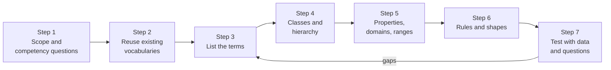
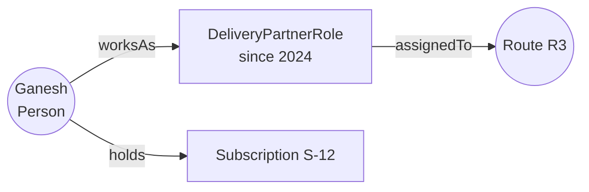

# Designing an Ontology for Your Domain: The Complete Guide

> 📚 **Before you start**
>
> - [What is an Ontology? A Worked Example](what-is-an-ontology-a-worked-example.md), for classes, properties and rules.
> - [RDF, RDFS and OWL in Plain English](rdf-rdfs-and-owl-in-plain-english.md), for OWL constructs, the open-world assumption and SHACL.

## Introduction

Reading an ontology is one skill. Designing one from a blank page is another, and that's where most projects stumble. The usual failure looks like this: a team spends three months modelling "everything about our business" in a beautiful 400-class ontology, and then discovers it can't answer the five questions the business actually asked, while nobody can explain why `Party` is a superclass of `Account`.

Good ontology design is driven by **questions, not by completeness**. In this lesson we'll design an ontology from scratch for a domain you haven't seen yet: **Dabba Express**, a Mumbai tiffin-delivery service. Home kitchens cook meals, customers subscribe to daily tiffins (veg, Jain, non-veg), and delivery partners carry them along fixed routes between areas. We'll go step by step: competency questions, reuse, terms, classes, properties, rules and tests. You'll also get a small **ontology linter** that catches the most common design smells.

By the end, you'll be able to run the same process for your own domain and defend every class you add.

> 💡 **Key Insight**
>
> Write the **questions first**. An ontology is finished when it can answer its competency questions with real data, not when it describes everything. Every class and property should trace back to at least one question.

---

## Core Explanation

### 1. The process at a glance



This loop is close to the classic "Ontology Development 101" method from Stanford, and to what modern teams do in practice. The arrow back from testing matters most: you will go round several times.

### 2. Step 1: scope and competency questions

**Competency questions (CQs)** are the questions the ontology (with data) must be able to answer. Ask the people who'll use it. For Dabba Express:

| ID | Competency question | Who asks |
|---|---|---|
| CQ1 | Which customers on route R3 have an active Jain subscription this week? | Kitchen planner |
| CQ2 | Which delivery partner carries a given customer's tiffin, and from which kitchen? | Support desk |
| CQ3 | How many tiffins does each kitchen cook for tomorrow, by meal type? | Operations |
| CQ4 | Which customers were affected when partner Ganesh was absent on 3 October? | Support desk |
| CQ5 | Which kitchens are within the customer's area or a neighbouring area? | Sales |

Also write down what's **out of scope** (payroll, kitchen inventory, payments). Scope stops the ontology from growing into "everything".

### 3. Step 2: reuse before you invent

Before inventing terms, check standard vocabularies. Reuse means other tools and partners understand your data for free.

| Need | Reuse | Terms |
|---|---|---|
| People, organisations, places | Schema.org | `schema:Person`, `schema:Organization`, `schema:Place` |
| Categories like meal types | SKOS | `skos:Concept`, `skos:prefLabel` |
| Where data came from | PROV-O (W3C provenance) | `prov:wasDerivedFrom`, `prov:generatedAtTime` |
| Titles, dates, creators of documents | Dublin Core | `dcterms:title`, `dcterms:created` |
| Time intervals | OWL-Time | `time:Interval` |

You can reuse a term directly, or define your own class and link it: `dabba:Customer rdfs:subClassOf schema:Person`. Linking keeps your own names and still lets outsiders understand them.

### 4. Step 3: list the terms

Go through the CQs and underline every noun and verb. Don't organise yet, just collect:

> customer, route, subscription, Jain, veg, non-veg, week, active, delivery partner, tiffin, kitchen, cook, carry, absent, date, area, neighbouring, meal type

Then sort them: **things** (customer, kitchen, route, area, partner, subscription, tiffin), **relationships** (subscribes, cooks, carries, serves area, neighbours), **values** (dates, active), and **categories** (veg, Jain, non-veg).

### 5. Step 4: classes and hierarchy, with four design patterns

Most design decisions fall into a few patterns. Using them deliberately is what separates a clean ontology from a tangled one.

**Pattern A: events become classes.** "Ganesh delivered tiffin T-88 to Asha on 3 October at 12:40" involves five things. Make `Delivery` a class with properties for each participant, exactly like `Order` in the tea shop.

**Pattern B: roles, not types, for people.** Is Ganesh a `DeliveryPartner` forever? He might also become a customer. Model **people** as one class and **roles** as relationships or role classes:



Rule of thumb: if something can stop being true while the individual continues to exist, it's a role or a state, not a subclass.

**Pattern C: categories as concepts, not subclasses.** Veg, Jain and non-veg change what the kitchen cooks, but not what a tiffin *is*. Model them as SKOS concepts (`dabba:MealType`) that a subscription points to, so the business can add "Diabetic-friendly" without changing the ontology's class structure.

**Pattern D: things that change over time get dates.** A subscription is active *between* dates. Give it `validFrom` and `validTo` instead of a true/false `active` property, which is always out of date.

The resulting class list:

| Class | Pattern | Superclass (reused) | Definition |
|---|---|---|---|
| `Person` | | `schema:Person` | A human, whatever their role |
| `Kitchen` | | `schema:Organization` | A home kitchen that cooks tiffins |
| `Area` | | `schema:Place` | A delivery locality, e.g. Dadar West |
| `Route` | | | An ordered set of pickups and drops served by one partner |
| `Subscription` | D | | A customer's agreement for daily tiffins, valid between two dates |
| `Delivery` | A | | One tiffin carried by one partner to one person on one date |
| `DeliveryPartnerRole` | B | | Someone's job as a delivery partner, with a start date |
| `MealType` | C | `skos:Concept` | Veg, Jain, non-veg and future types |

### 6. Step 5: properties with domains, ranges and names

| Property | Domain → Range | Answers |
|---|---|---|
| `subscriber` | Subscription → Person | CQ1, CQ4 |
| `mealType` | Subscription → MealType | CQ1, CQ3 |
| `fromKitchen` | Subscription → Kitchen | CQ2, CQ3 |
| `onRoute` | Subscription → Route | CQ1, CQ4 |
| `validFrom`, `validTo` | Subscription → xsd:date | CQ1 |
| `servedBy` | Route → DeliveryPartnerRole | CQ2, CQ4 |
| `rolePlayer` | DeliveryPartnerRole → Person | CQ2, CQ4 |
| `locatedIn` | Kitchen or Person → Area | CQ5 |
| `neighbours` | Area → Area (symmetric) | CQ5 |
| `forSubscription`, `deliveryDate`, `carriedBy` | Delivery → Subscription / date / Person | CQ4 |

Naming conventions: classes are singular nouns in PascalCase; object properties are verb phrases or role nouns in camelCase that read as a sentence ("Subscription *fromKitchen* Kitchen"); every term gets an `rdfs:label` and a one-sentence `rdfs:comment`.

### 7. Steps 6 and 7: the ontology as data, a linter, and tests

Let's hold the design in Python, then run two kinds of checks: a **linter** for design smells and **competency-question tests** against sample data.

```python
ONTO = {
    "classes": {
        "Person": "A human, whatever their role.",
        "Kitchen": "A home kitchen that cooks tiffins.",
        "Area": "A delivery locality such as Dadar West.",
        "Route": "An ordered set of pickups and drops served by one partner.",
        "Subscription": "A customer's agreement for daily tiffins between two dates.",
        "Delivery": "One tiffin carried by one partner to one person on one date.",
        "DeliveryPartnerRole": "",                       # forgot the definition
        "MealType": "Veg, Jain, non-veg and future meal categories.",
        "Tiffins": "Plural name, and no property uses it.",
    },
    "properties": {  # name: (domain, range, symmetric?)
        "subscriber": ("Subscription", "Person", False),
        "mealType": ("Subscription", "MealType", False),
        "fromKitchen": ("Subscription", "Kitchen", False),
        "onRoute": ("Subscription", "Route", False),
        "validFrom": ("Subscription", "date", False),
        "validTo": ("Subscription", "date", False),
        "servedBy": ("Route", "DeliveryPartnerRole", False),
        "rolePlayer": ("DeliveryPartnerRole", "Person", False),
        "locatedIn": ("Person", "Area", False),
        "neighbours": ("Area", "Area", True),
        "carriedBy": ("Delivery", "Person", False),
        "IsActive": (None, "boolean", False),             # two smells in one
    },
}

def lint(onto):
    issues = []
    classes, props = onto["classes"], onto["properties"]
    used = {c for d, r, _ in props.values() for c in (d, r)}
    for name, comment in classes.items():
        if not comment:
            issues.append(f"class {name}: missing rdfs:comment definition")
        if name.endswith("s") and not name.endswith("ss"):
            issues.append(f"class {name}: class names should be singular")
        if name not in used:
            issues.append(f"class {name}: no property uses it (orphan)")
    for name, (domain, rng, _) in props.items():
        if name[0].isupper():
            issues.append(f"property {name}: properties should start lowercase")
        if domain is None:
            issues.append(f"property {name}: no domain")
        if rng == "boolean" and name.lower().startswith("is"):
            issues.append(f"property {name}: true/false state; consider dates (validFrom/validTo)")
    return issues

for issue in lint(ONTO):
    print("⚠", issue)
```

Output:

```
⚠ class DeliveryPartnerRole: missing rdfs:comment definition
⚠ class Tiffins: class names should be singular
⚠ class Tiffins: no property uses it (orphan)
⚠ property IsActive: properties should start lowercase
⚠ property IsActive: no domain
⚠ property IsActive: true/false state; consider dates (validFrom/validTo)
```

Fix the smells, then test the ontology the way it'll be used: load sample data shaped by it and answer each competency question. If a question can't be answered, a term is missing.

```python
del ONTO["classes"]["Tiffins"], ONTO["properties"]["IsActive"]
ONTO["classes"]["DeliveryPartnerRole"] = "Someone's job as a delivery partner, from a start date."
print("lint issues after fixes:", lint(ONTO))

from datetime import date
facts = [
    ("S-12", "subscriber", "Asha"), ("S-12", "mealType", "Jain"), ("S-12", "onRoute", "R3"),
    ("S-12", "fromKitchen", "Annapurna Kitchen"), ("S-12", "validFrom", date(2026, 9, 1)), ("S-12", "validTo", date(2026, 12, 31)),
    ("S-15", "subscriber", "Rohan"), ("S-15", "mealType", "Jain"), ("S-15", "onRoute", "R3"),
    ("S-15", "fromKitchen", "Annapurna Kitchen"), ("S-15", "validFrom", date(2026, 6, 1)), ("S-15", "validTo", date(2026, 9, 30)),
    ("S-20", "subscriber", "Farah"), ("S-20", "mealType", "Non-veg"), ("S-20", "onRoute", "R3"),
    ("S-20", "fromKitchen", "Bismillah Tiffins"), ("S-20", "validFrom", date(2026, 9, 15)), ("S-20", "validTo", date(2027, 3, 14)),
    ("R3", "servedBy", "ROLE-7"), ("ROLE-7", "rolePlayer", "Ganesh"),
]
def value(s, p):
    return next(o for s2, p2, o in facts if s2 == s and p2 == p)
subs = sorted({s for s, p, _ in facts if p == "subscriber"})

def cq1(route, meal, week_start, week_end):
    return [value(s, "subscriber") for s in subs
            if value(s, "onRoute") == route and value(s, "mealType") == meal
            and value(s, "validFrom") <= week_end and value(s, "validTo") >= week_start]

def cq2(customer):
    s = next(s for s in subs if value(s, "subscriber") == customer)
    partner = value(value(value(s, "onRoute"), "servedBy"), "rolePlayer")
    return partner, value(s, "fromKitchen")

print("CQ1 (R3, Jain, week of 5 Oct):", cq1("R3", "Jain", date(2026, 10, 5), date(2026, 10, 11)))
print("CQ2 (Farah):", cq2("Farah"))
```

Output:

```
lint issues after fixes: []
CQ1 (R3, Jain, week of 5 Oct): ['Asha']
CQ2 (Farah): ('Ganesh', 'Bismillah Tiffins')
```

Rohan's Jain subscription ended on 30 September, so CQ1 correctly leaves him out. That only worked because we used dates instead of an `isActive` flag: a flag would still say "active" unless someone remembered to flip it. And CQ5 can't be answered yet, because no kitchen has a `locatedIn` (its domain is only `Person`). That's exactly the gap a test should reveal: widen the domain of `locatedIn` to "Person or Kitchen" (or to a shared superclass such as `schema:Thing`) and add kitchen locations.

### 8. Writing it down: the Turtle skeleton

Once the design settles, write the file. A trimmed version:

```turtle
@prefix dabba:  <https://dabbaexpress.example/ontology#> .
@prefix owl:    <http://www.w3.org/2002/07/owl#> .
@prefix rdfs:   <http://www.w3.org/2000/01/rdf-schema#> .
@prefix xsd:    <http://www.w3.org/2001/XMLSchema#> .
@prefix schema: <https://schema.org/> .
@prefix skos:   <http://www.w3.org/2004/02/skos/core#> .

<https://dabbaexpress.example/ontology> a owl:Ontology ;
    owl:versionIRI <https://dabbaexpress.example/ontology/1.1> ;
    rdfs:comment "Tiffin subscriptions, kitchens, routes and deliveries in Mumbai." .

dabba:Person a owl:Class ; rdfs:subClassOf schema:Person ;
    rdfs:label "Person"@en ; rdfs:comment "A human, whatever their role."@en .
dabba:Subscription a owl:Class ;
    rdfs:comment "A customer's agreement for daily tiffins between two dates."@en .
dabba:MealType a owl:Class ; rdfs:subClassOf skos:Concept .
dabba:Jain a dabba:MealType ; skos:prefLabel "Jain"@en, "जैन"@hi .

dabba:subscriber a owl:ObjectProperty, owl:FunctionalProperty ;
    rdfs:domain dabba:Subscription ; rdfs:range dabba:Person .
dabba:neighbours a owl:ObjectProperty, owl:SymmetricProperty ;
    rdfs:domain dabba:Area ; rdfs:range dabba:Area .
dabba:validFrom a owl:DatatypeProperty ;
    rdfs:domain dabba:Subscription ; rdfs:range xsd:date .
```

### 9. Versioning, IRIs and governance

- **Stable IRIs.** Never reuse an IRI for a different meaning. If `Subscription` changes meaning, deprecate it (`owl:deprecated true`) and create a new term.
- **Version the ontology** with `owl:versionIRI` and a changelog, and keep data annotated with the version it was validated against.
- **Name an owner.** Every term needs someone who can say what it means. Without an owner, definitions drift and two teams start using `Customer` differently again.
- **Keep it in Git** as Turtle files, reviewed through pull requests like code, with the linter and CQ tests in CI.

### 10. Common design smells

| Smell | Why it hurts | Fix |
|---|---|---|
| Classes for every adjective (`RedTea`, `BigOrder`) | Explodes the hierarchy | Use properties or SKOS concepts |
| Roles as subclasses (`DeliveryPartner` subclass of `Person`) | People change roles | Role pattern |
| Boolean state flags (`isActive`) | Stale the moment time passes | Date intervals |
| Missing definitions | People interpret terms differently | `rdfs:comment` on every term |
| Deep hierarchies with one child each | Adds nothing | Flatten |
| Copying a database schema table by table | Bakes in storage accidents (join tables, codes) | Model the domain, then map |

---

## Try It Yourself

1. **Answer CQ3.** Write `cq3(kitchen)` that counts active subscriptions for tomorrow (12 October 2026) by meal type.
2. **Fix CQ5's gap.** Change the domain of `locatedIn` so kitchens can have it too, then rerun `lint`. Any new issues?
3. **Design.** For a college, write three competency questions and the classes they need, using the role pattern for students who become teaching assistants.

<details>
<summary>Show answers</summary>

**1.**

```python
from collections import Counter

def cq3(kitchen, day):
    return dict(Counter(value(s, "mealType") for s in subs
                        if value(s, "fromKitchen") == kitchen
                        and value(s, "validFrom") <= day <= value(s, "validTo")))

print(cq3("Annapurna Kitchen", date(2026, 10, 12)), cq3("Bismillah Tiffins", date(2026, 10, 12)))
```

Output:

```
{'Jain': 1} {'Non-veg': 1}
```

**2.**

```python
ONTO["classes"]["Locatable"] = "Anything with a location: a person or a kitchen."
ONTO["properties"]["locatedIn"] = ("Locatable", "Area", False)
print(lint(ONTO))
```

Output:

```
[]
```

No issues, because `Locatable` is now used. You'd also add `Person rdfs:subClassOf Locatable` and `Kitchen rdfs:subClassOf Locatable`.

**3.** Example: "Which courses does each teaching assistant support this semester?", "Which students are enrolled in Data Structures and also TA for it?" (should be none), "Who teaches the prerequisites of course X?". Classes: Person, Course, Semester, Enrolment (event pattern: person + course + semester), TeachingAssistantRole (role pattern: person + course + semester), Instructor role, and a `prerequisiteOf` property between courses.

</details>

---

## Real-World Examples

- **Retailers** design product ontologies around search and merchandising questions, reusing Schema.org's Product and Offer.
- **Banks** start from FIBO and extend it with their own products, scoped by regulatory reporting questions.
- **Healthcare providers** reuse SNOMED CT for clinical terms and design small local ontologies for their own workflows.
- **AI teams** design compact ontologies for LLM extraction, where every class and property must be explainable in a prompt.

---

## Common Misconceptions

### "We should model the whole business first"

Big-bang ontologies rarely get used. Start from a handful of competency questions and grow.

### "Reusing standards is optional polish"

Reuse is what makes your data understandable by partners, tools and search engines. Linking to Schema.org or PROV-O costs little and pays off quickly.

### "The ontology should mirror our database"

Databases contain storage decisions (join tables, codes, denormalised columns). Model the domain, then map the database to it.

### "Once designed, the ontology is fixed"

It's a living artefact with versions, owners and reviews, just like code.

---

## Interview Relevance

*"How would you design an ontology for domain X?"* A strong answer walks through scope and competency questions, reuse of standard vocabularies (Schema.org, SKOS, PROV-O), term extraction, class hierarchy with explicit patterns (events as classes, roles not subclasses, categories as concepts, time-indexed states), properties with domains and ranges and naming conventions, constraints in OWL and SHACL, and testing by answering the CQs on sample data. Mention governance: stable IRIs, versioning, owners and CI checks.

---

## Key Takeaways

- **Competency questions drive the design**; every term should trace to one.
- **Reuse standard vocabularies** and link your terms to them.
- **Use patterns**: events as classes, roles instead of subclasses, categories as concepts, dates instead of flags.
- **Lint and test**: catch design smells automatically and answer the CQs with sample data.
- **Govern it like code**: stable IRIs, versions, owners, reviews.

---

**Up next:** [Semantic Search, Semantic Layers and Shared Meaning](semantic-search-semantic-layers-and-shared-meaning.md)
