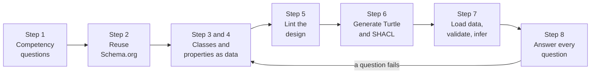
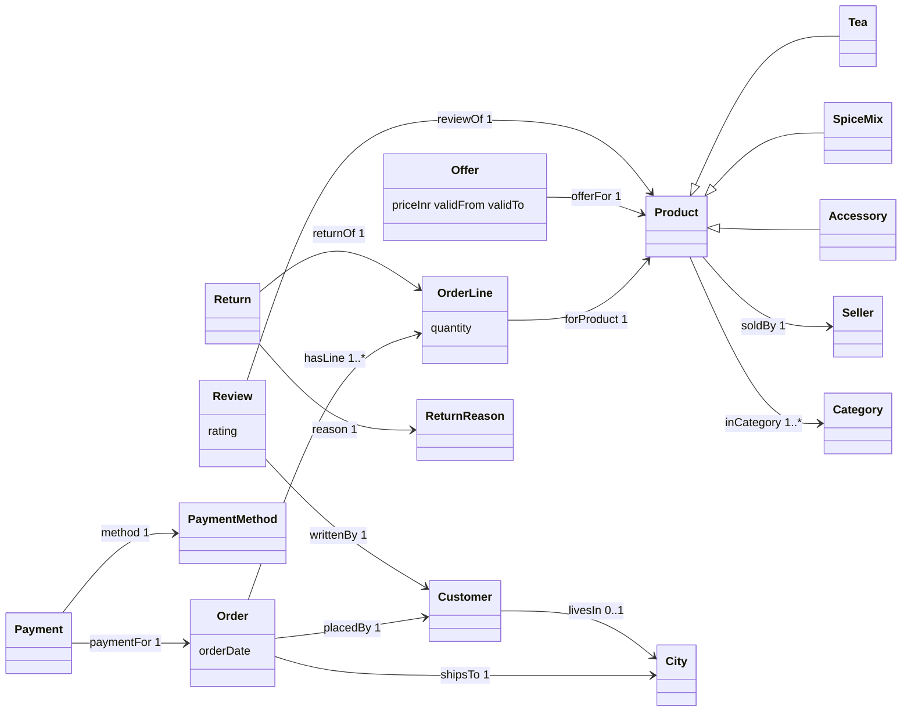

# Lab: Design an ontology for an online shop

> 📚 **Before you start**
>
> - [What is an Ontology? A Worked Example](what-is-an-ontology-a-worked-example.md), for the version 1 Chai Bazaar ontology this lab grows.
> - [RDF, RDFS and OWL in Plain English](rdf-rdfs-and-owl-in-plain-english.md), for Turtle, OWL and SHACL.
> - [Designing an Ontology for Your Domain](designing-an-ontology-for-your-domain.md), for competency questions, the four design patterns and the linter.
> - [What is a Knowledge Graph?](../02-entities-and-relationships/what-is-a-knowledge-graph.md), for the pattern-query function we reuse in Step 7.

## What You'll Build

Chai Bazaar is growing. The founder, Meera, wants to add **customer reviews**, **prices that change** during the Diwali sale, **returns**, and **payment methods** (UPI, card, cash on delivery). The version 1 ontology from the worked example can't describe any of that. In this lab you'll design **version 2** end to end, the way a real team would, and finish with five files' worth of real artefacts:

1. A list of **competency questions** the ontology must answer.
2. The design held as **Python data**, so you can lint it and test it.
3. A **Turtle file** generated from that data (the actual `.ttl` you'd commit to Git).
4. **SHACL shapes** that reject bad records at the door.
5. **Sample data**, validated and inferred over, with every competency question answered by a graph query.



All code runs in plain Python. Paste each block into one file (or one notebook) in order.

> 💡 **Key Insight**
>
> Keep the ontology as **one source of truth in data**, and generate everything else from it: the Turtle file, the SHACL shapes, the validator and the documentation. When Meera asks for a change, you edit one place, and every artefact and every test updates together.

---

## Step 1: Write the competency questions

Before drawing a single box, ask the people who'll use the graph what they need. After a chat with Meera, the support team and the finance team, the list is:

| ID | Competency question | Who asks | New in v2? |
|---|---|---|---|
| CQ1 | What did order O-2001 cost, using the price that was valid **on the order date**? | Finance | Yes (prices change) |
| CQ2 | What is the average rating of each tea, and who reviewed it? | Merchandising | Yes (reviews) |
| CQ3 | Which orders paid by UPI had a return, and why? | Finance | Yes (payments, returns) |
| CQ4 | Which sellers' products were returned as "damaged in transit"? | Seller support | Yes |
| CQ5 | Which customers in Pune bought from more than one category? | Marketing | No (v1 could already do it) |

And what's **out of scope** for v2: warehouse stock, delivery partners, coupons. Writing this down stops the ontology from drifting into "everything about the business".

## Step 2: Reuse before you invent

Every one of our main ideas already exists in **Schema.org**, the vocabulary search engines use. We'll keep our own `shop:` names (short, ours to define) and link each one to its Schema.org equivalent with `rdfs:subClassOf`, so any tool that understands Schema.org understands our data.

| Our class | Schema.org class it specialises |
|---|---|
| `shop:Product` | `schema:Product` |
| `shop:Customer` | `schema:Person` |
| `shop:Seller` | `schema:Organization` |
| `shop:Order` | `schema:Order` |
| `shop:Offer` | `schema:Offer` (a price for a product, valid between dates) |
| `shop:Review` | `schema:Review` |
| `shop:City` | `schema:Place` |

Payment methods and return reasons are **categories**, not kinds of things, so we follow Pattern C from the design lesson and make them **SKOS concepts**: a small, editable list the business can extend without changing the class structure.

## Step 3: Classes as data

Now the design itself. We hold it as a Python dictionary: one entry per class with its parent and a one-sentence definition. This dictionary is the single source of truth for the rest of the lab.

```python
SHOP = "https://chaibazaar.example/ontology#"

CLASSES = {
    # name:        (parent,         schema.org link,       definition)
    "Product":     (None,           "schema:Product",      "Anything Chai Bazaar sells."),
    "Tea":         ("Product",      None,                  "Loose or bagged tea."),
    "SpiceMix":    ("Product",      None,                  "A blend of spices, such as chai masala."),
    "Accessory":   ("Product",      None,                  "Cups, strainers and other non-food items."),
    "Customer":    (None,           "schema:Person",       "A person who has placed at least one order."),
    "Seller":      (None,           "schema:Organization", "A business that supplies products to Chai Bazaar."),
    "City":        (None,           "schema:Place",        "A city that orders ship to."),
    "Category":    (None,           None,                  "A shelf in the shop menu, such as Green Teas."),
    "Order":       (None,           "schema:Order",        "One checkout by one customer on one date."),
    "OrderLine":   (None,           None,                  "One product and its quantity within an order."),
    "Offer":       (None,           "schema:Offer",        "A price for one product, valid between two dates."),
    "Review":      (None,           "schema:Review",       "A customer's rating and comment about one product."),
    "Payment":     (None,           None,                  "Money received for one order, by one method."),
    "Return":      (None,           None,                  "One order line sent back, with a reason."),
    "PaymentMethod": (None,         "skos:Concept",        "UPI, card, cash on delivery and future methods."),
    "ReturnReason":  (None,         "skos:Concept",        "Why something was returned, e.g. damaged in transit."),
}
DISJOINT = [("Tea", "SpiceMix"), ("Tea", "Accessory"), ("SpiceMix", "Accessory")]
print(len(CLASSES), "classes,", sum(1 for c in CLASSES.values() if c[0]), "of them subclasses")
```

Output:

```
16 classes, 3 of them subclasses
```

Notice three design decisions that came straight from the patterns you learned:

- **`Offer` is a class, not a `priceInr` number on the product (Pattern D, things that change get dates).** In v1, `priceInr` sat on `Product`. During the Diwali sale Assam tea drops from ₹240 to ₹199 for a week, and a single number can't remember both. An offer with `validFrom` and `validTo` can, which is exactly what CQ1 needs.
- **`Payment` and `Return` are classes (Pattern A, events become classes).** A return involves an order line, a reason, a date and a refund amount: too much for one arrow.
- **`PaymentMethod` and `ReturnReason` are concepts (Pattern C).** Adding "BNPL" next year is a new data row, not a new class.

## Step 4: Properties as data

Each property gets a domain, a range, a cardinality (how many values one subject may have) and the competency questions it serves. Tracing every property to a question is how you defend it in a design review.

```python
PROPS = {
    # name:          (kind,  domain,     range,            min, max,  serves)
    "placedBy":      ("obj", "Order",     "Customer",       1,  1,    "CQ5"),
    "hasLine":       ("obj", "Order",     "OrderLine",      1,  None, "CQ1 CQ5"),
    "orderDate":     ("data","Order",     "xsd:date",       1,  1,    "CQ1"),
    "shipsTo":       ("obj", "Order",     "City",           1,  1,    "CQ5"),
    "forProduct":    ("obj", "OrderLine", "Product",        1,  1,    "CQ1 CQ4 CQ5"),
    "quantity":      ("data","OrderLine", "xsd:positiveInteger", 1, 1, "CQ1"),
    "livesIn":       ("obj", "Customer",  "City",           0,  1,    "CQ5"),
    "soldBy":        ("obj", "Product",   "Seller",         1,  1,    "CQ4"),
    "inCategory":    ("obj", "Product",   "Category",       1,  None, "CQ5"),
    "name":          ("data",None,        "xsd:string",     0,  1,    "all"),
    "offerFor":      ("obj", "Offer",     "Product",        1,  1,    "CQ1"),
    "priceInr":      ("data","Offer",     "xsd:decimal",    1,  1,    "CQ1"),
    "validFrom":     ("data","Offer",     "xsd:date",       1,  1,    "CQ1"),
    "validTo":       ("data","Offer",     "xsd:date",       0,  1,    "CQ1"),
    "reviewOf":      ("obj", "Review",    "Product",        1,  1,    "CQ2"),
    "writtenBy":     ("obj", "Review",    "Customer",       1,  1,    "CQ2"),
    "rating":        ("data","Review",    "xsd:integer",    1,  1,    "CQ2"),
    "paymentFor":    ("obj", "Payment",   "Order",          1,  1,    "CQ3"),
    "method":        ("obj", "Payment",   "PaymentMethod",  1,  1,    "CQ3"),
    "returnOf":      ("obj", "Return",    "OrderLine",      1,  1,    "CQ3 CQ4"),
    "reason":        ("obj", "Return",    "ReturnReason",   1,  1,    "CQ3 CQ4"),
}
for cq in ["CQ1", "CQ2", "CQ3", "CQ4", "CQ5"]:
    used = sorted(p for p, spec in PROPS.items() if cq in spec[5].split())
    print(cq, "->", ", ".join(used))
```

Output:

```
CQ1 -> forProduct, hasLine, offerFor, orderDate, priceInr, quantity, validFrom, validTo
CQ2 -> rating, reviewOf, writtenBy
CQ3 -> method, paymentFor, reason, returnOf
CQ4 -> forProduct, reason, returnOf, soldBy
CQ5 -> forProduct, hasLine, inCategory, livesIn, placedBy, shipsTo
```

Every question has the properties it needs, and no property is there "just in case". If a property served no question, that would be a reason to delete it or to find the question it was meant for.

Here is the design as a picture. Boxes are classes, arrows are object properties from domain to range, and the hollow-headed arrows are subclass links:



## Step 5: Lint the design

Before writing any Turtle, run a linter over the dictionaries. This is the same idea as the Dabba Express linter, with two extra checks that matter for a shop: every domain and range must be a known class (or an `xsd:` type), and every class must be reachable from some property, otherwise nobody can ever connect to it.

```python
def lint(classes, props):
    issues = []
    known = set(classes)
    used = set()
    for name, (kind, dom, rng, lo, hi, serves) in props.items():
        if name[0].isupper():
            issues.append(f"property {name}: should start lowercase")
        for end, label in [(dom, "domain"), (rng, "range")]:
            if end is None or end.startswith("xsd:"):
                continue
            if end not in known:
                issues.append(f"property {name}: {label} {end} is not a class")
            used.add(end)
        if kind == "data" and not rng.startswith("xsd:"):
            issues.append(f"property {name}: data property needs an xsd: range")
        if kind == "obj" and rng.startswith("xsd:"):
            issues.append(f"property {name}: object property points at a plain value")
        if hi is not None and lo > hi:
            issues.append(f"property {name}: min {lo} > max {hi}")
    for name, (parent, link, definition) in classes.items():
        if not definition:
            issues.append(f"class {name}: no definition")
        if parent and parent not in known:
            issues.append(f"class {name}: parent {parent} is not a class")
        family = {name} | {c for c, spec in classes.items() if spec[0] == name}
        if parent is None and not family & used:
            issues.append(f"class {name}: no property touches it")
    return issues

print(lint(CLASSES, PROPS) or "no issues")
```

Output:

```
no issues
```

A clean result is only convincing if the linter can actually fail. Break the design on purpose:

```python
broken = dict(PROPS, Discount=("data", "Order", "Coupon", 0, 1, "none"))
for issue in lint(dict(CLASSES, Wishlist=(None, None, "")), broken):
    print("⚠", issue)
```

Output:

```
⚠ property Discount: should start lowercase
⚠ property Discount: range Coupon is not a class
⚠ property Discount: data property needs an xsd: range
⚠ class Wishlist: no definition
⚠ class Wishlist: no property touches it
```

## Step 6: Generate the Turtle and the SHACL shapes

This is the payoff of keeping the design as data. A small function writes the real ontology file. Read the output slowly: this is what an ontology looks like when you open it in an editor.

```python
def to_turtle(classes, props, disjoint, version="2.0"):
    out = [f"@prefix shop:   <{SHOP}> .",
           "@prefix owl:    <http://www.w3.org/2002/07/owl#> .",
           "@prefix rdfs:   <http://www.w3.org/2000/01/rdf-schema#> .",
           "@prefix xsd:    <http://www.w3.org/2001/XMLSchema#> .",
           "@prefix schema: <https://schema.org/> .",
           "@prefix skos:   <http://www.w3.org/2004/02/skos/core#> .", "",
           "<https://chaibazaar.example/ontology> a owl:Ontology ;",
           f'    owl:versionInfo "{version}" .', ""]
    for name, (parent, link, definition) in classes.items():
        supers = [f"shop:{parent}"] if parent else []
        supers += [link] if link else []
        line = f"shop:{name} a owl:Class"
        if supers:
            line += " ;\n    rdfs:subClassOf " + ", ".join(supers)
        out.append(line + f' ;\n    rdfs:comment "{definition}"@en .')
    for a, b in disjoint:
        out.append(f"shop:{a} owl:disjointWith shop:{b} .")
    out.append("")
    for name, (kind, dom, rng, lo, hi, _) in props.items():
        types = ["owl:ObjectProperty" if kind == "obj" else "owl:DatatypeProperty"]
        if hi == 1:
            types.append("owl:FunctionalProperty")
        parts = [f"shop:{name} a " + ", ".join(types)]
        if dom:
            parts.append(f"rdfs:domain shop:{dom}")
        parts.append("rdfs:range " + (rng if rng.startswith("xsd:") else f"shop:{rng}"))
        out.append(" ;\n    ".join(parts) + " .")
    return "\n".join(out)

TTL = to_turtle(CLASSES, PROPS, DISJOINT)
print("\n".join(TTL.splitlines()[:30]))
print("...")
print(len(TTL.splitlines()), "lines in chaibazaar-ontology-v2.ttl")
```

Output:

```
@prefix shop:   <https://chaibazaar.example/ontology#> .
@prefix owl:    <http://www.w3.org/2002/07/owl#> .
@prefix rdfs:   <http://www.w3.org/2000/01/rdf-schema#> .
@prefix xsd:    <http://www.w3.org/2001/XMLSchema#> .
@prefix schema: <https://schema.org/> .
@prefix skos:   <http://www.w3.org/2004/02/skos/core#> .

<https://chaibazaar.example/ontology> a owl:Ontology ;
    owl:versionInfo "2.0" .

shop:Product a owl:Class ;
    rdfs:subClassOf schema:Product ;
    rdfs:comment "Anything Chai Bazaar sells."@en .
shop:Tea a owl:Class ;
    rdfs:subClassOf shop:Product ;
    rdfs:comment "Loose or bagged tea."@en .
shop:SpiceMix a owl:Class ;
    rdfs:subClassOf shop:Product ;
    rdfs:comment "A blend of spices, such as chai masala."@en .
shop:Accessory a owl:Class ;
    rdfs:subClassOf shop:Product ;
    rdfs:comment "Cups, strainers and other non-food items."@en .
shop:Customer a owl:Class ;
    rdfs:subClassOf schema:Person ;
    rdfs:comment "A person who has placed at least one order."@en .
shop:Seller a owl:Class ;
    rdfs:subClassOf schema:Organization ;
    rdfs:comment "A business that supplies products to Chai Bazaar."@en .
shop:City a owl:Class ;
    rdfs:subClassOf schema:Place ;
...
120 lines in chaibazaar-ontology-v2.ttl
```

And the property section, where the new v2 terms live:

```python
lines = TTL.splitlines()
start = next(i for i, l in enumerate(lines) if l.startswith("shop:offerFor"))
print("\n".join(lines[start:start + 12]))
```

Output:

```
shop:offerFor a owl:ObjectProperty, owl:FunctionalProperty ;
    rdfs:domain shop:Offer ;
    rdfs:range shop:Product .
shop:priceInr a owl:DatatypeProperty, owl:FunctionalProperty ;
    rdfs:domain shop:Offer ;
    rdfs:range xsd:decimal .
shop:validFrom a owl:DatatypeProperty, owl:FunctionalProperty ;
    rdfs:domain shop:Offer ;
    rdfs:range xsd:date .
shop:validTo a owl:DatatypeProperty, owl:FunctionalProperty ;
    rdfs:domain shop:Offer ;
    rdfs:range xsd:date .
```

Notice `priceInr` moved: its domain is now `Offer`, not `Product`. That's a **breaking change** for anyone who used v1, which is why the file says `owl:versionInfo "2.0"` and why you'd write a migration note ("v1 `Product priceInr X` becomes an `Offer` with `validFrom` = launch date").

The OWL file says what things **mean**. The closed-world checks ("an order must have exactly one customer before we accept it") belong in **SHACL**. The same dictionaries generate those shapes too:

```python
def to_shacl(props):
    shapes = {}
    for name, (kind, dom, rng, lo, hi, _) in props.items():
        if dom is None:
            continue
        rule = [f"sh:path shop:{name}"]
        rule.append(f"sh:datatype {rng}" if kind == "data" else f"sh:class shop:{rng}")
        if lo:
            rule.append(f"sh:minCount {lo}")
        if hi is not None:
            rule.append(f"sh:maxCount {hi}")
        shapes.setdefault(dom, []).append("    sh:property [ " + " ; ".join(rule) + " ]")
    out = ["@prefix sh: <http://www.w3.org/ns/shacl#> ."]
    for cls, rules in shapes.items():
        out.append(f"shop:{cls}Shape a sh:NodeShape ; sh:targetClass shop:{cls} ;\n" + " ;\n".join(rules) + " .")
    return "\n".join(out)

SHAPES = to_shacl(PROPS)
print(SHAPES.split("shop:OfferShape")[0].split("shop:OrderLineShape")[0])
```

Output:

```
@prefix sh: <http://www.w3.org/ns/shacl#> .
shop:OrderShape a sh:NodeShape ; sh:targetClass shop:Order ;
    sh:property [ sh:path shop:placedBy ; sh:class shop:Customer ; sh:minCount 1 ; sh:maxCount 1 ] ;
    sh:property [ sh:path shop:hasLine ; sh:class shop:OrderLine ; sh:minCount 1 ] ;
    sh:property [ sh:path shop:orderDate ; sh:datatype xsd:date ; sh:minCount 1 ; sh:maxCount 1 ] ;
    sh:property [ sh:path shop:shipsTo ; sh:class shop:City ; sh:minCount 1 ; sh:maxCount 1 ] .
```

That is a real SHACL shape. A SHACL engine such as `pyshacl` would load it next to your data and report violations. In this lab we write a small engine of our own in the next step, so you can see exactly what such a tool checks.

One more rule doesn't fit a single property: a rating must be between 1 and 5. You add it to the generated shape by hand (or extend the dictionary with min and max values):

```turtle
shop:ReviewShape sh:property [
    sh:path shop:rating ; sh:minInclusive 1 ; sh:maxInclusive 5 ;
    sh:message "Ratings are 1 to 5 stars." ] .
```

## Step 7: Load sample data, validate and infer

Here is a week of Chai Bazaar data, written as triples. Two records are deliberately broken, the way real imports break: a review with 7 stars, and an order with no city.

```python
from datetime import date

DATA = {
    # people and places
    ("C-17", "type", "Customer"), ("C-17", "name", "Priya Nair"), ("C-17", "livesIn", "PUNE"),
    ("C-21", "type", "Customer"), ("C-21", "name", "Arjun Rao"), ("C-21", "livesIn", "BLR"),
    ("C-30", "type", "Customer"), ("C-30", "name", "Sneha Kulkarni"), ("C-30", "livesIn", "PUNE"),
    ("PUNE", "type", "City"), ("BLR", "type", "City"),
    # products, sellers, categories
    ("P-ASSAM", "type", "Tea"), ("P-ASSAM", "name", "Assam CTC Tea"), ("P-ASSAM", "soldBy", "S-BRAHM"),
    ("P-ASSAM", "inCategory", "BLACK-TEAS"),
    ("P-MASALA", "type", "SpiceMix"), ("P-MASALA", "name", "Masala Chai Mix"), ("P-MASALA", "soldBy", "S-MALABAR"),
    ("P-MASALA", "inCategory", "SPICES"),
    ("P-KULHAD", "type", "Accessory"), ("P-KULHAD", "name", "Kulhad Cups (6)"), ("P-KULHAD", "soldBy", "S-KHURJA"),
    ("P-KULHAD", "inCategory", "SERVEWARE"),
    ("S-BRAHM", "type", "Seller"), ("S-MALABAR", "type", "Seller"), ("S-KHURJA", "type", "Seller"),
    ("BLACK-TEAS", "type", "Category"), ("SPICES", "type", "Category"), ("SERVEWARE", "type", "Category"),
    # offers: Assam tea has a normal price and a Diwali price
    ("OF-1", "offerFor", "P-ASSAM"), ("OF-1", "priceInr", 240), ("OF-1", "validFrom", date(2026, 1, 1)),
    ("OF-2", "offerFor", "P-ASSAM"), ("OF-2", "priceInr", 199), ("OF-2", "validFrom", date(2026, 10, 17)),
    ("OF-2", "validTo", date(2026, 10, 24)),
    ("OF-3", "offerFor", "P-MASALA"), ("OF-3", "priceInr", 150), ("OF-3", "validFrom", date(2026, 1, 1)),
    ("OF-4", "offerFor", "P-KULHAD"), ("OF-4", "priceInr", 320), ("OF-4", "validFrom", date(2026, 1, 1)),
    # orders
    ("O-2001", "type", "Order"), ("O-2001", "placedBy", "C-17"), ("O-2001", "shipsTo", "PUNE"),
    ("O-2001", "orderDate", date(2026, 10, 18)), ("O-2001", "hasLine", "L-1"), ("O-2001", "hasLine", "L-2"),
    ("L-1", "forProduct", "P-ASSAM"), ("L-1", "quantity", 3),
    ("L-2", "forProduct", "P-KULHAD"), ("L-2", "quantity", 1),
    ("O-2002", "type", "Order"), ("O-2002", "placedBy", "C-30"), ("O-2002", "shipsTo", "PUNE"),
    ("O-2002", "orderDate", date(2026, 10, 2)), ("O-2002", "hasLine", "L-3"),
    ("L-3", "forProduct", "P-ASSAM"), ("L-3", "quantity", 1),
    ("O-2003", "type", "Order"), ("O-2003", "placedBy", "C-21"),                       # no shipsTo!
    ("O-2003", "orderDate", date(2026, 10, 19)), ("O-2003", "hasLine", "L-4"),
    ("L-4", "forProduct", "P-MASALA"), ("L-4", "quantity", 2),
    # payments and returns
    ("PAY-1", "paymentFor", "O-2001"), ("PAY-1", "method", "UPI"),
    ("PAY-2", "paymentFor", "O-2002"), ("PAY-2", "method", "COD"),
    ("PAY-3", "paymentFor", "O-2003"), ("PAY-3", "method", "UPI"),
    ("RET-1", "returnOf", "L-2"), ("RET-1", "reason", "DAMAGED_IN_TRANSIT"),
    # reviews
    ("REV-1", "reviewOf", "P-ASSAM"), ("REV-1", "writtenBy", "C-17"), ("REV-1", "rating", 5),
    ("REV-2", "reviewOf", "P-ASSAM"), ("REV-2", "writtenBy", "C-30"), ("REV-2", "rating", 4),
    ("REV-3", "reviewOf", "P-MASALA"), ("REV-3", "writtenBy", "C-21"), ("REV-3", "rating", 7),  # 7 stars!
}
print(len(DATA), "triples")
```

Output:

```
82 triples
```

Many records have no `type` triple (offers, lines, payments, returns, reviews). That's normal: importers often forget them. The ontology's domain and range rules **infer** the missing types, exactly as in the worked example. Here's the inference step, driven entirely by `CLASSES` and `PROPS`:

```python
def ancestors(cls):
    parent = CLASSES.get(cls, (None,))[0]
    return [parent] + ancestors(parent) if parent else []

def infer(data):
    data = set(data)
    while True:
        new = set()
        for s, p, o in data:
            if p == "type":
                new |= {(s, "type", a) for a in ancestors(o)}
            elif p in PROPS:
                kind, dom, rng, *_ = PROPS[p]
                if dom:
                    new.add((s, "type", dom))
                if kind == "obj":
                    new.add((o, "type", rng))
        if new <= data:
            return data
        data |= new

KG = infer(DATA)
added = sorted(t for t in KG - DATA if t[2] in {"OrderLine", "Offer", "Review", "PaymentMethod", "ReturnReason"})
for t in added[:8]:
    print("inferred:", t)
print(len(KG - DATA), "facts inferred in total")
```

Output:

```
inferred: ('COD', 'type', 'PaymentMethod')
inferred: ('DAMAGED_IN_TRANSIT', 'type', 'ReturnReason')
inferred: ('L-1', 'type', 'OrderLine')
inferred: ('L-2', 'type', 'OrderLine')
inferred: ('L-3', 'type', 'OrderLine')
inferred: ('L-4', 'type', 'OrderLine')
inferred: ('OF-1', 'type', 'Offer')
inferred: ('OF-2', 'type', 'Offer')
21 facts inferred in total
```

Now the closed-world validator: a small SHACL engine that reads the same `PROPS` table. It checks minimum and maximum counts, the class of every object, and the one hand-written rule (ratings 1 to 5).

```python
def values(kg, s, p):
    return sorted((o for s2, p2, o in kg if s2 == s and p2 == p), key=str)

def types_of(kg, node):
    return {o for s, p, o in kg if s == node and p == "type"}

def shacl_validate(kg):
    report = []
    for name, (kind, dom, rng, lo, hi, _) in PROPS.items():
        if dom is None:
            continue
        for focus in sorted(s for s, p, o in kg if p == "type" and o == dom):
            vals = values(kg, focus, name)
            if len(vals) < lo:
                report.append(f"{focus}: {name} needs at least {lo} value(s), has {len(vals)}")
            if hi is not None and len(vals) > hi:
                report.append(f"{focus}: {name} allows at most {hi}, has {len(vals)}")
            if kind == "obj":
                report += [f"{focus}: {name} -> {v} is not a {rng}" for v in vals if rng not in types_of(kg, v)]
    for review in sorted(s for s, p, o in kg if p == "type" and o == "Review"):
        report += [f"{review}: rating {r} is outside 1 to 5" for r in values(kg, review, "rating") if not 1 <= r <= 5]
    return report

for problem in shacl_validate(KG):
    print("✗", problem)
```

Output:

```
✗ O-2003: shipsTo needs at least 1 value(s), has 0
✗ REV-3: rating 7 is outside 1 to 5
```

Both planted mistakes are caught, and nothing else is flagged. In a real pipeline these two records would go to a "needs fixing" queue instead of into the graph. Fix them and validate again:

```python
KG = infer((DATA - {("REV-3", "rating", 7)}) | {("REV-3", "rating", 4), ("O-2003", "shipsTo", "BLR")})
print("violations:", shacl_validate(KG))
```

Output:

```
violations: []
```

## Step 8: Answer every competency question

The ontology is only finished when the data it shapes can answer the questions from Step 1. We reuse the pattern-query function from [What is a Knowledge Graph?](../02-entities-and-relationships/what-is-a-knowledge-graph.md): variables start with `?`, and patterns that share a variable join together.

```python
def is_var(x):
    return isinstance(x, str) and x.startswith("?")

def match(pattern, binding, kg):
    for triple in kg:
        new = dict(binding)
        for want, have in zip(pattern, triple):
            want = new.get(want, want) if is_var(want) else want
            if is_var(want):
                new[want] = have
            elif want != have:
                break
        else:
            yield new

def query(patterns, kg):
    results = [{}]
    for pattern in patterns:
        results = [b2 for b in results for b2 in match(pattern, b, kg)]
    return results
```

**CQ1: what did O-2001 cost, at the prices valid on the order date?** Priya ordered on 18 October, inside the Diwali window, so her Assam tea should cost ₹199, not ₹240.

```python
def price_on(product, day, kg):
    valid = []
    for row in query([("?offer", "offerFor", product), ("?offer", "priceInr", "?price"),
                      ("?offer", "validFrom", "?from")], kg):
        until = values(kg, row["?offer"], "validTo")
        if row["?from"] <= day and (not until or day <= until[0]):
            valid.append((0 if until else 1, row["?price"]))   # a dated sale offer beats the open-ended price
    return min(valid)[1]

def order_total(order, kg):
    day = values(kg, order, "orderDate")[0]
    total = 0
    rows = query([(order, "hasLine", "?line"), ("?line", "forProduct", "?p"),
                  ("?line", "quantity", "?q"), ("?p", "name", "?name")], kg)
    for row in sorted(rows, key=lambda r: r["?line"]):
        price = price_on(row["?p"], day, kg)
        print(f"  {row['?name']:<16} {row['?q']} x ₹{price}")
        total += row["?q"] * price
    return total

for order in ["O-2001", "O-2002"]:
    print(order, "on", values(KG, order, "orderDate")[0])
    print("  total: ₹", order_total(order, KG))
```

Output:

```
O-2001 on 2026-10-18
  Assam CTC Tea    3 x ₹199
  Kulhad Cups (6)  1 x ₹320
  total: ₹ 917
O-2002 on 2026-10-02
  Assam CTC Tea    1 x ₹240
  total: ₹ 240
```

Sneha ordered before the sale and paid ₹240; Priya ordered during it and paid ₹199. With v1's single `priceInr` on the product, one of these totals would have been wrong.

**CQ2: average rating of each product, and the reviewers.**

```python
from collections import defaultdict

ratings = defaultdict(list)
for row in query([("?r", "reviewOf", "?p"), ("?r", "rating", "?stars"),
                  ("?r", "writtenBy", "?c"), ("?c", "name", "?who"), ("?p", "name", "?product")], KG):
    ratings[row["?product"]].append((row["?stars"], row["?who"]))
for product, rows in sorted(ratings.items()):
    avg = sum(s for s, _ in rows) / len(rows)
    print(f"{product:<16} {avg:.1f} stars from {', '.join(sorted(w for _, w in rows))}")
```

Output:

```
Assam CTC Tea    4.5 stars from Priya Nair, Sneha Kulkarni
Masala Chai Mix  4.0 stars from Arjun Rao
```

**CQ3 and CQ4: UPI orders with a return, and the sellers affected.** One query walks payment → order → line → return → reason, and onward to the seller:

```python
rows = query([("?pay", "method", "UPI"), ("?pay", "paymentFor", "?order"),
              ("?order", "hasLine", "?line"), ("?ret", "returnOf", "?line"),
              ("?ret", "reason", "?why"), ("?line", "forProduct", "?p"), ("?p", "soldBy", "?seller")], KG)
for r in rows:
    print(f"CQ3: {r['?order']} paid by UPI, line {r['?line']} returned ({r['?why']})")
    print(f"CQ4: seller {r['?seller']} had a {r['?why'].lower().replace('_', ' ')} return")
```

Output:

```
CQ3: O-2001 paid by UPI, line L-2 returned (DAMAGED_IN_TRANSIT)
CQ4: seller S-KHURJA had a damaged in transit return
```

The kulhad cups from the Khurja pottery seller broke on the way to Pune. Seller support now knows exactly whom to call about packaging.

**CQ5: customers in Pune who bought from more than one category.**

```python
cats = defaultdict(set)
for r in query([("?c", "livesIn", "PUNE"), ("?o", "placedBy", "?c"), ("?o", "hasLine", "?l"),
                ("?l", "forProduct", "?p"), ("?p", "inCategory", "?cat"), ("?c", "name", "?n")], KG):
    cats[r["?n"]].add(r["?cat"])
print({name: sorted(c) for name, c in sorted(cats.items()) if len(c) > 1})
```

Output:

```
{'Priya Nair': ['BLACK-TEAS', 'SERVEWARE']}
```

All five competency questions are answered from data shaped by the ontology. That's the test that says version 2 is done.

## Step 9: What you'd commit

In a real repository the lab's output is a small folder, reviewed through pull requests like any code:

```
chaibazaar-ontology/
├── ontology/chaibazaar-ontology-v2.ttl   # generated by to_turtle()
├── shapes/chaibazaar-shapes-v2.ttl       # generated by to_shacl(), plus hand-written rules
├── design.py                             # CLASSES, PROPS, DISJOINT: the single source of truth
├── tests/test_competency_questions.py    # Step 8 as tests with fixed sample data
├── tests/test_lint.py                    # Step 5 must return no issues
└── CHANGELOG.md                          # "2.0: priceInr moved from Product to Offer"
```

The continuous-integration job runs the linter, regenerates the Turtle and fails if the committed file differs, validates the sample data against the shapes, and runs the competency-question tests. Nobody can quietly add `orderedBy` next to `placedBy`, because the linter and the reviewers see it.

---

## Try It Yourself

1. **Add wishlists.** Add a `Wishlist` class (a customer's saved products) with properties `ownedBy` (Wishlist → Customer, exactly 1) and `includes` (Wishlist → Product, 0 or more). Run `lint`, regenerate the Turtle, and print the two new property blocks.
2. **A competency question that fails.** Meera asks: *"Which payment methods do customers who leave 5-star reviews prefer?"* Can the graph answer it? Write the query.
3. **Catch an expired offer.** Add a SHACL-style check that reports any offer whose `validTo` is before its `validFrom`, then test it with a bad offer.

<details>
<summary>Show answers</summary>

**1.**

```python
CLASSES["Wishlist"] = (None, None, "Products a customer has saved to buy later.")
PROPS["ownedBy"] = ("obj", "Wishlist", "Customer", 1, 1, "CQ6")
PROPS["includes"] = ("obj", "Wishlist", "Product", 0, None, "CQ6")
print(lint(CLASSES, PROPS) or "no issues")
ttl_lines = to_turtle(CLASSES, PROPS, DISJOINT, version="2.1").splitlines()
start = next(i for i, l in enumerate(ttl_lines) if l.startswith("shop:ownedBy"))
print("\n".join(ttl_lines[start:start + 6]))
```

Output:

```
no issues
shop:ownedBy a owl:ObjectProperty, owl:FunctionalProperty ;
    rdfs:domain shop:Wishlist ;
    rdfs:range shop:Customer .
shop:includes a owl:ObjectProperty ;
    rdfs:domain shop:Wishlist ;
    rdfs:range shop:Product .
```

`includes` has no maximum, so it isn't functional. The version moved to 2.1 because adding terms doesn't break anyone (only removing or changing meaning does).

**2.** Yes: review → customer → order → payment → method.

```python
prefs = defaultdict(set)
for r in query([("?rev", "rating", 5), ("?rev", "writtenBy", "?c"), ("?o", "placedBy", "?c"),
                ("?pay", "paymentFor", "?o"), ("?pay", "method", "?m"), ("?c", "name", "?n")], KG):
    prefs[r["?n"]].add(r["?m"])
print(dict(prefs))
```

Output:

```
{'Priya Nair': {'UPI'}}
```

A question nobody listed still worked, because the relationships were modelled as real connections rather than flags. That's a good sign for the design.

**3.**

```python
def check_offers(kg):
    bad = []
    for offer in sorted(s for s, p, o in kg if p == "type" and o == "Offer"):
        start, end = values(kg, offer, "validFrom"), values(kg, offer, "validTo")
        if start and end and end[0] < start[0]:
            bad.append(f"{offer}: validTo {end[0]} is before validFrom {start[0]}")
    return bad

bad_kg = infer(KG | {("OF-9", "offerFor", "P-MASALA"), ("OF-9", "priceInr", 99),
                     ("OF-9", "validFrom", date(2026, 11, 10)), ("OF-9", "validTo", date(2026, 11, 1))})
print(check_offers(bad_kg))
```

Output:

```
['OF-9: validTo 2026-11-01 is before validFrom 2026-11-10']
```

In SHACL you'd write this with `sh:lessThanOrEquals` on the `validFrom` path, pointing at `shop:validTo`.

</details>

---

## What You've Learned

- **Competency questions come first**, and every property traces back to at least one of them.
- **Reuse plus your own names**: `shop:` terms linked to Schema.org with `rdfs:subClassOf`.
- **Design patterns in practice**: offers with dates for changing prices, payments and returns as event classes, payment methods and return reasons as SKOS concepts.
- **One source of truth**: the design lives in data, and the Turtle ontology, the SHACL shapes, the inference and the validator are all generated from it.
- **Inference fills gaps, validation guards the door**: domain and range rules added 21 missing types; the closed-world checks caught a missing city and a 7-star review.
- **Done means answered**: version 2 is finished because all five questions return correct answers on real-looking data, including the Diwali price on the right day.

---

**Up next:** [Property Graphs and Neo4j](../04-neo4j-and-cypher/property-graphs-and-neo4j.md)
