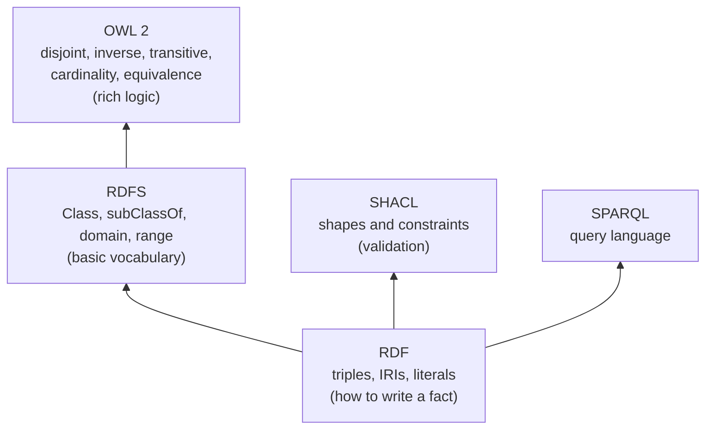

# RDF, RDFS and OWL in Plain English: The Complete Guide

> 📚 **Before you start**
>
> - [What is an Ontology? A Worked Example](what-is-an-ontology-a-worked-example.md), for the tea-shop ontology in Turtle.
> - [Taxonomies, Schemas and Ontologies Compared](taxonomies-schemas-and-ontologies-compared.md), for SKOS and the inverse/transitive examples.

## Introduction

Indian postal addresses work because everyone follows layers of agreement. At the bottom, an address is just lines of text. On top of that, there's an agreed structure: name, house, street, city, **PIN code**. On top of *that*, there are rules: a PIN starting with 4 is in western India, so a Pune address with a Kolkata PIN is wrong. Each layer adds meaning, and each depends on the one below.

The semantic web standards for knowledge graphs are layered the same way:

- **RDF** is the bottom layer: *how to write any fact as a triple*, with globally unique names.
- **RDFS** adds a small vocabulary for *classes and properties*: subclass, domain, range, label.
- **OWL** adds rich *logical rules*: disjointness, inverses, transitivity, cardinality, equivalence.
- **SHACL** sits beside them as the *validator*: does this data have the shape we require?

You've already read and written all four without the formal names. This lesson gives you the plain-English meaning of each layer, shows what the files look like, runs the core reasoning rules in Python, and explains the one idea that trips up nearly everyone: the **open-world assumption**.

> 💡 **Key Insight**
>
> RDF says **how to state facts**, RDFS and OWL say **what can be concluded from them**, and SHACL says **what the data must look like**. OWL reasoners never say "your data is incomplete"; they assume missing facts might exist somewhere. If you want "reject this record", you want SHACL.

---

## Core Explanation

### 1. The layer cake



### 2. RDF: facts as triples with global names

**RDF (Resource Description Framework)** is a W3C standard data model. Its only structure is the **triple**: *subject, predicate, object*. Three kinds of thing can appear in a triple:

| Kind | What it is | Example |
|---|---|---|
| **IRI** (Internationalized Resource Identifier) | A globally unique name that looks like a web address | `<https://chaibazaar.example/data/C-17>` |
| **Literal** | A plain value, optionally with a datatype or language | `"Priya Nair"`, `"240.00"^^xsd:decimal`, `"चाय"@hi` |
| **Blank node** | An unnamed "something", used for intermediate structure | `_:b1`, or `[ ... ]` in Turtle |

Why IRIs instead of simple IDs like `C-17`? Because two companies can both have a `C-17`. IRIs are unique worldwide (you own your domain), so graphs from different organisations can be merged without clashes. That's RDF's superpower: **data integration**.

The same facts can be written in several **serialisations** (file formats). All of these mean exactly the same two triples:

**Turtle** (human-friendly, with prefixes):

```turtle
@prefix shop: <https://chaibazaar.example/ontology#> .
@prefix ex:   <https://chaibazaar.example/data/> .
ex:C-17 a shop:Customer ; shop:name "Priya Nair" .
```

**N-Triples** (one full triple per line, easy for machines and line-based tools):

```text
<https://chaibazaar.example/data/C-17> <http://www.w3.org/1999/02/22-rdf-syntax-ns#type> <https://chaibazaar.example/ontology#Customer> .
<https://chaibazaar.example/data/C-17> <https://chaibazaar.example/ontology#name> "Priya Nair" .
```

**JSON-LD** (RDF as JSON, used by Schema.org markup on web pages):

```json
{
  "@context": {"shop": "https://chaibazaar.example/ontology#"},
  "@id": "https://chaibazaar.example/data/C-17",
  "@type": "shop:Customer",
  "shop:name": "Priya Nair"
}
```

There's also RDF/XML (older, verbose) and TriG (Turtle plus named graphs). Since every format is just triples, converting between them is mechanical. Here's a tiny converter from Python triples to N-Triples:

```python
PREFIXES = {
    "shop": "https://chaibazaar.example/ontology#",
    "ex": "https://chaibazaar.example/data/",
    "rdf": "http://www.w3.org/1999/02/22-rdf-syntax-ns#",
    "xsd": "http://www.w3.org/2001/XMLSchema#",
}

def term(x):
    if isinstance(x, tuple):                       # (value, datatype) literal
        value, dtype = x
        return f'"{value}"^^{term(dtype)}'
    if ":" in x and x.split(":")[0] in PREFIXES:   # prefixed name -> full IRI
        prefix, local = x.split(":", 1)
        return f"<{PREFIXES[prefix]}{local}>"
    return '"' + x.replace('"', '\\"') + '"'        # plain string literal

triples = [("ex:C-17", "rdf:type", "shop:Customer"),
           ("ex:C-17", "shop:name", "Priya Nair"),
           ("ex:P-ASSAM", "shop:priceInr", ("240.00", "xsd:decimal"))]
for s, p, o in triples:
    print(term(s), term(p), term(o), ".")
```

Output:

```
<https://chaibazaar.example/data/C-17> <http://www.w3.org/1999/02/22-rdf-syntax-ns#type> <https://chaibazaar.example/ontology#Customer> .
<https://chaibazaar.example/data/C-17> <https://chaibazaar.example/ontology#name> "Priya Nair" .
<https://chaibazaar.example/data/P-ASSAM> <https://chaibazaar.example/ontology#priceInr> "240.00"^^<http://www.w3.org/2001/XMLSchema#decimal> .
```

### 3. Statements about statements: named graphs and RDF 1.2

Plain triples can't say *who said* a fact or *when* it was true. RDF has two answers:

- **Named graphs**: group triples into a graph with its own IRI, then describe that graph ("this graph came from the March invoice import"). A triple plus its graph name is called a **quad**. The TriG and N-Quads formats store them.
- **RDF 1.2** (which reached Candidate Recommendation at the W3C in 2026) adds **triple terms**, so a triple can itself be the subject of other statements. Turtle 1.2 offers a compact *annotation* syntax:

```turtle
ex:C-17 shop:livesIn ex:MUMBAI {| ex:source ex:order-O-1077 ; ex:asOf "2026-10-02"^^xsd:date |} .
```

That reads: *"Priya lives in Mumbai, and that statement comes from order O-1077 as of 2 October."* It's the RDF way to put properties on a relationship, which property graphs like Neo4j have always had.

### 4. RDFS: a vocabulary for classes and properties

**RDFS (RDF Schema)** gives you a small, standard set of terms to describe your own vocabulary:

| RDFS term | Meaning |
|---|---|
| `rdfs:Class` | "This is a class." (OWL uses `owl:Class`.) |
| `rdfs:subClassOf` | "Every member of this class is a member of that one." |
| `rdfs:subPropertyOf` | "Whenever this property holds, that one holds too." |
| `rdfs:domain` | "Anything with this property is a member of this class." |
| `rdfs:range` | "Any value of this property is a member of this class." |
| `rdfs:label`, `rdfs:comment` | Human-readable name and definition. |

Read the domain and range rows carefully. They are **inference rules**, not checks. The RDF standard defines a set of **entailment rules** that a reasoner applies. Here are the five that matter most, running on the tea shop:

```python
SCHEMA = {
    ("shop:Tea", "rdfs:subClassOf", "shop:Product"),
    ("shop:Product", "rdfs:subClassOf", "shop:Item"),
    ("shop:placedBy", "rdfs:domain", "shop:Order"),
    ("shop:placedBy", "rdfs:range", "shop:Customer"),
    ("shop:giftedBy", "rdfs:subPropertyOf", "shop:placedBy"),   # a gift order is still placed by someone
}
DATA = {("ex:O-7", "shop:giftedBy", "ex:C-17"), ("ex:P-ASSAM", "rdf:type", "shop:Tea")}

def rdfs_closure(triples):
    g = set(triples)
    while True:
        new = set()
        for s, p, o in g:
            for a, q, b in g:
                if q == "rdfs:subPropertyOf" and p == a:            # rdfs7: inherit the super-property
                    new.add((s, b, o))
                if q == "rdfs:domain" and p == a:                   # rdfs2: domain gives subject a type
                    new.add((s, "rdf:type", b))
                if q == "rdfs:range" and p == a:                    # rdfs3: range gives object a type
                    new.add((o, "rdf:type", b))
                if p == "rdf:type" and q == "rdfs:subClassOf" and o == a:   # rdfs9: subclass membership
                    new.add((s, "rdf:type", b))
                if p == q == "rdfs:subClassOf" and o == a:          # rdfs11: subClassOf is transitive
                    new.add((s, p, b))
        if new <= g:
            return g
        g |= new

derived = rdfs_closure(SCHEMA | DATA) - SCHEMA - DATA
for t in sorted(derived):
    print(t)
```

Output:

```
('ex:C-17', 'rdf:type', 'shop:Customer')
('ex:O-7', 'rdf:type', 'shop:Order')
('ex:O-7', 'shop:placedBy', 'ex:C-17')
('ex:P-ASSAM', 'rdf:type', 'shop:Item')
('ex:P-ASSAM', 'rdf:type', 'shop:Product')
('shop:Tea', 'rdfs:subClassOf', 'shop:Item')
```

From two data triples the reasoner derived six new facts: the gift order is placed by Priya (subproperty), O-7 is an Order (domain), Priya is a Customer (range), and Assam tea is a Product and an Item (subclass, twice).

### 5. OWL: richer logic

**OWL 2 (Web Ontology Language)** builds on RDFS with constructs from description logic. The ones you'll use most:

| OWL construct | Plain English | Tea-shop example |
|---|---|---|
| `owl:disjointWith` | Nothing is in both classes | Tea and SpiceMix |
| `owl:equivalentClass` | Same members, two names | `shop:Customer` ≡ `schema:Customer` in a partner's ontology |
| `owl:inverseOf` | One property is the other read backwards | `placed` ↔ `placedBy` |
| `owl:TransitiveProperty` | A→B and B→C give A→C | `partOf` |
| `owl:SymmetricProperty` | A→B gives B→A | `siblingOf` |
| `owl:FunctionalProperty` | At most one value | `placedBy` |
| `owl:sameAs` | Two IRIs name the same thing | Your `ex:C-17` and the CRM's `crm:cust/88412` |
| Restrictions (`someValuesFrom`, `allValuesFrom`, cardinality) | Classes defined by their relationships | "A `VIPCustomer` is a customer who placed at least 10 orders" |

Here's a class *defined* by a restriction, so a reasoner can classify individuals automatically:

```turtle
shop:TeaLover a owl:Class ;
    owl:equivalentClass [
        a owl:Class ;
        owl:intersectionOf ( shop:Customer
                             [ a owl:Restriction ;
                               owl:onProperty shop:bought ;
                               owl:someValuesFrom shop:Tea ] )
    ] .
```

*"A TeaLover is exactly a Customer who bought at least one Tea."* Any customer with a `bought` link to some tea is inferred to be a TeaLover, with no one tagging them by hand.

OWL 2 also defines **profiles**, restricted subsets that reason fast at scale: **OWL 2 EL** (large class hierarchies, used by big medical ontologies), **OWL 2 QL** (query rewriting over databases) and **OWL 2 RL** (rule-based, fits databases and triple stores). Tools you'll meet: the **Protégé** ontology editor, and reasoners such as **HermiT**, **Pellet** and **ELK**.

### 6. The open-world assumption: the big surprise

Relational databases use the **closed-world assumption**: if a fact isn't in the database, it's false. RDF and OWL use the **open-world assumption**: if a fact isn't in the graph, it's merely *unknown*. They also make **no unique name assumption**: two different IRIs might name the same thing.

That changes what rules *do*. Take the functional property `placedBy` (at most one customer per order), and an order with two:

```python
def owl_functional(triples, functional_props):
    """What an OWL reasoner concludes from a functional property with two values."""
    conclusions = []
    by_subject = {}
    for s, p, o in sorted(triples):
        if p in functional_props:
            by_subject.setdefault((s, p), []).append(o)
    for (s, p), values in by_subject.items():
        for other in values[1:]:
            conclusions.append((values[0], "owl:sameAs", other))
    return conclusions

data = {("ex:O-1003", "shop:placedBy", "ex:C-17"), ("ex:O-1003", "shop:placedBy", "ex:C-21")}
print("Closed-world validator says: ERROR, O-1003 has 2 customers")
print("Open-world OWL reasoner says:", owl_functional(data, {"shop:placedBy"}))
```

Output:

```
Closed-world validator says: ERROR, O-1003 has 2 customers
Open-world OWL reasoner says: [('ex:C-17', 'owl:sameAs', 'ex:C-21')]
```

The reasoner doesn't complain. It concludes that **C-17 and C-21 must be the same person** with two IDs. That's logical under its assumptions, and very surprising if you expected an error. Similarly, a missing `hasLine` on an order isn't a violation to OWL: the line might exist in some other dataset. You only get a hard **inconsistency** when facts directly contradict each other, for example if C-17 and C-21 were also declared `owl:differentFrom` each other, or if one thing is typed into two disjoint classes.

| Assumption | Closed world (SQL, SHACL, your app) | Open world (RDFS, OWL) |
|---|---|---|
| Missing fact | False | Unknown |
| Two IDs | Two different things | Possibly the same thing |
| Rule like "exactly one customer" | Checks the data and reports violations | Infers new facts; only contradictions are errors |
| Good for | Validating records before they enter a system | Integrating data from many sources, deriving facts |

### 7. SHACL: validation for RDF data

**SHACL (Shapes Constraint Language)** is the W3C standard for validating RDF data under closed-world rules. You write **shapes** that say what valid data looks like:

```turtle
@prefix sh:   <http://www.w3.org/ns/shacl#> .
@prefix shop: <https://chaibazaar.example/ontology#> .
@prefix xsd:  <http://www.w3.org/2001/XMLSchema#> .

shop:OrderShape a sh:NodeShape ;
    sh:targetClass shop:Order ;
    sh:property [
        sh:path shop:placedBy ;
        sh:class shop:Customer ;
        sh:minCount 1 ; sh:maxCount 1 ;
        sh:message "Every order must be placed by exactly one Customer." ;
    ] ;
    sh:property [
        sh:path shop:hasLine ;
        sh:minCount 1 ;
    ] .

shop:OrderLineShape a sh:NodeShape ;
    sh:targetClass shop:OrderLine ;
    sh:property [
        sh:path shop:quantity ;
        sh:datatype xsd:integer ;
        sh:minInclusive 1 ;
    ] .
```

A SHACL engine (such as the `pyshacl` Python package, or the validators built into triple stores) reads the shapes and the data and produces a **validation report**. For the bad orders from the worked example, a report says, in summary:

Example output:

```
Conforms: False
Results (4):
  Focus node ex:O-1002, path shop:placedBy: Every order must be placed by exactly one Customer.  (value ex:PUNE is not a shop:Customer)
  Focus node ex:O-1003, path shop:placedBy: Every order must be placed by exactly one Customer.  (2 values, maxCount 1)
  Focus node ex:O-1002, path shop:hasLine: Less than 1 values
  Focus node ex:O-1003, path shop:hasLine: Less than 1 values
```

Notice the division of labour: the **OWL ontology** says what things mean and what follows; the **SHACL shapes** say what a record must contain before you accept it. Your `validate` function in the worked example was a hand-written SHACL.

### 8. Which layer do I need?

| You want to... | Use |
|---|---|
| Exchange facts with other systems with globally unique IDs | RDF (any serialisation) |
| Share a class hierarchy, labels and definitions | RDFS |
| Derive facts automatically, map vocabularies, define classes by their relationships | OWL (pick a profile for scale) |
| Reject bad records at the door, check LLM-extracted facts | SHACL |
| Query any of it | SPARQL ([SPARQL and RDF Triple Stores](../course.md#m4)) |

In practice many teams use a **light ontology** (RDFS plus a few OWL features like inverse and disjoint) and put most of the rigour into **SHACL shapes**, because closed-world validation is what applications usually need.

---

## Try It Yourself

1. **Serialise.** Add the triple `("ex:O-1001", "shop:orderDate", ("2026-09-14", "xsd:date"))` and print it as N-Triples.
2. **Reason.** Add `("shop:VIPCustomer", "rdfs:subClassOf", "shop:Customer")` and the data `("ex:C-50", "rdf:type", "shop:VIPCustomer")`. What does `rdfs_closure` derive about C-50?
3. **Open world.** An OWL ontology says every Order has at least one `hasLine`. Order O-9 has no lines in your graph. Will a reasoner report an error? What would SHACL do?

<details>
<summary>Show answers</summary>

**1.**

```python
s, p, o = ("ex:O-1001", "shop:orderDate", ("2026-09-14", "xsd:date"))
print(term(s), term(p), term(o), ".")
```

Output:

```
<https://chaibazaar.example/data/O-1001> <https://chaibazaar.example/ontology#orderDate> "2026-09-14"^^<http://www.w3.org/2001/XMLSchema#date> .
```

**2.**

```python
extra = {("shop:VIPCustomer", "rdfs:subClassOf", "shop:Customer"), ("ex:C-50", "rdf:type", "shop:VIPCustomer")}
print(sorted(t for t in rdfs_closure(SCHEMA | extra) if t[0] == "ex:C-50"))
```

Output:

```
[('ex:C-50', 'rdf:type', 'shop:Customer'), ('ex:C-50', 'rdf:type', 'shop:VIPCustomer')]
```

**3.** No error from the reasoner: under the open-world assumption the line may exist but be unknown, so the reasoner simply believes O-9 has *some* line. SHACL, which is closed-world, reports a violation (`sh:minCount 1` on `shop:hasLine`).

</details>

---

## Real-World Examples

- **Schema.org JSON-LD** on product and recipe pages is RDF; search engines merge it into their knowledge graphs.
- **Government open-data portals** in Europe publish datasets described with the DCAT vocabulary in RDF so catalogues can harvest each other.
- **Biomedical ontologies** such as SNOMED CT are maintained in OWL 2 EL and classified by fast reasoners like ELK.
- **Enterprises** run SHACL validation on data entering their knowledge graphs, including facts extracted by LLMs.

---

## Common Misconceptions

### "RDF means XML"

RDF/XML was an early format. Most people now use Turtle, JSON-LD or N-Triples. RDF is the data model, not a file format.

### "OWL is for validating data"

OWL is for inference under the open-world assumption. A "violation" usually becomes a new inferred fact (like `sameAs`). Use SHACL for validation.

### "Domain and range are type checks"

They're inference rules: using `placedBy` on Pune makes a reasoner conclude Pune is a Customer. Only a disjointness declaration (City disjoint with Customer) would turn that into a detectable contradiction.

### "You need full OWL to get value"

RDFS plus a handful of OWL features covers most business needs. Heavy OWL modelling is worth it in domains like medicine where automatic classification matters.

---

## Interview Relevance

Questions include *"Explain RDF, RDFS and OWL"* and *"What's the open-world assumption?"* A strong answer: RDF is the triple data model with IRIs, literals and blank nodes, serialised as Turtle/JSON-LD/N-Triples; RDFS adds class and property vocabulary with entailment rules (subclass, subproperty, domain, range); OWL 2 adds description-logic constructs (disjointness, inverse, transitive, cardinality, equivalence) and profiles (EL, QL, RL) for tractable reasoning; open-world and no-unique-name assumptions mean reasoners infer rather than reject; SHACL provides closed-world validation. Bonus: mention named graphs and RDF 1.2 triple terms for provenance.

---

## Key Takeaways

- **RDF** is triples with global IRIs; Turtle, JSON-LD and N-Triples are just formats.
- **RDFS** adds subclass, subproperty, domain and range, which act as inference rules.
- **OWL 2** adds rich logic (disjoint, inverse, transitive, cardinality, equivalence) with scalable profiles.
- **Open world**: missing facts are unknown and two IDs may be one thing, so reasoners infer instead of complaining.
- **SHACL** is the closed-world validator you use to accept or reject data.

---

**Up next:** [Designing an Ontology for Your Domain](designing-an-ontology-for-your-domain.md)
