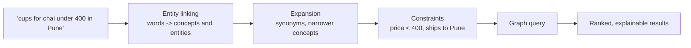
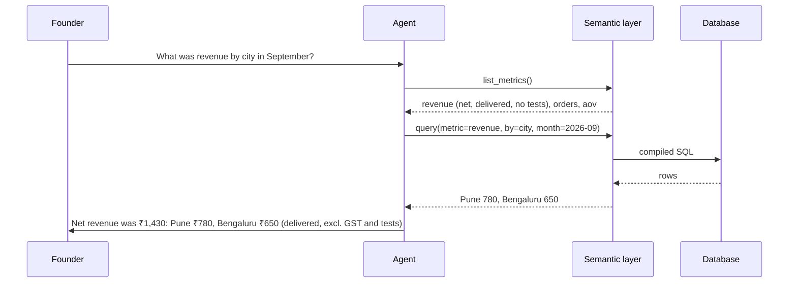
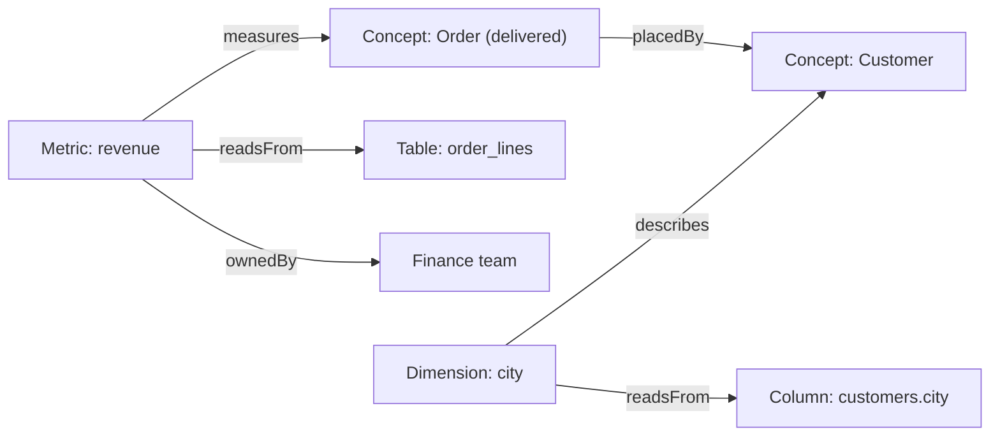

# Semantic Search, Semantic Layers and Shared Meaning: The Complete Guide

> 📚 **Before you start**
>
> - [Taxonomies, Schemas and Ontologies Compared](taxonomies-schemas-and-ontologies-compared.md), for taxonomies, thesauri and SKOS.
> - [Knowledge Graphs vs Relational Databases vs Vector Stores](../02-entities-and-relationships/knowledge-graphs-vs-relational-databases-vs-vector-stores.md), for keyword vs vector search.

## Introduction

At Chai Bazaar's monthly review, the finance head says September revenue was **₹4.1 lakh**. The sales head says **₹4.9 lakh**. The new AI analytics assistant, asked the same question, writes its own SQL and says **₹5.3 lakh**. All three ran correct queries. Finance subtracted GST and returns; sales counted orders on the day they were placed, including cancelled ones; the assistant summed every order line including test orders. The word "revenue" had three meanings, and nobody had written down which one the company meant.

The same problem appears in search. A customer types *"cups for chai under 400 in Pune"*. A keyword engine looks for the words "cups", "chai", "400" and "Pune" in product text, and returns a blog post about Pune's chai stalls. The customer meant: *products of type Kulhad Cup, priced below ₹400, deliverable to the city Pune*.

Both problems have the same root: **meaning lives in people's heads instead of in a shared, machine-readable place**. This lesson covers the three tools that fix it: **semantic search** (understand what a query means), **semantic layers** (define business metrics once) and the ontology-backed **shared meaning** that ties them together, including for AI agents.

> 💡 **Key Insight**
>
> "Semantic" just means "about meaning". Semantic search maps words to **things and constraints** before searching. A semantic layer maps business words like "revenue" to **one agreed calculation**. Both work best when they share one vocabulary, which is what an ontology provides.

---

## Core Explanation

### 1. Three kinds of search

| Kind | How it matches | Strength | Weakness |
|---|---|---|---|
| **Lexical (keyword)** | Shared words, ranked by statistics like BM25 | Exact names, codes, rare words | Misses synonyms; no idea what words *mean* |
| **Vector (embedding)** | Nearness of meaning vectors | Synonyms, paraphrases, fuzzy intent | Weak on exact constraints ("under ₹400", "in Pune"); can't list everything |
| **Knowledge-graph semantic search** | Recognises entities, types and constraints, then queries the graph | Precise, explainable, handles constraints and relationships | Needs a graph and an entity linker |

The best systems combine all three. The knowledge-graph part is the one most teams skip, so let's build it.

### 2. Semantic search with a knowledge graph, step by step



The pipeline:

1. **Entity linking**: find which words refer to known concepts or entities ("cups for chai" → concept *Kulhad Cup*; "Pune" → entity *City: Pune*).
2. **Expansion**: use the taxonomy and thesaurus to include narrower concepts and synonyms.
3. **Constraint extraction**: turn "under 400" into `price < 400`.
4. **Graph query**: find products matching the concept, filtered by constraints and relationships (deliverable to Pune).

```python
import re

CONCEPTS = {  # concept -> labels people use (from the thesaurus)
    "KulhadCup": ["kulhad", "kullad", "clay cup", "cups for chai", "chai cups"],
    "BlackTea": ["black tea", "ctc", "kadak chai"],
    "SpiceMix": ["masala", "chai masala", "spice mix"],
}
NARROWER = {"BlackTea": ["Assam", "Darjeeling"]}
CITIES = {"pune": "PUNE", "bengaluru": "BLR", "bangalore": "BLR", "kolkata": "CCU"}

PRODUCTS = [  # (id, name, concept, price_inr, ships_to)
    ("P-K6", "Kulhad Cups (set of 6)", "KulhadCup", 300, {"PUNE", "BLR"}),
    ("P-K12", "Kulhad Cups (set of 12)", "KulhadCup", 520, {"PUNE", "BLR", "CCU"}),
    ("P-KB", "Hand-painted Kulhad (set of 4)", "KulhadCup", 380, {"CCU"}),
    ("P-ASSAM", "Assam CTC Tea", "Assam", 240, {"PUNE", "BLR", "CCU"}),
    ("P-DARJ", "Darjeeling First Flush", "Darjeeling", 650, {"BLR", "CCU"}),
]

def understand(query):
    q = query.lower()
    concept = next((c for c, labels in CONCEPTS.items() if any(l in q for l in labels)), None)
    city = next((code for name, code in CITIES.items() if re.search(rf"\b{name}\b", q)), None)
    under = re.search(r"(?:under|below|less than)\s*(?:rs\.?|₹)?\s*(\d+)", q)
    return {"concept": concept, "city": city, "max_price": int(under.group(1)) if under else None}

def semantic_search(query):
    intent = understand(query)
    concepts = {intent["concept"]} | set(NARROWER.get(intent["concept"], []))
    hits = [p for p in PRODUCTS
            if p[2] in concepts
            and (intent["max_price"] is None or p[3] < intent["max_price"])
            and (intent["city"] is None or intent["city"] in p[4])]
    return intent, [name for _, name, *_ in hits]

for q in ["cups for chai under 400 in Pune", "kadak chai for Bangalore", "kullad below Rs 600"]:
    print(q, "->", semantic_search(q))
```

Output:

```
cups for chai under 400 in Pune -> ({'concept': 'KulhadCup', 'city': 'PUNE', 'max_price': 400}, ['Kulhad Cups (set of 6)'])
kadak chai for Bangalore -> ({'concept': 'BlackTea', 'city': 'BLR', 'max_price': None}, ['Assam CTC Tea', 'Darjeeling First Flush'])
kullad below Rs 600 -> ({'concept': 'KulhadCup', 'city': None, 'max_price': 600}, ['Kulhad Cups (set of 6)', 'Kulhad Cups (set of 12)', 'Hand-painted Kulhad (set of 4)'])
```

Three things happened that neither keyword nor vector search does reliably: "kadak chai" was expanded through the taxonomy to Assam and Darjeeling (narrower concepts of Black Tea), "Bangalore" was resolved to the same city entity as "Bengaluru", and "under 400" became a hard filter that excluded the ₹520 set and the hand-painted set that doesn't ship to Pune. The result also comes with its own explanation: the `intent` dictionary shows exactly how the query was understood.

In production, an LLM usually does the understanding step (returning the same intent dictionary as structured output), and a vector index helps match concepts when no thesaurus label fits. The knowledge graph supplies the entities, synonyms, hierarchy and relationships it maps onto.

### 3. The semantic layer: one definition of "revenue"

A **semantic layer** (also called a **metrics layer**) is a place where business terms are defined once, in terms of the underlying tables: **metrics** (revenue, active customers, average order value), **dimensions** (city, month, category) and how tables **join**. Dashboards, notebooks and AI agents all ask the semantic layer instead of writing their own SQL.

A semantic model is usually written in YAML. Tools such as dbt's Semantic Layer (MetricFlow), Cube and Looker's LookML all use this general shape, and the vendor-neutral **Open Semantic Interchange** specification (renamed **Apache Ossie**, incubating, in July 2026, with contributors including Snowflake, Salesforce, Databricks and dbt Labs) aims to let these definitions move between tools.

```yaml
# semantic model, illustrative
entities:
  order:   {table: orders, key: id}
  line:    {table: order_lines, key: id, joins: {order: order_id}}
  customer: {table: customers, key: id, joins_from: {order: customer_id}}
dimensions:
  city:  {entity: customer, column: city}
  month: {entity: order, expr: "substr(order_date, 1, 7)"}
metrics:
  revenue:
    description: >
      Net revenue in INR: line amounts excluding GST, for delivered orders only,
      excluding test orders. Recognised in the month the order was placed.
    expr: "sum(line.qty * line.unit_price_inr)"
    filters: ["order.status = 'delivered'", "order.is_test = 0"]
  orders:
    description: Count of delivered, non-test orders.
    expr: "count(distinct order.id)"
    filters: ["order.status = 'delivered'", "order.is_test = 0"]
```

Now let's see the three teams' disagreement, and how compiling every question from one definition removes it.

```python
import sqlite3

db = sqlite3.connect(":memory:")
db.executescript("""
CREATE TABLE customers (id TEXT, city TEXT);
CREATE TABLE orders (id TEXT, customer_id TEXT, order_date TEXT, status TEXT, is_test INTEGER);
CREATE TABLE order_lines (id TEXT, order_id TEXT, qty INTEGER, unit_price_inr REAL, gst_rate REAL);
INSERT INTO customers VALUES ('C-17','Pune'), ('C-21','Bengaluru'), ('C-99','Pune');
INSERT INTO orders VALUES
  ('O-1','C-17','2026-09-03','delivered',0), ('O-2','C-21','2026-09-10','delivered',0),
  ('O-3','C-17','2026-09-18','cancelled',0), ('O-4','C-99','2026-09-20','delivered',1);
INSERT INTO order_lines VALUES
  ('L-1','O-1',2,240,0.05), ('L-2','O-1',1,300,0.12), ('L-3','O-2',1,650,0.05),
  ('L-4','O-3',3,180,0.05), ('L-5','O-4',5,240,0.05);
""")

finance = "SELECT sum(qty*unit_price_inr) FROM order_lines l JOIN orders o ON o.id=l.order_id WHERE status='delivered' AND is_test=0"
sales = "SELECT sum(qty*unit_price_inr*(1+gst_rate)) FROM order_lines l JOIN orders o ON o.id=l.order_id WHERE is_test=0"
ai_guess = "SELECT sum(qty*unit_price_inr*(1+gst_rate)) FROM order_lines"
for team, sql in [("finance", finance), ("sales", sales), ("AI assistant", ai_guess)]:
    print(f"{team:<13} ₹{db.execute(sql).fetchone()[0]:,.0f}")
```

Output:

```
finance       ₹1,430
sales         ₹2,090
AI assistant  ₹3,350
```

Three numbers again. Here's a tiny semantic layer: metrics and dimensions defined once, and a compiler that turns *"revenue by city"* into SQL.

```python
SEMANTIC_MODEL = {
    "base": "FROM order_lines line JOIN orders o ON o.id = line.order_id JOIN customers c ON c.id = o.customer_id",
    "metrics": {
        "revenue": {"expr": "sum(line.qty * line.unit_price_inr)",
                    "filters": ["o.status = 'delivered'", "o.is_test = 0"]},
        "orders": {"expr": "count(distinct o.id)",
                   "filters": ["o.status = 'delivered'", "o.is_test = 0"]},
    },
    "dimensions": {"city": "c.city", "month": "substr(o.order_date, 1, 7)"},
}

def compile_query(metric, by=None):
    m = SEMANTIC_MODEL["metrics"][metric]
    select = [f"{SEMANTIC_MODEL['dimensions'][by]} AS {by}"] if by else []
    sql = f"SELECT {', '.join(select + [m['expr'] + ' AS ' + metric])} {SEMANTIC_MODEL['base']} WHERE {' AND '.join(m['filters'])}"
    return sql + (f" GROUP BY {by} ORDER BY {by}" if by else "")

print(compile_query("revenue", by="city"))
for row in db.execute(compile_query("revenue", by="city")):
    print(row)
print("total:", db.execute(compile_query("revenue")).fetchone(), "orders:", db.execute(compile_query("orders")).fetchone())
```

Output:

```
SELECT c.city AS city, sum(line.qty * line.unit_price_inr) AS revenue FROM order_lines line JOIN orders o ON o.id = line.order_id JOIN customers c ON c.id = o.customer_id WHERE o.status = 'delivered' AND o.is_test = 0 GROUP BY city ORDER BY city
('Bengaluru', 650.0)
('Pune', 780.0)
total: (1430.0,) orders: (2,)
```

Every consumer that asks for `revenue` now gets the same ₹1,430, broken down consistently. If the company decides revenue should include GST, one line in the model changes and every dashboard and agent follows.

### 4. Why AI agents need a semantic layer

When an LLM writes SQL directly against raw tables, it has to *guess* business definitions from column names: is `status = 'cancelled'` excluded? Are test orders flagged? Is GST included? It will guess differently on different days. Giving it the semantic layer as a **tool** changes the task from "invent the right SQL" to "pick the right metric and dimension":



The metric's `description` doubles as the agent's explanation, so the answer states exactly what "revenue" meant. This is the same move as giving an agent good tool descriptions, applied to business meaning.

### 5. Shared meaning: connecting the ontology and the semantic layer

The semantic layer defines **calculations**; the ontology defines **things and relationships**. Together they form a company's shared meaning:

| Question | Answered by |
|---|---|
| What is a Customer? A delivered Order? A test order? | Ontology (classes, definitions, rules) |
| How is revenue calculated, by which dimensions? | Semantic layer (metrics, dimensions, joins) |
| Which table and column holds each thing? | Mappings from ontology terms to physical data |
| What does a user's query mean? | Semantic search using ontology labels, synonyms and hierarchy |

Some platforms store all of this *as a knowledge graph*: metric nodes linked to the ontology concepts they measure, the tables they read and the owners who approve them. An agent can then ask *"which metrics measure customers, and who owns them?"* and get an exact answer.



### 6. Practical guidance

- **Start with the ten metrics people argue about.** Define them with a clear description, owner and filters.
- **Put descriptions everywhere.** They serve humans, BI tools and LLMs at once.
- **Give agents the semantic layer, not raw tables**, for anything involving business metrics; keep raw SQL for exploratory work with review.
- **Feed search from the same vocabulary** (the ontology's labels and synonyms), so search, reports and agents speak the same language.

---

## Try It Yourself

1. **Search.** Add the synonym "chai glass" to `KulhadCup` and search `"chai glass for Kolkata"`. What comes back and why?
2. **Metric.** Add an `aov` (average order value) metric to `SEMANTIC_MODEL` and compute it by city.
3. **Argue it out.** Write a one-paragraph `description` for "active customer" that would end an argument between marketing and sales.

<details>
<summary>Show answers</summary>

**1.**

```python
CONCEPTS["KulhadCup"].append("chai glass")
CITIES["kolkata"] = "CCU"
print(semantic_search("chai glass for Kolkata"))
```

Output:

```
({'concept': 'KulhadCup', 'city': 'CCU', 'max_price': None}, ['Kulhad Cups (set of 12)', 'Hand-painted Kulhad (set of 4)'])
```

Only the 12-cup set and the hand-painted set ship to Kolkata (CCU).

**2.**

```python
SEMANTIC_MODEL["metrics"]["aov"] = {
    "expr": "round(sum(line.qty * line.unit_price_inr) * 1.0 / count(distinct o.id), 2)",
    "filters": ["o.status = 'delivered'", "o.is_test = 0"]}
print(db.execute(compile_query("aov", by="city")).fetchall())
```

Output:

```
[('Bengaluru', 650.0), ('Pune', 780.0)]
```

Each city has one delivered, non-test order, so the AOV equals its revenue.

**3.** For example: *"An active customer is a person with at least one delivered, non-test order in the last 90 days, counted on the date of delivery. Newsletter sign-ups without an order are 'subscribers', not customers. Owner: Head of Sales."* Notice it names the exclusions, the time window, the event that counts and an owner.

</details>

---

## Real-World Examples

- **E-commerce search** engines link query words to product types, brands and attributes from a product knowledge graph before ranking.
- **Data teams** use semantic layers (dbt Semantic Layer, Cube, LookML) so finance, sales and product dashboards report identical numbers.
- **Warehouse vendors** have added semantic models that AI assistants query instead of guessing SQL from raw tables.
- **Enterprise knowledge graphs** catalogue metrics, datasets and owners together, so people and agents can find "the" definition of a KPI.

---

## Common Misconceptions

### "Semantic search means vector search"

Vector search is one technique for matching meaning. Knowledge-graph semantic search understands entities and constraints precisely. Strong systems combine both.

### "A semantic layer is just a set of SQL views"

Views fix one query. A semantic layer defines metrics and dimensions that combine on demand, with descriptions and owners, for any tool or agent.

### "LLMs can infer business definitions from column names"

They'll produce *plausible* SQL. Plausible isn't agreed. Give them the defined metrics.

### "Shared meaning is a technology problem"

The technology stores and serves definitions. Agreeing on them, and naming owners, is an organisational decision the technology can only support.

---

## Interview Relevance

You may be asked *"How would you make an LLM analytics assistant give consistent numbers?"* or *"What is semantic search beyond embeddings?"* A strong answer: put metric definitions in a semantic layer (metrics, dimensions, joins, filters, descriptions, owners) and expose it as a tool so the model selects metrics instead of writing raw SQL; for search, combine lexical, vector and knowledge-graph understanding (entity linking, taxonomy expansion, constraint extraction); tie both to an ontology so labels and definitions are shared; mention emerging interchange standards for semantic models.

---

## Key Takeaways

- **Semantic search** maps words to entities, concepts and constraints before searching.
- **Taxonomy expansion and entity linking** fix synonyms and "kadak chai means black tea".
- **A semantic layer** defines each metric once; every dashboard and agent compiles from it.
- **Agents should query metrics, not raw tables**, for business numbers.
- **The ontology is the shared vocabulary** behind search, metrics and agents.

---

**Up next:** [Lab: Design an ontology for an online shop](lab-design-an-ontology-for-an-online-shop.md)
