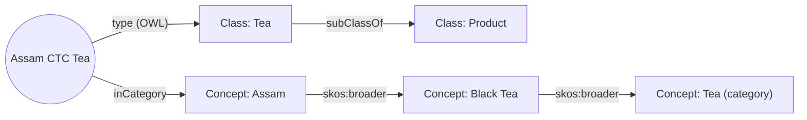

# Taxonomies, Schemas and Ontologies Compared: The Complete Guide

> 📚 **Before you start**
>
> - [What is an Ontology? A Worked Example](what-is-an-ontology-a-worked-example.md), for the tea-shop ontology in Turtle.

## Introduction

Walk into a big supermarket and look up: signs say *Beverages*, then *Tea and Coffee*, then *Green Tea* on one shelf. That's a **taxonomy**: things arranged in a hierarchy of categories. Now look at the barcode label on a packet: product code, MRP, weight, batch number, each in a fixed slot. That's a **schema**: the shape a record must have. And behind the scenes, the store's systems know that a *combo pack* contains *two products*, that a *loyalty member* can *place orders*, and that a product *can't be both vegetarian and non-vegetarian*. That's an **ontology**: meaning, relationships and rules.

People use these three words as if they were the same thing, and even experienced engineers argue about where one ends and the next begins. This lesson settles it with the same tea-shop data shown all three ways, plus their close cousins (controlled vocabularies and thesauri). By the end, you'll know what each one can and can't express, what they look like as real artefacts (SKOS Turtle, JSON Schema, OWL), and which one your project actually needs.

> 💡 **Key Insight**
>
> A **taxonomy** organises *terms* into a hierarchy. A **schema** fixes the *shape* of records so they can be stored and exchanged. An **ontology** describes *meaning*: kinds of things, how they relate and what must be true, so that software can reason. They aren't rivals; most real systems use all three together.

---

## Core Explanation

### 1. The whole comparison in one picture

![Three panels. Taxonomy: a tree from Products to Beverages, then Tea and Coffee, then Black Tea and Assam, with one relation, is a kind of. Schema: a products table with id, name, price and a seller foreign key, describing storage. Ontology: classes, relations and rules such as Tea subClassOf Product, Order placedBy exactly one Customer and Tea disjointWith SpiceMix, describing meaning. Below, a ladder from controlled vocabulary to taxonomy to thesaurus to ontology to knowledge graph, with more meaning and more effort to the right](/img/diagrams/knowledge-graphs-ontologies-and-unstructured-data/taxonomy-schema-ontology.svg)
*Each step to the right adds meaning, and adds effort. The schema sits beside them, describing storage.*

### 2. Controlled vocabulary: one agreed word per idea

The simplest step is a **controlled vocabulary**: an agreed list of terms, so that people stop writing the same thing five ways. Chai Bazaar's order notes say "kulhad", "kullad", "clay cup" and "matka cup" for one product type.

```python
VOCABULARY = {"kulhad": "Kulhad Cup", "kullad": "Kulhad Cup", "clay cup": "Kulhad Cup",
              "matka cup": "Kulhad Cup", "masala chai": "Masala Chai Mix", "chai masala": "Masala Chai Mix"}

notes = ["2 kullad sets", "Clay cup x6", "need chai masala", "Kulhad please", "green tea"]
for note in notes:
    term = next((v for k, v in VOCABULARY.items() if k in note.lower()), "UNKNOWN: needs review")
    print(f"{note:<18} -> {term}")
```

Output:

```
2 kullad sets      -> Kulhad Cup
Clay cup x6        -> Kulhad Cup
need chai masala   -> Masala Chai Mix
Kulhad please      -> Kulhad Cup
green tea          -> UNKNOWN: needs review
```

A controlled vocabulary has **no structure**: it can't tell you that a Kulhad Cup is an accessory, or that green tea is a tea.

### 3. Taxonomy: terms in a hierarchy

A **taxonomy** arranges terms into a tree using one relationship: *"is narrower than"* (or loosely, *"is a kind of"*). Here is Chai Bazaar's category tree in **SKOS** (Simple Knowledge Organization System), the W3C standard for taxonomies and thesauri:

```turtle
@prefix skos: <http://www.w3.org/2004/02/skos/core#> .
@prefix cat:  <https://chaibazaar.example/category/> .

cat:scheme    a skos:ConceptScheme ; skos:prefLabel "Chai Bazaar categories"@en .
cat:beverages a skos:Concept ; skos:prefLabel "Beverages"@en ; skos:topConceptOf cat:scheme .
cat:tea       a skos:Concept ; skos:prefLabel "Tea"@en ;       skos:broader cat:beverages .
cat:black-tea a skos:Concept ; skos:prefLabel "Black Tea"@en ; skos:broader cat:tea .
cat:green-tea a skos:Concept ; skos:prefLabel "Green Tea"@en ; skos:broader cat:tea .
cat:assam     a skos:Concept ; skos:prefLabel "Assam"@en ;     skos:broader cat:black-tea .
cat:spices    a skos:Concept ; skos:prefLabel "Spices"@en ;    skos:topConceptOf cat:scheme .
```

`skos:broader` points from a narrower category to its parent. The `@en` marks the label's language, so the same concept can carry `"चाय"@hi` too.

What a taxonomy is good at: **rolling up and drilling down**. Sales of Assam tea count towards Black Tea, Tea and Beverages:

```python
broader = {"tea": "beverages", "black-tea": "tea", "green-tea": "tea", "assam": "black-tea"}
sales = [("assam", 4800), ("green-tea", 1200), ("black-tea", 650), ("spices", 900)]

def lineage(category):
    chain = [category]
    while chain[-1] in broader:
        chain.append(broader[chain[-1]])
    return chain

totals = {}
for category, amount in sales:
    for level in lineage(category):
        totals[level] = totals.get(level, 0) + amount
for category in ["beverages", "tea", "black-tea", "assam", "green-tea", "spices"]:
    print(f"{category:<10} ₹{totals[category]:>5}")
```

Output:

```
beverages  ₹ 6650
tea        ₹ 6650
black-tea  ₹ 5450
assam      ₹ 4800
green-tea  ₹ 1200
spices     ₹  900
```

What a taxonomy **can't** do: say anything except "narrower/broader". It has no idea that products are *sold by* sellers or *placed in* orders.

### 4. Thesaurus: a taxonomy plus synonyms and related terms

A **thesaurus** adds more relationships between terms: preferred and alternative labels (synonyms), and "related" links that aren't parent-child. In SKOS:

```turtle
cat:kulhad a skos:Concept ;
    skos:prefLabel "Kulhad Cup"@en ;
    skos:altLabel  "kullad"@en, "clay cup"@en, "matka cup"@en ;
    skos:related   cat:masala-chai .
```

That makes search much smarter:

```python
THESAURUS = {
    "Kulhad Cup": {"alt": ["kullad", "clay cup", "matka cup"], "related": ["Masala Chai Mix"]},
    "Masala Chai Mix": {"alt": ["chai masala", "spiced tea mix"], "related": ["Kulhad Cup", "Assam CTC Tea"]},
}

def search(query):
    q = query.lower()
    hits = [c for c, info in THESAURUS.items() if q in c.lower() or any(q in a for a in info["alt"])]
    also = sorted({r for c in hits for r in THESAURUS[c]["related"]} - set(hits))
    return hits, also

print(search("clay cup"))
print(search("spiced tea"))
```

Output:

```
(['Kulhad Cup'], ['Masala Chai Mix'])
(['Masala Chai Mix'], ['Assam CTC Tea', 'Kulhad Cup'])
```

### 5. Schema: the shape of a record

A **schema** describes how data is **stored or exchanged**: which fields exist, their types, which are required, and how records refer to each other. It comes in many forms:

| Kind | Where you see it | Example |
|---|---|---|
| Relational schema | SQL databases | `CREATE TABLE products (id TEXT PRIMARY KEY, price_inr INTEGER NOT NULL, ...)` |
| JSON Schema | APIs, LLM structured output, tool definitions | `{"type": "object", "properties": {...}, "required": [...]}` |
| Graph schema | Neo4j constraints, GraphQL types | `CREATE CONSTRAINT FOR (p:Product) REQUIRE p.id IS UNIQUE` |
| Pydantic / dataclass models | Python code | `class Product(BaseModel): ...` |

Here's a schema for a product record, written as a Pydantic model and printed as the JSON Schema an API or an LLM would receive:

```python
import json
from typing import Literal
from pydantic import BaseModel, Field

class ProductRecord(BaseModel):
    id: str = Field(pattern=r"^P-[A-Z]+$")
    name: str
    price_inr: float = Field(gt=0)
    kind: Literal["Tea", "SpiceMix", "Accessory"]
    seller_id: str

schema = ProductRecord.model_json_schema()
print(json.dumps(schema["properties"], indent=1))
print("required:", schema["required"])
```

Output:

```
{
 "id": {
  "pattern": "^P-[A-Z]+$",
  "title": "Id",
  "type": "string"
 },
 "name": {
  "title": "Name",
  "type": "string"
 },
 "price_inr": {
  "exclusiveMinimum": 0,
  "title": "Price Inr",
  "type": "number"
 },
 "kind": {
  "enum": [
   "Tea",
   "SpiceMix",
   "Accessory"
  ],
  "title": "Kind",
  "type": "string"
 },
 "seller_id": {
  "title": "Seller Id",
  "type": "string"
 }
}
required: ['id', 'name', 'price_inr', 'kind', 'seller_id']
```

The schema is precise about **shape**: `price_inr` must be a positive number; `kind` is one of three strings. But it knows nothing about **meaning**. To the schema, `seller_id` is just a string; it can't say "this must identify a Seller", "a Tea is also a Product", or "an Order has exactly one Customer". Those are ontology statements.

### 6. Ontology: meaning, relationships and rules

An ontology can say things the others can't. Two examples beyond the subclass, domain, range and cardinality rules you saw in the worked example:

- **Inverse properties**: `placedBy` (Order → Customer) is the inverse of `placed` (Customer → Order). State one, and the other follows.
- **Transitive properties**: if a product is `partOf` a gift hamper, and the hamper is `partOf` a Diwali bundle, the product is `partOf` the bundle.

```turtle
shop:placed  a owl:ObjectProperty ; owl:inverseOf shop:placedBy .
shop:partOf  a owl:ObjectProperty, owl:TransitiveProperty .
```

```python
facts = {("O-1001", "placedBy", "C-17"),
         ("P-ASSAM", "partOf", "HAMPER-1"), ("HAMPER-1", "partOf", "DIWALI-BUNDLE")}
INVERSE = {"placedBy": "placed"}
TRANSITIVE = {"partOf"}

def reason(facts):
    facts = set(facts)
    while True:
        new = {(o, INVERSE[p], s) for s, p, o in facts if p in INVERSE}
        new |= {(a, p, c) for a, p, b in facts if p in TRANSITIVE
                for b2, p2, c in facts if p2 == p and b2 == b}
        if new <= facts:
            return facts
        facts |= new

for f in sorted(reason(facts) - facts):
    print("derived:", f)
```

Output:

```
derived: ('C-17', 'placed', 'O-1001')
derived: ('P-ASSAM', 'partOf', 'DIWALI-BUNDLE')
```

No taxonomy or schema can produce those facts. That's the dividing line: **an ontology lets software conclude things**.

### 7. Side by side

| | Controlled vocabulary | Taxonomy | Thesaurus | Schema | Ontology |
|---|---|---|---|---|---|
| Main purpose | Consistent words | Classify and navigate | Find and relate terms | Store and exchange records | Share meaning, reason, validate |
| Relationships | None | Broader/narrower | + synonyms, related | References (foreign keys) | Any typed relationship, plus rules |
| Typical standard | A list | SKOS | SKOS | SQL DDL, JSON Schema | OWL, RDFS (+ SHACL to validate) |
| Inference | No | Roll-up only | Synonym expansion | No | Yes |
| Example question | "What do we call this?" | "Total sales of all teas?" | "Did they mean kulhad?" | "Is this record well formed?" | "What must be true? What follows?" |
| Effort | Low | Low to medium | Medium | Medium | High |

### 8. A common confusion: is a category a class?

Is "Assam" a **subclass** of "Black Tea" (every Assam product is a Black Tea product) or a **narrower concept** (a category label in a navigation tree)? Both models exist, and mixing them causes bugs.

- Use **OWL classes** when membership has consequences: every `Tea` inherits `priceInr` and `soldBy`, and can't also be a `SpiceMix`.
- Use **SKOS concepts** for browsing categories, tags and facets that marketing can rearrange freely. Products then point to a concept with a property such as `shop:inCategory cat:assam`.

That's why the tea-shop ontology has both: `Tea` as a class (it changes what's true about a product) and `Category` as a separate thing products link to (it only organises the catalogue).



### 9. How they work together

In a mature system:

1. The **ontology** defines what a Product, Seller and Order *are* and the rules.
2. A **taxonomy** (SKOS) supplies the values for `inCategory`, managed by the merchandising team.
3. A **thesaurus** feeds search with synonyms.
4. **Schemas** (SQL tables, JSON Schema for the API, Pydantic models for LLM extraction) are *derived from* the ontology for each system that stores or exchanges data.

The ontology is the source of truth for meaning; schemas are its practical shadows in each technology.

---

## Try It Yourself

1. **Extend the taxonomy.** Add `darjeeling` under `black-tea` with ₹2,000 in sales and rerun the roll-up. What's the new total for `tea`?
2. **Schema vs meaning.** Create `ProductRecord(id="P-X", name="Mystery", price_inr=10, kind="Tea", seller_id="C-17")`. Does it validate? What is wrong that the schema can't see?
3. **Classify.** For each, say taxonomy, schema or ontology: (a) "A refund must reference exactly one order", (b) "Kurta is under Ethnic Wear under Women", (c) "`gst_rate` is a number with two decimals".

<details>
<summary>Show answers</summary>

**1.**

```python
broader["darjeeling"] = "black-tea"
sales.append(("darjeeling", 2000))
totals = {}
for category, amount in sales:
    for level in lineage(category):
        totals[level] = totals.get(level, 0) + amount
print(totals["tea"], totals["black-tea"])
```

Output:

```
8650 7450
```

**2.**

```python
record = ProductRecord(id="P-X", name="Mystery", price_inr=10, kind="Tea", seller_id="C-17")
print(record.seller_id)
```

Output:

```
C-17
```

It validates: the shape is fine. But `C-17` is a *customer*, not a seller. Only an ontology-aware check (range of `soldBy` is `Seller`) or a database foreign key into a sellers table would catch it.

**3.** (a) Ontology (a cardinality rule about meaning; a schema can enforce it too, as a required foreign key). (b) Taxonomy. (c) Schema (data type and format).

</details>

---

## Real-World Examples

- **E-commerce sites** keep a merchandising taxonomy for navigation ("Women › Ethnic Wear › Kurtas") separate from the product data schema.
- **Libraries** use thesauri such as the Library of Congress Subject Headings to link synonyms and related subjects.
- **Healthcare** uses ontologies (SNOMED CT) for clinical meaning and schemas (HL7 FHIR resources) for exchanging records between systems.
- **LLM tool calling** uses JSON Schema for the shape of tool inputs; teams increasingly generate those schemas from an ontology so the vocabulary stays consistent.

---

## Common Misconceptions

### "A taxonomy is a simple ontology"

A taxonomy has one relationship and no rules. Calling it an ontology sets wrong expectations: it can't validate relationships or infer anything beyond roll-ups.

### "If we have a good schema, we don't need an ontology"

A schema keeps records well formed inside one system. An ontology keeps meaning consistent *across* systems and lets you reason. You need the second when data from many sources must agree.

### "Ontologies replace schemas"

Databases, APIs and LLM structured outputs still need concrete schemas. The ontology is where you derive them from.

### "Category trees should be modelled as subclasses"

Only when membership changes what's true. Navigation categories change often and are better as SKOS concepts linked from products.

---

## Interview Relevance

*"What's the difference between a taxonomy, a schema and an ontology?"* is a favourite. A strong answer: a taxonomy is a hierarchy of terms (SKOS broader/narrower) for classification and roll-ups; a schema fixes record structure and types for storage or exchange (SQL DDL, JSON Schema) without meaning; an ontology models classes, relationships and axioms (OWL) so machines can infer and validate. Give one concrete example of each from the same domain, mention the thesaurus/controlled vocabulary steps, explain that categories-as-classes vs categories-as-concepts is a deliberate choice, and say that schemas are best generated from the ontology.

---

## Key Takeaways

- **Controlled vocabulary**: one agreed term per idea, no structure.
- **Taxonomy (SKOS)**: terms in a broader/narrower tree; great for navigation and roll-ups.
- **Thesaurus**: adds synonyms and related terms; great for search.
- **Schema**: the shape of records (SQL, JSON Schema, Pydantic); precise about types, blind to meaning.
- **Ontology (OWL)**: classes, relationships and rules; software can validate and infer.
- **Use them together**, with the ontology as the source of meaning.

---

**Up next:** [RDF, RDFS and OWL in Plain English](rdf-rdfs-and-owl-in-plain-english.md)
