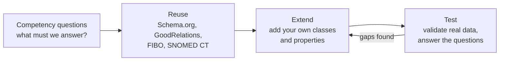

# What is an Ontology? A Worked Example: The Complete Guide

> 📚 **Before you start**
>
> - [What is a Knowledge Graph?](../02-entities-and-relationships/what-is-a-knowledge-graph.md), for triples, pattern queries and the subclass inference rule.
> - [Entities, Relationships and Properties](../02-entities-and-relationships/entities-relationships-and-properties.md), for the tea-shop data.

## Introduction

Two teams at Chai Bazaar both have a field called **"customer"**. For the sales team, a customer is anyone who has placed an order. For the marketing team, a customer is anyone who signed up for the newsletter, including people who never bought anything. Both teams report "12,000 customers" and "4,100 customers" to the founder in the same meeting. Nobody is lying. They just never agreed on what the word means.

Now imagine an AI agent reading both teams' data. It has even less chance of noticing the clash.

An **ontology** is the fix: a written, precise, machine-readable agreement about **what kinds of things exist in a domain, how they relate, and what must always be true about them**. Most explanations of ontologies stay abstract ("a formal specification of a shared conceptualisation"). This lesson does the opposite. We'll build a real ontology for the tea shop, look at it as a file, as a picture and as Python data, and then use it to catch bad data and infer new facts.

By the end, you'll be able to read an ontology written in Turtle, draw it, explain each part (classes, subclasses, object properties, datatype properties, domains, ranges, cardinality, disjointness), and run simple checks with it.

> 💡 **Key Insight**
>
> An ontology is **a rulebook for a knowledge graph**. The graph says *"Order 1001 was placed by Priya"*; the ontology says *"orders are placed by exactly one customer, and customers are people who placed at least one order"*. With the rulebook, software can catch nonsense and derive facts nobody wrote down.

---

## Core Explanation

### 1. What an ontology contains

Every ontology, from a tea shop's to a hospital's, is built from the same few parts:

| Part | Plain meaning | Tea-shop example |
|---|---|---|
| **Class** | A kind of thing | `Product`, `Customer`, `Order` |
| **Subclass** | A more specific kind; every member is also a member of the parent | `Tea` is a subclass of `Product` |
| **Object property** | A relationship between two things | `placedBy` links an `Order` to a `Customer` |
| **Datatype property** | A plain value attached to a thing | `priceInr` is a number on a `Product` |
| **Domain** | The class a property starts from | `placedBy` starts from `Order` |
| **Range** | The class (or data type) a property points to | `placedBy` points to `Customer`; `priceInr` points to a decimal |
| **Cardinality** | How many values are allowed | An order has *exactly one* `placedBy` |
| **Disjointness** | Classes that can't overlap | Nothing is both `Tea` and `SpiceMix` |
| **Individuals** | The actual things (usually kept in the data, not the ontology) | Priya, Order 1001 |

The ontology is the **classes, properties and rules**. The knowledge graph is the ontology **plus the individual facts**.

### 2. The tea-shop ontology as a picture


*The ontology describes kinds of things. Notice there's no Priya or Pune in the boxes: those are data that must follow the rules.*

Read the picture as sentences: *"Every Order is placed by exactly one Customer. An Order has one or more OrderLines. Each OrderLine is for a Product. A Tea is a kind of Product."* That's all an ontology is: sentences like these, written precisely enough for a computer.

### 3. The same ontology as a file (Turtle)

Ontologies are usually saved as RDF files using the **OWL** (Web Ontology Language) vocabulary. The most readable format is **Turtle** (`.ttl`). Here is the complete tea-shop ontology. Don't worry about every symbol yet; section 4 walks through it line by line.

```turtle
# chaibazaar-ontology.ttl
@prefix shop: <https://chaibazaar.example/ontology#> .
@prefix owl:  <http://www.w3.org/2002/07/owl#> .
@prefix rdfs: <http://www.w3.org/2000/01/rdf-schema#> .
@prefix xsd:  <http://www.w3.org/2001/XMLSchema#> .

<https://chaibazaar.example/ontology> a owl:Ontology ;
    rdfs:label "Chai Bazaar shop ontology" ;
    owl:versionInfo "1.0" .

# ---------- Classes ----------
shop:Product   a owl:Class ; rdfs:label "Product" ;
               rdfs:comment "Anything Chai Bazaar sells." .
shop:Tea       a owl:Class ; rdfs:subClassOf shop:Product .
shop:SpiceMix  a owl:Class ; rdfs:subClassOf shop:Product ;
               owl:disjointWith shop:Tea .
shop:Accessory a owl:Class ; rdfs:subClassOf shop:Product .
shop:Customer  a owl:Class ; rdfs:comment "A person who has placed at least one order." .
shop:Order     a owl:Class .
shop:OrderLine a owl:Class ; rdfs:comment "One product and its quantity within an order." .
shop:Seller    a owl:Class .
shop:City      a owl:Class .
shop:Category  a owl:Class .

# ---------- Object properties (thing -> thing) ----------
shop:placedBy   a owl:ObjectProperty, owl:FunctionalProperty ;
                rdfs:domain shop:Order ; rdfs:range shop:Customer .
shop:hasLine    a owl:ObjectProperty ;
                rdfs:domain shop:Order ; rdfs:range shop:OrderLine .
shop:forProduct a owl:ObjectProperty, owl:FunctionalProperty ;
                rdfs:domain shop:OrderLine ; rdfs:range shop:Product .
shop:shipsTo    a owl:ObjectProperty ;
                rdfs:domain shop:Order ; rdfs:range shop:City .
shop:livesIn    a owl:ObjectProperty ;
                rdfs:domain shop:Customer ; rdfs:range shop:City .
shop:soldBy     a owl:ObjectProperty ;
                rdfs:domain shop:Product ; rdfs:range shop:Seller .
shop:inCategory a owl:ObjectProperty ;
                rdfs:domain shop:Product ; rdfs:range shop:Category .

# ---------- Datatype properties (thing -> plain value) ----------
shop:name      a owl:DatatypeProperty ; rdfs:range xsd:string .
shop:priceInr  a owl:DatatypeProperty ; rdfs:domain shop:Product ;   rdfs:range xsd:decimal .
shop:quantity  a owl:DatatypeProperty ; rdfs:domain shop:OrderLine ; rdfs:range xsd:positiveInteger .
shop:orderDate a owl:DatatypeProperty ; rdfs:domain shop:Order ;     rdfs:range xsd:date .
shop:gstin     a owl:DatatypeProperty ; rdfs:domain shop:Seller ;    rdfs:range xsd:string .

# ---------- Rules about how many ----------
shop:Order rdfs:subClassOf [
    a owl:Restriction ;
    owl:onProperty shop:hasLine ;
    owl:minCardinality "1"^^xsd:nonNegativeInteger
] .
```

And here is some **data** that uses it. Notice it lives in a separate file and only *refers to* the ontology's terms:

```turtle
# chaibazaar-data.ttl
@prefix shop: <https://chaibazaar.example/ontology#> .
@prefix ex:   <https://chaibazaar.example/data/> .
@prefix xsd:  <http://www.w3.org/2001/XMLSchema#> .

ex:C-17     a shop:Customer ; shop:name "Priya Nair" ; shop:livesIn ex:PUNE .
ex:PUNE     a shop:City ; shop:name "Pune" .
ex:O-1001   a shop:Order ;
            shop:placedBy ex:C-17 ;
            shop:shipsTo  ex:PUNE ;
            shop:orderDate "2026-09-14"^^xsd:date ;
            shop:hasLine  ex:L-1 .
ex:L-1      a shop:OrderLine ; shop:forProduct ex:P-ASSAM ; shop:quantity 2 .
ex:P-ASSAM  a shop:Tea ; shop:name "Assam CTC Tea" ; shop:priceInr 240.00 ;
            shop:soldBy ex:S-BRAHM .
ex:S-BRAHM  a shop:Seller ; shop:name "Brahmaputra Tea Co." .
```

### 4. Reading the Turtle, line by line

| Turtle | What it says in English |
|---|---|
| `@prefix shop: <https://...#> .` | "When I write `shop:Tea`, I mean the full web address `https://chaibazaar.example/ontology#Tea`." Prefixes keep names short but globally unique. |
| `shop:Product a owl:Class` | "Product is a class." `a` is shorthand for "is of type". |
| `rdfs:comment "Anything Chai Bazaar sells."` | A human-readable definition. These comments are what stop the "customer" argument from the introduction. |
| `shop:Tea rdfs:subClassOf shop:Product` | "Every Tea is a Product." |
| `owl:disjointWith shop:Tea` | "Nothing can be both a SpiceMix and a Tea." |
| `shop:placedBy a owl:ObjectProperty, owl:FunctionalProperty` | "`placedBy` links things to things, and each thing has at most one value for it." The comma means "and also of type". |
| `rdfs:domain shop:Order ; rdfs:range shop:Customer` | "`placedBy` goes from an Order to a Customer." The semicolon means "same subject, next statement". |
| `rdfs:range xsd:positiveInteger` | "Quantities are whole numbers above zero." The `xsd:` types are standard data types. |
| `[ a owl:Restriction ; owl:onProperty shop:hasLine ; owl:minCardinality "1"^^xsd:nonNegativeInteger ]` | An unnamed rule (the square brackets are a "blank node"): "the things that have at least one `hasLine`". Saying `Order rdfs:subClassOf` that rule means "every Order has at least one line". |
| `"2026-09-14"^^xsd:date` | A value with an explicit data type: this text is a date, not just a string. |
| `.` | End of statements about this subject. |

Together with the "placed by exactly one customer" from `FunctionalProperty` (at most one) and the fact that a real order always names its customer, you have every sentence from the picture.

### 5. The ontology as Python data

Under the Turtle syntax, an ontology is just triples, exactly like the knowledge graph from module 2. Let's hold the important ones in Python so we can *use* them.

```python
ONTOLOGY = {
    ("Tea", "subClassOf", "Product"), ("SpiceMix", "subClassOf", "Product"),
    ("Accessory", "subClassOf", "Product"), ("SpiceMix", "disjointWith", "Tea"),
    ("placedBy", "domain", "Order"), ("placedBy", "range", "Customer"),
    ("hasLine", "domain", "Order"), ("hasLine", "range", "OrderLine"),
    ("forProduct", "domain", "OrderLine"), ("forProduct", "range", "Product"),
    ("shipsTo", "domain", "Order"), ("shipsTo", "range", "City"),
    ("livesIn", "domain", "Customer"), ("livesIn", "range", "City"),
    ("soldBy", "domain", "Product"), ("soldBy", "range", "Seller"),
    ("inCategory", "domain", "Product"), ("inCategory", "range", "Category"),
    ("placedBy", "type", "FunctionalProperty"), ("forProduct", "type", "FunctionalProperty"),
    ("priceInr", "domain", "Product"), ("quantity", "domain", "OrderLine"), ("orderDate", "domain", "Order"),
}
CLASSES = ["Product", "Tea", "SpiceMix", "Accessory", "Customer", "Order", "OrderLine", "Seller", "City", "Category"]

def subclasses(parent):
    return sorted(c for c, p, o in ONTOLOGY if p == "subClassOf" and o == parent)

def print_tree(cls, depth=0):
    print("  " * depth + "- " + cls)
    for child in subclasses(cls):
        print_tree(child, depth + 1)

roots = [c for c in CLASSES if not any(s == c and p == "subClassOf" for s, p, _ in ONTOLOGY)]
for root in roots:
    print_tree(root)
```

Output:

```
- Product
  - Accessory
  - SpiceMix
  - Tea
- Customer
- Order
- OrderLine
- Seller
- City
- Category
```

Now a helper that lists what the ontology says about a class, including what it **inherits** from its parents. This is how a tool shows "the properties available for a Tea":

```python
def ancestors(cls):
    parents = [o for s, p, o in ONTOLOGY if s == cls and p == "subClassOf"]
    return parents + [a for parent in parents for a in ancestors(parent)]

def properties_of(cls):
    family = [cls] + ancestors(cls)
    return sorted(s for s, p, o in ONTOLOGY if p == "domain" and o in family)

for cls in ["Tea", "Order"]:
    print(cls, "is a", ancestors(cls) or "(top-level class)", "| can have:", properties_of(cls))
```

Output:

```
Tea is a ['Product'] | can have: ['inCategory', 'priceInr', 'soldBy']
Order is a (top-level class) | can have: ['hasLine', 'orderDate', 'placedBy', 'shipsTo']
```

### 6. Using the ontology to catch bad data

Here's the data from the Turtle file, plus three records with mistakes, the kind that arrive from a buggy import or a careless LLM extraction:

```python
DATA = {
    ("C-17", "type", "Customer"), ("PUNE", "type", "City"), ("C-17", "livesIn", "PUNE"),
    ("O-1001", "type", "Order"), ("O-1001", "placedBy", "C-17"), ("O-1001", "shipsTo", "PUNE"),
    ("O-1001", "hasLine", "L-1"), ("L-1", "type", "OrderLine"), ("L-1", "forProduct", "P-ASSAM"),
    ("P-ASSAM", "type", "Tea"), ("P-ASSAM", "soldBy", "S-BRAHM"), ("S-BRAHM", "type", "Seller"),
    # mistakes:
    ("O-1002", "type", "Order"), ("O-1002", "placedBy", "PUNE"),                 # a city placed an order?
    ("O-1003", "type", "Order"), ("O-1003", "placedBy", "C-17"), ("O-1003", "placedBy", "C-21"),
    ("C-21", "type", "Customer"),                                                 # two customers on one order
    ("P-MIX", "type", "Tea"), ("P-MIX", "type", "SpiceMix"),                      # both Tea and SpiceMix
}

def types_of(node, data):
    direct = {o for s, p, o in data if s == node and p == "type"}
    return direct | {a for t in direct for a in ancestors(t)}

def validate(data):
    problems = []
    for s, p, o in sorted(data):
        if p == "type":
            continue
        for _, _, dom in [t for t in ONTOLOGY if t[0] == p and t[1] == "domain"]:
            if dom not in types_of(s, data):
                problems.append(f"{s} {p} {o}: subject should be a {dom}, is {sorted(types_of(s, data))}")
        for _, _, rng in [t for t in ONTOLOGY if t[0] == p and t[1] == "range"]:
            if rng not in types_of(o, data):
                problems.append(f"{s} {p} {o}: object should be a {rng}, is {sorted(types_of(o, data))}")
    for prop in [s for s, p, o in ONTOLOGY if p == "type" and o == "FunctionalProperty"]:
        subjects = sorted({s for s, p, _ in data if p == prop})
        for subj in subjects:
            values = sorted(o for s, p, o in data if s == subj and p == prop)
            if len(values) > 1:
                problems.append(f"{subj} has {len(values)} values for {prop} (max 1): {values}")
    for a, _, b in [t for t in ONTOLOGY if t[1] == "disjointWith"]:
        for node in sorted({s for s, _, _ in data}):
            if {a, b} <= types_of(node, data):
                problems.append(f"{node} is both {a} and {b}, which are disjoint")
    for order in sorted(s for s, p, o in data if p == "type" and o == "Order"):
        if not any(s == order and p == "hasLine" for s, p, _ in data):
            problems.append(f"{order} has no hasLine (every Order needs at least 1)")
    return problems

for problem in validate(DATA):
    print("✗", problem)
```

Output:

```
✗ O-1002 placedBy PUNE: object should be a Customer, is ['City']
✗ O-1003 has 2 values for placedBy (max 1): ['C-17', 'C-21']
✗ P-MIX is both SpiceMix and Tea, which are disjoint
✗ O-1002 has no hasLine (every Order needs at least 1)
✗ O-1003 has no hasLine (every Order needs at least 1)
```

Every mistake was caught, and the clean order O-1001 passed. Notice that the checker never mentions tea or Pune specifically. **All the knowledge lives in the ontology**; the code is generic. Change the ontology and the same code validates a hospital's data.

### 7. Using the ontology to infer facts

The checks above treat the rules as *constraints* ("reject what breaks them"). Formal ontology languages also read domains, ranges and subclasses as *inference rules* ("conclude what must be true"). That's how the graph answers questions about facts nobody typed:

```python
def infer(data):
    data = set(data)
    while True:
        new = set()
        for s, p, o in data:
            if p == "type":
                new |= {(s, "type", a) for a in ancestors(o)}           # subclass rule
            else:
                new |= {(s, "type", d) for x, q, d in ONTOLOGY if x == p and q == "domain"}  # domain rule
                new |= {(o, "type", r) for x, q, r in ONTOLOGY if x == p and q == "range"}   # range rule
        if new <= data:
            return data
        data |= new

sparse = {("O-2001", "placedBy", "C-99"), ("O-2001", "hasLine", "L-9"), ("L-9", "forProduct", "P-DARJ"),
          ("P-DARJ", "type", "Tea")}
for fact in sorted(infer(sparse) - sparse):
    print("inferred:", fact)
```

Output:

```
inferred: ('C-99', 'type', 'Customer')
inferred: ('L-9', 'type', 'OrderLine')
inferred: ('O-2001', 'type', 'Order')
inferred: ('P-DARJ', 'type', 'Product')
```

From four bare facts, the ontology tells us C-99 must be a customer and O-2001 an order. This is the double nature of an ontology, and the source of a famous confusion you'll untangle in [RDF, RDFS and OWL in Plain English](rdf-rdfs-and-owl-in-plain-english.md): in the official semantics, a domain **infers** a type rather than **rejecting** data. Applications that want rejection use a separate validation language called **SHACL**.

### 8. Where ontologies come from

You rarely start from nothing:



- **Schema.org** has `Product`, `Offer`, `Order`, `Person`, `Organization`, `Place`: a ready starting point for any shop.
- **Domain ontologies** exist for finance (FIBO), medicine (SNOMED CT, the Gene Ontology), and more.
- You map your own terms to them with links such as `shop:Product rdfs:subClassOf schema:Product`, so other systems understand your data.

You'll do this properly in [Designing an Ontology for Your Domain](designing-an-ontology-for-your-domain.md) and the [shop lab](lab-design-an-ontology-for-an-online-shop.md).

### 9. Why agents care

When an LLM agent writes facts into a graph or answers from one, the ontology gives it:

- **A fixed vocabulary**: it must use `placedBy`, not invent `orderedBy` today and `boughtBy` tomorrow.
- **A validator**: extracted facts like "Pune placed an order" are rejected before they pollute the graph.
- **Definitions**: `rdfs:comment` text can go straight into the prompt so the model knows what "Customer" means here.

That's the theme of [Ontology-Grounded Agents](../course.md#m6).

---

## Try It Yourself

1. **Add a class.** Add `Review` with properties `about` (Review → Product), `writtenBy` (Review → Customer) and `rating` (Review → integer). Write the Turtle for it.
2. **Validate a review.** Add the review triples to `ONTOLOGY`, then validate this data: `R-1 type Review`, `R-1 about S-BRAHM`, `R-1 writtenBy C-17`, plus the types of `S-BRAHM` and `C-17`. What's wrong?
3. **Infer.** Using `infer`, what types do you learn from the single fact `("X-1", "soldBy", "X-2")`?

<details>
<summary>Show answers</summary>

**1.**

```turtle
shop:Review    a owl:Class .
shop:about     a owl:ObjectProperty, owl:FunctionalProperty ;
               rdfs:domain shop:Review ; rdfs:range shop:Product .
shop:writtenBy a owl:ObjectProperty, owl:FunctionalProperty ;
               rdfs:domain shop:Review ; rdfs:range shop:Customer .
shop:rating    a owl:DatatypeProperty ;
               rdfs:domain shop:Review ; rdfs:range xsd:integer .
```

**2.**

```python
ONTOLOGY |= {("about", "domain", "Review"), ("about", "range", "Product"),
             ("writtenBy", "domain", "Review"), ("writtenBy", "range", "Customer")}
review_data = {("R-1", "type", "Review"), ("R-1", "about", "S-BRAHM"), ("R-1", "writtenBy", "C-17"),
               ("S-BRAHM", "type", "Seller"), ("C-17", "type", "Customer")}
print(validate(review_data))
```

Output:

```
["R-1 about S-BRAHM: object should be a Product, is ['Seller']"]
```

The review is about a seller, but `about` must point to a product. Either the data is wrong or the ontology needs a broader range (for example a `Reviewable` superclass of both Product and Seller). Deciding which is a real modelling conversation.

**3.**

```python
print(sorted(infer({("X-1", "soldBy", "X-2")})))
```

Output:

```
[('X-1', 'soldBy', 'X-2'), ('X-1', 'type', 'Product'), ('X-2', 'type', 'Seller')]
```

</details>

---

## Real-World Examples

- **Schema.org** is an ontology shared by search engines; millions of websites describe products, events and recipes with it.
- **SNOMED CT** gives hospitals a shared clinical vocabulary, so "myocardial infarction" in one system means the same as "heart attack" coded in another.
- **FIBO** (Financial Industry Business Ontology) defines loans, securities, legal entities and ownership for banks and regulators.
- **Retailers** use product ontologies so that "kurta", "kurti" and "tunic" land in consistent categories with consistent attributes (size, fabric, sleeve).

---

## Common Misconceptions

### "An ontology is a database schema"

A schema says how to store data (tables, columns, types). An ontology says what the data means (kinds of things, relationships, rules) independent of storage. The next lesson compares them side by side.

### "Ontologies must be huge"

The tea-shop ontology has ten classes and a dozen properties, and it already validates data and infers types. Start small, driven by the questions you need answered.

### "The ontology contains the data"

Usually the ontology holds classes, properties and rules, and the facts live in separate data files or a database. Keeping them apart lets many datasets share one ontology.

### "Domain and range reject wrong data"

In RDFS and OWL, they *infer* types. Rejecting data is done with a validation language (SHACL) or application code, as in our `validate` function.

---

## Interview Relevance

*"What is an ontology, and how would you use one in an AI system?"* A strong answer: a formal, shared model of a domain's classes, relationships and constraints, usually in OWL/RDF; give a concrete example with subclassing, domain/range, cardinality and disjointness; distinguish the ontology (TBox: terms and rules) from instance data (ABox: facts); explain the two uses (inference of implicit facts, validation of incoming data, typically with SHACL); and connect it to LLM systems: constraining extraction to a fixed vocabulary, validating generated facts and grounding prompts with definitions.

---

## Key Takeaways

- **An ontology is the rulebook**: classes, subclasses, properties, domains, ranges, cardinality, disjointness.
- **It's written as RDF**, usually in Turtle with OWL vocabulary, and is itself just triples.
- **Data lives separately** and refers to the ontology's terms.
- **Generic code + ontology** can validate data and infer missing facts for any domain.
- **Domain and range infer types** in OWL semantics; validation is a separate job (SHACL or code).
- **Agents benefit** from a fixed vocabulary, a validator and definitions they can read.

---

**Up next:** [Taxonomies, Schemas and Ontologies Compared](taxonomies-schemas-and-ontologies-compared.md)
