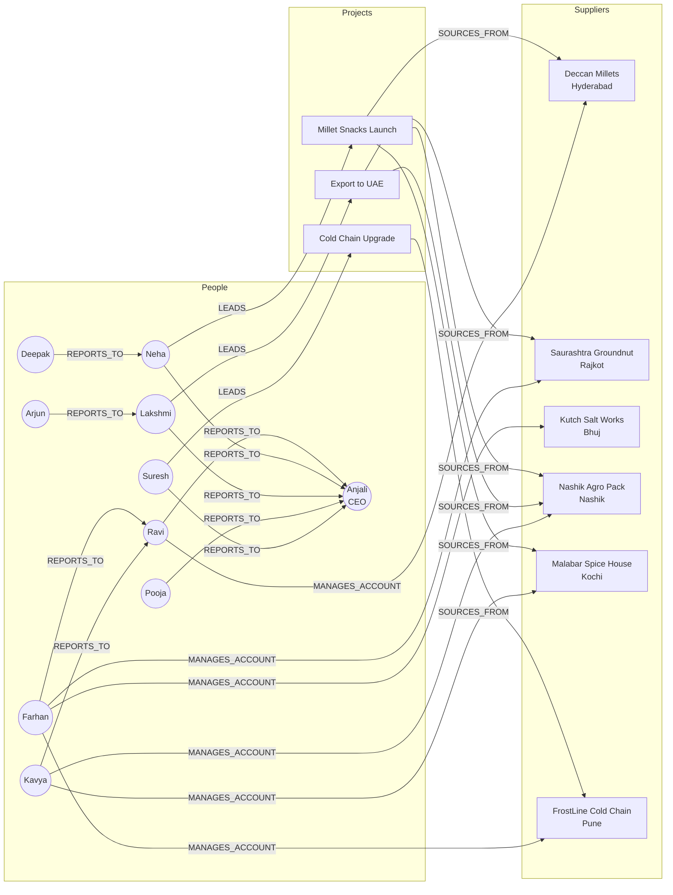

# Cypher Basics: MATCH, CREATE and MERGE: The Complete Guide

> 📚 **Before you start**
>
> - [Property Graphs and Neo4j](property-graphs-and-neo4j.md), for nodes, labels, relationship types, properties, and setting up Neo4j.
> - [What is a Knowledge Graph?](../02-entities-and-relationships/what-is-a-knowledge-graph.md), for pattern queries with variables.
> - Basic SQL helps for the comparisons: [Databases, SQL and NoSQL › Relational Databases and SQL](../../databases-sql-and-nosql/course.md#m2).

## Introduction

In module 2 you wrote pattern queries as Python lists of triples with `?variables`. **Cypher** is the same idea with a far nicer notation: you *draw* the pattern in ASCII art and Neo4j finds every place in the graph where the drawing fits.

```cypher
MATCH (e:Employee)-[:MANAGES_ACCOUNT]->(s:Supplier)-[:LOCATED_IN]->(c:City {state: 'Gujarat'})
RETURN e.name, s.name
```

Read it aloud: *"Find an Employee who manages the account of a Supplier located in a City in Gujarat; give me their names."* That sentence-like readability is why Cypher is popular with developers, analysts and, as you'll see in module 6, LLMs.

This lesson teaches the Cypher you'll use 90% of the time, on the full Kiran Foods graph: creating data (`CREATE`), reading it (`MATCH`, `WHERE`, `RETURN`, `ORDER BY`, aggregation), walking variable-length paths, chaining steps with `WITH`, changing data (`SET`, `DELETE`), and the most important and most misunderstood clause, `MERGE`. Every query comes with the result table it returns, and the Python examples rebuild the key ideas so you can see what Neo4j does internally.

> 💡 **Key Insight**
>
> Cypher runs as a **pipeline of rows**. `MATCH` produces one row per way the pattern fits; every later clause (`WHERE`, `WITH`, `RETURN`, `SET`) transforms that stream of rows. Once you think "rows flowing through clauses", aggregation, `WITH` and `MERGE` all stop being surprising.

---

## Core Explanation

### 1. Patterns: the alphabet of Cypher

| You write | It means |
|---|---|
| `()` | Any node |
| `(e)` | Any node, call it `e` so later clauses can use it |
| `(e:Employee)` | A node with the label `Employee` |
| `(e:Employee {name: 'Ravi Iyer'})` | ...whose `name` property is `'Ravi Iyer'` |
| `-[:WORKS_IN]->` | A relationship of type `WORKS_IN`, pointing right |
| `<-[:LEADS]-` | A `LEADS` relationship pointing left |
| `-[:REPORTS_TO]-` | Either direction |
| `-[m:MANAGES_ACCOUNT]->` | Name the relationship `m` to read its properties (`m.since`) |
| `-[:WORKS_IN|LEADS]->` | Either of two types |

A pattern is a chain of these: `(a)-[:R]->(b)<-[:S]-(c)`. Variables are like the `?x` of module 2: the same variable twice means the same node.

### 2. The Kiran Foods graph

Here is the whole dataset this module uses: 10 employees, 6 departments, 3 projects, 6 suppliers and 6 cities.



(`WORKS_IN` departments, `WORKS_ON` team members and `LOCATED_IN` cities are left out of the drawing to keep it readable, but they're in the data.)

### 3. CREATE: writing data

`CREATE` adds exactly what you draw, every time you run it. Here's the start of the Kiran Foods load script. Variables (`anjali`, `proc`) only live inside one statement, which is why the nodes and relationships are created together:

```cypher
CREATE (proc:Department {name: 'Procurement'}),
       (rnd:Department  {name: 'R&D'}),
       (anjali:Employee {id: 'E-01', name: 'Anjali Mehta', title: 'CEO', joined: 2015}),
       (ravi:Employee   {id: 'E-02', name: 'Ravi Iyer', title: 'Head of Procurement', joined: 2016}),
       (neha:Employee   {id: 'E-03', name: 'Neha Gupta', title: 'R&D Lead', joined: 2018}),
       (ravi)-[:WORKS_IN]->(proc),
       (neha)-[:WORKS_IN]->(rnd),
       (ravi)-[:REPORTS_TO]->(anjali),
       (neha)-[:REPORTS_TO]->(anjali),
       (millet:Project {id: 'PR-1', name: 'Millet Snacks Launch', budgetLakh: 85, status: 'active'}),
       (neha)-[:LEADS]->(millet);
```

Example output:

```
Added 6 labels, created 6 nodes, set 18 properties, created 5 relationships
```

To connect nodes that **already exist**, first find them with `MATCH`, then `CREATE` only the relationship:

```cypher
MATCH (p:Project {id: 'PR-1'}), (s:Supplier {id: 'S-01'})
CREATE (p)-[:SOURCES_FROM {item: 'ragi flour'}]->(s);
```

If you forget the `MATCH` and write `CREATE (:Project {id: 'PR-1'})-[:SOURCES_FROM]->(:Supplier {id: 'S-01'})`, Cypher happily creates **two new nodes**, giving you a second PR-1 and a second S-01. That's the most common beginner bug, and section 10 shows how `MERGE` and constraints prevent it.

### 4. MATCH and RETURN: reading data

**Who works in Procurement?**

```cypher
MATCH (e:Employee)-[:WORKS_IN]->(:Department {name: 'Procurement'})
RETURN e.name AS name, e.title AS title
ORDER BY name;
```

Example output:

```
╒═══════════════╤═════════════════════╕
│name           │title                │
╞═══════════════╪═════════════════════╡
│"Farhan Shaikh"│"Buyer"              │
│"Kavya Reddy"  │"Buyer"              │
│"Ravi Iyer"    │"Head of Procurement"│
└───────────────┴─────────────────────┘
```

Notice the department node has no variable: we only needed it to constrain the pattern. `AS` renames a column. `ORDER BY` sorts; add `DESC` for descending, and `SKIP 10 LIMIT 10` for paging.

**WHERE** adds conditions that don't fit inside the curly braces:

```cypher
MATCH (e:Employee)
WHERE e.joined >= 2020 AND NOT e.title STARTS WITH 'Head'
RETURN e.name AS name, e.joined AS joined
ORDER BY name;
```

Example output:

```
╒═══════════════╤══════╕
│name           │joined│
╞═══════════════╪══════╡
│"Deepak Joshi" │2021  │
│"Farhan Shaikh"│2020  │
│"Kavya Reddy"  │2022  │
└───────────────┴──────┘
```

Useful `WHERE` operators: `=`, `<>`, `<`, `>=`, `IN ['a','b']`, `STARTS WITH`, `ENDS WITH`, `CONTAINS`, `=~` (regular expression), `IS NULL`, `IS NOT NULL`, and `AND`, `OR`, `NOT`, `XOR`.

### 5. The row pipeline, built in Python

Before going further, let's see what Neo4j actually does with a `MATCH ... WHERE ... RETURN`. We'll load the Kiran Foods data into the small structures from the last lesson and run a query as **a list of rows passing through steps**.

```python
EMP = [  # id, name, title, department, joined
    ("E-01", "Anjali Mehta", "CEO", "Leadership", 2015), ("E-02", "Ravi Iyer", "Head of Procurement", "Procurement", 2016),
    ("E-03", "Neha Gupta", "R&D Lead", "R&D", 2018), ("E-04", "Farhan Shaikh", "Buyer", "Procurement", 2020),
    ("E-05", "Lakshmi Menon", "Head of Sales", "Sales", 2017), ("E-06", "Deepak Joshi", "Food Scientist", "R&D", 2021),
    ("E-07", "Kavya Reddy", "Buyer", "Procurement", 2022), ("E-08", "Arjun Patil", "Sales Manager West", "Sales", 2019),
    ("E-09", "Pooja Desai", "Finance Controller", "Finance", 2018), ("E-10", "Suresh Nair", "Head of Operations", "Operations", 2016),
]
REPORTS = [("E-02", "E-01"), ("E-03", "E-01"), ("E-05", "E-01"), ("E-09", "E-01"), ("E-10", "E-01"),
           ("E-04", "E-02"), ("E-07", "E-02"), ("E-06", "E-03"), ("E-08", "E-05")]
PROJ = [("PR-1", "Millet Snacks Launch", 85, "active"), ("PR-2", "Cold Chain Upgrade", 120, "active"),
        ("PR-3", "Export to UAE", 60, "planning")]
LEADS = [("E-03", "PR-1"), ("E-10", "PR-2"), ("E-05", "PR-3")]
SUP = [("S-01", "Deccan Millets", "Hyderabad"), ("S-02", "Saurashtra Groundnut Co.", "Rajkot"),
       ("S-03", "Kutch Salt Works", "Bhuj"), ("S-04", "Nashik Agro Pack", "Nashik"),
       ("S-05", "Malabar Spice House", "Kochi"), ("S-06", "FrostLine Cold Chain", "Pune")]
STATE = {"Hyderabad": "Telangana", "Rajkot": "Gujarat", "Bhuj": "Gujarat", "Nashik": "Maharashtra",
         "Kochi": "Kerala", "Pune": "Maharashtra"}
MANAGES = [("E-02", "S-01", 2023), ("E-04", "S-02", 2021), ("E-04", "S-03", 2024), ("E-07", "S-04", 2022),
           ("E-07", "S-05", 2022), ("E-04", "S-06", 2025)]
SOURCES = [("PR-1", "S-01", "ragi flour"), ("PR-1", "S-05", "spice blend"), ("PR-1", "S-04", "pouches"),
           ("PR-2", "S-06", "reefer trucks"), ("PR-3", "S-04", "export cartons"), ("PR-3", "S-02", "groundnuts")]

# Build a property graph: nodes keyed by id, relationships as (start, type, end, props)
nodes, rels = {}, []
for i, name, title, dept, joined in EMP:
    nodes[i] = {"labels": {"Employee"}, "name": name, "title": title, "joined": joined}
    nodes.setdefault(dept, {"labels": {"Department"}, "name": dept})
    rels.append((i, "WORKS_IN", dept, {}))
for i, name, budget, status in PROJ:
    nodes[i] = {"labels": {"Project"}, "name": name, "budgetLakh": budget, "status": status}
for i, name, city in SUP:
    nodes[i] = {"labels": {"Supplier"}, "name": name}
    nodes.setdefault(city, {"labels": {"City"}, "name": city, "state": STATE[city]})
    rels.append((i, "LOCATED_IN", city, {}))
rels += [(a, "REPORTS_TO", b, {}) for a, b in REPORTS] + [(a, "LEADS", b, {}) for a, b in LEADS]
rels += [(a, "MANAGES_ACCOUNT", b, {"since": y}) for a, b, y in MANAGES]
rels += [(a, "SOURCES_FROM", b, {"item": it}) for a, b, it in SOURCES]
print(len(nodes), "nodes,", len(rels), "relationships")
```

Output:

```
31 nodes, 40 relationships
```

Now the pipeline. Each Cypher clause becomes a function from rows to rows:

```python
def match_node(label, var):
    """MATCH (var:label) -> one row per node with that label."""
    return [{var: nid} for nid, n in nodes.items() if label in n["labels"]]

def expand(rows, src, rel_type, dst, rel_var=None):
    """Extend each row along (src)-[:rel_type]->(dst): one output row per relationship found."""
    out = []
    for row in rows:
        for s, t, e, props in rels:
            if s == row[src] and t == rel_type and (dst not in row or row[dst] == e):
                new = dict(row, **{dst: e})
                if rel_var:
                    new[rel_var] = props
                out.append(new)
    return out

# MATCH (e:Employee)-[m:MANAGES_ACCOUNT]->(s)-[:LOCATED_IN]->(c)
rows = match_node("Employee", "e")
print("after MATCH (e:Employee):", len(rows), "rows")
rows = expand(rows, "e", "MANAGES_ACCOUNT", "s", rel_var="m")
print("after expanding MANAGES_ACCOUNT:", len(rows), "rows")
rows = expand(rows, "s", "LOCATED_IN", "c")
# WHERE c.state = 'Gujarat'
rows = [r for r in rows if nodes[r["c"]]["state"] == "Gujarat"]
print("after WHERE:", len(rows), "rows")
# RETURN e.name, s.name, m.since ORDER BY m.since
for r in sorted(rows, key=lambda r: r["m"]["since"]):
    print(nodes[r["e"]]["name"], "|", nodes[r["s"]]["name"], "|", r["m"]["since"])
```

Output:

```
after MATCH (e:Employee): 10 rows
after expanding MANAGES_ACCOUNT: 6 rows
after WHERE: 2 rows
Farhan Shaikh | Saurashtra Groundnut Co. | 2021
Farhan Shaikh | Kutch Salt Works | 2024
```

Watch the row counts: 10 employees, then 6 rows (one per account managed; employees with no account **disappear**, because a `MATCH` row only survives if the whole pattern fits), then 2 after filtering. Neo4j's real engine is far cleverer about where to start (it would begin from Gujarat cities via an index), but the meaning of the query is exactly this pipeline.

### 6. Aggregation: grouping without GROUP BY

Cypher has no `GROUP BY`. Instead, **every column in `RETURN` that isn't an aggregate becomes the grouping key**. Aggregates include `count()`, `sum()`, `avg()`, `min()`, `max()` and `collect()` (gather values into a list).

```cypher
MATCH (e:Employee)-[:WORKS_IN]->(d:Department)
WITH d, e ORDER BY e.name
RETURN d.name AS department, count(e) AS people, collect(e.name) AS names
ORDER BY people DESC, department;
```

Example output:

```
╒═════════════╤══════╤═══════════════════════════════════════════════╕
│department   │people│names                                          │
╞═════════════╪══════╪═══════════════════════════════════════════════╡
│"Procurement"│3     │["Farhan Shaikh", "Kavya Reddy", "Ravi Iyer"]  │
│"R&D"        │2     │["Deepak Joshi", "Neha Gupta"]                 │
│"Sales"      │2     │["Arjun Patil", "Lakshmi Menon"]               │
│"Finance"    │1     │["Pooja Desai"]                                │
│"Leadership" │1     │["Anjali Mehta"]                               │
│"Operations" │1     │["Suresh Nair"]                                │
└─────────────┴──────┴───────────────────────────────────────────────┘
```

`d.name` is the grouping key; `count(e)` and `collect(e.name)` are computed per department. The `WITH d, e ORDER BY e.name` line sorts rows before collecting, so each list comes out alphabetical (without it, list order isn't guaranteed). The same grouping in our Python pipeline:

```python
from collections import defaultdict

rows = expand(match_node("Employee", "e"), "e", "WORKS_IN", "d")
groups = defaultdict(list)                       # grouping key -> rows
for r in sorted(rows, key=lambda r: nodes[r["e"]]["name"]):
    groups[nodes[r["d"]]["name"]].append(nodes[r["e"]]["name"])
for dept, names in sorted(groups.items(), key=lambda kv: (-len(kv[1]), kv[0]))[:3]:
    print(f"{dept:<12} {len(names)}  {names}")
```

Output:

```
Procurement  3  ['Farhan Shaikh', 'Kavya Reddy', 'Ravi Iyer']
R&D          2  ['Deepak Joshi', 'Neha Gupta']
Sales        2  ['Arjun Patil', 'Lakshmi Menon']
```

### 7. Multi-hop questions

The operations head's question from the last lesson: *"If Deccan Millets stops shipping, which projects are hit, and who leads them?"* It's one pattern, two hops away from the supplier:

```cypher
MATCH (s:Supplier {name: 'Deccan Millets'})<-[src:SOURCES_FROM]-(p:Project)<-[:LEADS]-(lead:Employee)
RETURN p.name AS project, src.item AS item, lead.name AS leader;
```

Example output:

```
╒══════════════════════╤════════════╤════════════╕
│project               │item        │leader      │
╞══════════════════════╪════════════╪════════════╡
│"Millet Snacks Launch"│"ragi flour"│"Neha Gupta"│
└──────────────────────┴────────────┴────────────┘
```

In SQL this is three joins across four tables. In Cypher it's the drawing of the path.

### 8. Variable-length paths

Org charts, supply chains and networks have paths of unknown length. *"Who is anywhere below Anjali?"* Cypher 25 uses **quantified path patterns**: put `+` (one or more), `*` (zero or more) or `{1,3}` (between one and three) after a relationship.

```cypher
MATCH p = (e:Employee)-[:REPORTS_TO]->+(:Employee {name: 'Anjali Mehta'})
RETURN e.name AS name, length(p) AS levels_below
ORDER BY levels_below, name;
```

Example output:

```
╒═══════════════╤════════════╕
│name           │levels_below│
╞═══════════════╪════════════╡
│"Lakshmi Menon"│1           │
│"Neha Gupta"   │1           │
│"Pooja Desai"  │1           │
│"Ravi Iyer"    │1           │
│"Suresh Nair"  │1           │
│"Arjun Patil"  │2           │
│"Deepak Joshi" │2           │
│"Farhan Shaikh"│2           │
│"Kavya Reddy"  │2           │
└───────────────┴────────────┘
```

`p = ...` names the whole **path**, and `length(p)` counts its relationships. You'll also see an older syntax in many tutorials and in LLM-generated queries: `-[:REPORTS_TO*1..]->`. It still works and means the same here. Quantified patterns are more powerful because you can repeat a whole sub-pattern, for example `((a)-[:SOURCES_FROM]->(s:Supplier WHERE s.rating > 3)){1,4}`.

Here is what a variable-length match does, as a breadth-first walk in Python:

```python
def below(boss_id):
    """Everyone who reaches boss_id by following REPORTS_TO one or more times, with depth."""
    found, frontier, depth = {}, [boss_id], 0
    while frontier:
        depth += 1
        nxt = []
        for person in frontier:
            for s, t, e, _ in rels:
                if t == "REPORTS_TO" and e == person and s not in found:
                    found[s] = depth
                    nxt.append(s)
        frontier = nxt
    return found

result = below("E-01")
for emp, d in sorted(result.items(), key=lambda kv: (kv[1], nodes[kv[0]]["name"])):
    print(d, nodes[emp]["name"])
```

Output:

```
1 Lakshmi Menon
1 Neha Gupta
1 Pooja Desai
1 Ravi Iyer
1 Suresh Nair
2 Arjun Patil
2 Deepak Joshi
2 Farhan Shaikh
2 Kavya Reddy
```

**Shortest paths.** *"What's the shortest chain of reporting lines between Deepak (R&D) and Arjun (Sales)?"*

```cypher
MATCH p = SHORTEST 1 (a:Employee {name: 'Deepak Joshi'})-[:REPORTS_TO]-+(b:Employee {name: 'Arjun Patil'})
RETURN [n IN nodes(p) | n.name] AS chain, length(p) AS hops;
```

Example output:

```
chain: ["Deepak Joshi", "Neha Gupta", "Anjali Mehta", "Lakshmi Menon", "Arjun Patil"]
hops:  4
```

The relationship has no arrowhead (`-[:REPORTS_TO]-+`), so the path may go up and down the hierarchy. `[n IN nodes(p) | n.name]` is a **list comprehension**, Cypher's version of Python's `[n.name for n in nodes(p)]`. Older code writes `shortestPath((a)-[:REPORTS_TO*]-(b))`, which still works.

### 9. OPTIONAL MATCH and WITH

`MATCH` drops rows where the pattern doesn't fit. **`OPTIONAL MATCH`** keeps them and fills the missing parts with `null`, like a SQL left join:

```cypher
MATCH (e:Employee)
OPTIONAL MATCH (e)-[:MANAGES_ACCOUNT]->(s:Supplier)
RETURN e.name AS name, count(s) AS accounts
ORDER BY accounts DESC, name
LIMIT 5;
```

Example output:

```
╒═══════════════╤════════╕
│name           │accounts│
╞═══════════════╪════════╡
│"Farhan Shaikh"│3       │
│"Kavya Reddy"  │2       │
│"Ravi Iyer"    │1       │
│"Anjali Mehta" │0       │
│"Arjun Patil"  │0       │
└───────────────┴────────┘
```

`count(s)` skips nulls, so people with no accounts get 0 instead of vanishing.

**`WITH`** ends one stage of the pipeline and starts the next. Use it to filter on an aggregate (SQL's `HAVING`), to limit before an expensive step, or to rename things:

```cypher
MATCH (s:Supplier)-[:LOCATED_IN]->(c:City)
WITH c.state AS state, count(s) AS suppliers
WHERE suppliers > 1
RETURN state, suppliers
ORDER BY state;
```

Example output:

```
╒═════════════╤═════════╕
│state        │suppliers│
╞═════════════╪═════════╡
│"Gujarat"    │2        │
│"Maharashtra"│2        │
└─────────────┴─────────┘
```

Only the variables listed in `WITH` survive into the next stage. That's a common source of "variable not defined" errors: if you need `c` later, carry it through `WITH`.

**Existential subqueries** test whether a pattern exists without adding rows. *Which employees manage a supplier used by an active project?*

```cypher
MATCH (e:Employee)
WHERE EXISTS { (e)-[:MANAGES_ACCOUNT]->(:Supplier)<-[:SOURCES_FROM]-(:Project {status: 'active'}) }
RETURN e.name AS name ORDER BY name;
```

Example output:

```
╒═══════════════╕
│name           │
╞═══════════════╡
│"Farhan Shaikh"│
│"Kavya Reddy"  │
│"Ravi Iyer"    │
└───────────────┘
```

Each appears once, even though Kavya manages two such suppliers. `COUNT { pattern }` works the same way and returns how many matches exist.

### 10. Changing data: SET, REMOVE, DELETE

```cypher
// Update a property (creates it if missing)
MATCH (p:Project {id: 'PR-3'}) SET p.status = 'active', p.startDate = date('2026-11-01');

// Add and remove labels
MATCH (e:Employee {id: 'E-02'}) SET e:Customer;
MATCH (e:Employee {id: 'E-02'}) REMOVE e:Customer;

// Remove a property
MATCH (p:Project {id: 'PR-3'}) REMOVE p.startDate;

// Delete a relationship
MATCH (:Employee {id: 'E-04'})-[m:MANAGES_ACCOUNT]->(:Supplier {id: 'S-03'}) DELETE m;

// Delete a node and every relationship attached to it
MATCH (s:Supplier {id: 'S-03'}) DETACH DELETE s;
```

Plain `DELETE` on a node that still has relationships fails with an error. That's deliberate (rule 2 from the last lesson: no dangling relationships). `DETACH DELETE` removes the relationships first. Be careful with `MATCH (n) DETACH DELETE n`: it empties the whole database.

### 11. MERGE: create only if it doesn't exist

Real data arrives again and again: a supplier appears on 50 invoices, an employee in 20 project documents. You want **one** node per real thing. `MERGE` means *"match this pattern; if it isn't there, create it"*.

```cypher
MERGE (s:Supplier {id: 'S-07'})
ON CREATE SET s.name = 'Bikaner Bhujia Masala', s.firstSeen = date()
ON MATCH  SET s.lastSeen = date();
```

Run it once and S-07 is created with `firstSeen`. Run it again and nothing new is created; only `lastSeen` changes. Running a load twice without creating duplicates is called **idempotence**, and it's what makes `MERGE` the workhorse of data loading.

Here's the difference between `CREATE` and `MERGE` as Python, loading the same invoice batch twice:

```python
def create_supplier(store, supplier_id, name):
    store.append({"id": supplier_id, "name": name})          # always adds

def merge_supplier(store, supplier_id, name):
    for node in store:
        if node["id"] == supplier_id:                        # MATCH part
            return node
    node = {"id": supplier_id, "name": name}                 # CREATE part
    store.append(node)
    return node

invoice_suppliers = [("S-01", "Deccan Millets"), ("S-02", "Saurashtra Groundnut Co."), ("S-01", "Deccan Millets")]
with_create, with_merge = [], []
for run in range(2):                                         # the nightly load runs twice by accident
    for sid, name in invoice_suppliers:
        create_supplier(with_create, sid, name)
        merge_supplier(with_merge, sid, name)
print("CREATE:", len(with_create), "supplier nodes")
print("MERGE: ", len(with_merge), "supplier nodes")
```

Output:

```
CREATE: 6 supplier nodes
MERGE:  2 supplier nodes
```

**The big MERGE trap.** `MERGE` works on the **whole pattern you write**. This looks innocent:

```cypher
MERGE (p:Project {id: 'PR-1'})-[:SOURCES_FROM]->(s:Supplier {id: 'S-08'})
```

If PR-1 exists but has no `SOURCES_FROM` to S-08, the whole pattern doesn't match, so `MERGE` creates **the whole pattern**: a brand-new PR-1 node, a new S-08 and the relationship. You now have two PR-1s. The safe habit is to merge each node separately, then merge the relationship between the variables:

```cypher
MERGE (p:Project {id: 'PR-1'})
MERGE (s:Supplier {id: 'S-08'})
MERGE (p)-[r:SOURCES_FROM]->(s)
ON CREATE SET r.item = 'jaggery';
```

Let's prove the trap in Python with a pattern-level merge:

```python
graph_nodes = [{"label": "Project", "id": "PR-1"}]
graph_rels = []

def find(label, node_id):
    return next((n for n in graph_nodes if n["label"] == label and n["id"] == node_id), None)

def merge_whole_pattern(p_id, s_id):
    """What MERGE (p:Project {id})-[:SOURCES_FROM]->(s:Supplier {id}) does."""
    for a, b in graph_rels:
        if a["id"] == p_id and b["id"] == s_id:
            return                                           # whole pattern exists
    p, s = {"label": "Project", "id": p_id}, {"label": "Supplier", "id": s_id}
    graph_nodes.extend([p, s])                               # creates EVERYTHING
    graph_rels.append((p, s))

def merge_piece_by_piece(p_id, s_id):
    p = find("Project", p_id) or graph_nodes.append({"label": "Project", "id": p_id}) or find("Project", p_id)
    s = find("Supplier", s_id) or graph_nodes.append({"label": "Supplier", "id": s_id}) or find("Supplier", s_id)
    if not any(a is p and b is s for a, b in graph_rels):
        graph_rels.append((p, s))

merge_whole_pattern("PR-1", "S-08")
print("whole pattern:  ", sorted(n["id"] for n in graph_nodes))
graph_nodes[:] = [{"label": "Project", "id": "PR-1"}]
graph_rels.clear()
merge_piece_by_piece("PR-1", "S-08")
print("piece by piece: ", sorted(n["id"] for n in graph_nodes))
```

Output:

```
whole pattern:   ['PR-1', 'PR-1', 'S-08']
piece by piece:  ['PR-1', 'S-08']
```

The whole-pattern merge created a second PR-1. The piece-by-piece version found the existing PR-1, created only S-08, and linked them.

Two more `MERGE` rules:

- **Merge on the identifying key only** (`{id: 'S-07'}`), then `SET` the other properties. `MERGE (s:Supplier {id: 'S-07', name: 'Bikaner Bhujia'})` creates a duplicate the day someone fixes the spelling, because the full property set no longer matches.
- **Back it with a uniqueness constraint** (next section). Without one, two loads running at the same moment can both decide "not found" and both create.

### 12. Constraints and indexes

```cypher
// One node per id: also creates an index used by MATCH and MERGE
CREATE CONSTRAINT supplier_id IF NOT EXISTS FOR (s:Supplier) REQUIRE s.id IS UNIQUE;
CREATE CONSTRAINT employee_id IF NOT EXISTS FOR (e:Employee) REQUIRE e.id IS UNIQUE;
CREATE CONSTRAINT project_id  IF NOT EXISTS FOR (p:Project)  REQUIRE p.id IS UNIQUE;

// A plain index to start queries quickly from a property
CREATE INDEX city_state IF NOT EXISTS FOR (c:City) ON (c.state);

// Full-text index for fuzzy name search (used in module 6)
CREATE FULLTEXT INDEX supplier_names IF NOT EXISTS FOR (s:Supplier) ON EACH [s.name];

SHOW CONSTRAINTS;
SHOW INDEXES;
```

With `supplier_id` in place, the bad `CREATE` from section 3 fails loudly instead of quietly creating a second S-01:

Example output:

```
Node(12) already exists with label `Supplier` and property `id` = 'S-01'
```

Enterprise Edition adds **existence** constraints (`REQUIRE s.name IS NOT NULL`), **property type** constraints (`REQUIRE p.budgetLakh IS :: INTEGER`) and **node key** constraints (unique and present). These turn your graph from "anything goes" into something close to the SHACL shapes of module 3.

### 13. Loading data in bulk: parameters, UNWIND and LOAD CSV

From application code, send a **list as a parameter** and `UNWIND` it into rows. One query loads thousands of records:

```cypher
UNWIND $rows AS row
MERGE (s:Supplier {id: row.id})
SET s.name = row.name
MERGE (c:City {name: row.city})
MERGE (s)-[:LOCATED_IN]->(c);
```

with `$rows = [{id: 'S-01', name: 'Deccan Millets', city: 'Hyderabad'}, ...]`. You'll do exactly this from Python in the lab.

From a CSV file in Neo4j's `import` folder (or a URL):

```cypher
LOAD CSV WITH HEADERS FROM 'file:///suppliers.csv' AS row
MERGE (s:Supplier {id: row.supplier_id})
SET s.name = row.name;
```

CSV values arrive as strings: convert with `toInteger(row.since)`, `toFloat(...)`, `date(row.joined)`. For big files, wrap the work in batched transactions with `CALL (row) { ... } IN TRANSACTIONS OF 1000 ROWS` so Neo4j commits as it goes.

### 14. SQL to Cypher cheat sheet

| SQL | Cypher |
|---|---|
| `SELECT name FROM employee WHERE joined >= 2020` | `MATCH (e:Employee) WHERE e.joined >= 2020 RETURN e.name` |
| `JOIN ... ON e.dept_id = d.id` | `(e)-[:WORKS_IN]->(d)` |
| `LEFT JOIN` | `OPTIONAL MATCH` |
| `GROUP BY d.name` | implicit: non-aggregated columns in `RETURN` / `WITH` |
| `HAVING count(*) > 1` | `WITH ..., count(*) AS n WHERE n > 1` |
| `WITH RECURSIVE` (org chart) | `-[:REPORTS_TO]->+` |
| `INSERT` | `CREATE` |
| `INSERT ... ON CONFLICT DO UPDATE` | `MERGE ... ON CREATE SET ... ON MATCH SET` |
| `UPDATE ... SET` | `MATCH ... SET` |
| `DELETE` | `DELETE` / `DETACH DELETE` |
| `EXPLAIN` / `EXPLAIN ANALYZE` | `EXPLAIN` / `PROFILE` |

---

## Try It Yourself

1. **Write the Cypher.** *"List each project with its budget and the number of distinct suppliers it sources from, biggest budget first."* Then compute the same answer with the Python data.
2. **Second-level managers.** Using quantified path patterns, find people exactly two levels below Anjali. Then do it in Python with `below()`.
3. **Fix the MERGE.** A teammate wrote `MERGE (e:Employee {id: 'E-11', name: 'Meera Rao'})-[:WORKS_IN]->(d:Department {name: 'R&D'})`. Explain what goes wrong if R&D already exists, and rewrite it.

<details>
<summary>Show answers</summary>

**1.**

```cypher
MATCH (p:Project)
OPTIONAL MATCH (p)-[:SOURCES_FROM]->(s:Supplier)
RETURN p.name AS project, p.budgetLakh AS budget, count(DISTINCT s) AS suppliers
ORDER BY budget DESC;
```

```python
for pid, name, budget, status in sorted(PROJ, key=lambda p: -p[2]):
    suppliers = {s for p, s, _ in SOURCES if p == pid}
    print(f"{name:<22} {budget:>4} lakh  {len(suppliers)} suppliers")
```

Output:

```
Cold Chain Upgrade      120 lakh  1 suppliers
Millet Snacks Launch     85 lakh  3 suppliers
Export to UAE            60 lakh  2 suppliers
```

**2.**

```cypher
MATCH (e:Employee)-[:REPORTS_TO]->{2}(:Employee {name: 'Anjali Mehta'})
RETURN e.name ORDER BY e.name;
```

```python
print(sorted(nodes[e]["name"] for e, d in below("E-01").items() if d == 2))
```

Output:

```
['Arjun Patil', 'Deepak Joshi', 'Farhan Shaikh', 'Kavya Reddy']
```

**3.** The whole pattern (E-11 working in an R&D node) doesn't exist yet, so `MERGE` creates all of it, including a **second** `R&D` department node. Merge the pieces separately:

```cypher
MERGE (e:Employee {id: 'E-11'}) ON CREATE SET e.name = 'Meera Rao'
MERGE (d:Department {name: 'R&D'})
MERGE (e)-[:WORKS_IN]->(d);
```

</details>

---

## Real-World Examples

- **Data engineers** write idempotent `UNWIND ... MERGE` loaders that run every night from relational exports into Neo4j.
- **Analysts** use variable-length patterns to answer "everyone affected downstream of X" questions in supply chains and IT dependency graphs.
- **Fraud teams** write `EXISTS { }` and `COUNT { }` subqueries to flag accounts sharing devices with known fraudsters.
- **LLM applications** generate Cypher from questions; the clauses in this lesson are exactly the subset models are prompted and tested on (module 6).

---

## Common Misconceptions

### "MERGE is an upsert of a node"

`MERGE` matches or creates the **entire pattern** you write. Merging a path when part of it already exists creates duplicates. Merge nodes one by one, then relationships.

### "Cypher needs GROUP BY"

Grouping is implicit: every non-aggregated column in `RETURN` or `WITH` is part of the key. Adding an extra column changes the groups, so be deliberate about what you return.

### "OPTIONAL MATCH is just a slower MATCH"

They differ in meaning: `MATCH` removes rows that don't fit, `OPTIONAL MATCH` keeps them with nulls. Counts and reports often need the second.

### "Relationship direction must match the query"

You can query a directed relationship in either direction, or without direction. The stored direction carries meaning; the query direction just says which way you're reading.

---

## Interview Relevance

Expect *"write a Cypher query for..."* questions: a multi-hop pattern with filters, an aggregation (and how grouping works without `GROUP BY`), a variable-length or shortest path, and an `OPTIONAL MATCH` count. A strong candidate also explains `MERGE` semantics (pattern-level match-or-create, merge on keys, `ON CREATE`/`ON MATCH`, uniqueness constraints to make it safe under concurrency), uses parameters rather than string concatenation, and knows `EXPLAIN`/`PROFILE` for checking that a query starts from an index.

---

## Key Takeaways

- **Patterns are drawings**: `(node:Label {prop})-[:TYPE]->(node)`, with variables to join and return.
- **Cypher is a row pipeline**: `MATCH` makes rows, `WHERE`/`WITH`/`RETURN` reshape them; grouping is implicit.
- **Paths of any length** use quantified patterns (`->+`, `{1,3}`) and `SHORTEST`.
- **`MERGE` is match-or-create on the whole pattern**: merge nodes on their keys, then relationships, and back it with uniqueness constraints.
- **Load in bulk** with `UNWIND $rows` or `LOAD CSV`, always with parameters.

---

**Up next:** [Graph Data Modelling](graph-data-modelling.md)
