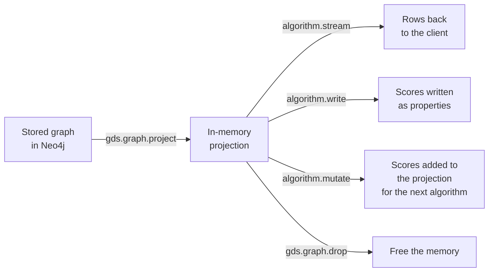

# Graph Algorithms: Paths, Centrality and Communities: The Complete Guide

> 📚 **Before you start**
>
> - [Graph Data Modelling](graph-data-modelling.md), for degree and supernodes.
> - [Cypher Basics: MATCH, CREATE and MERGE](cypher-basics-match-create-and-merge.md), for paths and `SHORTEST`.
> - NumPy arrays and matrix multiplication. [Data Analysis and Visualisation with Python](../../data-analysis-and-visualisation-with-python/course.md) covers NumPy.

## Introduction

Cypher answers questions you can **draw**: "who manages a Gujarat supplier?". Some questions can't be drawn because they're about the **shape of the whole graph**:

- *"What's the cheapest route to truck ragi flour from Hyderabad to our Nashik plant?"* (a path weighed by distance)
- *"Who is the person everything flows through? If she goes on leave, which teams stop talking?"* (importance)
- *"Which groups of people actually work together, regardless of the org chart?"* (communities)
- *"Which two suppliers look alike, and who should probably be connected but isn't?"* (similarity)

These are **graph algorithms**: procedures that look at many nodes and relationships at once and compute a number or a grouping for each node. Neo4j runs them through its **Graph Data Science (GDS)** library. In this lesson you'll implement the core ones yourself in NumPy and SciPy on Kiran Foods data, so you understand exactly what each number means, then see the GDS calls that do the same at scale. Community detection matters again in module 6, because GraphRAG uses it to summarise a whole corpus.

> 💡 **Key Insight**
>
> Graph algorithms come in four families, each answering one kind of question: **paths** (how do I get from A to B?), **centrality** (who matters most?), **communities** (who belongs together?) and **similarity** (who looks alike, and what link is missing?). Pick the family from the question, then the algorithm from what "matters" or "belongs" means in your domain.

---

## Core Explanation

### 1. The four families at a glance

| Family | Question | Algorithms | Kiran Foods use |
|---|---|---|---|
| **Paths** | Shortest or cheapest route between nodes | Breadth-first search, Dijkstra, A*, all-pairs shortest paths | Cheapest truck route; introduction chain between employees |
| **Centrality** | Which nodes are most important? | Degree, betweenness, closeness, PageRank | Key people and single points of failure |
| **Communities** | Which nodes form tight groups? | Connected components, label propagation, Louvain, Leiden | Real working groups; clusters of related suppliers |
| **Similarity and link prediction** | Which nodes look alike? Which link is likely missing? | Jaccard / node similarity, common neighbours, Adamic-Adar, k-nearest neighbours | Substitute suppliers; who should meet whom |

All of them work on the graph as a matrix or adjacency list. Let's build both.

### 2. The collaboration graph

Kiran Foods exported a year of meeting invites and project memberships. Two people are connected if they regularly work together. Here are 14 people and 23 connections:

```python
import numpy as np

PEOPLE = ["Anjali", "Ravi", "Farhan", "Kavya", "Suresh", "Imran", "Rohit",
          "Neha", "Deepak", "Vikram", "Lakshmi", "Arjun", "Sana", "Pooja"]
WORKS_WITH = [
    ("Ravi", "Farhan"), ("Ravi", "Kavya"), ("Farhan", "Kavya"), ("Farhan", "Suresh"),
    ("Suresh", "Imran"), ("Suresh", "Rohit"), ("Imran", "Rohit"), ("Farhan", "Imran"),
    ("Neha", "Deepak"), ("Neha", "Vikram"), ("Deepak", "Vikram"),
    ("Lakshmi", "Arjun"), ("Lakshmi", "Sana"), ("Arjun", "Sana"), ("Pooja", "Lakshmi"), ("Pooja", "Arjun"),
    ("Kavya", "Deepak"),                                      # the millet-sourcing link between Procurement and R&D
    ("Anjali", "Ravi"), ("Anjali", "Neha"), ("Anjali", "Lakshmi"), ("Anjali", "Suresh"), ("Anjali", "Pooja"),
    ("Pooja", "Ravi"),
]
idx = {p: i for i, p in enumerate(PEOPLE)}
n = len(PEOPLE)
A = np.zeros((n, n), dtype=int)               # adjacency matrix: A[i, j] = 1 if i and j work together
for a, b in WORKS_WITH:
    A[idx[a], idx[b]] = A[idx[b], idx[a]] = 1
neighbours = {p: sorted(PEOPLE[j] for j in np.flatnonzero(A[idx[p]])) for p in PEOPLE}
print("Anjali works with:", neighbours["Anjali"])
print("matrix is symmetric:", bool((A == A.T).all()), "| connections:", A.sum() // 2)
```

Output:

```
Anjali works with: ['Lakshmi', 'Neha', 'Pooja', 'Ravi', 'Suresh']
matrix is symmetric: True | connections: 23
```

The **adjacency matrix** has a 1 wherever two people are connected. It's symmetric because "works with" has no direction. Most algorithms below are a few lines of arithmetic on this matrix.

### 3. Paths: breadth-first search for hops

The fewest-hops path is found by **breadth-first search (BFS)**: visit all neighbours, then their neighbours, and so on, remembering who you came from. It's what Cypher's `SHORTEST 1` does on an unweighted pattern.

```python
from collections import deque

def bfs_path(start, goal):
    came_from = {start: None}
    queue = deque([start])
    while queue:
        person = queue.popleft()
        if person == goal:
            break
        for nb in neighbours[person]:
            if nb not in came_from:
                came_from[nb] = person
                queue.append(nb)
    path, node = [], goal
    while node is not None:
        path.append(node)
        node = came_from[node]
    return path[::-1]

print(" -> ".join(bfs_path("Imran", "Vikram")))
```

Output:

```
Imran -> Farhan -> Kavya -> Deepak -> Vikram
```

Imran in Operations reaches Vikram in R&D in four hops through the informal Kavya-Deepak link. The formal route through the CEO (Imran → Suresh → Anjali → Neha → Vikram) is also four hops; BFS returns whichever it reaches first. Cypher's `SHORTEST 2` or `ALL SHORTEST` would show you both.

### 4. Paths: Dijkstra for weighted routes

When relationships have a **cost** (kilometres, rupees, hours), the fewest hops isn't the cheapest route. **Dijkstra's algorithm** always expands the cheapest-so-far node next. SciPy implements it on a sparse matrix. Here are Kiran Foods' trucking lanes, with approximate road distances:

```python
from scipy.sparse import csr_matrix
from scipy.sparse.csgraph import dijkstra

CITIES = ["Pune", "Mumbai", "Nashik", "Hyderabad", "Bengaluru", "Kochi", "Ahmedabad", "Rajkot", "Bhuj"]
LANES_KM = [("Pune", "Mumbai", 150), ("Mumbai", "Nashik", 170), ("Pune", "Nashik", 210),
            ("Pune", "Hyderabad", 560), ("Hyderabad", "Bengaluru", 570), ("Pune", "Bengaluru", 840),
            ("Bengaluru", "Kochi", 550), ("Mumbai", "Ahmedabad", 530), ("Ahmedabad", "Rajkot", 215),
            ("Ahmedabad", "Bhuj", 330), ("Rajkot", "Bhuj", 230)]
ci = {c: i for i, c in enumerate(CITIES)}
W = np.zeros((len(CITIES), len(CITIES)))
for a, b, km in LANES_KM:
    W[ci[a], ci[b]] = W[ci[b], ci[a]] = km

dist, pred = dijkstra(csr_matrix(W), directed=False, indices=ci["Hyderabad"], return_predecessors=True)

def route(to):
    path, node = [], ci[to]
    while node != -9999:                      # SciPy marks "no predecessor" with -9999
        path.append(CITIES[node])
        node = pred[node]
    return " -> ".join(path[::-1])

for city in ["Nashik", "Kochi", "Bhuj"]:
    print(f"{route(city):<45} {dist[ci[city]]:.0f} km")
```

Output:

```
Hyderabad -> Pune -> Nashik                   770 km
Hyderabad -> Bengaluru -> Kochi               1120 km
Hyderabad -> Pune -> Mumbai -> Ahmedabad -> Bhuj 1570 km
```

Hyderabad to Nashik goes straight through Pune (770 km) rather than Pune-Mumbai-Nashik (880 km). In Neo4j you'd store `km` on a `LANE` relationship and call GDS's Dijkstra, shown in section 10.

### 5. Centrality: who matters?

"Important" has several meanings, and each centrality measures a different one:

| Measure | Idea | High score means |
|---|---|---|
| **Degree** | Count of connections | Talks to many people directly |
| **Betweenness** | Share of all shortest paths that pass through the node | A **bridge** or bottleneck; removing them splits groups |
| **Closeness** | 1 / average distance to everyone | Can reach everyone quickly |
| **PageRank** | Connected to other well-connected nodes | Influence that flows through the network |

**Degree** is a row sum. **Closeness** comes from BFS distances, which SciPy computes for all pairs at once:

```python
from scipy.sparse.csgraph import shortest_path

D = shortest_path(csr_matrix(A), unweighted=True)          # D[i, j] = hops from i to j
degree = A.sum(axis=1)
closeness = (n - 1) / D.sum(axis=1)
for p in sorted(PEOPLE, key=lambda p: (-closeness[idx[p]], p))[:5]:
    print(f"{p:<8} degree {degree[idx[p]]}  closeness {closeness[idx[p]]:.2f}")
```

Output:

```
Anjali   degree 5  closeness 0.62
Ravi     degree 4  closeness 0.52
Pooja    degree 4  closeness 0.50
Suresh   degree 4  closeness 0.50
Farhan   degree 4  closeness 0.46
```

**Betweenness** counts, for every pair of people, what fraction of their shortest paths go through each third person. Here's a direct implementation (fine for small graphs; GDS uses Brandes' faster algorithm):

```python
def count_paths_from(src):
    """BFS from src: hop distance and number of shortest paths to every node."""
    dist_ = {src: 0}
    sigma = {src: 1}
    queue = deque([src])
    while queue:
        u = queue.popleft()
        for v in neighbours[u]:
            if v not in dist_:
                dist_[v] = dist_[u] + 1
                sigma[v] = 0
                queue.append(v)
            if dist_[v] == dist_[u] + 1:
                sigma[v] += sigma[u]
    return dist_, sigma

info = {p: count_paths_from(p) for p in PEOPLE}
betweenness = dict.fromkeys(PEOPLE, 0.0)
for i, s in enumerate(PEOPLE):
    for t in PEOPLE[i + 1:]:
        d_s, sig_s = info[s]
        d_t, sig_t = info[t]
        for v in PEOPLE:
            if v not in (s, t) and d_s[v] + d_t[v] == d_s[t]:
                betweenness[v] += sig_s[v] * sig_t[v] / sig_s[t]
for p in sorted(PEOPLE, key=lambda p: -betweenness[p])[:5]:
    print(f"{p:<8} {betweenness[p]:5.1f}")
```

Output:

```
Anjali    34.5
Suresh    16.4
Neha      13.0
Lakshmi   12.8
Ravi      10.9
```

Anjali is far ahead: she's on most routes between departments. More interesting is the next tier. Suresh, Farhan and Pooja all have degree 4, yet Suresh's betweenness is almost double theirs, because he's the main doorway into Operations (Imran and Rohit reach the rest of the company mostly through him). Neha has only three connections but ranks third, because she's the main way into R&D. The Kavya-Deepak link gives R&D a second door, which is why Neha's score isn't even higher. Betweenness finds **gatekeepers and single points of failure** that a simple count of connections misses.

**PageRank** imagines a person passing a note to a random colleague, over and over, and occasionally (15% of the time) handing it to anyone at all. A person's score is the share of time the note spends with them. Being connected to well-connected people raises your score. It's computed by repeated matrix multiplication (the **power iteration**):

```python
def pagerank(adj, damping=0.85, iterations=100):
    out_degree = adj.sum(axis=1)
    transition = adj / out_degree[:, None]          # each row: probability of passing to each neighbour
    rank = np.full(len(adj), 1 / len(adj))
    for _ in range(iterations):
        rank = (1 - damping) / len(adj) + damping * transition.T @ rank
    return rank

pr = pagerank(A.astype(float))
for p in sorted(PEOPLE, key=lambda p: -pr[idx[p]])[:5]:
    print(f"{p:<8} {pr[idx[p]]:.3f}")
print("ranks sum to", round(pr.sum(), 3))
```

Output:

```
Anjali   0.101
Suresh   0.085
Lakshmi  0.084
Farhan   0.084
Pooja    0.082
ranks sum to 1.0
```

On an undirected graph PageRank tracks degree closely. It shines on **directed** graphs (web links, citations, "who asks whom for approval"), where pointing *to* someone transfers importance. Google's original search ranking was PageRank over hyperlinks; in GraphRAG systems it's used to rank which retrieved entities matter most.

### 6. Communities: who belongs together?

**Connected components** is the simplest grouping: nodes that can reach each other at all. Our collaboration graph is one component (everyone is reachable), so we need something finer. Remove Anjali and see what happens:

```python
from scipy.sparse.csgraph import connected_components

keep = [p for p in PEOPLE if p != "Anjali"]
sub = A[np.ix_([idx[p] for p in keep], [idx[p] for p in keep])]
count, labels = connected_components(csr_matrix(sub), directed=False)
print("components without Anjali:", count)
without_kavya = [p for p in keep if p != "Kavya"]
sub2 = A[np.ix_([idx[p] for p in without_kavya], [idx[p] for p in without_kavya])]
count2, labels2 = connected_components(csr_matrix(sub2), directed=False)
groups = {}
for p, g in zip(without_kavya, labels2):
    groups.setdefault(g, []).append(p)
print("components without Anjali and Kavya:", count2, list(groups.values()))
```

Output:

```
components without Anjali: 1
components without Anjali and Kavya: 2 [['Ravi', 'Farhan', 'Suresh', 'Imran', 'Rohit', 'Lakshmi', 'Arjun', 'Sana', 'Pooja'], ['Neha', 'Deepak', 'Vikram']]
```

Without Anjali the company still holds together: Pooja links Finance to Ravi, and Kavya links Procurement to R&D. Remove Kavya too and R&D is cut off completely. A link that looked minor on an org chart is what keeps the company connected.

**Label propagation** finds dense groups inside a connected graph. Every node starts with its own label; repeatedly, each node adopts the label most common among its neighbours. Dense groups quickly agree on one label, and the few links between groups can't outvote them.

```python
def label_propagation(max_rounds=20):
    label = {p: p for p in PEOPLE}
    for _ in range(max_rounds):
        changed = False
        for p in PEOPLE:                                        # fixed order keeps the result reproducible
            votes = {}
            for nb in neighbours[p]:
                votes[label[nb]] = votes.get(label[nb], 0) + 1
            best = max(sorted(votes), key=lambda lab: votes[lab])  # ties: alphabetically first label
            if votes.get(label[p], 0) < votes[best]:
                label[p], changed = best, True
        if not changed:
            break
    groups = {}
    for p in PEOPLE:
        groups.setdefault(label[p], []).append(p)
    return sorted(groups.values(), key=len, reverse=True)

communities = label_propagation()
for group in communities:
    print(group)
```

Output:

```
['Ravi', 'Farhan', 'Kavya', 'Suresh', 'Imran', 'Rohit']
['Anjali', 'Lakshmi', 'Arjun', 'Sana', 'Pooja']
['Neha', 'Deepak', 'Vikram']
```

Three real working groups emerge: Procurement plus Operations, Sales plus Finance (with Anjali, who works closely with Lakshmi and Pooja), and R&D. Notice that the algorithm ignored the official department boundaries between Procurement and Operations: Farhan works with Suresh and Imran as much as with his own team.

How good is a grouping? **Modularity** compares the number of links inside groups with what you'd expect if links were placed at random. Above about 0.3 is a clear community structure:

```python
def modularity(groups):
    m = A.sum() / 2
    k = A.sum(axis=1)
    q = 0.0
    for group in groups:
        ids = [idx[p] for p in group]
        inside = A[np.ix_(ids, ids)].sum() / 2
        q += inside / m - (k[ids].sum() / (2 * m)) ** 2
    return q

print("label propagation:", round(modularity(communities), 3))
print("official departments:", round(modularity([["Anjali"], ["Ravi", "Farhan", "Kavya"], ["Suresh", "Imran", "Rohit"],
                                                ["Neha", "Deepak", "Vikram"], ["Lakshmi", "Arjun", "Sana"], ["Pooja"]]), 3))
```

Output:

```
label propagation: 0.41
official departments: 0.338
```

The detected groups score higher than the official departments: Procurement and Operations really behave as one team. **Louvain** and **Leiden** are the algorithms used in practice. They directly optimise modularity by moving nodes between groups and then merging groups into super-nodes, level by level, which also gives you a **hierarchy** of communities (big groups made of smaller ones). Leiden fixes a flaw in Louvain that could produce badly connected groups, and it's the algorithm Microsoft's GraphRAG uses to build its community summaries in [GraphRAG](../course.md#m6).

### 7. Similarity and link prediction

**Jaccard similarity** between two nodes is the share of their neighbours that they have in common: |shared| / |either|. For suppliers, use the projects they serve and the items they ship; for people, their colleagues.

```python
def jaccard(a, b):
    na, nb = set(neighbours[a]), set(neighbours[b])
    return len(na & nb) / len(na | nb)

pairs = [(a, b) for i, a in enumerate(PEOPLE) for b in PEOPLE[i + 1:] if b not in neighbours[a]]
scored = sorted(((jaccard(a, b), a, b) for a, b in pairs), reverse=True)
for score, a, b in scored[:4]:
    print(f"{a} and {b}: {score:.2f} (shared: {sorted(set(neighbours[a]) & set(neighbours[b]))})")
```

Output:

```
Sana and Pooja: 0.50 (shared: ['Arjun', 'Lakshmi'])
Farhan and Rohit: 0.50 (shared: ['Imran', 'Suresh'])
Ravi and Suresh: 0.33 (shared: ['Anjali', 'Farhan'])
Ravi and Lakshmi: 0.33 (shared: ['Anjali', 'Pooja'])
```

Pairs who aren't connected but share most of their colleagues are good candidates for a **missing link**: they probably should meet, or they already do and it wasn't recorded. That's **link prediction**. Variants weight the shared neighbours differently: **common neighbours** just counts them; **Adamic-Adar** gives more credit to shared neighbours who have few connections themselves (sharing an obscure contact says more than sharing the CEO).

### 8. Algorithms on a knowledge graph, not just a social graph

A knowledge graph has many labels and relationship types, and algorithms need a single, simple graph. So you first **project** the part you care about:

| Question | Projection |
|---|---|
| Supplier risk: which suppliers are critical? | Suppliers and projects, connected by `SOURCES_FROM`; betweenness on suppliers |
| Similar suppliers | Bipartite graph supplier-item; node similarity between suppliers |
| Fraud rings | Accounts linked when they share a device, phone or address; connected components |
| Topic clusters in documents | Entities linked when they appear in the same chunk; Leiden communities |

The last row is the heart of GraphRAG, coming in module 6.

### 9. The GDS workflow in Neo4j

Graph Data Science runs algorithms on an **in-memory projection** of the stored graph. The steps are always the same:



Each algorithm comes in modes: `stream` (return results), `write` (store them as node properties), `mutate` (keep them in the projection for chaining) and `stats` (summary only). Add `.estimate` to see memory needs before running on a big graph.

### 10. The same algorithms in Cypher with GDS

```cypher
// 1. Project employees and WORKS_WITH relationships, ignoring direction
CALL gds.graph.project(
  'collab',
  'Employee',
  {WORKS_WITH: {orientation: 'UNDIRECTED'}}
)
YIELD graphName, nodeCount, relationshipCount;

// 2. Betweenness: who are the bridges?
CALL gds.betweenness.stream('collab')
YIELD nodeId, score
RETURN gds.util.asNode(nodeId).name AS name, score
ORDER BY score DESC LIMIT 5;

// 3. PageRank
CALL gds.pageRank.stream('collab', {dampingFactor: 0.85, maxIterations: 20})
YIELD nodeId, score
RETURN gds.util.asNode(nodeId).name AS name, round(score, 3) AS score
ORDER BY score DESC LIMIT 5;

// 4. Communities: write each person's community id as a property
CALL gds.louvain.write('collab', {writeProperty: 'community'})
YIELD communityCount, modularity;

// 5. Similar people (Jaccard over shared neighbours)
CALL gds.nodeSimilarity.stream('collab', {topK: 1})
YIELD node1, node2, similarity
RETURN gds.util.asNode(node1).name AS a, gds.util.asNode(node2).name AS b, similarity
ORDER BY similarity DESC LIMIT 5;

// 6. Weighted shortest route between cities
MATCH (src:City {name: 'Hyderabad'}), (dst:City {name: 'Bhuj'})
CALL gds.shortestPath.dijkstra.stream('lanes', {
    sourceNode: src, targetNodes: dst, relationshipWeightProperty: 'km'})
YIELD totalCost, nodeIds
RETURN totalCost, [id IN nodeIds | gds.util.asNode(id).name] AS route;

// 7. Free the memory
CALL gds.graph.drop('collab');
```

Example output (step 2, on the Kiran Foods data; the ranking matches the NumPy version above, though GDS may scale undirected scores differently):

```
╒═════════╤═════╕
│name     │score│
╞═════════╪═════╡
│"Anjali" │34.5 │
│"Suresh" │16.4 │
│"Neha"   │13.0 │
│"Lakshmi"│12.8 │
│"Ravi"   │10.9 │
└─────────┴─────┘
```

(The `lanes` projection in step 6 is created the same way as `collab`, from `City` nodes and `LANE` relationships with `relationshipProperties: 'km'`.)

GDS needs the plugin installed (the Docker command in [Property Graphs and Neo4j](property-graphs-and-neo4j.md) does it). On AuraDB, graph analytics is available as a separate managed service.

---

## Try It Yourself

1. **What if Kavya leaves?** Remove Kavya from the collaboration graph and recompute the hop distance from Imran to Vikram.
2. **Directed PageRank.** Build a directed "asks for approval" graph: Farhan, Kavya → Ravi; Ravi, Neha, Lakshmi, Suresh → Anjali; Deepak → Neha; Pooja → Anjali; Arjun → Lakshmi. Run `pagerank` (add a self-loop to Anjali so every row has an out-link). Who ranks first and second?
3. **Adamic-Adar.** Score the unconnected pair Ravi and Suresh: sum of 1/log(degree) over their shared neighbours.

<details>
<summary>Show answers</summary>

**1.**

```python
keep = [p for p in PEOPLE if p != "Kavya"]
kidx = [idx[p] for p in keep]
D2 = shortest_path(csr_matrix(A[np.ix_(kidx, kidx)]), unweighted=True)
print("Imran to Vikram without Kavya:", int(D2[keep.index("Imran"), keep.index("Vikram")]), "hops (was 4)")
```

Output:

```
Imran to Vikram without Kavya: 4 hops (was 4)
```

Still four hops, but now the route is Imran → Suresh → Anjali → Neha → Vikram: every conversation between Operations and R&D has to go through the CEO. The distance didn't change; the load on Anjali did. That's why you look at betweenness, not only distances.

**2.**

```python
APPROVALS = [("Farhan", "Ravi"), ("Kavya", "Ravi"), ("Ravi", "Anjali"), ("Neha", "Anjali"), ("Lakshmi", "Anjali"),
             ("Suresh", "Anjali"), ("Deepak", "Neha"), ("Pooja", "Anjali"), ("Arjun", "Lakshmi"), ("Anjali", "Anjali")]
names = sorted({x for pair in APPROVALS for x in pair})
D_ = np.zeros((len(names), len(names)))
for a, b in APPROVALS:
    D_[names.index(a), names.index(b)] = 1
scores = pagerank(D_)
for i in np.argsort(-scores)[:2]:
    print(names[i], round(scores[i], 3))
```

Output:

```
Anjali 0.814
Ravi 0.041
```

**3.**

```python
import math

shared = set(neighbours["Ravi"]) & set(neighbours["Suresh"])
score = sum(1 / math.log(len(neighbours[z])) for z in shared)
print(sorted(shared), round(score, 3))
```

Output:

```
['Anjali', 'Farhan'] 1.343
```

</details>

---

## Real-World Examples

- **Banks** run connected components and Louvain over shared-device and shared-address graphs to surface fraud rings for investigators.
- **Supply-chain teams** use betweenness on supplier-part-plant graphs to find single points of failure before a disruption finds them.
- **Logistics companies** run Dijkstra and A* over road and lane graphs with time or cost weights.
- **Search and recommendation** systems use PageRank-style scores and node similarity ("customers who bought this also bought").
- **GraphRAG** systems run Leiden community detection over entity graphs extracted from documents, then summarise each community for an LLM.

---

## Common Misconceptions

### "The most connected node is the most important"

Degree is one meaning of importance. Neha has only three links but ranks third for betweenness, because she's the main way into R&D. Pick the centrality that matches the question.

### "Community detection gives one true answer"

Different algorithms, random seeds and resolutions give different (often nested) groupings. Treat communities as a useful lens, check them against modularity and domain sense, and prefer Leiden over plain Louvain.

### "Run algorithms on the whole knowledge graph"

Algorithms need a projection with a clear meaning: which nodes, which relationships, what weight. Mixing every label and type gives scores nobody can interpret.

### "PageRank is only for web pages"

It's a general measure of importance flowing along links, used for citations, fraud, influence and ranking entities in retrieval.

---

## Interview Relevance

Expect *"how would you find X in a graph?"* questions: shortest weighted route (Dijkstra, why BFS fails with weights), key people or single points of failure (betweenness vs degree), clusters (Louvain/Leiden, modularity), and similar items or missing links (Jaccard, Adamic-Adar). Strong answers mention the projection step, the GDS modes (stream/write/mutate/stats) and memory estimation, and connect community detection to GraphRAG's global summaries.

---

## Key Takeaways

- **Four families**: paths, centrality, communities, similarity and link prediction.
- **BFS for hops, Dijkstra for weighted costs.**
- **Degree, betweenness, closeness and PageRank** measure different kinds of importance; betweenness finds bridges.
- **Label propagation, Louvain and Leiden** find groups; **modularity** scores them.
- **In Neo4j**, project an in-memory graph with GDS, then stream, write or mutate algorithm results.

---

**Up next:** [SPARQL and RDF Triple Stores](sparql-and-rdf-triple-stores.md)
