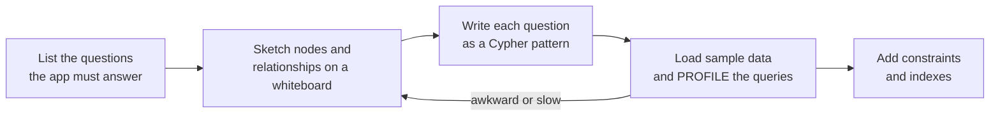
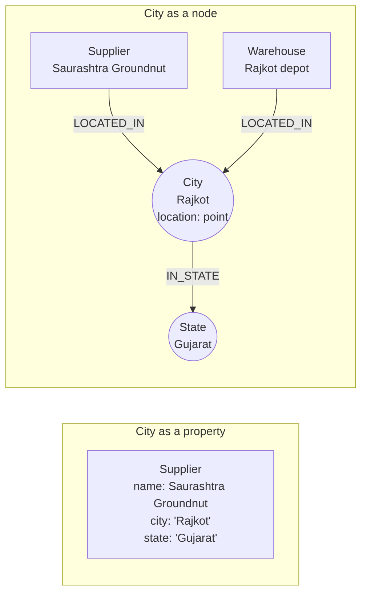
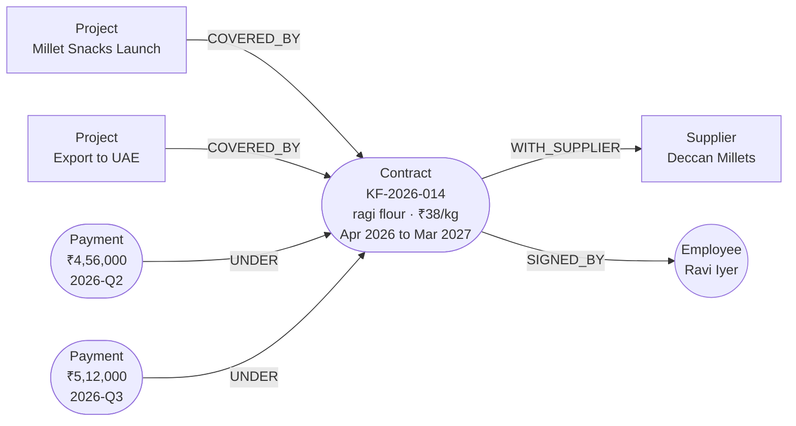

# Graph Data Modelling: The Complete Guide

> 📚 **Before you start**
>
> - [Cypher Basics: MATCH, CREATE and MERGE](cypher-basics-match-create-and-merge.md), for patterns, `MERGE` and constraints.
> - [Designing an Ontology for Your Domain](../03-ontologies-and-semantics/designing-an-ontology-for-your-domain.md), for competency questions and the four design patterns.
> - [Lab: Design an ontology for an online shop](../03-ontologies-and-semantics/lab-design-an-ontology-for-an-online-shop.md), whose ontology we turn into a Neo4j model here.

## Introduction

Two teams at Kiran Foods load the same supplier data into Neo4j. Team A makes `city` a property on each supplier. Team B makes `City` a node and links suppliers to it. Both graphs "work". Then the question arrives: *"Which suppliers share a city with one of our warehouses, and how far is that city from Pune?"* Team B writes a three-line query. Team A has to compare strings across labels, can't hang a distance anywhere, and discovers that "Bengaluru", "Bangalore" and "Bengaluru " are three different cities in their data.

**Graph data modelling** is deciding what becomes a node, what becomes a relationship, what becomes a property and what becomes a label, so that the questions you care about are short, fast and correct. It's the property-graph cousin of the ontology design you did in module 3, and it borrows the same starting point: **the questions**.

By the end of this lesson you'll be able to run a modelling session from questions to a tested model, make the six classic decisions with clear rules of thumb, recognise and fix supernodes, convert a relational schema and an OWL ontology into a property-graph model, and refactor a live graph with Cypher.

> 💡 **Key Insight**
>
> Model for the **queries**, not for the data. In a graph, the things you want to **start from, filter on, or walk through** should be nodes; details you only **read** should be properties; and a connection that carries its own facts may deserve to become a node itself.

---

## Core Explanation

### 1. The modelling loop



It is the competency-question loop from module 3 with one addition: **writing each question as a Cypher pattern before loading anything**. If a question needs a long string comparison, a property that holds a list of IDs, or a scan over every node, the model is wrong, and it's cheap to change on a whiteboard. (Neo4j's free web tool **Arrows** at arrows.app is handy for drawing models that export to Cypher.)

For Kiran Foods, the questions driving the model are:

| ID | Question |
|---|---|
| Q1 | Who manages a supplier based in Gujarat? |
| Q2 | If supplier X stops, which projects are hit and who leads them? |
| Q3 | What did we pay each supplier per quarter, and under which contract? |
| Q4 | Which suppliers are within 300 km of Pune? |
| Q5 | Who reported to whom on a given date (people move between teams)? |

### 2. Decision 1: node or property?

Take the supplier's city. As a property: `(:Supplier {city: 'Rajkot'})`. As a node: `(:Supplier)-[:LOCATED_IN]->(:City {name: 'Rajkot'})`.

Make it a **node** when any of these is true:

- You **start a query** from it or **group** by it often (Q1 starts from a state).
- Other things **connect to it too** (warehouses, customers and suppliers all have cities).
- It has **its own properties** (a city's state, its location for Q4's distance).
- **Consistency** matters: one `Bengaluru` node instead of free-text spellings.

Keep it a **property** when you only display it, it has no details of its own, and nothing else shares it: an employee's email address, a project's budget.



### 3. Decision 2: label or property?

Labels are for **kinds** of things and for **fast, frequent filters**; properties are for values that vary a lot.

| Use a label | Use a property |
|---|---|
| `:Supplier`, `:Employee` (what the thing is) | `status: 'active'` when status has many values or changes often |
| `:Preferred` on suppliers if "preferred suppliers" is a hot starting point | `rating: 4.2` |
| A second kind: `:Employee:Customer` | `title: 'Buyer'` |

Neo4j can start a query from all nodes with a label very cheaply, and a node can have several labels, so a small number of "role" labels is fine. Don't encode values as labels (`:Rating4`, `:Joined2021`): you can't range-query labels.

### 4. Decision 3: specific or generic relationship types?

Compare `(e)-[:RELATED_TO {kind: 'manages'}]->(s)` with `(e)-[:MANAGES_ACCOUNT]->(s)`. Specific types win almost every time:

- Neo4j stores relationships grouped by type, so `-[:MANAGES_ACCOUNT]->` skips everything else attached to a busy node.
- Queries read like sentences.
- LLMs generating Cypher get them right far more often, because the schema they're shown says exactly what each type means.

The exception is when the kinds are **open-ended data**, such as hundreds of relationship kinds coming from an extraction pipeline. Even then, aim to map them onto a fixed, small set of types (module 5 shows how an ontology does this).

**Naming conventions** that the Neo4j community and most tools assume: labels in `PascalCase` (`Supplier`), relationship types in `UPPER_SNAKE_CASE` (`MANAGES_ACCOUNT`), properties in `camelCase` (`budgetLakh`). Choose the stored direction that reads naturally as a sentence: `(:Employee)-[:REPORTS_TO]->(:Employee)`.

### 5. Decision 4: relationship or intermediate node?

A relationship connects exactly **two** nodes. When a fact involves **three or more things**, or when other facts need to point **at the connection itself**, promote it to a node. This is module 2's "facts about more than two things" and module 3's "events become classes" pattern, in property-graph form.

Kiran Foods' Q3 talks about contracts and payments. A first try:

```
(:Project)-[:SOURCES_FROM {item, pricePerKg, validFrom, validTo, contractNo}]->(:Supplier)
```

It breaks quickly: a payment must refer to a contract, the contract was signed by an employee, and a contract can cover several projects. You can't point a relationship at another relationship. So the contract becomes a node:



Rule of thumb: **if you find yourself wanting to add a relationship to a relationship, or the relationship has more than three or four properties, it's probably a node.** Common examples: Contract, Employment, Order line, Shipment, Meeting, Diagnosis, Transaction.

### 6. Decision 5: modelling time

Q5 asks who reported to whom **on a given date**. People change managers, so a plain `REPORTS_TO` only tells you today's truth. Three patterns, from simplest to richest:

| Pattern | Shape | Good for |
|---|---|---|
| **Dated relationship** | `(e)-[:REPORTS_TO {from: date('2024-04-01'), to: null}]->(m)`; close it by setting `to` and create a new one | Org charts, memberships: most cases |
| **Event or state node** | `(e)-[:HELD]->(:Role {title, from, to})-[:IN]->(:Department)` | When the period has its own details (salary band, location) |
| **Time tree** | `(:Year)-[:HAS_MONTH]->(:Month)-[:HAS_DAY]->(:Day)` with events linked to days | Heavy "everything on 3 October" queries; rarely needed now that dates and range indexes are fast |

The dated-relationship version of Q5:

```cypher
MATCH (e:Employee)-[r:REPORTS_TO]->(m:Employee)
WHERE r.from <= date('2025-06-30') AND (r.to IS NULL OR r.to >= date('2025-06-30'))
RETURN e.name, m.name;
```

This is the "dates instead of flags" pattern from the Dabba Express ontology, applied to relationships.

### 7. Decision 6: watch out for supernodes

A **supernode** is a node with an enormous number of relationships: the `Mumbai` city node with 3 million customers, a `Gender` node, a `Status: Active` node, a celebrity in a social graph. Walking *through* a supernode means touching millions of relationships, and it usually returns useless answers ("these two customers are connected: they both live in Mumbai").

Let's measure the degree (number of relationships) of each node in a generated customer graph:

```python
import random
from collections import Counter

random.seed(7)
cities = ["Mumbai"] * 70 + ["Pune"] * 15 + ["Nashik"] * 8 + ["Kochi"] * 5 + ["Bhuj"] * 2   # skewed, like real data
rels = []
for c in range(5000):
    rels.append((f"C-{c}", "LIVES_IN", random.choice(cities)))
    rels.append((f"C-{c}", "HAS_STATUS", "Active" if random.random() < 0.9 else "Dormant"))
    for _ in range(random.randint(1, 4)):
        rels.append((f"C-{c}", "BOUGHT", f"P-{random.randint(1, 300)}"))

degree = Counter()
for s, t, e in rels:
    degree[s] += 1
    degree[e] += 1
print("relationships:", len(rels))
for node, d in degree.most_common(5):
    print(f"{node:<8} degree {d}")
typical = sorted(degree[f"C-{c}"] for c in range(5000))[2500]
print("median customer degree:", typical)
```

Output:

```
relationships: 22478
Active   degree 4488
Mumbai   degree 3504
Pune     degree 737
Dormant  degree 512
Nashik   degree 437
median customer degree: 4
```

`Active` and `Mumbai` are supernodes. Fixes, in order of preference:

1. **Don't make it a node.** A status with two values is a property (or a label, `:Dormant`, if you often start from dormant customers).
2. **Don't traverse through it.** For "customers similar to Priya", walk through products bought, not through her city.
3. **Use relationship types and direction** so the engine can skip most of the node's relationships (Neo4j groups a dense node's relationships by type and direction).
4. **Bucket it**: split `Mumbai` into localities (`Andheri West`, `Dadar`) if locality is what matters.

### 8. Converting a relational schema

Most graphs start life as tables. The mapping is mechanical, and seeing it on real tables makes the decisions concrete. Here is a slice of Kiran Foods' procurement database in SQLite:

```python
import sqlite3

db = sqlite3.connect(":memory:")
db.executescript("""
CREATE TABLE employee (emp_id TEXT PRIMARY KEY, name TEXT, manager_id TEXT REFERENCES employee(emp_id));
CREATE TABLE supplier (sup_id TEXT PRIMARY KEY, name TEXT, city TEXT, state TEXT);
CREATE TABLE project  (proj_id TEXT PRIMARY KEY, name TEXT, lead_id TEXT REFERENCES employee(emp_id));
CREATE TABLE project_supplier (proj_id TEXT, sup_id TEXT, item TEXT, PRIMARY KEY (proj_id, sup_id));
INSERT INTO employee VALUES ('E-01','Anjali Mehta',NULL), ('E-02','Ravi Iyer','E-01'), ('E-03','Neha Gupta','E-01');
INSERT INTO supplier VALUES ('S-01','Deccan Millets','Hyderabad','Telangana'),
                            ('S-05','Malabar Spice House','Kochi','Kerala');
INSERT INTO project VALUES ('PR-1','Millet Snacks Launch','E-03');
INSERT INTO project_supplier VALUES ('PR-1','S-01','ragi flour'), ('PR-1','S-05','spice blend');
""")
print(db.execute("SELECT name FROM sqlite_master WHERE type='table' ORDER BY name").fetchall())
```

Output:

```
[('employee',), ('project',), ('project_supplier',), ('supplier',)]
```

The mapping rules:

| Relational thing | Becomes |
|---|---|
| Entity table (`employee`, `supplier`, `project`) | A **label**; each row a node; primary key becomes an `id` property with a uniqueness constraint |
| Foreign key column (`manager_id`, `lead_id`) | A **relationship** (`REPORTS_TO`, `LEADS`); the column disappears |
| Pure join table (`project_supplier`) | A **relationship**; extra columns (`item`) become relationship properties |
| Join table with its own identity or many columns | A **node** (decision 4) |
| Repeated text values worth traversing (`city`, `state`) | **Nodes** (decision 1) |
| Lookup/code tables (`status_code`) | Usually properties or labels |

A small converter that applies those rules and prints the Cypher it would run:

```python
def rows(sql):
    return db.execute(sql).fetchall()

cypher = []
for emp_id, name, _ in rows("SELECT * FROM employee ORDER BY emp_id"):
    cypher.append(f"MERGE (:Employee {{id: '{emp_id}', name: '{name}'}})")
for emp_id, _, mgr in rows("SELECT * FROM employee WHERE manager_id IS NOT NULL ORDER BY emp_id"):
    cypher.append(f"MATCH (a:Employee {{id: '{emp_id}'}}), (b:Employee {{id: '{mgr}'}}) MERGE (a)-[:REPORTS_TO]->(b)")
for sup_id, name, city, state in rows("SELECT * FROM supplier ORDER BY sup_id"):
    cypher.append(f"MERGE (s:Supplier {{id: '{sup_id}'}}) SET s.name = '{name}' "
                  f"MERGE (c:City {{name: '{city}'}}) SET c.state = '{state}' MERGE (s)-[:LOCATED_IN]->(c)")
for proj_id, name, lead in rows("SELECT * FROM project ORDER BY proj_id"):
    cypher.append(f"MERGE (p:Project {{id: '{proj_id}'}}) SET p.name = '{name}' "
                  f"WITH p MATCH (e:Employee {{id: '{lead}'}}) MERGE (e)-[:LEADS]->(p)")
for proj_id, sup_id, item in rows("SELECT * FROM project_supplier ORDER BY proj_id, sup_id"):
    cypher.append(f"MATCH (p:Project {{id: '{proj_id}'}}), (s:Supplier {{id: '{sup_id}'}}) "
                  f"MERGE (p)-[:SOURCES_FROM {{item: '{item}'}}]->(s)")
for statement in cypher[-4:]:
    print(statement + ";")
print(len(cypher), "statements")
```

Output:

```
MERGE (s:Supplier {id: 'S-05'}) SET s.name = 'Malabar Spice House' MERGE (c:City {name: 'Kochi'}) SET c.state = 'Kerala' MERGE (s)-[:LOCATED_IN]->(c);
MERGE (p:Project {id: 'PR-1'}) SET p.name = 'Millet Snacks Launch' WITH p MATCH (e:Employee {id: 'E-03'}) MERGE (e)-[:LEADS]->(p);
MATCH (p:Project {id: 'PR-1'}), (s:Supplier {id: 'S-01'}) MERGE (p)-[:SOURCES_FROM {item: 'ragi flour'}]->(s);
MATCH (p:Project {id: 'PR-1'}), (s:Supplier {id: 'S-05'}) MERGE (p)-[:SOURCES_FROM {item: 'spice blend'}]->(s);
10 statements
```

This printout is for learning only. Real loaders never paste values into Cypher strings (a name like `D'Souza` breaks it, and it's an injection risk); they send parameters with `UNWIND $rows`, which you'll do in the lab.

### 9. Converting an ontology

Module 3's Chai Bazaar ontology maps to a property graph almost one for one, with a few choices to make:

| OWL / ontology | Property graph | Note |
|---|---|---|
| Class `shop:Customer` | Label `:Customer` | |
| Subclass `shop:Tea ⊑ shop:Product` | **Both labels**: `(:Product:Tea)` | Lets `MATCH (p:Product)` find teas without inference |
| Object property `shop:placedBy` | Relationship type `:PLACED_BY` | Domain and range become the node labels at each end |
| Datatype property `shop:orderDate` | Property `orderDate` | Use Neo4j `date` type |
| Functional property (max 1) | Nothing built in | Enforce in loader code or with a test query |
| Event class `shop:OrderLine` | A node, **or** a relationship `(:Order)-[:CONTAINS {quantity}]->(:Product)` | Relationship is simpler while nothing points at a line; Returns (lab v2) point at lines, so keep it a node |
| SKOS concept `PaymentMethod` | Node `(:PaymentMethod {code: 'UPI'})` or a property | Node if you'll traverse "all UPI payments" often |
| `rdfs:comment` definitions | Not stored in data | Keep them in the model document and in the LLM's schema prompt (module 6) |

Here's that mapping as code, applied to part of the v2 property table from the lab:

```python
PROPS = {  # ontology property: (kind, domain, range)
    "placedBy": ("obj", "Order", "Customer"), "hasLine": ("obj", "Order", "OrderLine"),
    "forProduct": ("obj", "OrderLine", "Product"), "soldBy": ("obj", "Product", "Seller"),
    "orderDate": ("data", "Order", "xsd:date"), "quantity": ("data", "OrderLine", "xsd:positiveInteger"),
    "priceInr": ("data", "Offer", "xsd:decimal"), "offerFor": ("obj", "Offer", "Product"),
}
SUBCLASSES = {"Tea": "Product", "SpiceMix": "Product", "Accessory": "Product"}
NEO4J_TYPES = {"xsd:date": "DATE", "xsd:positiveInteger": "INTEGER", "xsd:decimal": "FLOAT"}

def upper_snake(camel):
    return "".join("_" + ch if ch.isupper() else ch.upper() for ch in camel)

print("Relationship patterns:")
for name, (kind, dom, rng) in PROPS.items():
    if kind == "obj":
        print(f"  (:{dom})-[:{upper_snake(name)}]->(:{rng})")
print("Node properties:")
for name, (kind, dom, rng) in PROPS.items():
    if kind == "data":
        print(f"  {dom}.{name} :: {NEO4J_TYPES[rng]}")
print("Extra labels:", ", ".join(f"(:{p}:{c})" for c, p in SUBCLASSES.items()))
```

Output:

```
Relationship patterns:
  (:Order)-[:PLACED_BY]->(:Customer)
  (:Order)-[:HAS_LINE]->(:OrderLine)
  (:OrderLine)-[:FOR_PRODUCT]->(:Product)
  (:Product)-[:SOLD_BY]->(:Seller)
  (:Offer)-[:OFFER_FOR]->(:Product)
Node properties:
  Order.orderDate :: DATE
  OrderLine.quantity :: INTEGER
  Offer.priceInr :: FLOAT
Extra labels: (:Product:Tea), (:Product:SpiceMix), (:Product:Accessory)
```

That printout is the **graph schema**, the compact description of node labels, relationship patterns and property types that you'll hand to an LLM in [Text-to-Cypher Agents](../course.md#m6). In a live database, `CALL db.schema.visualization()` draws the schema Neo4j infers from the stored data, which is a quick way to spot accidental labels and relationship types.

### 10. Refactoring a live graph

Models change. Neo4j has no `ALTER TABLE`, but refactoring is just Cypher. Promoting the `state` property on cities into `State` nodes:

```cypher
MATCH (c:City) WHERE c.state IS NOT NULL
MERGE (s:State {name: c.state})
MERGE (c)-[:IN_STATE]->(s)
REMOVE c.state;
```

Promoting a relationship to an intermediate node (decision 4):

```cypher
MATCH (p:Project)-[r:SOURCES_FROM]->(s:Supplier)
CREATE (k:Contract {item: r.item})
MERGE (p)-[:COVERED_BY]->(k)
MERGE (k)-[:WITH_SUPPLIER]->(s)
DELETE r;
```

Renaming a relationship type uses the APOC library (`apoc.refactor.setType`) or the same create-then-delete trick. On a big graph, batch these with `CALL (...) { ... } IN TRANSACTIONS`, and run them in a copy first.

### 11. A model checklist

Before loading production data, check:

- [ ] Every question from step 1 is a short pattern starting from an indexed property or a selective label.
- [ ] Every node label has a uniqueness constraint on its key.
- [ ] No property holds a list of IDs (those are hidden relationships).
- [ ] No node is expected to collect millions of relationships that queries walk through.
- [ ] Facts about connections that other facts point to are nodes, not relationships.
- [ ] Anything that changes over time has dates, not true/false flags.
- [ ] Names follow `Label`, `REL_TYPE`, `propertyName`.

---

## Try It Yourself

1. **Decide.** For each, say node, property, label or relationship, and why: (a) an employee's blood group; (b) the HSN code of a product (an Indian tax classification code shared by many products, with its own GST rate); (c) "this supplier is blacklisted"; (d) "Farhan approved this invoice on 3 March".
2. **Find the supernode.** In the customer graph from section 7, which relationship type creates the biggest node? Count relationships per type.
3. **Map a join table.** Add a table `employee_project(emp_id, proj_id, role, hours_per_week)` to the SQLite database and print the Cypher pattern each row would become.

<details>
<summary>Show answers</summary>

**1.** (a) Property: only read, no details of its own, and as a node it would be a supernode. (b) Node `(:HSNCode {code, gstRate})`: shared by many products, has its own properties, and you'll ask "all products under HSN 1905". (c) A label `:Blacklisted` (fast filter, few nodes) or a dated relationship to a `Blacklisting` decision if you need who decided and when. (d) An approval involves a person, an invoice and a date, and auditors will ask about it: a relationship `(:Employee)-[:APPROVED {on: date('2026-03-03')}]->(:Invoice)` is enough unless approvals carry more facts.

**2.**

```python
by_type = Counter(t for _, t, _ in rels)
print(by_type.most_common())
```

Output:

```
[('BOUGHT', 12478), ('LIVES_IN', 5000), ('HAS_STATUS', 5000)]
```

`HAS_STATUS` has only 5,000 relationships, but they all land on two nodes, so `Active` gets 90% of them. The total count per type isn't the problem; the number of relationships per **target node** is.

**3.**

```python
db.execute("CREATE TABLE employee_project (emp_id TEXT, proj_id TEXT, role TEXT, hours_per_week INTEGER)")
db.execute("INSERT INTO employee_project VALUES ('E-02','PR-1','sponsor',2), ('E-03','PR-1','lead',30)")
for emp, proj, role, hours in rows("SELECT * FROM employee_project ORDER BY emp_id"):
    print(f"(:Employee {{id: '{emp}'}})-[:WORKS_ON {{role: '{role}', hoursPerWeek: {hours}}}]->(:Project {{id: '{proj}'}})")
```

Output:

```
(:Employee {id: 'E-02'})-[:WORKS_ON {role: 'sponsor', hoursPerWeek: 2}]->(:Project {id: 'PR-1'})
(:Employee {id: 'E-03'})-[:WORKS_ON {role: 'lead', hoursPerWeek: 30}]->(:Project {id: 'PR-1'})
```

</details>

---

## Real-World Examples

- **Banks** model transactions as nodes (not relationships) so that alerts, investigations and reversals can point at them.
- **E-commerce teams** keep order lines as relationships `(:Order)-[:CONTAINS {qty, price}]->(:Product)` for recommendation queries, and as nodes in the order-management graph where returns refer to them.
- **Telecom operators** avoid tower supernodes by modelling calls as time-bucketed aggregates rather than one relationship per call.
- **Knowledge-graph teams** keep a model document (labels, relationship patterns, definitions) in Git next to the loader, and generate the LLM's schema prompt from it.

---

## Common Misconceptions

### "There's one correct graph model for a domain"

The right model depends on the questions. The same order line is a relationship in one graph and a node in another, and both can be right.

### "More nodes always means a better graph"

Turning every value into a node creates supernodes and slow, noisy traversals. Promote a value to a node only when you start from it, share it, or give it its own properties.

### "Copying the relational schema is a good start"

It's a fine *input*, but join tables, code tables and denormalised columns are storage decisions. Apply the mapping rules, then check the model against the questions.

### "Graph models can't change once loaded"

Refactoring is ordinary Cypher: `MERGE` new nodes, move relationships, delete the old ones, in batches.

---

## Interview Relevance

*"How would you model X as a graph?"* is a classic design question. Walk through: questions first; entities as nodes with key constraints; specific relationship types with a natural direction; the node-vs-property rules (start from it, share it, give it properties); promoting n-ary facts and events to intermediate nodes; time via dated relationships or state nodes; supernode risks and mitigations; and how you'd validate with `PROFILE`. Being able to map a relational schema or an OWL ontology to labels, relationship types and properties shows you understand both worlds.

---

## Key Takeaways

- **Start from the questions** and write each as a Cypher pattern before loading data.
- **Nodes for what you start from, share or describe; properties for what you only read.**
- **Specific relationship types**, named as sentences, beat generic `RELATED_TO`.
- **Facts about connections become intermediate nodes**; things that change get dates.
- **Avoid traversing supernodes**; relational tables and OWL ontologies map to graphs by clear rules.

---

**Up next:** [Graph Algorithms: Paths, Centrality and Communities](graph-algorithms-paths-centrality-and-communities.md)
