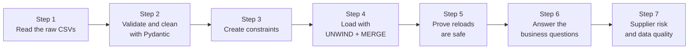

# Lab: Build a company knowledge graph in Neo4j

> 📚 **Before you start**
>
> - [Property Graphs and Neo4j](property-graphs-and-neo4j.md), for setting up Neo4j and the Python driver.
> - [Cypher Basics: MATCH, CREATE and MERGE](cypher-basics-match-create-and-merge.md), for `MERGE`, constraints and `UNWIND`.
> - [Graph Data Modelling](graph-data-modelling.md), for the node-or-property decisions this model follows.
> - [Graph Algorithms: Paths, Centrality and Communities](graph-algorithms-paths-centrality-and-communities.md), for the supplier-risk step.
> - Pydantic models and validators: [APIs and Apps › Validation and Schemas](../../apis-and-apps-fastapi-streamlit-and-docker/course.md#m4).

## What You'll Build

Kiran Foods' operations head wants one place to answer questions that today need three systems and a lot of phone calls. The data lives in three CSV exports: HR (employees), procurement (suppliers) and the project tracker (projects). Like all real exports, they're messy: stray spaces, "Gujrat" spelt wrong, a supplier listed twice, a tax number typed with the wrong state code.

You'll build the full pipeline a data engineer would build:

![Kiran Foods company graph. Top row: three CSV exports from HR, procurement and the project tracker flow into a Python loader that cleans and validates them with Pydantic and sends UNWIND plus MERGE batches to a Neo4j database, where constraints are created first so reloads are safe. Below, the graph model inside Neo4j: Employee WORKS_IN Department and REPORTS_TO another Employee; Employee LEADS or WORKS_ON a Project; Employee MANAGES_ACCOUNT a Supplier with a since date; Project SOURCES_FROM Supplier with an item; Supplier LOCATED_IN City; City IN_STATE State](/img/diagrams/knowledge-graphs-ontologies-and-unstructured-data/kiran-foods-model.svg)
*Three exports in, one connected graph out. Each step below builds one arrow of this picture.*



Everything runs in plain Python: an in-memory stand-in plays the part of Neo4j so you can see every node and relationship being merged. Each step also shows the exact Cypher and driver code to run against a real Neo4j instance from [Property Graphs and Neo4j](property-graphs-and-neo4j.md).

> 💡 **Key Insight**
>
> A production graph loader is **validate, then merge, in batches, behind constraints**. Validation stops bad rows before they become bad nodes; `MERGE` on keys plus uniqueness constraints makes the load **idempotent**, so it can be rerun every night (or after a crash) without creating a single duplicate.

---

## Step 1: Read the raw CSVs

Here are the three exports exactly as they arrive. Read them carefully and try to spot the problems before Step 2 finds them.

```python
import csv
import io

EMPLOYEES_CSV = """emp_id,name,title,department,manager_id,joined
E-01,Anjali Mehta,CEO,Leadership,,2015
E-02,Ravi Iyer,Head of Procurement,Procurement,E-01,2016
E-03,Neha Gupta,R&D Lead,R&D,E-01,2018
E-04, Farhan Shaikh ,Buyer,procurement,E-02,2020
E-05,Lakshmi Menon,Head of Sales,Sales,E-01,2017
E-06,Deepak Joshi,Food Scientist,R&D,E-03,2021
E-07,Kavya Reddy,Buyer,Procurement,E-02,2022
E-08,Arjun Patil,Sales Manager West,Sales,E-05,2019
E-09,Pooja Desai,Finance Controller,Finance,E-01,2018
E-10,Suresh Nair,Head of Operations,Operations,E-01,2016
"""

SUPPLIERS_CSV = """sup_id,name,city,state,gstin,account_manager,since
S-01,Deccan Millets,Hyderabad,Telangana,36AABCD1234E1Z5,E-02,2023
S-02,Saurashtra Groundnut Co.,Rajkot,Gujrat,24AAECS5678F1Z2,E-04,2021
S-03,Kutch Salt Works,Bhuj,Gujarat,24AADCK9012G1Z8,E-04,2024
S-04,Nashik Agro Pack,nashik,Maharashtra,27AAFCN3456H1Z1,E-07,2022
S-05,Malabar Spice House,Kochi,Kerala,32AAGCM7890J1Z4,E-07,2022
S-06,FrostLine Cold Chain,Pune,Maharashtra,29AAHCF2345K1Z7,E-04,2025
S-01,Deccan Millets,Hyderabad,Telangana,36AABCD1234E1Z5,E-02,2023
"""

PROJECTS_CSV = """proj_id,name,budget_lakh,status,lead_id,team,sources
PR-1,Millet Snacks Launch,85,active,E-03,E-06:recipe;E-07:sourcing,S-01:ragi flour;S-05:spice blend;S-04:pouches
PR-2,Cold Chain Upgrade,120,active,E-10,E-04:vendor,S-06:reefer trucks
PR-3,Export to UAE,60,planning,E-05,E-08:market;E-09:pricing,S-04:export cartons;S-02:groundnuts
"""

def read(text):
    return list(csv.DictReader(io.StringIO(text)))

raw_employees, raw_suppliers, raw_projects = read(EMPLOYEES_CSV), read(SUPPLIERS_CSV), read(PROJECTS_CSV)
print(len(raw_employees), "employee rows,", len(raw_suppliers), "supplier rows,", len(raw_projects), "project rows")
print(raw_employees[3])
```

Output:

```
10 employee rows, 7 supplier rows, 3 project rows
{'emp_id': 'E-04', 'name': ' Farhan Shaikh ', 'title': 'Buyer', 'department': 'procurement', 'manager_id': 'E-02', 'joined': '2020'}
```

Every value is a string, even numbers and empty manager IDs. Farhan's name has spaces around it and his department is lower-case, so a naive load would create a second `procurement` department. Those are the easy ones.

## Step 2: Validate and clean with Pydantic

Each record type gets a Pydantic model. Validators clean what can be fixed safely (spaces, capitalisation, known misspellings) and reject what can't. One check deserves a word: an Indian **GSTIN** (GST identification number) is 15 characters, and its **first two digits are the state code** of the business (24 is Gujarat, 27 Maharashtra, 29 Karnataka, 32 Kerala, 36 Telangana). So a GSTIN is a free consistency check against the address.

```python
import re
from typing import Literal, Optional
from pydantic import BaseModel, ValidationError, field_validator, model_validator

STATE_FIXES = {"gujrat": "Gujarat"}
GST_STATE_CODES = {"24": "Gujarat", "27": "Maharashtra", "29": "Karnataka", "32": "Kerala", "36": "Telangana"}
GSTIN_PATTERN = re.compile(r"^\d{2}[A-Z]{5}\d{4}[A-Z][1-9A-Z]Z[0-9A-Z]$")

def tidy(text: str) -> str:
    return " ".join(text.split())                          # trim and collapse inner spaces

class Employee(BaseModel):
    emp_id: str
    name: str
    title: str
    department: str
    manager_id: Optional[str] = None
    joined: int

    @field_validator("name", "title")
    @classmethod
    def strip_spaces(cls, v: str) -> str:
        return tidy(v)

    @field_validator("department")
    @classmethod
    def department_case(cls, v: str) -> str:
        v = tidy(v)
        return v if any(ch.isupper() for ch in v) else v.title()   # 'procurement' -> 'Procurement', keep 'R&D'

    @field_validator("manager_id")
    @classmethod
    def empty_is_none(cls, v):
        return v or None

class Supplier(BaseModel):
    sup_id: str
    name: str
    city: str
    state: str
    gstin: str
    account_manager: str
    since: int

    @field_validator("name")
    @classmethod
    def strip_name(cls, v: str) -> str:
        return tidy(v)

    @field_validator("city")
    @classmethod
    def city_case(cls, v: str) -> str:
        return tidy(v).title()

    @field_validator("state")
    @classmethod
    def fix_state(cls, v: str) -> str:
        v = tidy(v)
        return STATE_FIXES.get(v.lower(), v)

    @field_validator("gstin")
    @classmethod
    def gstin_format(cls, v: str) -> str:
        if not GSTIN_PATTERN.match(v):
            raise ValueError(f"{v!r} is not a valid GSTIN format")
        return v

    @model_validator(mode="after")
    def gstin_matches_state(self):
        expected = GST_STATE_CODES.get(self.gstin[:2])
        if expected != self.state:
            raise ValueError(f"GSTIN {self.gstin} is registered in {expected}, but the address says {self.state}")
        return self

class Project(BaseModel):
    proj_id: str
    name: str
    budget_lakh: int
    status: Literal["planning", "active", "closed"]
    lead_id: str
    team: list[tuple[str, str]]
    sources: list[tuple[str, str]]

    @field_validator("team", "sources", mode="before")
    @classmethod
    def split_pairs(cls, v):
        if isinstance(v, str):                                    # "E-06:recipe;E-07:sourcing"
            return [tuple(part.split(":", 1)) for part in v.split(";") if part]
        return v

def validate(rows, model, key):
    good, rejected, seen = [], [], set()
    for row in rows:
        try:
            record = model(**row)
        except ValidationError as err:
            rejected.append((row[key], err.errors()[0]["msg"]))
            continue
        if getattr(record, key) in seen:
            rejected.append((row[key], "duplicate row, skipped"))
            continue
        seen.add(getattr(record, key))
        good.append(record)
    return good, rejected

employees, emp_rejects = validate(raw_employees, Employee, "emp_id")
suppliers, sup_rejects = validate(raw_suppliers, Supplier, "sup_id")
projects, proj_rejects = validate(raw_projects, Project, "proj_id")
print(f"employees: {len(employees)} ok, rejected {emp_rejects}")
print(f"suppliers: {len(suppliers)} ok")
for key, reason in sup_rejects:
    print("  rejected", key, "->", reason)
print(f"projects: {len(projects)} ok, rejected {proj_rejects}")
print(employees[3].name, "|", employees[3].department, "|", suppliers[1].state, "|", suppliers[3].city)
```

Output:

```
employees: 10 ok, rejected []
suppliers: 5 ok
  rejected S-06 -> Value error, GSTIN 29AAHCF2345K1Z7 is registered in Karnataka, but the address says Maharashtra
  rejected S-01 -> duplicate row, skipped
projects: 3 ok, rejected []
Farhan Shaikh | Procurement | Gujarat | Nashik
```

Look at what happened:

- **Fixed silently** (safe, mechanical): Farhan's spaces, `procurement` → `Procurement`, `Gujrat` → `Gujarat`, `nashik` → `Nashik`.
- **Skipped**: the duplicate S-01 row.
- **Rejected for a human**: FrostLine Cold Chain's GSTIN starts with 29 (Karnataka) while its address is Pune, Maharashtra. Either the address or the tax number is wrong, and guessing could put tax filings against the wrong entity. In a real pipeline this row goes to a review queue.

For this lab, procurement confirms that FrostLine's Pune branch has its own Maharashtra registration, so we apply the correction and revalidate. The fix goes into the source system too; patching only the graph means the error comes back tomorrow.

```python
fixed = dict(next(r for r in raw_suppliers if r["sup_id"] == "S-06"), gstin="27AAHCF2345K1Z3")
suppliers.append(Supplier(**fixed))
print(len(suppliers), "suppliers ready:", [s.sup_id for s in suppliers])
```

Output:

```
6 suppliers ready: ['S-01', 'S-02', 'S-03', 'S-04', 'S-05', 'S-06']
```

## Step 3: Create constraints first

Constraints come **before** any data. They make `MERGE` fast (each creates an index) and safe (two loads can't both create the same supplier). In Neo4j Browser or from the driver:

```cypher
CREATE CONSTRAINT employee_id   IF NOT EXISTS FOR (n:Employee)   REQUIRE n.id IS UNIQUE;
CREATE CONSTRAINT supplier_id   IF NOT EXISTS FOR (n:Supplier)   REQUIRE n.id IS UNIQUE;
CREATE CONSTRAINT project_id    IF NOT EXISTS FOR (n:Project)    REQUIRE n.id IS UNIQUE;
CREATE CONSTRAINT department_nm IF NOT EXISTS FOR (n:Department) REQUIRE n.name IS UNIQUE;
CREATE CONSTRAINT city_nm       IF NOT EXISTS FOR (n:City)       REQUIRE n.name IS UNIQUE;
CREATE CONSTRAINT state_nm      IF NOT EXISTS FOR (n:State)      REQUIRE n.name IS UNIQUE;
```

(City names aren't unique across India; there's more than one Aurangabad. For a national graph you'd key cities by a code, such as a census town code or `name + state`. Kiran's six cities are unambiguous, so `name` is fine here.)

## Step 4: Load with UNWIND and MERGE

The loader turns the validated records into **batches**: one Cypher statement plus a list of row dictionaries. Each statement merges nodes on their keys first, then relationships, exactly as the `MERGE` lesson taught.

```python
STATEMENTS = {
    "departments": """
        UNWIND $rows AS row
        MERGE (:Department {name: row.name})""",
    "employees": """
        UNWIND $rows AS row
        MERGE (e:Employee {id: row.id})
        SET e.name = row.name, e.title = row.title, e.joined = row.joined
        WITH e, row
        MATCH (d:Department {name: row.department})
        MERGE (e)-[:WORKS_IN]->(d)""",
    "reports_to": """
        UNWIND $rows AS row
        MATCH (e:Employee {id: row.id}), (m:Employee {id: row.manager})
        MERGE (e)-[:REPORTS_TO]->(m)""",
    "suppliers": """
        UNWIND $rows AS row
        MERGE (s:Supplier {id: row.id})
        SET s.name = row.name, s.gstin = row.gstin
        MERGE (c:City {name: row.city})
        MERGE (st:State {name: row.state})
        MERGE (s)-[:LOCATED_IN]->(c)
        MERGE (c)-[:IN_STATE]->(st)
        WITH s, row
        MATCH (e:Employee {id: row.manager})
        MERGE (e)-[r:MANAGES_ACCOUNT]->(s)
        SET r.since = row.since""",
    "projects": """
        UNWIND $rows AS row
        MERGE (p:Project {id: row.id})
        SET p.name = row.name, p.budgetLakh = row.budget, p.status = row.status
        WITH p, row
        MATCH (lead:Employee {id: row.lead})
        MERGE (lead)-[:LEADS]->(p)""",
    "works_on": """
        UNWIND $rows AS row
        MATCH (e:Employee {id: row.emp}), (p:Project {id: row.proj})
        MERGE (e)-[r:WORKS_ON]->(p)
        SET r.role = row.role""",
    "sources_from": """
        UNWIND $rows AS row
        MATCH (p:Project {id: row.proj}), (s:Supplier {id: row.sup})
        MERGE (p)-[r:SOURCES_FROM]->(s)
        SET r.item = row.item""",
}

def build_batches():
    return [
        ("departments", [{"name": d} for d in sorted({e.department for e in employees})]),
        ("employees", [{"id": e.emp_id, "name": e.name, "title": e.title, "joined": e.joined,
                        "department": e.department} for e in employees]),
        ("reports_to", [{"id": e.emp_id, "manager": e.manager_id} for e in employees if e.manager_id]),
        ("suppliers", [{"id": s.sup_id, "name": s.name, "gstin": s.gstin, "city": s.city, "state": s.state,
                        "manager": s.account_manager, "since": s.since} for s in suppliers]),
        ("projects", [{"id": p.proj_id, "name": p.name, "budget": p.budget_lakh, "status": p.status,
                       "lead": p.lead_id} for p in projects]),
        ("works_on", [{"emp": emp, "proj": p.proj_id, "role": role} for p in projects for emp, role in p.team]),
        ("sources_from", [{"proj": p.proj_id, "sup": sup, "item": item} for p in projects for sup, item in p.sources]),
    ]

BATCHES = build_batches()
for name, rows in BATCHES:
    print(f"{name:<13} {len(rows):>2} rows   e.g. {rows[0]}")
```

Output:

```
departments    6 rows   e.g. {'name': 'Finance'}
employees     10 rows   e.g. {'id': 'E-01', 'name': 'Anjali Mehta', 'title': 'CEO', 'joined': 2015, 'department': 'Leadership'}
reports_to     9 rows   e.g. {'id': 'E-02', 'manager': 'E-01'}
suppliers      6 rows   e.g. {'id': 'S-01', 'name': 'Deccan Millets', 'gstin': '36AABCD1234E1Z5', 'city': 'Hyderabad', 'state': 'Telangana', 'manager': 'E-02', 'since': 2023}
projects       3 rows   e.g. {'id': 'PR-1', 'name': 'Millet Snacks Launch', 'budget': 85, 'status': 'active', 'lead': 'E-03'}
works_on       5 rows   e.g. {'emp': 'E-06', 'proj': 'PR-1', 'role': 'recipe'}
sources_from   6 rows   e.g. {'proj': 'PR-1', 'sup': 'S-01', 'item': 'ragi flour'}
```

Against a real database, each batch is one `execute_query` call. The values travel as parameters, never pasted into the query text:

```python
# not-run: needs a running Neo4j server and the neo4j package
from neo4j import GraphDatabase

with GraphDatabase.driver("neo4j://localhost:7687", auth=("neo4j", "kiranfoods123")) as driver:
    for name, rows in BATCHES:
        for start in range(0, len(rows), 1000):                  # 1,000 rows per transaction
            summary = driver.execute_query(STATEMENTS[name], rows=rows[start:start + 1000],
                                           database_="neo4j").summary
            c = summary.counters
            print(f"{name:<13} +{c.nodes_created} nodes, +{c.relationships_created} relationships")
```

Example output (first run on an empty database):

```
departments   +6 nodes, +0 relationships
employees     +10 nodes, +10 relationships
reports_to    +0 nodes, +9 relationships
suppliers     +16 nodes, +18 relationships
projects      +3 nodes, +3 relationships
works_on      +0 nodes, +5 relationships
sources_from  +0 nodes, +6 relationships
```

Order matters: departments before employees (employees `MATCH` their department), employees before `reports_to`, suppliers and projects before `sources_from`. A `MATCH` that finds nothing silently produces no row, so a wrong order gives you missing relationships rather than an error. Step 7 catches that.

To run the whole lab without a database, here's a small in-memory stand-in that applies each statement's meaning with Python dictionaries and counts what it creates, like `summary.counters` does:

```python
class InMemoryGraph:
    def __init__(self):
        self.nodes = {}                 # (label, key) -> properties
        self.rels = {}                  # (start, type, end) -> properties

    def merge_node(self, label, key, **props):
        created = (label, key) not in self.nodes
        self.nodes.setdefault((label, key), {}).update(props)
        return created

    def merge_rel(self, start, rel_type, end, **props):
        if start not in self.nodes or end not in self.nodes:   # MATCH found nothing: no row, no error
            return False
        created = (start, rel_type, end) not in self.rels
        self.rels.setdefault((start, rel_type, end), {}).update(props)
        return created

    def run(self, name, rows):
        n = r = 0
        for row in rows:
            if name == "departments":
                n += self.merge_node("Department", row["name"])
            elif name == "employees":
                n += self.merge_node("Employee", row["id"], name=row["name"], title=row["title"], joined=row["joined"])
                r += self.merge_rel(("Employee", row["id"]), "WORKS_IN", ("Department", row["department"]))
            elif name == "reports_to":
                r += self.merge_rel(("Employee", row["id"]), "REPORTS_TO", ("Employee", row["manager"]))
            elif name == "suppliers":
                n += self.merge_node("Supplier", row["id"], name=row["name"], gstin=row["gstin"])
                n += self.merge_node("City", row["city"])
                n += self.merge_node("State", row["state"])
                r += self.merge_rel(("Supplier", row["id"]), "LOCATED_IN", ("City", row["city"]))
                r += self.merge_rel(("City", row["city"]), "IN_STATE", ("State", row["state"]))
                r += self.merge_rel(("Employee", row["manager"]), "MANAGES_ACCOUNT", ("Supplier", row["id"]), since=row["since"])
            elif name == "projects":
                n += self.merge_node("Project", row["id"], name=row["name"], budgetLakh=row["budget"], status=row["status"])
                r += self.merge_rel(("Employee", row["lead"]), "LEADS", ("Project", row["id"]))
            elif name == "works_on":
                r += self.merge_rel(("Employee", row["emp"]), "WORKS_ON", ("Project", row["proj"]), role=row["role"])
            elif name == "sources_from":
                r += self.merge_rel(("Project", row["proj"]), "SOURCES_FROM", ("Supplier", row["sup"]), item=row["item"])
        return n, r

graph = InMemoryGraph()
for name, rows in BATCHES:
    n, r = graph.run(name, rows)
    print(f"{name:<13} +{n} nodes, +{r} relationships")
print("total:", len(graph.nodes), "nodes,", len(graph.rels), "relationships")
```

Output:

```
departments   +6 nodes, +0 relationships
employees     +10 nodes, +10 relationships
reports_to    +0 nodes, +9 relationships
suppliers     +16 nodes, +18 relationships
projects      +3 nodes, +3 relationships
works_on      +0 nodes, +5 relationships
sources_from  +0 nodes, +6 relationships
total: 35 nodes, 51 relationships
```

The suppliers batch created 16 nodes: 6 suppliers, 6 cities and only 4 states, because Gujarat and Maharashtra each have two suppliers and `MERGE` reused the state node the second time. Count by label to confirm:

```python
from collections import Counter
print(Counter(label for label, _ in graph.nodes))
```

Output:

```
Counter({'Employee': 10, 'Department': 6, 'Supplier': 6, 'City': 6, 'State': 4, 'Project': 3})
```

## Step 5: Prove reloads are safe

The nightly job will run this loader every day, and occasionally twice. Run it again on the same graph:

```python
for name, rows in BATCHES:
    n, r = graph.run(name, rows)
    assert (n, r) == (0, 0), name
print("second run created nothing:", len(graph.nodes), "nodes,", len(graph.rels), "relationships")

graph.run("suppliers", [dict(BATCHES[3][1][0], since=2024)])       # Deccan's account handed over in 2024
print("updated in place:", graph.rels[(("Employee", "E-02"), "MANAGES_ACCOUNT", ("Supplier", "S-01"))])
```

Output:

```
second run created nothing: 35 nodes, 51 relationships
updated in place: {'since': 2024}
```

Zero new nodes, zero new relationships, and changed values are updated in place. That's idempotence, and it's why every statement uses `MERGE` on keys followed by `SET`.

## Step 6: Answer the business questions

Now the payoff. Each question below is shown as the Cypher you'd run in Neo4j, then answered from the loaded graph in Python so you can check the result.

A tiny helper to walk relationships in the in-memory graph:

```python
def out(node, rel_type):
    return [(e, props) for (s, t, e), props in graph.rels.items() if s == node and t == rel_type]

def into(node, rel_type):
    return [(s, props) for (s, t, e), props in graph.rels.items() if e == node and t == rel_type]

def name(node):
    return graph.nodes[node].get("name", node[1])
```

**Q1. Who manages suppliers in Gujarat?**

```cypher
MATCH (e:Employee)-[:MANAGES_ACCOUNT]->(s:Supplier)-[:LOCATED_IN]->(:City)-[:IN_STATE]->(:State {name: 'Gujarat'})
RETURN e.name AS manager, collect(s.name) AS suppliers;
```

```python
for city, _ in into(("State", "Gujarat"), "IN_STATE"):
    for sup, _ in into(city, "LOCATED_IN"):
        for emp, props in into(sup, "MANAGES_ACCOUNT"):
            print(name(emp), "->", name(sup), f"({city[1]}, since {props['since']})")
```

Output:

```
Farhan Shaikh -> Saurashtra Groundnut Co. (Rajkot, since 2021)
Farhan Shaikh -> Kutch Salt Works (Bhuj, since 2024)
```

**Q2. If Nashik Agro Pack stops shipping, which projects are hit, what do they lose, and who leads them?**

```cypher
MATCH (s:Supplier {name: 'Nashik Agro Pack'})<-[src:SOURCES_FROM]-(p:Project)<-[:LEADS]-(lead:Employee)
RETURN p.name AS project, p.status AS status, src.item AS item, lead.name AS leader;
```

```python
for proj, props in sorted(into(("Supplier", "S-04"), "SOURCES_FROM")):
    leader = name(into(proj, "LEADS")[0][0])
    print(f"{name(proj):<22} {graph.nodes[proj]['status']:<9} loses {props['item']:<15} leader: {leader}")
```

Output:

```
Millet Snacks Launch   active    loses pouches         leader: Neha Gupta
Export to UAE          planning  loses export cartons  leader: Lakshmi Menon
```

**Q3. Who is everyone involved in the Millet Snacks Launch, and what's their chain of command up to the CEO?**

```cypher
MATCH (e:Employee)-[:LEADS|WORKS_ON]->(:Project {id: 'PR-1'})
MATCH chain = (e)-[:REPORTS_TO]->*(:Employee {title: 'CEO'})
RETURN e.name AS person, [n IN nodes(chain) | n.name] AS chain;
```

```python
def chain_to_ceo(emp):
    path = [emp]
    while graph.nodes[path[-1]].get("title") != "CEO":
        path.append(out(path[-1], "REPORTS_TO")[0][0])
    return [name(n) for n in path]

team = [e for e, _ in into(("Project", "PR-1"), "LEADS")] + [e for e, _ in into(("Project", "PR-1"), "WORKS_ON")]
for emp in sorted(team):
    print(" -> ".join(chain_to_ceo(emp)))
```

Output:

```
Neha Gupta -> Anjali Mehta
Deepak Joshi -> Neha Gupta -> Anjali Mehta
Kavya Reddy -> Ravi Iyer -> Anjali Mehta
```

The `->*` (zero or more) means Anjali herself would be listed with a chain of one if she worked on the project.

**Q4. Which buyer is overloaded?** Count accounts and how many active projects depend on them.

```cypher
MATCH (e:Employee)-[:MANAGES_ACCOUNT]->(s:Supplier)
OPTIONAL MATCH (s)<-[:SOURCES_FROM]-(p:Project {status: 'active'})
RETURN e.name AS manager, count(DISTINCT s) AS accounts, count(DISTINCT p) AS activeProjects
ORDER BY accounts DESC;
```

```python
load = {}
for (s, t, e), _ in graph.rels.items():
    if t == "MANAGES_ACCOUNT":
        active = {p for p, _ in into(e, "SOURCES_FROM") if graph.nodes[p]["status"] == "active"}
        accounts, projects_ = load.get(s, (set(), set()))
        load[s] = (accounts | {e}, projects_ | active)
for emp, (accounts, active) in sorted(load.items(), key=lambda kv: -len(kv[1][0])):
    print(f"{name(emp):<14} accounts={len(accounts)} activeProjects={len(active)}")
```

Output:

```
Farhan Shaikh  accounts=3 activeProjects=1
Kavya Reddy    accounts=2 activeProjects=1
Ravi Iyer      accounts=1 activeProjects=1
```

## Step 7: Supplier risk and data quality

**Supplier risk.** A supplier is risky if many projects depend on it *and* it's the only source for some item. Here we score each supplier by the number of projects using it, and flag suppliers in a state where Kiran has no other supplier (a regional disruption would hit them with no nearby alternative):

```python
risk = []
for (label, sid), props in sorted(graph.nodes.items()):
    if label != "Supplier":
        continue
    projects_using = len(into((label, sid), "SOURCES_FROM"))
    city = out((label, sid), "LOCATED_IN")[0][0]
    state = out(city, "IN_STATE")[0][0]
    others_in_state = len([c for c, _ in into(state, "IN_STATE") for _s in into(c, "LOCATED_IN")]) - 1
    risk.append((projects_using, others_in_state == 0, props["name"], state[1]))
for projects_using, alone, sup_name, state in sorted(risk, key=lambda x: (-x[0], not x[1])):
    print(f"{sup_name:<26} projects={projects_using}  only supplier in {state}: {alone}")
```

Output:

```
Nashik Agro Pack           projects=2  only supplier in Maharashtra: False
Deccan Millets             projects=1  only supplier in Telangana: True
Malabar Spice House        projects=1  only supplier in Kerala: True
Saurashtra Groundnut Co.   projects=1  only supplier in Gujarat: False
FrostLine Cold Chain       projects=1  only supplier in Maharashtra: False
Kutch Salt Works           projects=0  only supplier in Gujarat: False
```

Nashik Agro Pack serves two projects, so it's the first one to find a backup for. With a larger graph you'd run betweenness on the project-supplier projection with GDS, exactly as in the algorithms lesson.

**Data quality checks.** These run after every load and fail the pipeline if they return rows:

```cypher
// Employees with no department (a MATCH in the loader found nothing)
MATCH (e:Employee) WHERE NOT EXISTS { (e)-[:WORKS_IN]->() } RETURN e.id;
// Suppliers nobody manages
MATCH (s:Supplier) WHERE NOT EXISTS { (:Employee)-[:MANAGES_ACCOUNT]->(s) } RETURN s.id;
// Projects without a leader
MATCH (p:Project) WHERE NOT EXISTS { (:Employee)-[:LEADS]->(p) } RETURN p.id;
```

```python
def quality_report():
    issues = []
    for (label, key) in graph.nodes:
        node = (label, key)
        if label == "Employee" and not out(node, "WORKS_IN"):
            issues.append(f"{key} has no department")
        if label == "Supplier" and not into(node, "MANAGES_ACCOUNT"):
            issues.append(f"{key} has no account manager")
        if label == "Project" and not into(node, "LEADS"):
            issues.append(f"{key} has no leader")
    return issues

print("issues:", quality_report())
broken = InMemoryGraph()
for batch_name, rows in BATCHES[1:]:                 # forgot to load departments first
    broken.run(batch_name, rows)
graph, good_graph = broken, graph
print("issues after a mis-ordered load:", len(quality_report()), "e.g.", quality_report()[0])
graph = good_graph
```

Output:

```
issues: []
issues after a mis-ordered load: 10 e.g. E-01 has no department
```

The mis-ordered load raised no error at all; only the quality check noticed. That's why these checks are part of the pipeline, not an afterthought.

**The schema, written down.** Finally, generate the compact schema description that module 6's text-to-Cypher agent will read:

```python
patterns = sorted({(s[0], t, e[0]) for (s, t, e) in graph.rels})
print("Node labels:", ", ".join(sorted({label for label, _ in graph.nodes})))
for s, t, e in patterns:
    sample = next(props for (a, tt, b), props in graph.rels.items() if a[0] == s and tt == t and b[0] == e)
    print(f"(:{s})-[:{t}{' ' + str(sorted(sample)) if sample else ''}]->(:{e})")
```

Output:

```
Node labels: City, Department, Employee, Project, State, Supplier
(:City)-[:IN_STATE]->(:State)
(:Employee)-[:LEADS]->(:Project)
(:Employee)-[:MANAGES_ACCOUNT ['since']]->(:Supplier)
(:Employee)-[:REPORTS_TO]->(:Employee)
(:Employee)-[:WORKS_IN]->(:Department)
(:Employee)-[:WORKS_ON ['role']]->(:Project)
(:Project)-[:SOURCES_FROM ['item']]->(:Supplier)
(:Supplier)-[:LOCATED_IN]->(:City)
```

---

## Try It Yourself

1. **A new supplier arrives.** Add `S-07,Bikaner Bhujia Masala,Bikaner,Rajasthan,08AAKCB1111L1Z6,E-07,2026` to the supplier CSV. What does validation say, and what's the minimal change to accept it?
2. **A second project uses Deccan Millets.** Add a `sources_from` row so PR-3 also buys "millet flour" from S-01, load it, and rerun the supplier-risk step.
3. **Write the Cypher.** *"For each state, how many suppliers and which buyers manage them?"*

<details>
<summary>Show answers</summary>

**1.** Rajasthan's GST state code is 08, but our lookup table doesn't know it, so the model validator sees `expected = None` and rejects the row. Add the code to the table:

```python
row = dict(zip(raw_suppliers[0].keys(),
               "S-07,Bikaner Bhujia Masala,Bikaner,Rajasthan,08AAKCB1111L1Z6,E-07,2026".split(",")))
try:
    Supplier(**row)
except ValidationError as err:
    print("rejected:", err.errors()[0]["msg"])
GST_STATE_CODES["08"] = "Rajasthan"
print("accepted:", Supplier(**row).sup_id)
```

Output:

```
rejected: Value error, GSTIN 08AAKCB1111L1Z6 is registered in None, but the address says Rajasthan
accepted: S-07
```

In production you'd load the full official list of state codes rather than a hand-made table.

**2.**

```python
graph.run("sources_from", [{"proj": "PR-3", "sup": "S-01", "item": "millet flour"}])
print(len(into(("Supplier", "S-01"), "SOURCES_FROM")), "projects now depend on Deccan Millets, the only supplier in Telangana")
```

Output:

```
2 projects now depend on Deccan Millets, the only supplier in Telangana
```

Deccan Millets now has both risk signals: two projects and no regional alternative. It should move to the top of the backup-supplier list.

**3.**

```cypher
MATCH (st:State)<-[:IN_STATE]-(:City)<-[:LOCATED_IN]-(s:Supplier)
OPTIONAL MATCH (e:Employee)-[:MANAGES_ACCOUNT]->(s)
RETURN st.name AS state, count(DISTINCT s) AS suppliers, collect(DISTINCT e.name) AS buyers
ORDER BY suppliers DESC, state;
```

</details>

---

## What You've Learned

- **Real exports are messy**: Pydantic validators fix the safe things (spaces, case, known misspellings), reject the unsafe ones (a GSTIN in the wrong state) and the pipeline skips duplicates.
- **Constraints first**, so `MERGE` is fast and can't race into duplicates.
- **Batches of `UNWIND $rows` + `MERGE` on keys + `SET`** make a loader that is parameterised, efficient and idempotent; the order of batches matters.
- **Business questions become short patterns**: managers by state, supplier impact on projects, chains of command, workload.
- **Quality checks and risk scores** run after each load; a mis-ordered load fails silently without them.
- **The schema description** generated at the end is the bridge to letting an LLM query this graph in module 6.

---

**Up next:** [From Documents to Data: OCR and Document Parsing](../course.md#m5)
