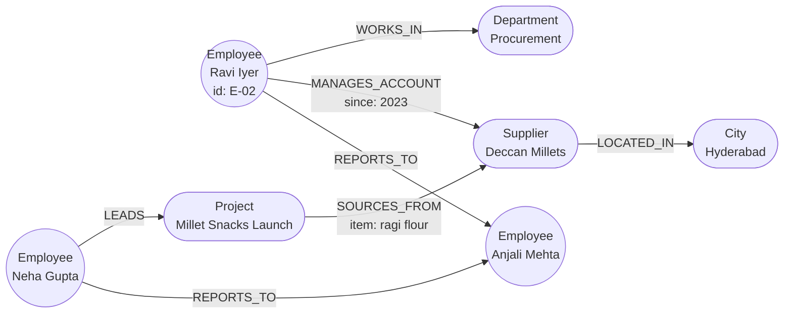

# Property Graphs and Neo4j: The Complete Guide

> 📚 **Before you start**
>
> - [What is a Knowledge Graph?](../02-entities-and-relationships/what-is-a-knowledge-graph.md), where you met the two families of graphs: RDF triples and labelled property graphs.
> - [Entities, Relationships and Properties](../02-entities-and-relationships/entities-relationships-and-properties.md), for the `(node)-[RELATIONSHIP]->(node)` notation.
> - [Lab: Design an ontology for an online shop](../03-ontologies-and-semantics/lab-design-an-ontology-for-an-online-shop.md), because we'll compare an ontology with a property-graph model.

## Introduction

Module 3 was about **meaning**: what a Customer is, what must be true of an Order. This module is about **storing and querying** a graph fast, every day, inside a real application. For that job, most teams reach for a **property graph database**, and the most widely used one is **Neo4j**.

Meet the running example for this module, **Kiran Foods**: a Pune-based snack company with about 400 employees, a dozen departments, a few hundred suppliers across India and projects like the new millet-snack range. Kiran's operations head asks questions such as:

- *"Who in Procurement manages a supplier based in Gujarat?"*
- *"If Deccan Millets stops shipping, which projects are hit, and who leads them?"*
- *"Who is the shortest chain of introductions between our new hire and the R&D head?"*

Each question is a walk across connections. In a spreadsheet or a relational database, every hop is a join. In a property graph, every hop is following a pointer that is already stored.

By the end of this lesson you'll be able to describe the property-graph model precisely (nodes, labels, relationship types, properties), explain how Neo4j stores and runs queries, set it up three different ways, connect to it from Python, and see why "following a pointer" beats "searching a table" for connected questions.

> 💡 **Key Insight**
>
> A property graph stores **relationships as first-class records**, each pointing directly at the nodes it connects. A query therefore costs roughly **the size of the part of the graph it touches**, not the size of the whole database. That's what makes multi-hop questions fast.

---

## Core Explanation

### 1. The property-graph model in one picture

Here is a small piece of Kiran Foods as a property graph. Look at it first; the vocabulary comes right after.



| Part | What it is | In the picture |
|---|---|---|
| **Node** | A thing with an identity | Ravi, Deccan Millets, Hyderabad |
| **Label** | A tag saying what kind of thing a node is. A node can have several. | `Employee`, `Supplier`, `City` |
| **Relationship** | A **directed, named** connection between exactly two nodes | `(Ravi)-[:MANAGES_ACCOUNT]->(Deccan Millets)` |
| **Relationship type** | The name of a relationship. Exactly one per relationship. | `WORKS_IN`, `REPORTS_TO` |
| **Property** | A key and a value, on a node **or** a relationship | `id: "E-02"` on Ravi; `since: 2023` on the relationship |

Compare that with the triples of module 2. A triple store would need extra machinery to say *"Ravi has managed the Deccan Millets account since 2023"*, because `since` belongs to the connection, not to either end. In a property graph you simply put the property on the relationship.

### 2. Rules of the model

The property-graph model is deliberately small. These rules cover almost everything:

1. Every relationship has **exactly one type** and **a direction**. You can still query it in either direction; the direction just records meaning (*Ravi reports to Anjali*, not the other way round).
2. A relationship always connects **two existing nodes**. There are no dangling relationships: delete a node and you must delete its relationships too.
3. Nodes can have **zero or more labels**. A person who is both an employee and a customer can carry `:Employee:Customer`.
4. Property values are simple: numbers, strings, booleans, dates and times, points, vectors, or **lists** of one simple type. A property value cannot be a map or a nested object. If you want structure, make another node.
5. There is **no schema by default**. Two `Employee` nodes can have different properties. You add rules (uniqueness, required properties, property types) with **constraints**, which you'll write in the next lesson.

Notice how different that last rule is from module 3. An OWL ontology is open-world and says what things *mean*. A property graph is closed-world (if a relationship isn't stored, it doesn't exist) and says almost nothing about meaning unless you add constraints. In practice, teams use an ontology as the design and a property graph as the store. You'll do that mapping in [Graph Data Modelling](../course.md#m4).

### 3. A property graph in plain Python

Before installing anything, let's build a tiny property graph store ourselves. Seeing the data structures makes Neo4j's design obvious.

```python
class PropertyGraph:
    def __init__(self):
        self.nodes = {}           # node id -> {"labels": set, "props": dict}
        self.rels = []            # list of {"id", "start", "type", "end", "props"}
        self.out_edges = {}       # node id -> list of relationship ids leaving it
        self.in_edges = {}        # node id -> list of relationship ids arriving

    def add_node(self, node_id, *labels, **props):
        self.nodes[node_id] = {"labels": set(labels), "props": props}
        self.out_edges.setdefault(node_id, [])
        self.in_edges.setdefault(node_id, [])

    def add_rel(self, start, rel_type, end, **props):
        rel_id = len(self.rels)
        self.rels.append({"id": rel_id, "start": start, "type": rel_type, "end": end, "props": props})
        self.out_edges[start].append(rel_id)      # the "pointer" stored on each end
        self.in_edges[end].append(rel_id)

    def name(self, node_id):
        return self.nodes[node_id]["props"].get("name", node_id)

kg = PropertyGraph()
for eid, name, dept in [("E-01", "Anjali Mehta", "Leadership"), ("E-02", "Ravi Iyer", "Procurement"),
                        ("E-03", "Neha Gupta", "R&D"), ("E-04", "Farhan Shaikh", "Procurement"),
                        ("E-05", "Lakshmi Menon", "Sales")]:
    kg.add_node(eid, "Employee", name=name)
    if dept not in kg.nodes:
        kg.add_node(dept, "Department", name=dept)
    kg.add_rel(eid, "WORKS_IN", dept)
for eid in ["E-02", "E-03", "E-05"]:
    kg.add_rel(eid, "REPORTS_TO", "E-01")
kg.add_rel("E-04", "REPORTS_TO", "E-02")
for sid, name, city, state in [("S-01", "Deccan Millets", "Hyderabad", "Telangana"),
                               ("S-02", "Saurashtra Groundnut Co.", "Rajkot", "Gujarat"),
                               ("S-03", "Kutch Salt Works", "Bhuj", "Gujarat")]:
    kg.add_node(sid, "Supplier", name=name)
    kg.add_node(city, "City", name=city, state=state)
    kg.add_rel(sid, "LOCATED_IN", city)
kg.add_rel("E-02", "MANAGES_ACCOUNT", "S-01", since=2023)
kg.add_rel("E-04", "MANAGES_ACCOUNT", "S-02", since=2021)
kg.add_rel("E-04", "MANAGES_ACCOUNT", "S-03", since=2024)
kg.add_node("PR-1", "Project", name="Millet Snacks Launch", budgetLakh=85)
kg.add_rel("E-03", "LEADS", "PR-1")
kg.add_rel("PR-1", "SOURCES_FROM", "S-01", item="ragi flour")

print(len(kg.nodes), "nodes,", len(kg.rels), "relationships")
for r in kg.rels[-3:]:
    print(f"({kg.name(r['start'])})-[:{r['type']} {r['props']}]->({kg.name(r['end'])})")
```

Output:

```
16 nodes, 17 relationships
(Farhan Shaikh)-[:MANAGES_ACCOUNT {'since': 2024}]->(Kutch Salt Works)
(Neha Gupta)-[:LEADS {}]->(Millet Snacks Launch)
(Millet Snacks Launch)-[:SOURCES_FROM {'item': 'ragi flour'}]->(Deccan Millets)
```

Every relationship knows its start node, its type, its end node and its own properties. And every node keeps two short lists, `out_edges` and `in_edges`, pointing at its own relationships. Those two lists are the whole trick, as the next section shows.

### 4. Answering a question by following pointers

Now the first question from the introduction: *who manages a supplier based in Gujarat?* Our store can answer it two ways.

**Way 1, scanning:** look through every relationship for `MANAGES_ACCOUNT`, then look through every relationship again for the supplier's `LOCATED_IN`. That's what a database without stored adjacency must do (with indexes it's smarter, but each hop is still a lookup in a big structure).

**Way 2, following pointers:** start from each Gujarat city, walk its incoming `LOCATED_IN` relationships to suppliers, then walk each supplier's incoming `MANAGES_ACCOUNT` to employees. Each step touches only the relationships attached to the node in hand.

```python
def scan(kg, state):
    steps, answer = 0, set()
    for r1 in kg.rels:
        steps += 1
        if r1["type"] != "MANAGES_ACCOUNT":
            continue
        for r2 in kg.rels:
            steps += 1
            if r2["type"] == "LOCATED_IN" and r2["start"] == r1["end"] \
                    and kg.nodes[r2["end"]]["props"]["state"] == state:
                answer.add(kg.name(r1["start"]))
    return sorted(answer), steps

def traverse(kg, state):
    steps, answer = 0, set()
    cities = [n for n, d in kg.nodes.items() if "City" in d["labels"] and d["props"]["state"] == state]
    for city in cities:
        for rid in kg.in_edges[city]:
            steps += 1
            supplier = kg.rels[rid]["start"]
            for rid2 in kg.in_edges[supplier]:
                steps += 1
                if kg.rels[rid2]["type"] == "MANAGES_ACCOUNT":
                    answer.add(kg.name(kg.rels[rid2]["start"]))
    return sorted(answer), steps

print("scan:     ", scan(kg, "Gujarat"))
print("traverse: ", traverse(kg, "Gujarat"))
```

Output:

```
scan:      (['Farhan Shaikh'], 68)
traverse:  (['Farhan Shaikh'], 4)
```

Same answer, 68 steps versus 4. The traversal started from the two Gujarat cities (Neo4j would find them with an index) and then only touched relationships attached to them. Now imagine Kiran Foods' real graph, with millions of relationships for invoices, shipments and emails. The scan grows with the whole graph. The traversal still touches only the few relationships around Gujarat's suppliers.

This idea has a name: **index-free adjacency**. Each node record knows where its own relationships are, so moving to a neighbour is a direct jump rather than a search. It's the single most important idea behind native graph databases.

### 5. What Neo4j is

**Neo4j** is a database built around that idea. The main facts worth knowing:

| Aspect | Detail |
|---|---|
| Data model | Labelled property graph, exactly as in section 1 |
| Query language | **Cypher**, a pattern-matching language where you draw the graph in ASCII: `(e:Employee)-[:WORKS_IN]->(d:Department)` |
| Standard | Cypher strongly influenced **GQL** (ISO/IEC 39075, published 2024), the first ISO standard graph query language; Neo4j keeps aligning Cypher with it |
| Transactions | Fully ACID: a write either completes entirely or not at all, and a crash doesn't leave half a relationship |
| Editions | Community Edition (free, open source, single server) and Enterprise Edition (clustering, role-based security, online backup) |
| Cloud | **AuraDB**, a managed service with a free tier for learning |
| Versions | Since 2025 Neo4j uses calendar versions (for example 2026.x); queries can be run in Cypher 5 or the newer Cypher 25 |
| Extensions | **APOC** (hundreds of utility procedures) and **Graph Data Science** (graph algorithms, covered in [Graph Algorithms: Paths, Centrality and Communities](../course.md#m4)) |
| AI features | Vector indexes for embeddings, full-text indexes, and a GraphRAG Python package, all used in module 6 |

Neo4j isn't the only property graph database. **Memgraph** speaks Cypher and keeps the graph in memory; **Amazon Neptune** supports property graphs (with openCypher and Gremlin) as well as RDF; **TigerGraph** uses its own GSQL language; **Kùzu** was an embedded, in-process option. The concepts in this module transfer to all of them. We use Neo4j because it's the most common, it has the largest community, and its Cypher is the language LLMs write best.

### 6. How a query runs inside Neo4j

![Neo4j architecture in three bands. Clients: Neo4j Browser, the Python driver, an LLM agent and BI tools. All talk to the Neo4j DBMS over the Bolt protocol on port 7687 or HTTP on port 7474. Inside, a Cypher query is parsed, planned and run; the planner uses indexes to find a starting node and the runtime hops along relationships in graph storage, inside ACID transactions, with APOC and Graph Data Science plugins alongside. It can run on Neo4j Desktop, the Docker image, AuraDB in the cloud, or a self-managed Enterprise cluster](/img/diagrams/knowledge-graphs-ontologies-and-unstructured-data/neo4j-architecture.svg)
*Every client speaks Cypher over Bolt. The planner picks where to start; the runtime walks the graph from there.*

Step by step, for *"who manages a Gujarat supplier?"*:

1. **The client sends Cypher** over **Bolt**, Neo4j's binary protocol (port 7687). The Browser and every official driver use it.
2. **Parse:** the text becomes a tree of clauses and patterns. Syntax errors stop here.
3. **Plan:** the planner estimates how many nodes match each part of the pattern and picks the cheapest starting point. With an index on `City.state`, it starts from the two Gujarat cities, exactly like our `traverse` function. You can see its choice by prefixing a query with `EXPLAIN` (plan only) or `PROFILE` (run it and count the work).
4. **Run:** the runtime expands from the start nodes along relationships, filters, and streams rows back.
5. **Transactions:** reads see a consistent snapshot; writes go to a write-ahead log first so they survive crashes.

The plan for our question looks roughly like this when you run `PROFILE` in the Browser (read it bottom-up):

```
ProduceResults        name
Projection            e.name AS name
Filter                e:Employee
Expand(All)           (s)<-[:MANAGES_ACCOUNT]-(e)
Filter                s:Supplier
Expand(All)           (c)<-[:LOCATED_IN]-(s)
NodeIndexSeek         c:City(state) WHERE state = 'Gujarat'
```

Bottom line: an **index seek** to find the start, then **Expand** operators that follow relationships. When a plan shows `AllNodesScan` or `NodeByLabelScan` on a large label, that's the equivalent of our `scan` function, and usually a sign you need an index.

### 7. Setting up Neo4j

You need Neo4j running only to try the Cypher yourself; the lessons' Python examples run without it. Pick one:

**Option A: Docker (one command).**

```bash
docker run --name kiran-neo4j \
  -p 7474:7474 -p 7687:7687 \
  -e NEO4J_AUTH=neo4j/kiranfoods123 \
  -e NEO4J_PLUGINS='["apoc", "graph-data-science"]' \
  neo4j:latest
```

Then open `http://localhost:7474` in a browser and log in with `neo4j` / `kiranfoods123`. The `NEO4J_PLUGINS` line downloads APOC and Graph Data Science, which later lessons use. (Pin a specific version tag instead of `latest` for anything you'll keep.)

**Option B: Neo4j Desktop.** A desktop app that manages local databases, plugins and the Browser for you. Good if you don't use Docker.

**Option C: AuraDB Free.** Create a free instance at Neo4j's website. You get a connection URI like `neo4j+s://xxxxxxxx.databases.neo4j.io`, a username and a generated password. Save the password: it's shown once.

### 8. Your first Cypher, in the Browser

With Neo4j open, paste this into the Browser's query box. It creates the same small graph as our Python store. Don't worry about every keyword; the next lesson teaches them properly. Read it as a drawing: round brackets are nodes, square brackets are relationships, `->` is the direction.

```cypher
CREATE (anjali:Employee {id: 'E-01', name: 'Anjali Mehta'}),
       (ravi:Employee   {id: 'E-02', name: 'Ravi Iyer'}),
       (farhan:Employee {id: 'E-04', name: 'Farhan Shaikh'}),
       (proc:Department {name: 'Procurement'}),
       (deccan:Supplier {id: 'S-01', name: 'Deccan Millets'}),
       (saur:Supplier   {id: 'S-02', name: 'Saurashtra Groundnut Co.'}),
       (hyd:City {name: 'Hyderabad', state: 'Telangana'}),
       (rajkot:City {name: 'Rajkot', state: 'Gujarat'}),
       (ravi)-[:WORKS_IN]->(proc), (farhan)-[:WORKS_IN]->(proc),
       (ravi)-[:REPORTS_TO]->(anjali), (farhan)-[:REPORTS_TO]->(ravi),
       (ravi)-[:MANAGES_ACCOUNT {since: 2023}]->(deccan),
       (farhan)-[:MANAGES_ACCOUNT {since: 2021}]->(saur),
       (deccan)-[:LOCATED_IN]->(hyd), (saur)-[:LOCATED_IN]->(rajkot);
```

Then ask the Gujarat question:

```cypher
MATCH (e:Employee)-[m:MANAGES_ACCOUNT]->(s:Supplier)-[:LOCATED_IN]->(c:City {state: 'Gujarat'})
RETURN e.name AS manager, s.name AS supplier, c.name AS city, m.since AS since;
```

Example output:

```
╒═══════════════╤══════════════════════════╤════════╤═══════╕
│manager        │supplier                  │city    │since  │
╞═══════════════╪══════════════════════════╪════════╪═══════╡
│"Farhan Shaikh"│"Saurashtra Groundnut Co."│"Rajkot"│2021   │
└───────────────┴──────────────────────────┴────────┴───────┘
```

Switch the result view to **Graph** and you'll see circles and arrows, which is exactly the drawing from section 1.

### 9. Connecting from Python

Applications talk to Neo4j through the official **`neo4j`** Python driver (`pip install neo4j`). The simplest API is `driver.execute_query`, which runs one query in a managed transaction and retries on transient errors:

```python
# not-run: needs a running Neo4j server and the neo4j package
from neo4j import GraphDatabase

URI = "neo4j://localhost:7687"           # or neo4j+s://xxxx.databases.neo4j.io for AuraDB
AUTH = ("neo4j", "kiranfoods123")

with GraphDatabase.driver(URI, auth=AUTH) as driver:
    driver.verify_connectivity()
    records, summary, keys = driver.execute_query(
        """
        MATCH (e:Employee)-[:MANAGES_ACCOUNT]->(s:Supplier)-[:LOCATED_IN]->(c:City {state: $state})
        RETURN e.name AS manager, s.name AS supplier
        """,
        state="Gujarat",                  # a query parameter, never string formatting
        database_="neo4j",
    )
    for record in records:
        print(record["manager"], "->", record["supplier"])
    print("took", summary.result_available_after, "ms")
```

Example output:

```
Farhan Shaikh -> Saurashtra Groundnut Co.
took 3 ms
```

Two habits to form from day one:

- **Always use parameters** (`$state`), never f-strings. Parameters prevent Cypher injection (the graph cousin of SQL injection), and they let Neo4j reuse the cached query plan. This matters doubly when an LLM writes queries, as you'll see in [Text-to-Cypher Agents](../course.md#m6).
- **Create one driver per application** and reuse it. The driver holds a connection pool; creating one per request is slow.

### 10. When a property graph is the right store

| Situation | Property graph (Neo4j) | Relational (PostgreSQL) | RDF triple store |
|---|---|---|---|
| Many-hop questions (who knows who, supply chains) | ✅ Built for it | ⚠️ Recursive SQL works, gets slow and awkward | ✅ Works, SPARQL property paths |
| Data on relationships (since, role, amount) | ✅ Native | ✅ Join-table columns | ⚠️ Needs RDF 1.2 annotations or extra nodes |
| Sharing meaning across organisations | ⚠️ Conventions only | ⚠️ | ✅ Global IRIs, ontologies |
| Heavy aggregation over flat records (sales totals) | ⚠️ Fine at small scale | ✅ Best | ⚠️ |
| Graph algorithms (centrality, communities) | ✅ Graph Data Science library | ❌ | ⚠️ Some stores |
| Developer onboarding | ✅ Cypher reads like a drawing | ✅ Everybody knows SQL | ⚠️ Steeper |

The pattern you'll see at most companies: transactional data stays in a relational database; the connected view (who, what, where, linked to what) is loaded into a graph for questions, analytics and AI retrieval.

---

## Try It Yourself

1. **Multiple labels.** Ravi starts buying Kiran's snacks online. Add a `Customer` label to his node in the Python store and print his labels. What's the Cypher to add a label to an existing node? (Guess, then check the next lesson.)
2. **Reverse direction.** Using `kg.in_edges`, list everyone who reports to Anjali Mehta.
3. **Count the work.** Add 200 extra suppliers in Karnataka (no managers) to the store, then rerun `scan` and `traverse` for Gujarat. How do the step counts change?

<details>
<summary>Show answers</summary>

**1.**

```python
kg.nodes["E-02"]["labels"].add("Customer")
print(sorted(kg.nodes["E-02"]["labels"]))
```

Output:

```
['Customer', 'Employee']
```

In Cypher: `MATCH (e:Employee {id: 'E-02'}) SET e:Customer`.

**2.**

```python
reports = [kg.name(kg.rels[r]["start"]) for r in kg.in_edges["E-01"] if kg.rels[r]["type"] == "REPORTS_TO"]
print(sorted(reports))
```

Output:

```
['Lakshmi Menon', 'Neha Gupta', 'Ravi Iyer']
```

Farhan reports to Ravi, not to Anjali, so he isn't listed. "Everyone below Anjali at any depth" is a variable-length pattern, which you'll write in the next lesson.

**3.**

```python
kg.add_node("Mysuru", "City", name="Mysuru", state="Karnataka")
for i in range(200):
    kg.add_node(f"S-K{i}", "Supplier", name=f"Karnataka supplier {i}")
    kg.add_rel(f"S-K{i}", "LOCATED_IN", "Mysuru")
print("scan:     ", scan(kg, "Gujarat")[1], "steps")
print("traverse: ", traverse(kg, "Gujarat")[1], "steps")
```

Output:

```
scan:      868 steps
traverse:  4 steps
```

The scan grew from 68 to 868 steps because it reads every relationship, Karnataka ones included. The traversal didn't change at all: it never looks at Mysuru. That's index-free adjacency in one experiment.

</details>

---

## Real-World Examples

- **Fraud and anti-money-laundering teams** at banks load accounts, devices, phone numbers and transfers into property graphs to spot rings of accounts sharing a device or address.
- **Supply-chain teams** model suppliers, parts, plants and shipping lanes so that "what breaks if this port closes" is a traversal, not a week of spreadsheet work.
- **IT operations** keep a graph of services, servers and dependencies to find the blast radius of an outage.
- **AI teams** store extracted entities and document chunks in Neo4j with a vector index, then retrieve both similar text and connected facts for an LLM (module 6).

---

## Common Misconceptions

### "Neo4j is a triple store with a different syntax"

Both store graphs, but the models differ: property graphs have properties on relationships and internal node IDs; RDF has global IRIs and formal semantics. You'll compare them directly in [SPARQL and RDF Triple Stores](../course.md#m4).

### "Graph databases don't have schemas"

They're schema-*optional*. Neo4j supports uniqueness, existence and property-type constraints, and you should use them. A graph without constraints fills up with duplicates fast.

### "Relationships are just foreign keys"

A foreign key is a value you search for. A stored relationship is a direct link with its own type and properties, and traversing it doesn't depend on table size.

### "Neo4j is only for huge graphs"

A graph of a few thousand nodes already pays off when the questions are about connections, because the queries are short and readable. Size matters less than the shape of the questions.

---

## Interview Relevance

*"What is a property graph, and why would you choose Neo4j over a relational database?"* A strong answer defines nodes, labels, typed directed relationships and properties on both; mentions index-free adjacency, so traversal cost depends on the neighbourhood touched rather than total data size; contrasts multi-hop queries in Cypher with recursive joins in SQL; notes ACID transactions, constraints, and the Bolt protocol and drivers; and is balanced about when *not* to use a graph (flat aggregations, simple CRUD). Bonus points for mentioning `PROFILE` plans (index seek then expand) and parameterised queries.

---

## Key Takeaways

- **Property graph = nodes with labels + typed, directed relationships + properties on both.**
- **Relationships are stored records with direct pointers**, so traversal cost depends on what you touch, not the database size.
- **Neo4j** runs Cypher over the Bolt protocol, with ACID transactions, indexes, and plugins for utilities and graph algorithms.
- **Set it up** with Docker, Neo4j Desktop or AuraDB Free, and connect from Python with `driver.execute_query` and parameters.
- **Use a property graph for connected questions**; keep flat transactional data in a relational database.

---

**Up next:** [Cypher Basics: MATCH, CREATE and MERGE](cypher-basics-match-create-and-merge.md)
