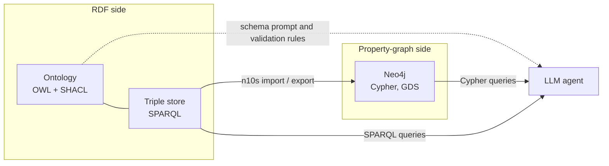

# SPARQL and RDF Triple Stores: The Complete Guide

> 📚 **Before you start**
>
> - [RDF, RDFS and OWL in Plain English](../03-ontologies-and-semantics/rdf-rdfs-and-owl-in-plain-english.md), for IRIs, literals, Turtle, named graphs and RDFS inference.
> - [What is a Knowledge Graph?](../02-entities-and-relationships/what-is-a-knowledge-graph.md), for the pattern-query engine with `?variables` that we extend here.
> - [Cypher Basics: MATCH, CREATE and MERGE](cypher-basics-match-create-and-merge.md), because we compare the two languages side by side.

## Introduction

Module 3 gave Chai Bazaar an ontology written in RDF. The Neo4j lessons stored Kiran Foods as a property graph. Both are knowledge graphs, and both need a query language. For property graphs that's Cypher. For RDF it's **SPARQL** (pronounced "sparkle"), the W3C standard query language for triples.

Why learn a second one? Because a lot of the world's shared knowledge is RDF: Wikidata, government open-data portals, life-science databases, the product data search engines read from web pages, and many enterprise knowledge graphs built on ontologies like FIBO. If your agent needs to look up *"the population of every Indian state capital"* from Wikidata, or to query a bank's FIBO-based graph, it will write SPARQL.

The good news: you already know the core idea. SPARQL's heart is the triple-pattern query you built in module 2: a list of patterns with `?variables`, joined on shared variables. This lesson teaches SPARQL syntax on the Chai Bazaar data, implements its key features in Python so nothing is magic, shows the same questions in Cypher, and tours the triple stores you can run it on.

> 💡 **Key Insight**
>
> A SPARQL query is a **graph pattern with holes**. The engine finds every way to fill the holes (`?variables`) so that all the triple patterns exist in the data. Everything else (`OPTIONAL`, `FILTER`, property paths, aggregates) refines that one idea.

---

## Core Explanation

### 1. A first SPARQL query

Here's the Chai Bazaar data from module 3, as it would sit in a triple store:

```turtle
@prefix shop: <https://chaibazaar.example/ontology#> .
@prefix ex:   <https://chaibazaar.example/data/> .
@prefix rdfs: <http://www.w3.org/2000/01/rdf-schema#> .

shop:Tea rdfs:subClassOf shop:Product .   shop:SpiceMix rdfs:subClassOf shop:Product .
shop:GreenTea rdfs:subClassOf shop:Tea .

ex:C-17 a shop:Customer ; shop:name "Priya Nair" ; shop:livesIn ex:PUNE .
ex:C-21 a shop:Customer ; shop:name "Arjun Rao"  ; shop:livesIn ex:BLR .
ex:C-30 a shop:Customer ; shop:name "Sneha Kulkarni" .
ex:PUNE shop:name "Pune" .  ex:BLR shop:name "Bengaluru" .

ex:P-ASSAM  a shop:Tea      ; shop:name "Assam CTC Tea"   ; shop:priceInr 240 .
ex:P-MASALA a shop:SpiceMix ; shop:name "Masala Chai Mix" ; shop:priceInr 150 .
ex:P-SENCHA a shop:GreenTea ; shop:name "Nilgiri Green"   ; shop:priceInr 310 .

ex:O-1001 shop:placedBy ex:C-17 ; shop:contains ex:P-ASSAM .
ex:O-1002 shop:placedBy ex:C-21 ; shop:contains ex:P-MASALA, ex:P-ASSAM .
ex:O-1003 shop:placedBy ex:C-30 ; shop:contains ex:P-SENCHA .
```

**Which customers bought Assam CTC Tea, and where do they live?**

```sparql
PREFIX shop: <https://chaibazaar.example/ontology#>
PREFIX ex:   <https://chaibazaar.example/data/>

SELECT ?name ?cityName
WHERE {
  ?order shop:contains ex:P-ASSAM .
  ?order shop:placedBy ?cust .
  ?cust  shop:name     ?name .
  ?cust  shop:livesIn  ?city .
  ?city  shop:name     ?cityName .
}
ORDER BY ?name
```

Example output:

```
| name         | cityName    |
|--------------|-------------|
| "Arjun Rao"  | "Bengaluru" |
| "Priya Nair" | "Pune"      |
```

The anatomy:

| Part | Meaning |
|---|---|
| `PREFIX shop: <...>` | Short names for long IRIs, exactly like Turtle's `@prefix` |
| `SELECT ?name ?cityName` | Which variables become result columns (`SELECT *` for all) |
| `WHERE { ... }` | The graph pattern: triple patterns separated by `.` |
| `?order shop:contains ex:P-ASSAM .` | A triple pattern with one variable |
| Shared variables (`?order`, `?cust`, `?city`) | Joins: the same value must fill every occurrence |

Turtle's shortcuts work inside patterns too: `;` repeats the subject, `,` repeats subject and predicate, and `a` means `rdf:type`. The first three patterns could be written `?order shop:contains ex:P-ASSAM ; shop:placedBy ?cust .`

### 2. The engine, in Python

Let's load the same triples and write the matcher. It's the module 2 engine, now with prefixed IRIs:

```python
DATA = {
    ("shop:Tea", "rdfs:subClassOf", "shop:Product"), ("shop:SpiceMix", "rdfs:subClassOf", "shop:Product"),
    ("shop:GreenTea", "rdfs:subClassOf", "shop:Tea"),
    ("ex:C-17", "rdf:type", "shop:Customer"), ("ex:C-17", "shop:name", "Priya Nair"), ("ex:C-17", "shop:livesIn", "ex:PUNE"),
    ("ex:C-21", "rdf:type", "shop:Customer"), ("ex:C-21", "shop:name", "Arjun Rao"), ("ex:C-21", "shop:livesIn", "ex:BLR"),
    ("ex:C-30", "rdf:type", "shop:Customer"), ("ex:C-30", "shop:name", "Sneha Kulkarni"),
    ("ex:PUNE", "shop:name", "Pune"), ("ex:BLR", "shop:name", "Bengaluru"),
    ("ex:P-ASSAM", "rdf:type", "shop:Tea"), ("ex:P-ASSAM", "shop:name", "Assam CTC Tea"), ("ex:P-ASSAM", "shop:priceInr", 240),
    ("ex:P-MASALA", "rdf:type", "shop:SpiceMix"), ("ex:P-MASALA", "shop:name", "Masala Chai Mix"), ("ex:P-MASALA", "shop:priceInr", 150),
    ("ex:P-SENCHA", "rdf:type", "shop:GreenTea"), ("ex:P-SENCHA", "shop:name", "Nilgiri Green"), ("ex:P-SENCHA", "shop:priceInr", 310),
    ("ex:O-1001", "shop:placedBy", "ex:C-17"), ("ex:O-1001", "shop:contains", "ex:P-ASSAM"),
    ("ex:O-1002", "shop:placedBy", "ex:C-21"), ("ex:O-1002", "shop:contains", "ex:P-MASALA"),
    ("ex:O-1002", "shop:contains", "ex:P-ASSAM"),
    ("ex:O-1003", "shop:placedBy", "ex:C-30"), ("ex:O-1003", "shop:contains", "ex:P-SENCHA"),
}

def is_var(x):
    return isinstance(x, str) and x.startswith("?")

def match(pattern, binding, data):
    for triple in sorted(data, key=str):
        new = dict(binding)
        for want, have in zip(pattern, triple):
            want = new.get(want, want) if is_var(want) else want
            if is_var(want):
                new[want] = have
            elif want != have:
                break
        else:
            yield new

def bgp(patterns, data, start=None):
    """A basic graph pattern: every triple pattern must match, joined on shared variables."""
    rows = [start or {}]
    for pattern in patterns:
        rows = [b2 for b in rows for b2 in match(pattern, b, data)]
    return rows

rows = bgp([("?order", "shop:contains", "ex:P-ASSAM"), ("?order", "shop:placedBy", "?cust"),
            ("?cust", "shop:name", "?name"), ("?cust", "shop:livesIn", "?city"),
            ("?city", "shop:name", "?cityName")], DATA)
for r in sorted(rows, key=lambda r: r["?name"]):
    print(r["?name"], "|", r["?cityName"])
```

Output:

```
Arjun Rao | Bengaluru
Priya Nair | Pune
```

The SPARQL specification calls a block of triple patterns a **basic graph pattern (BGP)**, and our `bgp` function is exactly its meaning. Real engines add indexes (stores typically keep the triples sorted in several orders such as SPO, POS and OSP so any pattern is a fast range lookup) and a join-order optimiser.

### 3. OPTIONAL: keep rows with missing parts

Sneha has no city on record. The query above silently drops her, because `?cust shop:livesIn ?city` has no match. **`OPTIONAL`** keeps the row and leaves the variable unbound, like Cypher's `OPTIONAL MATCH` and SQL's left join:

```sparql
SELECT ?name ?cityName
WHERE {
  ?cust a shop:Customer ; shop:name ?name .
  OPTIONAL { ?cust shop:livesIn ?city . ?city shop:name ?cityName . }
}
ORDER BY ?name
```

```python
def optional(rows, patterns, data):
    out = []
    for row in rows:
        extended = bgp(patterns, data, start=row)
        out.extend(extended if extended else [row])   # no match: keep the row as it is
    return out

rows = bgp([("?cust", "rdf:type", "shop:Customer"), ("?cust", "shop:name", "?name")], DATA)
rows = optional(rows, [("?cust", "shop:livesIn", "?city"), ("?city", "shop:name", "?cityName")], DATA)
for r in sorted(rows, key=lambda r: r["?name"]):
    print(r["?name"], "|", r.get("?cityName", "(unbound)"))
```

Output:

```
Arjun Rao | Bengaluru
Priya Nair | Pune
Sneha Kulkarni | (unbound)
```

Remember the open-world assumption from module 3: an unbound `?cityName` means *unknown*, not *has no city*. To ask for customers with **no recorded** city, combine `OPTIONAL` with `FILTER(!BOUND(?city))`, or use `FILTER NOT EXISTS { ?cust shop:livesIn ?c }`.

### 4. FILTER, BIND and functions

`FILTER` keeps rows where a condition is true. `BIND` computes a new variable.

```sparql
SELECT ?name ?price ?withGst
WHERE {
  ?p shop:name ?name ; shop:priceInr ?price .
  FILTER (?price >= 200 && !CONTAINS(LCASE(?name), "masala"))
  BIND (?price * 1.05 AS ?withGst)
}
ORDER BY DESC(?price)
```

```python
rows = bgp([("?p", "shop:name", "?name"), ("?p", "shop:priceInr", "?price")], DATA)
rows = [r for r in rows if r["?price"] >= 200 and "masala" not in r["?name"].lower()]   # FILTER
rows = [dict(r, **{"?withGst": round(r["?price"] * 1.05, 2)}) for r in rows]            # BIND
for r in sorted(rows, key=lambda r: -r["?price"]):
    print(r["?name"], r["?price"], r["?withGst"])
```

Output:

```
Nilgiri Green 310 325.5
Assam CTC Tea 240 252.0
```

Common functions: `STR()`, `LANG()`, `LCASE()`, `CONTAINS()`, `STRSTARTS()`, `REGEX()`, `YEAR()` on dates, `BOUND()`, `IF()`, `COALESCE()`, and `IN (...)`. Language-tagged literals let you filter labels by language: `FILTER(LANG(?label) = "hi")` picks Hindi labels like `"जैन"@hi` from module 3.

### 5. Property paths: walking hierarchies

The single most useful SPARQL feature for ontologies. **List every product, including subclasses of subclasses:**

```sparql
SELECT ?name ?type
WHERE {
  ?p a ?type ; shop:name ?name .
  ?type rdfs:subClassOf* shop:Product .
}
```

`rdfs:subClassOf*` means "follow `subClassOf` **zero or more** times". Nilgiri Green is a `GreenTea`, which is a `Tea`, which is a `Product`, so it matches even though no triple says it's a product directly. That's RDFS subclass inference done at query time.

| Path | Meaning | Example |
|---|---|---|
| `p*` | zero or more | `rdfs:subClassOf*` |
| `p+` | one or more | `ex:reportsTo+` (everyone above me) |
| `p?` | zero or one | |
| `p1/p2` | sequence | `shop:placedBy/shop:livesIn` (order → city) |
| `^p` | reverse direction | `^shop:placedBy` (customer → their orders) |
| `p1\|p2` | either | `shop:name\|rdfs:label` |

Here's `*` implemented as a breadth-first walk:

```python
def path_star(start, predicate, data):
    """All nodes reachable from start by following predicate zero or more times."""
    seen, frontier = {start}, [start]
    while frontier:
        nxt = [o for s, p, o in data if p == predicate and s in frontier and o not in seen]
        seen.update(nxt)
        frontier = nxt
    return seen

rows = bgp([("?p", "rdf:type", "?type"), ("?p", "shop:name", "?name")], DATA)
rows = [r for r in rows if "shop:Product" in path_star(r["?type"], "rdfs:subClassOf", DATA)]
for r in sorted(rows, key=lambda r: r["?name"]):
    print(r["?name"], "|", r["?type"], "| path to Product:", sorted(path_star(r["?type"], "rdfs:subClassOf", DATA)))
```

Output:

```
Assam CTC Tea | shop:Tea | path to Product: ['shop:Product', 'shop:Tea']
Masala Chai Mix | shop:SpiceMix | path to Product: ['shop:Product', 'shop:SpiceMix']
Nilgiri Green | shop:GreenTea | path to Product: ['shop:GreenTea', 'shop:Product', 'shop:Tea']
```

Many triple stores can instead **materialise** RDFS or OWL inferences when data is loaded, so a plain `?p a shop:Product` finds teas directly. Query-time paths are flexible; materialisation makes queries simpler and faster at the cost of storage and load time.

### 6. Aggregates and the other query forms

**Aggregates** need an explicit `GROUP BY` (unlike Cypher):

```sparql
SELECT ?name (COUNT(?order) AS ?orders) (SUM(?price) AS ?spent)
WHERE {
  ?order shop:placedBy ?cust ; shop:contains ?p .
  ?cust shop:name ?name .
  ?p shop:priceInr ?price .
}
GROUP BY ?name
HAVING (SUM(?price) > 200)
ORDER BY DESC(?spent)
```

```python
from collections import defaultdict

rows = bgp([("?order", "shop:placedBy", "?cust"), ("?order", "shop:contains", "?p"),
            ("?cust", "shop:name", "?name"), ("?p", "shop:priceInr", "?price")], DATA)
groups = defaultdict(list)
for r in rows:
    groups[r["?name"]].append(r)                                   # GROUP BY ?name
result = [(name, len(rs), sum(r["?price"] for r in rs)) for name, rs in groups.items()]
for name, orders, spent in sorted([x for x in result if x[2] > 200], key=lambda x: -x[2]):   # HAVING, ORDER BY
    print(f"{name:<15} lines={orders} spent=₹{spent}")
```

Output:

```
Arjun Rao       lines=2 spent=₹390
Sneha Kulkarni  lines=1 spent=₹310
Priya Nair      lines=1 spent=₹240
```

(`COUNT(?order)` counts rows, so Arjun's single order with two products counts twice; use `COUNT(DISTINCT ?order)` for orders.)

SPARQL has four query forms:

| Form | Returns | Use |
|---|---|---|
| `SELECT` | A table of variable bindings | Most questions |
| `ASK` | `true` or `false` | "Does any order contain a SpiceMix?" |
| `CONSTRUCT` | **New triples** built from a template | Transform or extract a subgraph, e.g. build `ex:C-17 shop:boughtProduct ex:P-ASSAM` shortcuts |
| `DESCRIBE` | Triples about a resource (store decides which) | Exploring unfamiliar data |

```sparql
CONSTRUCT { ?cust shop:boughtProduct ?p }
WHERE     { ?order shop:placedBy ?cust ; shop:contains ?p . }
```

**SPARQL Update** changes data: `INSERT DATA { ... }`, `DELETE DATA { ... }`, and the pattern-based `DELETE { ... } INSERT { ... } WHERE { ... }`, which is how you'd rename a property across a whole graph.

**Named graphs**: `GRAPH ?g { ... }` matches triples together with the graph they live in, which is how you ask *"which import did this fact come from?"*. **Federation**: `SERVICE <https://query.wikidata.org/sparql> { ... }` sends part of a query to another endpoint and joins the results with local data.

### 7. A real public endpoint: Wikidata

Wikidata's query service accepts SPARQL at `https://query.wikidata.org/sparql`. Its items are `wd:Q...` and its direct properties `wdt:P...`. For example `wd:Q1156` is Mumbai, `wd:Q668` is India, `wdt:P31` is "instance of", `wdt:P17` is "country" and `wdt:P1082` is "population".

```sparql
# Indian cities with more than 5 million people, largest first
SELECT ?city ?cityLabel ?population
WHERE {
  ?city wdt:P31/wdt:P279* wd:Q515 ;      # instance of (a subclass of) city
        wdt:P17 wd:Q668 ;                # country: India
        wdt:P1082 ?population .
  FILTER (?population > 5000000)
  SERVICE wikibase:label { bd:serviceParam wikibase:language "en". }
}
ORDER BY DESC(?population)
```

Notice the property path `wdt:P31/wdt:P279*`: "instance of something that is a subclass (at any depth) of city", the same hierarchy trick as section 5 on a graph with over a hundred million items. The `SERVICE wikibase:label` line is a Wikidata convenience that fills `?cityLabel` with English names. Results change as people edit Wikidata, and a city can appear more than once if it has several population figures, which is a realistic lesson in messy open data. Try it in the browser at the query service's web page.

From Python you'd send it with an HTTP GET and a descriptive `User-Agent` (Wikidata asks for one):

```python
# not-run: needs network access
import httpx

query = open("indian_cities.rq").read()
response = httpx.get("https://query.wikidata.org/sparql",
                     params={"query": query, "format": "json"},
                     headers={"User-Agent": "KiranFoodsLearning/0.1 (learning@example.com)"})
for b in response.json()["results"]["bindings"]:
    print(b["cityLabel"]["value"], b["population"]["value"])
```

The JSON result format (`head.vars` plus `results.bindings`, each binding a map from variable to `{type, value}`) is standard across SPARQL endpoints.

### 8. SPARQL and Cypher side by side

The same question, *customers who bought a kind of tea (any subclass), with their city if known*, in both languages:

```sparql
SELECT DISTINCT ?name ?cityName WHERE {
  ?order shop:placedBy ?cust ; shop:contains ?p .
  ?p a/rdfs:subClassOf* shop:Tea .
  ?cust shop:name ?name .
  OPTIONAL { ?cust shop:livesIn/shop:name ?cityName }
}
```

```cypher
MATCH (c:Customer)<-[:PLACED_BY]-(:Order)-[:CONTAINS]->(:Tea)
OPTIONAL MATCH (c)-[:LIVES_IN]->(city:City)
RETURN DISTINCT c.name AS name, city.name AS cityName;
```

| | SPARQL | Cypher |
|---|---|---|
| Data model | RDF triples, global IRIs | Property graph, internal IDs plus key properties |
| Pattern style | List of triple patterns | ASCII-art paths |
| Subclasses | `rdf:type/rdfs:subClassOf*` or store inference | Multiple labels (`:Product:Tea`) set at load time |
| Missing data | `OPTIONAL` | `OPTIONAL MATCH` |
| Grouping | Explicit `GROUP BY` | Implicit |
| Properties on relationships | RDF 1.2 annotations, or an intermediate node | Native |
| Federation across organisations | `SERVICE` keyword, shared IRIs | Not part of the language |
| Standard | W3C SPARQL 1.1 (with a 1.2 revision for RDF 1.2) | Cypher, converging on ISO GQL |

Rule of thumb: SPARQL where **meaning must be shared** (ontologies, cross-organisation integration, public linked data); Cypher where the main job is **fast application queries and analytics** on your own graph. Many companies run both: an RDF layer for the ontology and master data, and Neo4j for operational queries, with a sync between them.

### 9. Triple stores

A **triple store** (or RDF store, or quad store when it supports named graphs) is a database for RDF with a SPARQL endpoint.

| Store | Notes |
|---|---|
| **Apache Jena** (with Fuseki server, TDB2 storage) | Open source, Java; the standard learning and prototyping choice |
| **GraphDB** (by Graphwise, formerly Ontotext) | Strong RDFS/OWL reasoning, SHACL validation, popular in enterprises |
| **Stardog** | Knowledge-graph platform with virtual graphs over relational data |
| **Virtuoso** | Long-running open-source and commercial store behind many public endpoints |
| **Amazon Neptune** | Managed AWS service supporting both RDF/SPARQL and property graphs |
| **Oxigraph** | Lightweight, embeddable store written in Rust with Python bindings |
| **QLever** | Very fast engine for huge read-mostly datasets such as all of Wikidata |

In Python, the **rdflib** library parses every RDF format and runs SPARQL in memory, which is perfect for small graphs and tests:

```python
# not-run: needs the rdflib package
from rdflib import Graph

g = Graph()
g.parse("chaibazaar-data.ttl")            # format guessed from the extension
q = """
PREFIX shop: <https://chaibazaar.example/ontology#>
SELECT ?name WHERE { ?c a shop:Customer ; shop:name ?name } ORDER BY ?name
"""
for row in g.query(q):
    print(row.name)
```

Example output:

```
Arjun Rao
Priya Nair
Sneha Kulkarni
```

### 10. Bridging RDF and Neo4j

You don't have to choose one world forever:

- **Neo4j's neosemantics (n10s) plugin** imports RDF (Turtle, JSON-LD, N-Triples) into a property graph and can export graph data back as RDF. Classes can become labels and IRIs are kept as a `uri` property.
- **Property graph to RDF** by hand: each node becomes an IRI (`ex:` + its key), each label an `rdf:type`, each property a literal triple, each relationship a triple; relationship properties need RDF 1.2 annotations or an intermediate node (the same decision as module 4's intermediate nodes).



An agent can be given tools for both, with the ontology telling it what the terms mean. That's the theme of module 6.

---

## Try It Yourself

1. **ASK.** Write a SPARQL `ASK` query for *"Did anyone in Pune order a product costing more than ₹300?"*, then answer it with `bgp` and a filter.
2. **Sequence path.** Using `shop:placedBy/shop:livesIn`, write a pattern from orders to cities. Implement it with `bgp` (two patterns) and list order → city.
3. **CONSTRUCT.** Build the `shop:boughtProduct` shortcut triples from section 6 in Python and print them.

<details>
<summary>Show answers</summary>

**1.**

```sparql
ASK { ?o shop:placedBy/shop:livesIn ex:PUNE ; shop:contains/shop:priceInr ?price . FILTER(?price > 300) }
```

```python
rows = bgp([("?o", "shop:placedBy", "?c"), ("?c", "shop:livesIn", "ex:PUNE"),
            ("?o", "shop:contains", "?p"), ("?p", "shop:priceInr", "?price")], DATA)
print(any(r["?price"] > 300 for r in rows))
```

Output:

```
False
```

Priya in Pune only bought the ₹240 Assam tea. Nilgiri Green (₹310) went to Sneha, whose city is unknown, so under the open-world assumption the honest answer is "not as far as this data says".

**2.**

```python
for r in sorted(bgp([("?o", "shop:placedBy", "?c"), ("?c", "shop:livesIn", "?city")], DATA), key=lambda r: r["?o"]):
    print(r["?o"], "->", r["?city"])
```

Output:

```
ex:O-1001 -> ex:PUNE
ex:O-1002 -> ex:BLR
```

**3.**

```python
constructed = sorted({(r["?cust"], "shop:boughtProduct", r["?p"])
                      for r in bgp([("?order", "shop:placedBy", "?cust"), ("?order", "shop:contains", "?p")], DATA)})
for t in constructed:
    print(*t, ".")
```

Output:

```
ex:C-17 shop:boughtProduct ex:P-ASSAM .
ex:C-21 shop:boughtProduct ex:P-ASSAM .
ex:C-21 shop:boughtProduct ex:P-MASALA .
ex:C-30 shop:boughtProduct ex:P-SENCHA .
```

</details>

---

## Real-World Examples

- **Wikidata** serves millions of SPARQL queries from researchers, journalists and apps, and is a common lookup tool for agents.
- **Life sciences**: UniProt and many biomedical databases publish SPARQL endpoints, and pharma companies federate them with internal data.
- **Finance**: banks build FIBO-based knowledge graphs in triple stores for regulatory reporting and data lineage.
- **Government open data**: statistics offices publish datasets as linked data so they can be joined across agencies.
- **Enterprises** keep their master data and ontology in RDF and sync operational subsets into Neo4j for applications.

---

## Common Misconceptions

### "SPARQL is just SQL for RDF"

It borrows SQL's keywords, but the core is graph pattern matching with shared variables, plus property paths and open-world semantics. Thinking in tables leads to awkward queries.

### "If a variable is unbound, the value is empty"

Unbound means unknown. Absence in RDF is not falsehood, so "customers without a city" really means "customers with no recorded city".

### "Triple stores are slow and academic"

Modern stores handle billions of triples, and engines like QLever query all of Wikidata interactively. Performance depends on the store and the query, like any database.

### "You have to pick RDF or property graphs"

Many organisations use both, with tools such as neosemantics moving data between them.

---

## Interview Relevance

Questions here test whether you understand the RDF side of knowledge graphs: *"How does SPARQL differ from Cypher?"*, *"How would you query all subclasses of a class?"* (property paths or materialised inference), *"What does OPTIONAL do and why does open-world matter?"*, *"When would you choose a triple store over Neo4j?"* (shared meaning, global IRIs, federation, OWL reasoning, SHACL). Knowing Wikidata's `wd:`/`wdt:` pattern and the `SELECT`/`ASK`/`CONSTRUCT`/`DESCRIBE` forms is a plus for roles involving linked data or LLM tools over public knowledge.

---

## Key Takeaways

- **SPARQL = triple patterns with variables**, joined on shared variables (basic graph patterns).
- **`OPTIONAL`, `FILTER`, `BIND`, property paths and `GROUP BY`** refine that pattern; `rdfs:subClassOf*` walks hierarchies.
- **Four forms**: `SELECT`, `ASK`, `CONSTRUCT`, `DESCRIBE`; plus SPARQL Update, named graphs and federated `SERVICE`.
- **Triple stores** (Jena, GraphDB, Stardog, Virtuoso, Neptune, Oxigraph, QLever) host RDF; rdflib is the Python workhorse.
- **Choose by need**: SPARQL for shared meaning and integration, Cypher for application queries and analytics, and bridges like neosemantics between them.

---

**Up next:** [Lab: Build a company knowledge graph in Neo4j](lab-build-a-company-knowledge-graph-in-neo4j.md)
