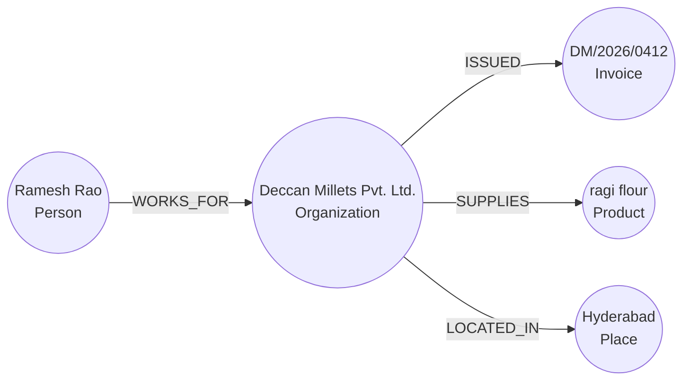
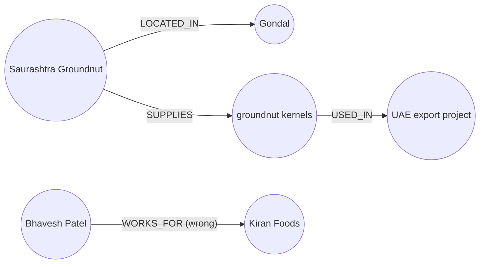
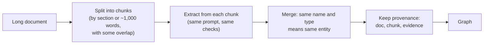

# Entity and Relation Extraction with LLMs: The Complete Guide

> 📚 **Before you start**
>
> - [Extracting Tables, Forms and Layout](extracting-tables-forms-and-layout.md): how text and its structure come out of a document. This lesson starts from that text.
> - [What is an Ontology? A Worked Example](../03-ontologies-and-semantics/what-is-an-ontology-a-worked-example.md): classes, relationships, domain and range. The ontology becomes the instructions you give the LLM.
> - [Structured JSON Output](../../generative-ai-and-llm-foundations/04-prompting-and-structured-output/structured-json-output.md): asking a model for JSON and checking what comes back.
> - Named entity recognition in classic NLP: [NLP for Machine Learning › Text Preprocessing](../../nlp-for-machine-learning/course.md#m3) (helpful, not required; this lesson explains what you need).

## Introduction

The invoices are only half of the invoice pile. The other half is the mail around them. Here is one that reached Farhan, the buyer at Kiran Foods who looks after the Gujarat suppliers:

> *Hi Farhan, Saurashtra Groundnut has moved its packing unit from Rajkot to Gondal. Bhavesh Patel is now their contact for all Kiran Foods orders. The groundnut kernels for the UAE export project will ship from Gondal from October.*

A person reads this once and updates three facts in their head: the supplier's location changed, there's a new contact person, and a product for a project now ships from a new town. None of those facts is in any database. If Farhan goes on leave, they leave with him.

**Entity and relation extraction** turns sentences like these into facts a program can store: *things* (Saurashtra Groundnut, Bhavesh Patel, Gondal) and *links between them* (Bhavesh Patel works for Saurashtra Groundnut; Saurashtra Groundnut is located in Gondal). Those facts are exactly the nodes and relationships of a knowledge graph.

By the end of this lesson you'll be able to write an extraction prompt built from an ontology, read the JSON an LLM sends back, check it automatically (types, directions, and whether the evidence is really in the text), measure precision and recall against hand-labelled answers, and turn the result into Cypher and Turtle.

> 💡 **Key Insight**
>
> An LLM will happily extract *something* from any text. The ontology decides *what* it may extract, and your validator decides *what you keep*. Give the model the allowed entity and relation types, make it quote its evidence word for word, then reject anything with an unknown type, a wrong direction, or a quote that isn't in the source.

---

## Core Explanation

### 1. What we're extracting, shown first

Two tasks, both decades old in NLP:

- **Named entity recognition (NER)**: find the mentions of things in text and give each a type. "Ramesh Rao" is a Person, "Hyderabad" is a Place.
- **Relation extraction (RE)**: find which pairs of those entities are linked, and how. Ramesh Rao *works for* Deccan Millets.

Here is a real-looking input and the output we want. The input is an email from the invoice pile:

```text
From: Ramesh Rao <ramesh@deccanmillets.example>
Subject: PFA invoice DM/2026/0412

Dear Ravi ji, please find attached our invoice DM/2026/0412 for 40 bags of ragi flour,
dispatched from our Hyderabad unit on 11 Aug. Payment within 30 days please.
Regards, Ramesh Rao, Sales Manager, Deccan Millets Pvt. Ltd.
```

The output, as JSON:

```json
{
  "entities": [
    {"id": "e1", "type": "Person",       "name": "Ramesh Rao"},
    {"id": "e2", "type": "Organization", "name": "Deccan Millets Pvt. Ltd."},
    {"id": "e3", "type": "Invoice",      "name": "DM/2026/0412"},
    {"id": "e4", "type": "Product",      "name": "ragi flour"},
    {"id": "e5", "type": "Place",        "name": "Hyderabad"}
  ],
  "relations": [
    {"source": "e1", "type": "WORKS_FOR",  "target": "e2", "evidence": "Ramesh Rao, Sales Manager, Deccan Millets Pvt. Ltd."},
    {"source": "e2", "type": "ISSUED",     "target": "e3", "evidence": "our invoice DM/2026/0412"},
    {"source": "e2", "type": "SUPPLIES",   "target": "e4", "evidence": "40 bags of ragi flour"},
    {"source": "e2", "type": "LOCATED_IN", "target": "e5", "evidence": "our Hyderabad unit"}
  ]
}
```

And the same facts as a small graph:



Look at two details. The email never says "Deccan Millets is located in Hyderabad"; it says "*our* Hyderabad unit", and the reader has to work out that "our" means Deccan Millets. And "Ravi" appears in the text but has no relation in the output, because the email doesn't say anything about him that fits our relation types. Good extraction is as much about what to leave out as what to put in.

### 2. Classic approaches, and why they ran out of road

Before LLMs, there were three main ways to do this:

| Approach | How it works | Strength | Weakness |
|---|---|---|---|
| **Dictionaries (gazetteers) and rules** | Look up known names; regex patterns like `X, Sales Manager, Y` | Precise, cheap, explainable | Finds only what you listed; every new phrasing needs a new rule |
| **Trained NER models** (for example spaCy's pipelines, or fine-tuned BERT models) | A model labels each token as the start, inside or outside of an entity | Finds unseen names; fast | Fixed entity types (PERSON, ORG, GPE...); new types need labelled training data |
| **Supervised relation classifiers** | For each pair of entities in a sentence, predict a relation label | Good accuracy in a narrow domain | Needs thousands of labelled examples per relation type |

Let's try the first one on all three emails to feel its limits. A gazetteer of the suppliers Kiran Foods already knows:

```python
import json
import re

EMAILS = {
"mail_01": """From: Ramesh Rao <ramesh@deccanmillets.example>
Subject: PFA invoice DM/2026/0412

Dear Ravi ji, please find attached our invoice DM/2026/0412 for 40 bags of ragi flour,
dispatched from our Hyderabad unit on 11 Aug. Payment within 30 days please.
Regards, Ramesh Rao, Sales Manager, Deccan Millets Pvt. Ltd.""",
"mail_02": """Hi Farhan, Saurashtra Groundnut has moved its packing unit from Rajkot to Gondal.
Bhavesh Patel is now their contact for all Kiran Foods orders. The groundnut kernels for
the UAE export project will ship from Gondal from October.""",
"mail_03": """Kavya, Nashik Agro Pack quoted Rs 2.40 per pouch for the Millet Snacks Launch.
They also supply cartons to Malabar Spice House, so they know food-grade packing. - Neha""",
}

GAZETTEER = {
    "Deccan Millets": "Organization", "Saurashtra Groundnut Co.": "Organization",
    "Nashik Agro Pack": "Organization", "Malabar Spice House": "Organization",
    "Hyderabad": "Place", "Rajkot": "Place", "Nashik": "Place", "Kochi": "Place",
}

for mail_id, text in EMAILS.items():
    flat = " ".join(text.split())
    found = [(name, typ) for name, typ in GAZETTEER.items() if name in flat]
    print(mail_id, found)
```

Output:

```
mail_01 [('Deccan Millets', 'Organization'), ('Hyderabad', 'Place')]
mail_02 [('Rajkot', 'Place')]
mail_03 [('Nashik Agro Pack', 'Organization'), ('Malabar Spice House', 'Organization'), ('Nashik', 'Place')]
```

The dictionary missed "Saurashtra Groundnut" (the email drops the "Co."), found "Rajkot" (the town the supplier just *left*), found a Place called "Nashik" that is really part of the name "Nashik Agro Pack", and knows nothing about Gondal, Bhavesh Patel, ragi flour or the UAE export project. It also found zero relations, because a dictionary only names things. Rules for relations would need a pattern for "moved its packing unit from X to Y", another for "is now their contact", and so on forever.

**LLMs changed this** because they already understand the language. You describe the entity and relation types in plain words, and the model applies them to phrasings it has never seen, with no training data. What you give up is predictability, which is why the second half of this lesson is about checking the output.

### 3. The ontology becomes the prompt

The relation types aren't invented on the spot. They come from the Kiran Foods ontology: each relation has a **domain** (the type it starts from) and a **range** (the type it points to), exactly as in module 3. Here is the extraction slice of it, as Python data:

```python
ONTOLOGY = {
    "entity_types": {
        "Organization": "a company or firm, such as a supplier or a customer",
        "Person": "a named individual",
        "Product": "a good that is bought or sold, such as ragi flour or pouches",
        "Place": "a city, town or state",
        "Invoice": "an invoice, named by its invoice number",
        "Project": "a named internal project of Kiran Foods",
    },
    "relation_types": {               # name: (domain, range)
        "WORKS_FOR":   ("Person", "Organization"),
        "LOCATED_IN":  ("Organization", "Place"),
        "SUPPLIES":    ("Organization", "Product"),
        "SUPPLIES_TO": ("Organization", "Organization"),
        "ISSUED":      ("Organization", "Invoice"),
        "USED_IN":     ("Product", "Project"),
    },
}

def build_prompt(text):
    entity_lines = "\n".join(f"- {name}: {meaning}" for name, meaning in ONTOLOGY["entity_types"].items())
    relation_lines = "\n".join(f"- {name}: {dom} -> {rng}" for name, (dom, rng) in ONTOLOGY["relation_types"].items())
    return f"""You extract a knowledge graph from business text for Kiran Foods.

Entity types (use only these):
{entity_lines}

Relation types (use only these, in the direction shown):
{relation_lines}

Rules:
1. Extract only facts the text states. Do not add outside knowledge.
2. Give every entity an id (e1, e2, ...), a type, and its name exactly as written in the text.
3. For every relation, copy a short quote from the text as evidence, word for word.
4. Work out what words like "our", "their" and "they" refer to, and link the real entity.
5. If the text states no relation of an allowed type, return an empty list.

Return only JSON with this shape:
{{"entities": [{{"id": "...", "type": "...", "name": "..."}}],
 "relations": [{{"source": "e1", "type": "...", "target": "e2", "evidence": "..."}}]}}

Text:
<<<
{text}
>>>"""

print(build_prompt(EMAILS["mail_02"]))
```

Output:

```
You extract a knowledge graph from business text for Kiran Foods.

Entity types (use only these):
- Organization: a company or firm, such as a supplier or a customer
- Person: a named individual
- Product: a good that is bought or sold, such as ragi flour or pouches
- Place: a city, town or state
- Invoice: an invoice, named by its invoice number
- Project: a named internal project of Kiran Foods

Relation types (use only these, in the direction shown):
- WORKS_FOR: Person -> Organization
- LOCATED_IN: Organization -> Place
- SUPPLIES: Organization -> Product
- SUPPLIES_TO: Organization -> Organization
- ISSUED: Organization -> Invoice
- USED_IN: Product -> Project

Rules:
1. Extract only facts the text states. Do not add outside knowledge.
2. Give every entity an id (e1, e2, ...), a type, and its name exactly as written in the text.
3. For every relation, copy a short quote from the text as evidence, word for word.
4. Work out what words like "our", "their" and "they" refer to, and link the real entity.
5. If the text states no relation of an allowed type, return an empty list.

Return only JSON with this shape:
{"entities": [{"id": "...", "type": "...", "name": "..."}],
 "relations": [{"source": "e1", "type": "...", "target": "e2", "evidence": "..."}]}

Text:
<<<
Hi Farhan, Saurashtra Groundnut has moved its packing unit from Rajkot to Gondal.
Bhavesh Patel is now their contact for all Kiran Foods orders. The groundnut kernels for
the UAE export project will ship from Gondal from October.
>>>
```

That printed text is exactly what the model receives. Nothing about Kiran Foods' suppliers is hard-coded in it: change the ontology and the prompt changes with it.

Each piece of the prompt has a job:

| Prompt part | Why it's there |
|---|---|
| Entity types **with a one-line meaning** | "Product" alone is vague; "a good that is bought or sold" stops the model tagging "payment" as a product |
| Relation types **with direction** | `LOCATED_IN: Organization -> Place` tells the model which end is which |
| "Only facts the text states" | Blocks the model's general knowledge from leaking in ("Rajkot is in Gujarat" is true but not in this email) |
| "Name exactly as written" | Lets you check each name against the source, and keeps the original spelling for the resolution step later |
| **Evidence quote** | The single most useful rule: every fact can be traced to words in the document, and a quote that isn't there exposes a made-up fact |
| Pronoun rule | Business mail is full of "our unit", "their contact", "they also supply" |
| Delimiters `<<<` `>>>` | Separate instructions from the document, so text inside the email can't pose as instructions |

### 4. Running the extraction

To keep the lesson runnable offline, a pretend model returns the JSON a real model gave for each email (LangChain's `FakeListChatModel` replies with its listed responses in order). The second response is deliberately the kind of answer a real model produces on a bad day.

```python
from langchain_core.language_models.fake_chat_models import FakeListChatModel

RESPONSES = [
    json.dumps({"entities": [
        {"id": "e1", "type": "Person", "name": "Ramesh Rao"},
        {"id": "e2", "type": "Organization", "name": "Deccan Millets Pvt. Ltd."},
        {"id": "e3", "type": "Invoice", "name": "DM/2026/0412"},
        {"id": "e4", "type": "Product", "name": "ragi flour"},
        {"id": "e5", "type": "Place", "name": "Hyderabad"}],
     "relations": [
        {"source": "e1", "type": "WORKS_FOR", "target": "e2", "evidence": "Ramesh Rao, Sales Manager, Deccan Millets Pvt. Ltd."},
        {"source": "e2", "type": "ISSUED", "target": "e3", "evidence": "our invoice DM/2026/0412"},
        {"source": "e2", "type": "SUPPLIES", "target": "e4", "evidence": "40 bags of ragi flour"},
        {"source": "e2", "type": "LOCATED_IN", "target": "e5", "evidence": "our Hyderabad unit"}]}),
    json.dumps({"entities": [
        {"id": "e1", "type": "Organization", "name": "Saurashtra Groundnut"},
        {"id": "e2", "type": "Place", "name": "Gondal"},
        {"id": "e3", "type": "Person", "name": "Bhavesh Patel"},
        {"id": "e4", "type": "Organization", "name": "Kiran Foods"},
        {"id": "e5", "type": "Product", "name": "groundnut kernels"},
        {"id": "e6", "type": "Project", "name": "UAE export project"},
        {"id": "e7", "type": "Person", "name": "Farhan"}],
     "relations": [
        {"source": "e1", "type": "LOCATED_IN", "target": "e2", "evidence": "moved its packing unit from Rajkot to Gondal"},
        {"source": "e3", "type": "WORKS_FOR", "target": "e4", "evidence": "Bhavesh Patel is now their contact for all Kiran Foods orders"},
        {"source": "e1", "type": "SUPPLIES", "target": "e5", "evidence": "The groundnut kernels for the UAE export project"},
        {"source": "e5", "type": "USED_IN", "target": "e6", "evidence": "groundnut kernels for the UAE export project"},
        {"source": "e2", "type": "LOCATED_IN", "target": "e1", "evidence": "will ship from Gondal"},
        {"source": "e1", "type": "MOVED_TO", "target": "e2", "evidence": "moved its packing unit from Rajkot to Gondal"},
        {"source": "e7", "type": "WORKS_FOR", "target": "e4", "evidence": "Farhan is a buyer at Kiran Foods"}]}),
    json.dumps({"entities": [
        {"id": "e1", "type": "Organization", "name": "Nashik Agro Pack"},
        {"id": "e2", "type": "Product", "name": "pouch"},
        {"id": "e3", "type": "Project", "name": "Millet Snacks Launch"},
        {"id": "e4", "type": "Organization", "name": "Malabar Spice House"},
        {"id": "e5", "type": "Person", "name": "Neha"},
        {"id": "e6", "type": "Person", "name": "Kavya"}],
     "relations": [
        {"source": "e1", "type": "SUPPLIES", "target": "e2", "evidence": "Nashik Agro Pack quoted Rs 2.40 per pouch"},
        {"source": "e2", "type": "USED_IN", "target": "e3", "evidence": "per pouch for the Millet Snacks Launch"},
        {"source": "e1", "type": "SUPPLIES_TO", "target": "e4", "evidence": "They also supply cartons to Malabar Spice House"}]}),
]
llm = FakeListChatModel(responses=RESPONSES)

raw = {}
for mail_id, text in EMAILS.items():
    reply = llm.invoke(build_prompt(text))
    raw[mail_id] = json.loads(reply.content)
    print(mail_id, len(raw[mail_id]["entities"]), "entities,", len(raw[mail_id]["relations"]), "relations")
```

Output:

```
mail_01 5 entities, 4 relations
mail_02 7 entities, 7 relations
mail_03 6 entities, 3 relations
```

With a real model, the only change is the `llm` object (shown in section 9). The rest of the pipeline, parsing and checking, is identical, which is why it's worth building carefully.

### 5. Checking the output against the ontology and the text

The JSON parsed, but parsing only proves it's well-formed. Five checks decide what to keep:

1. Every entity type is in the ontology.
2. Every relation type is in the ontology.
3. Both ends of each relation exist among the entities.
4. The relation's direction fits its **domain and range**.
5. The **evidence** quote really appears in the source text (ignoring line breaks and case), and so does each entity's name.

```python
def flat(text):
    return " ".join(text.split()).lower()

def check(extraction, source_text):
    src = flat(source_text)
    entities = {e["id"]: e for e in extraction["entities"]}
    kept, problems = [], []
    for e in entities.values():
        if e["type"] not in ONTOLOGY["entity_types"]:
            problems.append(f"entity {e['name']!r}: unknown type {e['type']}")
        elif flat(e["name"]) not in src:
            problems.append(f"entity {e['name']!r}: name not found in the text")
    for r in extraction["relations"]:
        label = f"{r['source']} {r['type']} {r['target']}"
        if r["type"] not in ONTOLOGY["relation_types"]:
            problems.append(f"{label}: unknown relation type")
            continue
        if r["source"] not in entities or r["target"] not in entities:
            problems.append(f"{label}: refers to a missing entity")
            continue
        s, t = entities[r["source"]], entities[r["target"]]
        domain, rng = ONTOLOGY["relation_types"][r["type"]]
        if (s["type"], t["type"]) != (domain, rng):
            problems.append(f"{label}: needs {domain} -> {rng}, got {s['type']} -> {t['type']}")
            continue
        if flat(r["evidence"]) not in src:
            problems.append(f"{label}: evidence {r['evidence']!r} is not in the text")
            continue
        kept.append((s["name"], r["type"], t["name"]))
    return kept, problems

triples = {}
for mail_id, text in EMAILS.items():
    triples[mail_id], problems = check(raw[mail_id], text)
    print(f"{mail_id}: kept {len(triples[mail_id])}")
    for p in problems:
        print("   rejected:", p)
```

Output:

```
mail_01: kept 4
mail_02: kept 4
   rejected: e2 LOCATED_IN e1: needs Organization -> Place, got Place -> Organization
   rejected: e1 MOVED_TO e2: unknown relation type
   rejected: e7 WORKS_FOR e4: evidence 'Farhan is a buyer at Kiran Foods' is not in the text
mail_03: kept 3
```

The validator caught three of the four bad relations in mail_02:

- **Wrong direction**: `Gondal LOCATED_IN Saurashtra Groundnut` points from a Place to an Organization. Domain and range catch it.
- **Invented relation type**: `MOVED_TO` isn't in the ontology. The model was being helpful; the graph would end up with a relation nobody queries for.
- **Hallucinated fact**: "Farhan is a buyer at Kiran Foods" is true in real life, and the model may well "know" it from context, but the email doesn't say it. The evidence check catches it because the quote isn't in the text.

It did **not** catch `Bhavesh Patel WORKS_FOR Kiran Foods`. The types fit, and the quote is real. But the meaning is wrong: "their contact for all Kiran Foods orders" means Bhavesh works for *Saurashtra Groundnut* and handles the Kiran Foods account. Mechanical checks catch mechanical errors; a fact that is well-formed, grounded and still wrong is only caught by **measuring against hand-checked answers** (section 7) or by a reviewer. Keep that in mind whenever someone says their extraction is "validated".

Here is what was kept from mail_02, as a picture, with the error still in it:



### 6. The hard cases

Most extraction errors come from a handful of language patterns. Knowing them helps you write prompts, choose test examples and decide what to model.

| Pattern | Example from the pile | What goes wrong | What to do |
|---|---|---|---|
| **Coreference** (a word pointing back to an entity) | "*our* Hyderabad unit", "*They* also supply cartons" | The fact gets attached to the wrong entity, or dropped | Pronoun rule in the prompt; give the model the whole email, not single sentences |
| **Change over time** | "moved its packing unit from Rajkot to Gondal" | The old fact (`LOCATED_IN Rajkot`) is extracted as current, or the old one stays in the graph next to the new | Put dates on relations (`since`, `until`); when a new fact replaces an old one, close the old one rather than deleting it |
| **Roles and perspective** | "*their* contact for all Kiran Foods orders" | Relation pointed at the wrong organisation | Add a precise meaning to each relation type; include an example of this case in the prompt |
| **Plans, quotes and negation** | "*quoted* Rs 2.40 per pouch", "we will *not* renew" | A proposal is stored as a fact | Decide in the ontology whether quotes count; add a `status` such as `quoted` or `confirmed` |
| **Implied facts** | "ship from Gondal" implies a location | Model either skips it or over-infers | Write down which implications you want; leave the rest |

Change over time deserves a concrete look, because it's what makes a knowledge graph trustworthy or not. Instead of a bare triple, store the relation with **qualifiers** (extra properties on the relationship):

```json
{"source": "Saurashtra Groundnut", "type": "LOCATED_IN", "target": "Gondal",
 "since": "2026-10", "evidence": "moved its packing unit from Rajkot to Gondal", "doc": "mail_02"}
{"source": "Saurashtra Groundnut", "type": "LOCATED_IN", "target": "Rajkot",
 "until": "2026-10", "evidence": "moved its packing unit from Rajkot to Gondal", "doc": "mail_02"}
```

In Neo4j those are properties on the relationship; in RDF you'd use RDF 1.2 statements about statements, which you met in [RDF, RDFS and OWL in Plain English](../03-ontologies-and-semantics/rdf-rdfs-and-owl-in-plain-english.md). Either way, the graph can now answer both "where are they now?" and "where were they in August?".

#### Why not let the model invent relation types?

You might wonder why we restrict the types at all. Some tools offer **open extraction**: the model names whatever relations it sees. Here is what three runs of open extraction over similar supplier emails returned for the "supplies" idea alone:

```python
from collections import Counter

open_relations = ["supplies", "SUPPLIES", "is_supplier_of", "provides", "SUPPLIES_TO", "sells",
                  "quoted_price_for", "supplier of", "ships", "provides_product"]
print(len(open_relations), "relation names for one or two ideas")
print(Counter(name.lower().replace(" ", "_") for name in open_relations).most_common(3))
```

Output:

```
10 relation names for one or two ideas
[('supplies', 2), ('is_supplier_of', 1), ('provides', 1)]
```

Ten names, and even after lower-casing only two of them agree. A query for `SUPPLIES` would miss most of the facts. Open extraction is useful for **discovering** what relation types a domain needs (run it on a sample, then design the ontology). For the graph you actually query, use a fixed set.

### 7. Measuring quality: precision, recall and F1

To know how good extraction is, hand-label a sample of documents with the correct triples (the **gold standard**) and compare. Three numbers:

- **Precision**: of the triples we kept, what fraction are correct? (Low precision means a graph full of wrong facts.)
- **Recall**: of the correct triples, what fraction did we find? (Low recall means a graph with gaps.)
- **F1**: the harmonic mean of the two, one number for comparing prompts or models.

```python
GOLD = {
    "mail_01": {("Ramesh Rao", "WORKS_FOR", "Deccan Millets Pvt. Ltd."),
                ("Deccan Millets Pvt. Ltd.", "ISSUED", "DM/2026/0412"),
                ("Deccan Millets Pvt. Ltd.", "SUPPLIES", "ragi flour"),
                ("Deccan Millets Pvt. Ltd.", "LOCATED_IN", "Hyderabad")},
    "mail_02": {("Saurashtra Groundnut", "LOCATED_IN", "Gondal"),
                ("Bhavesh Patel", "WORKS_FOR", "Saurashtra Groundnut"),
                ("Saurashtra Groundnut", "SUPPLIES", "groundnut kernels"),
                ("groundnut kernels", "USED_IN", "UAE export project")},
    "mail_03": {("Nashik Agro Pack", "SUPPLIES", "pouch"),
                ("pouch", "USED_IN", "Millet Snacks Launch"),
                ("Nashik Agro Pack", "SUPPLIES", "cartons"),
                ("Nashik Agro Pack", "SUPPLIES_TO", "Malabar Spice House")},
}

def norm(triple):
    return tuple(flat(part) for part in triple)

def score(predicted, gold):
    tp = fp = fn = 0
    for mail_id in gold:
        p = {norm(t) for t in predicted.get(mail_id, [])}
        g = {norm(t) for t in gold[mail_id]}
        tp, fp, fn = tp + len(p & g), fp + len(p - g), fn + len(g - p)
    precision, recall = tp / (tp + fp), tp / (tp + fn)
    return round(precision, 2), round(recall, 2), round(2 * precision * recall / (precision + recall), 2)

unchecked = {}
for mail_id in raw:
    ents = {e["id"]: e["name"] for e in raw[mail_id]["entities"]}
    unchecked[mail_id] = [(ents.get(r["source"], "?"), r["type"], ents.get(r["target"], "?"))
                          for r in raw[mail_id]["relations"]]

print("before checks  P, R, F1 =", score(unchecked, GOLD))
print("after checks   P, R, F1 =", score(triples, GOLD))
for mail_id in GOLD:
    missed = {norm(t) for t in GOLD[mail_id]} - {norm(t) for t in triples[mail_id]}
    print(mail_id, "missed:", sorted(missed))
```

Output:

```
before checks  P, R, F1 = (0.71, 0.83, 0.77)
after checks   P, R, F1 = (0.91, 0.83, 0.87)
mail_01 missed: []
mail_02 missed: [('bhavesh patel', 'works_for', 'saurashtra groundnut')]
mail_03 missed: [('nashik agro pack', 'supplies', 'cartons')]
```

The checks raised precision without costing any recall, because everything they removed was wrong. The remaining misses tell you what to fix next:

- `Bhavesh Patel WORKS_FOR Saurashtra Groundnut`: the role-and-perspective case. A prompt example showing "X is their contact for our orders" usually fixes it.
- `Nashik Agro Pack SUPPLIES cartons`: the model put the cartons fact only into `SUPPLIES_TO`. One sentence held two facts. Adding "one sentence can state several relations" to the rules helps.

Twelve gold triples is far too few for real decisions; teams label 50 to 200 documents covering every supplier and template, and rerun the score on every prompt change, just like a test suite.

### 8. Long documents and provenance

An email fits in one prompt. A 40-page supply contract doesn't fit well: models get less careful over very long inputs, and you want to know *where* each fact came from. The standard approach:



```python
def chunks(text, size=40, overlap=10):
    """Split into windows of `size` words, each sharing `overlap` words with the previous one."""
    words = text.split()
    step = size - overlap
    return [" ".join(words[i:i + size]) for i in range(0, max(len(words) - overlap, 1), step)]

contract = (EMAILS["mail_01"] + " ") * 2          # stands in for a longer document
for i, c in enumerate(chunks(contract)):
    print(f"chunk {i}: {len(c.split())} words, starts {c[:40]!r}")
```

Output:

```
chunk 0: 40 words, starts 'From: Ramesh Rao <ramesh@deccanmillets.e'
chunk 1: 40 words, starts 'Aug. Payment within 30 days please. Rega'
chunk 2: 30 words, starts 'invoice DM/2026/0412 for 40 bags of ragi'
```

**Overlap** matters because a fact can straddle a chunk boundary ("...dispatched from our Hyderabad" | "unit on 11 Aug"). The merge step is naive here (same name and type means same entity), so "Deccan Millets Pvt. Ltd." from one chunk and "DECCAN MILLETS" from another become two nodes. Fixing that properly is [Entity Resolution and Deduplication](entity-resolution-and-deduplication.md), two lessons from now.

**Provenance** means storing, with every fact, the document, chunk and evidence it came from. It costs a few extra properties and pays for itself the first time someone asks "why does the graph say this?".

### 9. With a real model

With the Anthropic API you can go one step further than asking for JSON in the prompt: pass a JSON schema with `output_config`, and the reply is guaranteed to match it. Putting the allowed types in `enum` lists means the model *cannot* produce `MOVED_TO`:

```python
# not-run: needs the anthropic package and an API key
import anthropic

client = anthropic.Anthropic()
schema = {
    "type": "object",
    "properties": {
        "entities": {"type": "array", "items": {
            "type": "object",
            "properties": {"id": {"type": "string"}, "name": {"type": "string"},
                           "type": {"type": "string", "enum": list(ONTOLOGY["entity_types"])}},
            "required": ["id", "type", "name"], "additionalProperties": False}},
        "relations": {"type": "array", "items": {
            "type": "object",
            "properties": {"source": {"type": "string"}, "target": {"type": "string"},
                           "evidence": {"type": "string"},
                           "type": {"type": "string", "enum": list(ONTOLOGY["relation_types"])}},
            "required": ["source", "type", "target", "evidence"], "additionalProperties": False}},
    },
    "required": ["entities", "relations"],
    "additionalProperties": False,
}
response = client.messages.create(
    model="claude-opus-5-5",
    max_tokens=4000,
    messages=[{"role": "user", "content": build_prompt(EMAILS["mail_02"])}],
    output_config={"format": {"type": "json_schema", "schema": schema}},
)
extraction = json.loads(next(b.text for b in response.content if b.type == "text"))
kept, problems = check(extraction, EMAILS["mail_02"])
print(kept)
print(problems)
```

Example output:

```
[('Saurashtra Groundnut', 'LOCATED_IN', 'Gondal'), ('Bhavesh Patel', 'WORKS_FOR', 'Saurashtra Groundnut'),
 ('Saurashtra Groundnut', 'SUPPLIES', 'groundnut kernels'), ('groundnut kernels', 'USED_IN', 'UAE export project')]
[]
```

The schema enforces the *names* of types. It can't enforce domain and range (which entity sits at which end), and it can't make a quote true. So `check()` still runs on every response. The next lesson builds this same idea out properly with Pydantic models instead of a hand-written JSON schema.

### 10. From checked JSON to graph artefacts

The kept triples are now ready for the graph. Here they are as Cypher you could run in Neo4j (with `MERGE`, so reloading the same email doesn't duplicate anything) and as Turtle for an RDF store:

```python
TYPE_OF = {}
for mail_id in raw:
    for e in raw[mail_id]["entities"]:
        TYPE_OF[e["name"]] = e["type"]

def to_cypher(triples, doc):
    lines = []
    for s, rel, t in triples:
        lines.append(f"MERGE (a:{TYPE_OF[s]} {{name: {json.dumps(s)}}}) "
                     f"MERGE (b:{TYPE_OF[t]} {{name: {json.dumps(t)}}}) "
                     f"MERGE (a)-[:{rel} {{doc: {json.dumps(doc)}}}]->(b);")
    return "\n".join(lines)

def iri(name):
    return "kf:" + re.sub(r"[^A-Za-z0-9]+", "_", name).strip("_")

def to_turtle(triples):
    lines = ["@prefix kf: <https://kiranfoods.example/kg#> ."]
    for s, rel, t in triples:
        lines.append(f"{iri(s)} a kf:{TYPE_OF[s]} .")
        first, *rest = rel.lower().split("_")             # WORKS_FOR -> worksFor, the RDF naming habit
        lines.append(f"{iri(s)} kf:{first + ''.join(w.title() for w in rest)} {iri(t)} .")
    return "\n".join(dict.fromkeys(lines))          # drop repeated lines, keep order

print(to_cypher(triples["mail_01"][:2], "mail_01"))
print()
print(to_turtle(triples["mail_01"]))
```

Output:

```
MERGE (a:Person {name: "Ramesh Rao"}) MERGE (b:Organization {name: "Deccan Millets Pvt. Ltd."}) MERGE (a)-[:WORKS_FOR {doc: "mail_01"}]->(b);
MERGE (a:Organization {name: "Deccan Millets Pvt. Ltd."}) MERGE (b:Invoice {name: "DM/2026/0412"}) MERGE (a)-[:ISSUED {doc: "mail_01"}]->(b);

@prefix kf: <https://kiranfoods.example/kg#> .
kf:Ramesh_Rao a kf:Person .
kf:Ramesh_Rao kf:worksFor kf:Deccan_Millets_Pvt_Ltd .
kf:Deccan_Millets_Pvt_Ltd a kf:Organization .
kf:Deccan_Millets_Pvt_Ltd kf:issued kf:DM_2026_0412 .
kf:Deccan_Millets_Pvt_Ltd kf:supplies kf:ragi_flour .
kf:Deccan_Millets_Pvt_Ltd kf:locatedIn kf:Hyderabad .
```

The Cypher uses the label from the entity type and the relationship type straight from the ontology. The Turtle does the same with IRIs. This is the moment unstructured email becomes something a graph query can reach.

---

## Try It Yourself

1. **Catch the Rajkot mistake.** Suppose a model returns `Saurashtra Groundnut LOCATED_IN Rajkot` with evidence `"from Rajkot to Gondal"`. Does `check()` reject it? What extra rule or relation property would let you store it correctly instead of rejecting it?
2. **Add a relation type.** Add `CONTACT_FOR: Person -> Organization` (the person handles that organisation's account) to the ontology. Write the triple(s) mail_02 should then produce for Bhavesh Patel, and confirm `check()` accepts them on a hand-written extraction.
3. **Score a better model.** Pretend a better prompt fixed both misses in section 7 and introduced no errors. Compute the new precision, recall and F1 with `score()`.

<details>
<summary>Show answers</summary>

**1.** It passes: the types fit (Organization → Place) and the quote is in the text. The fact is grounded but out of date. Store it with a time qualifier instead: `until: "2026-10"` on the Rajkot relation and `since: "2026-10"` on the Gondal one, and add a prompt rule "for a move or change, extract both the old and the new value with since/until".

```python
bad = {"entities": [{"id": "e1", "type": "Organization", "name": "Saurashtra Groundnut"},
                    {"id": "e2", "type": "Place", "name": "Rajkot"}],
       "relations": [{"source": "e1", "type": "LOCATED_IN", "target": "e2", "evidence": "from Rajkot to Gondal"}]}
print(check(bad, EMAILS["mail_02"]))
```

Output:

```
([('Saurashtra Groundnut', 'LOCATED_IN', 'Rajkot')], [])
```

**2.**

```python
ONTOLOGY["relation_types"]["CONTACT_FOR"] = ("Person", "Organization")
fixed = {"entities": [{"id": "e1", "type": "Organization", "name": "Saurashtra Groundnut"},
                      {"id": "e3", "type": "Person", "name": "Bhavesh Patel"},
                      {"id": "e4", "type": "Organization", "name": "Kiran Foods"}],
         "relations": [{"source": "e3", "type": "WORKS_FOR", "target": "e1",
                        "evidence": "Bhavesh Patel is now their contact"},
                       {"source": "e3", "type": "CONTACT_FOR", "target": "e4",
                        "evidence": "their contact for all Kiran Foods orders"}]}
print(check(fixed, EMAILS["mail_02"]))
```

Output:

```
([('Bhavesh Patel', 'WORKS_FOR', 'Saurashtra Groundnut'), ('Bhavesh Patel', 'CONTACT_FOR', 'Kiran Foods')], [])
```

The relation that was wrong before is now *two* correct facts: who employs him, and whose account he handles.

**3.**

```python
better = {mail_id: set(GOLD[mail_id]) for mail_id in GOLD}
print(score(better, GOLD))
```

Output:

```
(1.0, 1.0, 1.0)
```

Perfect on twelve triples proves little. It's the first point on a test set that should grow every time you find a new kind of error.

</details>

---

## Real-World Examples

- **Procurement and supplier intelligence**: extracting supplier, product, location and contact facts from emails, contracts and quotations to keep a supplier graph current.
- **Biomedical literature**: drug, gene, disease and "treats"/"interacts with" relations extracted from research papers into graphs used for drug repurposing.
- **Financial news and filings**: company, executive, subsidiary and "acquired"/"invested in" relations for risk and compliance graphs, such as tracing who ultimately owns a company.
- **Legal and compliance**: parties, obligations, dates and governing law from contracts, with the clause as evidence for every fact.
- **Customer support**: product, version, symptom and fix extracted from tickets to find recurring problems across thousands of conversations.

---

## Common Misconceptions

### "The JSON parsed, so the extraction is correct"

Parsing proves format. Types, direction, grounding and meaning all need separate checks, and meaning needs a labelled test set.

### "Constrained output (an enum of types) removes the need for validation"

It stops unknown type names. It can't stop a relation from pointing the wrong way or a quote from being invented.

### "Let the model decide the relation types; it knows the domain"

You get ten names for one idea. Use open extraction to discover candidate types, then fix the list in an ontology.

### "Extraction is a one-time job"

Facts change (suppliers move, contacts leave). Store dates and provenance, and re-extract when new documents arrive.

---

## Interview Relevance

Expect *"How would you build a knowledge graph from emails or contracts with an LLM?"* or *"How do you stop an LLM from hallucinating facts during extraction?"* A strong answer covers: an ontology-driven prompt (types with meanings and directions), JSON or schema-constrained output, evidence quotes and grounding checks, domain/range validation, handling of coreference and time (qualifiers like `since`/`until`), chunking with overlap and provenance, and evaluation with precision, recall and F1 against a labelled sample, rerun on every prompt change.

---

## Key Takeaways

- **NER finds things, RE finds links between them**; together they produce the nodes and relationships of a graph.
- **The ontology is the prompt**: allowed entity types with meanings, relation types with direction, and rules for what counts as a fact.
- **Demand evidence quotes** and check them against the source; they expose invented facts cheaply.
- **Validate types, direction and grounding**, then measure precision and recall on hand-labelled examples, because well-formed facts can still be wrong.
- **Store time and provenance** on every relation, so the graph can say when a fact held and where it came from.

---

**Up next:** [Schema-Guided Extraction with Pydantic](schema-guided-extraction-with-pydantic.md)
