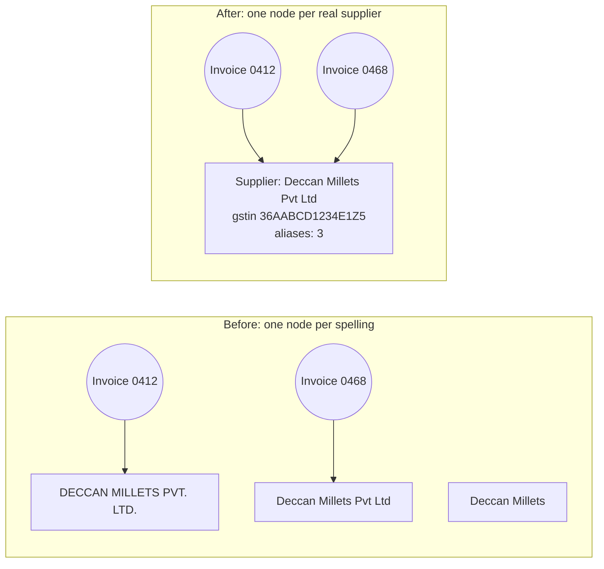

# Entity Resolution and Deduplication: The Complete Guide

> 📚 **Before you start**
>
> - [Schema-Guided Extraction with Pydantic](schema-guided-extraction-with-pydantic.md): validated invoice records, each with a seller name and (usually) a GSTIN.
> - [Entity and Relation Extraction with LLMs](entity-and-relation-extraction-with-llms.md): entity names extracted from emails, often without any identifier.
> - [Cypher Basics: MATCH, CREATE and MERGE](../04-neo4j-and-cypher/cypher-basics-match-create-and-merge.md): why `MERGE` needs a stable key.
> - [Lab: Build a company knowledge graph in Neo4j](../04-neo4j-and-cypher/lab-build-a-company-knowledge-graph-in-neo4j.md): GSTINs, their state codes, and the FrostLine Cold Chain GSTIN mix-up.

## Introduction

Your phone's contacts app probably has "Amma", "Mom" and "Amma (new no.)", all the same person. Merging them is easy because you know your mother. Now imagine 40,000 supplier records from invoices, emails and three old spreadsheets, and nobody who knows them all.

That's where the invoice pile has left Kiran Foods. The extraction lessons produced clean, validated records, but the *names* in them are as messy as the documents: `DECCAN MILLETS PVT. LTD.`, `Deccan Millets Pvt Ltd` and plain `Deccan Millets`. If each becomes its own node, the knowledge graph says Kiran Foods has three suppliers where it has one, and a question like "how much did we pay Deccan Millets this year?" quietly adds up a third of the answer.

**Entity resolution** (also called record linkage, matching or deduplication) decides which records refer to the same real-world thing and merges them into one. It sounds like string matching. It isn't, quite: `Nashik Agro Pack` and `Nashik Agro Packers` look nearly identical and are two different companies, while `Kutch Salt Works` and `Kachchh Salt Works` look different and are the same one.

By the end of this lesson you'll be able to run the full pipeline (normalise, block, compare, decide, cluster, choose a canonical record), use GSTINs as strong evidence for and against a match, ask an LLM about borderline pairs, measure the result, and load resolved entities into a graph.

> 💡 **Key Insight**
>
> Name similarity is weak evidence; identifiers are strong evidence, in **both directions**. Two records with the same PAN inside their GSTINs are the same business even if the names differ, and two records with different PANs are different businesses even if the names are nearly identical. Use strong evidence first, similarity second, and a reviewer (human or LLM) only for the genuinely unclear middle.

---

## Core Explanation

### 1. The problem, shown

Here are the supplier **mentions** collected from the pile: every place a supplier name appeared, with whatever else was printed next to it.

```python
import difflib
import re

MENTIONS = [  # id, name as written, city, GSTIN (None if not printed), source
    ("m01", "DECCAN MILLETS PVT. LTD.",     "Hyderabad",    "36AABCD1234E1Z5", "invoice"),
    ("m02", "Deccan Millets Pvt Ltd",       "Hyderabad",    "36AABCD1234E1Z5", "invoice"),
    ("m03", "Deccan Millets",               "Hyderabad",    None,              "suppliers.csv"),
    ("m04", "Deccan Millet Mills",          "Secunderabad", "36AAFCD9876K1Z2", "invoice"),
    ("m05", "SAURASHTRA GROUNDNUT CO.",     "Rajkot",       "24AAECS5678F1Z2", "invoice"),
    ("m06", "Saurashtra Groundnut",         "Gondal",       None,              "email"),
    ("m07", "Saurashtra Groundnut Company", "Rajkot",       None,              "suppliers.csv"),
    ("m08", "Nashik Agro Pack",             "Nashik",       "27AAFCN3456H1Z1", "invoice"),
    ("m09", "Nashik Agro Packers",          "Nashik",       "27AAGCN1111B1Z8", "invoice"),
    ("m10", "Malabar Spice House",          "Kochi",        "32AAGCM7890J1Z4", "invoice"),
    ("m11", "MALABAR SPICE H0USE",          "Kochi",        None,              "ocr"),
    ("m12", "FrostLine Cold Chain",         "Pune",         "27AAHCF2345K1Z3", "invoice"),
    ("m13", "Frostline Coldchain Pvt Ltd",  "Bengaluru",    "29AAHCF2345K1Z7", "invoice"),
    ("m14", "Kutch Salt Works",             "Bhuj",         "24AAKCK7777P1Z1", "invoice"),
    ("m15", "Kachchh Salt Works",           "Bhuj",         None,              "email"),
]
BY_ID = {m[0]: m for m in MENTIONS}
print(len(MENTIONS), "mentions,", len({m[1] for m in MENTIONS}), "distinct spellings")
```

Output:

```
15 mentions, 15 distinct spellings
```

Fifteen spellings. The right answer, which a procurement person worked out by hand, is **eight** suppliers. Loaded naively, the graph looks like the left side of this picture; resolved, like the right:



A few words you'll need:

| Term | Meaning |
|---|---|
| **Mention** (or record) | One appearance of a name in one source, like `m06` |
| **Entity** | The real-world thing, like the company Deccan Millets |
| **Match / non-match** | A decision that two mentions are / aren't the same entity |
| **Cluster** | All mentions resolved to one entity |
| **Canonical record** | The single cleaned record chosen to represent a cluster (also called the "golden record") |

### 2. The pipeline at a glance

![Entity resolution pipeline. Mentions from invoices, emails and spreadsheets are normalised, then grouped into blocks so only likely pairs are compared. Each pair is scored with identifiers and name similarity and sorted into match, review or non-match. Matches are clustered with union-find, a conflict check stops clusters that contain two different PANs, borderline pairs go to an LLM or human reviewer, and each cluster becomes one canonical record with aliases, loaded into the graph with MERGE on a stable ID](/img/diagrams/knowledge-graphs-ontologies-and-unstructured-data/entity-resolution.svg)
*Every stage removes work or risk from the next one. Sections 3 to 9 follow the picture from left to right.*

### 3. Normalise: make trivial differences disappear

Most variation is noise: capital letters, full stops, and legal suffixes like "Pvt. Ltd." or "Co.". Remove it before comparing anything. The OCR fix from the first lesson of this module (`0` read for `O` inside a word) belongs here too.

```python
LEGAL_SUFFIXES = r"\b(private limited|pvt ltd|pvt|ltd|limited|co|company|llp)\b"

def normalise(name):
    n = name.lower()
    n = re.sub(r"(?<=[a-z])0|0(?=[a-z])", "o", n)       # OCR: a zero touching letters is an 'o'
    n = re.sub(r"[^a-z0-9 ]", " ", n)                      # punctuation to spaces
    n = re.sub(LEGAL_SUFFIXES, " ", n)                     # drop legal form
    return " ".join(n.split())

for mid in ["m01", "m02", "m03", "m05", "m07", "m11", "m13"]:
    print(f"{BY_ID[mid][1]:<30} -> {normalise(BY_ID[mid][1])!r}")
```

Output:

```
DECCAN MILLETS PVT. LTD.       -> 'deccan millets'
Deccan Millets Pvt Ltd         -> 'deccan millets'
Deccan Millets                 -> 'deccan millets'
SAURASHTRA GROUNDNUT CO.       -> 'saurashtra groundnut'
Saurashtra Groundnut Company   -> 'saurashtra groundnut'
MALABAR SPICE H0USE            -> 'malabar spice house'
Frostline Coldchain Pvt Ltd    -> 'frostline coldchain'
```

Seven spellings collapse into four strings already. Normalisation rules should be **conservative**: drop things that never distinguish two businesses (case, punctuation, legal form) and nothing else. Removing words like "agro" or "foods" because they're common would make `Nashik Agro Pack` and `Nashik Pack Industries` look alike.

### 4. Identifiers: the strongest evidence

An Indian **GSTIN** is 15 characters: 2 digits of state code, then the business's 10-character **PAN** (its income-tax number), then 3 more characters. A company registered for GST in two states has two GSTINs **with the same PAN** inside them. That gives two rules worth more than any name comparison:

- **Same PAN → same legal entity**, even across states and spellings.
- **Different PANs → different legal entities**, however similar the names.

```python
def pan(gstin):
    return gstin[2:12] if gstin else None

for a, b in [("m12", "m13"), ("m08", "m09"), ("m01", "m04")]:
    pa, pb = pan(BY_ID[a][3]), pan(BY_ID[b][3])
    print(f"{BY_ID[a][1]:<22} {pa}  vs  {BY_ID[b][1]:<28} {pb}  -> {'SAME' if pa == pb else 'DIFFERENT'} business")
```

Output:

```
FrostLine Cold Chain   AAHCF2345K  vs  Frostline Coldchain Pvt Ltd  AAHCF2345K  -> SAME business
Nashik Agro Pack       AAFCN3456H  vs  Nashik Agro Packers          AAGCN1111B  -> DIFFERENT business
DECCAN MILLETS PVT. LTD. AABCD1234E  vs  Deccan Millet Mills          AAFCD9876K  -> DIFFERENT business
```

FrostLine has a Pune (Maharashtra, `27`) registration and a Bengaluru (Karnataka, `29`) one: one company, two branches. That's the mix-up from the module 4 lab, now explained. Meanwhile, `Nashik Agro Pack` and `Nashik Agro Packers` are proven to be different companies. Every domain has identifiers like these: PAN and GSTIN for Indian businesses, ISBN for books, IFSC for bank branches, a hospital's patient ID. Find them and use them before anything fuzzy.

Identifiers also have limits. An email has none. A GSTIN can be misread by OCR (the Pydantic format check catches many of those). And an identifier can be shared by mistake, which is why the conflict check in section 7 exists.

### 5. Blocking: don't compare everything with everything

With *n* mentions there are *n*(*n*−1)/2 pairs: 105 for our 15, about 800 million for 40,000. **Blocking** only compares mentions that share a cheap key. Use more than one key, because a single key misses pairs where that key differs:

```python
from collections import defaultdict
from itertools import combinations

def block_keys(m):
    keys = {"name:" + normalise(m[1]).split()[0], "city:" + m[2].lower()}
    if m[3]:
        keys.add("pan:" + pan(m[3]))
    return keys

blocks = defaultdict(set)
for m in MENTIONS:
    for key in block_keys(m):
        blocks[key].add(m[0])

candidates = set()
for members in blocks.values():
    candidates |= set(combinations(sorted(members), 2))
print("all pairs:", len(MENTIONS) * (len(MENTIONS) - 1) // 2, "| candidate pairs after blocking:", len(candidates))
print("Kutch/Kachchh compared?", ("m14", "m15") in candidates, "| because of block:",
      [k for k, v in blocks.items() if {"m14", "m15"} <= v])
```

Output:

```
all pairs: 105 | candidate pairs after blocking: 13
Kutch/Kachchh compared? True | because of block: ['city:bhuj']
```

Blocking cut the work about eight times here, and by thousands of times at real scale. Notice why more than one key is needed: `Kutch` and `Kachchh` share no first word, so the name key alone would never compare them; the city key (Bhuj) catches the pair. The PAN key does the same for a company whose branches trade under different names in different cities. Missing a true pair at the blocking stage is unrecoverable, so the usual advice is: several loose keys, and measure how many known duplicates end up in a shared block.

### 6. Compare: name similarity

For the remaining pairs, score how alike the names are. A robust, simple choice for company names is **character trigram Jaccard similarity**: break each normalised name (spaces removed) into overlapping 3-letter pieces and measure the overlap.

```python
def trigrams(name):
    s = normalise(name).replace(" ", "")
    return {s[i:i + 3] for i in range(len(s) - 2)}

def name_similarity(a, b):
    ta, tb = trigrams(a), trigrams(b)
    return len(ta & tb) / len(ta | tb)

print("trigrams of 'Kutch Salt Works':", sorted(trigrams("Kutch Salt Works")))
print()
for a, b in sorted(candidates):
    na, nb = BY_ID[a][1], BY_ID[b][1]
    raw = difflib.SequenceMatcher(None, na, nb).ratio()
    print(f"{a}-{b}  {na:<28} {nb:<28} trigram {name_similarity(na, nb):.2f}  raw-text ratio {raw:.2f}")
```

Output:

```
trigrams of 'Kutch Salt Works': ['alt', 'chs', 'hsa', 'kut', 'ltw', 'ork', 'rks', 'sal', 'tch', 'two', 'utc', 'wor']

m01-m02  DECCAN MILLETS PVT. LTD.     Deccan Millets Pvt Ltd       trigram 1.00  raw-text ratio 0.30
m01-m03  DECCAN MILLETS PVT. LTD.     Deccan Millets               trigram 1.00  raw-text ratio 0.16
m01-m04  DECCAN MILLETS PVT. LTD.     Deccan Millet Mills          trigram 0.71  raw-text ratio 0.19
m02-m03  Deccan Millets Pvt Ltd       Deccan Millets               trigram 1.00  raw-text ratio 0.78
m02-m04  Deccan Millets Pvt Ltd       Deccan Millet Mills          trigram 0.71  raw-text ratio 0.68
m03-m04  Deccan Millets               Deccan Millet Mills          trigram 0.71  raw-text ratio 0.85
m05-m06  SAURASHTRA GROUNDNUT CO.     Saurashtra Groundnut         trigram 1.00  raw-text ratio 0.14
m05-m07  SAURASHTRA GROUNDNUT CO.     Saurashtra Groundnut Company trigram 1.00  raw-text ratio 0.19
m06-m07  Saurashtra Groundnut         Saurashtra Groundnut Company trigram 1.00  raw-text ratio 0.83
m08-m09  Nashik Agro Pack             Nashik Agro Packers          trigram 0.80  raw-text ratio 0.91
m10-m11  Malabar Spice House          MALABAR SPICE H0USE          trigram 1.00  raw-text ratio 0.26
m12-m13  FrostLine Cold Chain         Frostline Coldchain Pvt Ltd  trigram 1.00  raw-text ratio 0.72
m14-m15  Kutch Salt Works             Kachchh Salt Works           trigram 0.44  raw-text ratio 0.82
```

Compare the two score columns. On raw text (`difflib`'s ratio, without normalising), `DECCAN MILLETS PVT. LTD.` and `Deccan Millets` look quite different because of case and the suffix; after normalising they're identical. And the two traps from the introduction are clearly visible: `Nashik Agro Pack` vs `Nashik Agro Packers` scores high (wrongly suggesting a match), and `Kutch` vs `Kachchh` scores low (wrongly suggesting a non-match). Name similarity alone can't get those right. Other useful comparators, which libraries provide: Jaro-Winkler (good for short names and typos), token-based scores that ignore word order, phonetic codes, and **embedding similarity** (vectors from a language model, which can know that "Kutch" and "Kachchh" are the same place).

### 7. Decide, then cluster

Combine the evidence into one of three decisions per pair:

```python
MATCH_AT, REVIEW_AT = 0.90, 0.40

def decide(a, b):
    ga, gb = BY_ID[a][3], BY_ID[b][3]
    if ga and gb:
        return ("match", "same PAN") if pan(ga) == pan(gb) else ("non-match", "different PANs")
    sim = name_similarity(BY_ID[a][1], BY_ID[b][1])
    if sim >= MATCH_AT:
        return "match", f"names {sim:.2f}"
    if sim >= REVIEW_AT:
        return "review", f"names {sim:.2f}"
    return "non-match", f"names {sim:.2f}"

decisions = {pair: decide(*pair) for pair in sorted(candidates)}
for pair, (verdict, why) in decisions.items():
    print(pair, f"{verdict:<9}", why)
```

Output:

```
('m01', 'm02') match     same PAN
('m01', 'm03') match     names 1.00
('m01', 'm04') non-match different PANs
('m02', 'm03') match     names 1.00
('m02', 'm04') non-match different PANs
('m03', 'm04') review    names 0.71
('m05', 'm06') match     names 1.00
('m05', 'm07') match     names 1.00
('m06', 'm07') match     names 1.00
('m08', 'm09') non-match different PANs
('m10', 'm11') match     names 1.00
('m12', 'm13') match     same PAN
('m14', 'm15') review    names 0.44
```

Pairwise decisions aren't the end, because "same entity" is **transitive**: if m03 = m01 and m01 = m02, then m03 = m02. **Union-find** (also called disjoint sets) is the standard structure for building clusters from pairwise matches: each mention points to a parent, and following parents leads to the cluster's root.

```python
class Clusters:
    def __init__(self, ids):
        self.parent = {i: i for i in ids}

    def find(self, x):
        while self.parent[x] != x:
            self.parent[x] = self.parent[self.parent[x]]     # shorten the path as we go
            x = self.parent[x]
        return x

    def union(self, a, b):
        ra, rb = sorted((self.find(a), self.find(b)))
        self.parent[rb] = ra                                  # smaller id becomes the root

    def groups(self):
        out = defaultdict(list)
        for i in self.parent:
            out[self.find(i)].append(i)
        return sorted(out.values())

def pans_in(clusters, x):
    root = clusters.find(x)
    return {pan(BY_ID[i][3]) for i in clusters.parent if clusters.find(i) == root and BY_ID[i][3]}
```

Transitivity is also the main danger: one bad match chains two whole clusters together. To see it, here's what happens with a naive rule (match whenever names score 0.7 or more, ignoring identifiers):

```python
naive = Clusters(BY_ID)
for a, b in sorted(candidates):
    if name_similarity(BY_ID[a][1], BY_ID[b][1]) >= 0.7:
        naive.union(a, b)
for group in naive.groups():
    if len(group) > 1:
        found = sorted(pans_in(naive, group[0]))
        print(str(group) + (f"  <- CONFLICT: PANs {found}" if len(found) > 1 else ""))
```

Output:

```
['m01', 'm02', 'm03', 'm04']  <- CONFLICT: PANs ['AABCD1234E', 'AAFCD9876K']
['m05', 'm06', 'm07']
['m08', 'm09']  <- CONFLICT: PANs ['AAFCN3456H', 'AAGCN1111B']
['m10', 'm11']
['m12', 'm13']
```

The naive rule glued `Deccan Millet Mills` onto Deccan Millets and `Nashik Agro Packers` onto `Nashik Agro Pack`, and missed Kutch/Kachchh entirely. The **conflict check** (a cluster must never hold two different PANs) exposes both bad merges.

Now the careful version. Apply strong matches first, then handle review pairs: if joining them would create a PAN conflict, it's a non-match automatically; otherwise it goes to a reviewer.

```python
clusters = Clusters(BY_ID)
for (a, b), (verdict, _) in decisions.items():
    if verdict == "match" and len(pans_in(clusters, a) | pans_in(clusters, b)) <= 1:
        clusters.union(a, b)

to_review = []
for (a, b), (verdict, why) in decisions.items():
    if verdict != "review" or clusters.find(a) == clusters.find(b):
        continue
    if len(pans_in(clusters, a) | pans_in(clusters, b)) > 1:
        print(f"{a}-{b}: would mix PANs {sorted(pans_in(clusters, a) | pans_in(clusters, b))} -> non-match")
    else:
        to_review.append((a, b))
print("for review:", to_review)
```

Output:

```
m03-m04: would mix PANs ['AABCD1234E', 'AAFCD9876K'] -> non-match
for review: [('m14', 'm15')]
```

`Deccan Millets` (m03, no GSTIN) was borderline-similar to `Deccan Millet Mills` (m04). On its own the pair was unclear, but m03 had already joined the Deccan Millets cluster through a perfect name match, and that cluster's PAN differs from m04's. **Resolving in order of confidence** turned an unclear pair into a clear one. Only Kutch/Kachchh is left for a reviewer.

### 8. Borderline pairs: ask a reviewer (an LLM or a person)

A reviewer sees both records side by side and the evidence so far. An LLM is a reasonable first reviewer for this, because it knows things a string metric doesn't (that Kachchh is the official spelling of the Kutch district, for example), as long as you ask for a structured answer with a reason and keep a human in the loop for anything high-stakes.

```python
import json
from langchain_core.language_models.fake_chat_models import FakeListChatModel

def review_prompt(a, b):
    ra, rb = BY_ID[a], BY_ID[b]
    return (
        "Do these two supplier records refer to the same business? Answer only with JSON: "
        '{"same": true or false, "reason": "one sentence"}. Say false if unsure.\n'
        f"Record A: name={ra[1]!r}, city={ra[2]!r}, gstin={ra[3]!r}, source={ra[4]}\n"
        f"Record B: name={rb[1]!r}, city={rb[2]!r}, gstin={rb[3]!r}, source={rb[4]}\n"
        f"Name similarity: {name_similarity(ra[1], rb[1]):.2f}")

print(review_prompt("m14", "m15"))
judge = FakeListChatModel(responses=[json.dumps({
    "same": True,
    "reason": "Kachchh is the official spelling of Kutch; same business type and same town, Bhuj."})])

for a, b in to_review:
    verdict = json.loads(judge.invoke(review_prompt(a, b)).content)
    print(f"\n{a}-{b}: same={verdict['same']} ({verdict['reason']})")
    if verdict["same"]:
        clusters.union(a, b)
```

Output:

```
Do these two supplier records refer to the same business? Answer only with JSON: {"same": true or false, "reason": "one sentence"}. Say false if unsure.
Record A: name='Kutch Salt Works', city='Bhuj', gstin='24AAKCK7777P1Z1', source=invoice
Record B: name='Kachchh Salt Works', city='Bhuj', gstin=None, source=email
Name similarity: 0.44

m14-m15: same=True (Kachchh is the official spelling of Kutch; same business type and same town, Bhuj.)
```

"Say false if unsure" sets the default: a missed merge leaves two nodes that someone can join later, while a wrong merge mixes two companies' invoices and payments, which is far harder to undo. In finance-adjacent data, **wrong merges cost more than missed ones**, so thresholds and prompts should lean towards keeping records apart.

### 9. Measure, then build canonical records

To measure, compare predicted clusters with the hand-made answer **pair by pair**: every pair of mentions placed together is a predicted match.

```python
GOLD = [["m01", "m02", "m03"], ["m04"], ["m05", "m06", "m07"], ["m08"], ["m09"],
        ["m10", "m11"], ["m12", "m13"], ["m14", "m15"]]

def pairs_of(groups):
    return {pair for g in groups for pair in combinations(sorted(g), 2)}

def pairwise_scores(groups):
    pred, gold = pairs_of(groups), pairs_of(GOLD)
    tp = len(pred & gold)
    precision = tp / len(pred) if pred else 1.0
    recall = tp / len(gold)
    return round(precision, 2), round(recall, 2)

print("naive  precision, recall:", pairwise_scores(naive.groups()))
print("final  precision, recall:", pairwise_scores(clusters.groups()))
print(len(clusters.groups()), "suppliers from", len(MENTIONS), "mentions")
```

Output:

```
naive  precision, recall: (0.67, 0.89)
final  precision, recall: (1.0, 1.0)
8 suppliers from 15 mentions
```

The naive rule found most true pairs but a third of its merges were wrong. The careful pipeline reproduces the procurement team's eight clusters exactly. On real data it won't be perfect, and these two numbers are what you track as you tune thresholds and rules.

Finally, each cluster becomes one **canonical record**. Choosing which value survives is called **survivorship**: here, the name prefers mixed case over ALL CAPS, then invoices over the master spreadsheet over emails over OCR, then the fuller spelling; the ID comes from the PAN; and every other spelling is kept as an alias, because aliases are what let future mentions match quickly.

```python
SOURCE_RANK = {"invoice": 0, "suppliers.csv": 1, "email": 2, "ocr": 3}

def canonical(group):
    members = [BY_ID[i] for i in group]
    best = min(members, key=lambda m: (m[1].isupper(), SOURCE_RANK[m[4]], -len(m[1])))
    pans = sorted({pan(m[3]) for m in members if m[3]})
    return {
        "id": "SUP-" + (pans[0] if pans else normalise(best[1]).replace(" ", "-")),
        "name": best[1],
        "gstins": sorted({m[3] for m in members if m[3]}),
        "aliases": sorted({m[1] for m in members} - {best[1]}),
        "mentions": group,
    }

SUPPLIERS = [canonical(g) for g in clusters.groups()]
for s in SUPPLIERS:
    print(f"{s['id']:<17} {s['name']:<22} gstins={s['gstins']} aliases={len(s['aliases'])}")
```

Output:

```
SUP-AABCD1234E    Deccan Millets Pvt Ltd gstins=['36AABCD1234E1Z5'] aliases=2
SUP-AAFCD9876K    Deccan Millet Mills    gstins=['36AAFCD9876K1Z2'] aliases=0
SUP-AAECS5678F    Saurashtra Groundnut Company gstins=['24AAECS5678F1Z2'] aliases=2
SUP-AAFCN3456H    Nashik Agro Pack       gstins=['27AAFCN3456H1Z1'] aliases=0
SUP-AAGCN1111B    Nashik Agro Packers    gstins=['27AAGCN1111B1Z8'] aliases=0
SUP-AAGCM7890J    Malabar Spice House    gstins=['32AAGCM7890J1Z4'] aliases=1
SUP-AAHCF2345K    Frostline Coldchain Pvt Ltd gstins=['27AAHCF2345K1Z3', '29AAHCF2345K1Z7'] aliases=1
SUP-AAKCK7777P    Kutch Salt Works       gstins=['24AAKCK7777P1Z1'] aliases=1
```

Each supplier has a **stable ID** built from its PAN where one is known. Stable IDs matter: the graph uses them as the `MERGE` key, so reloading tomorrow, with new mentions, attaches to the same nodes.

### 10. Resolution in the graph

There are two common ways to store the result, and many systems use both:

- **Merge**: one `Supplier` node per entity; aliases and GSTINs as properties. Simple to query.
- **Link**: keep each mention as its own node and connect it to the entity with a relationship such as `REFERS_TO`. Nothing is lost, and a wrong merge can be undone by deleting one relationship.

```python
def load_statements(supplier):
    lines = [f"MERGE (s:Supplier {{id: {json.dumps(supplier['id'])}}}) "
             f"SET s.name = {json.dumps(supplier['name'])}, s.gstins = {json.dumps(supplier['gstins'])}, "
             f"s.aliases = {json.dumps(supplier['aliases'])}"]
    for mid in supplier["mentions"]:
        m = BY_ID[mid]
        lines.append(f"MERGE (m:Mention {{id: {json.dumps(mid)}}}) SET m.text = {json.dumps(m[1])}, "
                     f"m.source = {json.dumps(m[4])} WITH m MATCH (s:Supplier {{id: {json.dumps(supplier['id'])}}}) "
                     f"MERGE (m)-[:REFERS_TO]->(s)")
    return lines

for line in load_statements(SUPPLIERS[-1]):
    print(line + ";")
```

Output:

```
MERGE (s:Supplier {id: "SUP-AAKCK7777P"}) SET s.name = "Kutch Salt Works", s.gstins = ["24AAKCK7777P1Z1"], s.aliases = ["Kachchh Salt Works"];
MERGE (m:Mention {id: "m14"}) SET m.text = "Kutch Salt Works", m.source = "invoice" WITH m MATCH (s:Supplier {id: "SUP-AAKCK7777P"}) MERGE (m)-[:REFERS_TO]->(s);
MERGE (m:Mention {id: "m15"}) SET m.text = "Kachchh Salt Works", m.source = "email" WITH m MATCH (s:Supplier {id: "SUP-AAKCK7777P"}) MERGE (m)-[:REFERS_TO]->(s);
```

In RDF, the same decision is written with `owl:sameAs`, which you met in module 3: it tells a reasoner that two IRIs name one thing, so every fact about one applies to the other.

```turtle
@prefix kf:  <https://kiranfoods.example/kg#> .
@prefix owl: <http://www.w3.org/2002/07/owl#> .

kf:mention_m15 owl:sameAs kf:SUP-AAKCK7777P .
kf:mention_m14 owl:sameAs kf:SUP-AAKCK7777P .
```

Use `owl:sameAs` only for confirmed matches. Because a reasoner copies every fact across a `sameAs` link, one wrong link spreads one company's facts onto another.

#### Tools for real scale

| Tool | What it is |
|---|---|
| **Splink** | Open-source Python library for probabilistic record linkage (the Fellegi-Sunter model), running on DuckDB, Spark and other SQL engines; scales to many millions of records |
| **dedupe** | Open-source Python library that learns matching rules from pairs you label interactively |
| **Zingg** | Open-source ML entity resolution on Spark |
| **Commercial ER engines** (for example Senzing, and master-data-management products) | Real-time resolution with survivorship, history and review screens |
| **Neo4j Graph Data Science** | Node similarity algorithms that compare nodes by their shared neighbours, useful when relationships (same address, same phone) are the evidence |

The ideas inside all of them are the ones in this lesson: blocking, comparison, a decision with an uncertain middle, clustering, and survivorship.

---

## Try It Yourself

1. **A new mention arrives.** An email mentions `"Deccan Millets (Hyd)"` with no GSTIN. Using the aliases, normalise it and find the best-matching canonical supplier by name similarity. What score does it get, and what does that tell you about normalising brackets?
2. **Products need resolving too.** Line items arrive as `"Ragi flour (25 kg)"`, `"Ragi Flour 25kg"`, `"RAGI FLOUR - 25 KG BAG"` and `"Jowar flour (25 kg)"`. Write a `product_key()` that maps the three ragi variants to one key and keeps jowar separate.
3. **Raise the review threshold.** Set `REVIEW_AT` to 0.5 and rerun the decisions for the pair `('m14', 'm15')`. What happens, and what would that do to recall?

<details>
<summary>Show answers</summary>

**1.** Brackets become spaces, so `"Deccan Millets (Hyd)"` normalises to `deccan millets hyd`. The extra `hyd` lowers the score below the 0.90 match threshold, so it would go to review. A normalisation rule for well-known city abbreviations in brackets would help, but keep such rules few and tested.

```python
def best_match(name):
    scored = []
    for s in SUPPLIERS:
        for candidate in [s["name"], *s["aliases"]]:
            scored.append((round(name_similarity(name, candidate), 2), s["id"], candidate))
    return max(scored)

print(normalise("Deccan Millets (Hyd)"), "->", best_match("Deccan Millets (Hyd)"))
```

Output:

```
deccan millets hyd -> (0.79, 'SUP-AABCD1234E', 'Deccan Millets Pvt Ltd')
```

**2.**

```python
def product_key(text):
    t = text.lower()
    t = re.sub(r"(\d+)\s*kg", r"\1kg", t)                 # '25 kg' -> '25kg'
    t = re.sub(r"\b(bag|bags|pack)\b", " ", t)
    t = re.sub(r"[^a-z0-9 ]", " ", t)
    return " ".join(t.split())

for p in ["Ragi flour (25 kg)", "Ragi Flour 25kg", "RAGI FLOUR - 25 KG BAG", "Jowar flour (25 kg)"]:
    print(f"{p:<24} -> {product_key(p)}")
```

Output:

```
Ragi flour (25 kg)       -> ragi flour 25kg
Ragi Flour 25kg          -> ragi flour 25kg
RAGI FLOUR - 25 KG BAG   -> ragi flour 25kg
Jowar flour (25 kg)      -> jowar flour 25kg
```

Products often resolve better with rules plus a product master list (with HSN codes) than with fuzzy matching, because "25 kg" and "50 kg" bags of the same flour are different products.

**3.**

```python
REVIEW_AT = 0.5
print(decide("m14", "m15"))
REVIEW_AT = 0.40
```

Output:

```
('non-match', 'names 0.44')
```

The pair is now a non-match without any review, so Kutch/Kachchh stays split and pairwise recall drops. A higher review threshold saves reviewer time and loses exactly the hard, valuable matches. Tune thresholds with the labelled pairs, not by feel.

</details>

---

## Real-World Examples

- **Banks** resolve customers across accounts, loans and cards (a "single customer view") for KYC and credit risk, and screen names against sanctions lists, where a missed match is a compliance failure.
- **E-commerce marketplaces** merge duplicate product listings from different sellers so that one product page shows every offer.
- **Healthcare** systems link patient records across hospitals and labs; a wrong merge here can put one patient's results into another's file.
- **Government programmes** deduplicate beneficiary lists so that one person isn't enrolled twice, often using an ID number plus name and address matching.
- **Knowledge graph builders** (Wikidata editors, enterprise graph teams) link new mentions to existing entities, which is called **entity linking** when the target is an existing knowledge base.

---

## Common Misconceptions

### "Entity resolution is fuzzy string matching"

Strings are one signal. Identifiers, addresses, shared relationships and context usually decide the hard cases, as Nashik Agro Pack/Packers and Kutch/Kachchh show.

### "More matches is better"

A wrong merge corrupts every fact on both entities and is hard to undo. Most business data should lean towards precision, with a review queue for the middle.

### "Pairwise decisions are enough"

Matches chain through transitivity. Cluster, then check clusters for conflicts such as two different PANs.

### "Do it once during the migration"

New mentions arrive daily. Keep aliases and stable IDs so that resolution runs incrementally, and keep the mention-to-entity links so mistakes can be reversed.

---

## Interview Relevance

Entity resolution comes up in data engineering, ML and knowledge-graph interviews: *"How would you deduplicate a customer or supplier table?"* or *"How do you merge entities extracted from documents into a graph?"* A strong answer walks the pipeline (normalise, block with several keys, compare with identifiers first and similarity second, three-way decisions, union-find clustering with conflict checks, review for the middle, survivorship into a canonical record with stable IDs), discusses the precision/recall trade-off and why wrong merges are costlier, names tools such as Splink or dedupe, and explains how to store the result in a graph (merged nodes, `REFERS_TO` links, or `owl:sameAs`).

---

## Key Takeaways

- **Normalise conservatively**, then **block** with several keys so you compare only plausible pairs without losing true ones.
- **Identifiers beat names in both directions**: the same PAN proves a match, different PANs prove a non-match.
- **Decide in three ways** (match, review, non-match), resolve in order of confidence, and cluster with union-find plus a conflict check.
- **Lean towards precision**: wrong merges are costlier than missed ones; an LLM or person reviews the borderline middle.
- **Produce canonical records with stable IDs and aliases**, and keep mention links so the graph can be corrected later.

---

**Up next:** [Lab: Turn a pile of invoices into structured records](lab-turn-a-pile-of-invoices-into-structured-records.md)
