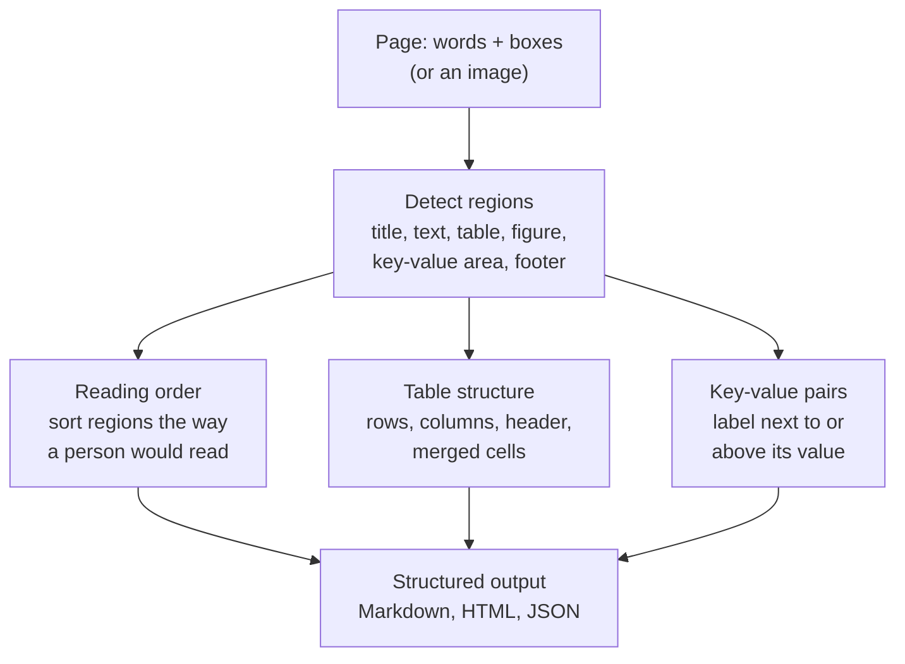

# Extracting Tables, Forms and Layout: The Complete Guide

> 📚 **Before you start**
>
> - [From Documents to Data: OCR and Document Parsing](from-documents-to-data-ocr-and-document-parsing.md): the invoice pile, text layers, OCR, and word bounding boxes. This lesson builds directly on those boxes.
> - pandas DataFrames: [Data Analysis and Visualisation with Python](../../data-analysis-and-visualisation-with-python/course.md).

## Introduction

The last lesson got text out of Kiran Foods' invoices. But a flat string like this isn't data yet:

```text
1   Ragi flour (25 kg)     1102   40    bag    950.00    38,000.00
```

Which number is the quantity and which is the rate? A human sees it instantly because of the **layout**: the number sits under the column heading "Qty". The text string has lost that relationship; the **bounding boxes** still have it.

This lesson is about recovering structure from position. A document has three kinds of structure that matter for extraction:

- **Tables**: rows and columns, like invoice line items.
- **Forms (key-value pairs)**: a label and its value, like `Invoice No: DM/2026/0412` or `GSTIN` printed above a box containing `36AABCD1234E1Z5`.
- **Reading order**: which block of text comes before which, especially on pages with two columns, sidebars or a "Ship from / Bill to" pair side by side.

You'll rebuild a table from word boxes, pull key-value pairs from five invoices with different templates (and see exactly why templates break), fix reading order on a two-column page, and meet the tools that do all this at scale.

> 💡 **Key Insight**
>
> **Layout is meaning.** A number's column tells you what it is; a value's position next to a label tells you which field it fills. Keep word positions until the very end of parsing, and turn tables into a format that preserves rows and columns (a DataFrame, Markdown or HTML table, or JSON) before any LLM or rule tries to understand them.

---

## Core Explanation

### 1. What a layout model sees

Layout analysis splits a page into typed regions, then works out order and structure inside each one:



Modern tools detect regions with a neural network trained on page images (for example, layout models trained on the DocLayNet and PubLayNet datasets) and recognise table structure with a second model (TableFormer, used by Docling, is one). Underneath, they use the same geometry you're about to code by hand: words that line up horizontally form rows, words that line up vertically form columns.

### 2. Words with boxes

PyMuPDF's `page.get_text("words")` returns each word with its box: `x0, x1` (left and right edges) and `top` (in points, where 72 points = 1 inch). To keep this runnable without a PDF, we simulate that output from the Deccan Millets invoice: each character is 6 points wide and each line 14 points tall, which is what a monospaced PDF would give.

```python
import re
import pandas as pd

INVOICES = {
"inv_01_deccan.pdf": """DECCAN MILLETS PVT. LTD.
Plot 14, IDA Uppal, Hyderabad, Telangana 500039
GSTIN: 36AABCD1234E1Z5
TAX INVOICE
Invoice No: DM/2026/0412            Date: 12-08-2026
Bill To: Kiran Foods Pvt Ltd, Hinjewadi, Pune, Maharashtra
Buyer GSTIN: 27AAKCK4321M1Z9
Sl  Description            HSN    Qty   Unit   Rate      Amount
1   Ragi flour (25 kg)     1102   40    bag    950.00    38,000.00
2   Jowar flour (25 kg)    1102   10    bag    880.00     8,800.00
                                         Taxable value    46,800.00
                                         IGST @ 5%         2,340.00
                                         Total (INR)      49,140.00
""",
"inv_02_nashik.pdf": """Nashik Agro Pack
MIDC Ambad, Nashik 422010, Maharashtra | GSTIN 27AAFCN3456H1Z1
INVOICE #NAP-2026-1187
Invoice date: 2026-08-20
Customer: Kiran Foods Pvt. Ltd., Pune
Item: Laminated snack pouches 200 g    Qty: 5,000   @ Rs. 2.40    Rs. 12,000.00
Item: Corrugated cartons 5-ply         Qty: 200     @ Rs. 45.00   Rs. 9,000.00
Sub-total: Rs. 21,000.00
CGST 9%: Rs. 1,890.00
SGST 9%: Rs. 1,890.00
Grand Total: Rs. 24,780.00
""",
"inv_03_malabar_scan.png": """MALABAR SPICE HOUSE
Mattancherry, Kochi, Kerala   GSTIN 32AAGCM7890J1Z4
Inv # MSH-889      Dt. 3rd Sept 2026
To: Kiran Foods, Pune
Chai masala blend 10kg  x 6  @ ₹1,450  = ₹8,700
Black pepper 5kg  x 4  @ ₹3,100  = ₹12,400
Taxable value ₹21,100
IGST 5% ₹1,055
Total ₹22,155
""",
"inv_04_deccan.pdf": """Deccan Millets Pvt Ltd
Hyderabad
GSTIN: 36AABCD1234E1Z5
Invoice No: DM/2026/0468   Date: 02-09-2026
Bill To: Kiran Foods Pvt Ltd, Pune
Ragi flour (25 kg) x 60 bags @ 950.00 = 57,000.00
IGST @ 5% = 2,850.00
Total (INR) 59,850.00
""",
"inv_05_saurashtra.pdf": """SAURASHTRA GROUNDNUT CO.
Gondal Road, Rajkot, Gujarat
GSTIN 24AAECS5678F1Z2
Bill No. SGC/889/26-27      Bill Date: 15/09/2026
Kiran Foods Private Limited, Pune
Bold groundnut kernels 50/60    1,200 kg  x  INR 112.00  =  INR 1,34,400.00
IGST 5%                                                     INR 6,720.00
Amount payable                                              INR 1,41,120/-
""",
}

CHAR_W, LINE_H, TOP = 6.0, 14.0, 40.0

def words_with_boxes(text):
    """Simulate PyMuPDF's page.get_text('words'): each word with its box (in points)."""
    words = []
    for line_no, line in enumerate(text.splitlines()):
        for m in re.finditer(r"\S+", line):
            words.append({"text": m.group(), "x0": m.start() * CHAR_W,
                          "x1": m.end() * CHAR_W, "top": TOP + line_no * LINE_H})
    return pd.DataFrame(words)

words = words_with_boxes(INVOICES["inv_01_deccan.pdf"])
print(len(words), "words")
print(words.iloc[40:46].to_string(index=False))
```

Output:

```
69 words
 text    x0    x1   top
 Ragi  24.0  48.0 152.0
flour  54.0  84.0 152.0
  (25  90.0 108.0 152.0
  kg) 114.0 132.0 152.0
 1102 162.0 186.0 152.0
   40 204.0 216.0 152.0
```
(The Malabar invoice here is the cleaned version from the last lesson, with OCR errors fixed.) Each row is one word with its position. The words `Ragi flour (25 kg)` are four separate words that belong in one cell. Nothing in the data says so yet; only their positions do.

### 3. Rebuilding a table from boxes

Three steps rebuild the line-item table:

1. **Group words into lines**: words whose `top` values are within a small tolerance are on the same line.
2. **Find the header line** and use the header words' positions as column anchors.
3. **Assign every word below the header to a column**: a column owns the strip from its header's left edge to the next header's left edge, and words landing in the same strip are joined into one cell. Stop when a line has nothing in the first column (that's where the totals block starts).

```python
def group_lines(words, tol=3.0):
    """Words whose tops differ by at most `tol` points are on the same line."""
    lines, current, last_top = [], [], None
    for w in words.sort_values(["top", "x0"]).to_dict("records"):
        if last_top is not None and abs(w["top"] - last_top) > tol:
            lines.append(current)
            current = []
        current.append(w)
        last_top = w["top"]
    lines.append(current)
    return lines

lines = group_lines(words)
header_idx = next(i for i, ln in enumerate(lines)
                  if {"Description", "Amount"} <= {w["text"] for w in ln})
header = lines[header_idx]
cols = [w["text"] for w in header]
print("header:", [(w["text"], w["x0"]) for w in header])

starts = [w["x0"] for w in header]

def column_of(word):
    """A column owns the space from its header's left edge up to the next header's left edge."""
    return max(i for i, x in enumerate(starts) if x <= word["x0"] + 3)   # 3-point slack

rows = []
for ln in lines[header_idx + 1:]:
    cells = {}
    for w in ln:
        col = cols[column_of(w)]
        cells[col] = (cells.get(col, "") + " " + w["text"]).strip()
    if "Sl" not in cells:            # no serial number: the table has ended
        break
    rows.append(cells)

items = pd.DataFrame(rows)
print(items.to_string(index=False))
```

Output:

```
header: [('Sl', 0.0), ('Description', 24.0), ('HSN', 162.0), ('Qty', 204.0), ('Unit', 240.0), ('Rate', 282.0), ('Amount', 342.0)]
Sl         Description  HSN Qty Unit   Rate    Amount
 1  Ragi flour (25 kg) 1102  40  bag 950.00 38,000.00
 2 Jowar flour (25 kg) 1102  10  bag 880.00  8,800.00
```
That's a real table: `Ragi flour (25 kg)` is one cell, and `40` is in the `Qty` column because of where it sits. Now the values can be **checked**, which is the whole point of structure:

```python
def num(s):
    return float(s.replace(",", ""))

items["computed"] = items["Qty"].map(num) * items["Rate"].map(num)
items["ok"] = items["computed"] == items["Amount"].map(num)
print(items[["Description", "Qty", "Rate", "Amount", "computed", "ok"]].to_string(index=False))

totals = {}
for ln in lines[header_idx + 1 + len(rows):]:
    label = " ".join(w["text"] for w in ln[:-1])     # everything but the last word is the label
    totals[label] = num(ln[-1]["text"])               # the right-most word is the value
print(totals)
print("line items add up to taxable value:", items["Amount"].map(num).sum() == totals["Taxable value"])
print("taxable + IGST == total:", totals["Taxable value"] + totals["IGST @ 5%"] == totals["Total (INR)"])
```

Output:

```
        Description Qty   Rate    Amount  computed   ok
 Ragi flour (25 kg)  40 950.00 38,000.00   38000.0 True
Jowar flour (25 kg)  10 880.00  8,800.00    8800.0 True
{'Taxable value': 46800.0, 'IGST @ 5%': 2340.0, 'Total (INR)': 49140.0}
line items add up to taxable value: True
taxable + IGST == total: True
```
The totals block is a mini **key-value** area: label on the left, value right-aligned at the edge. The rule "the right-most word on the line is the value" is a typical layout heuristic. (We used `float` here only for a quick check; the stored records in later lessons use `Decimal`.)

Real tables are harder: cells that wrap onto two lines, merged header cells ("Amount" spanning "Rate" and "Value"), tables that break across pages and repeat their header, and tables with no ruling lines at all. That's why dedicated table-structure models exist. But every one of them is answering the same two questions you just answered: which words share a row, and which share a column.

### 4. Key-value pairs, and why templates break

Header fields (invoice number, date, GSTIN) are key-value pairs. The classic approach is a **template**: a list of label patterns per field. Let's write one and run it over all five invoices:

```python
FIELD_PATTERNS = {
    "invoice_no": r"Invoice No:\s*(\S+)",
    "date": r"Date:\s*(\S+)",
    "gstin": r"GSTIN:?\s*([0-9A-Z]{15})",
}

def extract_with_template(text):
    found = {}
    for field, pattern in FIELD_PATTERNS.items():
        m = re.search(pattern, text)
        found[field] = m.group(1) if m else None
    return found

results = pd.DataFrame({name: extract_with_template(text) for name, text in INVOICES.items()}).T
print(results.to_string())
print("\nfields found:", int(results.notna().sum().sum()), "of", results.size)
```

Output:

```
                           invoice_no        date            gstin
inv_01_deccan.pdf        DM/2026/0412  12-08-2026  36AABCD1234E1Z5
inv_02_nashik.pdf                 NaN         NaN  27AAFCN3456H1Z1
inv_03_malabar_scan.png           NaN         NaN  32AAGCM7890J1Z4
inv_04_deccan.pdf        DM/2026/0468  02-09-2026  36AABCD1234E1Z5
inv_05_saurashtra.pdf             NaN  15/09/2026  24AAECS5678F1Z2

fields found: 10 of 15
```
The template was written while looking at the Deccan invoices, so it works on Deccan and partly elsewhere. The Nashik invoice says `INVOICE #` and `Invoice date:` (lower-case d), Malabar says `Inv #` and `Dt.`, Saurashtra says `Bill No.` and `Bill Date:`. Notice the date column too: `Date:\s*(\S+)` matched inside `Bill Date:` on the Saurashtra invoice, which happened to be right; on another document the same accident could grab the wrong date.

You can add synonyms, and teams do, for a while:

```python
FIELD_PATTERNS = {
    "invoice_no": r"(?:Invoice No:|INVOICE #|Inv #|Bill No\.)\s*(\S+)",
    "date": r"(?:Date:|date:|Dt\.)\s*(\d{1,2}(?:st|nd|rd|th)? \w+ \d{4}|\S+)",
    "gstin": r"GSTIN:?\s*([0-9A-Z]{15})",
}
results = pd.DataFrame({name: extract_with_template(text) for name, text in INVOICES.items()}).T
print(results.to_string())
print("\nfields found:", int(results.notna().sum().sum()), "of", results.size)
```

Output:

```
                            invoice_no           date            gstin
inv_01_deccan.pdf         DM/2026/0412     12-08-2026  36AABCD1234E1Z5
inv_02_nashik.pdf        NAP-2026-1187     2026-08-20  27AAFCN3456H1Z1
inv_03_malabar_scan.png        MSH-889  3rd Sept 2026  32AAGCM7890J1Z4
inv_04_deccan.pdf         DM/2026/0468     02-09-2026  36AABCD1234E1Z5
inv_05_saurashtra.pdf    SGC/889/26-27     15/09/2026  24AAECS5678F1Z2

fields found: 15 of 15
```
All fields found, after hand-writing synonyms for five suppliers. Kiran Foods has dozens of suppliers, each new one brings a new template, and suppliers change their billing software without warning. That maintenance burden is the main reason invoice extraction moved first to **ML models trained on many layouts** (the cloud prebuilt invoice models) and now to **LLMs with a schema** (the next two lessons), which understand that `Bill No.`, `Inv #` and `INVOICE #` all mean "invoice number" without being told.

Templates still have a place: for a handful of high-volume, stable layouts they're fast, free and perfectly predictable. A common design is **templates for the known top suppliers, LLM extraction for the long tail**.

### 5. Reading order on a two-column page

Many invoices print the seller and buyer side by side. Here's a block from a delivery challan, as word boxes:

```python
CHALLAN = """Ship from:                       Bill to:
FrostLine Cold Chain             Kiran Foods Pvt Ltd
Plot 7, Chakan MIDC              Hinjewadi Phase 2
Pune 410501                      Pune 411057
GSTIN 27AAHCF2468K1Z3            GSTIN 27AAKCK4321M1Z9"""

cw = words_with_boxes(CHALLAN)
naive = " ".join(cw.sort_values(["top", "x0"])["text"])
print("naive top-to-bottom, left-to-right:\n ", naive[:120], "...")
```

Output:

```
naive top-to-bottom, left-to-right:
  Ship from: Bill to: FrostLine Cold Chain Kiran Foods Pvt Ltd Plot 7, Chakan MIDC Hinjewadi Phase 2 Pune 410501 Pune 4110 ...
```
Reading strictly line by line interleaves the two addresses: "FrostLine Cold Chain Kiran Foods Pvt Ltd Plot 7, Chakan MIDC Hinjewadi...". An extractor reading this could easily pin Kiran Foods' GSTIN on FrostLine. The fix is to **find the column gutter**: an x-range that no word crosses, running down the block.

```python
page_width = int(cw["x1"].max())
covered = [False] * page_width
for _, w in cw.iterrows():
    for x in range(int(w["x0"]), int(w["x1"])):
        covered[x] = True

gaps, start = [], None
for x, c in enumerate(covered):
    if not c and start is None:
        start = x
    if c and start is not None:
        if x - start >= 30:                      # a gap at least 30 points wide is a gutter
            gaps.append((start, x))
        start = None
print("gutters:", gaps)

split = (gaps[0][0] + gaps[0][1]) / 2
for name, part in [("left", cw[cw.x0 < split]), ("right", cw[cw.x0 >= split])]:
    print(f"{name}: " + " ".join(part.sort_values(["top", "x0"])["text"]))
```

Output:

```
gutters: [(126, 198)]
left: Ship from: FrostLine Cold Chain Plot 7, Chakan MIDC Pune 410501 GSTIN 27AAHCF2468K1Z3
right: Bill to: Kiran Foods Pvt Ltd Hinjewadi Phase 2 Pune 411057 GSTIN 27AAKCK4321M1Z9
```
Each address is now intact and in order, so the seller's GSTIN stays with the seller. This "whitespace gutter" idea, applied recursively (split the page into columns, then each column into blocks), is the core of classic reading-order algorithms such as the **XY-cut**. Layout models learn more robust versions of it, and they handle cases like a full-width title above two columns.

### 6. The tools

Doing all of the above robustly is what these tools are for:

| Tool | Tables | Key-value / forms | Notes |
|---|---|---|---|
| **pdfplumber** | `page.extract_tables()` from ruling lines or text alignment | Words with boxes; you write the rules | Born-digital PDFs, very controllable |
| **Camelot** | "lattice" (ruled tables) and "stream" (whitespace-aligned) modes | No | Born-digital PDFs |
| **Docling** | TableFormer model; exports Markdown/HTML/JSON | Partial (layout regions) | Open source, also handles scans via OCR |
| **Unstructured** | `Table` elements, with HTML in the element metadata when inferred | Partial | Many formats through one `partition()` call |
| **AWS Textract** | `AnalyzeDocument` with TABLES and FORMS features; `AnalyzeExpense` for invoices and receipts | Yes | Managed; prebuilt invoice fields |
| **Google Document AI** | Form and layout parsers | Yes, plus a prebuilt invoice processor | Managed |
| **Azure AI Document Intelligence** | Layout model | Yes, plus a prebuilt invoice model | Managed |
| **Vision LLMs** | Asked to output a Markdown or JSON table | Asked to output named fields | Flexible; verify numbers |

pdfplumber, for a born-digital invoice:

```python
# not-run: needs the pdfplumber package and the PDF
import pdfplumber

with pdfplumber.open("inv_01_deccan.pdf") as pdf:
    page = pdf.pages[0]
    for table in page.extract_tables():
        for row in table:
            print(row)
```

Example output:

```
['Sl', 'Description', 'HSN', 'Qty', 'Unit', 'Rate', 'Amount']
['1', 'Ragi flour (25 kg)', '1102', '40', 'bag', '950.00', '38,000.00']
['2', 'Jowar flour (25 kg)', '1102', '10', 'bag', '880.00', '8,800.00']
```

And a cloud invoice model, AWS Textract's expense analysis, which returns named summary fields (vendor, invoice number, total) and line items without any template:

```python
# not-run: needs AWS credentials and the boto3 package
import boto3

textract = boto3.client("textract", region_name="ap-south-1")
with open("inv_02_nashik.pdf", "rb") as f:
    resp = textract.analyze_expense(Document={"Bytes": f.read()})

for field in resp["ExpenseDocuments"][0]["SummaryFields"]:
    print(field["Type"]["Text"], "=", field.get("ValueDetection", {}).get("Text"),
          f'({field["Type"].get("Confidence", 0):.0f}%)')
```

Example output:

```
VENDOR_NAME = Nashik Agro Pack (98%)
INVOICE_RECEIPT_ID = NAP-2026-1187 (97%)
INVOICE_RECEIPT_DATE = 2026-08-20 (99%)
SUBTOTAL = Rs. 21,000.00 (96%)
TOTAL = Rs. 24,780.00 (98%)
```

Notice that even the managed service gives you `Rs. 24,780.00` as text, with a confidence. Normalising and validating it is still your job.

### 7. What to hand to the next stage

The output of this stage should keep structure and evidence together. A good intermediate format for an invoice looks like this:

```python
import json

parsed = {
    "source": "inv_01_deccan.pdf",
    "page": 1,
    "reading_order_text": "DECCAN MILLETS PVT. LTD. ... Total (INR) 49,140.00",
    "key_values": {"Invoice No": "DM/2026/0412", "Date": "12-08-2026", "GSTIN": "36AABCD1234E1Z5"},
    "tables": [items[["Description", "HSN", "Qty", "Unit", "Rate", "Amount"]].to_dict("records")],
    "totals": totals,
}
print(json.dumps(parsed, indent=2)[:600])
```

Output:

```
{
  "source": "inv_01_deccan.pdf",
  "page": 1,
  "reading_order_text": "DECCAN MILLETS PVT. LTD. ... Total (INR) 49,140.00",
  "key_values": {
    "Invoice No": "DM/2026/0412",
    "Date": "12-08-2026",
    "GSTIN": "36AABCD1234E1Z5"
  },
  "tables": [
    [
      {
        "Description": "Ragi flour (25 kg)",
        "HSN": "1102",
        "Qty": "40",
        "Unit": "bag",
        "Rate": "950.00",
        "Amount": "38,000.00"
      },
      {
        "Description": "Jowar flour (25 kg)",
        "HSN": "1102",
        "Qty": "10",
        "Unit": "bag",
        "Rate": "880.00",
```
This is still raw, supplier-specific text (`"Invoice No"` here, `"Bill No."` elsewhere; amounts as strings with commas). The next step maps it onto **one schema** with typed fields, whatever the supplier called them. That's the job of LLM extraction.

---

## Try It Yourself

1. **A wrapped cell.** Change the first line item's description so it wraps: put `(25 kg)` on its own line directly below `Ragi flour`, under the Description column, and rerun the table code. What goes wrong, and what simple rule would fix it?
2. **Template drift.** Deccan Millets switches billing software and now prints `Inv. No. DM/2026/0501` and `Inv. Date 01-10-2026`. Run the second template on that text. What does it return for each field?
3. **Gutter width.** In the gutter code, what happens if the minimum gap is 6 points instead of 30? Why?

<details>
<summary>Show answers</summary>

**1.** The wrapped line has no `Sl` value, so the loop thinks the table has ended and stops after the first row.

```python
wrapped = INVOICES["inv_01_deccan.pdf"].replace(
    "1   Ragi flour (25 kg)     1102   40    bag    950.00    38,000.00",
    "1   Ragi flour             1102   40    bag    950.00    38,000.00\n    (25 kg)")
wl = group_lines(words_with_boxes(wrapped))
hi = next(i for i, ln in enumerate(wl) if {"Description", "Amount"} <= {w["text"] for w in ln})
out = []
for ln in wl[hi + 1:]:
    cells = {}
    for w in ln:
        col = cols[column_of(w)]
        cells[col] = (cells.get(col, "") + " " + w["text"]).strip()
    if "Sl" not in cells:
        if out and set(cells) <= {"Description"}:      # only text in Description: a continuation line
            out[-1]["Description"] += " " + cells["Description"]
            continue
        break
    out.append(cells)
print(pd.DataFrame(out)[["Sl", "Description", "Amount"]].to_string(index=False))
```

Output:

```
Sl         Description    Amount
 1  Ragi flour (25 kg) 38,000.00
 2 Jowar flour (25 kg)  8,800.00
```
Rule: a line with text only in a text column and nothing in the key columns continues the previous row.

**2.**

```python
drift = "Deccan Millets Pvt Ltd\nGSTIN: 36AABCD1234E1Z5\nInv. No. DM/2026/0501   Inv. Date 01-10-2026\n"
print(extract_with_template(drift))
```

Output:

```
{'invoice_no': None, 'date': None, 'gstin': '36AABCD1234E1Z5'}
```
Both the invoice number and the date are lost, silently. A template pipeline must alert on missing fields, or this supplier's invoices quietly stop being recorded correctly.

**3.** With a 6-point minimum, every single space between words (6 points wide) counts as a gutter, so the page is "split" between every pair of words. The gutter must be clearly wider than normal word spacing, which is why real tools compare gaps with the typical space width of the page.

</details>

---

## Real-World Examples

- **Accounts payable**: line items from supplier invoices are matched against purchase-order lines (the "three-way match": purchase order, goods receipt, invoice) before payment.
- **Bank statement parsing** for lending turns transaction tables, often spanning dozens of pages with repeated headers, into rows for cash-flow analysis.
- **Annual reports and financial filings**: analysts extract balance-sheet and P&L tables; table structure models matter because of merged headers and multi-level rows.
- **Lab reports and prescriptions** in healthcare: test name, value, unit and reference range are a table, often with irregular layout.
- **RAG over PDFs**: turning tables into Markdown before chunking stops numbers from being separated from their column headers.

---

## Common Misconceptions

### "Text extraction gives you the table"

Plain text loses which column a value belongs to. Keep the boxes, or use a tool that outputs table structure.

### "Templates are good enough"

They are for a few stable layouts. They fail silently when a layout changes, and the maintenance grows with every supplier.

### "Left-to-right, top-to-bottom is the reading order"

Not on multi-column pages. Wrong reading order mixes up whose address, whose GSTIN and whose total is whose.

### "The cloud API's output is final data"

It gives you fields as text with confidences. You still normalise, validate and resolve them.

---

## Interview Relevance

Expect questions like *"How would you extract line items from thousands of invoices with different layouts?"* Cover layout analysis (regions, reading order, table structure, key-value pairs), why geometry matters, template versus ML versus LLM approaches and when each fits (templates for stable high-volume layouts, models for the long tail), arithmetic validation of extracted tables, and an intermediate representation that keeps provenance (file, page, box) for review.

---

## Key Takeaways

- **Layout carries meaning**: column position says what a number is; label position says which field a value fills.
- **Tables come from geometry**: group words into lines by `top`, assign them to columns by `x`, handle wrapped cells and section ends.
- **Templates are brittle**: they work for known layouts and fail silently on new ones; ML and LLM extraction handle the long tail.
- **Reading order matters** on multi-column pages; whitespace gutters (XY-cut) and layout models fix it.
- **Pass structure and evidence forward**: tables, key-values and source positions, ready to be mapped onto one schema.

---

**Up next:** [Entity and Relation Extraction with LLMs](entity-and-relation-extraction-with-llms.md)
