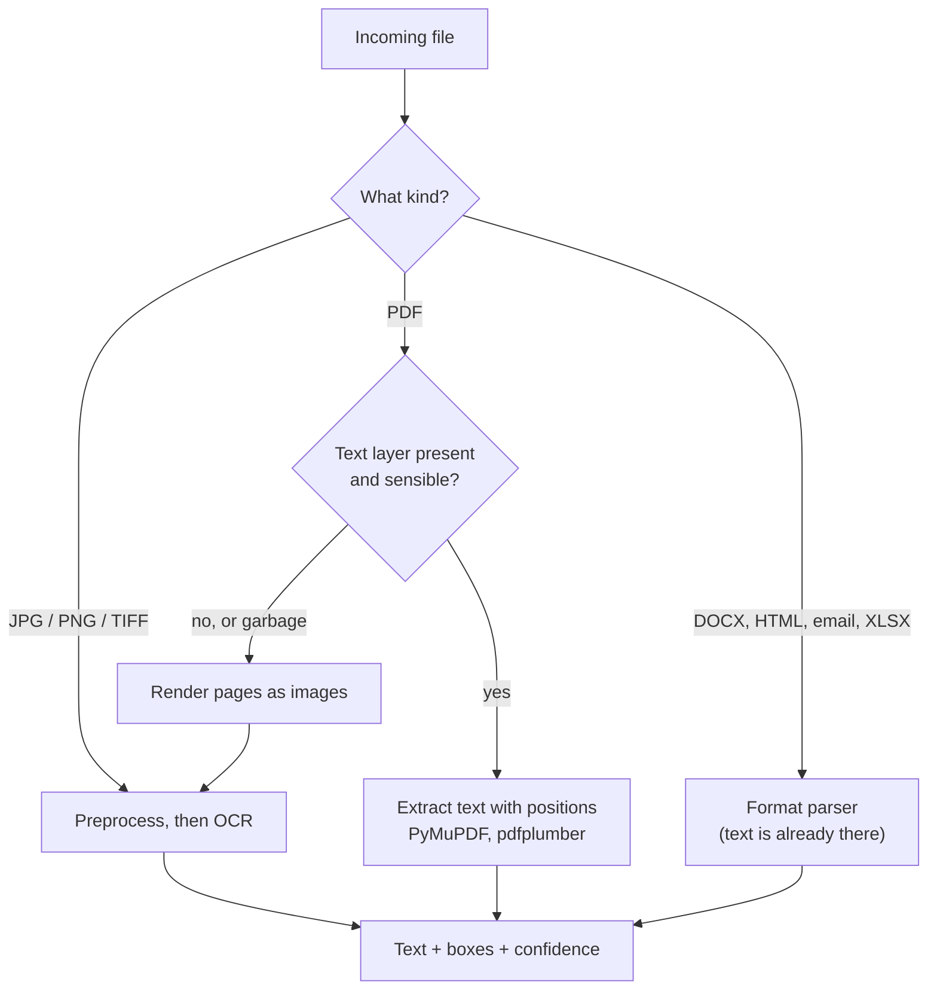
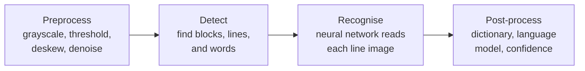

# From Documents to Data: OCR and Document Parsing: The Complete Guide

> 📚 **Before you start**
>
> - [Lab: Build a company knowledge graph in Neo4j](../04-neo4j-and-cypher/lab-build-a-company-knowledge-graph-in-neo4j.md), where data arrived as tidy CSV files. This module deals with data that doesn't.
> - NumPy arrays and pandas DataFrames: [Data Analysis and Visualisation with Python](../../data-analysis-and-visualisation-with-python/course.md).
> - Loading files into LangChain documents: [Retrieval-Augmented Generation (RAG) › RAG Building Blocks in LangChain](../../retrieval-augmented-generation-rag/course.md#m5).

## Introduction

In the last lab, Kiran Foods' suppliers arrived as a clean `suppliers.csv`. That file was a luxury. What actually lands in the accounts team's inbox every week is **the invoice pile**: PDFs exported from five different billing systems, scanned paper invoices, a phone photo of a bill taken on a delivery van's dashboard, and emails saying *"PFA invoice, amount Rs 24,780/-"*.

The supplier names are written three different ways. Amounts appear as `38,000.00`, `Rs. 12,000.00`, `₹1180` and `INR 1,34,400.00` (Indian digit grouping: one lakh thirty-four thousand four hundred). Dates are `12-08-2026`, `2026-08-20` and `3rd Sept 2026`. None of this is in a database, and none of it can go into the knowledge graph until it's turned into **structured data**: fields with names, types and values.

This module builds that conversion step by step. This first lesson covers the bottom layer: **getting text (and where it sits on the page) out of a document**. You'll learn how to tell a digital PDF from a scan, how OCR works inside, what its output looks like, how to fix its typical mistakes, which tools to use when, and how to measure how good it is.


*The whole module on one page. This lesson is the "Read" band; the next four lessons climb the rest.*

> 💡 **Key Insight**
>
> Never OCR a document that already has text. First ask **"is there a text layer?"**: digital PDFs give you exact text for free, and OCR is only for images. Then treat whatever text you get as **evidence with a confidence and a location**, not as truth, because every later step (extraction, validation, audits) needs to know how sure you were and where a value came from.

---

## Core Explanation

### 1. The invoice pile

Here are five invoices from the pile, as text. The first, second, fourth and fifth came from PDFs with a text layer; the third is what OCR produced from a scanned paper invoice. Look at the third one closely.

```python
INVOICES = {
"inv_01_deccan.pdf": """DECCAN MILLETS PVT. LTD.
Plot 14, IDA Uppal, Hyderabad, Telangana 500039
GSTIN: 36AABCD1234E1Z5
TAX INVOICE
Invoice No: DM/2026/0412            Date: 12-08-2026
Bill To: Kiran Foods Pvt Ltd, Hinjewadi, Pune, Maharashtra
Buyer GSTIN: 27AAKCK4321M1Z9
Sl  Description            HSN    Qty   Unit   Rate      Amount
1   Ragi flour (25 kg)     1102   40    bag    950.00    38,000.00
2   Jowar flour (25 kg)    1102   10    bag    880.00     8,800.00
                                         Taxable value    46,800.00
                                         IGST @ 5%         2,340.00
                                         Total (INR)      49,140.00
""",
"inv_02_nashik.pdf": """Nashik Agro Pack
MIDC Ambad, Nashik 422010, Maharashtra | GSTIN 27AAFCN3456H1Z1
INVOICE #NAP-2026-1187
Invoice date: 2026-08-20
Customer: Kiran Foods Pvt. Ltd., Pune
Item: Laminated snack pouches 200 g    Qty: 5,000   @ Rs. 2.40    Rs. 12,000.00
Item: Corrugated cartons 5-ply         Qty: 200     @ Rs. 45.00   Rs. 9,000.00
Sub-total: Rs. 21,000.00
CGST 9%: Rs. 1,890.00
SGST 9%: Rs. 1,890.00
Grand Total: Rs. 24,780.00
""",
"inv_03_malabar_scan.png": """MALABAR SPICE H0USE
Mattancherry, Kochi, Kerala   GSTIN 32AAGCM7890J1Z4
lnv # MSH-889      Dt. 3rd Sept 2026
To: Kiran Foods, Pune
Chai masala blend 10kg  x 6  @ %1,450  = %8,700
Black pepper 5kg  x 4  @ %3,100  = %12,400
Taxab1e value %21,100
IGST 5% %1,055
Tota1 %22,155
""",
"inv_04_deccan.pdf": """Deccan Millets Pvt Ltd
Hyderabad
GSTIN: 36AABCD1234E1Z5
Invoice No: DM/2026/0468   Date: 02-09-2026
Bill To: Kiran Foods Pvt Ltd, Pune
Ragi flour (25 kg) x 60 bags @ 950.00 = 57,000.00
IGST @ 5% = 2,850.00
Total (INR) 59,850.00
""",
"inv_05_saurashtra.pdf": """SAURASHTRA GROUNDNUT CO.
Gondal Road, Rajkot, Gujarat
GSTIN 24AAECS5678F1Z2
Bill No. SGC/889/26-27      Bill Date: 15/09/2026
Kiran Foods Private Limited, Pune
Bold groundnut kernels 50/60    1,200 kg  x  INR 112.00  =  INR 1,34,400.00
IGST 5%                                                     INR 6,720.00
Amount payable                                              INR 1,41,120/-
""",
}
for name, text in INVOICES.items():
    print(f"{name:<26} {len(text.splitlines()):>2} lines  first line: {text.splitlines()[0]!r}")
```

Output:

```
inv_01_deccan.pdf          13 lines  first line: 'DECCAN MILLETS PVT. LTD.'
inv_02_nashik.pdf          11 lines  first line: 'Nashik Agro Pack'
inv_03_malabar_scan.png     9 lines  first line: 'MALABAR SPICE H0USE'
inv_04_deccan.pdf           8 lines  first line: 'Deccan Millets Pvt Ltd'
inv_05_saurashtra.pdf       8 lines  first line: 'SAURASHTRA GROUNDNUT CO.'
```

The scan has classic OCR mistakes: `H0USE` (zero for the letter O), `lnv` (lower-case L for I), `Taxab1e` and `Tota1` (digit one for L), and the rupee sign `₹` read as `%` because the OCR model didn't know the symbol. We'll fix all of these in section 6. This pile is the running example for the whole module: by the lab at the end, it becomes clean, validated invoice records linked to resolved suppliers.

### 2. The first decision: does the file have a text layer?

A PDF is a container. A **born-digital** PDF (exported from billing software, Word or a browser) stores the actual characters and their positions: a **text layer**. A **scanned** PDF stores only pictures of pages. Some scanned PDFs have an invisible OCR text layer added by the scanner, which may be good or terrible.



The text-layer check is cheap: extract text from the first pages and see whether you get a reasonable number of real words per page. The library **PyMuPDF** (imported as `pymupdf`) does this quickly:

```python
# not-run: needs the pymupdf package and a PDF file
import pymupdf

doc = pymupdf.open("inv_01_deccan.pdf")
for page in doc:
    text = page.get_text()                          # the text layer, in reading order
    words = page.get_text("words")                  # (x0, y0, x1, y1, word, block, line, word_no)
    print(page.number, len(text.split()), "words; first box:", words[0][:5])
    if len(text.split()) < 20:
        print("  little or no text layer: send this page to OCR")
```

Example output:

```
0 68 words; first box: (36.0, 42.1, 102.7, 55.3, 'DECCAN')
```

Notice what you get: not just the text but a **bounding box** for each word (left, top, right, bottom in points). Boxes are how the next lesson rebuilds tables and forms.

Why this matters so much: text from a text layer is **exact**. OCR on the same page, even very good OCR, will occasionally turn `38,000.00` into `38,000.0O`. Running OCR on digital PDFs is the most common, most avoidable source of errors in document pipelines.

### 3. How OCR works inside

**OCR (optical character recognition)** turns pixels into characters. Modern engines run four stages:



Let's make the first two stages concrete with a tiny synthetic "scan": a grayscale image as a NumPy array, where ink is dark (low values), paper is light, and there's random noise from the scanner.

```python
import numpy as np

rng = np.random.default_rng(42)
page = np.full((40, 60), 210.0)                         # light grey paper
for top in (5, 17, 29):                                 # three "lines of text"
    for left in range(4, 56, 6):
        page[top:top + 6, left:left + 4] = 60           # dark letter blobs
page += rng.normal(0, 25, page.shape)                   # scanner noise
page = page.clip(0, 255)

def otsu_threshold(img):
    """Pick the threshold that best separates ink pixels from paper pixels."""
    hist, edges = np.histogram(img, bins=256, range=(0, 256))
    best_t, best_score = 0, -1.0
    total = img.size
    for t in range(1, 256):
        w0, w1 = hist[:t].sum() / total, hist[t:].sum() / total
        if w0 == 0 or w1 == 0:
            continue
        m0 = (hist[:t] * edges[:t]).sum() / hist[:t].sum()
        m1 = (hist[t:] * edges[t:256]).sum() / hist[t:].sum()
        score = w0 * w1 * (m0 - m1) ** 2                 # between-class variance
        if score > best_score:
            best_t, best_score = t, score
    return best_t

t = otsu_threshold(page)
ink = page < t                                           # binarised: True where there's ink
print("threshold:", t, "| ink pixels:", int(ink.sum()), "of", ink.size)
```

Output:

```
threshold: 134 | ink pixels: 650 of 2400
```

**Binarisation** turns the noisy grey image into clean black and white. Otsu's method (a classic from 1979, still used) picks the threshold that best separates the two groups of pixel brightness. Now **line detection** by a projection profile: count ink pixels in each row; rows with many are text, rows with almost none are gaps between lines.

```python
row_ink = ink.sum(axis=1)
is_text_row = row_ink > 5
lines, start = [], None
for y, text_row in enumerate(is_text_row):
    if text_row and start is None:
        start = y
    if not text_row and start is not None:
        lines.append((start, y - 1))
        start = None
print("text lines found at rows:", lines)
print("profile of first 12 rows:", row_ink[:12].tolist())
```

Output:

```
text lines found at rows: [(5, 10), (17, 22), (29, 34)]
profile of first 12 rows: [0, 0, 0, 0, 0, 36, 36, 36, 36, 36, 36, 0]
```

All three lines found at exactly the rows where we drew them. Real engines do the same in spirit with more sophisticated methods: they find text regions, split them into lines, and pass each line image to a **recognition model** (in Tesseract 4 and later an LSTM network; in newer engines, transformer models) that outputs a character sequence with a confidence. **Deskewing** (rotating a tilted scan so lines are horizontal) works with the same profile idea: try small rotation angles and keep the one whose row profile has the sharpest peaks.

Practical rules that improve OCR more than switching engines:

- Scan or render at about **300 DPI**. Lower loses detail in small digits; much higher just slows things down.
- **Crop and deskew** phone photos; shadows and perspective hurt badly.
- Tell the engine the **language and script** (Tesseract's `lang="eng+hin"` for an English and Hindi invoice).
- Tell it the **page layout** when you know it (Tesseract's `--psm` page segmentation modes, such as `--psm 6` for "a single uniform block of text").

### 4. What OCR output actually looks like

OCR engines give you more than a string. **Tesseract**, the long-standing open-source engine (used from Python through the `pytesseract` wrapper), can return one row per word with its box and a confidence from 0 to 100:

```python
# not-run: needs Tesseract installed, plus the pytesseract and Pillow packages
import pytesseract
from PIL import Image

img = Image.open("inv_03_malabar_scan.png")
print(pytesseract.image_to_string(img, lang="eng"))
tsv = pytesseract.image_to_data(img, lang="eng", config="--psm 6")   # tab-separated: one row per word
```

The TSV looks like this (a few rows from the Malabar scan):

```python
import io
import pandas as pd

TSV = """level\tpage_num\tblock_num\tpar_num\tline_num\tword_num\tleft\ttop\twidth\theight\tconf\ttext
5\t1\t1\t1\t1\t1\t212\t48\t188\t31\t93.1\tMALABAR
5\t1\t1\t1\t1\t2\t412\t48\t121\t31\t95.7\tSPICE
5\t1\t1\t1\t1\t3\t545\t48\t128\t31\t61.4\tH0USE
5\t1\t1\t1\t3\t1\t60\t160\t38\t26\t48.9\tlnv
5\t1\t1\t1\t3\t2\t106\t160\t14\t26\t90.2\t#
5\t1\t1\t1\t3\t3\t128\t160\t104\t26\t91.8\tMSH-889
5\t1\t1\t1\t9\t1\t60\t412\t71\t26\t55.0\tTota1
5\t1\t1\t1\t9\t2\t140\t412\t104\t26\t42.3\t%22,155
"""
words = pd.read_csv(io.StringIO(TSV), sep="\t")
print(words[["line_num", "left", "top", "conf", "text"]].to_string(index=False))
print("\nwords below 70% confidence:", words.loc[words.conf < 70, "text"].tolist())
```

Output:

```
 line_num  left  top  conf    text
        1   212   48  93.1 MALABAR
        1   412   48  95.7   SPICE
        1   545   48  61.4   H0USE
        3    60  160  48.9     lnv
        3   106  160  90.2       #
        3   128  160  91.8 MSH-889
        9    60  412  55.0   Tota1
        9   140  412  42.3 %22,155

words below 70% confidence: ['H0USE', 'lnv', 'Tota1', '%22,155']
```

The low-confidence words are exactly the wrong ones (`H0USE`, `lnv`, `Tota1`, `%22,155`). That's typical: **confidence is a good pointer to errors**, though not a perfect one, since engines are sometimes confidently wrong. Keep the confidence and the box with every value you extract; later steps use them to decide what needs a human look.

### 5. The tool landscape

| Tool | What it is | Good for |
|---|---|---|
| **PyMuPDF**, **pdfplumber** | Read a PDF's text layer with positions; pdfplumber also has table helpers | Born-digital PDFs: fast, exact, free |
| **Tesseract** | Classic open-source OCR engine, 100+ languages including Hindi, Tamil, Bengali and other Indic scripts | Clean scans, offline use, no per-page cost |
| **PaddleOCR**, **EasyOCR** | Open-source deep-learning OCR toolkits | Harder images, photos, multilingual text |
| **Docling** | Open-source document converter (from IBM Research) that combines layout analysis, OCR and table structure, exporting Markdown or JSON | Turning mixed PDFs into clean structured text for RAG and extraction |
| **Unstructured** | Open-source library that partitions documents into typed elements (Title, NarrativeText, Table, ...) | Many formats (PDF, DOCX, HTML, email) through one API |
| **Cloud document APIs**: AWS Textract, Google Document AI, Azure AI Document Intelligence | Managed OCR plus layout, tables, forms, and prebuilt invoice and receipt models | High volume, managed service, prebuilt field extraction |
| **Vision LLMs** (Claude and others) | Read page images or PDFs directly and answer in text or JSON | Messy layouts, handwriting, mixed content, few-shot flexibility |

Docling in a few lines:

```python
# not-run: needs the docling package (downloads layout models on first run)
from docling.document_converter import DocumentConverter

result = DocumentConverter().convert("inv_01_deccan.pdf")
print(result.document.export_to_markdown())
```

Example output:

```
DECCAN MILLETS PVT. LTD.

Plot 14, IDA Uppal, Hyderabad, Telangana 500039

GSTIN: 36AABCD1234E1Z5

## TAX INVOICE

Invoice No: DM/2026/0412 Date: 12-08-2026

| Sl | Description         | HSN  | Qty | Unit | Rate   | Amount    |
|----|---------------------|------|-----|------|--------|-----------|
| 1  | Ragi flour (25 kg)  | 1102 | 40  | bag  | 950.00 | 38,000.00 |
| 2  | Jowar flour (25 kg) | 1102 | 10  | bag  | 880.00 | 8,800.00  |
```

The table came out as a real Markdown table, which is far easier for an LLM (and for you) than space-aligned text. That's the job of the layout and table stage in the next lesson.

### 6. Fixing OCR mistakes with context

OCR errors follow patterns. Characters that look alike get swapped: `0`/`O`, `1`/`l`/`I`, `5`/`S`, `8`/`B`, and rare symbols like `₹` become common ones like `%` or `?`. The fix depends on **context**: inside a number, `O` must be `0`; inside a word, `0` must be `O`.

```python
import re

TO_DIGIT = str.maketrans({"O": "0", "o": "0", "l": "1", "I": "1", "S": "5", "B": "8"})
TO_LETTER = str.maketrans({"0": "O", "1": "l", "5": "S"})
KNOWN_WORDS = {"TOTAL", "TAXABLE", "VALUE", "INVOICE", "INV", "HOUSE", "SPICE", "IGST", "CGST", "SGST"}

def fix_token(tok):
    core = tok.strip(".,:")
    if re.fullmatch(r"%[\d,]+(\.\d+)?", core):                   # '%22,155' -> '₹22,155'
        return tok.replace("%", "₹", 1)
    digits = sum(ch.isdigit() for ch in core)
    letters = sum(ch.isalpha() for ch in core)
    if digits and letters and digits >= letters:                 # mostly digits: letters are misreads
        return tok.translate(TO_DIGIT)
    if letters and digits and letters > digits:                  # mostly letters: digits are misreads
        candidate = tok.translate(TO_LETTER)
        if candidate.upper().strip(".,:") in KNOWN_WORDS:
            return candidate
    if core.lower() == "lnv":                                    # a known OCR confusion for 'Inv'
        return tok.replace("lnv", "Inv")
    return tok

def fix_line(line):
    return " ".join(fix_token(t) for t in line.split())

for line in INVOICES["inv_03_malabar_scan.png"].splitlines():
    fixed = fix_line(line)
    if fixed != " ".join(line.split()):
        print(f"{line.strip():<45} -> {fixed}")
```

Output:

```
MALABAR SPICE H0USE                           -> MALABAR SPICE HOUSE
lnv # MSH-889      Dt. 3rd Sept 2026          -> Inv # M5H-889 Dt. 3rd Sept 2026
Chai masala blend 10kg  x 6  @ %1,450  = %8,700 -> Chai masala blend 10kg x 6 @ ₹1,450 = ₹8,700
Black pepper 5kg  x 4  @ %3,100  = %12,400    -> Black pepper 5kg x 4 @ ₹3,100 = ₹12,400
Taxab1e value %21,100                         -> Taxable value ₹21,100
IGST 5% %1,055                                -> IGST 5% ₹1,055
Tota1 %22,155                                 -> Total ₹22,155
```

Every real OCR error is fixed, but look at the second line: the invoice number `MSH-889` became `M5H-889`. The token has three letters and three digits, so the "mostly digits" rule fired and turned the `S` into a `5`. The rules were right for amounts and wrong for an identifier, and nothing in the output warns you. That is the nature of rule-based fixing: each rule helps somewhere and silently hurts somewhere else. You'll repair this one in exercise 1, and the next lessons go further: they hand messy text to an LLM with a schema, and then **verify the numbers** (line items must add up to the taxable value, and tax plus taxable value must equal the total).

### 7. Normalising amounts and dates

Even perfect text needs normalising before it becomes data. Indian invoices mix currency markers (`Rs.`, `₹`, `INR`), the Indian grouping (`1,34,400.00`), and trailing `/-` ("and no paise"). Dates come in many formats. Two small parsers handle the pile:

```python
from datetime import date, datetime
from decimal import Decimal

def parse_amount(text):
    """'Rs. 1,34,400.00', '₹1180', 'INR 1,41,120/-' -> Decimal."""
    cleaned = re.sub(r"(?i)(rs\.?|inr|₹|/-)", "", text).replace(",", "").strip()
    return Decimal(cleaned)

DATE_FORMATS = ["%d-%m-%Y", "%Y-%m-%d", "%d/%m/%Y", "%d %b %Y", "%d %B %Y"]

def parse_date(text):
    text = re.sub(r"(\d+)(st|nd|rd|th)", r"\1", text.strip())       # '3rd' -> '3'
    text = text.replace("Sept", "Sep")
    for fmt in DATE_FORMATS:
        try:
            return datetime.strptime(text, fmt).date()
        except ValueError:
            pass
    raise ValueError(f"unknown date format: {text!r}")

for raw in ["Rs. 12,000.00", "₹22,155", "INR 1,34,400.00", "INR 1,41,120/-", "49,140.00"]:
    print(f"{raw:<18} -> {parse_amount(raw)!r}")
for raw in ["12-08-2026", "2026-08-20", "3rd Sept 2026", "15/09/2026"]:
    print(f"{raw:<18} -> {parse_date(raw)}")
```

Output:

```
Rs. 12,000.00      -> Decimal('12000.00')
₹22,155            -> Decimal('22155')
INR 1,34,400.00    -> Decimal('134400.00')
INR 1,41,120/-     -> Decimal('141120')
49,140.00          -> Decimal('49140.00')
12-08-2026         -> 2026-08-12
2026-08-20         -> 2026-08-20
3rd Sept 2026      -> 2026-09-03
15/09/2026         -> 2026-09-15
```

Two habits worth copying: use **`Decimal`**, never `float`, for money (floats can't store 0.1 exactly, and accounts must reconcile to the paisa); and read `12-08-2026` as **day-month-year**, the Indian convention. An American system would read it as 8 December. Ambiguous dates are a real source of wrong records, so write the expected format into your schema.

### 8. Letting a vision LLM read the page

Vision-capable LLMs can read a PDF or image directly and return text, Markdown or JSON, handling odd layouts, stamps and handwriting that classic OCR struggles with. With the Anthropic API, a PDF goes in as a `document` content block:

```python
# not-run: needs the anthropic package, an API key and the PDF
import base64
import anthropic

client = anthropic.Anthropic()
pdf_b64 = base64.standard_b64encode(open("inv_03_malabar_scan.pdf", "rb").read()).decode()
response = client.messages.create(
    model="claude-opus-5-5",
    max_tokens=4000,
    messages=[{"role": "user", "content": [
        {"type": "document", "source": {"type": "base64", "media_type": "application/pdf", "data": pdf_b64}},
        {"type": "text", "text": "Transcribe this invoice exactly as Markdown. Keep every number as printed. "
                                 "Use a Markdown table for line items. Write [illegible] for anything you cannot read."},
    ]}],
)
print(next(b.text for b in response.content if b.type == "text"))
```

Example output:

```
**MALABAR SPICE HOUSE**
Mattancherry, Kochi, Kerala · GSTIN 32AAGCM7890J1Z4

Inv # MSH-889 · Dt. 3rd Sept 2026 · To: Kiran Foods, Pune

| Item | Qty | Rate | Amount |
|---|---|---|---|
| Chai masala blend 10kg | 6 | ₹1,450 | ₹8,700 |
| Black pepper 5kg | 4 | ₹3,100 | ₹12,400 |

Taxable value ₹21,100 · IGST 5% ₹1,055 · **Total ₹22,155**
```

The trade-offs against OCR:

| | Classic OCR (+ layout tools) | Vision LLM |
|---|---|---|
| Cost per page | Very low, can run offline | Higher, per-token pricing |
| Messy layouts, stamps, handwriting | Struggles | Usually much better |
| Word boxes and confidences | Yes | Not by default |
| Failure mode | Garbled characters (easy to spot) | **Fluent but wrong** text: it may "correct" a number that was printed differently |
| Determinism | Same output every run | Can vary between runs |

That last row is why the instruction says *"keep every number as printed"*, and why you should always **check the arithmetic** of LLM-read documents. Many production systems combine both: OCR or the text layer for exact characters and positions, and an LLM for understanding and extraction on top.

### 9. Measuring OCR quality

You can't improve what you don't measure. The standard metrics compare OCR output with a hand-typed **ground truth**:

- **CER (character error rate)**: the minimum number of character insertions, deletions and substitutions to turn the output into the truth (the **edit distance**), divided by the length of the truth.
- **WER (word error rate)**: the same, counting whole words.

```python
def edit_distance(a, b):
    prev = list(range(len(b) + 1))
    for i, ca in enumerate(a, 1):
        cur = [i]
        for j, cb in enumerate(b, 1):
            cur.append(min(prev[j] + 1,                  # delete
                           cur[j - 1] + 1,               # insert
                           prev[j - 1] + (ca != cb)))    # substitute (free if equal)
        prev = cur
    return prev[-1]

truth = "MALABAR SPICE HOUSE Inv # MSH-889 Total ₹22,155"
raw = "MALABAR SPICE H0USE lnv # MSH-889 Tota1 %22,155"
fixed = " ".join(fix_line(part) for part in raw.split(" "))
for label, text in [("raw OCR", raw), ("after fixes", fixed)]:
    cer = edit_distance(text, truth) / len(truth)
    wer = edit_distance(text.split(), truth.split()) / len(truth.split())
    print(f"{label:<12} CER {cer:.1%}  WER {wer:.1%}")
```

Output:

```
raw OCR      CER 8.5%  WER 50.0%
after fixes  CER 2.1%  WER 12.5%
```

A CER of 8.5% sounds small, but it broke half the words (and the remaining 12.5% after fixes is the `M5H-889` the rules themselves broke), and one wrong digit in an amount is a wrong payment. That's why the rest of this module adds layers of checks on top of OCR rather than trusting it. For extraction, the metric that matters most is **field accuracy**: did the invoice number, date, GSTIN and total come out exactly right? You'll measure that in the lab.

---

## Try It Yourself

1. **Repair the invoice number.** `fix_token` turned `MSH-889` into `M5H-889`. Change the "mostly digits" rule so it only fires when the result is a real number, then test it on `MSH-889`, `Tota1`, `Taxab1e`, `H0USE`, `%1,450` and an OCR'd amount like `38,0O0.00`.
2. **More amounts.** Parse `"Rs 2,40,000/-"`, `"₹ 950"` and `"INR 12.5 lakh"` with `parse_amount`. Which fails, and how would you support it?
3. **Ambiguous date.** What does `parse_date("04/05/2026")` return? Under what circumstances is that wrong, and how would you protect against it?

<details>
<summary>Show answers</summary>

**1.** Translate letters to digits only when the translated token is entirely digits, commas and a decimal point. An identifier like `MSH-889` then fails the test and is left alone.

```python
def fix_token(tok):
    core = tok.strip(".,:")
    if re.fullmatch(r"%[\d,]+(\.\d+)?", core):
        return tok.replace("%", "₹", 1)
    digits = sum(ch.isdigit() for ch in core)
    letters = sum(ch.isalpha() for ch in core)
    if digits and letters and digits >= letters:
        candidate = tok.translate(TO_DIGIT)
        if re.fullmatch(r"[\d,]+(\.\d+)?", candidate.strip(".,:")):   # only if it's now a number
            return candidate
        return tok
    if letters and digits and letters > digits:
        candidate = tok.translate(TO_LETTER)
        if candidate.upper().strip(".,:") in KNOWN_WORDS:
            return candidate
    if core.lower() == "lnv":
        return tok.replace("lnv", "Inv")
    return tok

tests = {"MSH-889": "MSH-889", "Tota1": "Total", "Taxab1e": "Taxable", "H0USE": "HOUSE",
         "%1,450": "₹1,450", "38,0O0.00": "38,000.00"}
for raw, want in tests.items():
    print(f"{raw:<10} -> {fix_token(raw):<10} {'ok' if fix_token(raw) == want else 'WRONG'}")
```

Output:

```
MSH-889    -> MSH-889    ok
Tota1      -> Total      ok
Taxab1e    -> Taxable    ok
H0USE      -> HOUSE      ok
%1,450     -> ₹1,450     ok
38,0O0.00  -> 38,000.00  ok
```

Keep a test table like this for every OCR rule you add; it's the only way to notice when a new rule breaks an old case.

**2.**

```python
for raw in ["Rs 2,40,000/-", "₹ 950"]:
    print(raw, "->", parse_amount(raw))
try:
    parse_amount("INR 12.5 lakh")
except Exception as err:
    print("INR 12.5 lakh -> fails:", type(err).__name__)
```

Output:

```
Rs 2,40,000/- -> 240000
₹ 950 -> 950
INR 12.5 lakh -> fails: InvalidOperation
```

Support words for Indian units: if the text ends in `lakh` multiply by 100,000; `crore` by 10,000,000.

**3.**

```python
print(parse_date("04/05/2026"))
```

Output:

```
2026-05-04
```

It's read as 4 May. That's right for an Indian supplier and wrong for a US one (April 5). Protect against it by recording the expected date format per supplier or per country, and by sanity checks: an invoice date should be close to the delivery date and not in the future.

</details>

---

## Real-World Examples

- **Accounts-payable automation** at Indian companies reads supplier invoices, matches them against purchase orders and goods receipts, and checks GSTINs against the GST portal before payment.
- **Banks and lenders** digitise KYC documents (PAN, Aadhaar, bank statements) and salary slips for loan processing, with human review for low-confidence fields.
- **Insurers** process claim forms, hospital bills and discharge summaries, often a mix of print, stamps and handwriting.
- **Government archives** OCR land records and gazettes in Indic scripts to make them searchable.
- **RAG pipelines** convert PDFs to Markdown with tools like Docling before chunking, because clean tables and headings make much better retrieval chunks.

---

## Common Misconceptions

### "OCR everything to be safe"

OCR on a born-digital PDF throws away exact text and adds errors. Check for a text layer first.

### "High OCR accuracy means the data is right"

A 98% character accuracy still breaks numbers. Validate the fields that matter (totals, tax, IDs) with arithmetic and format checks.

### "Vision LLMs make OCR obsolete"

They're excellent readers but cost more, don't give word boxes by default, and can produce fluent wrong text. Many pipelines use both.

### "Floats are fine for money"

They aren't exact. Use `Decimal` (or integer paise) for every amount you store or compare.

---

## Interview Relevance

Document AI questions often start with *"design a pipeline to extract data from invoices or KYC documents."* A strong answer starts with input triage (text layer vs scan vs photo), names the OCR stages (preprocessing, detection, recognition, post-processing) and tools (Tesseract, PaddleOCR, Docling, cloud document APIs, vision LLMs) with honest trade-offs, keeps confidences and bounding boxes for provenance, normalises amounts and dates (`Decimal`, locale-aware formats), measures quality with CER/WER and field-level accuracy, and routes low-confidence documents to human review.

---

## Key Takeaways

- **Triage first**: digital PDFs have an exact text layer; OCR only images.
- **OCR = preprocess, detect, recognise, post-process**; good scans (300 DPI, deskewed, right language) matter more than the engine.
- **Keep confidence and position** with every piece of text; low confidence points at errors.
- **Fix OCR with context and normalise values**: digits inside numbers, letters inside words, `Decimal` money, explicit date formats.
- **Vision LLMs** read hard documents well but can be fluently wrong, so verify arithmetic; measure everything with CER, WER and field accuracy.

---

**Up next:** [Extracting Tables, Forms and Layout](extracting-tables-forms-and-layout.md)
