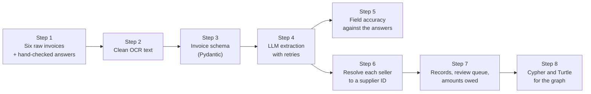

# Lab: Turn a pile of invoices into structured records

> 📚 **Before you start**
>
> This lab joins up the whole module, so have these open:
>
> - [From Documents to Data: OCR and Document Parsing](from-documents-to-data-ocr-and-document-parsing.md): the invoice pile, OCR fixes, `Decimal` money.
> - [Schema-Guided Extraction with Pydantic](schema-guided-extraction-with-pydantic.md): the `Invoice` model and the retry loop.
> - [Entity Resolution and Deduplication](entity-resolution-and-deduplication.md): PANs inside GSTINs and canonical supplier IDs.
> - [Entity and Relation Extraction with LLMs](entity-and-relation-extraction-with-llms.md): precision, recall and turning records into Cypher and Turtle.

## What You'll Build

Kiran Foods' accounts team wants one answer every Friday: **how much do we owe each supplier, and which invoices need a human to look at them?** Today that answer comes from someone typing invoices into a spreadsheet. You'll build the pipeline that produces it from six raw invoices: four born-digital PDFs, one OCR'd scan with errors, and one invoice whose own numbers don't add up.



At the end you'll have a table of validated records, a review queue with reasons, a per-supplier payable summary, a measured field accuracy, and graph-ready output.

> 💡 **Key Insight**
>
> A document pipeline is only as trustworthy as the evidence it keeps. Every record that leaves this lab says which file it came from, how many attempts it took, and which checks it passed; every record that *doesn't* leave says exactly why. And "it validated" is not the same as "it's right", which is why Step 5 measures accuracy against hand-checked answers.

---

## Step 1: The pile and the answer key

Six invoices as text. Five you've seen during the module; the sixth is a FrostLine Cold Chain invoice for refrigerated truck hire. The Malabar invoice is the raw OCR output, errors included.

```python
import json
import re
from collections import defaultdict
from datetime import date, datetime
from decimal import Decimal
from typing import Optional

import pandas as pd

PILE = {
"inv_01_deccan.pdf": """DECCAN MILLETS PVT. LTD.
GSTIN: 36AABCD1234E1Z5
Invoice No: DM/2026/0412            Date: 12-08-2026
Bill To: Kiran Foods Pvt Ltd, Pune  Buyer GSTIN: 27AAKCK4321M1Z9
1   Ragi flour (25 kg)     1102   40    bag    950.00    38,000.00
2   Jowar flour (25 kg)    1102   10    bag    880.00     8,800.00
                         Taxable value    46,800.00
                         IGST @ 5%         2,340.00
                         Total (INR)      49,140.00""",
"inv_02_nashik.pdf": """Nashik Agro Pack | GSTIN 27AAFCN3456H1Z1
INVOICE #NAP-2026-1187
Invoice date: 2026-08-20
Customer: Kiran Foods Pvt. Ltd., Pune  GSTIN 27AAKCK4321M1Z9
Item: Laminated snack pouches 200 g    Qty: 5,000   @ Rs. 2.40    Rs. 12,000.00
Item: Corrugated cartons 5-ply         Qty: 200     @ Rs. 45.00   Rs. 9,000.00
Sub-total: Rs. 21,000.00
CGST 9%: Rs. 1,890.00
SGST 9%: Rs. 1,890.00
Grand Total: Rs. 24,780.00""",
"inv_03_malabar_scan.png": """MALABAR SPICE H0USE
Mattancherry, Kochi, Kerala   GSTIN 32AAGCM7890J1Z4
lnv # MSH-889      Dt. 3rd Sept 2026
To: Kiran Foods, Pune
Chai masala blend 10kg  x 6  @ %1,450  = %8,700
Black pepper 5kg  x 4  @ %3,100  = %12,400
Taxab1e value %21,100
IGST 5% %1,055
Tota1 %22,155""",
"inv_04_deccan.pdf": """Deccan Millets Pvt Ltd
GSTIN: 36AABCD1234E1Z5
Invoice No: DM/2026/0468   Date: 02-09-2026
Bill To: Kiran Foods Pvt Ltd, Pune
Ragi flour (25 kg) x 60 bags @ 950.00 = 57,000.00
IGST @ 5% = 2,850.00
Total (INR) 59,850.00""",
"inv_05_saurashtra.pdf": """SAURASHTRA GROUNDNUT CO.
Gondal Road, Rajkot, Gujarat   GSTIN 24AAECS5678F1Z2
Bill No. SGC/889/26-27      Bill Date: 15/09/2026
Kiran Foods Private Limited, Pune
Bold groundnut kernels 50/60    1,200 kg  x  INR 112.00  =  INR 1,34,400.00
IGST 5%                                                     INR 6,720.00
Amount payable                                              INR 1,41,120/-""",
"inv_06_frostline.pdf": """FROSTLINE COLD CHAIN PVT LTD
Chakan MIDC, Pune   GSTIN 27AAHCF2345K1Z3
Invoice FCC/26/0931   Date 30-09-2026
To: Kiran Foods Pvt Ltd   GSTIN 27AAKCK4321M1Z9
Reefer truck hire Pune-Mumbai   4 trips  @ 6,500.00   26,000.00
CGST 9%   2,340.00
SGST 9%   2,340.00
TOTAL   31,680.00""",
}

# The answer key: typed in by a careful person from the actual documents.
ANSWERS = {
    "inv_01_deccan.pdf":       {"invoice_no": "DM/2026/0412",  "invoice_date": "2026-08-12", "seller_gstin": "36AABCD1234E1Z5", "total": "49140.00"},
    "inv_02_nashik.pdf":       {"invoice_no": "NAP-2026-1187", "invoice_date": "2026-08-20", "seller_gstin": "27AAFCN3456H1Z1", "total": "24780.00"},
    "inv_03_malabar_scan.png": {"invoice_no": "MSH-889",       "invoice_date": "2026-09-03", "seller_gstin": "32AAGCM7890J1Z4", "total": "22155"},
    "inv_04_deccan.pdf":       {"invoice_no": "DM/2026/0468",  "invoice_date": "2026-09-02", "seller_gstin": "36AABCD1234E1Z5", "total": "59850.00"},
    "inv_05_saurashtra.pdf":   {"invoice_no": "SGC/889/26-27", "invoice_date": "2026-09-15", "seller_gstin": "24AAECS5678F1Z2", "total": "141120"},
    "inv_06_frostline.pdf":    {"invoice_no": "FCC/26/0931",   "invoice_date": "2026-09-30", "seller_gstin": "27AAHCF2345K1Z3", "total": "31680.00"},
}
print(len(PILE), "invoices;", sum(len(t.splitlines()) for t in PILE.values()), "lines of text")
```

Output:

```
6 invoices; 50 lines of text
```

The answer key is the most important thing in this step. Without it you can tell whether records are *consistent*, but never whether they're *correct*. In a real project, a person labels 50 to 200 documents covering every supplier and layout before any prompt tuning starts.

Look at the FrostLine invoice before running anything: 26,000 + 2,340 + 2,340 is 30,680, but it says 31,680. The supplier made a mistake. The correct behaviour for the pipeline is to **refuse** to produce a record for it.

## Step 2: Clean the OCR text

Born-digital PDFs pass through untouched. The scan gets the context-aware OCR fixes from the first lesson of this module (the corrected version from its first exercise, which leaves identifiers like `MSH-889` alone):

```python
TO_DIGIT = str.maketrans({"O": "0", "o": "0", "l": "1", "I": "1", "S": "5", "B": "8"})
TO_LETTER = str.maketrans({"0": "O", "1": "l", "5": "S"})
KNOWN_WORDS = {"TOTAL", "TAXABLE", "VALUE", "INVOICE", "INV", "HOUSE", "SPICE", "IGST", "CGST", "SGST"}

def fix_token(tok):
    core = tok.strip(".,:")
    if re.fullmatch(r"%[\d,]+(\.\d+)?", core):
        return tok.replace("%", "₹", 1)
    digits = sum(ch.isdigit() for ch in core)
    letters = sum(ch.isalpha() for ch in core)
    if digits and letters and digits >= letters:
        candidate = tok.translate(TO_DIGIT)
        return candidate if re.fullmatch(r"[\d,]+(\.\d+)?", candidate.strip(".,:")) else tok
    if letters and digits and letters > digits:
        candidate = tok.translate(TO_LETTER)
        if candidate.upper().strip(".,:") in KNOWN_WORDS:
            return candidate
    if core.lower() == "lnv":
        return tok.replace("lnv", "Inv")
    return tok

def clean(name, text):
    if not name.endswith((".png", ".jpg")):
        return text                                   # text layer: exact, leave it alone
    return "\n".join(" ".join(fix_token(t) for t in line.split()) for line in text.splitlines())

CLEAN = {name: clean(name, text) for name, text in PILE.items()}
print(CLEAN["inv_03_malabar_scan.png"])
```

Output:

```
MALABAR SPICE HOUSE
Mattancherry, Kochi, Kerala GSTIN 32AAGCM7890J1Z4
Inv # MSH-889 Dt. 3rd Sept 2026
To: Kiran Foods, Pune
Chai masala blend 10kg x 6 @ ₹1,450 = ₹8,700
Black pepper 5kg x 4 @ ₹3,100 = ₹12,400
Taxable value ₹21,100
IGST 5% ₹1,055
Total ₹22,155
```

Every OCR error is fixed, and the invoice number survived. This is the text the model will read.

## Step 3: The schema

The `Invoice` model from the Pydantic lesson, unchanged in spirit: printed values in, Python checks the arithmetic and the GST type.

```python
from pydantic import BaseModel, Field, ValidationError, field_validator, model_validator

GSTIN_PATTERN = re.compile(r"^\d{2}[A-Z]{5}\d{4}[A-Z][1-9A-Z]Z[0-9A-Z]$")

class Party(BaseModel):
    name: str = Field(description="Business name exactly as printed")
    gstin: Optional[str] = Field(None, description="15-character GSTIN as printed, or null")

    @field_validator("gstin")
    @classmethod
    def gstin_format(cls, v):
        if v is not None and not GSTIN_PATTERN.match(v):
            raise ValueError(f"{v!r} is not a valid 15-character GSTIN")
        return v

class LineItem(BaseModel):
    description: str
    quantity: Decimal = Field(gt=0)
    unit: Optional[str] = None
    rate: Decimal = Field(ge=0)
    amount: Decimal

    @model_validator(mode="after")
    def amount_matches(self):
        if abs(self.quantity * self.rate - self.amount) > Decimal("0.01"):
            raise ValueError(f"{self.description}: {self.quantity} x {self.rate} != {self.amount}")
        return self

class Invoice(BaseModel):
    invoice_no: str = Field(description="Invoice number as printed, whatever the label")
    invoice_date: date = Field(description="YYYY-MM-DD. Printed dates are day-month-year.")
    seller: Party
    buyer: Party
    line_items: list[LineItem] = Field(min_length=1)
    taxable_value: Decimal
    cgst: Decimal = Decimal("0")
    sgst: Decimal = Decimal("0")
    igst: Decimal = Decimal("0")
    total: Decimal

    @field_validator("cgst", "sgst", "igst", mode="before")
    @classmethod
    def missing_tax_is_zero(cls, v):
        return Decimal("0") if v is None else v

    @model_validator(mode="after")
    def totals_and_gst(self):
        items = sum(i.amount for i in self.line_items)
        if items != self.taxable_value:
            raise ValueError(f"line items add up to {items}, but taxable_value is {self.taxable_value}")
        expected = self.taxable_value + self.cgst + self.sgst + self.igst
        if expected != self.total:
            raise ValueError(f"taxable_value + taxes = {expected}, but total is {self.total}")
        if self.seller.gstin and self.buyer.gstin:
            same_state = self.seller.gstin[:2] == self.buyer.gstin[:2]
            if same_state == bool(self.igst):
                raise ValueError("same-state sales take CGST + SGST; inter-state sales take IGST")
        return self

print(sorted(Invoice.model_json_schema()["required"]))
```

Output:

```
['buyer', 'invoice_date', 'invoice_no', 'line_items', 'seller', 'taxable_value', 'total']
```

## Step 4: Extract with retries

The pretend model below plays back, in order, the answers a real model gave across the whole run. Three things happen along the way, as they would in production: the Malabar total is misread on the first try, the Malabar *date* comes back with day and month swapped (and nothing complains), and the FrostLine invoice fails every attempt because the document itself is wrong.

```python
from langchain_core.language_models.fake_chat_models import FakeListChatModel

def answer(no, day, seller, sgstin, buyer, bgstin, items, taxable, total, cgst=None, sgst=None, igst=None):
    return json.dumps({
        "invoice_no": no, "invoice_date": day,
        "seller": {"name": seller, "gstin": sgstin}, "buyer": {"name": buyer, "gstin": bgstin},
        "line_items": [{"description": d, "quantity": q, "unit": u, "rate": r, "amount": a} for d, q, u, r, a in items],
        "taxable_value": taxable, "cgst": cgst, "sgst": sgst, "igst": igst, "total": total})

MALABAR_ITEMS = [("Chai masala blend 10kg", "6", None, "1450", "8700"), ("Black pepper 5kg", "4", None, "3100", "12400")]
FROSTLINE = ("FCC/26/0931", "2026-09-30", "FROSTLINE COLD CHAIN PVT LTD", "27AAHCF2345K1Z3", "Kiran Foods Pvt Ltd",
             "27AAKCK4321M1Z9", [("Reefer truck hire Pune-Mumbai", "4", "trips", "6500.00", "26000.00")], "26000.00", "31680.00")

SCRIPT = [
    answer("DM/2026/0412", "2026-08-12", "DECCAN MILLETS PVT. LTD.", "36AABCD1234E1Z5", "Kiran Foods Pvt Ltd", "27AAKCK4321M1Z9",
           [("Ragi flour (25 kg)", "40", "bag", "950.00", "38000.00"), ("Jowar flour (25 kg)", "10", "bag", "880.00", "8800.00")],
           "46800.00", "49140.00", igst="2340.00"),
    answer("NAP-2026-1187", "2026-08-20", "Nashik Agro Pack", "27AAFCN3456H1Z1", "Kiran Foods Pvt. Ltd.", "27AAKCK4321M1Z9",
           [("Laminated snack pouches 200 g", "5000", None, "2.40", "12000.00"), ("Corrugated cartons 5-ply", "200", None, "45.00", "9000.00")],
           "21000.00", "24780.00", cgst="1890.00", sgst="1890.00"),
    answer("MSH-889", "2026-03-09", "MALABAR SPICE HOUSE", "32AAGCM7890J1Z4", "Kiran Foods", None,
           MALABAR_ITEMS, "21100", "22515", igst="1055"),                   # total misread: 22515
    answer("MSH-889", "2026-03-09", "MALABAR SPICE HOUSE", "32AAGCM7890J1Z4", "Kiran Foods", None,
           MALABAR_ITEMS, "21100", "22155", igst="1055"),                   # fixed total, date still swapped
    answer("DM/2026/0468", "2026-09-02", "Deccan Millets Pvt Ltd", "36AABCD1234E1Z5", "Kiran Foods Pvt Ltd", None,
           [("Ragi flour (25 kg)", "60", "bags", "950.00", "57000.00")], "57000.00", "59850.00", igst="2850.00"),
    answer("SGC/889/26-27", "2026-09-15", "SAURASHTRA GROUNDNUT CO.", "24AAECS5678F1Z2", "Kiran Foods Private Limited", None,
           [("Bold groundnut kernels 50/60", "1200", "kg", "112.00", "134400.00")], "134400.00", "141120", igst="6720.00"),
] + [answer(*FROSTLINE, cgst="2340.00", sgst="2340.00")] * 3            # faithful to a wrong document, every time

llm = FakeListChatModel(responses=SCRIPT)

def build_prompt(text):
    return ("Extract this supplier invoice into JSON matching the schema. Copy numbers exactly as printed; "
            "do not calculate or correct anything. Use null for anything not printed.\n\n"
            f"Schema:\n{json.dumps(Invoice.model_json_schema())}\n\nInvoice:\n<<<\n{text}\n>>>")

def extract(text, max_attempts=3):
    messages = [("human", build_prompt(text))]
    for attempt in range(1, max_attempts + 1):
        reply = llm.invoke(messages)
        try:
            return Invoice.model_validate_json(reply.content), attempt, None
        except ValidationError as err:
            problem = "; ".join(e["msg"] for e in err.errors())
            messages += [("ai", reply.content),
                         ("human", f"Your JSON failed these checks: {problem}. Read the invoice again and return "
                                   "corrected JSON. Keep printed values even if the document does not add up.")]
    return None, max_attempts, problem

results = {}
for name, text in CLEAN.items():
    record, attempts, problem = extract(text)
    results[name] = {"record": record, "attempts": attempts, "problem": problem}
    status = "ok" if record else "REVIEW"
    print(f"{name:<24} {status:<6} attempts={attempts}  {problem or ''}".rstrip())
```

Output:

```
inv_01_deccan.pdf        ok     attempts=1
inv_02_nashik.pdf        ok     attempts=1
inv_03_malabar_scan.png  ok     attempts=2
inv_04_deccan.pdf        ok     attempts=1
inv_05_saurashtra.pdf    ok     attempts=1
inv_06_frostline.pdf     REVIEW attempts=3  Value error, taxable_value + taxes = 30680.00, but total is 31680.00
```

Five records validated, one needed a retry, and FrostLine went to review after three attempts with the reason attached. The model never "fixed" the FrostLine total, because the retry message told it not to, so a supplier's billing error can't turn into a made-up record.

## Step 5: Measure field accuracy

Now the answer key. For each validated record, compare four fields with what the person typed:

```python
def field_values(inv):
    return {"invoice_no": inv.invoice_no, "invoice_date": inv.invoice_date.isoformat(),
            "seller_gstin": inv.seller.gstin, "total": inv.total}

rows = []
for name, res in results.items():
    if res["record"] is None:
        continue
    got = field_values(res["record"])
    for field, truth in ANSWERS[name].items():
        ok = Decimal(truth) == got[field] if field == "total" else truth == got[field]
        rows.append({"file": name, "field": field, "correct": ok, "got": str(got[field]), "truth": truth})

acc = pd.DataFrame(rows)
print(acc.groupby("field")["correct"].mean().round(2).to_string())
print("\noverall field accuracy:", round(acc["correct"].mean(), 3))
print("\nwrong fields:")
print(acc[~acc["correct"]][["file", "field", "got", "truth"]].to_string(index=False))
```

Output:

```
field
invoice_date    0.8
invoice_no      1.0
seller_gstin    1.0
total           1.0

overall field accuracy: 0.95

wrong fields:
                   file        field        got      truth
inv_03_malabar_scan.png invoice_date 2026-03-09 2026-09-03
```

Every record passed every check, and one field is still wrong. The Malabar invoice says "3rd Sept 2026"; the model wrote `2026-03-09`, the American month-day reading of a day-month date. The date is a perfectly valid `date`, and no arithmetic involves it, so no validator could notice. Only the answer key did.

That's the lesson of this step: **validation measures consistency, accuracy needs ground truth**. The fix is a new check, which you'll add in the first exercise, plus a new labelled example for this kind of date in the test set.

## Step 6: Resolve each seller to a supplier

Each record names its seller in its own spelling. The supplier master from the entity resolution lesson gives every supplier a stable ID built from its PAN, and the PAN sits inside every GSTIN, so the strongest evidence comes first:

```python
MASTER = [  # canonical suppliers from the entity resolution lesson
    {"id": "SUP-AABCD1234E", "name": "Deccan Millets Pvt Ltd", "aliases": ["DECCAN MILLETS PVT. LTD.", "Deccan Millets"]},
    {"id": "SUP-AAECS5678F", "name": "Saurashtra Groundnut Company", "aliases": ["SAURASHTRA GROUNDNUT CO.", "Saurashtra Groundnut"]},
    {"id": "SUP-AAFCN3456H", "name": "Nashik Agro Pack", "aliases": []},
    {"id": "SUP-AAGCM7890J", "name": "Malabar Spice House", "aliases": ["MALABAR SPICE H0USE"]},
    {"id": "SUP-AAHCF2345K", "name": "Frostline Coldchain Pvt Ltd", "aliases": ["FrostLine Cold Chain"]},
]
BY_PAN = {s["id"].removeprefix("SUP-"): s for s in MASTER}

def resolve_seller(party):
    if party.gstin and party.gstin[2:12] in BY_PAN:
        return BY_PAN[party.gstin[2:12]]["id"], "PAN in GSTIN"
    return None, "unknown supplier: create a new one or review"

for name, res in results.items():
    if res["record"]:
        sid, how = resolve_seller(res["record"].seller)
        res["supplier_id"] = sid
        print(f"{res['record'].seller.name:<26} -> {sid}  ({how})")
```

Output:

```
DECCAN MILLETS PVT. LTD.   -> SUP-AABCD1234E  (PAN in GSTIN)
Nashik Agro Pack           -> SUP-AAFCN3456H  (PAN in GSTIN)
MALABAR SPICE HOUSE        -> SUP-AAGCM7890J  (PAN in GSTIN)
Deccan Millets Pvt Ltd     -> SUP-AABCD1234E  (PAN in GSTIN)
SAURASHTRA GROUNDNUT CO.   -> SUP-AAECS5678F  (PAN in GSTIN)
```

Two different spellings of Deccan Millets land on one ID, and "MALABAR SPICE HOUSE" (cleaned from the scan) needs no fuzzy matching at all. If an invoice arrived without a GSTIN, the name-based steps from the resolution lesson would take over, with the review queue for anything unclear.

## Step 7: Records, review queue and amounts owed

Now assemble what the accounts team actually asked for. Records carry their provenance (source file and attempts). The Malabar record goes to the review queue because of its date, and here we apply the correction the reviewer made, so it is counted with the right date.

```python
HELD = {"inv_03_malabar_scan.png": "date reads as 9 March; printed '3rd Sept 2026' (fixed by a reviewer)"}

records, review = [], []
for name, res in results.items():
    inv = res["record"]
    if inv is None:
        review.append({"file": name, "reason": res["problem"]})
        continue
    if name in HELD:
        review.append({"file": name, "reason": HELD[name]})
        inv = inv.model_copy(update={"invoice_date": date(2026, 9, 3)})      # the reviewer's correction
    records.append({"file": name, "supplier_id": res["supplier_id"], "invoice_no": inv.invoice_no,
                    "date": inv.invoice_date, "total": inv.total, "attempts": res["attempts"]})

table = pd.DataFrame(records)
print(table.to_string(index=False))
print("\nreview queue:")
for item in review:
    print(f"  {item['file']}: {item['reason']}")
```

Output:

```
                   file    supplier_id    invoice_no       date    total  attempts
      inv_01_deccan.pdf SUP-AABCD1234E  DM/2026/0412 2026-08-12 49140.00         1
      inv_02_nashik.pdf SUP-AAFCN3456H NAP-2026-1187 2026-08-20 24780.00         1
inv_03_malabar_scan.png SUP-AAGCM7890J       MSH-889 2026-09-03    22155         2
      inv_04_deccan.pdf SUP-AABCD1234E  DM/2026/0468 2026-09-02 59850.00         1
  inv_05_saurashtra.pdf SUP-AAECS5678F SGC/889/26-27 2026-09-15   141120         1

review queue:
  inv_03_malabar_scan.png: date reads as 9 March; printed '3rd Sept 2026' (fixed by a reviewer)
  inv_06_frostline.pdf: Value error, taxable_value + taxes = 30680.00, but total is 31680.00
```

And the Friday answer: how much is owed to each supplier, from the records that passed.

```python
owed = defaultdict(Decimal)
for r in records:
    owed[r["supplier_id"]] += r["total"]
names = {s["id"]: s["name"] for s in MASTER}
for sid, amount in sorted(owed.items(), key=lambda kv: -kv[1]):
    print(f"{names[sid]:<30} Rs {amount:>12,.2f}")
print(f"{'TOTAL':<30} Rs {sum(owed.values()):>12,.2f}")
print(f"\nheld for review: {len([i for i in review if i['file'] not in HELD])} invoice(s) not counted")
```

Output:

```
Saurashtra Groundnut Company   Rs   141,120.00
Deccan Millets Pvt Ltd         Rs   108,990.00
Nashik Agro Pack               Rs    24,780.00
Malabar Spice House            Rs    22,155.00
TOTAL                          Rs   297,045.00

held for review: 1 invoice(s) not counted
```

Deccan Millets' two invoices are added together because they resolved to one ID; with three spellings and no resolution, the summary would have split them. FrostLine's invoice isn't counted until a person sorts out the ₹1,000 discrepancy with the supplier. (Python prints the total with Western comma grouping; Indian formatting would write 2,97,045.00.)

## Step 8: Hand the records to the graph

Last, the records become graph data. The supplier ID is the `MERGE` key, so the invoice attaches to the existing supplier node from module 4 rather than creating a new one:

```python
params = [{"supplier_id": r["supplier_id"], "invoice_no": r["invoice_no"], "date": r["date"].isoformat(),
           "total": str(r["total"]), "source": r["file"]} for r in records]
print(json.dumps(params[0], indent=2))
```

Output:

```
{
  "supplier_id": "SUP-AABCD1234E",
  "invoice_no": "DM/2026/0412",
  "date": "2026-08-12",
  "total": "49140.00",
  "source": "inv_01_deccan.pdf"
}
```

```cypher
UNWIND $rows AS row
MATCH (s:Supplier {id: row.supplier_id})
MERGE (i:Invoice {number: row.invoice_no})
  SET i.date = date(row.date), i.total = toFloat(row.total), i.source = row.source
MERGE (s)-[:ISSUED]->(i)
```

The same records in Turtle, for an RDF store, with provenance kept as a property of the invoice:

```python
def invoice_turtle(r):
    iri = "kf:invoice_" + re.sub(r"[^A-Za-z0-9]+", "_", r["invoice_no"])
    return (f"{iri} a kf:Invoice ;\n"
            f"    kf:invoiceNumber \"{r['invoice_no']}\" ;\n"
            f"    kf:invoiceDate \"{r['date'].isoformat()}\"^^xsd:date ;\n"
            f"    kf:total \"{r['total']}\"^^xsd:decimal ;\n"
            f"    kf:issuedBy kf:{r['supplier_id']} ;\n"
            f"    kf:sourceFile \"{r['file']}\" .")

print("@prefix kf:  <https://kiranfoods.example/kg#> .")
print("@prefix xsd: <http://www.w3.org/2001/XMLSchema#> .\n")
print(invoice_turtle(records[2]))
```

Output:

```
@prefix kf:  <https://kiranfoods.example/kg#> .
@prefix xsd: <http://www.w3.org/2001/XMLSchema#> .

kf:invoice_MSH_889 a kf:Invoice ;
    kf:invoiceNumber "MSH-889" ;
    kf:invoiceDate "2026-09-03"^^xsd:date ;
    kf:total "22155"^^xsd:decimal ;
    kf:issuedBy kf:SUP-AAGCM7890J ;
    kf:sourceFile "inv_03_malabar_scan.png" .
```

Once these are loaded, questions that used to need a spreadsheet and a phone call become graph queries: which suppliers of the Millet Snacks Launch project have invoices waiting for review, or which project's suppliers we owe the most. That's the bridge to the last module, where agents ask those questions themselves.

### With real files and a real model

For the real pile, Step 2 reads the files (PyMuPDF for text layers, OCR for scans) and Step 4 calls a model. The structure stays the same:

```python
# not-run: needs pymupdf, anthropic, an API key and the invoice files
import pathlib
import anthropic
import pymupdf

client = anthropic.Anthropic()
for path in sorted(pathlib.Path("invoices").glob("*.pdf")):
    text = "\n".join(page.get_text() for page in pymupdf.open(path))
    response = client.messages.parse(
        model="claude-opus-5-5", max_tokens=4000,
        messages=[{"role": "user", "content": build_prompt(text)}],
        output_format=Invoice)
    print(path.name, response.parsed_output.invoice_no, response.parsed_output.total)
```

Example output:

```
inv_01_deccan.pdf DM/2026/0412 49140.00
inv_02_nashik.pdf NAP-2026-1187 24780.00
```

Wrap the call in the retry loop from Step 4, because `parse` raises a `ValidationError` when a business rule fails.

---

## Try It Yourself

1. **Catch swapped dates.** Add a check that flags a record when its invoice date is more than 60 days away from the date the file was received. Assume every invoice in this pile arrived on 2026-10-01. Which records does it flag?
2. **Per-supplier accuracy.** Using `acc` from Step 5, compute field accuracy per supplier file. Why is this breakdown more useful to the team than the overall number?
3. **A seventh invoice.** An invoice arrives from `Kutch Salt Works` with GSTIN `24AAKCK7777P1Z1`. What does `resolve_seller` return, and what should the pipeline do?

<details>
<summary>Show answers</summary>

**1.** A date far from the receipt date is suspicious: the swapped Malabar date (9 March) is about seven months early.

```python
RECEIVED = date(2026, 10, 1)
for name, res in results.items():
    if res["record"] and abs((RECEIVED - res["record"].invoice_date).days) > 60:
        print(name, res["record"].invoice_date, f"{(RECEIVED - res['record'].invoice_date).days} days before receipt")
```

Output:

```
inv_03_malabar_scan.png 2026-03-09 206 days before receipt
```

It flags exactly the wrong one. Plausibility checks like this (dates near receipt, amounts near a supplier's usual range) catch the errors that arithmetic can't.

**2.**

```python
print(acc.groupby("file")["correct"].mean().round(2).to_string())
```

Output:

```
file
inv_01_deccan.pdf          1.00
inv_02_nashik.pdf          1.00
inv_03_malabar_scan.png    0.75
inv_04_deccan.pdf          1.00
inv_05_saurashtra.pdf      1.00
```

The overall 95% hides that all errors come from one source type, the scan. That tells the team where to spend effort: better scanning or a vision model for scans, not a new prompt for everything.

**3.**

```python
kutch = Party(name="Kutch Salt Works", gstin="24AAKCK7777P1Z1")
print(resolve_seller(kutch))
```

Output:

```
(None, 'unknown supplier: create a new one or review')
```

The master in this step only has the five suppliers in the pile. The pipeline should run the entity resolution steps against the full supplier list (where Kutch Salt Works exists as `SUP-AAKCK7777P`) and only create a new supplier after review, otherwise the graph slowly fills with duplicates again.

</details>

---

## What You've Learned

- **The full document-to-data pipeline**: triage and OCR cleaning, a Pydantic schema, LLM extraction with capped retries, supplier resolution by PAN, and graph-ready output.
- **Two kinds of failure need two kinds of handling**: inconsistent records fail validation and go to review with a reason; consistent-but-wrong values are only found by measuring against an answer key.
- **Documents can be wrong, too**: the FrostLine invoice was correctly refused, not "fixed".
- **Resolution makes the numbers right**: two Deccan Millets spellings became one supplier, so the amount owed was one correct figure.
- **Provenance travels with every record** (file, attempts, review reason), all the way into Cypher and Turtle.

---

**Up next:** [Building a Knowledge Graph from Text with an LLM](../06-knowledge-graphs-for-ai-agents/building-a-knowledge-graph-from-text-with-an-llm.md)
