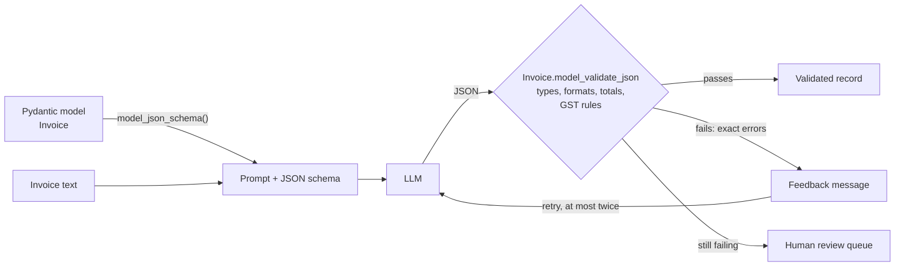
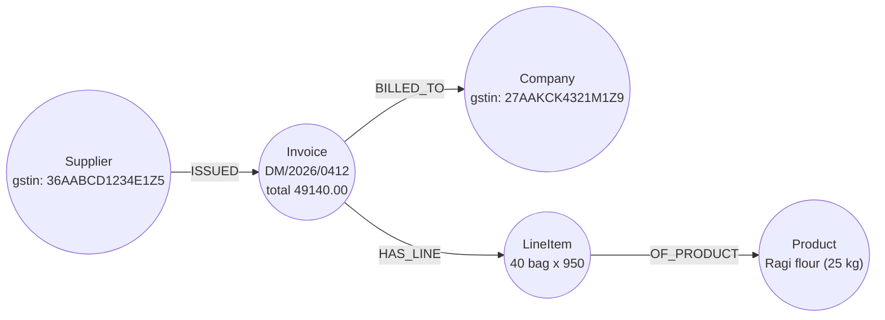

# Schema-Guided Extraction with Pydantic: The Complete Guide

> 📚 **Before you start**
>
> - [Entity and Relation Extraction with LLMs](entity-and-relation-extraction-with-llms.md): the extraction prompt, evidence checks and the `FakeListChatModel` used here.
> - [From Documents to Data: OCR and Document Parsing](from-documents-to-data-ocr-and-document-parsing.md): the invoice pile, `Decimal` for money and Indian date formats.
> - [Lab: Build a company knowledge graph in Neo4j](../04-neo4j-and-cypher/lab-build-a-company-knowledge-graph-in-neo4j.md): Pydantic models, `field_validator`, `model_validator` and the GSTIN state-code check.
> - [Structured JSON Output](../../generative-ai-and-llm-foundations/04-prompting-and-structured-output/structured-json-output.md): JSON schemas and constrained output.

## Introduction

Think of a GST return form. Every box has a label, a type (a date, an amount, a 15-character GSTIN) and rules (the tax must match the rate, the totals must add up). A clerk filling it in from a pile of bills can't write "approx. twenty-four thousand" in an amount box, and the portal rejects a return whose numbers don't reconcile.

The last lesson extracted loose facts (entities and relations) from emails. Invoices need something stricter: **one fixed record shape**, filled the same way whether the supplier printed `Bill No.`, `Inv #` or `INVOICE #`. That record is a **schema**, and in Python the natural way to write one is a **Pydantic model**. The same model does three jobs at once:

1. It tells the LLM **what to fill** (Pydantic turns it into a JSON schema with descriptions).
2. It **checks** what comes back: types, formats, and business rules like "line items add up to the taxable value".
3. It produces **error messages precise enough to send back to the model** for a second try.

By the end of this lesson you'll have an `Invoice` model for the invoice pile, a validated record for each invoice, a retry loop that fixes a misread total, and the rules for designing schemas that LLMs fill well.

> 💡 **Key Insight**
>
> Write the schema once and let it be the prompt, the parser and the auditor. Ask the model only for what is **printed** on the page; let Python **compute and compare** (sums, tax rules, state codes). When the comparison fails, send the exact error back once or twice, and if the document still doesn't add up, send it to a person instead of letting the model "fix" the numbers.

---

## Core Explanation

### 1. The record we want, shown first

Here is the Deccan Millets invoice from the pile, and the record it should become:

```text
DECCAN MILLETS PVT. LTD.                       GSTIN: 36AABCD1234E1Z5
Invoice No: DM/2026/0412            Date: 12-08-2026
Bill To: Kiran Foods Pvt Ltd, Pune  Buyer GSTIN: 27AAKCK4321M1Z9
1   Ragi flour (25 kg)     1102   40    bag    950.00    38,000.00
2   Jowar flour (25 kg)    1102   10    bag    880.00     8,800.00
                         Taxable value    46,800.00
                         IGST @ 5%         2,340.00
                         Total (INR)      49,140.00
```

```json
{
  "invoice_no": "DM/2026/0412",
  "invoice_date": "2026-08-12",
  "seller": {"name": "DECCAN MILLETS PVT. LTD.", "gstin": "36AABCD1234E1Z5"},
  "buyer":  {"name": "Kiran Foods Pvt Ltd", "gstin": "27AAKCK4321M1Z9"},
  "line_items": [
    {"description": "Ragi flour (25 kg)",  "quantity": 40, "unit": "bag", "rate": 950.00, "amount": 38000.00},
    {"description": "Jowar flour (25 kg)", "quantity": 10, "unit": "bag", "rate": 880.00, "amount": 8800.00}
  ],
  "taxable_value": 46800.00,
  "cgst": 0, "sgst": 0, "igst": 2340.00,
  "total": 49140.00
}
```

Every invoice in the pile, from any supplier, should come out in exactly this shape. The rest of the lesson builds the model that defines it, fills it and checks it.



### 2. The schema as Pydantic models

Three models, nested: a `Party` (seller or buyer), a `LineItem`, and the `Invoice` that holds them. Read the `Field(description=...)` texts carefully: they're written for the LLM, because they end up in the schema it receives.

```python
import json
import re
from datetime import date, datetime
from decimal import Decimal
from typing import Optional

from pydantic import BaseModel, Field, ValidationError, field_validator, model_validator

GSTIN_PATTERN = re.compile(r"^\d{2}[A-Z]{5}\d{4}[A-Z][1-9A-Z]Z[0-9A-Z]$")
STATE_CODES = {"24": "Gujarat", "27": "Maharashtra", "32": "Kerala", "36": "Telangana"}

class Party(BaseModel):
    name: str = Field(description="Business name exactly as printed")
    gstin: Optional[str] = Field(None, description="15-character GSTIN as printed, or null if none is printed")

    @field_validator("gstin")
    @classmethod
    def gstin_format(cls, v):
        if v is None:
            return v
        v = v.replace(" ", "").upper()
        if not GSTIN_PATTERN.match(v):
            raise ValueError(f"{v!r} is not a valid 15-character GSTIN")
        return v

class LineItem(BaseModel):
    description: str = Field(description="Item description as printed")
    quantity: Decimal = Field(gt=0, description="Quantity as printed, without the unit")
    unit: Optional[str] = Field(None, description="Unit such as bag, kg or pcs, or null")
    rate: Decimal = Field(ge=0, description="Price per unit in rupees, as printed")
    amount: Decimal = Field(description="Line amount in rupees, as printed")

    @model_validator(mode="after")
    def amount_matches(self):
        if abs(self.quantity * self.rate - self.amount) > Decimal("0.01"):
            raise ValueError(f"{self.description}: {self.quantity} x {self.rate} = "
                             f"{self.quantity * self.rate}, but the amount says {self.amount}")
        return self

class Invoice(BaseModel):
    invoice_no: str = Field(description="Invoice number as printed, whatever the label (Bill No., Inv #, ...)")
    invoice_date: date = Field(description="Invoice date as YYYY-MM-DD. Printed dates are day-month-year.")
    seller: Party
    buyer: Party
    line_items: list[LineItem] = Field(min_length=1)
    taxable_value: Decimal = Field(description="Total before tax, as printed")
    cgst: Decimal = Field(Decimal("0"), description="CGST amount, 0 if not charged")
    sgst: Decimal = Field(Decimal("0"), description="SGST amount, 0 if not charged")
    igst: Decimal = Field(Decimal("0"), description="IGST amount, 0 if not charged")
    total: Decimal = Field(description="Grand total payable, as printed")

    @field_validator("invoice_date", mode="before")
    @classmethod
    def day_month_year(cls, v):
        if isinstance(v, str) and re.fullmatch(r"\d{2}[-/]\d{2}[-/]\d{4}", v):
            return datetime.strptime(v.replace("/", "-"), "%d-%m-%Y").date()
        return v

    @field_validator("cgst", "sgst", "igst", mode="before")
    @classmethod
    def missing_tax_is_zero(cls, v):
        return Decimal("0") if v is None else v

    @model_validator(mode="after")
    def totals_and_gst_rules(self):
        items = sum(item.amount for item in self.line_items)
        if items != self.taxable_value:
            raise ValueError(f"line items add up to {items}, but taxable_value is {self.taxable_value}")
        expected = self.taxable_value + self.cgst + self.sgst + self.igst
        if expected != self.total:
            raise ValueError(f"taxable_value + taxes = {expected}, but total is {self.total}")
        if self.seller.gstin and self.buyer.gstin:
            same_state = self.seller.gstin[:2] == self.buyer.gstin[:2]
            if same_state and self.igst:
                raise ValueError("seller and buyer are in the same state, so the tax must be CGST + SGST, not IGST")
            if not same_state and (self.cgst or self.sgst):
                raise ValueError("seller and buyer are in different states, so the tax must be IGST")
        return self

print("Invoice fields:", list(Invoice.model_fields))
```

Output:

```
Invoice fields: ['invoice_no', 'invoice_date', 'seller', 'buyer', 'line_items', 'taxable_value', 'cgst', 'sgst', 'igst', 'total']
```

The checks come in three layers, from cheap to clever:

| Layer | Example in the model | Catches |
|---|---|---|
| **Types** | `invoice_date: date`, `quantity: Decimal` | "twelfth August", "forty" |
| **Formats and ranges** | GSTIN regex, `gt=0`, `min_length=1` | a 14-character GSTIN, a zero quantity, an invoice with no lines |
| **Business rules** (`model_validator`) | items sum to taxable value; taxes sum to total; same-state means CGST + SGST | a misread digit, a skipped line, the wrong tax type |

The last rule is Indian GST law in three lines: a sale within one state is taxed as CGST plus SGST, a sale across states as IGST. The first two digits of a GSTIN are the state code, which you met in the module 4 lab, so the model can check the tax type without being told where anyone is.

### 3. What the LLM sees: the JSON schema

Pydantic turns the model into a **JSON schema**, the standard format LLM APIs accept. Here is the part for one line item:

```python
schema = Invoice.model_json_schema()
print(json.dumps(schema["$defs"]["LineItem"]["properties"]["quantity"], indent=2))
print("required in LineItem:", schema["$defs"]["LineItem"]["required"])
print("required in Invoice:", schema["required"])
```

Output:

```
{
  "anyOf": [
    {
      "exclusiveMinimum": 0.0,
      "type": "number"
    },
    {
      "pattern": "^(?!^[-+.]*$)[+-]?0*\\d*\\.?\\d*$",
      "type": "string"
    }
  ],
  "description": "Quantity as printed, without the unit",
  "title": "Quantity"
}
required in LineItem: ['description', 'quantity', 'rate', 'amount']
required in Invoice: ['invoice_no', 'invoice_date', 'seller', 'buyer', 'line_items', 'taxable_value', 'total']
```

Three things to notice:

- Your **descriptions travel with the schema**. "Quantity as printed, without the unit" is now an instruction to the model, attached to exactly the field it's about. This is the best place for field-level guidance, much better than a long paragraph at the top of the prompt.
- `Decimal` becomes "a number, or a string that looks like a number" (the `pattern`). Pydantic accepts both and converts either to an exact `Decimal`.
- Fields with defaults (`unit`, `cgst`, ...) aren't required, so the model can leave them out instead of inventing a value.

The prompt itself can now be short, because the schema carries the detail:

```python
def build_prompt(text):
    return ("Extract this supplier invoice into JSON that matches the schema. "
            "Copy numbers exactly as printed; do not calculate or correct anything. "
            "Use null for anything not printed.\n\n"
            f"Schema:\n{json.dumps(Invoice.model_json_schema())}\n\n"
            f"Invoice:\n<<<\n{text}\n>>>")

print(len(build_prompt("...")), "characters of prompt, almost all of it schema")
```

Output:

```
3122 characters of prompt, almost all of it schema
```

"Do not calculate or correct anything" matters. If the model computes the total itself, your total check compares the model with itself and can never fail. If it copies what's printed, the check compares the **document** with **arithmetic**, which is the whole point.

### 4. Validating a good extraction

The pretend model returns, for the Deccan invoice, the JSON a real model gave:

```python
from langchain_core.language_models.fake_chat_models import FakeListChatModel

INVOICES = {
"inv_01_deccan.pdf": """DECCAN MILLETS PVT. LTD.
GSTIN: 36AABCD1234E1Z5
Invoice No: DM/2026/0412            Date: 12-08-2026
Bill To: Kiran Foods Pvt Ltd, Pune  Buyer GSTIN: 27AAKCK4321M1Z9
1   Ragi flour (25 kg)     1102   40    bag    950.00    38,000.00
2   Jowar flour (25 kg)    1102   10    bag    880.00     8,800.00
                         Taxable value    46,800.00
                         IGST @ 5%         2,340.00
                         Total (INR)      49,140.00""",
"inv_02_nashik.pdf": """Nashik Agro Pack
MIDC Ambad, Nashik 422010, Maharashtra | GSTIN 27AAFCN3456H1Z1
INVOICE #NAP-2026-1187
Invoice date: 2026-08-20
Customer: Kiran Foods Pvt. Ltd., Pune  GSTIN 27AAKCK4321M1Z9
Item: Laminated snack pouches 200 g    Qty: 5,000   @ Rs. 2.40    Rs. 12,000.00
Item: Corrugated cartons 5-ply         Qty: 200     @ Rs. 45.00   Rs. 9,000.00
Sub-total: Rs. 21,000.00
CGST 9%: Rs. 1,890.00
SGST 9%: Rs. 1,890.00
Grand Total: Rs. 24,780.00""",
}

DECCAN_JSON = json.dumps({
    "invoice_no": "DM/2026/0412", "invoice_date": "2026-08-12",
    "seller": {"name": "DECCAN MILLETS PVT. LTD.", "gstin": "36AABCD1234E1Z5"},
    "buyer": {"name": "Kiran Foods Pvt Ltd", "gstin": "27AAKCK4321M1Z9"},
    "line_items": [
        {"description": "Ragi flour (25 kg)", "quantity": 40, "unit": "bag", "rate": "950.00", "amount": "38000.00"},
        {"description": "Jowar flour (25 kg)", "quantity": 10, "unit": "bag", "rate": "880.00", "amount": "8800.00"}],
    "taxable_value": "46800.00", "igst": "2340.00", "total": "49140.00"})

llm = FakeListChatModel(responses=[DECCAN_JSON])
reply = llm.invoke(build_prompt(INVOICES["inv_01_deccan.pdf"]))
deccan = Invoice.model_validate_json(reply.content)

print(type(deccan).__name__, deccan.invoice_no, deccan.invoice_date, repr(deccan.invoice_date))
print("seller state:", STATE_CODES[deccan.seller.gstin[:2]], "| buyer state:", STATE_CODES[deccan.buyer.gstin[:2]])
for item in deccan.line_items:
    print(f"  {item.description:<20} {item.quantity:>3} x {item.rate} = {item.amount}")
print("total:", deccan.total, "| IGST:", deccan.igst, "| CGST:", deccan.cgst)
```

Output:

```
Invoice DM/2026/0412 2026-08-12 datetime.date(2026, 8, 12)
seller state: Telangana | buyer state: Maharashtra
  Ragi flour (25 kg)    40 x 950.00 = 38000.00
  Jowar flour (25 kg)   10 x 880.00 = 8800.00
total: 49140.00 | IGST: 2340.00 | CGST: 0
```

Every value now has a real type: `invoice_date` is a `date` you can compare and sort, amounts are exact `Decimal`s, and `cgst` defaulted to zero because the model left it out. All the checks ran during `model_validate_json` and passed: 40 × 950 = 38,000; the lines add up to 46,800; 46,800 + 2,340 = 49,140; Telangana to Maharashtra is inter-state, so IGST is right.

### 5. When extraction goes wrong: reading the errors

The Nashik invoice is trickier: the amounts sit after `@ Rs.` and `Rs.`, and the totals block has two taxes. Here is a first answer from the model with a typical mistake in it. Read the error output closely:

```python
NASHIK_FIRST = {
    "invoice_no": "NAP-2026-1187", "invoice_date": "2026-08-20",
    "seller": {"name": "Nashik Agro Pack", "gstin": "27AAFCN3456H1Z1"},
    "buyer": {"name": "Kiran Foods Pvt. Ltd.", "gstin": "27AAKCK4321M1Z9"},
    "line_items": [
        {"description": "Laminated snack pouches 200 g", "quantity": "5000", "unit": None, "rate": "2.40", "amount": "12000.00"},
        {"description": "Corrugated cartons 5-ply", "quantity": "200", "unit": None, "rate": "45.00", "amount": "9000.00"}],
    "taxable_value": "21000.00", "cgst": "1890.00", "sgst": None, "total": "24780.00"}

try:
    Invoice.model_validate_json(json.dumps(NASHIK_FIRST))
except ValidationError as err:
    for e in err.errors():
        print("location:", e["loc"] or "(whole invoice)")
        print("message: ", e["msg"])
```

Output:

```
location: (whole invoice)
message:  Value error, taxable_value + taxes = 22890.00, but total is 24780.00
```

The model dropped the SGST line (it returned `null`, which became 0), so 21,000 + 1,890 = 22,890 falls short of the printed 24,780. The error doesn't just say "invalid"; it says which sum failed and what the two sides were. That message is precise enough to hand straight back to the model.

### 6. The retry loop: send the errors back

A retry sends the conversation so far plus the error messages, and asks the model to look at the document again. With LangChain messages, it's a list of `(role, text)` pairs:

```python
def feedback_for(err):
    lines = []
    for e in err.errors():
        where = ".".join(str(part) for part in e["loc"]) or "invoice"
        lines.append(f"- {where}: {e['msg']}")
    return "\n".join(lines)

def extract_invoice(text, llm, max_attempts=3):
    messages = [("human", build_prompt(text))]
    for attempt in range(1, max_attempts + 1):
        reply = llm.invoke(messages)
        try:
            return Invoice.model_validate_json(reply.content), attempt, None
        except ValidationError as err:
            feedback = feedback_for(err)
            print(f"attempt {attempt} failed:\n{feedback}")
            messages += [("ai", reply.content),
                         ("human", "Your JSON failed these checks:\n" + feedback +
                          "\nRead the invoice again and return corrected JSON. Copy printed numbers exactly; "
                          "if the document itself does not add up, keep the printed values.")]
    return None, max_attempts, feedback

NASHIK_FIXED = dict(NASHIK_FIRST, sgst="1890.00")
llm = FakeListChatModel(responses=[json.dumps(NASHIK_FIRST), json.dumps(NASHIK_FIXED)])
nashik, attempts, problem = extract_invoice(INVOICES["inv_02_nashik.pdf"], llm)
print(f"\nvalid after {attempts} attempts: {nashik.invoice_no}, CGST {nashik.cgst} + SGST {nashik.sgst}, total {nashik.total}")
```

Output:

```
attempt 1 failed:
- invoice: Value error, taxable_value + taxes = 22890.00, but total is 24780.00

valid after 2 attempts: NAP-2026-1187, CGST 1890.00 + SGST 1890.00, total 24780.00
```

One retry, and the record is complete and consistent. Three rules keep this loop honest:

1. **Cap the attempts** (two or three). Each retry costs a full model call, and a model that failed twice rarely succeeds on the fifth try.
2. **Tell the model to keep printed values.** Sometimes the *document* is wrong: suppliers do send invoices whose lines don't add up. If you only say "make the totals match", a helpful model will quietly change a printed number to pass your check, and you've turned a supplier's mistake into a fabricated record. The instruction "if the document itself does not add up, keep the printed values" means a wrong document fails every attempt, which is what you want.
3. **Route final failures to a person** with the error message attached. That's what the third return value is for.

### 7. Designing schemas that LLMs fill well

Schema design changes extraction quality as much as the choice of model. Guidelines from practice:

| Do | Why |
|---|---|
| **Make a field optional when it may be missing** (`Optional[...] = None`) | A required field pressures the model to invent a value; `null` is an honest answer |
| **Write a description on every non-obvious field** | It's field-level prompt text, read exactly where it's needed |
| **Ask for printed values, compute in code** | Keeps your validators meaningful (section 3) |
| **Use enums for closed sets** (`Literal["bag", "kg", "pcs"]`) | Constrained output can enforce them; free text drifts ("Bags", "bg") |
| **Name fields in plain domain words** (`invoice_no`, not `f7`) | The model uses names as hints |
| **Keep nesting shallow and natural** | Invoice → line items is natural; five levels deep is not |
| **Add an evidence or raw-text field where audits matter** (`total_as_printed: "Rs. 24,780.00"`) | Lets a reviewer see what the model read |

| Avoid | Why |
|---|---|
| Asking for derived judgements in the same call ("is this invoice suspicious?") | Mixes reading with reasoning; do it in a separate step |
| One giant schema for every document type | Detect the document type first, then use the right schema |
| Trusting a field because it validated | Validation catches inconsistency, not every wrong value; measure field accuracy on a labelled sample, as in the lab |

#### Confidence without confidences

LLMs don't return a reliable confidence per field. Practical substitutes:

- **Checks passed**: a record that passed every business rule on the first try is more trustworthy than one that needed two retries.
- **Agreement**: extract twice (or with two models) and compare field by field; disagreement marks a field for review.
- **OCR confidence**: carry the OCR engine's word confidences from the first lesson of this module alongside the values that came from those words.

### 8. With a real model

The Anthropic Python SDK accepts the Pydantic model directly and returns a validated instance, as you saw in the structured output lesson:

```python
# not-run: needs the anthropic package and an API key
import anthropic

client = anthropic.Anthropic()
response = client.messages.parse(
    model="claude-opus-5-5",
    max_tokens=4000,
    messages=[{"role": "user", "content": "Extract this supplier invoice. Copy numbers exactly as printed.\n\n"
                                          + INVOICES["inv_02_nashik.pdf"]}],
    output_format=Invoice,
)
invoice = response.parsed_output        # an Invoice instance, already validated
print(invoice.invoice_no, invoice.total)
```

Example output:

```
NAP-2026-1187 24780.00
```

LangChain offers the same through `with_structured_output`, which works across model providers:

```python
# not-run: needs the langchain-anthropic package and an API key
from langchain_anthropic import ChatAnthropic

extractor = ChatAnthropic(model="claude-opus-5-5").with_structured_output(Invoice)
invoice = extractor.invoke("Extract this supplier invoice. Copy numbers exactly as printed.\n\n"
                           + INVOICES["inv_02_nashik.pdf"])
```

Two cautions. Constrained decoding guarantees the *shape* of the JSON, but some schema features (such as numeric minimums) aren't enforced by the API and are checked afterwards by Pydantic, and business rules in `model_validator` always run only in your code. So a parse can still raise `ValidationError`, and the retry loop from section 6 is still needed around it.

### 9. From a validated record to the graph

A validated `Invoice` maps cleanly onto graph nodes and relationships. The GSTIN is the natural key for a supplier, because it's unique and printed on every invoice, unlike the name:



```python
record = deccan.model_dump(mode="json")          # plain JSON types: dates and Decimals become strings
print(json.dumps({k: record[k] for k in ["invoice_no", "invoice_date", "total"]}))
print(json.dumps(record["line_items"][0]))
```

Output:

```
{"invoice_no": "DM/2026/0412", "invoice_date": "2026-08-12", "total": "49140.00"}
{"description": "Ragi flour (25 kg)", "quantity": "40", "unit": "bag", "rate": "950.00", "amount": "38000.00"}
```

That dictionary is what you'd pass as a parameter to a Cypher load query, the same `UNWIND` plus `MERGE` pattern as the module 4 lab:

```cypher
MERGE (s:Supplier {gstin: $rec.seller.gstin})
  ON CREATE SET s.name = $rec.seller.name
MERGE (i:Invoice {number: $rec.invoice_no})
  SET i.date = date($rec.invoice_date), i.total = toFloat($rec.total)
MERGE (s)-[:ISSUED]->(i)
WITH i
UNWIND $rec.line_items AS line
MERGE (p:Product {name: line.description})
CREATE (i)-[:HAS_LINE {quantity: toFloat(line.quantity), rate: toFloat(line.rate)}]->(p)
```

One problem remains, and it's visible right in this query: `MERGE (p:Product {name: line.description})` will create one product called "Ragi flour (25 kg)" and, from the next invoice, another called "Ragi flour 25kg". The same goes for suppliers without a GSTIN on the page. Deciding which names mean the same thing is the next lesson.

---

## Try It Yourself

1. **A wrong tax type.** Change the Deccan record so the tax is split as CGST 1,170 and SGST 1,170 instead of IGST 2,340. Which check fails, and what does the message say?
2. **A bad GSTIN.** OCR read the seller GSTIN as `36AABCD1234E1Z` (one character short). What error do you get, and at which location?
3. **Supplier's own mistake.** A supplier's invoice prints line items 12,000 and 9,000 but a sub-total of 22,000. Simulate a model that copies the printed numbers faithfully on all three attempts. What does `extract_invoice` return?

<details>
<summary>Show answers</summary>

**1.** The totals still add up, so the GST rule fires: Telangana (36) to Maharashtra (27) is inter-state.

```python
wrong_tax = dict(json.loads(DECCAN_JSON), igst="0", cgst="1170.00", sgst="1170.00")
try:
    Invoice.model_validate(wrong_tax)
except ValidationError as err:
    print(err.errors()[0]["msg"])
```

Output:

```
Value error, seller and buyer are in different states, so the tax must be IGST
```

**2.**

```python
short = json.loads(DECCAN_JSON)
short["seller"]["gstin"] = "36AABCD1234E1Z"
try:
    Invoice.model_validate(short)
except ValidationError as err:
    print(err.errors()[0]["loc"], "->", err.errors()[0]["msg"])
```

Output:

```
('seller', 'gstin') -> Value error, '36AABCD1234E1Z' is not a valid 15-character GSTIN
```

The location points to the exact nested field, which makes the feedback message to the model precise.

**3.** Every attempt fails with the same message, and the invoice goes to review with that message attached. That's the correct outcome: the document is wrong, not the extraction.

```python
bad_doc = dict(NASHIK_FIXED, taxable_value="22000.00", total="25780.00")
llm = FakeListChatModel(responses=[json.dumps(bad_doc)] * 3)
result, attempts, problem = extract_invoice("(the faulty invoice text)", llm)
print("\nresult:", result, "| attempts:", attempts, "| for review:", problem)
```

Output:

```
attempt 1 failed:
- invoice: Value error, line items add up to 21000.00, but taxable_value is 22000.00
attempt 2 failed:
- invoice: Value error, line items add up to 21000.00, but taxable_value is 22000.00
attempt 3 failed:
- invoice: Value error, line items add up to 21000.00, but taxable_value is 22000.00

result: None | attempts: 3 | for review: - invoice: Value error, line items add up to 21000.00, but taxable_value is 22000.00
```

</details>

---

## Real-World Examples

- **Accounts payable** teams extract invoices into a fixed schema, then match them against purchase orders and goods receipts; GST rules like the one in this lesson are standard validations before input tax credit is claimed.
- **Lending and KYC**: salary slips and bank statements are extracted into typed schemas, with rules such as "net pay = gross pay − deductions" catching misreads.
- **Insurance claims**: hospital bills become line items with codes and amounts, checked against policy limits.
- **Logistics**: e-way bills, delivery challans and bills of lading are extracted to track shipments; vehicle numbers and GSTINs have format validators.
- **Data platforms**: LLM extraction jobs write Pydantic-validated records to a warehouse, with failed records landing in a quarantine table for review.

---

## Common Misconceptions

### "Structured output means I don't need validation"

Constrained decoding fixes the shape. Values, sums and cross-field rules still need checks in your code.

### "Make every field required so nothing is missed"

Required fields push the model to invent values. Optional fields with `null` give honest gaps you can count and review.

### "Retry until it passes"

If the document itself is wrong, a model told to "make it pass" will alter printed numbers. Cap retries and send persistent failures to a person.

### "Let the model calculate totals; it's good at arithmetic"

Then the totals check compares the model with itself. Ask for printed values and calculate in Python.

---

## Interview Relevance

Common questions: *"How do you get reliable structured data out of an LLM?"* and *"How would you validate LLM-extracted invoice data?"* A strong answer describes a Pydantic schema used three ways (JSON schema for the prompt or constrained output, parser, validator), layered checks (types, formats, cross-field business rules such as totals and GST type), a capped retry loop that feeds back precise error messages, the rule to extract printed values and compute in code, optional fields over invented values, a review queue for persistent failures, and field-level accuracy measured on a labelled sample.

---

## Key Takeaways

- **One Pydantic model is the prompt, the parser and the auditor**: descriptions guide the model, types parse the output, validators check it.
- **Layer the checks**: types, then formats and ranges, then business rules like "lines add up" and "same state means CGST + SGST".
- **Extract printed values, compute in code**, so arithmetic checks compare the document with maths, not the model with itself.
- **Retry with the exact error, at most two or three times**, and tell the model to keep printed values; persistent failures go to a person.
- **Optional beats invented**: let the model say `null`, and measure field accuracy rather than trusting validation alone.

---

**Up next:** [Entity Resolution and Deduplication](entity-resolution-and-deduplication.md)
